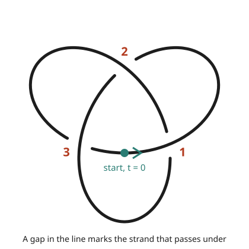

# Knots and links: closed loops in space, their flat diagrams, and what an invariant is

[Syllabus](../../../SYLLABUS.md) → [Topology](../README.md) → [Surfaces and Manifolds](../README.md#s03) → Knots and links

---

## General Overview

Tie an overhand knot in a rope, then splice the two ends together. The rope is now a closed loop with the knot trapped in it. Shake it, stretch it, twist it: the knot never comes out, because there is no free end to pull through.

Lay the loop flat and look down. The rope crosses itself in 3 places, and a gap in a drawing shows which strand lies underneath. That drawing is the **trefoil**, the simplest real knot, and the example on this card.

Knot theory asks whether one loop can be moved into another without cutting. A loop that can be laid out as a plain circle is the **unknot**. Loops are told apart by an **invariant**: a value every drawing of the same knot shares.

**A knot is a closed loop in space, studied through flat drawings with over and under marked at each crossing; an invariant is a value shared by all drawings of the same knot, so a difference in an invariant proves two knots different.**

**What kind of fact this is:** definitions, plus two theorems proved in Why it works (even gaps in every diagram's code; a descending diagram is the unknot) which, with an exhaustive check, prove every diagram with two or fewer crossings is the unknot. That the trefoil is knotted is proved on [Reidemeister moves and the three-colour test](07-reidemeister-moves-and-tricolourability.md).

### The picture: the trefoil, read from a start point

<p align="center"></p>

Schematic: one drawing of the trefoil out of endlessly many, plotted from the curve in the code, with crossings at (1.299, −0.750), (0.000, 1.500) and (−1.299, −0.750). Walk from the dot: over at 1, under at 2, over at 3, under at 1, over at 2, under at 3, and home.

---

## The formula

- A **knot** is a closed loop in space that never touches itself, made of finitely many straight pieces or smooth.
- A **link** is several such loops, not touching. Each loop is a **component**.
- Two knots are the **same knot**, written $`K \sim K'`$, when one can be moved into the other through space without the rope passing through itself. This is an equivalence relation, as in Foundations.
- A **diagram** $`D`$ is the knot's shadow on a plane, with a gap in the lower strand at each **crossing**. Exactly two strands meet at each crossing, and they cross rather than touch.
- The **Gauss code** is what you write on one walk round the diagram: each crossing passed, by name, with O for over or U for under. The trefoil reads O1 U2 O3 U1 O2 U3.

An **invariant** is a rule $`I`$ that gives each knot a value and obeys one law:

```math
K \sim K' \;\Longrightarrow\; I(K) = I(K')
```

**Read it aloud:** if two loops are the same knot, the invariant gives them the same value.

Used in reverse: if $`I(K) \neq I(K')`$, the knots differ. The first invariant on every knot table is the **crossing number**:

```math
c(K) = \min_{D \text{ a diagram of } K} \mathrm{cr}(D)
```

**Read it aloud:** the crossing number of a knot is the fewest crossings in any drawing of it.

The picture shows the trefoil's $`c(K) \le 3`$. Why it works proves $`c(K) = 3`$, once the next card shows the trefoil is knotted.

| Symbol | Plain meaning | In our example | Push it up and the answer… |
| --- | --- | --- | --- |
| $`K`$, $`K'`$ | knots: closed loops in space | the trefoil; the unknot | — |
| $`\sim`$ | "is the same knot as" | trefoil $`\not\sim`$ unknot, proved on the next card | — |
| $`D`$ | a diagram: a flat drawing with over and under marked | the picture above | — |
| $`\mathrm{cr}(D)`$ | crossings in one diagram | 3; or 4 with an extra kink | the drawing is busier, not the knot |
| $`c(K)`$ | crossing number: fewest crossings over all diagrams | 3 for the trefoil, 0 for the unknot | a more tangled knot |
| $`u(K)`$ | unknotting number: fewest crossing changes, over all diagrams, giving the unknot | 1 for the trefoil | further from the unknot |
| $`I`$ | any invariant | crossing number; number of components | — |
| $`t`$, $`s`$ | position along the loop: $`t`$ from 0 to $`2\pi`$ in the code, $`s`$ from 0 to 1 in the staircase proof | 0 at the start dot | further round the walk |
| $`n`$ | crossings in the diagrams counted | 1, 2, 3 | more codes to test |
| O, U | over, under, at one passage through a crossing | O1 U2 O3 U1 O2 U3 | — |
| $`K_1 \# K_2`$ | connected sum: two knots cut open, ends joined | two trefoils: the granny knot | — |
| $`x`$, $`L_1`$, $`L_2`$, $`p`$, $`h`$, $`a(h)`$, $`b(h)`$ | in the proof folds: a crossing, and the two closed curves the walk splits into there; the start point, a height, and the points at height $`h`$ on the downhill walk and on the climb back | crossing 1; the start dot | — |

### When it holds

- **The loop is tame.** A wild loop, with infinitely many shrinking tangles piled toward one point, has no diagram with finitely many crossings.
- **The diagram is in general position.** Where three strands meet, or two only touch, there is no clear Gauss code.
- **Over and under are marked.** Of the 8 ways to mark the trefoil's shadow, 6 give the unknot.
- **An invariant must survive every move between drawings.** Agreeing on a few drawings proves nothing; [Reidemeister moves and the three-colour test](07-reidemeister-moves-and-tricolourability.md) reduces every move to three local ones.
- **Equal values prove nothing.** The unknot and the trefoil each have 1 component.

---

## Why it works

### Step 0: one knot has endless drawings, so compare values

The trefoil can be drawn with 3 crossings, or with 4 after adding a small twist, so drawings that look different prove nothing. An invariant gives one value to all drawings of a knot, so different values rule out any move between them, as the [Euler characteristic](04-euler-characteristic-and-triangulations.md) does for surfaces.

### Step 1: reading a diagram as a Gauss code

Walk once round from a start point, naming crossings 1, 2, 3 in the order first reached and writing O or U at each pass. Each crossing is passed twice, once over and once under, so $`n`$ crossings give $`2n`$ letters: 6 for the trefoil. Its O and U alternate all the way round: it is **alternating**.

### Step 2: every crossing has an even gap

Count the letters between the two visits to one crossing: for crossing 1 of the trefoil, U2 and O3, so 2. Every diagram drawn on a plane has even gaps, by the parity argument of the [Jordan curve theorem](05-jordan-curve-theorem.md): two closed curves in a plane that cross rather than touch cross an even number of times.

<details>
<summary>Detailed proof: the gap between two visits is even</summary>

Fix a crossing $`x`$. The walk from the first visit to $`x`$ to the second traces a closed curve $`L_1`$, and the rest traces a closed curve $`L_2`$. They touch at $`x`$ without crossing; push them apart there.

Each letter in the gap is a crossing met on $`L_1`$: twice for a self-crossing of $`L_1`$, once for a crossing with $`L_2`$. So the gap is twice the self-crossings of $`L_1`$, plus the crossings between $`L_1`$ and $`L_2`$.

The parity argument colours the plane off $`L_1`$ in two colours, so that crossing $`L_1`$ once switches colour; the ray-counting argument on the Jordan card works for a curve with finitely many self-crossings too. A walk round $`L_2`$ ends on its starting colour, so it crosses $`L_1`$ an even number of times. The gap is even.

</details>

So codes with an odd gap, such as 1 2 1 2, have no drawing.

### Step 3: a descending diagram is the unknot

A diagram is **descending** if, from some start and in some direction, you meet every crossing first on the over strand. Such a diagram is always the unknot.

The idea: let the rope run steadily downhill along the walk, then climb straight back to the start. Each crossing's first visit is higher, so passes over, as the diagram says. Level lines from the downhill part to the climb sweep out a disc with the loop as its rim, and the loop shrinks across it.

<details>
<summary>Detailed proof: the staircase disc</summary>

Let the walk from the start $`p`$ take time $`s`$ from 0 to 1, and lift the point reached at time $`s`$ to height $`1 - s`$. The diagram is descending from $`p`$, so each crossing's first visit is higher than its second, and the space curve has exactly this diagram. Close it with the vertical segment from height 0 up to height 1 above $`p`$.

At each height $`h`$ the curve meets the level in one point $`a(h)`$ on the downhill part and one point $`b(h)`$ on the vertical segment. Segments from $`a(h)`$ to $`b(h)`$ at different heights are disjoint, so their union is an embedded disc whose boundary is the knot. Shrinking across the disc carries the knot to a small round loop beside the vertical segment, so the knot is the unknot.

</details>

The trefoil is not descending: from every start, some crossing is met under first. The hypothesis fails, and the next card shows the conclusion fails too.

### Step 4: every diagram with 0, 1 or 2 crossings is the unknot

List every Gauss code with $`n`$ crossings, keep those with even gaps (every real diagram is among them, by Step 2), try all $`2^n`$ markings of over and under, and run two tests:

- **Test A:** is the diagram descending (Step 3)?
- **Test B:** delete **kinks**, a crossing visited twice in a row. A kink is a small twist in the rope, removed by R1, the kink move, on [Reidemeister moves and the three-colour test](07-reidemeister-moves-and-tricolourability.md). If the code empties, the diagram is the unknot.

| $`n`$ | Codes | Even gaps | Diagrams | Descending | Untwist by kinks | Either |
| --- | --- | --- | --- | --- | --- | --- |
| 1 | 1 | 1 | 2 | 2 | 2 | 2 |
| 2 | 6 | 4 | 16 | 16 | 16 | 16 |
| 3 | 90 | 36 | 288 | 240 | 240 | 276 |

With 1 or 2 crossings, both tests pass every diagram. This exhaustive check, with Steps 2 and 3, proves that every knot diagram with at most 2 crossings is the unknot.

With 3 crossings, 12 diagrams pass neither test. All have code shape abcabc and alternate: the trefoil's shadow, read from different starts or renamed, marked as the trefoil or its mirror image.

### Step 5: what this proves about the trefoil

- **Crossing number.** The drawing gives $`c \le 3`$, and Step 4 rules out 2 or fewer for any knotted loop. So $`c = 3`$ once the next card proves the trefoil knotted.
- **Unknotting number.** Changing any one of the 3 crossings makes the diagram descending, so $`u \le 1`$; and $`u = 1`$ once the trefoil is knotted.
- **Why the crossing number is an invariant.** If $`K' \sim K`$, they have the same diagrams, so the same minimum.

### Step 6: links, sums, and what this card leaves out

**Links.** The **Hopf link** is two rings hooked once; its diagram has 2 crossings, both between the rings. Moving never cuts or joins loops, so the number of components, 2, is an invariant. Whether the rings can be pulled apart is answered by the linking number on the next card.

**Sums.** The connected sum $`K_1 \# K_2`$ cuts two knots open and joins their ends. Two trefoils make the granny knot, written here as a 6-crossing Gauss code; adding the unknot changes nothing. A knot is **prime** when it is not a sum of two knotted knots; the trefoil is prime, as Lickorish, in Sources, proves. Whether crossing numbers always add under $`\#`$ is unproved as of 2026-11-14, though proved for alternating knots; Lackenby proved the sum keeps at least a fixed fraction.

**Left out.** Polynomials start on [Knot polynomials in outline](08-knot-polynomials-in-outline.md). The HOMFLY polynomial, Khovanov homology, braid groups, Seifert genus and hyperbolic volume have no card here; Lickorish, in Sources, treats the first and fourth.

---

## Worked numbers, by hand

| Step | Arithmetic | Value |
| --- | --- | --- |
| crossings in the drawing | count the points where the shadow crosses itself | 3 |
| walk from the start dot | name crossings by first visit; note O or U | O1 U2 O3 U1 O2 U3 |
| even gaps | letters between the two visits to 1, 2, 3 | 2, 2, 2 |
| descending as drawn? | from any start, some crossing is first met under | no |
| all markings of the shadow | 2 choices at each of 3 crossings: 2 × 2 × 2 | 8 |
| descending markings | over at 3 passages in a row: one for each of 6 start positions | 6 |
| change one crossing | each of 1, 2, 3 alone: descending afterwards | yes, yes, yes |
| crossing number | at most 3 here; at least 3 by Step 4 and the next card | **3** |

Once the next card proves the trefoil knotted: it needs 3 crossings, and changing 1 unties it.

### What breaks if you drop a piece

| Mistake | Comes out at | What went wrong |
| --- | --- | --- |
| One drawing's crossings used as an invariant | unknot 0, or 1 with a kink; trefoil 3, or 4 | One knot, two values; only the minimum is invariant |
| Equal values read as "same knot" | loops: unknot 1, trefoil 1 | Equal values prove nothing |
| Shadow read without over and under | 6 of 8 markings are the unknot | The shadow does not decide the knot |
| "Not descending" read as "knotted" | 3 crossings: 240 of 288 descending, 276 untie | Descending is sufficient, not necessary |

The checks print every number in this table. The loop counts are read off how many curves each example is built from, not computed.

---

## Code, from first principles, and it actually runs

Road 1 builds the trefoil in space, $`(\sin t + 2\sin 2t,\ \cos t - 2\cos 2t,\ \sin 3t)`$ for $`t`$ from 0 to $`2\pi`$, in 720 straight pieces, finds the shadow's crossings, compares heights, and must reproduce the hand-read Gauss code. Road 2 sees only codes and runs two independent unknot tests, descending and kink deletion, which must agree up to 2 crossings; the 6 descending markings are also counted as O on 3 passages in a row. Up to 2 crossings the check is exhaustive, so a proof with Steps 2 and 3; at 3 it is a census of 288 diagrams.

### Python

```python
# Knots and invariants in outline -- the check behind the card.  Standard
# library only.  Road 1 builds the trefoil as a closed curve in space, looks
# down on it, and reads the diagram: its crossings, their order, over or under.
# Road 2 works with that reading alone, a Gauss code, and tests every choice
# of over and under two ways for a proof that the loop is the unknot.
from itertools import permutations, product
from math import cos, sin, pi

STEPS = 720                                       # straight pieces per loop
trefoil = lambda t: (sin(t) + 2 * sin(2 * t), cos(t) - 2 * cos(2 * t), sin(3 * t))
ring_a = lambda t: (cos(t), sin(t), 0.0)          # the Hopf link: two rings,
ring_b = lambda t: (1 + cos(t), 0.3 * sin(t), sin(t))   # hooked through each other once

def crossings(loops):
    """Every point where two pieces cross, seen from above, with heights."""
    pts = [[f(2 * pi * k / STEPS) for k in range(STEPS)] for f in loops]
    segs = [(c, k) for c in range(len(loops)) for k in range(STEPS)]
    found = []
    for i, (c1, k1) in enumerate(segs):
        p, q = pts[c1][k1], pts[c1][(k1 + 1) % STEPS]
        for c2, k2 in segs[i + 1:]:
            if c1 == c2 and (k2 - k1) % STEPS in (1, STEPS - 1):
                continue                          # neighbours share an end point
            r, s = pts[c2][k2], pts[c2][(k2 + 1) % STEPS]
            d = (q[0] - p[0]) * (s[1] - r[1]) - (q[1] - p[1]) * (s[0] - r[0])
            if d == 0:
                continue
            u = ((r[0] - p[0]) * (s[1] - r[1]) - (r[1] - p[1]) * (s[0] - r[0])) / d
            v = ((r[0] - p[0]) * (q[1] - p[1]) - (r[1] - p[1]) * (q[0] - p[0])) / d
            if 0 <= u < 1 and 0 <= v < 1:
                z1, z2 = p[2] + u * (q[2] - p[2]), r[2] + v * (s[2] - r[2])
                xy = (p[0] + u * (q[0] - p[0]), p[1] + u * (q[1] - p[1]))
                found.append((c1, k1 + u, c2, k2 + v, z1 > z2, xy))
    return found

def gauss_code(found):
    """Walk the loop from t = 0; name crossings 1, 2, 3 in order of first visit."""
    visits = sorted([(f[1], f[4], n) for n, f in enumerate(found)]
                    + [(f[3], not f[4], n) for n, f in enumerate(found)])
    names = {}
    for _, _, n in visits:
        names.setdefault(n, len(names) + 1)
    return [(names[n], up) for _, up, n in visits], names

def show(word):
    return " ".join(("O" if up else "U") + str(c) for c, up in word)

def descending(word):
    """Road A: some start and direction meets every crossing first as over."""
    n = len(word)
    for start, step in product(range(n), (1, -1)):
        seen, ok = set(), True
        for j in range(n):
            c, up = word[(start + step * j) % n]
            if c not in seen:
                seen.add(c)
                ok = ok and up
        if ok:
            return True
    return n == 0

def untwists(word):
    """Road B: delete kinks (a crossing visited twice in a row) until none is left."""
    word = list(word)
    while word:
        n = len(word)
        hit = [i for i in range(n) if word[i][0] == word[(i + 1) % n][0]]
        if not hit:
            return False
        word = [w for j, w in enumerate(word) if j not in (hit[0], (hit[0] + 1) % n)]
    return True

def gaps(word):                                   # letters between a crossing's two visits
    pos = {}
    for i, (c, _) in enumerate(word):
        pos.setdefault(c, []).append(i)
    return [pos[c][1] - pos[c][0] - 1 for c in sorted(pos)]

def choose(shadow, pick):                         # over/under: pick says first visit is over
    seen = {}
    return [(c, pick[c - 1] == (seen.setdefault(c, k) == k)) for k, c in enumerate(shadow)]

alternating = lambda w: all(w[i][1] != w[(i + 1) % len(w)][1] for i in range(len(w)))
yn = lambda claim: "yes" if claim else "no"

tre = crossings([trefoil])
code, names = gauss_code(tre)
hopf = crossings([ring_a, ring_b])
between = sum(1 for f in hopf if f[0] != f[2])
print("Road 1: the trefoil as a curve in space, seen from above")
print(f"crossings in the drawing: {len(tre)}")
print(f"walk from t = 0: {show(code)}")
print(f"over and under alternate: {yn(alternating(code))}")
spots = sorted((names[n], f[5]) for n, f in enumerate(tre))
print("figure, " + ", ".join(f"crossing {c} at ({x:.3f}, {y:.3f})" for c, (x, y) in spots))
print(f"Hopf link: 2 loops, crossings between them {between}, of a loop with itself {len(hopf) - between}")
print("Road 2: the Gauss code alone")
print(f"letters between the two visits to crossings 1, 2, 3: {gaps(code)}")
print(f"the trefoil as drawn: descending {yn(descending(code))}, untwists {yn(untwists(code))}")
diagrams = [choose([c for c, _ in code], pick) for pick in product((True, False), repeat=3)]
down = [d for d in diagrams if descending(d)]
stuck = [d for d in diagrams if not descending(d)]
runs = {frozenset((s + j) % 6 for j in range(3)) for s in range(6)}
in_a_row = sum(frozenset(k for k, (_, up) in enumerate(d) if up) in runs for d in diagrams)
print(f"the 8 over/under choices on the trefoil's shadow: {len(down)} descending, {len(stuck)} not")
print(f"over at three passages in a row, counted directly: {in_a_row}")
print(f"the two that are not: {show(stuck[0])} and {show(stuck[1])}; "
      f"both alternate: {yn(all(alternating(d) for d in stuck))}")
flips = [descending([(c, up != (c == x)) for c, up in code]) for x in (1, 2, 3)]
print(f"change crossing 1, 2 or 3 alone, then descending: {', '.join(yn(f) for f in flips)}")
print("every Gauss word, every over/under choice, for n = 1 to 3 crossings:")
census = {}
for n in (1, 2, 3):
    words = sorted(set(permutations([c for c in range(1, n + 1) for _ in (0, 1)])))
    even = [w for w in words if all(g % 2 == 0 for g in gaps([(c, 0) for c in w]))]
    ds = [choose(w, pick) for w in even for pick in product((True, False), repeat=n)]
    dn, kn = [descending(d) for d in ds], [untwists(d) for d in ds]
    census[n] = (len(ds), sum(dn), sum(kn), [d for d, a, b in zip(ds, dn, kn) if not (a or b)])
    print(f"n = {n}: {len(words)} words, {len(even)} pass the even test, {len(ds)} diagrams; "
          f"descending {sum(dn)}, untwist by kinks {sum(kn)}, either {len(ds) - len(census[n][3])}")
left = census[3][3]
abc = all(d[0][0] == d[3][0] and d[1][0] == d[4][0] and d[2][0] == d[5][0] for d in left)
print(f"neither at 3 crossings: {len(left)}, all of shape abcabc: {yn(abc)}, "
      f"all alternating: {yn(all(alternating(d) for d in left))}")
kinked, granny = code + [(4, True), (4, False)], code + [(c + 3, up) for c, up in code]
print(f"kinked trefoil {show(kinked)}: {len(kinked) // 2} crossings, descending {yn(descending(kinked))}")
print(f"granny knot, two trefoils joined: {len(granny) // 2} crossings, descending {yn(descending(granny))}")
print(f"mistake 1, crossings in one drawing: unknot round {len(crossings([ring_a]))}, with one kink {len(gaps([(1, True), (1, False)]))}")
print(f"mistake 2, loops counted: unknot 1, trefoil {len([trefoil])}, Hopf link {len([ring_a, ring_b])}")
print(f"mistake 3, the shadow without over/under: {len(down)} of {len(diagrams)} choices are the unknot")
assert len(tre) == 3 and show(code) == "O1 U2 O3 U1 O2 U3"       # road 1 matches the hand reading
assert alternating(code) and not descending(code) and gaps(code) == [2, 2, 2]
assert len(down) == in_a_row == 6                                 # descending = over three in a row
assert all(flips) and between == 2 and len(hopf) == 2
assert all(census[n][0] == census[n][1] == census[n][2] for n in (1, 2))   # roads A and B agree
assert len(left) == 12 and abc and all(alternating(d) for d in left)
print("ALL CHECKS PASS")
```

**Ran 2026-11-14 on macOS, Python 3.14.10, standard library only. All checks passed. Output, pasted from the run:**

```
Road 1: the trefoil as a curve in space, seen from above
crossings in the drawing: 3
walk from t = 0: O1 U2 O3 U1 O2 U3
over and under alternate: yes
figure, crossing 1 at (1.299, -0.750), crossing 2 at (0.000, 1.500), crossing 3 at (-1.299, -0.750)
Hopf link: 2 loops, crossings between them 2, of a loop with itself 0
Road 2: the Gauss code alone
letters between the two visits to crossings 1, 2, 3: [2, 2, 2]
the trefoil as drawn: descending no, untwists no
the 8 over/under choices on the trefoil's shadow: 6 descending, 2 not
over at three passages in a row, counted directly: 6
the two that are not: O1 U2 O3 U1 O2 U3 and U1 O2 U3 O1 U2 O3; both alternate: yes
change crossing 1, 2 or 3 alone, then descending: yes, yes, yes
every Gauss word, every over/under choice, for n = 1 to 3 crossings:
n = 1: 1 words, 1 pass the even test, 2 diagrams; descending 2, untwist by kinks 2, either 2
n = 2: 6 words, 4 pass the even test, 16 diagrams; descending 16, untwist by kinks 16, either 16
n = 3: 90 words, 36 pass the even test, 288 diagrams; descending 240, untwist by kinks 240, either 276
neither at 3 crossings: 12, all of shape abcabc: yes, all alternating: yes
kinked trefoil O1 U2 O3 U1 O2 U3 O4 U4: 4 crossings, descending no
granny knot, two trefoils joined: 6 crossings, descending no
mistake 1, crossings in one drawing: unknot round 0, with one kink 1
mistake 2, loops counted: unknot 1, trefoil 1, Hopf link 2
mistake 3, the shadow without over/under: 6 of 8 choices are the unknot
ALL CHECKS PASS
```

### Rust

Same numbers, same labels, built with `rustc --edition 2021 -O`.

```rust
// Knots and invariants in outline -- the same check as the Python, in Rust.  No
// crates.  Road 1 builds the trefoil as a closed curve in space, looks down on
// it, and reads the diagram: its crossings, their order, over or under.  Road 2
// works with that reading alone, a Gauss code, and tests every choice of over
// and under two ways for a proof that the loop is the unknot.
use std::collections::{BTreeMap, BTreeSet};
use std::f64::consts::PI;

const STEPS: usize = 720; // straight pieces per loop
type P3 = (f64, f64, f64);
type Word = Vec<(usize, bool)>; // (crossing name, over?) for each visit in turn
struct Cross { c1: usize, a: f64, c2: usize, b: f64, up: bool, xy: (f64, f64) }

fn trefoil(t: f64) -> P3 { (t.sin() + 2.0 * (2.0 * t).sin(), t.cos() - 2.0 * (2.0 * t).cos(), (3.0 * t).sin()) }
fn ring_a(t: f64) -> P3 { (t.cos(), t.sin(), 0.0) } // the Hopf link: two rings,
fn ring_b(t: f64) -> P3 { (1.0 + t.cos(), 0.3 * t.sin(), t.sin()) } // hooked once

fn crossings(loops: &[fn(f64) -> P3]) -> Vec<Cross> {
    let pts: Vec<Vec<P3>> = loops.iter()
        .map(|f| (0..STEPS).map(|k| f(2.0 * PI * k as f64 / STEPS as f64)).collect()).collect();
    let segs: Vec<(usize, usize)> = (0..loops.len()).flat_map(|c| (0..STEPS).map(move |k| (c, k))).collect();
    let mut found = Vec::new();
    for (i, &(c1, k1)) in segs.iter().enumerate() {
        let (p, q) = (pts[c1][k1], pts[c1][(k1 + 1) % STEPS]);
        for &(c2, k2) in &segs[i + 1..] {
            let gap = (k2 + STEPS - k1) % STEPS;
            if c1 == c2 && (gap == 1 || gap == STEPS - 1) { continue } // neighbours
            let (r, s) = (pts[c2][k2], pts[c2][(k2 + 1) % STEPS]);
            let d = (q.0 - p.0) * (s.1 - r.1) - (q.1 - p.1) * (s.0 - r.0);
            if d == 0.0 { continue }
            let u = ((r.0 - p.0) * (s.1 - r.1) - (r.1 - p.1) * (s.0 - r.0)) / d;
            let v = ((r.0 - p.0) * (q.1 - p.1) - (r.1 - p.1) * (q.0 - p.0)) / d;
            if (0.0..1.0).contains(&u) && (0.0..1.0).contains(&v) {
                let (z1, z2) = (p.2 + u * (q.2 - p.2), r.2 + v * (s.2 - r.2));
                let xy = (p.0 + u * (q.0 - p.0), p.1 + u * (q.1 - p.1));
                found.push(Cross { c1, a: k1 as f64 + u, c2, b: k2 as f64 + v, up: z1 > z2, xy });
            }
        }
    }
    found
}

fn gauss_code(found: &[Cross]) -> (Word, Vec<usize>) { // walk from t = 0, name by first visit
    let mut visits: Vec<(f64, bool, usize)> = Vec::new();
    for (n, f) in found.iter().enumerate() { visits.push((f.a, f.up, n)); visits.push((f.b, !f.up, n)); }
    visits.sort_by(|x, y| x.0.partial_cmp(&y.0).unwrap());
    let mut names = vec![0; found.len()];
    let mut next = 1;
    for v in &visits { if names[v.2] == 0 { names[v.2] = next; next += 1 } }
    (visits.iter().map(|v| (names[v.2], v.1)).collect(), names)
}

fn show(w: &Word) -> String {
    w.iter().map(|&(c, up)| format!("{}{}", if up { "O" } else { "U" }, c)).collect::<Vec<_>>().join(" ")
}

fn descending(w: &Word) -> bool { // road A: some start and direction meets every crossing first as over
    let n = w.len();
    if n == 0 { return true }
    for start in 0..n {
        for back in [false, true] {
            let (mut seen, mut ok) = (BTreeSet::new(), true);
            for j in 0..n {
                let (c, up) = w[if back { (start + n * n - j) % n } else { (start + j) % n }];
                if seen.insert(c) { ok = ok && up }
            }
            if ok { return true }
        }
    }
    false
}

fn untwists(w: &Word) -> bool { // road B: delete kinks until none is left
    let mut w = w.clone();
    while !w.is_empty() {
        let n = w.len();
        match (0..n).find(|&i| w[i].0 == w[(i + 1) % n].0) {
            None => return false,
            Some(i) => { let j = (i + 1) % n; w = w.iter().enumerate().filter(|(k, _)| *k != i && *k != j).map(|(_, x)| *x).collect() }
        }
    }
    true
}

fn gaps(w: &[usize]) -> Vec<usize> { // letters between a crossing's two visits
    let mut pos: BTreeMap<usize, Vec<usize>> = BTreeMap::new();
    for (i, &c) in w.iter().enumerate() { pos.entry(c).or_default().push(i) }
    pos.values().map(|p| p[1] - p[0] - 1).collect()
}

fn choose(shadow: &[usize], pick: usize) -> Word { // bit c-1 of pick set: first visit to c is over
    let mut seen = BTreeSet::new();
    shadow.iter().map(|&c| (c, ((pick >> (c - 1)) & 1 == 1) == seen.insert(c))).collect()
}

fn alternating(w: &Word) -> bool { (0..w.len()).all(|i| w[i].1 != w[(i + 1) % w.len()].1) }
fn yn(claim: bool) -> &'static str { if claim { "yes" } else { "no" } }
fn shadow_of(w: &Word) -> Vec<usize> { w.iter().map(|x| x.0).collect() }

fn words(n: usize, prefix: &mut Vec<usize>, used: &mut Vec<usize>, out: &mut Vec<Vec<usize>>) {
    if prefix.len() == 2 * n { out.push(prefix.clone()); return }
    for c in 1..=n {
        if used[c] < 2 { used[c] += 1; prefix.push(c); words(n, prefix, used, out); prefix.pop(); used[c] -= 1 }
    }
}

fn main() {
    let tre = crossings(&[trefoil]);
    let (code, names) = gauss_code(&tre);
    let hopf = crossings(&[ring_a, ring_b]);
    let between = hopf.iter().filter(|f| f.c1 != f.c2).count();
    println!("Road 1: the trefoil as a curve in space, seen from above");
    println!("crossings in the drawing: {}", tre.len());
    println!("walk from t = 0: {}", show(&code));
    println!("over and under alternate: {}", yn(alternating(&code)));
    let mut spots: Vec<(usize, (f64, f64))> = tre.iter().enumerate().map(|(n, f)| (names[n], f.xy)).collect();
    spots.sort_by_key(|s| s.0);
    let spot_text: Vec<String> = spots.iter().map(|(c, (x, y))| format!("crossing {} at ({:.3}, {:.3})", c, x, y)).collect();
    println!("figure, {}", spot_text.join(", "));
    println!("Hopf link: 2 loops, crossings between them {}, of a loop with itself {}", between, hopf.len() - between);
    println!("Road 2: the Gauss code alone");
    println!("letters between the two visits to crossings 1, 2, 3: {:?}", gaps(&shadow_of(&code)));
    println!("the trefoil as drawn: descending {}, untwists {}", yn(descending(&code)), yn(untwists(&code)));
    let diagrams: Vec<Word> = (0..8).rev().map(|p| choose(&shadow_of(&code), p)).collect();
    let down = diagrams.iter().filter(|d| descending(d)).count();
    let stuck: Vec<&Word> = diagrams.iter().filter(|d| !descending(d)).collect();
    let runs: BTreeSet<BTreeSet<usize>> = (0..6).map(|s| (0..3).map(|j| (s + j) % 6).collect()).collect();
    let in_a_row = diagrams.iter()
        .filter(|d| runs.contains(&d.iter().enumerate().filter(|x| x.1 .1).map(|x| x.0).collect())).count();
    println!("the 8 over/under choices on the trefoil's shadow: {} descending, {} not", down, stuck.len());
    println!("over at three passages in a row, counted directly: {}", in_a_row);
    println!("the two that are not: {} and {}; both alternate: {}", show(stuck[0]), show(stuck[1]),
             yn(stuck.iter().all(|d| alternating(d))));
    let flips: Vec<bool> = (1..=3).map(|x| descending(&code.iter().map(|&(c, up)| (c, up != (c == x))).collect())).collect();
    println!("change crossing 1, 2 or 3 alone, then descending: {}", flips.iter().map(|&f| yn(f)).collect::<Vec<_>>().join(", "));
    println!("every Gauss word, every over/under choice, for n = 1 to 3 crossings:");
    let mut census = Vec::new();
    for n in 1..=3usize {
        let mut all = Vec::new();
        words(n, &mut Vec::new(), &mut vec![0; n + 1], &mut all);
        let even: Vec<&Vec<usize>> = all.iter().filter(|w| gaps(w).iter().all(|g| g % 2 == 0)).collect();
        let ds: Vec<Word> = even.iter().flat_map(|w| (0..1usize << n).rev().map(move |p| choose(w, p))).collect();
        let dn = ds.iter().filter(|d| descending(d)).count();
        let kn = ds.iter().filter(|d| untwists(d)).count();
        let left: Vec<Word> = ds.iter().filter(|d| !descending(d) && !untwists(d)).cloned().collect();
        println!("n = {}: {} words, {} pass the even test, {} diagrams; descending {}, untwist by kinks {}, either {}",
                 n, all.len(), even.len(), ds.len(), dn, kn, ds.len() - left.len());
        census.push((ds.len(), dn, kn, left));
    }
    let left = &census[2].3;
    let abc = left.iter().all(|d| d[0].0 == d[3].0 && d[1].0 == d[4].0 && d[2].0 == d[5].0);
    println!("neither at 3 crossings: {}, all of shape abcabc: {}, all alternating: {}",
             left.len(), yn(abc), yn(left.iter().all(alternating)));
    let mut kinked = code.clone();
    kinked.extend([(4, true), (4, false)]);
    let mut granny = code.clone();
    granny.extend(code.iter().map(|&(c, up)| (c + 3, up)));
    println!("kinked trefoil {}: {} crossings, descending {}", show(&kinked), kinked.len() / 2, yn(descending(&kinked)));
    println!("granny knot, two trefoils joined: {} crossings, descending {}", granny.len() / 2, yn(descending(&granny)));
    println!("mistake 1, crossings in one drawing: unknot round {}, with one kink {}", crossings(&[ring_a]).len(), gaps(&[1, 1]).len());
    println!("mistake 2, loops counted: unknot 1, trefoil {}, Hopf link {}", [trefoil].len(), [ring_a, ring_b].len());
    println!("mistake 3, the shadow without over/under: {} of {} choices are the unknot", down, diagrams.len());
    assert!(tre.len() == 3 && show(&code) == "O1 U2 O3 U1 O2 U3"); // road 1 matches the hand reading
    assert!(alternating(&code) && !descending(&code) && gaps(&shadow_of(&code)) == vec![2, 2, 2]);
    assert!(down == 6 && in_a_row == 6); // descending = over three in a row
    assert!(flips.iter().all(|&f| f) && between == 2 && hopf.len() == 2);
    assert!(census[..2].iter().all(|c| c.0 == c.1 && c.1 == c.2)); // roads A and B agree
    assert!(left.len() == 12 && abc && left.iter().all(alternating));
    println!("ALL CHECKS PASS");
}
```

**Ran 2026-11-14 on macOS, rustc 1.98.1, no crates. All checks passed. Output, pasted from the run:**

```
Road 1: the trefoil as a curve in space, seen from above
crossings in the drawing: 3
walk from t = 0: O1 U2 O3 U1 O2 U3
over and under alternate: yes
figure, crossing 1 at (1.299, -0.750), crossing 2 at (0.000, 1.500), crossing 3 at (-1.299, -0.750)
Hopf link: 2 loops, crossings between them 2, of a loop with itself 0
Road 2: the Gauss code alone
letters between the two visits to crossings 1, 2, 3: [2, 2, 2]
the trefoil as drawn: descending no, untwists no
the 8 over/under choices on the trefoil's shadow: 6 descending, 2 not
over at three passages in a row, counted directly: 6
the two that are not: O1 U2 O3 U1 O2 U3 and U1 O2 U3 O1 U2 O3; both alternate: yes
change crossing 1, 2 or 3 alone, then descending: yes, yes, yes
every Gauss word, every over/under choice, for n = 1 to 3 crossings:
n = 1: 1 words, 1 pass the even test, 2 diagrams; descending 2, untwist by kinks 2, either 2
n = 2: 6 words, 4 pass the even test, 16 diagrams; descending 16, untwist by kinks 16, either 16
n = 3: 90 words, 36 pass the even test, 288 diagrams; descending 240, untwist by kinks 240, either 276
neither at 3 crossings: 12, all of shape abcabc: yes, all alternating: yes
kinked trefoil O1 U2 O3 U1 O2 U3 O4 U4: 4 crossings, descending no
granny knot, two trefoils joined: 6 crossings, descending no
mistake 1, crossings in one drawing: unknot round 0, with one kink 1
mistake 2, loops counted: unknot 1, trefoil 1, Hopf link 2
mistake 3, the shadow without over/under: 6 of 8 choices are the unknot
ALL CHECKS PASS
```

The two outputs match line for line.

### Lean

Lean proves Step 4's exhaustive check and the trefoil's numbers, for Gauss codes, not curves in space.

- Take a Gauss code with at most 2 crossings, each passed once over and once under, with even gaps. Then it is descending.
- The trefoil as drawn, O1 U2 O3 U1 O2 U3, is not descending. From every start, in either direction, some crossing is met under first.
- Of the 8 ways to mark over and under on the trefoil's shadow, exactly 6 are descending.
- The trefoil's code alternates and has even gaps, and changing any one crossing makes it descending.
- The table's first two rows hold: 2 diagrams with 1 crossing, and 6 codes and 16 diagrams with 2 crossings.

The curve in space, the kink test, the 3-crossing census, links and sums are left to the Python and Rust checks.

```lean
-- Knots and links: every Gauss-code knot diagram with at most two crossings and even gaps is descending, the trefoil's diagram is not, and 6 of the 8 over-under markings of the trefoil's shadow are descending.
import Mathlib.Data.Fintype.Card
import Mathlib.Data.Fintype.Pi
import Mathlib.Data.Fintype.Prod
import Mathlib.Data.Fin.VecNotation
import Mathlib.Logic.Equiv.Fin.Rotate
import Mathlib.Algebra.Group.Nat.Even
import Mathlib.Tactic.NormNum

/-! Mathlib has no knot theory, so the card's combinatorial objects are defined here.
A knot diagram with `n` crossings is read on one walk as a Gauss code: passage `k` of the
`2n` passages gives the crossing's name and `true` for over (O), `false` for under (U).
The topology (a descending diagram is the unknot; real diagrams have even gaps) is proved
on the card in words; this file checks the finite, exhaustive part of Step 4 and the
trefoil's numbers. -/

/-- A diagram with `n` crossings as a Gauss code: `2n` passages, each a crossing and O or U. -/
abbrev GaussDiagram (n : ℕ) := Fin (2 * n) → Fin n × Bool

namespace GaussDiagram

variable {n : ℕ}

/-- Each crossing is passed exactly twice: once over and once under. -/
def IsValid (d : GaussDiagram n) : Prop :=
  ∀ c : Fin n, ∀ b : Bool, (Finset.univ.filter fun k => d k = (c, b)).card = 1

/-- Even gaps: between the two visits to one crossing lie an even number of letters. -/
def HasEvenGaps (d : GaussDiagram n) : Prop :=
  ∀ i j : Fin (2 * n), i < j → (d i).1 = (d j).1 → Even (j.val - i.val - 1)

/-- The passage reached at step `j` of a walk from passage `start`, forwards or backwards. -/
def walkPos (start : Fin (2 * n)) (back : Bool) (j : Fin (2 * n)) : Fin (2 * n) :=
  if back then start - j else start + j

/-- Descending: from some start, in some direction, every crossing is first met on the over
strand. The empty diagram (no crossings) counts as descending. -/
def IsDescending (d : GaussDiagram n) : Prop :=
  n = 0 ∨ ∃ start : Fin (2 * n), ∃ back : Bool, ∀ j : Fin (2 * n),
    (∀ i : Fin (2 * n), i < j → (d (walkPos start back i)).1 ≠ (d (walkPos start back j)).1) →
      (d (walkPos start back j)).2 = true

/-- Alternating: over and under alternate all the way round the walk. -/
def IsAlternating (d : GaussDiagram n) : Prop :=
  ∀ k : Fin (2 * n), (d k).2 ≠ (d (finRotate (2 * n) k)).2

instance (d : GaussDiagram n) : Decidable d.IsValid := by unfold IsValid; infer_instance
instance (d : GaussDiagram n) : Decidable d.HasEvenGaps := by unfold HasEvenGaps; infer_instance
instance (d : GaussDiagram n) : Decidable d.IsDescending := by unfold IsDescending; infer_instance
instance (d : GaussDiagram n) : Decidable d.IsAlternating := by unfold IsAlternating; infer_instance

/-- Mark a shadow (the crossing names along the walk) with over and under:
`pick c = true` says the first visit to crossing `c` is over. -/
def ofShadow (w : Fin (2 * n) → Fin n) (pick : Fin n → Bool) : GaussDiagram n :=
  fun k => (w k, pick (w k) == decide (∀ i : Fin (2 * n), i < k → w i ≠ w k))

/-- Change one crossing: swap over and under at both visits to crossing `x`. -/
def flip (d : GaussDiagram n) (x : Fin n) : GaussDiagram n :=
  fun k => ((d k).1, if (d k).1 = x then !(d k).2 else (d k).2)

end GaussDiagram

open GaussDiagram

/-- The trefoil's shadow, read from the start dot: crossings 1 2 3 1 2 3 (named 0, 1, 2). -/
def trefoilShadow : Fin (2 * 3) → Fin 3 := ![0, 1, 2, 0, 1, 2]

/-- The trefoil as drawn on the card: O1 U2 O3 U1 O2 U3 (crossings named 0, 1, 2). -/
def trefoil : GaussDiagram 3 :=
  ![(0, true), (1, false), (2, true), (0, false), (1, true), (2, false)]

/-- Step 4, the exhaustive check: every Gauss-code diagram with at most 2 crossings, each
crossing passed once over and once under, with even gaps, is descending (so, by Step 3,
the unknot). -/
theorem diagram_with_at_most_two_crossings_is_descending (n : ℕ) (hn : n ≤ 2)
    (d : GaussDiagram n) (hd : d.IsValid) (he : d.HasEvenGaps) : d.IsDescending := by
  revert d
  rcases (by omega : n = 0 ∨ n = 1 ∨ n = 2) with rfl | rfl | rfl
  · intro d _ _; exact Or.inl rfl
  · set_option maxRecDepth 100000 in decide
  · set_option maxRecDepth 100000 in decide

/-- The trefoil as drawn is not descending: from every start, in either direction, some
crossing is met under first. -/
theorem trefoil_not_descending : ¬ trefoil.IsDescending := by
  decide

/-- Of the 8 ways to mark over and under on the trefoil's shadow, exactly 6 are descending. -/
theorem trefoil_shadow_six_of_eight_markings_descending :
    (Finset.univ.filter fun pick : Fin 3 → Bool =>
      (ofShadow trefoilShadow pick).IsDescending).card = 6 := by
  decide

-- The trefoil's diagram is a valid Gauss code, alternates, and has even gaps (2, 2, 2).
example : trefoil.IsValid ∧ trefoil.IsAlternating ∧ trefoil.HasEvenGaps := by decide

-- The card's trefoil is the shadow marked over first at crossings 1 and 3, under first at 2.
example : ofShadow trefoilShadow ![true, false, true] = trefoil := by decide

-- All markings of the trefoil's shadow: 2 × 2 × 2 = 8.
example : Fintype.card (Fin 3 → Bool) = 8 := by decide

-- Changing any one of the 3 crossings makes the trefoil's diagram descending.
example : ∀ x : Fin 3, (trefoil.flip x).IsDescending := by decide

-- Census, n = 1: 1 code, 1 with even gaps, 2 diagrams.
example : (Finset.univ.filter fun d : GaussDiagram 1 => d.IsValid ∧ d.HasEvenGaps).card = 2 := by
  decide

-- Census, n = 2: 6 codes, 4 with even gaps, 16 diagrams.
example : (Finset.univ.filter fun w : Fin (2 * 2) → Fin 2 =>
    ∀ c, (Finset.univ.filter fun k => w k = c).card = 2).card = 6 := by decide
example : (Finset.univ.filter fun d : GaussDiagram 2 => d.IsValid ∧ d.HasEvenGaps).card = 16 := by
  decide

-- Census, n = 3: 36 codes with even gaps, each with 2 ^ 3 markings, give 288 diagrams.
example : 36 * 2 ^ 3 = 288 := by norm_num

#print axioms diagram_with_at_most_two_crossings_is_descending
#print axioms trefoil_not_descending
#print axioms trefoil_shadow_six_of_eight_markings_descending
```

**Checked 2026-11-15 on macOS, Lean 4.36.0-rc2, Mathlib v4.36.0-rc2. Every proof is complete and uses only Lean's standard axioms. Output, pasted from the run:**

```
'diagram_with_at_most_two_crossings_is_descending' depends on axioms: [propext, Classical.choice, Quot.sound]
'trefoil_not_descending' depends on axioms: [propext, Quot.sound]
'trefoil_shadow_six_of_eight_markings_descending' depends on axioms: [propext, Classical.choice, Quot.sound]
```

> [!TIP]
> **Try changing**
> Guess first, then run it.
> - **Coarser rope.** Set `STEPS = 60`. Still 3 crossings? Yes, with the same code; the crossings move by about 0.01.
> - **The mirror image.** In `trefoil`, change `sin(3 * t)` to `-sin(3 * t)`. Every O and U swaps, U1 O2 U3 O1 U2 O3, and the first assert stops the run.
> - **A different knot.** Replace the trefoil with `((2 + cos(2 * t)) * cos(3 * t), (2 + cos(2 * t)) * sin(3 * t), sin(4 * t))`, the figure-eight knot. How many crossings? 4, alternating: O1 U2 O3 U1 O4 U3 O2 U4. The run then stops, because later lines assume 3 crossings.
> - **Four crossings.** Change `for n in (1, 2, 3)` to `(1, 2, 3, 4)`. All cleared? No: 8256 of 9216 pass a test; the rest include the figure-eight knot.

---

## The usual mistake

> [!warning]
> **Counting crossings in one drawing and calling it the crossing number.** A drawing's count changes with every extra twist: the unknot has 0 drawn round and 1 with a kink; the trefoil has 3, or 4 with a kink. Only the minimum over all drawings is an invariant, and a minimum needs a proof that no smaller drawing exists.
>
> - **Equal values read as "same knot".** The unknot and the trefoil both have 1 loop. An invariant can only prove knots different.
> - **Ignoring over and under.** On the trefoil's shadow, 6 of the 8 markings are the unknot.
> - **"Not descending" read as "knotted".** At 3 crossings, 240 of 288 diagrams are descending, yet 276 are shown to be the unknot. Failing a sufficient test proves nothing.

---

## Where you meet it in real life

- **DNA in cells.** Enzymes called topoisomerases pass one DNA strand through another: a crossing change. Knotted DNA rings of one length separate on a gel by knot type (Stasiak and colleagues).
- **Tangled cords.** A string tumbled in a box for 10 seconds often comes out knotted. Raymer and Smith named each knot by an invariant computed from a photo; higher crossing numbers were steeply rarer.
- **Knotted proteins.** Some protein chains fold into a knot; Taylor found a deep figure-eight knot in one.
- **Ropes.** The granny knot and the reef knot are both sums of two trefoils, with the ends closed off. In the reef knot the two trefoils are mirror images; in the granny they are not.

> **Say it back**
> A knot is a closed loop in space, studied through a flat diagram with over and under marked, read as a Gauss code on one walk. An invariant is a value all drawings of one knot share: different values prove knots different, equal values prove nothing. A descending diagram is the unknot, and so is every diagram with two or fewer crossings. Once the next card proves the trefoil knotted, its crossing number is 3 and its unknotting number 1.

---

## What this builds on

- [Jordan curve theorem](05-jordan-curve-theorem.md): the parity argument that a closed curve splits the plane into two colours, which makes every gap in a Gauss code even.

## Where this goes next

- [Reidemeister moves and the three-colour test](07-reidemeister-moves-and-tricolourability.md): three local moves connect all diagrams of one knot, and a colouring count that survives them proves the trefoil is knotted.
- [Knot polynomials in outline](08-knot-polynomials-in-outline.md): one rule at each crossing turns a diagram into a polynomial, an invariant that tells many more knots apart.

The question this card leaves open: the trefoil's diagram fails every unknot test here, but failing a test is not a proof, so which invariant shows it really is knotted?

---

## Sources

Verified 2026-11-14: every link below resolves to the publisher's page.

- Lickorish, W. B. Raymond. *An Introduction to Knot Theory*. Springer, Graduate Texts in Mathematics 175, 1997. [doi:10.1007/978-1-4612-0691-0](https://doi.org/10.1007/978-1-4612-0691-0). Knots, diagrams, connected sums, prime knots and the classical invariants.
- Lackenby, Marc. "The crossing number of composite knots." *Journal of Topology* 2 (2009): 747–768. [doi:10.1112/jtopol/jtp028](https://doi.org/10.1112/jtopol/jtp028). A sum's crossing number is at least a fixed fraction of the total.
- Stasiak, Andrzej, Vsevolod Katritch, Jan Bednar, and others. "Electrophoretic mobility of DNA knots." *Nature* 384 (1996): 122. [doi:10.1038/384122a0](https://doi.org/10.1038/384122a0). Knotted DNA rings sorted by knot type on a gel.
- Raymer, Dorian M., and Douglas E. Smith. "Spontaneous knotting of an agitated string." *Proceedings of the National Academy of Sciences* 104 (2007): 16432–16437. [doi:10.1073/pnas.0611320104](https://doi.org/10.1073/pnas.0611320104). Tumbled-string knots, named by an invariant computed from photos.
- Taylor, William R. "A deeply knotted protein structure and how it might fold." *Nature* 406 (2000): 916–919. [doi:10.1038/35022623](https://doi.org/10.1038/35022623). A protein chain that forms a deep knot.
