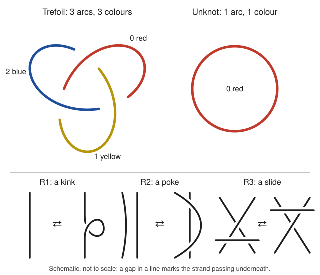

# Reidemeister moves and the three-colour test: proof that the trefoil cannot be untied

[Syllabus](../../../SYLLABUS.md) → [Topology](../README.md) → [Surfaces and Manifolds](../README.md#s03) → Reidemeister moves and the three-colour test

---

## General Overview

Tie an overhand knot in a 2-metre rope and splice the ends together into one closed loop. Laid flat, it shows 3 crossings, where the rope passes over itself. This knot is the **trefoil**. Next to it, lay a second loop with no knot at all: a plain ring, the **unknot**.

Can the trefoil loop be slid and stretched, without cutting, until it lies flat as a plain ring? Failing to do it proves nothing. This card gives a proof, and the proof is a colouring puzzle with 3 pens.

Break the drawing of a knot into **arcs**: the unbroken pieces of rope you see from above. An arc runs from one place where the rope dives under another piece to the next such place. The trefoil drawing has 3 arcs. Now colour each arc red, yellow or blue, by one rule: at every crossing, the three arcs that meet there are all the same colour or all different. The trefoil has 9 legal colourings. The plain ring has 1 arc and only 3, one per pen.

Any motion of a loop in space changes its drawing by a chain of three small local changes, the **Reidemeister moves**. None of the three changes the count of colourings. So the count belongs to the loop, not the drawing, and 9 is not 3. The same argument shows that the **linking number** of two loops, a signed count of how many times one winds round the other, never changes either.

**Count the legal three-colourings of a knot's drawing; each of the three Reidemeister moves leaves the count unchanged, so drawings with different counts are different knots, and the trefoil's 9 against the unknot's 3 proves the trefoil cannot be untied.**

**What kind of fact this is:** a theorem. That each move keeps the count of colourings and the linking number is proved on this card in Why it works. That the three moves connect every pair of drawings of one knot is Reidemeister's theorem, stated with its key steps and a source, not proved here.

<p align="center"></p>

The figure is schematic. A gap in a line marks the strand passing underneath. The trefoil is traced from a curve in space; its crossings sit at (0, 3/2), (1.299, −0.750) and (−1.299, −0.750), with the strands at heights +0.726 and −0.726.

---

## The formula

Notation first, in words. A **knot** is a closed loop in space that does not cross itself; a **link** is several such loops, its **components**. A **diagram** $`D`$ is a drawing of it on a flat table, with a gap where a strand passes under. These terms are set up on [Knots and links](06-knots-and-invariants-in-outline.md), with the **invariant**: a number that every diagram of one knot shares.

Name the colours by numbers: red 0, yellow 1, blue 2. Write $`c`$ for the colour of an arc. At a crossing, $`c_{\text{over}}`$ is the colour of the arc on top, and $`c_1`$, $`c_2`$ are the colours of the two arcs that end there, underneath. The sign $`\equiv \pmod 3`$ means "equal after removing whole multiples of 3", as on a 3-hour clock: $`-3 \equiv 0`$.

```math
2\,c_{\text{over}} - c_1 - c_2 \equiv 0 \pmod 3 \qquad \text{at every crossing}
```

**Read it aloud:** twice the over colour, minus the two under colours, leaves no remainder when divided by 3.

This rule says the same as "all three the same or all three different". If two colours match, the rule forces the third to match too. Three different colours are 0, 1 and 2 in some order, and $`2 \cdot 0 - 1 - 2 = -3`$, a multiple of 3.

A **colouring** is a choice of colour for every arc that passes the rule at every crossing. $`T(D)`$ counts them. The rules are equations mod 3: $`n`$ unknowns, one per arc, and one equation per crossing. Arithmetic mod 3 allows division, so elimination works as usual. If $`r`$ equations are independent, $`n - r`$ colours are free:

```math
T(D) = 3^{\,n - r}
```

**Read it aloud:** the number of colourings is 3 raised to the number of free choices, arcs minus independent rules.

A diagram is **tricolourable** when $`T(D) > 3`$: some colouring uses more than one colour. The theorem of this card:

```math
D \text{ and } D' \text{ differ by Reidemeister moves} \;\Rightarrow\; T(D) = T(D')
```

**Read it aloud:** two diagrams joined by a chain of moves have the same number of colourings.

For a link of two components $`K_1`$ and $`K_2`$, give each loop a direction of travel. Each crossing then gets a **sign** $`\varepsilon`$: $`+1`$, a right-handed crossing, if the under strand passes from right to left as seen walking along the over strand; $`-1`$, left-handed, otherwise. The **linking number** adds the signs of the crossings between the two loops and halves the total:

```math
\mathrm{lk}(K_1, K_2) = \tfrac12 \sum_{\text{crossings of } K_1 \text{ with } K_2} \varepsilon
```

**Read it aloud:** count the crossings where one loop meets the other, plus one for each right-handed and minus one for each left-handed, then halve.

| Symbol | Plain meaning | In our example | Push it up and the answer… |
| --- | --- | --- | --- |
| $`D`$ | a diagram: a drawing with gaps at under-crossings | the trefoil's 3-crossing drawing | — |
| $`n`$ | the number of arcs in $`D`$ | 3 for the trefoil, 1 for the ring | more unknowns to colour |
| $`c`$ | the colour of an arc: 0 red, 1 yellow, 2 blue | 0, 1, 2 on the trefoil's arcs | — |
| $`c_{\text{over}}`$, $`c_1`$, $`c_2`$ | colours at one crossing: the top arc, the two under arcs | 0 over 1 and 2 | — |
| $`\equiv \pmod 3`$ | equal after removing multiples of 3 | $`-3 \equiv 0`$ | — |
| $`r`$ | how many crossing rules are independent | 1 for the trefoil | fewer colourings |
| $`T(D)`$ | the number of colourings | 9 for the trefoil, 3 for the ring | — |
| $`K_1`$, $`K_2`$ | the two loops of a link | the two rings of the Hopf link, two rings linked once | — |
| $`\varepsilon`$ | the sign of a crossing, $`+1`$ or $`-1`$ | $`+1`$ at both Hopf crossings | — |
| $`\mathrm{lk}(K_1, K_2)`$ | the linking number | 1 for the Hopf link, 0 for two separate rings | more times one loop winds round the other |

### When it holds

- **Closed loops only.** A rope with free ends can always be slid apart, so any knot in it comes undone. The invariants talk about loops with the ends joined.
- **A tame knot.** The loop is smooth or made of finitely many straight pieces. A wild knot, with infinitely many ever-smaller tangles, has no finite diagram, and Reidemeister's theorem says nothing about it.
- **A clean diagram.** Exactly two strands meet at each crossing, and they really cross. Three strands through one point leave the arcs undefined; nudge the loop first.
- **The whole rule.** Drop it, or tighten it to "all different", and the count changes under the kink move (What breaks, below).
- **Different counts prove difference; equal counts prove nothing.** The figure-eight knot has 3 colourings, the same as the ring, yet it is knotted: [Knot polynomials in outline](08-knot-polynomials-in-outline.md) tells them apart.

---

## Why it works

### Step 0: a number no move can change belongs to the knot

A knot has endless drawings. Find a number, computed from a drawing, that every legal change of drawing keeps. Then all drawings of one knot share it, and two drawings with different numbers are different knots.

Each move changes only a small disc of the drawing. Counting colourings, not just asking whether one exists, lets the proof look inside that disc and nowhere else.

### Step 1: the three moves are enough (Reidemeister's theorem, stated)

**Reidemeister's theorem:** two diagrams show the same knot exactly when a finite chain of the three moves, plus stretching the drawing without changing its crossings, turns one into the other. Kurt Reidemeister proved it in 1927 (Sources).

The moves are in the figure: **R1** adds or removes a kink with one crossing; **R2** slides one strand over another, adding or removing two crossings; **R3** slides a strand across the crossing of two others. The key steps of the proof, not given in full here:

1. Replace the loop with a polygon of many short straight pieces.
2. Any motion of the loop in space can be broken into **triangle moves**: replace one straight piece by the other two sides of a triangle that touches the loop nowhere else, or the reverse.
3. Seen from above, one small enough triangle move either changes no crossings or does exactly one of R1, R2, R3.

Stretching the drawing keeps its arcs and crossings, so only the three moves need checking.

### Step 2: the count splits into inside and outside

Draw a small disc round the place where a move happens. Strands enter and leave the disc through a few **ends**: 2 for R1, 4 for R2, 6 for R3. Fix a colour on every end. Then the colourings of the whole diagram split into an outside part and an inside part that agree on the ends:

```math
T(D) = \sum_{\text{colours on the ends}} (\text{outside count}) \times (\text{inside count})
```

The move leaves the outside untouched. So if, for every choice of end colours, the inside count is the same before and after the move, the total is the same. Steps 3 to 5 prove exactly that.

### Step 3: R1, the kink

Before the move, the disc holds one plain strand, one arc: its two ends must share a colour. Inside count: 1 if the end colours match, 0 if not.

After the move, the strand comes in as arc $`p`$, loops round, and dives under itself, leaving as arc $`q`$. The crossing has $`p`$ on top and $`p`$, $`q`$ underneath, so the rule reads $`2c_p - c_p - c_q = c_p - c_q \equiv 0`$: the end colours must match. Inside count: again 1 if they match, 0 if not. The kink that passes under first and over second gives the same, with $`q`$ on top.

### Step 4: R2, the poke

Before the move, two separate strands cross the disc. Inside count: 1 if each strand's two ends match, 0 otherwise.

After it, strand $`a`$ lies over strand $`b`$ twice, cutting $`b`$ into $`b_1`$, a short middle arc $`m`$, and $`b_2`$. The two rules are

```math
2c_a - c_{b_1} - c_m \equiv 0, \qquad 2c_a - c_m - c_{b_2} \equiv 0
```

The first fixes $`c_m = 2c_a - c_{b_1}`$, one choice. Subtracting the two gives $`c_{b_2} \equiv c_{b_1}`$. So the after-picture has a colouring exactly when the before-picture does, $`b`$'s ends matching, and then exactly one. The inside counts agree.

### Step 5: R3, the slide

Write the crossing rule as a recipe. An arc of colour $`x`$ that passes under an arc of colour $`y`$ comes out with colour $`2y - x`$. Call the three strands top $`t`$, middle $`m`$ and under $`u`$, by the colours they enter with. The top strand passes over everything, the middle passes over $`u`$ and under $`t`$.

- **Before:** $`u`$ passes under $`m`$, then under $`t`$. It leaves with $`2t - (2m - u) = 2t - 2m + u`$. The middle leaves with $`2t - m`$.
- **After:** $`u`$ passes under $`t`$ first, becoming $`2t - u`$. Then it passes under the middle strand, which has already passed under $`t`$ and now carries $`2t - m`$. It leaves with $`2(2t - m) - (2t - u) = 2t - 2m + u`$. The middle again leaves with $`2t - m`$.

Every colour leaving the disc is the same before and after, and the inside colours are forced by the entering ones. So each choice of end colours has the same inside count, 1 or 0, on both sides. Which strand moves does not matter: naming the strands by height always gives this calculation.

The code also checks every colouring of the ends, 9 for R1, 81 for R2 and 729 for R3. With finitely many colours, that exhaustive check is itself a proof.

### Step 6: the trefoil is knotted

Steps 1 to 5 make $`T`$ a knot invariant. The trefoil diagram has $`T = 9`$ and the ring has $`T = 3`$. If some motion turned the trefoil into the ring, Reidemeister's theorem would give a chain of moves between the two diagrams, and the count could not change. It does, so no such motion exists. A ring with a kink or a poke still counts 3; the trefoil with a kink, 4 arcs and 4 crossings, still counts 9.

### Step 7: the linking number survives the moves too

The linking number counts only crossings between the two loops.

- **R1:** the kink's crossing is a loop crossing itself. It is not counted.
- **R2:** if the two strands belong to different loops, the two new crossings have opposite signs: the under strand passes right to left at one and left to right at the other. They cancel.
- **R3:** the three crossings move but survive, each between the same two strands, with the same strand on top and the same sign. The sum does not change.

The Hopf link, two rings linked once, has two crossings, both $`+1`$: $`\mathrm{lk} = 1`$. Two separate rings have none: $`\mathrm{lk} = 0`$. So the Hopf link cannot be pulled apart.

<details>
<summary>Detailed proof: the linking number is a whole number</summary>

Split the crossings of $`K_1`$ with $`K_2`$ into those where $`K_1`$ is on top and those where $`K_2`$ is. The claim is that the two signed sums are equal, so each is half the total, a whole number.

Forget which strand is on top and look only at the flat picture. At each crossing, $`K_1`$ passes across $`K_2`$ either from the right side of $`K_2`$ to its left side, or the other way; score $`+1`$ or $`-1`$. The sign $`\varepsilon`$ equals this score where $`K_2`$ is on top, and its opposite where $`K_1`$ is on top, since swapping top and bottom flips the handedness. So

$`\displaystyle \sum_{K_2 \text{ on top}} \varepsilon \; - \sum_{K_1 \text{ on top}} \varepsilon \;=\; \sum_{\text{all crossings}} \text{score}.`$

The right side is zero. Take a point travelling once round $`K_1`$ and watch the winding number of $`K_2`$ round it, the count of turns $`n(\gamma, a)`$ from [Deforming a loop](../../07-Complex%20analysis/03-Contour%20Integrals%20and%20Cauchy%27s%20Theorem/04-deforming-contours-and-winding-numbers.md). It stays constant off $`K_2`$ and jumps by the score at each crossing. The point comes back to where it started, so the jumps add to 0.

</details>

---

## Worked numbers, by hand

The trefoil drawing, arcs 0, 1 and 2, with every crossing meeting all three arcs.

| Step | Arithmetic | Value |
| --- | --- | --- |
| paint jobs with no rule | 3 colours on each of 3 arcs: 3 × 3 × 3 | 27 |
| one-colour colourings | all red, all yellow, all blue | 3 |
| all-different colourings | 3 × 2 × 1 ways to give the arcs different colours | 6 |
| a two-colour paint job, such as 0, 0, 1 | every crossing meets 0, 0 and 1: neither all same nor all different | fails |
| legal colourings | 3 + 6 | 9 |
| the rule as an equation mod 3 | each row 2, −1, −1 in some order; 2 ≡ −1, so every row is −1, −1, −1 | rank $`r = 1`$ |
| the formula | $`3^{3 - 1}`$ | 9 |
| the ring | 1 arc, no crossings: $`3^{1 - 0}`$ | 3 |
| **trefoil against ring** | 9 ≠ 3 | **different knots** |

The trefoil admits 9 colourings and every unknot diagram admits 3, so no motion of the rope turns one into the other.

A slide, worked with colours. Enter with $`u = 1`$ (yellow), $`m = 2`$ (blue), $`t = 0`$ (red).

- **Before:** $`u`$ passes under blue: $`2 \cdot 2 - 1 = 3 \equiv 0`$. Then under red: $`2 \cdot 0 - 0 = 0`$. It leaves red.
- **After:** blue passes under red: $`2 \cdot 0 - 2 = -2 \equiv 1`$. $`u`$ passes under red: $`2 \cdot 0 - 1 = -1 \equiv 2`$. Then under the middle strand, now yellow: $`2 \cdot 1 - 2 = 0`$. It leaves red.

### What breaks if you drop a piece

| Mistake | Comes out at | What went wrong |
| --- | --- | --- |
| No rule: count all paint jobs | trefoil 27, the same trefoil with a kink 81 | a kink adds an arc, so the count changes under R1: not an invariant |
| Rule "all three different" | ring 3, the same ring with a kink 0 | a kink's crossing meets one arc twice, so "all different" can never hold there |
| Two colours instead of three | trefoil 2, ring 2 | mod 2 the rule forces the two under arcs to match, so every knot gets 2: it sees nothing |
| Self-crossings counted in the linking number | Hopf link with a kink: 3/2 | the kink's sign is not cancelled; the number changes under R1 and is not even whole |

The code prints all four.

---

## Code, from first principles, and it actually runs

A diagram is stored as its number of arcs and a list of crossings (over arc, under arc, under arc). Colourings are counted by two roads: all $`3^n`$ paint jobs, and $`3^{\,n - r}`$ by elimination mod 3. Each move is checked on every colouring of its ends, an exhaustive proof for three colours. The linking number is found two ways: half of all signs, and only crossings with $`K_1`$ on top. The signs of the crossings added by the kink and the poke are entered by hand, as Step 7 assigns them, so those lines illustrate Step 7 rather than test it. The diagrams are 8 and 5 checked cases; the general proof is Steps 2 to 7.

### Python

```python
# Reidemeister moves and the three-colour test -- the check behind the card.
# Only Fraction (exact halves) and sqrt (the figure) are imported.  A diagram
# is a count of arcs and a list of crossings (over arc, under arc, under arc).
# Colourings are counted two ways: every paint job tried, and 3 to the power
# (arcs - rank) by elimination mod 3.  The three moves are checked on every
# colouring of their loose ends, and the linking number is found two ways.
from fractions import Fraction
from math import sqrt

P = 3                                        # number of colours: 0 red, 1 yellow, 2 blue

def paints(n, p):                            # every way to give n arcs a colour 0..p-1
    out = [[]]
    for _ in range(n):
        out = [c + [k] for c in out for k in range(p)]
    return out

def legal(cr, col, p, rule="mod"):           # the crossing rule, and two broken ones
    if rule == "none":
        return True
    if rule == "different":
        return all(len({col[o], col[a], col[b]}) == 3 for o, a, b in cr)
    return all((2 * col[o] - col[a] - col[b]) % p == 0 for o, a, b in cr)

def brute(n, cr, p=P, rule="mod"):           # road one: try every paint job
    return sum(legal(cr, c, p, rule) for c in paints(n, p))

def by_rank(n, cr, p=P):                     # road two: p ** (arcs - rank mod p)
    rows = []
    for o, a, b in cr:
        r = [0] * n
        r[o] += 2; r[a] -= 1; r[b] -= 1
        rows.append([x % p for x in r])
    rank = 0
    for col in range(n):
        piv = next((i for i in range(rank, len(rows)) if rows[i][col]), None)
        if piv is None:
            continue
        rows[rank], rows[piv] = rows[piv], rows[rank]
        inv = pow(rows[rank][col], p - 2, p)
        rows[rank] = [x * inv % p for x in rows[rank]]
        for i in range(len(rows)):
            if i != rank and rows[i][col]:
                f = rows[i][col]
                rows[i] = [(x - f * y) % p for x, y in zip(rows[i], rows[rank])]
        rank += 1
    return p ** (n - rank), rank

def inside(n, cr, ends, fixed, rule="mod"):  # colourings of a move's inside, ends fixed
    return sum(legal(cr, c, P, rule) and [c[e] for e in ends] == fixed
               for c in paints(n, P))

def same_inside(before, after, rule="mod"):  # equal on every colouring of the ends
    k = len(before[2])
    return all(inside(*before, f, rule) == inside(*after, f, rule) for f in paints(k, P))

D = {"circle": (1, []), "circle + R1 kink": (1, [(0, 0, 0)]),
     "circle + R2 poke": (2, [(0, 0, 1), (0, 1, 0)]),
     "trefoil": (3, [(0, 1, 2), (1, 2, 0), (2, 0, 1)]),
     "trefoil + R1 kink": (4, [(0, 1, 2), (1, 2, 0), (2, 3, 1), (3, 0, 3)]),
     "figure-eight": (4, [(0, 1, 2), (2, 3, 0), (1, 2, 3), (3, 0, 1)]),
     "two-circle unlink": (2, []), "Hopf link": (2, [(0, 1, 1), (1, 0, 0)])}
counts = {}
for name, (n, cr) in D.items():
    t, rank = by_rank(n, cr)
    counts[name] = brute(n, cr)
    print(f"{name}: arcs {n}, crossings {len(cr)}, rank {rank}; colourings "
          f"by brute force {counts[name]}, by 3^(arcs - rank) {t}")
    assert counts[name] == t                                   # two roads agree

MOVES = {"R1 kink, over first": ((1, [], [0, 0]), (2, [(0, 0, 1)], [0, 1])),
         "R1 kink, under first": ((1, [], [0, 0]), (2, [(1, 0, 1)], [0, 1])),
         "R2 poke": ((2, [], [0, 0, 1, 1]), (4, [(0, 1, 2), (0, 2, 3)], [0, 0, 1, 3])),
         "R3 slide": ((6, [(1, 3, 4), (0, 4, 5), (0, 1, 2)], [0, 0, 1, 2, 3, 5]),
                      (6, [(0, 1, 2), (0, 3, 4), (2, 4, 5)], [0, 0, 1, 2, 3, 5]))}
for name, (bef, aft) in MOVES.items():
    ok = same_inside(bef, aft)
    print(f"{name}: inside counts agree on all {P ** len(bef[2])} colourings of the ends: {'yes' if ok else 'no'}")
    assert ok                                                  # exhaustive: a proof for 3 colours
u, m, t = 1, 2, 0                                    # R3 worked: x under y comes out 2y - x
b2 = (2 * m - u) % P; b3 = (2 * t - b2) % P                          # before: under m, then t
m2 = (2 * t - m) % P; a2 = (2 * t - u) % P; a3 = (2 * m2 - a2) % P   # after: under t, then m
print(f"R3 worked, u, m, t = {u}, {m}, {t}: before u -> {b2} -> {b3}; "
      f"after m -> {m2}, u -> {a2} -> {a3}")
assert b3 == a3 == (2 * t - 2 * m + u) % P
print(f"trefoil one-colour 3 + all-different 6 = {counts['trefoil']}; unknot {counts['circle']}")
assert counts["trefoil"] == 3 + 6 and counts["trefoil"] != counts["circle"]

def lk_half(cr):                             # road one: half the signs between K1 and K2
    return Fraction(sum(s for o, w, s in cr if o != w), 2)

def lk_over(cr):                             # road two: only crossings where K1 is over
    return sum(s for o, w, s in cr if (o, w) == (0, 1))

hopf = [(0, 1, 1), (1, 0, 1)]
L = {"unlink": [], "Hopf link": hopf, "Hopf + R1 kink": hopf + [(0, 0, 1)],
     "Hopf + R2 poke": hopf + [(0, 1, 1), (0, 1, -1)], "Solomon link": hopf * 2}
for name, cr in L.items():
    print(f"linking number of {name}: half-sum {lk_half(cr)}, K1-over sum {lk_over(cr)}")
    assert lk_half(cr) == lk_over(cr)                          # two roads agree
assert lk_half(L["Hopf + R1 kink"]) == lk_half(L["Hopf + R2 poke"]) == 1

tre, tk = D["trefoil"], D["trefoil + R1 kink"]
print(f"mistake 1, no rule: trefoil {brute(*tre, rule='none')}, after a kink "
      f"{brute(*tk, rule='none')}; R1 inside agrees: "
      f"{'yes' if same_inside(*MOVES['R1 kink, over first'], rule='none') else 'no'}")
print(f"mistake 2, all different required: circle {brute(*D['circle'], rule='different')}, "
      f"after a kink {brute(*D['circle + R1 kink'], rule='different')}")
print(f"mistake 3, two colours: trefoil {brute(*tre, p=2)}, circle {brute(*D['circle'], p=2)}")
print(f"mistake 4, self-crossing counted: Hopf + R1 kink gives "
      f"{Fraction(sum(s for o, w, s in L['Hopf + R1 kink']), 2)}")
assert brute(*tk, rule="none") == 81 and brute(*D["circle + R1 kink"], rule="different") == 0
c = Fraction(-1, 4)                                            # figure: cos t = -1/4
y, h = c - 2 * (2 * c * c - 1), 3 * sqrt(15) / 16
print(f"figure, trefoil crossings at (0, {y}), ({float(y) * sqrt(3) / 2:.3f}, {-float(y) / 2:.3f}), "
      f"({-float(y) * sqrt(3) / 2:.3f}, {-float(y) / 2:.3f}); strand heights +{h:.3f} and -{h:.3f}")
print("ALL CHECKS PASS")
```

**Ran 2026-11-14 on macOS, Python 3.14.10, standard library only. All checks passed. Output, pasted from the run:**

```
circle: arcs 1, crossings 0, rank 0; colourings by brute force 3, by 3^(arcs - rank) 3
circle + R1 kink: arcs 1, crossings 1, rank 0; colourings by brute force 3, by 3^(arcs - rank) 3
circle + R2 poke: arcs 2, crossings 2, rank 1; colourings by brute force 3, by 3^(arcs - rank) 3
trefoil: arcs 3, crossings 3, rank 1; colourings by brute force 9, by 3^(arcs - rank) 9
trefoil + R1 kink: arcs 4, crossings 4, rank 2; colourings by brute force 9, by 3^(arcs - rank) 9
figure-eight: arcs 4, crossings 4, rank 3; colourings by brute force 3, by 3^(arcs - rank) 3
two-circle unlink: arcs 2, crossings 0, rank 0; colourings by brute force 9, by 3^(arcs - rank) 9
Hopf link: arcs 2, crossings 2, rank 1; colourings by brute force 3, by 3^(arcs - rank) 3
R1 kink, over first: inside counts agree on all 9 colourings of the ends: yes
R1 kink, under first: inside counts agree on all 9 colourings of the ends: yes
R2 poke: inside counts agree on all 81 colourings of the ends: yes
R3 slide: inside counts agree on all 729 colourings of the ends: yes
R3 worked, u, m, t = 1, 2, 0: before u -> 0 -> 0; after m -> 1, u -> 2 -> 0
trefoil one-colour 3 + all-different 6 = 9; unknot 3
linking number of unlink: half-sum 0, K1-over sum 0
linking number of Hopf link: half-sum 1, K1-over sum 1
linking number of Hopf + R1 kink: half-sum 1, K1-over sum 1
linking number of Hopf + R2 poke: half-sum 1, K1-over sum 1
linking number of Solomon link: half-sum 2, K1-over sum 2
mistake 1, no rule: trefoil 27, after a kink 81; R1 inside agrees: no
mistake 2, all different required: circle 3, after a kink 0
mistake 3, two colours: trefoil 2, circle 2
mistake 4, self-crossing counted: Hopf + R1 kink gives 3/2
figure, trefoil crossings at (0, 3/2), (1.299, -0.750), (-1.299, -0.750); strand heights +0.726 and -0.726
ALL CHECKS PASS
```

### Rust

Same numbers, same labels, built with `rustc --edition 2021 -O`.

```rust
// Reidemeister moves and the three-colour test -- the same check as the Python,
// in Rust.  No crates.  A diagram is a count of arcs and a list of crossings
// (over arc, under arc, under arc).  Colourings are counted two ways: every
// paint job tried, and 3 to the power (arcs - rank) by elimination mod 3.  The
// three moves are checked on every colouring of their loose ends, and the
// linking number is found two ways.
const P: i64 = 3; // number of colours: 0 red, 1 yellow, 2 blue
type Cr = Vec<(usize, usize, usize)>;
type Tangle = (usize, Cr, Vec<usize>);

fn paints(n: usize, p: i64) -> Vec<Vec<i64>> { // every way to give n arcs a colour 0..p-1
    let mut out: Vec<Vec<i64>> = vec![vec![]];
    for _ in 0..n {
        out = out.iter().flat_map(|c| (0..p).map(move |k| { let mut d = c.clone(); d.push(k); d })).collect();
    }
    out
}

fn legal(cr: &Cr, col: &[i64], p: i64, rule: &str) -> bool { // the crossing rule, and two broken ones
    match rule {
        "none" => true,
        "different" => cr.iter().all(|&(o, a, b)| col[o] != col[a] && col[a] != col[b] && col[o] != col[b]),
        _ => cr.iter().all(|&(o, a, b)| (2 * col[o] - col[a] - col[b]).rem_euclid(p) == 0),
    }
}

fn brute(n: usize, cr: &Cr, p: i64, rule: &str) -> i64 { // road one: try every paint job
    paints(n, p).iter().filter(|c| legal(cr, c, p, rule)).count() as i64
}

fn by_rank(n: usize, cr: &Cr, p: i64) -> (i64, usize) { // road two: p ** (arcs - rank mod p)
    let mut rows: Vec<Vec<i64>> = cr.iter().map(|&(o, a, b)| {
        let mut r = vec![0i64; n];
        r[o] += 2; r[a] -= 1; r[b] -= 1;
        r.iter().map(|x| x.rem_euclid(p)).collect()
    }).collect();
    let mut rank = 0;
    for col in 0..n {
        let piv = match (rank..rows.len()).find(|&i| rows[i][col] != 0) { Some(i) => i, None => continue };
        rows.swap(rank, piv);
        let mut inv = 1;
        for _ in 0..p - 2 { inv = inv * rows[rank][col] % p }
        rows[rank] = rows[rank].iter().map(|x| x * inv % p).collect();
        for i in 0..rows.len() {
            if i != rank && rows[i][col] != 0 {
                let f = rows[i][col];
                let piv_row = rows[rank].clone();
                rows[i] = rows[i].iter().zip(&piv_row).map(|(x, y)| (x - f * y).rem_euclid(p)).collect();
            }
        }
        rank += 1;
    }
    (p.pow((n - rank) as u32), rank)
}

fn inside(t: &Tangle, fixed: &[i64], rule: &str) -> i64 { // colourings of a move's inside, ends fixed
    paints(t.0, P).iter().filter(|c| legal(&t.1, c, P, rule) && t.2.iter().map(|&e| c[e]).collect::<Vec<i64>>() == fixed).count() as i64
}

fn same_inside(before: &Tangle, after: &Tangle, rule: &str) -> bool { // equal on every colouring of the ends
    paints(before.2.len(), P).iter().all(|f| inside(before, f, rule) == inside(after, f, rule))
}

fn yn(b: bool) -> &'static str { if b { "yes" } else { "no" } }

struct Half(i64); // an exact half, printed like Python's Fraction
impl std::fmt::Display for Half {
    fn fmt(&self, f: &mut std::fmt::Formatter) -> std::fmt::Result {
        if self.0 % 2 == 0 { write!(f, "{}", self.0 / 2) } else { write!(f, "{}/2", self.0) }
    }
}

fn lk_twice(cr: &[(u8, u8, i64)]) -> i64 { cr.iter().filter(|c| c.0 != c.1).map(|c| c.2).sum() } // road one, doubled
fn lk_over(cr: &[(u8, u8, i64)]) -> i64 { cr.iter().filter(|c| (c.0, c.1) == (0, 1)).map(|c| c.2).sum() } // road two

fn main() {
    let d: Vec<(&str, usize, Cr)> = vec![
        ("circle", 1, vec![]), ("circle + R1 kink", 1, vec![(0, 0, 0)]),
        ("circle + R2 poke", 2, vec![(0, 0, 1), (0, 1, 0)]),
        ("trefoil", 3, vec![(0, 1, 2), (1, 2, 0), (2, 0, 1)]),
        ("trefoil + R1 kink", 4, vec![(0, 1, 2), (1, 2, 0), (2, 3, 1), (3, 0, 3)]),
        ("figure-eight", 4, vec![(0, 1, 2), (2, 3, 0), (1, 2, 3), (3, 0, 1)]),
        ("two-circle unlink", 2, vec![]), ("Hopf link", 2, vec![(0, 1, 1), (1, 0, 0)])];
    let mut counts = std::collections::BTreeMap::new();
    for (name, n, cr) in &d {
        let (t, rank) = by_rank(*n, cr, P);
        let b = brute(*n, cr, P, "mod");
        counts.insert(*name, b);
        println!("{}: arcs {}, crossings {}, rank {}; colourings by brute force {}, by 3^(arcs - rank) {}", name, n, cr.len(), rank, b, t);
        assert!(b == t); // two roads agree
    }
    let r1a: Tangle = (2, vec![(0, 0, 1)], vec![0, 1]);
    let r1_before: Tangle = (1, vec![], vec![0, 0]);
    let moves: Vec<(&str, Tangle, Tangle)> = vec![
        ("R1 kink, over first", r1_before.clone(), r1a.clone()),
        ("R1 kink, under first", r1_before.clone(), (2, vec![(1, 0, 1)], vec![0, 1])),
        ("R2 poke", (2, vec![], vec![0, 0, 1, 1]), (4, vec![(0, 1, 2), (0, 2, 3)], vec![0, 0, 1, 3])),
        ("R3 slide", (6, vec![(1, 3, 4), (0, 4, 5), (0, 1, 2)], vec![0, 0, 1, 2, 3, 5]),
                     (6, vec![(0, 1, 2), (0, 3, 4), (2, 4, 5)], vec![0, 0, 1, 2, 3, 5]))];
    for (name, bef, aft) in &moves {
        let ok = same_inside(bef, aft, "mod");
        println!("{}: inside counts agree on all {} colourings of the ends: {}", name, P.pow(bef.2.len() as u32), yn(ok));
        assert!(ok); // exhaustive: a proof for 3 colours
    }
    let (u, m, t) = (1i64, 2i64, 0i64); // R3 worked: x under y comes out 2y - x
    let b2 = (2 * m - u).rem_euclid(P); let b3 = (2 * t - b2).rem_euclid(P);
    let m2 = (2 * t - m).rem_euclid(P); let a2 = (2 * t - u).rem_euclid(P); let a3 = (2 * m2 - a2).rem_euclid(P);
    println!("R3 worked, u, m, t = {}, {}, {}: before u -> {} -> {}; after m -> {}, u -> {} -> {}", u, m, t, b2, b3, m2, a2, a3);
    assert!(b3 == a3 && a3 == (2 * t - 2 * m + u).rem_euclid(P));
    println!("trefoil one-colour 3 + all-different 6 = {}; unknot {}", counts["trefoil"], counts["circle"]);
    assert!(counts["trefoil"] == 3 + 6 && counts["trefoil"] != counts["circle"]);

    let hopf: Vec<(u8, u8, i64)> = vec![(0, 1, 1), (1, 0, 1)];
    let cat = |extra: &[(u8, u8, i64)]| { let mut v = hopf.clone(); v.extend_from_slice(extra); v };
    let links: Vec<(&str, Vec<(u8, u8, i64)>)> = vec![("unlink", vec![]), ("Hopf link", hopf.clone()),
        ("Hopf + R1 kink", cat(&[(0, 0, 1)])), ("Hopf + R2 poke", cat(&[(0, 1, 1), (0, 1, -1)])),
        ("Solomon link", cat(&hopf))];
    for (name, cr) in &links {
        println!("linking number of {}: half-sum {}, K1-over sum {}", name, Half(lk_twice(cr)), lk_over(cr));
        assert!(lk_twice(cr) == 2 * lk_over(cr)); // two roads agree
    }
    assert!(lk_twice(&links[2].1) == 2 && lk_twice(&links[3].1) == 2);

    let get = |k: &str| d.iter().find(|x| x.0 == k).unwrap();
    let (tre, tk, ci, ck) = (get("trefoil"), get("trefoil + R1 kink"), get("circle"), get("circle + R1 kink"));
    println!("mistake 1, no rule: trefoil {}, after a kink {}; R1 inside agrees: {}", brute(tre.1, &tre.2, P, "none"),
             brute(tk.1, &tk.2, P, "none"), yn(same_inside(&r1_before, &r1a, "none")));
    println!("mistake 2, all different required: circle {}, after a kink {}", brute(ci.1, &ci.2, P, "different"),
             brute(ck.1, &ck.2, P, "different"));
    println!("mistake 3, two colours: trefoil {}, circle {}", brute(tre.1, &tre.2, 2, "mod"), brute(ci.1, &ci.2, 2, "mod"));
    let all_signs: i64 = links[2].1.iter().map(|c| c.2).sum();
    println!("mistake 4, self-crossing counted: Hopf + R1 kink gives {}", Half(all_signs));
    assert!(brute(tk.1, &tk.2, P, "none") == 81 && brute(ck.1, &ck.2, P, "different") == 0);
    let c = -0.25f64; // figure: cos t = -1/4, so y = c - 2(2c^2 - 1) = 3/2
    let y2 = 2.0 * (c - 2.0 * (2.0 * c * c - 1.0)); // twice y, an exact 3
    let (y, h) = (y2 / 2.0, 3.0 * 15f64.sqrt() / 16.0);
    println!("figure, trefoil crossings at (0, {}/2), ({:.3}, {:.3}), ({:.3}, {:.3}); strand heights +{:.3} and -{:.3}",
             y2, y * 3f64.sqrt() / 2.0, -y / 2.0, -y * 3f64.sqrt() / 2.0, -y / 2.0, h, h);
    println!("ALL CHECKS PASS");
}
```

**Ran 2026-11-14 on macOS, rustc 1.98.1, no crates. All checks passed. Output, pasted from the run:**

```
circle: arcs 1, crossings 0, rank 0; colourings by brute force 3, by 3^(arcs - rank) 3
circle + R1 kink: arcs 1, crossings 1, rank 0; colourings by brute force 3, by 3^(arcs - rank) 3
circle + R2 poke: arcs 2, crossings 2, rank 1; colourings by brute force 3, by 3^(arcs - rank) 3
trefoil: arcs 3, crossings 3, rank 1; colourings by brute force 9, by 3^(arcs - rank) 9
trefoil + R1 kink: arcs 4, crossings 4, rank 2; colourings by brute force 9, by 3^(arcs - rank) 9
figure-eight: arcs 4, crossings 4, rank 3; colourings by brute force 3, by 3^(arcs - rank) 3
two-circle unlink: arcs 2, crossings 0, rank 0; colourings by brute force 9, by 3^(arcs - rank) 9
Hopf link: arcs 2, crossings 2, rank 1; colourings by brute force 3, by 3^(arcs - rank) 3
R1 kink, over first: inside counts agree on all 9 colourings of the ends: yes
R1 kink, under first: inside counts agree on all 9 colourings of the ends: yes
R2 poke: inside counts agree on all 81 colourings of the ends: yes
R3 slide: inside counts agree on all 729 colourings of the ends: yes
R3 worked, u, m, t = 1, 2, 0: before u -> 0 -> 0; after m -> 1, u -> 2 -> 0
trefoil one-colour 3 + all-different 6 = 9; unknot 3
linking number of unlink: half-sum 0, K1-over sum 0
linking number of Hopf link: half-sum 1, K1-over sum 1
linking number of Hopf + R1 kink: half-sum 1, K1-over sum 1
linking number of Hopf + R2 poke: half-sum 1, K1-over sum 1
linking number of Solomon link: half-sum 2, K1-over sum 2
mistake 1, no rule: trefoil 27, after a kink 81; R1 inside agrees: no
mistake 2, all different required: circle 3, after a kink 0
mistake 3, two colours: trefoil 2, circle 2
mistake 4, self-crossing counted: Hopf + R1 kink gives 3/2
figure, trefoil crossings at (0, 3/2), (1.299, -0.750), (-1.299, -0.750); strand heights +0.726 and -0.726
ALL CHECKS PASS
```

The two outputs match line for line.

### Lean

Lean proves that each move keeps the number of colourings, whatever the rest of the diagram, and checks the worked numbers.

- Take any diagram and a small disc inside it. Then R1 (either kink), R2 or R3 made in that disc leaves the number of colourings unchanged.
- Take one crossing with colours $`c_{\text{over}}`$, $`c_1`$ and $`c_2`$. Then the crossing rule holds exactly when they are all the same or all different.
- Take a diagram with $`n`$ arcs and $`r`$ independent crossing rules. Then $`T(D) = 3^{\,n - r}`$.
- The trefoil has 9 colourings, 3 one-colour and 6 all-different. The ring has 3, so 9 is not 3.
- The ring with a kink or a poke has 3, the trefoil with a kink 9, and the figure-eight 3.
- With no rule, the trefoil gets 27 and 81 after a kink. With two colours, the trefoil and the ring both get 2.

Reidemeister's theorem is cited, not proved; the linking number and the figure are left to the Python and Rust checks.

```lean
-- Reidemeister moves and the three-colour test: each Reidemeister move leaves the number of three-colourings of a knot diagram unchanged, and the trefoil has 9 colourings against the unknot's 3.
import Mathlib.Data.ZMod.Basic
import Mathlib.Data.Fintype.Pi
import Mathlib.LinearAlgebra.Matrix.Rank
import Mathlib.FieldTheory.Finiteness
import Mathlib.Algebra.Field.ZMod

/-!
A diagram is stored as on the card's code: a number of arcs `n` and a list of crossings
`(over arc, under arc, under arc)`. Colours are `ZMod p`: red 0, yellow 1, blue 2 when `p = 3`.
Mathlib has no knot diagrams, so this combinatorial model is set up here.
-/

namespace Tricolour

/-- The crossing rule: at every crossing, twice the over colour minus the two under colours is 0. -/
def Legal {p : ℕ} {ι : Type*} (cr : List (ι × ι × ι)) (c : ι → ZMod p) : Prop :=
  ∀ x ∈ cr, 2 * c x.1 - c x.2.1 - c x.2.2 = 0

instance {p : ℕ} {ι : Type*} (cr : List (ι × ι × ι)) (c : ι → ZMod p) :
    Decidable (Legal cr c) := by
  unfold Legal; infer_instance

/-- `T p n cr`: the number of colourings, with `p` colours, of the diagram with `n` arcs and
crossing list `cr`. The card's `T(D)` is `T 3 n cr`. -/
def T (p : ℕ) [NeZero p] (n : ℕ) (cr : List (Fin n × Fin n × Fin n)) : ℕ :=
  (Finset.univ.filter (fun c : Fin n → ZMod p => Legal cr c)).card

/-- A tangle: the part of a diagram inside a small disc where a move happens. It has its own
arcs and crossings, and `j` ends on the edge of the disc; `ends i` is the inside arc at end `i`. -/
structure Tangle (j : ℕ) where
  arcs : ℕ
  crossings : List (Fin arcs × Fin arcs × Fin arcs)
  ends : Fin j → Fin arcs

/-- The number of three-colourings of the whole diagram made by gluing an outside part
(arcs `α`, crossings `out`, end `i` lying on outside arc `g i`) to the tangle `t`: a colouring
of the outside and one of the inside that agree at every end. -/
def glued {α : Type*} [Fintype α] [DecidableEq α] {j : ℕ}
    (out : List (α × α × α)) (g : Fin j → α) (t : Tangle j) : ℕ :=
  (Finset.univ.filter (fun q : (α → ZMod 3) × (Fin t.arcs → ZMod 3) =>
    Legal out q.1 ∧ Legal t.crossings q.2 ∧ ∀ i, q.1 (g i) = q.2 (t.ends i))).card

/-- R1 before: one plain strand, both ends on the same arc. -/
def r1Before : Tangle 2 := ⟨1, [], ![0, 0]⟩
/-- R1 after, kink passing over first: arc `p` lies over itself and over `q`. -/
def r1OverFirst : Tangle 2 := ⟨2, [(0, 0, 1)], ![0, 1]⟩
/-- R1 after, kink passing under first: arc `q` lies over `p` and over itself. -/
def r1UnderFirst : Tangle 2 := ⟨2, [(1, 0, 1)], ![0, 1]⟩
/-- R2 before: two separate strands `a` and `b`. -/
def r2Before : Tangle 4 := ⟨2, [], ![0, 0, 1, 1]⟩
/-- R2 after: `a` lies over `b` twice, cutting it into `b₁`, `m`, `b₂`. -/
def r2After : Tangle 4 := ⟨4, [(0, 1, 2), (0, 2, 3)], ![0, 0, 1, 3]⟩
/-- R3 before: arcs top `t`; middle in, middle out; under in, under middle, under out.
The under strand passes under the middle strand first, then under the top. -/
def r3Before : Tangle 6 := ⟨6, [(1, 3, 4), (0, 4, 5), (0, 1, 2)], ![0, 0, 1, 2, 3, 5]⟩
/-- R3 after: the under strand passes under the top first, then under the middle strand. -/
def r3After : Tangle 6 := ⟨6, [(0, 1, 2), (0, 3, 4), (2, 4, 5)], ![0, 0, 1, 2, 3, 5]⟩

theorem legal_nil {p : ℕ} {ι : Type*} (c : ι → ZMod p) : Legal [] c := by
  simp [Legal]

#print axioms legal_nil

theorem legal_cons {p : ℕ} {ι : Type*} (x : ι × ι × ι) (l : List (ι × ι × ι)) (c : ι → ZMod p) :
    Legal (x :: l) c ↔ 2 * c x.1 - c x.2.1 - c x.2.2 = 0 ∧ Legal l c := by
  simp [Legal]

#print axioms legal_cons

theorem glued_eq_of_maps {α : Type*} [Fintype α] [DecidableEq α] {j : ℕ}
    (out : List (α × α × α)) (g : Fin j → α) (t t' : Tangle j)
    (F : (Fin t.arcs → ZMod 3) → (Fin t'.arcs → ZMod 3))
    (G : (Fin t'.arcs → ZMod 3) → (Fin t.arcs → ZMod 3))
    (hF : ∀ (e : Fin j → ZMod 3) c, Legal t.crossings c → (∀ i, e i = c (t.ends i)) →
      Legal t'.crossings (F c) ∧ ∀ i, e i = F c (t'.ends i))
    (hG : ∀ (e : Fin j → ZMod 3) c, Legal t'.crossings c → (∀ i, e i = c (t'.ends i)) →
      Legal t.crossings (G c) ∧ ∀ i, e i = G c (t.ends i))
    (hGF : ∀ c, Legal t.crossings c → G (F c) = c)
    (hFG : ∀ c, Legal t'.crossings c → F (G c) = c) :
    glued out g t = glued out g t' := by
  unfold glued
  refine Finset.card_bij' (fun q _ => (q.1, F q.2)) (fun q _ => (q.1, G q.2)) ?_ ?_ ?_ ?_
  · intro q hq
    simp only [Finset.mem_filter, Finset.mem_univ, true_and] at hq ⊢
    exact ⟨hq.1, hF (fun i => q.1 (g i)) q.2 hq.2.1 hq.2.2⟩
  · intro q hq
    simp only [Finset.mem_filter, Finset.mem_univ, true_and] at hq ⊢
    exact ⟨hq.1, hG (fun i => q.1 (g i)) q.2 hq.2.1 hq.2.2⟩
  · intro q hq
    simp only [Finset.mem_filter, Finset.mem_univ, true_and] at hq
    exact Prod.ext rfl (hGF q.2 hq.2.1)
  · intro q hq
    simp only [Finset.mem_filter, Finset.mem_univ, true_and] at hq
    exact Prod.ext rfl (hFG q.2 hq.2.1)

#print axioms glued_eq_of_maps

theorem r1_over {α : Type*} [Fintype α] [DecidableEq α] (out : List (α × α × α))
    (g : Fin 2 → α) : glued out g r1Before = glued out g r1OverFirst := by
  refine glued_eq_of_maps out g r1Before r1OverFirst
    (fun (c : Fin 1 → ZMod 3) => ![c 0, c 0]) (fun (c : Fin 2 → ZMod 3) => ![c 0]) ?_ ?_ ?_ ?_
  all_goals dsimp only [r1Before, r1OverFirst] at *
  all_goals simp only [legal_cons, legal_nil, and_true, Fin.forall_fin_two,
    Matrix.cons_val_zero, Matrix.cons_val_one] at *
  · intro e c _ he
    refine ⟨by ring, he⟩
  · intro e c hc he
    refine ⟨trivial, he.1, ?_⟩
    rw [he.2]; grind
  · intro c _
    funext i; fin_cases i; rfl
  · intro c hc
    funext i; fin_cases i
    · rfl
    · simp; grind

#print axioms r1_over

theorem r1_under {α : Type*} [Fintype α] [DecidableEq α] (out : List (α × α × α))
    (g : Fin 2 → α) : glued out g r1Before = glued out g r1UnderFirst := by
  refine glued_eq_of_maps out g r1Before r1UnderFirst
    (fun (c : Fin 1 → ZMod 3) => ![c 0, c 0]) (fun (c : Fin 2 → ZMod 3) => ![c 0]) ?_ ?_ ?_ ?_
  all_goals dsimp only [r1Before, r1UnderFirst] at *
  all_goals simp only [legal_cons, legal_nil, and_true] at *
  · intro e c hc he
    refine ⟨by simp; grind, fun i => ?_⟩
    have h := he i
    fin_cases i <;> simp at h ⊢ <;> grind
  · intro e c hc he
    refine ⟨by simp, fun i => ?_⟩
    have h := he i
    fin_cases i <;> simp at h ⊢ <;> grind
  · intro c hc
    funext i
    fin_cases i; simp
  · intro c hc
    funext i
    fin_cases i <;> simp
    grind

#print axioms r1_under

theorem r2 {α : Type*} [Fintype α] [DecidableEq α] (out : List (α × α × α))
    (g : Fin 4 → α) : glued out g r2Before = glued out g r2After := by
  refine glued_eq_of_maps out g r2Before r2After
    (fun (c : Fin 2 → ZMod 3) => ![c 0, c 1, 2 * c 0 - c 1, c 1])
    (fun (c : Fin 4 → ZMod 3) => ![c 0, c 1]) ?_ ?_ ?_ ?_
  all_goals dsimp only [r2Before, r2After] at *
  all_goals simp only [legal_cons, legal_nil, and_true] at *
  · intro e c hc he
    refine ⟨by simp, fun i => ?_⟩
    have h := he i
    fin_cases i <;> simp at h ⊢ <;> grind
  · intro e c hc he
    refine ⟨by simp, fun i => ?_⟩
    have h := he i
    fin_cases i <;> simp at h ⊢ <;> grind
  · intro c hc
    funext i
    fin_cases i <;> simp
  · intro c hc
    funext i
    fin_cases i <;> simp <;> grind

#print axioms r2

theorem r3 {α : Type*} [Fintype α] [DecidableEq α] (out : List (α × α × α))
    (g : Fin 6 → α) : glued out g r3Before = glued out g r3After := by
  refine glued_eq_of_maps out g r3Before r3After
    (fun (c : Fin 6 → ZMod 3) => ![c 0, c 1, c 2, c 3, 2 * c 0 - c 3, c 5])
    (fun (c : Fin 6 → ZMod 3) => ![c 0, c 1, c 2, c 3, 2 * c 1 - c 3, c 5]) ?_ ?_ ?_ ?_
  all_goals dsimp only [r3Before, r3After] at *
  all_goals simp only [legal_cons, legal_nil, and_true] at *
  · intro e c hc he
    refine ⟨by simp; grind, fun i => ?_⟩
    have h := he i
    fin_cases i <;> simp at h ⊢ <;> grind
  · intro e c hc he
    refine ⟨by simp; grind, fun i => ?_⟩
    have h := he i
    fin_cases i <;> simp at h ⊢ <;> grind
  · intro c hc
    funext i
    fin_cases i <;> simp
    grind
  · intro c hc
    funext i
    fin_cases i <;> simp
    grind

#print axioms r3

/-- The card's theorem: each of the three Reidemeister moves (the kink R1 in both forms, the
poke R2, the slide R3), made inside a small disc of any diagram, leaves the number of
three-colourings of the whole diagram unchanged. -/
theorem reidemeister_moves_preserve_colouring_count
    {α : Type*} [Fintype α] [DecidableEq α] :
    (∀ (out : List (α × α × α)) (g : Fin 2 → α),
        glued out g r1Before = glued out g r1OverFirst) ∧
    (∀ (out : List (α × α × α)) (g : Fin 2 → α),
        glued out g r1Before = glued out g r1UnderFirst) ∧
    (∀ (out : List (α × α × α)) (g : Fin 4 → α),
        glued out g r2Before = glued out g r2After) ∧
    (∀ (out : List (α × α × α)) (g : Fin 6 → α),
        glued out g r3Before = glued out g r3After) := by
  exact ⟨r1_over, r1_under, r2, r3⟩

/-- The rule "twice the over colour minus the two under colours is 0 mod 3" says the same as
"the three colours at the crossing are all the same or all different". -/
theorem crossing_rule_iff_all_same_or_all_different (o a b : ZMod 3) :
    2 * o - a - b = 0 ↔ (o = a ∧ a = b) ∨ (o ≠ a ∧ a ≠ b ∧ o ≠ b) := by
  revert o a b; decide

/-- The crossing matrix: one row per crossing, with 2 at the over arc and −1 at each under arc. -/
def crossingMatrix {n : ℕ} (cr : List (Fin n × Fin n × Fin n)) :
    Matrix (Fin cr.length) (Fin n) (ZMod 3) :=
  Matrix.of fun i => 2 • (Pi.single cr[i].1 1 : Fin n → ZMod 3)
    - Pi.single cr[i].2.1 1 - Pi.single cr[i].2.2 1

theorem legal_iff_mulVec {n : ℕ} (cr : List (Fin n × Fin n × Fin n)) (c : Fin n → ZMod 3) :
    Legal cr c ↔ (crossingMatrix cr).mulVec c = 0 := by
  have key : ∀ i : Fin cr.length, (crossingMatrix cr).mulVec c i
      = 2 * c cr[i].1 - c cr[i].2.1 - c cr[i].2.2 := by
    intro i
    simp only [Matrix.mulVec, crossingMatrix, Matrix.of_apply, sub_dotProduct,
      two_nsmul, add_dotProduct, single_dotProduct]
    ring
  constructor
  · intro h
    funext i
    rw [key, Pi.zero_apply]
    exact h _ (List.getElem_mem _)
  · intro h x hx
    obtain ⟨i, hi, rfl⟩ := List.getElem_of_mem hx
    have := congrFun h ⟨i, hi⟩
    rw [key] at this
    exact this

#print axioms legal_iff_mulVec

/-- The number of colourings is 3 to the power (arcs minus the number of independent
crossing rules): `T(D) = 3^(n - r)`. -/
theorem colouring_count_eq_three_pow_arcs_sub_rank (n : ℕ) (cr : List (Fin n × Fin n × Fin n)) :
    T 3 n cr = 3 ^ (n - (crossingMatrix cr).rank) := by
  have h1 : T 3 n cr = Nat.card (LinearMap.ker (crossingMatrix cr).mulVecLin) := by
    rw [T, ← Fintype.card_coe, ← Nat.card_eq_fintype_card]
    refine Nat.card_congr (Equiv.subtypeEquivRight ?_)
    intro c
    simp [legal_iff_mulVec]
  have h2 := LinearMap.finrank_range_add_finrank_ker (crossingMatrix cr).mulVecLin
  rw [h1, Module.natCard_eq_pow_finrank (K := ZMod 3), Nat.card_zmod, Matrix.rank]
  congr 1
  simp only [Module.finrank_fin_fun] at h2
  omega

/-! The card's worked numbers. -/

-- The trefoil (3 arcs, 3 crossings) has 9 colourings; the ring (1 arc) has 3; 9 ≠ 3.
example : T 3 3 [(0, 1, 2), (1, 2, 0), (2, 0, 1)] = 9 := by decide
example : T 3 1 [] = 3 := by decide
example : T 3 3 [(0, 1, 2), (1, 2, 0), (2, 0, 1)] ≠ T 3 1 [] := by decide
-- The trefoil's 9 = 3 one-colour colourings + 6 all-different ones.
example : (Finset.univ.filter (fun c : Fin 3 → ZMod 3 => c 0 = c 1 ∧ c 1 = c 2)).card = 3 := by
  decide
example : (Finset.univ.filter
    (fun c : Fin 3 → ZMod 3 => c 0 ≠ c 1 ∧ c 1 ≠ c 2 ∧ c 0 ≠ c 2)).card = 6 := by decide
-- The other diagrams in the code: ring with a kink, ring with a poke, trefoil with a kink,
-- figure-eight, two separate rings, Hopf link.
example : T 3 1 [(0, 0, 0)] = 3 := by decide
example : T 3 2 [(0, 0, 1), (0, 1, 0)] = 3 := by decide
example : T 3 4 [(0, 1, 2), (1, 2, 0), (2, 3, 1), (3, 0, 3)] = 9 := by decide
example : T 3 4 [(0, 1, 2), (2, 3, 0), (1, 2, 3), (3, 0, 1)] = 3 := by decide
example : T 3 2 [] = 9 := by decide
example : T 3 2 [(0, 1, 1), (1, 0, 0)] = 3 := by decide
-- Three different colours pass the rule: 2·0 − 1 − 2 = −3 ≡ 0.
example : (2 * 0 - 1 - 2 : ZMod 3) = 0 := by decide
-- The slide worked with u = 1, m = 2, t = 0: the under strand leaves red both ways.
example : (2 * 0 - (2 * 2 - 1) : ZMod 3) = 0 := by decide
example : (2 * (2 * 0 - 2) - (2 * 0 - 1) : ZMod 3) = 0 := by decide
-- What breaks: no rule gives 27 for the trefoil and 81 after a kink.
example : Fintype.card (Fin 3 → ZMod 3) = 27 := by decide
example : Fintype.card (Fin 4 → ZMod 3) = 81 := by decide
-- "All different" only: the ring with a kink has no colouring.
example : (Finset.univ.filter (fun c : Fin 1 → ZMod 3 =>
    c 0 ≠ c 0 ∧ c 0 ≠ c 0 ∧ c 0 ≠ c 0)).card = 0 := by decide
-- Two colours: trefoil 2, ring 2.
example : T 2 3 [(0, 1, 2), (1, 2, 0), (2, 0, 1)] = 2 := by decide
example : T 2 1 [] = 2 := by decide

#print axioms reidemeister_moves_preserve_colouring_count
#print axioms crossing_rule_iff_all_same_or_all_different
#print axioms colouring_count_eq_three_pow_arcs_sub_rank

end Tricolour
```

**Checked 2026-11-15 on macOS, Lean 4.36.0-rc2, Mathlib v4.36.0-rc2. Every proof is complete and uses only Lean's standard axioms. Output, pasted from the run:**

```
'Tricolour.legal_nil' depends on axioms: [propext, Quot.sound]
'Tricolour.legal_cons' depends on axioms: [propext, Quot.sound]
'Tricolour.glued_eq_of_maps' depends on axioms: [propext, Classical.choice, Quot.sound]
'Tricolour.r1_over' depends on axioms: [propext, Classical.choice, Quot.sound]
'Tricolour.r1_under' depends on axioms: [propext, Classical.choice, Quot.sound]
'Tricolour.r2' depends on axioms: [propext, Classical.choice, Quot.sound]
'Tricolour.r3' depends on axioms: [propext, Classical.choice, Quot.sound]
'Tricolour.legal_iff_mulVec' depends on axioms: [propext, Classical.choice, Quot.sound]
'Tricolour.reidemeister_moves_preserve_colouring_count' depends on axioms: [propext, Classical.choice, Quot.sound]
'Tricolour.crossing_rule_iff_all_same_or_all_different' depends on axioms: [propext, Classical.choice, Quot.sound]
'Tricolour.colouring_count_eq_three_pow_arcs_sub_rank' depends on axioms: [propext, Classical.choice, Quot.sound]
```

> [!TIP]
> **Try changing**
> Guess first, then run it. The asserts are pinned to three colours, so expect one to stop the program.
> - **Two pens instead of three.** Set `P = 2`. Guess first: can two colours tell the trefoil from the ring? No. Every knot diagram gets 2 colourings, and both two-loop links get 4. The moves still pass, so the count is an invariant, just a useless one. The assert on the trefoil's 9 stops it.
> - **Forget that the middle strand changed colour.** In the R3 "after" picture, change `(2, 4, 5)` to `(1, 4, 5)`, so the under strand reads the middle strand's colour from before it passed under the top. Guess first: does the slide still pass? No: the run prints `no` for R3 and an assert stops it.
> - **Turn one loop round.** Set `hopf = [(0, 1, -1), (1, 0, -1)]`, the Hopf link with one loop's direction reversed. Guess first: what is the linking number? −1 by both roads, and −2 for the Solomon link, two rings linked twice. Reversing one loop flips every sign between them. The assert pinned to $`+1`$ stops it.

---

## The usual mistake

> [!warning]
> **Reading "only the 3 one-colour colourings" as "no knot".** The ring and the figure-eight both have 3 colourings, yet the figure-eight is knotted. An invariant proves two knots different when its values differ. When the values agree, it proves nothing; another invariant has to decide.
>
> - **No rule.** The trefoil gets 27, the same trefoil with a kink 81: the number belongs to the drawing.
> - **"All different" only.** The ring gives 3, the ring with a kink 0.
> - **Two colours.** The trefoil gives 2 and so does the ring: two colours see nothing.
> - **A loop's own crossings in the linking number.** A kinked Hopf link gives 3/2, not even a whole number.

---

## Where you meet it in real life

- **DNA in the cell.** The two strands of a circular DNA molecule wind round each other, and their linking number cannot change unless a strand is cut. Enzymes called topoisomerases cut and rejoin strands to change it (Wasserman and Cozzarelli, Sources).
- **Vortex lines and magnetic fields.** In a fluid without friction, field lines move without cutting. Moffatt showed that a conserved quantity, helicity, is for two thin linked tubes a multiple of their linking number (Sources).
- **Tables of knots.** Each entry in a knot table must be proved different from every other, and only invariants can do that. Crowell and Fox develop colourings as an early such tool (Sources).

> **Say it back**
> Colour each arc of a knot's drawing with one of three colours, so that at every crossing the three arcs are all the same or all different. Count the colourings. Each of the three Reidemeister moves changes the drawing only inside a small disc, and inside that disc the colourings before and after match one for one, so the count never changes. Since the moves connect every pair of drawings of one knot, the count belongs to the knot: the trefoil's 9 against the ring's 3 proves the trefoil cannot be untied. The linking number of two loops survives the moves in the same way, so the Hopf link, with linking number 1, cannot be pulled apart.

---

## What this builds on

- [Knots and links](06-knots-and-invariants-in-outline.md): knots, links, diagrams, the crossing number, the unknot and the idea of an invariant.
- [Finite fields](../../03-Algebra/09-Rings%20and%20Fields/05-finite-fields.md): arithmetic mod 3, where every colour but 0 can be divided by, so elimination works.
- [Gaussian elimination](../../03-Algebra/05-Solving%20Systems/02-gaussian-elimination.md): the row moves that find the rank $`r`$ of the crossing rules.
- [Deforming a loop](../../07-Complex%20analysis/03-Contour%20Integrals%20and%20Cauchy%27s%20Theorem/04-deforming-contours-and-winding-numbers.md): the winding number $`n(\gamma, a)`$, used to prove the linking number is whole.

## Where this goes next

- [Knot polynomials in outline](08-knot-polynomials-in-outline.md): one skein rule turns a diagram into a polynomial, proved invariant by the same move-by-move checks, and strong enough to tell the figure-eight from the ring.

The three-colour test cannot see the figure-eight's knot: which number, computed move by move in the same way, can?

---

## Sources

Verified 2026-11-14: every link below resolves to the publisher's page.

- Reidemeister, Kurt. "Elementare Begründung der Knotentheorie." *Abhandlungen aus dem Mathematischen Seminar der Universität Hamburg* 5 (1927), 24–32. [DOI 10.1007/BF02952507](https://doi.org/10.1007/BF02952507). The three moves and the theorem that they connect every pair of diagrams of one knot.
- Lickorish, W. B. Raymond. *An Introduction to Knot Theory*. Springer, Graduate Texts in Mathematics 175, 1997. [DOI 10.1007/978-1-4612-0691-0](https://doi.org/10.1007/978-1-4612-0691-0). A modern proof of Reidemeister's theorem by triangle moves, and the linking number.
- Crowell, Richard H., and Ralph H. Fox. *Introduction to Knot Theory*. Springer, Graduate Texts in Mathematics 57, 1977. [DOI 10.1007/978-1-4612-9935-6](https://doi.org/10.1007/978-1-4612-9935-6). Colourings of knot diagrams, tied to the knot group.
- Wasserman, Steven A., and Nicholas R. Cozzarelli. "Biochemical Topology: Applications to DNA Recombination and Replication." *Science* 232 (1986), 951–960. [DOI 10.1126/science.3010458](https://doi.org/10.1126/science.3010458). Linking number and knots in circular DNA, and the enzymes that change them.
- Moffatt, H. K. "The degree of knottedness of tangled vortex lines." *Journal of Fluid Mechanics* 35 (1969), 117–129. [DOI 10.1017/S0022112069000991](https://doi.org/10.1017/S0022112069000991). Helicity as a linking number of vortex lines.
