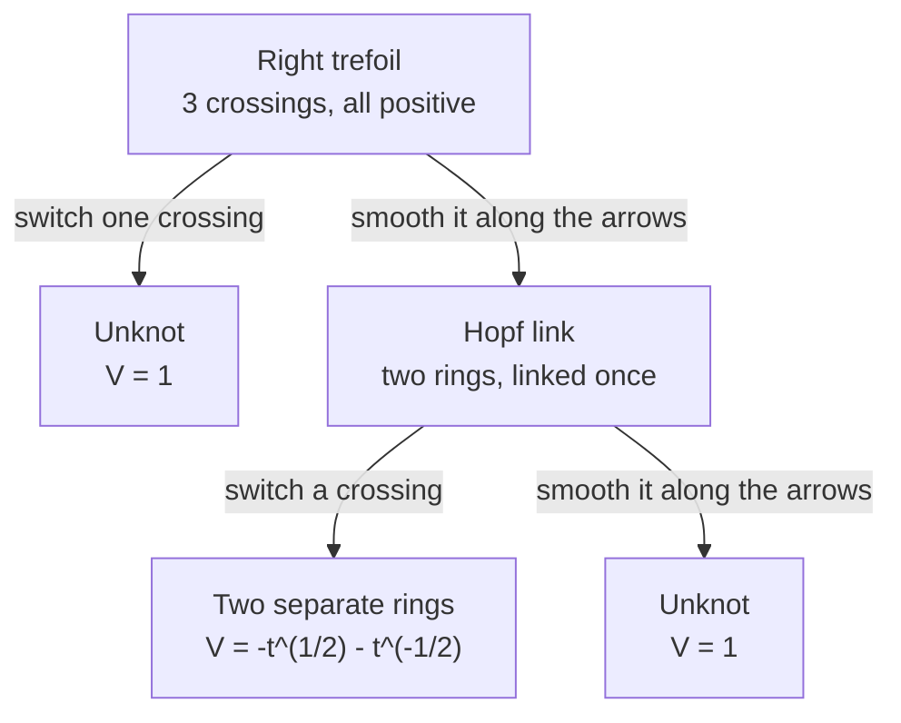

# Knot polynomials in outline: one skein rule turns a diagram into a polynomial

[Syllabus](../../../SYLLABUS.md) → [Topology](../README.md) → [Surfaces and Manifolds](../README.md#s03) → Knot polynomials in outline

---

## General Overview

Tie an overhand knot in a length of climbing rope and fuse the two ends. The loop that results is the **trefoil**: drawn flat, it crosses itself 3 times. Tie the same knot with the rope turned the other way, as in a mirror, and you get the **mirror trefoil**.

Can the rope of one be slid and twisted, without cutting, into the shape of the other? The three-colour test proves each trefoil is knotted ([Reidemeister moves and the three-colour test](07-reidemeister-moves-and-tricolourability.md)). It cannot tell them apart: it finds 9 colourings for each, because it ignores which strand passes over.

A **knot polynomial** does look. One local rule, applied at every crossing, turns the drawing into a polynomial in a letter $`t`$. Sliding the rope changes the drawing but not the polynomial. The trefoil gives $`t + t^3 - t^4`$. Its mirror gives $`t^{-1} + t^{-3} - t^{-4}`$. Different polynomials: so no amount of sliding turns one into the other.

This is the **Jones polynomial**, found in 1984. Within three years it had settled problems open for a century.

**A knot polynomial cuts every crossing open in both possible ways, scores the loops left over, and corrects for twists, so that the three Reidemeister moves leave the result unchanged; two knots with different polynomials are different knots.**

**What kind of fact this is:** a theorem. That the Kauffman bracket survives moves R2 and R3, and the writhe-corrected bracket survives all three moves, is proved on this card in Why it works (move R3 in outline). The trefoil's polynomial and its mirror's are an exhaustive computation on one 3-crossing diagram, so they are proof, not a sample.

### The picture: the skein road to the trefoil

Step 6 computes the trefoil one crossing at a time. Each drawing hands its value to two simpler drawings, until only unknots and separate rings are left.



Schematic: the diagrams are named, not drawn.

---

## The formula

Notation first, in words. A **knot diagram** $`D`$ is the flat drawing of the knot, with a gap in the lower strand at each crossing. Its **Kauffman bracket** $`\langle D\rangle`$ is a **Laurent polynomial** in a letter $`A`$: a polynomial ([Polynomials](../../03-Algebra/02-Polynomials/01-polynomials.md)) that may also have negative powers, $`A^{-3}`$ meaning $`1/A^3`$.

Four corners of the plane meet at a crossing. Turn the over-strand anticlockwise onto the under-strand: it sweeps two opposite corners, the **A corners**. The **A-smoothing** cuts the crossing open and rejoins the ends so the A corners merge into one region. The **B-smoothing** merges the other two corners instead.

In the rules below, $`\bigcirc`$ is a lone loop, $`D \sqcup \bigcirc`$ is $`D`$ with a separate loop beside it, and $`\times`$ is one crossing, drawn with its over-strand running from top left to bottom right. $`\asymp`$ is its A-smoothing, two arcs one above the other, and $`)(`$ its B-smoothing, two arcs side by side, the rest of the diagram unchanged. The bracket obeys three rules:

```math
\langle \bigcirc \rangle = 1, \qquad \langle D \sqcup \bigcirc \rangle = d\,\langle D \rangle, \qquad \langle \times \rangle = A\,\langle \asymp \rangle + A^{-1}\,\langle )( \rangle
```

**Read it aloud:** one plain loop scores 1; an extra separate loop multiplies by $`d = -A^2 - A^{-2}`$; a crossing equals $`A`$ times its A-smoothing plus $`A^{-1}`$ times its B-smoothing.

Smoothing all $`n`$ crossings at once gives the **state sum**:

```math
\langle D\rangle = \sum_{S} A^{\,a(S) - b(S)}\, d^{\,\ell(S) - 1}
```

**Read it aloud:** over every **state** (one smoothing chosen at each crossing), add $`A`$ raised to the A-count minus the B-count, times $`d`$ once per loop beyond the first.

Then fix the twists. Give the knot a direction. A crossing is **positive** when, with both strands pointing up, the over-strand runs bottom left to top right. The **writhe** $`w(D)`$ is the number of positive crossings minus the negative ones. The **Jones polynomial** is

```math
V_K(t) = (-A^3)^{-w(D)}\,\langle D\rangle \quad \text{with } A = t^{-1/4}
```

**Read it aloud:** divide the bracket by minus $`A`$ cubed once per unit of writhe, then write $`t^{-1/4}`$ wherever $`A`$ stood.

It obeys the **skein relation**, Jones's own rule, linking three diagrams alike except at one crossing:

```math
t^{-1}\,V(L_+) - t\,V(L_-) = \left(t^{1/2} - t^{-1/2}\right) V(L_0)
```

**Read it aloud:** the values with the crossing positive and switched, weighted by $`t^{-1}`$ and $`t`$, differ by the smoothed value times $`t^{1/2} - t^{-1/2}`$.

| Symbol | Plain meaning | In our example | Push it up and the answer… |
| --- | --- | --- | --- |
| $`D`$, $`n`$ | a knot diagram: the flat drawing with gaps at under-crossings; $`n`$ is its number of crossings | the right trefoil, $`n = 3`$ | $`2^n`$ states to sum |
| $`\langle D\rangle`$ | the Kauffman bracket, a Laurent polynomial in $`A`$ | $`A^{-7} - A^{-3} - A^{5}`$ | — |
| $`\bigcirc`$, $`\sqcup`$, $`\times`$, $`\asymp`$, $`)(`$ | a lone loop; placed beside, not linked; one crossing; its A-smoothing; its B-smoothing | the trefoil has 3 crossings to smooth | — |
| $`A`$ | the bracket's letter, a placeholder, never given a value | — | — |
| $`d`$ | the score of one extra loop, $`-A^2 - A^{-2}`$ | — | — |
| $`S`$, $`a(S)`$, $`b(S)`$ | a state (one smoothing chosen at every crossing), its A-count and B-count | AAB: 2 and 1 | — |
| $`\ell(S)`$ | the number of loops a state leaves | AAA leaves 2, BBB leaves 3 | — |
| $`w(D)`$ | the writhe: positive crossings minus negative ones | +3 | all powers shift |
| $`t`$ | the Jones polynomial's letter, standing for $`A^{-4}`$ | — | — |
| $`V_K(t)`$ | the Jones polynomial of the knot $`K`$ | $`t + t^3 - t^4`$ | — |
| $`L_+`$, $`L_-`$, $`L_0`$ | three diagrams alike except at one crossing: positive, switched negative, smoothed along the arrows | trefoil, unknot, Hopf link | — |
| $`L_\infty`$, $`f`$ | (in a fold) the smoothing against the arrows; the corrected bracket $`(-A^3)^{-w}\langle D\rangle`$ | — | — |

### When it holds

- **A tame diagram.** Finitely many crossings, two strands each. Infinitely many crossings leave no finite sum.
- **The writhe needs a direction.** Without one, a crossing has no sign. Reversing a knot's direction flips both strands at each crossing, so no sign changes; for a link of several rings it can.
- **The writhe correction must be kept.** Alone, the bracket changes under move R1: the kinked unknot gives $`-A^3`$.
- **Different polynomials prove different knots; equal ones prove nothing.** The knots listed as 5₁ and 10₁₃₂ in the standard tables are different but share a Jones polynomial. Whether any knotted loop shares the unknot's value 1 is unknown.

---

## Why it works

### Step 0: an invariant must survive three moves

Two diagrams show the same knot exactly when a finite chain of Reidemeister moves links them ([Reidemeister moves and the three-colour test](07-reidemeister-moves-and-tricolourability.md)): R1, the kink, adds or removes a twist; R2, the poke, slides one strand over another; R3, the slide, slides a strand across the crossing of two others. A number no move changes is an **invariant**: a property of the knot, not the drawing.

The loop score $`d`$ is chosen so moves R2 and R3 leave the bracket alone. Move R1 multiplies it by a known factor, which the writhe factor cancels.

### Step 1: one crossing, two smoothings

Apply the third rule at every crossing and each term becomes a set of separate loops, which the first two rules score. That is the state sum: $`2^n`$ states, 8 for the trefoil.

### Step 2: move R2 is why $`d = -A^2 - A^{-2}`$

Two strands overlapping in two crossings expand into four states. One, with weight $`A \cdot A^{-1} = 1`$, is the two strands pushed apart: the diagram before the move. The other three are one diagram, the strands joined across, with weights $`A^2`$, $`A^{-2}`$ and, for the copy carrying a small extra loop, $`d`$. Move R2 needs their total, $`A^2 + A^{-2} + d`$, to vanish, and $`d = -A^2 - A^{-2}`$ makes it vanish.

<details>
<summary>Detailed proof: the bracket is unchanged by move R2</summary>

Here the two symbols name pictures only, not which smoothing made them. Smoothing both crossings, AA and BB give the strands joined across, two arcs one above the other, $`\asymp`$, with weights $`A^2`$ and $`A^{-2}`$. AB gives the strands pushed apart, two arcs side by side, $`)(`$. BA gives $`\asymp`$ plus a separate loop, worth $`d\,\langle\asymp\rangle`$. Adding up:

$`\displaystyle \langle \text{two crossings} \rangle = \langle )( \rangle + \left(A^2 + A^{-2} + d\right)\langle \asymp \rangle`$

With $`d = -A^2 - A^{-2}`$ the second term vanishes. If the over-strand runs the other way, AB and BA swap roles; the sum is the same.

</details>

### Step 3: move R3 follows from move R2

View move R3 as the top strand, the one passing over both others, sliding across the crossing of the other two. Expand that crossing, the one slid across, on both sides of the move. One of its smoothings gives the same picture on both sides. The other gives two pictures that each lose two crossings by move R2, and then agree. So both sides of move R3 have the same bracket. The full proof, with pictures, is in the Kauffman and Lickorish sources.

### Step 4: move R1 costs $`-A^3`$, and the writhe pays it back

A single twist with a positive crossing expands into two terms. One smoothing leaves the strand plus a small separate loop, worth $`d`$; the other leaves the strand alone. So the twist is worth

```math
A\,d + A^{-1} = A\left(-A^2 - A^{-2}\right) + A^{-1} = -A^3
```

times the diagram without it. The twist also adds 1 to the writhe. The factor $`(-A^3)^{-w}`$ then contributes $`(-A^3)^{-1}`$, which cancels the $`-A^3`$ exactly. A negative twist gives $`-A^{-3}`$ and takes 1 off the writhe; the cancellation is the same.

Move R2 adds one positive and one negative crossing, and move R3 keeps every sign, so neither changes the writhe. The corrected bracket survives all three moves.

### Step 5: the skein relation is the bracket in other clothes

At a positive crossing the A-smoothing follows the arrows; at the switched crossing the B-smoothing does. Write both crossings' bracket rules, cancel the smoothing that ignores the arrows, and put in the writhes: the skein relation comes out.

<details>
<summary>Detailed proof: from the bracket to the skein relation</summary>

Let $`L_\infty`$ be the smoothing against the arrows. Then $`\langle L_+\rangle = A\langle L_0\rangle + A^{-1}\langle L_\infty\rangle`$ and $`\langle L_-\rangle = A^{-1}\langle L_0\rangle + A\langle L_\infty\rangle`$. Multiply the first by $`A`$, the second by $`A^{-1}`$, and subtract:

$`\displaystyle A\langle L_+\rangle - A^{-1}\langle L_-\rangle = \left(A^2 - A^{-2}\right)\langle L_0\rangle`$

Let $`w`$ be the writhe of $`L_0`$, so $`L_+`$ has $`w + 1`$ and $`L_-`$ has $`w - 1`$. Write each bracket as $`\langle L\rangle = (-A^3)^{w(L)} f(L)`$, where $`f`$ is the corrected bracket. Divide through by $`(-A^3)^{w}`$:

$`\displaystyle -A^4 f(L_+) + A^{-4} f(L_-) = \left(A^2 - A^{-2}\right) f(L_0)`$

Now $`A = t^{-1/4}`$ makes $`A^4 = t^{-1}`$ and $`A^2 = t^{-1/2}`$. Multiply by $`-1`$:

$`\displaystyle t^{-1} V(L_+) - t\,V(L_-) = \left(t^{1/2} - t^{-1/2}\right) V(L_0)`$

</details>

### Step 6: the trefoil by the skein road

Three facts start the road. A plain loop has $`V = 1`$. Two separate loops have bracket $`d`$ and writhe 0, so $`V = d = -t^{1/2} - t^{-1/2}`$. And each step solves the skein relation for $`V(L_+)`$:

```math
V(L_+) = t\left[\,t\,V(L_-) + \left(t^{1/2} - t^{-1/2}\right) V(L_0)\right]
```

**The Hopf link** (two rings linked once, both crossings positive). Switch a crossing: two separate rings. Smooth it: one loop. So $`V = t\left[t\left(-t^{1/2} - t^{-1/2}\right) + t^{1/2} - t^{-1/2}\right] = -t^{1/2} - t^{5/2}`$.

**The right trefoil** (three positive crossings). Switch one crossing: the knot falls open, an unknot. Smooth it along the arrows: the Hopf link. So $`V = t\left[t + \left(t^{1/2} - t^{-1/2}\right)\left(-t^{1/2} - t^{5/2}\right)\right]`$. The bracket in the middle is $`1 - t + t^2 - t^3`$, and

```math
V = t\left[\,t + 1 - t + t^2 - t^3\,\right] = t + t^3 - t^4
```

### Step 7: the mirror, and what this settled

Mirroring swaps over and under, hence the A and B corners, so $`A`$ and $`A^{-1}`$ trade places and the writhe changes sign: $`V_{\text{mirror}}(t) = V(t^{-1})`$. The left trefoil's polynomial is $`t^{-1} + t^{-3} - t^{-4}`$, not $`t + t^3 - t^4`$. Since $`V`$ is an invariant, the two trefoils are different knots.

The rule settled three kinds of question:

- **Chirality.** A knot that differs from its mirror is **chiral**. The trefoil's chirality was first proved in 1914 by a long argument; the lines above do it. The Alexander polynomial (1928) and the three-colour test give both trefoils the same answer.
- **Tait's crossing-number conjectures, from the 1880s.** The **span** of the bracket is its highest power of $`A`$ minus its lowest. It is at most 4 times the crossings of any diagram, with equality for a reduced alternating diagram. Alternating means over, under, over, under all the way round; reduced means no crossing could be untwisted away. The span is an invariant, since the writhe factor only shifts powers. The trefoil's span is 12, so every diagram of it has at least 3 crossings. In 1987 three papers used this to prove Tait's claim that a reduced alternating diagram has the fewest crossings possible.
- **Telling knots apart in tables.** The polynomial separates many tabulated knots that share an Alexander polynomial.

---

## Worked numbers, by hand

The right trefoil. Each row is one state: its A-power is $`a - b`$, and its term is $`A^{a-b} d^{\ell - 1}`$.

| Step | Arithmetic | Value |
| --- | --- | --- |
| AAA: power 3, 2 loops | $`A^3 \cdot d`$ | $`-A - A^{5}`$ |
| AAB, ABA, BAA: power 1, 1 loop each | $`A^1 \cdot 1`$, three times | $`A`$ each |
| ABB, BAB, BBA: power −1, 2 loops each | $`A^{-1} \cdot d`$, three times | $`-A^{-3} - A`$ each |
| BBB: power −3, 3 loops | $`A^{-3} \cdot d^2`$ | $`A^{-7} + 2A^{-3} + A`$ |
| add all eight | the $`A`$ terms cancel: −1 + 3 − 3 + 1 | $`A^{-7} - A^{-3} - A^{5}`$ |
| span | 5 − (−7) | 12 = 4 × 3 crossings |
| writhe factor | $`(-A^3)^{-3}`$ | $`-A^{-9}`$ |
| corrected bracket | $`-A^{-9}\left(A^{-7} - A^{-3} - A^{5}\right)`$ | $`-A^{-16} + A^{-12} + A^{-4}`$ |
| $`A^{-4} = t`$ | $`A^{-16} = t^4`$, $`A^{-12} = t^3`$ | **$`V = t + t^3 - t^4`$** |
| the mirror | $`t \to t^{-1}`$ | **$`t^{-1} + t^{-3} - t^{-4}`$** |

The right trefoil's polynomial has only positive powers of $`t`$ and its mirror's only negative ones, so no chain of moves joins them: the two trefoils are different knots.

### What breaks if you drop a piece

| Mistake | Comes out at | What went wrong |
| --- | --- | --- |
| Bracket with no writhe factor | the kinked unknot gives $`-A^3`$, not 1 | Move R1 changes the bracket; only the corrected bracket is an invariant |
| Score every loop, $`d^{\,\ell}`$ not $`d^{\,\ell - 1}`$ | kinked unknot $`A + A^5`$; trefoil $`-t^{1/2} - t^{3/2} - t^{5/2} + t^{9/2}`$ | The plain loop must score 1; this multiplies every answer by $`d`$ |
| A and B smoothings swapped, writhe kept | $`-t^{1/2} + t^{3/2} + t^{7/2}`$ | Half the work mirrored the knot: half-integer powers cannot come from a knot |

The code prints all three.

---

## Code, from first principles, and it actually runs

Each script reads a knot as a planar-diagram code: one entry X[a, b, c, d] per crossing, edge labels read anticlockwise from the incoming under-strand. The tables' trefoil is the left one; swapping over and under builds the right one. Two independent roads reach its polynomial. Road 1 sums the bracket over all 8 states, counting loops with union-find (merging labels into groups), then applies the writhe. Road 2 runs the skein relation from two rings through the Hopf link, with no diagram code. The mirror is computed from its own diagram and checked against $`V(t^{-1})`$; the kinked unknot checks move R1; brute-force three-colourings show that test is blind to mirrors.

### Python

```python
# Knot polynomials in outline -- the check behind the card.  Standard library
# only.  A diagram is a planar-diagram code: one X[a, b, c, d] per crossing,
# edge labels read anticlockwise from the incoming under-strand, labels rising
# along the knot.  Polynomials are dicts {exponent: integer coefficient}.
# Road 1: the bracket state sum over all 2^n smoothings, then the writhe.
# Road 2: the Jones skein relation, by hand: unlink -> Hopf link -> trefoil.
from itertools import product

LEFT = [(1, 4, 2, 5), (3, 6, 4, 1), (5, 2, 6, 3)]   # the trefoil of the tables
KINK = [(1, 1, 2, 2)]                                # an unknot with one twist

def mul(p, q):
    out = {}
    for e, c in p.items():
        for f, k in q.items():
            out[e + f] = out.get(e + f, 0) + c * k
    return {e: c for e, c in out.items() if c}

def add(p, q):
    out = dict(p)
    for e, c in q.items():
        out[e] = out.get(e, 0) + c
    return {e: c for e, c in out.items() if c}

def scale(p, k, shift):                          # k * p, exponents moved by shift
    return {e + shift: k * c for e, c in p.items()}

D = {2: -1, -2: -1}                              # d = -A^2 - A^-2, one loop's worth
ONE, ROOT = {0: 1}, {1: 1, -1: -1}               # 1 and t^(1/2) - t^(-1/2)

def positive(x):                                 # sign of a crossing
    a, b, c, dd = x
    return a == b or c == dd or b - dd == 1 or dd - b > 1

def writhe(pd):
    return sum(1 if positive(x) else -1 for x in pd)

def mirror(pd):                                  # swap over and under everywhere
    return [(d, a, b, c) if positive((a, b, c, d)) else (b, c, d, a)
            for a, b, c, d in pd]

def loops(pairs):                                # count closed loops: union-find
    parent = {}
    def find(x):
        parent.setdefault(x, x)
        while parent[x] != x:
            x = parent[x]
        return x
    for u, v in pairs:
        parent[find(u)] = find(v)
    return len({find(x) for x in list(parent)})

def states(pd, loop_power=-1):        # every smoothing: name, A-power, loops, term
    for state in product("AB", repeat=len(pd)):
        pairs = []
        for (a, b, c, d), s in zip(pd, state):
            pairs += [(a, b), (c, d)] if s == "A" else [(a, d), (b, c)]
        power, n = 2 * state.count("A") - len(pd), loops(pairs)
        term = {power: 1}
        for _ in range(n + loop_power):
            term = mul(term, D)
        yield "".join(state), power, n, term

def bracket(pd, loop_power=-1):
    total = {}
    for _, _, _, term in states(pd, loop_power):
        total = add(total, term)
    return total

def jones(br, w):                    # (-A^3)^-w <D>, then A = t^(-1/4); t in half-steps
    f = scale(br, -1 if w % 2 else 1, -3 * w)
    assert all(e % 2 == 0 for e in f)
    return {-e // 2: c for e, c in f.items()}

def show(p, v, den):                 # print a polynomial, lowest power first
    out = ""
    for e in sorted(p):
        c, g = p[e], [k for k in (den, 1) if e % k == 0][0]
        n, m = e // g, den // g
        pw = "" if e == 0 else v if (n, m) == (1, 1) else f"{v}^{n}" if m == 1 else f"{v}^({n}/{m})"
        mag = "" if abs(c) == 1 and pw else str(abs(c))
        sign = ("-" if c < 0 else "") if not out else (" - " if c < 0 else " + ")
        out += sign + mag + pw
    return out or "0"

def tricolourings(pd):
    arcs = {}
    for a, b, c, d in pd:
        arcs[d] = b                  # the over-strand keeps one arc through b and d
    def arc(x):
        while x in arcs and arcs[x] != x:
            x = arcs[x]
        return x
    names = sorted({arc(x) for X in pd for x in X})
    count = 0
    for cols in product(range(3), repeat=len(names)):
        col = dict(zip(names, cols))
        count += all((col[arc(a)] + col[arc(c)] + col[arc(b)]) % 3 == 0 for a, b, c, d in pd)
    return count

RIGHT = mirror(LEFT)
print("state, A-power, loops, term of the right trefoil:")
for name, power, n, term in states(RIGHT):
    print(f"  {name}  A^{power}  loops {n}  term {show(term, 'A', 1)}")
br, bl = bracket(RIGHT), bracket(LEFT)
vr, vl = jones(br, writhe(RIGHT)), jones(bl, writhe(LEFT))
print(f"right trefoil: writhe {writhe(RIGHT)}, bracket {show(br, 'A', 1)}")
fr = scale(ONE, -1 if writhe(RIGHT) % 2 else 1, -3 * writhe(RIGHT))
print(f"  writhe factor (-A^3)^-{writhe(RIGHT)} = {show(fr, 'A', 1)}; corrected {show(mul(fr, br), 'A', 1)}")
print(f"  span of the bracket {max(br) - min(br)} = 4 x {len(RIGHT)} crossings")
print(f"  Jones V(t) = {show(vr, 't', 2)}")
print(f"left trefoil (mirror): writhe {writhe(LEFT)}, bracket {show(bl, 'A', 1)}")
print(f"  Jones V(t) = {show(vl, 't', 2)}")
# Road 2: t^-1 V(L+) - t V(L-) = (t^(1/2) - t^(-1/2)) V(L0), solved for V(L+).
def skein(v_minus, v_zero):
    return scale(add(scale(v_minus, 1, 2), mul(ROOT, v_zero)), 1, 2)
unlink = {1: -1, -1: -1}                         # two separate loops: d, at A = t^(-1/4)
hopf = skein(unlink, ONE)
tref = skein(ONE, hopf)
print(f"skein road: unlink {show(unlink, 't', 2)}; Hopf link {show(hopf, 't', 2)}")
print(f"skein road: (t^(1/2) - t^(-1/2)) x Hopf = {show(mul(ROOT, hopf), 't', 2)}")
print(f"skein road: right trefoil {show(tref, 't', 2)}")
flip = {-e: c for e, c in vr.items()}
print(f"right trefoil's V at t -> 1/t: {show(flip, 't', 2)}; mirror differs: {'yes' if vr != vl else 'no'}")
bk = bracket(KINK)
print(f"kinked unknot: writhe {writhe(KINK)}, bracket {show(bk, 'A', 1)}, Jones {show(jones(bk, 1), 't', 2)}")
print(f"tricolourings: right {tricolourings(RIGHT)}, left {tricolourings(LEFT)}, unknot {tricolourings(KINK)}")
print(f"mistake 1, bracket with no writhe factor: kinked unknot {show(bk, 'A', 1)}, not 1")
print(f"mistake 2, d^loops not d^(loops-1): kinked unknot {show(bracket(KINK, 0), 'A', 1)}; "
      f"trefoil {show(jones(bracket(RIGHT, 0), 3), 't', 2)}")
swapped = [(b, c, d, a) for a, b, c, d in RIGHT]      # A and B smoothings swapped
print(f"mistake 3, A and B swapped, writhe kept: {show(jones(bracket(swapped), 3), 't', 2)}")
assert tref == vr                                 # road 1 = road 2
assert vl == flip and vr != vl                    # the mirror is V(1/t), and differs
assert jones(bk, writhe(KINK)) == ONE and bk == {3: -1}
assert br == {-7: 1, -3: -1, 5: -1} and max(br) - min(br) == 4 * len(RIGHT)
assert tricolourings(RIGHT) == tricolourings(LEFT) == 9
print("ALL CHECKS PASS")
```

**Ran 2026-11-14 on macOS, Python 3.14.10, standard library only. All checks passed. Output, pasted from the run:**

```
state, A-power, loops, term of the right trefoil:
  AAA  A^3  loops 2  term -A - A^5
  AAB  A^1  loops 1  term A
  ABA  A^1  loops 1  term A
  ABB  A^-1  loops 2  term -A^-3 - A
  BAA  A^1  loops 1  term A
  BAB  A^-1  loops 2  term -A^-3 - A
  BBA  A^-1  loops 2  term -A^-3 - A
  BBB  A^-3  loops 3  term A^-7 + 2A^-3 + A
right trefoil: writhe 3, bracket A^-7 - A^-3 - A^5
  writhe factor (-A^3)^-3 = -A^-9; corrected -A^-16 + A^-12 + A^-4
  span of the bracket 12 = 4 x 3 crossings
  Jones V(t) = t + t^3 - t^4
left trefoil (mirror): writhe -3, bracket -A^-5 - A^3 + A^7
  Jones V(t) = -t^-4 + t^-3 + t^-1
skein road: unlink -t^(-1/2) - t^(1/2); Hopf link -t^(1/2) - t^(5/2)
skein road: (t^(1/2) - t^(-1/2)) x Hopf = 1 - t + t^2 - t^3
skein road: right trefoil t + t^3 - t^4
right trefoil's V at t -> 1/t: -t^-4 + t^-3 + t^-1; mirror differs: yes
kinked unknot: writhe 1, bracket -A^3, Jones 1
tricolourings: right 9, left 9, unknot 3
mistake 1, bracket with no writhe factor: kinked unknot -A^3, not 1
mistake 2, d^loops not d^(loops-1): kinked unknot A + A^5; trefoil -t^(1/2) - t^(3/2) - t^(5/2) + t^(9/2)
mistake 3, A and B swapped, writhe kept: -t^(1/2) + t^(3/2) + t^(7/2)
ALL CHECKS PASS
```

### Rust

Same numbers, same labels, built with `rustc --edition 2021 -O`.

```rust
// Knot polynomials in outline -- the same check as the Python, in Rust.  No
// crates.  A diagram is a planar-diagram code: one X[a, b, c, d] per crossing,
// edge labels read anticlockwise from the incoming under-strand, labels rising
// along the knot.  Polynomials are BTreeMaps {exponent: integer coefficient}.
// Road 1: the bracket state sum over all 2^n smoothings, then the writhe.
// Road 2: the Jones skein relation, by hand: unlink -> Hopf link -> trefoil.
use std::collections::{BTreeMap, BTreeSet, HashMap};

type Poly = BTreeMap<i64, i64>;
type Pd = Vec<[i64; 4]>;

fn poly(terms: &[(i64, i64)]) -> Poly { terms.iter().cloned().collect() }

fn clean(p: Poly) -> Poly { p.into_iter().filter(|&(_, c)| c != 0).collect() }

fn mul(p: &Poly, q: &Poly) -> Poly {
    let mut out = Poly::new();
    for (e, c) in p { for (f, k) in q { *out.entry(e + f).or_insert(0) += c * k; } }
    clean(out)
}

fn add(p: &Poly, q: &Poly) -> Poly {
    let mut out = p.clone();
    for (e, c) in q { *out.entry(*e).or_insert(0) += c; }
    clean(out)
}

fn scale(p: &Poly, k: i64, shift: i64) -> Poly { p.iter().map(|(e, c)| (e + shift, k * c)).collect() }

fn positive(x: &[i64; 4]) -> bool {               // sign of a crossing
    let [a, b, c, d] = *x;
    a == b || c == d || b - d == 1 || d - b > 1
}

fn writhe(pd: &Pd) -> i64 { pd.iter().map(|x| if positive(x) { 1 } else { -1 }).sum() }

fn mirror(pd: &Pd) -> Pd {                         // swap over and under everywhere
    pd.iter().map(|&[a, b, c, d]| if positive(&[a, b, c, d]) { [d, a, b, c] } else { [b, c, d, a] }).collect()
}

fn find(parent: &mut HashMap<i64, i64>, mut x: i64) -> i64 {
    parent.entry(x).or_insert(x);
    while parent[&x] != x { x = parent[&x]; }
    x
}

fn loops(pairs: &[(i64, i64)]) -> i64 {           // count closed loops: union-find
    let mut parent: HashMap<i64, i64> = HashMap::new();
    for &(u, v) in pairs { let (ru, rv) = (find(&mut parent, u), find(&mut parent, v)); parent.insert(ru, rv); }
    let keys: Vec<i64> = parent.keys().cloned().collect();
    keys.iter().map(|&x| find(&mut parent, x)).collect::<BTreeSet<i64>>().len() as i64
}

fn states(pd: &Pd, loop_power: i64) -> Vec<(String, i64, i64, Poly)> {   // name, A-power, loops, term
    let d = poly(&[(2, -1), (-2, -1)]);           // d = -A^2 - A^-2, one loop's worth
    let mut out = Vec::new();
    for mask in 0..(1usize << pd.len()) {
        let (mut pairs, mut name) = (Vec::new(), String::new());
        for (i, &[a, b, c, d]) in pd.iter().enumerate() {
            if (mask >> (pd.len() - 1 - i)) & 1 == 0 { pairs.extend([(a, b), (c, d)]); name.push('A') }
            else { pairs.extend([(a, d), (b, c)]); name.push('B') }
        }
        let power = 2 * name.matches('A').count() as i64 - pd.len() as i64;
        let n = loops(&pairs);
        let mut term = poly(&[(power, 1)]);
        for _ in 0..(n + loop_power) { term = mul(&term, &d); }
        out.push((name, power, n, term));
    }
    out
}

fn bracket(pd: &Pd, loop_power: i64) -> Poly {
    states(pd, loop_power).iter().fold(Poly::new(), |acc, s| add(&acc, &s.3))
}

fn jones(br: &Poly, w: i64) -> Poly {             // (-A^3)^-w <D>, then A = t^(-1/4); t in half-steps
    let f = scale(br, if w % 2 == 0 { 1 } else { -1 }, -3 * w);
    assert!(f.keys().all(|e| e % 2 == 0));
    f.iter().map(|(e, c)| (-e / 2, *c)).collect()
}

fn show(p: &Poly, v: &str, den: i64) -> String {  // print a polynomial, lowest power first
    let mut out = String::new();
    for (&e, &c) in p {
        let g = if e % den == 0 { den } else { 1 };
        let (n, m) = (e / g, den / g);
        let pw = if e == 0 { String::new() } else if (n, m) == (1, 1) { v.to_string() }
                 else if m == 1 { format!("{}^{}", v, n) } else { format!("{}^({}/{})", v, n, m) };
        let mag = if c.abs() == 1 && !pw.is_empty() { String::new() } else { c.abs().to_string() };
        let sign = if out.is_empty() { if c < 0 { "-" } else { "" } } else if c < 0 { " - " } else { " + " };
        out += &format!("{}{}{}", sign, mag, pw);
    }
    if out.is_empty() { "0".to_string() } else { out }
}

fn tricolourings(pd: &Pd) -> i64 {
    let arcs: HashMap<i64, i64> = pd.iter().map(|&[_, b, _, d]| (d, b)).collect();
    let arc = |mut x: i64| { while arcs.contains_key(&x) && arcs[&x] != x { x = arcs[&x]; } x };
    let names: Vec<i64> = pd.iter().flatten().map(|&x| arc(x)).collect::<BTreeSet<i64>>().into_iter().collect();
    let mut count = 0;
    for code in 0..3i64.pow(names.len() as u32) {
        let col: HashMap<i64, i64> = names.iter().enumerate()
            .map(|(i, &n)| (n, code / 3i64.pow((names.len() - 1 - i) as u32) % 3)).collect();
        if pd.iter().all(|&[a, b, c, _]| (col[&arc(a)] + col[&arc(c)] + col[&arc(b)]) % 3 == 0) { count += 1; }
    }
    count
}

fn main() {
    let left: Pd = vec![[1, 4, 2, 5], [3, 6, 4, 1], [5, 2, 6, 3]];   // the trefoil of the tables
    let kink: Pd = vec![[1, 1, 2, 2]];                                  // an unknot with one twist
    let right = mirror(&left);
    println!("state, A-power, loops, term of the right trefoil:");
    for (name, power, n, term) in states(&right, -1) {
        println!("  {}  A^{}  loops {}  term {}", name, power, n, show(&term, "A", 1));
    }
    let (br, bl) = (bracket(&right, -1), bracket(&left, -1));
    let (vr, vl) = (jones(&br, writhe(&right)), jones(&bl, writhe(&left)));
    let span = br.keys().max().unwrap() - br.keys().min().unwrap();
    println!("right trefoil: writhe {}, bracket {}", writhe(&right), show(&br, "A", 1));
    let w = writhe(&right);
    let fr = scale(&poly(&[(0, 1)]), if w % 2 == 0 { 1 } else { -1 }, -3 * w);
    println!("  writhe factor (-A^3)^-{} = {}; corrected {}", w, show(&fr, "A", 1), show(&mul(&fr, &br), "A", 1));
    println!("  span of the bracket {} = 4 x {} crossings", span, right.len());
    println!("  Jones V(t) = {}", show(&vr, "t", 2));
    println!("left trefoil (mirror): writhe {}, bracket {}", writhe(&left), show(&bl, "A", 1));
    println!("  Jones V(t) = {}", show(&vl, "t", 2));
    // Road 2: t^-1 V(L+) - t V(L-) = (t^(1/2) - t^(-1/2)) V(L0), solved for V(L+).
    let (one, root) = (poly(&[(0, 1)]), poly(&[(1, 1), (-1, -1)]));
    let skein = |vm: &Poly, v0: &Poly| scale(&add(&scale(vm, 1, 2), &mul(&root, v0)), 1, 2);
    let unlink = poly(&[(1, -1), (-1, -1)]);       // two separate loops: d, at A = t^(-1/4)
    let hopf = skein(&unlink, &one);
    let tref = skein(&one, &hopf);
    println!("skein road: unlink {}; Hopf link {}", show(&unlink, "t", 2), show(&hopf, "t", 2));
    println!("skein road: (t^(1/2) - t^(-1/2)) x Hopf = {}", show(&mul(&root, &hopf), "t", 2));
    println!("skein road: right trefoil {}", show(&tref, "t", 2));
    let flip: Poly = vr.iter().map(|(e, c)| (-e, *c)).collect();
    println!("right trefoil's V at t -> 1/t: {}; mirror differs: {}", show(&flip, "t", 2), if vr != vl { "yes" } else { "no" });
    let bk = bracket(&kink, -1);
    println!("kinked unknot: writhe {}, bracket {}, Jones {}", writhe(&kink), show(&bk, "A", 1), show(&jones(&bk, 1), "t", 2));
    println!("tricolourings: right {}, left {}, unknot {}", tricolourings(&right), tricolourings(&left), tricolourings(&kink));
    println!("mistake 1, bracket with no writhe factor: kinked unknot {}, not 1", show(&bk, "A", 1));
    println!("mistake 2, d^loops not d^(loops-1): kinked unknot {}; trefoil {}",
             show(&bracket(&kink, 0), "A", 1), show(&jones(&bracket(&right, 0), 3), "t", 2));
    let swapped: Pd = right.iter().map(|&[a, b, c, d]| [b, c, d, a]).collect();   // A and B smoothings swapped
    println!("mistake 3, A and B swapped, writhe kept: {}", show(&jones(&bracket(&swapped, -1), 3), "t", 2));
    assert!(tref == vr);                                        // road 1 = road 2
    assert!(vl == flip && vr != vl);                            // the mirror is V(1/t), and differs
    assert!(jones(&bk, writhe(&kink)) == one && bk == poly(&[(3, -1)]));
    assert!(br == poly(&[(-7, 1), (-3, -1), (5, -1)]) && span == 4 * right.len() as i64);
    assert!(tricolourings(&right) == 9 && tricolourings(&left) == 9);
    println!("ALL CHECKS PASS");
}
```

**Ran 2026-11-14 on macOS, rustc 1.98.1, no crates. All checks passed. Output, pasted from the run:**

```
state, A-power, loops, term of the right trefoil:
  AAA  A^3  loops 2  term -A - A^5
  AAB  A^1  loops 1  term A
  ABA  A^1  loops 1  term A
  ABB  A^-1  loops 2  term -A^-3 - A
  BAA  A^1  loops 1  term A
  BAB  A^-1  loops 2  term -A^-3 - A
  BBA  A^-1  loops 2  term -A^-3 - A
  BBB  A^-3  loops 3  term A^-7 + 2A^-3 + A
right trefoil: writhe 3, bracket A^-7 - A^-3 - A^5
  writhe factor (-A^3)^-3 = -A^-9; corrected -A^-16 + A^-12 + A^-4
  span of the bracket 12 = 4 x 3 crossings
  Jones V(t) = t + t^3 - t^4
left trefoil (mirror): writhe -3, bracket -A^-5 - A^3 + A^7
  Jones V(t) = -t^-4 + t^-3 + t^-1
skein road: unlink -t^(-1/2) - t^(1/2); Hopf link -t^(1/2) - t^(5/2)
skein road: (t^(1/2) - t^(-1/2)) x Hopf = 1 - t + t^2 - t^3
skein road: right trefoil t + t^3 - t^4
right trefoil's V at t -> 1/t: -t^-4 + t^-3 + t^-1; mirror differs: yes
kinked unknot: writhe 1, bracket -A^3, Jones 1
tricolourings: right 9, left 9, unknot 3
mistake 1, bracket with no writhe factor: kinked unknot -A^3, not 1
mistake 2, d^loops not d^(loops-1): kinked unknot A + A^5; trefoil -t^(1/2) - t^(3/2) - t^(5/2) + t^(9/2)
mistake 3, A and B swapped, writhe kept: -t^(1/2) + t^(3/2) + t^(7/2)
ALL CHECKS PASS
```

The two outputs match line for line.

### Lean

Lean proves the algebra behind moves R1 and R2 and the skein relation, and checks the trefoil's hand arithmetic.

- Take a twist of either sign, with loop score $`d = -A^2 - A^{-2}`$. Then the corrected bracket is the same with the twist and without it.
- Move R2 leaves the bracket unchanged, whatever the rest of the diagram, exactly when $`d = -A^2 - A^{-2}`$.
- Suppose the bracket rules hold at one crossing, and the writhes are $`w + 1`$, $`w - 1`$ and $`w`$ for $`L_+`$, $`L_-`$, $`L_0`$. Then the skein relation holds, with $`t = A^{-4}`$.
- Lean also checks the hand arithmetic for the right trefoil. This covers the eight-state sum, the span 12, and the corrected bracket $`-A^{-16} + A^{-12} + A^{-4}`$.
- It also checks the skein road. The Hopf link gives $`-t^{1/2} - t^{5/2}`$, and the right trefoil gives $`t + t^3 - t^4`$.
- The polynomials $`t + t^3 - t^4`$ and $`t^{-1} + t^{-3} - t^{-4}`$ are different.

Reading the diagram codes, counting each state's loops, the mirror's own diagram and the three-colour counts are left to the Python and Rust checks.

```lean
-- Knot polynomials in outline: the writhe factor cancels a kink's -A^3, the loop score d = -A^2 - A^-2 is exactly what makes move R2 harmless, the bracket rules give Jones's skein relation, and the trefoil's numbers come out as the card says.
import Mathlib.Algebra.Polynomial.Laurent
import Mathlib.Tactic.FieldSimp
import Mathlib.Tactic.Ring
import Mathlib.Tactic.NormNum
import Mathlib.Tactic.LinearCombination

open LaurentPolynomial

/-- Move R1 (the kink). A positive twist expands into `A` times (the strand plus a loop, worth
`d` times the bracket `b` of the diagram without the twist) plus `A⁻¹` times the strand alone, and
adds 1 to the writhe. A negative twist swaps the two weights and takes 1 off the writhe. Either way
the writhe-corrected bracket `(-A^3)^(-w) * ⟨D⟩` is unchanged, when `d = -A^2 - A^-2`. -/
theorem corrected_bracket_unchanged_by_kink {K : Type*} [Field K] (A d b : K) (w : ℤ)
    (hA : A ≠ 0) (hd : d = -A ^ 2 - A ^ (-2 : ℤ)) :
    (-A ^ 3) ^ (-(w + 1)) * (A * (d * b) + A⁻¹ * b) = (-A ^ 3) ^ (-w) * b ∧
    (-A ^ 3) ^ (-(w - 1)) * (A⁻¹ * (d * b) + A * b) = (-A ^ 3) ^ (-w) * b := by
  have h3 : (-A ^ 3 : K) ≠ 0 := neg_ne_zero.mpr (pow_ne_zero 3 hA)
  have e2 : A ^ (-2 : ℤ) = (A ^ 2)⁻¹ := by rw [zpow_neg]; norm_cast
  subst hd
  rw [e2]
  constructor
  · rw [show -(w + 1) = -w + (-1 : ℤ) by ring, zpow_add₀ h3, zpow_neg_one]
    field_simp
    ring
  · rw [show -(w - 1) = -w + (1 : ℤ) by ring, zpow_add₀ h3, zpow_one]
    field_simp
    ring

/-- Move R2 (the poke). Two strands overlapping in two crossings expand into four states: AA and BB
give the strands joined across (bracket `y`) with weights `A·A` and `A⁻¹·A⁻¹`, AB gives the strands
pushed apart (bracket `x`) with weight `A·A⁻¹`, and BA gives the joined picture plus a separate loop,
worth `d * y`, with weight `A⁻¹·A`. The total equals the bracket `x` of the diagram before the move,
for every pair of pictures, exactly when the loop score is `d = -A^2 - A^-2`. -/
theorem bracket_unchanged_by_poke_iff {K : Type*} [Field K] (A d : K) (hA : A ≠ 0) :
    (∀ x y : K, A * A * y + A * A⁻¹ * x + A⁻¹ * A * (d * y) + A⁻¹ * A⁻¹ * y = x) ↔
      d = -A ^ 2 - A ^ (-2 : ℤ) := by
  have e2 : A ^ (-2 : ℤ) = (A ^ 2)⁻¹ := by rw [zpow_neg]; norm_cast
  rw [e2]
  constructor
  · intro h
    have h1 := h 0 1
    simp only [mul_zero, mul_one, add_zero] at h1
    rw [inv_mul_cancel₀ hA, one_mul] at h1
    linear_combination h1
  · intro hd x y
    subst hd
    field_simp
    ring

/-- The skein relation. Let `L₊`, `L₋`, `L₀`, `L∞` be diagrams alike except at one crossing:
positive, switched, smoothed along the arrows, smoothed against them. The bracket rule gives
`⟨L₊⟩ = A⟨L₀⟩ + A⁻¹⟨L∞⟩` and `⟨L₋⟩ = A⁻¹⟨L₀⟩ + A⟨L∞⟩`. If `L₀` has writhe `w`, then `L₊` has
`w + 1` and `L₋` has `w - 1`, and `V(L) = (-A^3)^(-w(L)) ⟨L⟩`. With `t = A^-4` (so `t^(1/2) = A^-2`),
`t⁻¹ V(L₊) - t V(L₋) = (t^(1/2) - t^(-1/2)) V(L₀)`. -/
theorem skein_relation_of_bracket {K : Type*} [Field K] (A bp bm b0 binf : K) (w : ℤ)
    (hA : A ≠ 0) (hp : bp = A * b0 + A⁻¹ * binf) (hm : bm = A⁻¹ * b0 + A * binf) :
    (A ^ (-4 : ℤ))⁻¹ * ((-A ^ 3) ^ (-(w + 1)) * bp) - A ^ (-4 : ℤ) * ((-A ^ 3) ^ (-(w - 1)) * bm) =
      (A ^ (-2 : ℤ) - (A ^ (-2 : ℤ))⁻¹) * ((-A ^ 3) ^ (-w) * b0) := by
  have h3 : (-A ^ 3 : K) ≠ 0 := neg_ne_zero.mpr (pow_ne_zero 3 hA)
  have e2 : A ^ (-2 : ℤ) = (A ^ 2)⁻¹ := by rw [zpow_neg]; norm_cast
  have e4 : A ^ (-4 : ℤ) = (A ^ 4)⁻¹ := by rw [zpow_neg]; norm_cast
  subst hp hm
  rw [e2, e4, show -(w + 1) = -w + (-1 : ℤ) by ring, show -(w - 1) = -w + (1 : ℤ) by ring,
    zpow_add₀ h3, zpow_add₀ h3, zpow_neg_one, zpow_one]
  field_simp
  ring

/-! The card's worked numbers for the right trefoil. -/

-- The state sum over all eight states: AAA, three states with one B, three with two Bs, BBB.
example {K : Type*} [Field K] (A d : K) (hA : A ≠ 0) (hd : d = -A ^ 2 - A ^ (-2 : ℤ)) :
    A ^ 3 * d + 3 * A + 3 * (A ^ (-1 : ℤ) * d) + A ^ (-3 : ℤ) * d ^ 2 =
      A ^ (-7 : ℤ) - A ^ (-3 : ℤ) - A ^ 5 := by
  have e1 : A ^ (-1 : ℤ) = A⁻¹ := zpow_neg_one A
  have e2 : A ^ (-2 : ℤ) = (A ^ 2)⁻¹ := by rw [zpow_neg]; norm_cast
  have e3 : A ^ (-3 : ℤ) = (A ^ 3)⁻¹ := by rw [zpow_neg]; norm_cast
  have e7 : A ^ (-7 : ℤ) = (A ^ 7)⁻¹ := by rw [zpow_neg]; norm_cast
  subst hd
  rw [e1, e2, e3, e7]
  field_simp
  ring

-- The span of the bracket: 5 - (-7) = 12 = 4 × 3 crossings.
example : (5 : ℤ) - (-7) = 4 * 3 := by norm_num

-- The writhe factor (-A^3)^(-3) = -A^-9 applied to the bracket.
example {K : Type*} [Field K] (A : K) (hA : A ≠ 0) :
    (-A ^ 3) ^ (-3 : ℤ) * (A ^ (-7 : ℤ) - A ^ (-3 : ℤ) - A ^ 5) =
      -A ^ (-16 : ℤ) + A ^ (-12 : ℤ) + A ^ (-4 : ℤ) := by
  have e : (-A ^ 3) ^ (-3 : ℤ) = ((-A ^ 3) ^ 3)⁻¹ := by rw [zpow_neg]; norm_cast
  have e3 : A ^ (-3 : ℤ) = (A ^ 3)⁻¹ := by rw [zpow_neg]; norm_cast
  have e4 : A ^ (-4 : ℤ) = (A ^ 4)⁻¹ := by rw [zpow_neg]; norm_cast
  have e7 : A ^ (-7 : ℤ) = (A ^ 7)⁻¹ := by rw [zpow_neg]; norm_cast
  have e12 : A ^ (-12 : ℤ) = (A ^ 12)⁻¹ := by rw [zpow_neg]; norm_cast
  have e16 : A ^ (-16 : ℤ) = (A ^ 16)⁻¹ := by rw [zpow_neg]; norm_cast
  rw [e, e3, e4, e7, e12, e16]
  field_simp
  ring

-- The skein road, writing `s` for `t^(1/2)`: two separate rings give `-s - s⁻¹`,
-- the Hopf link gives `-s - s^5`, and the right trefoil gives `t + t^3 - t^4 = s^2 + s^6 - s^8`.
example {K : Type*} [Field K] (s : K) (hs : s ≠ 0) :
    s ^ 2 * (s ^ 2 * (-s - s⁻¹) + (s - s⁻¹) * 1) = -s - s ^ 5 := by
  field_simp
  ring

example {K : Type*} [Field K] (s : K) (hs : s ≠ 0) :
    s ^ 2 * (s ^ 2 * 1 + (s - s⁻¹) * (-s - s ^ 5)) = s ^ 2 + s ^ 6 - s ^ 8 := by
  field_simp
  ring

-- The right trefoil and its mirror have different Jones polynomials.
example : (T 1 + T 3 - T 4 : LaurentPolynomial ℤ) ≠ T (-1) + T (-3) - T (-4) := by
  intro h
  have := congrArg (fun p : LaurentPolynomial ℤ => p.coeff 1) h
  simp at this

#print axioms corrected_bracket_unchanged_by_kink
#print axioms bracket_unchanged_by_poke_iff
#print axioms skein_relation_of_bracket
```

**Checked 2026-11-15 on macOS, Lean 4.36.0-rc2, Mathlib v4.36.0-rc2. Every proof is complete and uses only Lean's standard axioms. Output, pasted from the run:**

```
'corrected_bracket_unchanged_by_kink' depends on axioms: [propext, Classical.choice, Quot.sound]
'bracket_unchanged_by_poke_iff' depends on axioms: [propext, Classical.choice, Quot.sound]
'skein_relation_of_bracket' depends on axioms: [propext, Classical.choice, Quot.sound]
```

> [!TIP]
> **Try changing**
> Guess first, then run the Python. The asserts are pinned to the trefoil, so expect runs to stop.
> - **Skip the mirror.** Change `RIGHT = mirror(LEFT)` to `RIGHT = LEFT`. Guess first: which road disagrees? Road 1 now gives $`-t^{-4} + t^{-3} + t^{-1}`$, the skein road still gives $`t + t^3 - t^4`$, and the first assert stops the run.
> - **Give a loop the wrong score.** Set `D = {2: 1, -2: 1}`, so $`d = A^2 + A^{-2}`$. Guess first: is the kinked unknot still 1? It prints Jones $`-1 - 2t`$: move R2 and move R1 both fail, and the first assert stops the run.
> - **Try the figure-eight knot.** Set `LEFT = [(4, 2, 5, 1), (8, 6, 1, 5), (6, 3, 7, 4), (2, 7, 3, 8)]`. Guess first: does it differ from its mirror? Both print $`t^{-2} - t^{-1} + 1 - t + t^{2}`$, writhe 0, "mirror differs: no". It is its own mirror, but equal polynomials do not prove that. Its polynomial is not 1, so it is knotted, which the three-colour test (3 colourings, the plain ones) cannot see. The run stops at the mistake lines, which assume writhe 3.

---

## The usual mistake

> [!warning]
> **Reading equal polynomials as "same knot".** Different values prove different knots; equal values prove nothing. The figure-eight knot and its mirror both give $`t^{-2} - t^{-1} + 1 - t + t^{2}`$; proving them the same knot needs an explicit chain of moves.
>
> - **Dropping the writhe factor.** The bracket alone is not an invariant: the kinked unknot gives $`-A^3`$, not 1.
> - **Scoring every loop.** Using $`d^{\,\ell}`$ instead of $`d^{\,\ell - 1}`$ makes the unknot $`d`$ instead of 1, and the kinked unknot $`A + A^5`$.
> - **Mixing up the A and B corners.** The trefoil comes out $`-t^{1/2} + t^{3/2} + t^{7/2}`$; half powers never come from a single knot.
> - **Expecting the three-colour test to see handedness.** It counts 9 colourings for both trefoils; colourings ignore which strand is on top.

---

## Where you meet it in real life

- **Chemistry.** Molecules shaped as trefoil knots have been made since 1989. Left and right trefoil molecules are different compounds, as the mirror computation predicts.
- **Biology.** Enzymes that cut and rejoin circular DNA leave knots behind. The knot types seen under the electron microscope, told apart by invariants, show how each enzyme acts.
- **Physics.** The state sum has the shape of a sum over states in statistical mechanics, and the polynomial reappears in quantum field theory.
- **Quantum computing.** Estimating the polynomial at certain values of $`t`$ is fast on a quantum computer and believed hard on ordinary ones.

> **Say it back**
> The Kauffman bracket cuts every crossing open both ways and scores each result by its loops. Each extra loop scores $`d = -A^2 - A^{-2}`$, the choice that makes moves R2 and R3 leave it alone. Move R1 multiplies it by $`-A^3`$, which the writhe factor cancels, so the corrected bracket with $`A = t^{-1/4}`$, the Jones polynomial, is a knot invariant. The right trefoil gives $`t + t^3 - t^4`$, and its mirror $`t^{-1} + t^{-3} - t^{-4}`$, so the two are different knots. Equal polynomials prove nothing.

---

## What this builds on

- [Reidemeister moves and the three-colour test](07-reidemeister-moves-and-tricolourability.md): the three moves an invariant must survive, and the proof that the trefoil is knotted at all.
- [Polynomials](../../03-Algebra/02-Polynomials/01-polynomials.md): adding and multiplying polynomials term by term, which the state sum does throughout.
- [Knots and links](06-knots-and-invariants-in-outline.md): knot diagrams, crossings, the unknot and what an invariant is.

## Where this goes next

- Knot theory in depth (planned, wing 25 Frontier): the HOMFLY polynomial, which extends the skein relation to two letters, and Khovanov homology, which replaces each power of $`t`$ by a group (Khovanov, Sources). Its alternating count of ranks returns the Jones polynomial, up to a standard factor, much as the alternating count of vertices, edges and faces returns a surface's Euler characteristic.

The question the rule leaves open: is the unknot the only knot whose Jones polynomial is 1? As of 2026-11-14 nobody knows.

---

## Sources

Verified 2026-11-14: every link below resolves to the publisher's page.

- Jones, V. F. R. "A polynomial invariant for knots via von Neumann algebras." *Bulletin of the American Mathematical Society* 12 (1985). [doi:10.1090/S0273-0979-1985-15304-2](https://doi.org/10.1090/S0273-0979-1985-15304-2). The polynomial and the skein relation, first announced.
- Kauffman, L. H. "State models and the Jones polynomial." *Topology* 26 (1987). [doi:10.1016/0040-9383(87)90009-7](https://doi.org/10.1016/0040-9383(87)90009-7). The bracket, the state sum and the writhe correction used on this card.
- Murasugi, K. "Jones polynomials and classical conjectures in knot theory." *Topology* 26 (1987). [doi:10.1016/0040-9383(87)90058-9](https://doi.org/10.1016/0040-9383(87)90058-9). The span bound and Tait's crossing-number conjecture.
- Lickorish, W. B. R. *An Introduction to Knot Theory*. Springer, Graduate Texts in Mathematics 175, 1997. [doi:10.1007/978-1-4612-0691-0](https://doi.org/10.1007/978-1-4612-0691-0). Full proofs of invariance under all three moves, and the mirror rule.
- Khovanov, M. "A categorification of the Jones polynomial." *Duke Mathematical Journal* 101 (2000). [doi:10.1215/S0012-7094-00-10131-7](https://doi.org/10.1215/S0012-7094-00-10131-7). Khovanov homology, whose Euler characteristic is the Jones polynomial.
