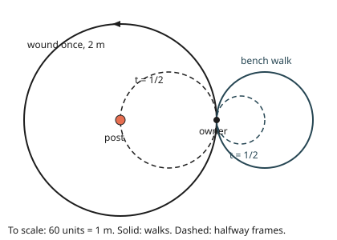

# Homotopy: sliding one map into another, and spaces that squash into each other

[Syllabus](../../../SYLLABUS.md) → [Topology](../README.md) → [Homotopy](../README.md#s04) → Homotopy

---

## General Overview

A lamp post stands in a park. An owner stands 2 metres east of it, holding a dog's lead. The dog runs once round the post, anticlockwise, and comes back to the owner's feet. Now the lead is wound round the post. The owner pulls, flicks and lifts the lead along the ground, but it will not come free. The post is in the way.

Change one thing. The dog runs round a park bench 3 metres east of the post instead, and comes back. This lead slides free: the owner can pull the whole loop in to their feet without touching the post. A third dog runs round the post once, then back round the other way. That lead slides free too, although it went round the post twice.

A **homotopy** is the slide: a continuous film of loops, or of maps in general, that starts at one and ends at the other. This card writes such films down, shows that "wound once" can never be filmed into "free", and uses the same films on whole spaces. The lawn squashes to a single point. The ground round the post squashes onto a ring. Spaces that squash into each other like that are **homotopy equivalent**, a looser kind of sameness than the homeomorphism of [Continuity by pre-images, and homeomorphism](../02-Topological%20Spaces/03-continuity-and-homeomorphism.md).

**A homotopy slides one map into another through a continuous film of maps that never leaves the target space; two spaces are homotopy equivalent when maps each way undo each other up to such a slide, so a lawn squashes to a point and the ground round a post squashes onto a ring, without either pair being homeomorphic.**

**What kind of fact this is:** three definitions (homotopy, homotopy equivalence, deformation retract) and five theorems proved on this card in Why it works: homotopy is an equivalence relation; the winding number does not change along a homotopy that avoids the post; the lawn is homotopy equivalent to a point and the ground to a ring; neither pair is homeomorphic; and the ring is not homotopy equivalent to a point.

### The picture: two walks and the straight slide to the owner

<p align="center"></p>

To scale, 60 drawing units a metre. Solid circles are walks; dashed circles are the halfway frames of a straight slide that pulls every point of the walk to the owner. The wound walk's halfway frame runs through the post. The bench walk's frames never come nearer the post than 2 m.

---

## The formula

Notation first, in words. $`I = [0, 1]`$ is the time interval of a film, and $`t`$ in $`I`$ is the time. $`X \times I`$ is the set of pairs: a point of $`X`$ and a time. This card introduces three marks.

- $`H(x, t)`$: a **homotopy**, the frame at time $`t`$ evaluated at the point $`x`$.
- $`\simeq`$: read "is homotopic to" between maps and "is homotopy equivalent to" between spaces. It is never written $`\sim`$, which is the equivalence relation of wing 01.
- $`D^2`$: the closed **disc**, every point of the plane at distance at most 1 from the centre. The lawn is $`D^2`$ scaled up to a 5 m radius.

A homotopy from a map $`f`$ to a map $`g`$, both from $`X`$ to $`Y`$:

```math
H : X \times I \to Y \text{ continuous}, \qquad H(x, 0) = f(x), \qquad H(x, 1) = g(x)
```

**Read it aloud:** a continuous film of maps from X into Y, whose first frame is f and whose last frame is g; if one exists, f is homotopic to g, written f ≃ g.

Two spaces are homotopy equivalent when maps each way undo each other up to a homotopy. Here $`\mathrm{id}_X`$ is the identity map, which leaves every point of $`X`$ where it is, and $`g \circ f`$ means do $`f`$, then $`g`$.

```math
X \simeq Y \iff \text{some } f : X \to Y,\ g : Y \to X \text{ have } g \circ f \simeq \mathrm{id}_X \text{ and } f \circ g \simeq \mathrm{id}_Y
```

**Read it aloud:** X and Y are homotopy equivalent when going across and back is homotopic to staying put, on both sides.

The tool that produces most equivalences is the **deformation retract**. A subset $`A`$ of $`X`$ is one when a film shrinks all of $`X`$ onto $`A`$ while every point of $`A`$ stays still:

```math
H(x, 0) = x, \qquad H(x, 1) \in A, \qquad H(a, t) = a \ \text{ for every } a \in A \text{ and every } t
```

The park gives three films, each with its own numbers below. The post is the disc of radius 0.1 m round the origin; the **ground** is the lawn without the post; the **ring** $`S^1`$ is the circle of radius 2 m round the post.

```math
H(x, t) = (1 - t)\, f(x) + t\, g(x), \qquad H(x, t) = (1 - t)\, x, \qquad H(x, t) = (1 - t)\, x + t\, \frac{2x}{\lvert x \rvert}
```

The first is the **straight slide** from $`f`$ to $`g`$; the second squashes the lawn to its centre; the third squashes the ground onto the ring. Here $`\lvert x \rvert`$ is the distance from the post's centre to $`x`$.

A walk is a loop: a map $`\gamma`$ (gamma) from $`I`$ into the ground with $`\gamma(0) = \gamma(1)`$, the owner's feet. The walk wound once is $`\gamma_1(s) = (2\cos 2\pi s,\ 2\sin 2\pi s)`$, with $`s`$ the fraction of the walk done. Its **winding number** $`n(\gamma, 0)`$, from [Deforming a loop](../../07-Complex%20analysis/03-Contour%20Integrals%20and%20Cauchy%27s%20Theorem/04-deforming-contours-and-winding-numbers.md), is the net number of anticlockwise turns the walk makes round the post.

The card follows four walks, each starting and ending at the owner's feet: **wound once** ($`\gamma_1`$), **wound the other way**, clockwise ($`\gamma_{-1}`$), **round the bench**, and **round, then back**. Every distance "from the post" is measured from the post's centre.

| Symbol | Plain meaning | In our example | Push it up and the answer… |
| --- | --- | --- | --- |
| $`X`$, $`Y`$, $`Z`$, $`A`$ | spaces; $`A`$ a subset of $`X`$ | the lawn, the ground, the ring | — |
| $`f`$, $`g`$, $`h`$, $`r`$ | continuous maps; $`r(x) = 2x / \lvert x \rvert`$ pushes a ground point along its ray onto the ring | $`r(0.3, 0.4) = (1.2, 1.6)`$ | — |
| $`H(x, t)`$ | a homotopy: frame $`t`$ of the film, at the point $`x`$ | the straight slide | — |
| $`t`$, $`I`$ | the film's time; the interval $`[0, 1]`$ | $`t = 1/2`$, halfway | 0 is the first map, 1 the last |
| $`s`$, $`\gamma`$, $`\gamma_k`$, $`\varphi`$ | the fraction of a walk done; a walk; the walk wound $`k`$ times on the ring; the out-and-back schedule of Step 2 | $`\gamma_1(1/2) = (-2, 0)`$ | — |
| $`n(\gamma, 0)`$ | the winding number: net anticlockwise turns round the post | 1, −1, 0, 0 for the four walks | each extra turn adds 1 |
| $`\simeq`$ | homotopic (maps) or homotopy equivalent (spaces) | lawn $`\simeq`$ point | — |
| $`\cong`$ | homeomorphic: paired one for one, continuously both ways | ring $`\cong`$ a square outline | — |
| $`\mathrm{id}_X`$, $`\circ`$ | the identity map of $`X`$; "do this, then that" | $`r \circ i`$ | — |
| $`i`$ | the inclusion: a point of the ring regarded as a point of the ground | $`i(2, 0) = (2, 0)`$ | — |
| $`D^2`$, $`S^1`$ | the disc; the circle (here the 2 m ring) | the lawn is $`D^2`$ of radius 5 m | — |
| $`\lvert x \rvert`$ | distance from the post's centre | $`\lvert (0.3, 0.4) \rvert = 0.5`$ m | — |

### When it holds

- **Every frame stays in the target.** The straight slide of the wound walk is a film of loops in the plane, but its halfway frame passes through the post, so it is no homotopy in the ground.
- **The film is continuous in time too.** Swap the wound walk for the owner's feet at $`t = 1/2`$, and the "film" changes winding number from 1 to 0 without ever coming nearer the post than 2 m. That jump is not a homotopy.
- **The target space is part of the question.** On the lawn with no post, the wound walk slides free: the straight slide is legal there. Whether two maps are homotopic depends on $`Y`$.
- **Both round trips.** For $`X \simeq Y`$, both $`g \circ f`$ and $`f \circ g`$ must be homotopic to the identity. One alone allows a point to look equivalent to the ring (What breaks).
- **Squashing is allowed.** A homotopy equivalence need not be one for one. That is the whole difference from a homeomorphism, and the reason $`\simeq`$ does not imply $`\cong`$.

---

## Why it works

### Step 0: a count cannot change along a film

A homotopy is a film with no jumps, neither from point to point nor from frame to frame. Anything that can only take whole-number values, such as a count of turns, must then stay the same from the first frame to the last. That one idea proves when a lead is caught.

The homotopies themselves are written by formulas, and their continuity comes from the rules of [Continuity](../../06-Calculus%20and%20analysis/01-Limits%20and%20Continuity/05-continuity.md): sums, products and quotients by non-zero numbers of continuous functions are continuous.

[Deforming a loop](../../07-Complex%20analysis/03-Contour%20Integrals%20and%20Cauchy%27s%20Theorem/04-deforming-contours-and-winding-numbers.md) already slid a loop round the plane without crossing a singularity: that slide is a homotopy in the punctured plane, the plane with one point removed. This card makes the film the object of study.

### Step 1: writing a homotopy, and watching one fail

The straight slide pulls each point of a walk along a straight line to the owner at $`(2, 0)`$: $`H(s, t) = (1 - t)\,\gamma(s) + t\,(2, 0)`$.

- **The bench walk.** It is the 1 m circle round $`(3, 0)`$. Frame $`t`$ is the circle of radius $`1 - t`$ round $`(3 - t, 0)`$. Its nearest point to the post is $`(3 - t) - (1 - t) = 2`$ m away, in every frame. So the film stays in the ground, and the bench walk is homotopic to the owner standing still.
- **The wound walk.** Frame $`t`$ is the circle of radius $`2(1 - t)`$ round $`(2t, 0)`$. Its nearest point to the post's centre is $`\lvert 2 - 4t \rvert`$ away. At $`t = 1/2`$ the point $`\gamma_1(1/2) = (-2, 0)`$ has moved to $`\tfrac12(-2, 0) + \tfrac12(2, 0) = (0, 0)`$: the lead runs through the post.

One failed film proves nothing on its own: some cleverer film might succeed. Step 2 shows none does.

### Step 2: wound once, it cannot slide free

The winding number of a walk is its total change of angle, seen from the post, divided by one full turn. Deforming a loop shows this equals the contour integral formula there. It is a whole number, because the walk ends where it began.

**Claim:** if $`H`$ is a homotopy of closed loops in the ground, every frame has the same winding number. Each frame must end where it starts, but the start point may move from frame to frame.

The proof has two parts. First, the **leash lemma**: if two walks stay closer to each other at every moment than the first is to the post, they wind equally. A dog on a short lead, walked round a post, goes round as often as its owner. Second, a continuous film on the closed square $`I \times I`$ moves by less than that margin in any short enough time step, so neighbouring frames are leashed to each other, and the count passes unchanged from frame 0 to frame 1.

<details>
<summary>Detailed proof: the winding number is constant along a homotopy</summary>

Write points of the plane as complex numbers, with the post's centre at 0. For a walk $`\gamma`$ avoiding 0, the winding number is the total change in the angle of $`\gamma(s)`$ as $`s`$ runs from 0 to 1, divided by $`2\pi`$.

**Leash lemma.** Suppose $`\lvert \beta(s) - \alpha(s) \rvert < \lvert \alpha(s) \rvert`$ for every $`s`$. Put $`q(s) = \beta(s) / \alpha(s)`$. Then

$`\displaystyle \lvert q(s) - 1 \rvert = \frac{\lvert \beta(s) - \alpha(s) \rvert}{\lvert \alpha(s) \rvert} < 1,`$

so $`q(s)`$ lies in the open disc of radius 1 round 1, inside the right half-plane. Its angle stays strictly between $`-\pi/2`$ and $`\pi/2`$, so a closed loop $`q`$ has total angle change 0. Angles add when complex numbers multiply, and $`\beta = \alpha\, q`$, so the total angle change of $`\beta`$ equals that of $`\alpha`$. The two walks wind equally.

**The film.** $`H`$ is continuous on the closed square $`I \times I`$, which is compact, so $`\lvert H \rvert`$ reaches a minimum $`m`$, and $`m > 0.1`$ since every frame lies in the ground. A continuous map on a compact set is uniformly continuous ([Uniform continuity](../01-Metric%20Spaces/07-uniform-continuity-and-heine-cantor.md)): some $`\delta > 0`$ has

$`\displaystyle \lvert t - t' \rvert < \delta \implies \lvert H(s, t) - H(s, t') \rvert < m \le \lvert H(s, t) \rvert \text{ for every } s.`$

Choose times $`0 = t_0 < t_1 < \dots < t_N = 1`$ less than $`\delta`$ apart. The leash lemma gives the frames at $`t_j`$ and $`t_{j+1}`$ equal winding numbers, for each $`j`$. Chaining these equalities, frame 0 and frame 1 wind equally.

</details>

So the wound walk, with winding number 1, is not homotopic in the ground to the owner standing still, whose winding number is 0. The code finds the counts 1, −1, 0 and 0 for the four walks, by two separate roads.

A count of 0 does not, by itself, say how to free the lead. For the walk round and back, a film does it. Let $`\varphi(s)`$ (phi) run from 0 up to 1 and back to 0, so that $`\gamma_1(\varphi(s))`$ is that walk. The film

```math
H(s, t) = \gamma_1\big((1 - t)\,\varphi(s)\big)
```

shrinks how far round the walk goes, from a full turn at $`t = 0`$ to nothing at $`t = 1`$. Every frame stays on the 2 m ring, never nearer the post than 2 m. That a winding number of 0 always means "slides free" is a theorem about the ring, proved on [The circle's fundamental group is the integers](04-fundamental-group-of-the-circle.md).

### Step 3: homotopy is an equivalence relation

Homotopic maps fall into classes, because $`\simeq`$ has the three properties of an equivalence relation.

1. **Reflexive.** $`H(x, t) = f(x)`$, the film that never moves, takes $`f`$ to itself.
2. **Symmetric.** Play a film backwards, $`H(x, 1 - t)`$, and it takes $`g`$ to $`f`$.
3. **Transitive.** Play a film from $`f`$ to $`g`$ at double speed for $`t \le 1/2`$, then one from $`g`$ to a third map $`h`$. The two halves agree at $`t = 1/2`$, where both show $`g`$, and they are defined on closed pieces, so the pasting lemma of [Continuity by pre-images, and homeomorphism](../02-Topological%20Spaces/03-continuity-and-homeomorphism.md) makes the joined film continuous.

Homotopy equivalence of spaces is an equivalence relation too. Reflexive and symmetric follow at once. Transitive needs one more fact: a film run through fixed continuous maps before and after, $`g(H(f(x), t))`$, is still a film. So if $`X \simeq Y`$ and $`Y \simeq Z`$, the round trip $`X \to Y \to Z \to Y \to X`$ has the round trip $`Y \to Z \to Y`$ in its middle. Squash that middle to the identity of $`Y`$, and what is left, $`X \to Y \to X`$, squashes to the identity of $`X`$. The round trip from $`Z`$ is the same.

### Step 4: the lawn squashes to a point

Take $`f`$ from the lawn to its centre, sending every point to $`(0, 0)`$, and $`g`$ the inclusion of the centre back into the lawn.

- $`f \circ g`$ sends the centre to the centre: it is the identity of the one-point space, exactly.
- $`g \circ f`$ sends every point of the lawn to the centre. The film $`H(x, t) = (1 - t)\,x`$ runs from the identity at $`t = 0`$ to that map at $`t = 1`$. Every frame stays in the lawn, since $`\lvert (1 - t)\,x \rvert \le \lvert x \rvert \le 5`$.

So the lawn $`\simeq`$ a point, and the centre is a deformation retract of the lawn: it never moves. The same film works for $`D^2`$, for any disc and for any convex set, one that holds the straight segment between any two of its points, with the centre replaced by any chosen point of the set. Every walk on the lawn with no post slides free, by squashing it with the lawn.

### Step 5: the ground squashes onto the ring

Take $`r(x) = 2x / \lvert x \rvert`$ from the ground to the ring, and $`i`$ the inclusion of the ring into the ground.

- $`r \circ i`$ is the identity of the ring: a point already 2 m from the post stays where it is.
- $`i \circ r`$ is homotopic to the identity of the ground, through $`H(x, t) = (1 - t)\,x + t\, r(x)`$.

That film moves each point along its own ray from the post, from distance $`\lvert x \rvert`$ to distance 2, so frame $`t`$ is at distance $`(1 - t)\lvert x \rvert + 2t`$. That lies between $`\lvert x \rvert`$ and 2, both more than 0.1 and at most 5, so every frame stays in the ground. It never moves a point of the ring.

So the ring is a deformation retract of the ground, and the ground $`\simeq S^1`$. This is why one count settles every lead question on the ground: they are all questions about the ring.

### Step 6: homotopy equivalent is not homeomorphic

A homeomorphism must pair points one for one, continuously both ways. A homotopy equivalence may squash.

- **Lawn and point.** The lawn has infinitely many points and the point has one, so no pairing exists: lawn $`\simeq`$ point, but not lawn $`\cong`$ point.
- **Ground and ring.** A homeomorphism carries the number of pieces left after removing two points. Remove two points from the ring and two open arcs remain: 2 pieces. Remove two points from the ground and it stays in 1 piece, because a path can always step round a missing point. So the ground is not homeomorphic to the ring, although ground $`\simeq`$ ring.
- **Ring and point.** These are not even homotopy equivalent. Going ring → point → ring sends every point to one chosen point of the ring, such as $`(2, 0)`$. If that were homotopic to the identity of the ring, the film would carry $`\gamma_1`$, winding number 1, to the loop that stays at the chosen point, winding number 0, inside the ring and so inside the ground. Step 2 forbids it, whichever point is chosen, since its frames may start anywhere.

Agreeing on an invariant proves nothing in either direction. Ground and ring share every homotopy invariant, yet are different spaces for homeomorphism.

---

## Worked numbers, by hand

| Step | Arithmetic | Value |
| --- | --- | --- |
| wound walk, halfway round | $`\gamma_1(1/2) = (2\cos\pi,\ 2\sin\pi)`$ | $`(-2, 0)`$ |
| straight slide, halfway frame | $`\tfrac12(-2, 0) + \tfrac12(2, 0)`$ | $`(0, 0)`$: inside the post |
| wound walk, nearest the post in frame $`t = 0.3`$ | $`\lvert 2 - 4 \times 0.3 \rvert`$ | 0.8 m |
| bench walk, nearest the post in any frame | $`(3 - t) - (1 - t)`$ | 2 m |
| winding numbers of the four walks | count net anticlockwise turns | 1, −1, 0, 0 |
| lawn squash, $`(3, 4)`$ at $`t = 1/2`$ | $`\tfrac12 \times (3, 4)`$ | $`(3/2, 2)`$ |
| ground squash, $`(0.3, 0.4)`$ at $`t = 1`$ | $`2 \times (0.3, 0.4) / 0.5`$ | $`(1.2, 1.6)`$ |
| the same point at $`t = 1/2`$ | $`\tfrac12 (0.3, 0.4) + \tfrac12 (1.2, 1.6)`$ | $`(0.75, 1)`$ |
| cut test, two points removed | ring against ground | 2 pieces against 1 |
| **verdict** | **the count survives every film** | **wound once: caught; bench, round-and-back: free** |

The wound lead is caught for good: winding number 1, and no film in the ground changes it. The ground behaves like the ring for every such question, yet is not the ring.

### What breaks if you drop a piece

| Mistake | Comes out at | What went wrong |
| --- | --- | --- |
| Let a frame pass through the post | straight slide, frame 0.5 hits $`(0, 0)`$; winding 1 before, 0 after | Not a homotopy in the ground: the post is outside the target |
| Let the film jump in time | winding 1 for $`t < 0.5`$, 0 after, never nearer the post than 2 m | Continuity in $`t`$ fails, and the count jumps |
| Check one round trip only | point → ring → point is the identity; ring → point → ring winds 0, the identity loop 1 | The second round trip is not homotopic to the identity: ring $`\not\simeq`$ point |
| Read $`\simeq`$ as $`\cong`$ | two points cut: ring 2 pieces, ground 1 piece | Squashing is allowed in $`\simeq`$; a homeomorphism keeps the cut count |

The code prints all four.

---

## Code, from first principles, and it actually runs

The code samples each walk at 360 points and finds its winding number by two roads: adding the small turns between neighbouring points, and counting signed crossings of a ray from the post. It plays each film in 11 frames, $`t = 0, 0.1, \dots, 1`$, and compares the sampled nearest approach with the exact formula $`\lvert 2 - 4t \rvert`$. The lawn squash is checked exactly in integers on 81 grid points; the ground squash on 7840 points 0.1 m apart, against the distance formula $`(1 - t)\lvert x \rvert + 2t`$. The cut test runs on graph models, by breadth-first search and by union-find. These are illustrations checked on finitely many cases; the proofs are in Why it works.

### Python

```python
# Homotopy and homotopy equivalence -- the check behind the card.  Standard library only.
# A lamp post is the disc of radius 0.1 m round (0, 0); the owner stands at (2, 0).
# A walk is a loop s -> point, s in [0, 1]; a homotopy H(s, t) is one walk per frame t.
from fractions import Fraction as F
from math import atan2, cos, pi, sin, sqrt

N, POST, U = 360, 0.1, (cos(1.0), sin(1.0))       # samples per walk; post radius; ray direction

def wound(k):                                      # k turns round the post on the 2 m ring
    return lambda s: (2 * cos(2 * pi * k * s), 2 * sin(2 * pi * k * s))
def bench(s):                                      # a 1 m circle round a bench at (3, 0)
    return (3 - cos(2 * pi * s), -sin(2 * pi * s))
def phi(s): return 2 * s if s <= 0.5 else 2 - 2 * s   # once round, then back the same way
def there_back(s): return wound(1)(phi(s))

def pts(f): return [f(j / N) for j in range(N)]
def closest(p): return min(sqrt(x * x + y * y) for x, y in p)
def wind_angle(p):                                 # road 1: add the turns between neighbours
    tot = 0.0
    for (x0, y0), (x1, y1) in zip(p, p[1:] + p[:1]):
        tot += atan2(x0 * y1 - y0 * x1, x0 * x1 + y0 * y1)
    return round(tot / (2 * pi))
def wind_ray(p):                                   # road 2: signed crossings of a ray from the post
    n = 0
    for (x0, y0), (x1, y1) in zip(p, p[1:] + p[:1]):
        c0, c1 = U[0] * y0 - U[1] * x0, U[0] * y1 - U[1] * x1
        if (c0 < 0) != (c1 < 0):
            a = c0 / (c0 - c1)
            if (x0 + a * (x1 - x0)) * U[0] + (y0 + a * (y1 - y0)) * U[1] > 0:
                n += 1 if c0 < 0 else -1
    return n
def frame(H, t): return pts(lambda s: H(s, t))
def straight(f):                                   # slide every point straight to the owner
    return lambda s, t: ((1 - t) * f(s)[0] + 2 * t, (1 - t) * f(s)[1])
def report(H):                                     # closest approach and winding, frame by frame
    out = []
    for j in range(11):
        p = frame(H, j / 10)
        d = closest(p)
        out.append((d, None if d <= POST else wind_angle(p), None if d <= POST else wind_ray(p)))
    return out
def w(v): return "hits post" if v is None else f"winding {v:2d}"

walks = [("wound once", wound(1)), ("wound the other way", wound(-1)),
         ("round the bench", bench), ("round, then back", there_back)]
print(f"post radius {POST} m at (0, 0); owner at (2, 0); {N} samples per walk")
wind = {}
for name, f in walks:
    p = pts(f)
    wind[name] = (wind_angle(p), wind_ray(p))
    print(f"{name:20s} closest {closest(p):.6f} m, winding by angle sum {wind[name][0]:2d}, by ray {wind[name][1]:2d}")
sb, sw = report(straight(bench)), report(straight(wound(1)))
print("straight slide to the owner, frame by frame:")
for j in range(11):
    print(f"t={j / 10:.1f}  bench {sb[j][0]:.6f} m {w(sb[j][1])}  |  wound once {sw[j][0]:.6f} m {w(sw[j][1])}")
mid = straight(wound(1))(0.5, 0.5)
print(f"wound once, gamma(1/2) = ({wound(1)(0.5)[0]:.6f}, {abs(wound(1)(0.5)[1]):.6f}); H(1/2, 1/2) = ({abs(mid[0]):.6f}, {abs(mid[1]):.6f}): the straight slide crosses the post")
tight = report(lambda s, t: ((1 - 0.75 * t) * wound(1)(s)[0], (1 - 0.75 * t) * wound(1)(s)[1]))
print(f"pull the wound lead tight, radius 2 -> 0.5 m: windings {[r[1] for r in tight]}, closest at t=1 {tight[10][0]:.6f} m")
undo = report(lambda s, t: wound(1)((1 - t) * phi(s)))
print(f"round-then-back, unwind the angle: windings {[r[1] for r in undo]}, closest {min(r[0] for r in undo):.6f} m")
end = frame(lambda s, t: wound(1)((1 - t) * phi(s)), 1.0)
print(f"  last frame stays at the owner: {'yes' if max(abs(x - 2) + abs(y) for x, y in end) < 1e-12 else 'no'}")
jump = [wind_angle(frame(lambda s, t: wound(1)(s) if t < 0.5 else (2.0, 0.0), j / 10)) for j in range(11)]
print(f"mistake, frames that jump at t=0.5: windings {jump}, never nearer the post than 2 m")
# The lawn: a disc of radius 5 m.  Squash it to its centre with H(x, t) = (1 - t) x, exactly.
lawn = [(a, b) for a in range(-5, 6) for b in range(-5, 6) if a * a + b * b <= 25]
inside = all(((1 - F(j, 10)) ** 2) * (a * a + b * b) <= 25 for a, b in lawn for j in range(11))
print(f"lawn grid: {len(lawn)} points; every frame inside the lawn: {'yes' if inside else 'no'}; "
      f"(3, 4) at t=1/2 -> ({F(1, 2) * 3}, {F(1, 2) * 4}); at t=1 all at (0, 0)")
# The ground: the lawn minus the post.  Retract it onto the 2 m ring: H(x, t) = (1 - t) x + t * 2x/|x|.
ground = [(a / 10, b / 10) for a in range(-50, 51) for b in range(-50, 51) if 1 < a * a + b * b <= 2500]
worst, low = 0.0, 9.0
for x, y in ground:
    r = sqrt(x * x + y * y)
    for j in range(11):
        t = j / 10
        hx, hy = (1 - t) * x + t * 2 * x / r, (1 - t) * y + t * 2 * y / r
        d = sqrt(hx * hx + hy * hy)
        worst, low = max(worst, abs(d - ((1 - t) * r + 2 * t))), min(low, d)
ring = [(x, y) for x, y in ground if abs(x * x + y * y - 4) < 1e-9]
fixed = all(abs(2 * x / sqrt(x * x + y * y) - x) + abs(2 * y / sqrt(x * x + y * y) - y) < 1e-12 for x, y in ring)
hx, hy = 0.5 * 0.3 + 0.5 * 2 * 0.3 / 0.5, 0.5 * 0.4 + 0.5 * 2 * 0.4 / 0.5
print(f"ground grid: {len(ground)} points, 0.1 m apart; closest any frame comes to the post {low:.6f} m")
print(f"  distance (1-t)|x| + 2t by formula and directly agree to 1e-12: {'yes' if worst < 1e-12 else 'no'}")
print(f"  (0.3, 0.4), |x| = {sqrt(0.3 * 0.3 + 0.4 * 0.4):.6f}, at t=1/2 -> ({hx:.6f}, {hy:.6f}); at t=1 -> ({2 * 0.3 / 0.5:.6f}, {2 * 0.4 / 0.5:.6f})")
print(f"  {len(ring)} grid points on the ring, all left where they are: {'yes' if fixed else 'no'}")
# Cut test: a homeomorphism keeps the number of pieces left after removing two points.
def pieces_bfs(nodes, nbrs):
    seen, n = set(), 0
    for v in nodes:
        if v not in seen:
            n, todo = n + 1, [v]
            seen.add(v)
            while todo:
                for u in nbrs(todo.pop()):
                    if u in nodes and u not in seen:
                        seen.add(u)
                        todo.append(u)
    return n
def pieces_uf(nodes, nbrs):
    par = {v: v for v in nodes}
    def root(v):
        while par[v] != v:
            v = par[v]
        return v
    for v in nodes:
        for u in nbrs(v):
            if u in nodes:
                par[root(u)] = root(v)
    return len({root(v) for v in nodes})
ring12 = set(range(12)) - {0, 6}
step12 = lambda v: [(v + 1) % 12, (v - 1) % 12]
grid = {(a, b) for a in range(-5, 6) for b in range(-5, 6) if 4 <= a * a + b * b <= 25} - {(3, 0), (-3, 0)}
step4 = lambda v: [(v[0] + 1, v[1]), (v[0] - 1, v[1]), (v[0], v[1] + 1), (v[0], v[1] - 1)]
rc, gc = (pieces_bfs(ring12, step12), pieces_uf(ring12, step12)), (pieces_bfs(grid, step4), pieces_uf(grid, step4))
print(f"cut two opposite points: ring of 12 -> {rc[0]} pieces (union-find {rc[1]}); "
      f"ground model of {len(grid) + 2} -> {gc[0]} piece (union-find {gc[1]})")
print(f"mistake, one round trip: point -> ring -> point is the identity; ring -> point -> ring "
      f"winds {wind_angle(pts(lambda s: (2.0, 0.0)))}, the identity loop {wind['wound once'][0]}")
print(f"figure,post r=0.1,ring c=(0,0) r=2,frame c=(1,0) r=1,bench c=(3,0) r=1,frame c=(2.5,0) r=0.5")
assert [wind[n] for n, _ in walks] == [(1, 1), (-1, -1), (0, 0), (0, 0)]       # two roads agree
assert all(abs(sw[j][0] - abs(2 - 0.4 * j)) < 1e-9 for j in range(11))       # sampled = exact |2 - 4t|
assert [r[1] for r in sw] == [1] * 5 + [None] + [0] * 5 and all(r[1] == 0 for r in sb)
assert all(abs(r[0] - 2) < 1e-9 for r in sb)                                  # bench: 2 m in every frame
assert [r[1] for r in tight] == [1] * 11 and abs(tight[10][0] - 0.5) < 1e-12 and [r[1] for r in undo] == [0] * 11
assert inside and len(lawn) == 81 and worst < 1e-12 and fixed and len(ring) == 12
assert rc == (2, 2) and gc == (1, 1) and jump == [1] * 5 + [0] * 6
print("ALL CHECKS PASS")
```

**Ran 2026-11-15 on macOS, Python 3.14.10, standard library only. All checks passed. Output, pasted from the run:**

```
post radius 0.1 m at (0, 0); owner at (2, 0); 360 samples per walk
wound once           closest 2.000000 m, winding by angle sum  1, by ray  1
wound the other way  closest 2.000000 m, winding by angle sum -1, by ray -1
round the bench      closest 2.000000 m, winding by angle sum  0, by ray  0
round, then back     closest 2.000000 m, winding by angle sum  0, by ray  0
straight slide to the owner, frame by frame:
t=0.0  bench 2.000000 m winding  0  |  wound once 2.000000 m winding  1
t=0.1  bench 2.000000 m winding  0  |  wound once 1.600000 m winding  1
t=0.2  bench 2.000000 m winding  0  |  wound once 1.200000 m winding  1
t=0.3  bench 2.000000 m winding  0  |  wound once 0.800000 m winding  1
t=0.4  bench 2.000000 m winding  0  |  wound once 0.400000 m winding  1
t=0.5  bench 2.000000 m winding  0  |  wound once 0.000000 m hits post
t=0.6  bench 2.000000 m winding  0  |  wound once 0.400000 m winding  0
t=0.7  bench 2.000000 m winding  0  |  wound once 0.800000 m winding  0
t=0.8  bench 2.000000 m winding  0  |  wound once 1.200000 m winding  0
t=0.9  bench 2.000000 m winding  0  |  wound once 1.600000 m winding  0
t=1.0  bench 2.000000 m winding  0  |  wound once 2.000000 m winding  0
wound once, gamma(1/2) = (-2.000000, 0.000000); H(1/2, 1/2) = (0.000000, 0.000000): the straight slide crosses the post
pull the wound lead tight, radius 2 -> 0.5 m: windings [1, 1, 1, 1, 1, 1, 1, 1, 1, 1, 1], closest at t=1 0.500000 m
round-then-back, unwind the angle: windings [0, 0, 0, 0, 0, 0, 0, 0, 0, 0, 0], closest 2.000000 m
  last frame stays at the owner: yes
mistake, frames that jump at t=0.5: windings [1, 1, 1, 1, 1, 0, 0, 0, 0, 0, 0], never nearer the post than 2 m
lawn grid: 81 points; every frame inside the lawn: yes; (3, 4) at t=1/2 -> (3/2, 2); at t=1 all at (0, 0)
ground grid: 7840 points, 0.1 m apart; closest any frame comes to the post 0.141421 m
  distance (1-t)|x| + 2t by formula and directly agree to 1e-12: yes
  (0.3, 0.4), |x| = 0.500000, at t=1/2 -> (0.750000, 1.000000); at t=1 -> (1.200000, 1.600000)
  12 grid points on the ring, all left where they are: yes
cut two opposite points: ring of 12 -> 2 pieces (union-find 2); ground model of 72 -> 1 piece (union-find 1)
mistake, one round trip: point -> ring -> point is the identity; ring -> point -> ring winds 0, the identity loop 1
figure,post r=0.1,ring c=(0,0) r=2,frame c=(1,0) r=1,bench c=(3,0) r=1,frame c=(2.5,0) r=0.5
ALL CHECKS PASS
```

### Rust

Same numbers, same labels, built with `rustc --edition 2021 -O`.

```rust
// Homotopy and homotopy equivalence -- the same check as the Python, in Rust.  No crates.
// A lamp post is the disc of radius 0.1 m round (0, 0); the owner stands at (2, 0).
// A walk is a loop s -> point, s in [0, 1]; a homotopy H(s, t) is one walk per frame t.
use std::collections::{HashMap, HashSet, VecDeque};
use std::f64::consts::PI;

const N: usize = 360;
const POST: f64 = 0.1;
type P = (f64, f64);

fn wound(k: f64, s: f64) -> P { (2.0 * (2.0 * PI * k * s).cos(), 2.0 * (2.0 * PI * k * s).sin()) }
fn bench(s: f64) -> P { (3.0 - (2.0 * PI * s).cos(), -(2.0 * PI * s).sin()) }
fn phi(s: f64) -> f64 { if s <= 0.5 { 2.0 * s } else { 2.0 - 2.0 * s } }
fn there_back(s: f64) -> P { wound(1.0, phi(s)) }
fn pts(f: &dyn Fn(f64) -> P) -> Vec<P> { (0..N).map(|j| f(j as f64 / N as f64)).collect() }
fn closest(p: &[P]) -> f64 { p.iter().map(|&(x, y)| (x * x + y * y).sqrt()).fold(f64::INFINITY, f64::min) }
fn wind_angle(p: &[P]) -> i64 {               // road 1: add the turns between neighbours
    let mut tot = 0.0;
    for i in 0..p.len() {
        let ((x0, y0), (x1, y1)) = (p[i], p[(i + 1) % p.len()]);
        tot += (x0 * y1 - y0 * x1).atan2(x0 * x1 + y0 * y1);
    }
    (tot / (2.0 * PI)).round() as i64
}
fn wind_ray(p: &[P]) -> i64 {                 // road 2: signed crossings of a ray from the post
    let u = (1.0f64.cos(), 1.0f64.sin());
    let mut n = 0;
    for i in 0..p.len() {
        let ((x0, y0), (x1, y1)) = (p[i], p[(i + 1) % p.len()]);
        let (c0, c1) = (u.0 * y0 - u.1 * x0, u.0 * y1 - u.1 * x1);
        if (c0 < 0.0) != (c1 < 0.0) {
            let a = c0 / (c0 - c1);
            if (x0 + a * (x1 - x0)) * u.0 + (y0 + a * (y1 - y0)) * u.1 > 0.0 { n += if c0 < 0.0 { 1 } else { -1 } }
        }
    }
    n
}
fn frame(h: &dyn Fn(f64, f64) -> P, t: f64) -> Vec<P> { pts(&|s| h(s, t)) }
fn straight(f: &dyn Fn(f64) -> P, s: f64, t: f64) -> P { let p = f(s); ((1.0 - t) * p.0 + 2.0 * t, (1.0 - t) * p.1) }
fn report(h: &dyn Fn(f64, f64) -> P) -> Vec<(f64, Option<i64>, Option<i64>)> {
    (0..11).map(|j| {
        let p = frame(h, j as f64 / 10.0);
        let d = closest(&p);
        if d <= POST { (d, None, None) } else { (d, Some(wind_angle(&p)), Some(wind_ray(&p))) }
    }).collect()
}
fn w(v: Option<i64>) -> String { match v { None => "hits post".to_string(), Some(k) => format!("winding {:2}", k) } }
fn frac(n: i64, d: i64) -> String {          // a fraction in lowest terms
    let (mut a, mut b) = (n.abs(), d);
    while b != 0 { (a, b) = (b, a % b) }
    if d / a == 1 { format!("{}", n / a) } else { format!("{}/{}", n / a, d / a) }
}
fn yn(b: bool) -> &'static str { if b { "yes" } else { "no" } }
fn windings(r: &[(f64, Option<i64>, Option<i64>)]) -> Vec<i64> { r.iter().map(|x| x.1.unwrap()).collect() }
fn pieces_bfs<T: Copy + Eq + std::hash::Hash>(nodes: &HashSet<T>, order: &[T], nbrs: &dyn Fn(T) -> Vec<T>) -> usize {
    let (mut seen, mut n) = (HashSet::new(), 0);
    for &v in order {
        if seen.insert(v) {
            n += 1;
            let mut todo = VecDeque::from([v]);
            while let Some(x) = todo.pop_front() {
                for u in nbrs(x) { if nodes.contains(&u) && seen.insert(u) { todo.push_back(u) } }
            }
        }
    }
    n
}
fn pieces_uf<T: Copy + Eq + std::hash::Hash>(nodes: &HashSet<T>, order: &[T], nbrs: &dyn Fn(T) -> Vec<T>) -> usize {
    let mut par: HashMap<T, T> = order.iter().map(|&v| (v, v)).collect();
    fn root<T: Copy + Eq + std::hash::Hash>(par: &HashMap<T, T>, mut v: T) -> T { while par[&v] != v { v = par[&v] } v }
    for &v in order {
        for u in nbrs(v) {
            if nodes.contains(&u) { let (ru, rv) = (root(&par, u), root(&par, v)); par.insert(ru, rv); }
        }
    }
    order.iter().map(|&v| root(&par, v)).collect::<HashSet<T>>().len()
}

fn main() {
    let walks: Vec<(&str, Box<dyn Fn(f64) -> P>)> = vec![
        ("wound once", Box::new(|s| wound(1.0, s))), ("wound the other way", Box::new(|s| wound(-1.0, s))),
        ("round the bench", Box::new(bench)), ("round, then back", Box::new(there_back))];
    println!("post radius {} m at (0, 0); owner at (2, 0); {} samples per walk", POST, N);
    let mut wind = Vec::new();
    for (name, f) in &walks {
        let p = pts(f.as_ref());
        wind.push((wind_angle(&p), wind_ray(&p)));
        let k = wind.last().unwrap();
        println!("{:<20} closest {:.6} m, winding by angle sum {:2}, by ray {:2}", name, closest(&p), k.0, k.1);
    }
    let sb = report(&|s, t| straight(&bench, s, t));
    let sw = report(&|s, t| straight(&|s| wound(1.0, s), s, t));
    println!("straight slide to the owner, frame by frame:");
    for j in 0..11 {
        println!("t={:.1}  bench {:.6} m {}  |  wound once {:.6} m {}", j as f64 / 10.0, sb[j].0, w(sb[j].1), sw[j].0, w(sw[j].1));
    }
    let mid = straight(&|s| wound(1.0, s), 0.5, 0.5);
    println!("wound once, gamma(1/2) = ({:.6}, {:.6}); H(1/2, 1/2) = ({:.6}, {:.6}): the straight slide crosses the post", wound(1.0, 0.5).0, wound(1.0, 0.5).1.abs(), mid.0.abs(), mid.1.abs());
    let tight = report(&|s, t| { let p = wound(1.0, s); ((1.0 - 0.75 * t) * p.0, (1.0 - 0.75 * t) * p.1) });
    println!("pull the wound lead tight, radius 2 -> 0.5 m: windings {:?}, closest at t=1 {:.6} m", windings(&tight), tight[10].0);
    let unwind = |s: f64, t: f64| wound(1.0, (1.0 - t) * phi(s));
    let undo = report(&unwind);
    println!("round-then-back, unwind the angle: windings {:?}, closest {:.6} m", windings(&undo), undo.iter().map(|r| r.0).fold(f64::INFINITY, f64::min));
    let end = frame(&unwind, 1.0);
    println!("  last frame stays at the owner: {}", yn(end.iter().map(|&(x, y)| (x - 2.0).abs() + y.abs()).fold(0.0, f64::max) < 1e-12));
    let jump: Vec<i64> = (0..11).map(|j| wind_angle(&frame(&|s, t| if t < 0.5 { wound(1.0, s) } else { (2.0, 0.0) }, j as f64 / 10.0))).collect();
    println!("mistake, frames that jump at t=0.5: windings {:?}, never nearer the post than 2 m", jump);
    // The lawn: a disc of radius 5 m.  Squash it to its centre with H(x, t) = (1 - t) x, exactly in integers.
    let lawn: Vec<(i64, i64)> = (-5..6).flat_map(|a| (-5..6).map(move |b| (a, b))).filter(|&(a, b)| a * a + b * b <= 25).collect();
    let inside = lawn.iter().all(|&(a, b)| (0..11i64).all(|j| (10 - j) * (10 - j) * (a * a + b * b) <= 2500));
    println!("lawn grid: {} points; every frame inside the lawn: {}; (3, 4) at t=1/2 -> ({}, {}); at t=1 all at (0, 0)", lawn.len(), yn(inside), frac(3, 2), frac(4, 2));
    // The ground: the lawn minus the post.  Retract it onto the 2 m ring: H(x, t) = (1 - t) x + t * 2x/|x|.
    let mut ground: Vec<P> = Vec::new();
    for a in -50..51i64 { for b in -50..51i64 { if 1 < a * a + b * b && a * a + b * b <= 2500 { ground.push((a as f64 / 10.0, b as f64 / 10.0)) } } }
    let (mut worst, mut low) = (0.0f64, 9.0f64);
    for &(x, y) in &ground {
        let r = (x * x + y * y).sqrt();
        for j in 0..11 {
            let t = j as f64 / 10.0;
            let (hx, hy) = ((1.0 - t) * x + t * 2.0 * x / r, (1.0 - t) * y + t * 2.0 * y / r);
            let d = (hx * hx + hy * hy).sqrt();
            worst = worst.max((d - ((1.0 - t) * r + 2.0 * t)).abs());
            low = low.min(d);
        }
    }
    let ring: Vec<P> = ground.iter().copied().filter(|&(x, y)| (x * x + y * y - 4.0).abs() < 1e-9).collect();
    let fixed = ring.iter().all(|&(x, y)| { let r = (x * x + y * y).sqrt(); (2.0 * x / r - x).abs() + (2.0 * y / r - y).abs() < 1e-12 });
    let (hx, hy) = (0.5 * 0.3 + 0.5 * 2.0 * 0.3 / 0.5, 0.5 * 0.4 + 0.5 * 2.0 * 0.4 / 0.5);
    println!("ground grid: {} points, 0.1 m apart; closest any frame comes to the post {:.6} m", ground.len(), low);
    println!("  distance (1-t)|x| + 2t by formula and directly agree to 1e-12: {}", yn(worst < 1e-12));
    println!("  (0.3, 0.4), |x| = {:.6}, at t=1/2 -> ({:.6}, {:.6}); at t=1 -> ({:.6}, {:.6})", (0.3f64 * 0.3 + 0.4 * 0.4).sqrt(), hx, hy, 2.0 * 0.3 / 0.5, 2.0 * 0.4 / 0.5);
    println!("  {} grid points on the ring, all left where they are: {}", ring.len(), yn(fixed));
    // Cut test: a homeomorphism keeps the number of pieces left after removing two points.
    let r_order: Vec<i64> = (0..12).filter(|v| *v != 0 && *v != 6).collect();
    let ring12: HashSet<i64> = r_order.iter().copied().collect();
    let step12 = |v: i64| vec![(v + 1).rem_euclid(12), (v - 1).rem_euclid(12)];
    let g_order: Vec<(i64, i64)> = (-5..6i64).flat_map(|a| (-5..6i64).map(move |b| (a, b)))
        .filter(|&(a, b)| 4 <= a * a + b * b && a * a + b * b <= 25 && (a, b) != (3, 0) && (a, b) != (-3, 0)).collect();
    let grid: HashSet<(i64, i64)> = g_order.iter().copied().collect();
    let step4 = |v: (i64, i64)| vec![(v.0 + 1, v.1), (v.0 - 1, v.1), (v.0, v.1 + 1), (v.0, v.1 - 1)];
    let rc = (pieces_bfs(&ring12, &r_order, &step12), pieces_uf(&ring12, &r_order, &step12));
    let gc = (pieces_bfs(&grid, &g_order, &step4), pieces_uf(&grid, &g_order, &step4));
    println!("cut two opposite points: ring of 12 -> {} pieces (union-find {}); ground model of {} -> {} piece (union-find {})", rc.0, rc.1, grid.len() + 2, gc.0, gc.1);
    println!("mistake, one round trip: point -> ring -> point is the identity; ring -> point -> ring winds {}, the identity loop {}", wind_angle(&pts(&|_| (2.0, 0.0))), wind[0].0);
    println!("figure,post r=0.1,ring c=(0,0) r=2,frame c=(1,0) r=1,bench c=(3,0) r=1,frame c=(2.5,0) r=0.5");
    assert!(wind == vec![(1, 1), (-1, -1), (0, 0), (0, 0)]);                         // two roads agree
    assert!((0..11).all(|j| (sw[j].0 - (2.0 - 0.4 * j as f64).abs()).abs() < 1e-9)); // sampled = exact |2 - 4t|
    assert!(sw.iter().map(|r| r.1).collect::<Vec<_>>() == [vec![Some(1); 5], vec![None], vec![Some(0); 5]].concat());
    assert!(sb.iter().all(|r| r.1 == Some(0)));
    assert!(sb.iter().all(|r| (r.0 - 2.0).abs() < 1e-9));                          // bench: 2 m in every frame
    assert!(windings(&tight) == vec![1; 11] && (tight[10].0 - 0.5).abs() < 1e-12 && windings(&undo) == vec![0; 11]);
    assert!(inside && lawn.len() == 81 && worst < 1e-12 && fixed && ring.len() == 12);
    assert!(rc == (2, 2) && gc == (1, 1) && jump == [vec![1; 5], vec![0; 6]].concat());
    println!("ALL CHECKS PASS");
}
```

**Ran 2026-11-15 on macOS, rustc 1.98.1, no crates. All checks passed. Output, pasted from the run:**

```
post radius 0.1 m at (0, 0); owner at (2, 0); 360 samples per walk
wound once           closest 2.000000 m, winding by angle sum  1, by ray  1
wound the other way  closest 2.000000 m, winding by angle sum -1, by ray -1
round the bench      closest 2.000000 m, winding by angle sum  0, by ray  0
round, then back     closest 2.000000 m, winding by angle sum  0, by ray  0
straight slide to the owner, frame by frame:
t=0.0  bench 2.000000 m winding  0  |  wound once 2.000000 m winding  1
t=0.1  bench 2.000000 m winding  0  |  wound once 1.600000 m winding  1
t=0.2  bench 2.000000 m winding  0  |  wound once 1.200000 m winding  1
t=0.3  bench 2.000000 m winding  0  |  wound once 0.800000 m winding  1
t=0.4  bench 2.000000 m winding  0  |  wound once 0.400000 m winding  1
t=0.5  bench 2.000000 m winding  0  |  wound once 0.000000 m hits post
t=0.6  bench 2.000000 m winding  0  |  wound once 0.400000 m winding  0
t=0.7  bench 2.000000 m winding  0  |  wound once 0.800000 m winding  0
t=0.8  bench 2.000000 m winding  0  |  wound once 1.200000 m winding  0
t=0.9  bench 2.000000 m winding  0  |  wound once 1.600000 m winding  0
t=1.0  bench 2.000000 m winding  0  |  wound once 2.000000 m winding  0
wound once, gamma(1/2) = (-2.000000, 0.000000); H(1/2, 1/2) = (0.000000, 0.000000): the straight slide crosses the post
pull the wound lead tight, radius 2 -> 0.5 m: windings [1, 1, 1, 1, 1, 1, 1, 1, 1, 1, 1], closest at t=1 0.500000 m
round-then-back, unwind the angle: windings [0, 0, 0, 0, 0, 0, 0, 0, 0, 0, 0], closest 2.000000 m
  last frame stays at the owner: yes
mistake, frames that jump at t=0.5: windings [1, 1, 1, 1, 1, 0, 0, 0, 0, 0, 0], never nearer the post than 2 m
lawn grid: 81 points; every frame inside the lawn: yes; (3, 4) at t=1/2 -> (3/2, 2); at t=1 all at (0, 0)
ground grid: 7840 points, 0.1 m apart; closest any frame comes to the post 0.141421 m
  distance (1-t)|x| + 2t by formula and directly agree to 1e-12: yes
  (0.3, 0.4), |x| = 0.500000, at t=1/2 -> (0.750000, 1.000000); at t=1 -> (1.200000, 1.600000)
  12 grid points on the ring, all left where they are: yes
cut two opposite points: ring of 12 -> 2 pieces (union-find 2); ground model of 72 -> 1 piece (union-find 1)
mistake, one round trip: point -> ring -> point is the identity; ring -> point -> ring winds 0, the identity loop 1
figure,post r=0.1,ring c=(0,0) r=2,frame c=(1,0) r=1,bench c=(3,0) r=1,frame c=(2.5,0) r=0.5
ALL CHECKS PASS
```

The two outputs match line for line.

### Lean

Lean proves the claims below for any post, ring and lawn sizes, provided the ring lies between the post and the lawn's edge.

- The lawn is homotopy equivalent to a point, but not homeomorphic to it.
- The ground is homotopy equivalent to the ring, but not homeomorphic to it.
- The ring is not homotopy equivalent to a point.
- Wound once, the lead cannot slide free. No film of closed walks in the ground takes the wound walk to the owner standing still, wherever they stand.
- Each frame of that film must end where it starts, but the start may move from frame to frame.
- Take the straight slide of the wound walk. Then its halfway frame lands on $`(0, 0)`$, and frame 0.3 comes 0.8 m from the post.
- The bench walk's frames all stay 2 m from the post, by the arithmetic $`(3 - t) - (1 - t) = 2`$.
- Take $`(3, 4)`$ on the lawn's edge, 5 m out. Then the lawn squash sends it to $`(3/2, 2)`$ at $`t = 1/2`$.
- Take $`(0.3, 0.4)`$, 0.5 m out. Then the ground squash sends it to $`(1.2, 1.6)`$ at $`t = 1`$, and $`(0.75, 1)`$ at $`t = 1/2`$.
- The lawn grid in the code has 81 points.

Left to Python and Rust: the four walks' winding numbers, the unwinding film, the frame-by-frame slide and the cut test.

```lean
-- Homotopy: the lawn (a closed disc) is homotopy equivalent to a point and the ground round the post (the disc with a smaller open disc removed) is homotopy equivalent to a ring, neither pair is homeomorphic, the ring is not homotopy equivalent to a point, and a lead wound once round the post cannot slide free.
import Mathlib.Topology.Homotopy.Equiv
import Mathlib.Topology.UnitInterval
import Mathlib.Analysis.SpecialFunctions.Exp
import Mathlib.Analysis.SpecialFunctions.Trigonometric.Basic
import Mathlib.Analysis.Complex.Basic
import Mathlib.Tactic.NormNum
import Mathlib.Analysis.Complex.CoveringMap
import Mathlib.Topology.Homotopy.Lifting
import Mathlib.Analysis.Convex.Contractible
import Mathlib.Topology.Order.IntermediateValue
import Mathlib.Analysis.SpecialFunctions.Complex.Log

open ContinuousMap unitInterval

/-! Points of the plane are complex numbers, with the post's centre at 0, so `‖z‖` is the
distance from the post's centre. The post is the closed disc of radius `p`, the lawn is the closed
disc of radius `R`, the ground is the lawn without the post, `{z | p < ‖z‖ ∧ ‖z‖ ≤ R}`, and the
ring is the circle of radius `ρ`, which lies in the ground. In the park, `p = 1/10`, `ρ = 2` and
`R = 5` (metres). A point is the one-point space `Unit`. -/

theorem exp_one_valued_const {X : Type*} [TopologicalSpace X] [PreconnectedSpace X]
    (g : X → ℂ) (hg : Continuous g) (h : ∀ x, Complex.exp (g x) = 1) (a b : X) :
    g a = g b := by
  have hne : (2 * Real.pi * Complex.I) ≠ 0 := by simp [Real.pi_ne_zero, Complex.I_ne_zero]
  set φ : X → ℝ := fun x => (g x / (2 * Real.pi * Complex.I)).re with hφdef
  have hφ : Continuous φ := by fun_prop
  have hφint : ∀ x, ∃ n : ℤ, φ x = n ∧ g x = n * (2 * Real.pi * Complex.I) := by
    intro x
    obtain ⟨n, hn⟩ := Complex.exp_eq_one_iff.mp (h x)
    refine ⟨n, ?_, hn⟩
    simp only [φ, hn, mul_div_cancel_right₀ _ hne, Complex.intCast_re]
  have half : ∀ (k n : ℤ), (k : ℝ) ≠ n + 1 / 2 := by
    intro k n hk
    have h2 : ((2 * k : ℤ) : ℝ) = ((2 * n + 1 : ℤ) : ℝ) := by push_cast; linarith
    have := Int.cast_injective h2
    omega
  obtain ⟨n, hn, hgn⟩ := hφint a
  obtain ⟨m, hm, hgm⟩ := hφint b
  rw [hgn, hgm]
  by_contra hnm
  have hnm' : n ≠ m := fun h => hnm (by rw [h])
  rcases lt_or_gt_of_ne hnm' with hlt | hlt
  · have hlt' : (n : ℝ) + 1 ≤ m := by exact_mod_cast hlt
    obtain ⟨x, hx⟩ := intermediate_value_univ a b hφ
      (show (n : ℝ) + 1 / 2 ∈ Set.Icc (φ a) (φ b) by
        rw [hn, hm]; constructor <;> linarith)
    obtain ⟨k, hk, -⟩ := hφint x
    exact half k n (hk ▸ hx)
  · have hlt' : (m : ℝ) + 1 ≤ n := by exact_mod_cast hlt
    obtain ⟨x, hx⟩ := intermediate_value_univ b a hφ
      (show (m : ℝ) + 1 / 2 ∈ Set.Icc (φ b) (φ a) by
        rw [hn, hm]; constructor <;> linarith)
    obtain ⟨k, hk, -⟩ := hφint x
    exact half k m (hk ▸ hx)

#print axioms exp_one_valued_const

theorem no_free_unwinding (ρ : ℝ) (hρ : 0 < ρ) (c : ℂ) (H : C(I × I, ℂ)) (h0 : ∀ x, H x ≠ 0)
    (hs : ∀ s : I, H (s, 0) = (ρ : ℂ) * Complex.exp (2 * Real.pi * Complex.I * (s : ℝ)))
    (h1 : ∀ s : I, H (s, 1) = c) (hper : ∀ t : I, H (0, t) = H (1, t)) : False := by
  have cov := Complex.isCoveringMap_exp
  let K : C(I × I, {z : ℂ // z ≠ 0}) :=
    ⟨fun x => ⟨H (x.2, x.1), h0 _⟩, by fun_prop⟩
  let f : C(I, ℂ) :=
    ⟨fun s => (Real.log ρ : ℂ) + 2 * Real.pi * Complex.I * (s : ℝ), by fun_prop⟩
  have hK0 : ∀ s, K (0, s) = ⟨Complex.exp (f s), Complex.exp_ne_zero _⟩ := by
    intro s
    apply Subtype.ext
    simp only [K, f, ContinuousMap.coe_mk, hs, Complex.exp_add, ← Complex.ofReal_exp,
      Real.exp_log hρ]
  let L := cov.liftHomotopy K f hK0
  have hL : ∀ t s, Complex.exp (L (t, s)) = H (s, t) := by
    intro t s
    have := congrArg Subtype.val (congr_fun (cov.liftHomotopy_lifts K f hK0) (t, s))
    exact this
  have hL0 : ∀ s, L (0, s) = f s := cov.liftHomotopy_zero K f hK0
  have hc : c ≠ 0 := by rw [← h1 0]; exact h0 _
  -- the change of the lift round each frame
  have hD := exp_one_valued_const (fun t : I => L (t, 1) - L (t, 0)) (by fun_prop)
    (fun t => by
      simp only [Complex.exp_sub, hL, ← hper t]
      exact div_self (h0 _)) 0 1
  have hE := exp_one_valued_const (fun s : I => L (1, s) - L (1, 0)) (by fun_prop)
    (fun s => by
      simp only [Complex.exp_sub, hL, h1]
      exact div_self hc) 0 1
  simp only [hL0, f, ContinuousMap.coe_mk, sub_self] at hD hE
  rw [← hE] at hD
  have : (2 * Real.pi * Complex.I) = 0 := by
    simpa using hD.symm
  simp [Real.pi_ne_zero, Complex.I_ne_zero] at this

#print axioms no_free_unwinding

theorem norm_wound_loop (ρ : ℝ) (hρ : 0 < ρ) (s : ℝ) :
    ‖(ρ : ℂ) * Complex.exp (2 * Real.pi * Complex.I * s)‖ = ρ := by
  have : (2 * Real.pi * Complex.I * s) = ((2 * Real.pi * s : ℝ) : ℂ) * Complex.I := by
    push_cast; ring
  rw [norm_mul, this, Complex.norm_exp_ofReal_mul_I, Complex.norm_real, Real.norm_eq_abs,
    abs_of_pos hρ, mul_one]

#print axioms norm_wound_loop

theorem annulus_hequiv_sphere (p ρ R : ℝ) (hp : 0 < p) (hpρ : p < ρ) (hρR : ρ ≤ R) :
    Nonempty ({z : ℂ | p < ‖z‖ ∧ ‖z‖ ≤ R} ≃ₕ Metric.sphere (0 : ℂ) ρ) := by
  set A := {z : ℂ | p < ‖z‖ ∧ ‖z‖ ≤ R}
  have hA : ∀ z : A, 0 < ‖(z : ℂ)‖ := fun z => hp.trans z.2.1
  have hscale : ∀ (a : ℝ) (z : ℂ), 0 ≤ a → ‖((a : ℝ) : ℂ) * z‖ = a * ‖z‖ := by
    intro a z ha
    rw [norm_mul, Complex.norm_real, Real.norm_eq_abs, abs_of_nonneg ha]
  let r : C(A, Metric.sphere (0 : ℂ) ρ) :=
    ⟨fun z => ⟨((ρ / ‖(z : ℂ)‖ : ℝ) : ℂ) * z, by
      rw [mem_sphere_zero_iff_norm, hscale _ _ (div_nonneg (hp.trans hpρ).le (hA z).le),
        div_mul_cancel₀ _ (hA z).ne']⟩, by
      apply Continuous.subtype_mk
      apply Continuous.mul _ continuous_subtype_val
      apply Complex.continuous_ofReal.comp
      exact continuous_const.div (continuous_norm.comp continuous_subtype_val)
        (fun z => (hA z).ne')⟩
  let i : C(Metric.sphere (0 : ℂ) ρ, A) :=
    ⟨fun z => ⟨z, by
      have := mem_sphere_zero_iff_norm.mp z.2
      change p < _ ∧ _ ≤ R
      rw [this]
      exact ⟨hpρ, hρR⟩⟩, by fun_prop⟩
  refine ⟨⟨r, i, ?_, ?_⟩⟩
  · refine ⟨⟨⟨fun x => ⟨((((1 - (x.1 : ℝ)) * (ρ / ‖(x.2 : ℂ)‖) + x.1 : ℝ)) : ℂ) * x.2, ?_⟩,
      ?_⟩, ?_, ?_⟩⟩
    · have hz := x.2.2
      have ht0 := x.1.2.1
      have ht1 := x.1.2.2
      have hzpos := hA x.2
      have hcoef : 0 ≤ (1 - (x.1 : ℝ)) * (ρ / ‖(x.2 : ℂ)‖) + x.1 :=
        add_nonneg (mul_nonneg (by linarith) (div_nonneg (by linarith) hzpos.le)) ht0
      have hn : ‖((((1 - (x.1 : ℝ)) * (ρ / ‖(x.2 : ℂ)‖) + x.1 : ℝ)) : ℂ) * x.2‖
          = (1 - (x.1 : ℝ)) * ρ + x.1 * ‖(x.2 : ℂ)‖ := by
        rw [hscale _ _ hcoef, add_mul, mul_assoc, div_mul_cancel₀ _ hzpos.ne']
      change p < _ ∧ _ ≤ R
      rw [hn]
      obtain ⟨hz1, hz2⟩ := hz
      rcases le_total ρ ‖(x.2 : ℂ)‖ with hle | hle
      · constructor <;> nlinarith [mul_nonneg ht0 (sub_nonneg.mpr hle)]
      · constructor <;> nlinarith [mul_nonneg (sub_nonneg.mpr ht1) (sub_nonneg.mpr hle)]
    · apply Continuous.subtype_mk
      apply Continuous.mul _ (continuous_subtype_val.comp continuous_snd)
      apply Complex.continuous_ofReal.comp
      refine Continuous.add (Continuous.mul ?_ ?_) (continuous_subtype_val.comp continuous_fst)
      · exact continuous_const.sub (continuous_subtype_val.comp continuous_fst)
      · exact continuous_const.div
          (continuous_norm.comp (continuous_subtype_val.comp continuous_snd))
          (fun x => (hA x.2).ne')
    · intro z
      apply Subtype.ext
      simp [r, i]
    · intro z
      apply Subtype.ext
      simp
  · have : r.comp i = ContinuousMap.id _ := by
      ext z
      have := mem_sphere_zero_iff_norm.mp z.2
      simp only [r, i, ContinuousMap.comp_apply, ContinuousMap.coe_mk, ContinuousMap.id_apply]
      rw [this, div_self (hp.trans hpρ).ne']
      simp
    rw [this]

#print axioms annulus_hequiv_sphere

/-- The card's main claim. Two spaces are homotopy equivalent when maps each way undo each other
up to a homotopy. The lawn squashes to a point and the ground round the post squashes onto the
ring, so lawn ≃ point and ground ≃ ring; but neither pair is homeomorphic (no one-for-one pairing
that is continuous both ways exists). -/
theorem lawn_squashes_to_point_and_ground_onto_ring_without_homeomorphism
    (p ρ R : ℝ) (hp : 0 < p) (hpρ : p < ρ) (hρR : ρ ≤ R) :
    Nonempty (Metric.closedBall (0 : ℂ) R ≃ₕ Unit) ∧
    IsEmpty (Metric.closedBall (0 : ℂ) R ≃ₜ Unit) ∧
    Nonempty ({z : ℂ | p < ‖z‖ ∧ ‖z‖ ≤ R} ≃ₕ Metric.sphere (0 : ℂ) ρ) ∧
    IsEmpty ({z : ℂ | p < ‖z‖ ∧ ‖z‖ ≤ R} ≃ₜ Metric.sphere (0 : ℂ) ρ) := by
  have hR : 0 < R := by linarith
  refine ⟨?_, ?_, annulus_hequiv_sphere p ρ R hp hpρ hρR, ?_⟩
  · have : ContractibleSpace (Metric.closedBall (0 : ℂ) R) :=
      (convex_closedBall (0 : ℂ) R).contractibleSpace ⟨0, Metric.mem_closedBall_self hR.le⟩
    exact ContractibleSpace.hequiv_unit _
  · refine ⟨fun e => ?_⟩
    have h0 : (0 : ℂ) ∈ Metric.closedBall (0 : ℂ) R := Metric.mem_closedBall_self hR.le
    have h1 : ((R : ℝ) : ℂ) ∈ Metric.closedBall (0 : ℂ) R := by
      rw [mem_closedBall_zero_iff, Complex.norm_real, Real.norm_eq_abs, abs_of_pos hR]
    have := e.injective (Subsingleton.elim (e ⟨0, h0⟩) (e ⟨(R : ℂ), h1⟩))
    have := congrArg Subtype.val this
    simp only at this
    have := congrArg Complex.re this
    simp at this
    linarith
  · refine ⟨fun e => ?_⟩
    set A := {z : ℂ | p < ‖z‖ ∧ ‖z‖ ≤ R}
    have : CompactSpace A := e.symm.compactSpace
    have hcomp : IsCompact A := isCompact_iff_compactSpace.mpr this
    have hρA : ((ρ : ℝ) : ℂ) ∈ A := by
      change p < _ ∧ _ ≤ R
      rw [Complex.norm_real, Real.norm_eq_abs, abs_of_pos (hp.trans hpρ)]
      exact ⟨hpρ, hρR⟩
    obtain ⟨z, hzA, hmin⟩ := hcomp.exists_isMinOn ⟨_, hρA⟩ continuous_norm.continuousOn
    have hz : p < ‖z‖ ∧ ‖z‖ ≤ R := hzA
    have hzpos : 0 < ‖z‖ := hp.trans hz.1
    set w : ℂ := (((p + ‖z‖) / 2 / ‖z‖ : ℝ) : ℂ) * z
    have hw : ‖w‖ = (p + ‖z‖) / 2 := by
      simp only [w]
      rw [norm_mul, Complex.norm_real, Real.norm_eq_abs,
        abs_of_pos (div_pos (by linarith) hzpos), div_mul_cancel₀ _ hzpos.ne']
    have hwA : w ∈ A := by
      change p < _ ∧ _ ≤ R
      rw [hw]; constructor <;> linarith
    have := hmin hwA
    simp only [Set.mem_ofPred_eq, hw] at this
    linarith

/-- Wound once, the lead cannot slide free. The walk wound once round the post on the ring,
`s ↦ ρ e^(2πis)`, is not homotopic in the ground to the owner standing still at any point `c` of
the ground: no continuous film `H(s, t)` of closed walks (each frame ends where it starts, though
the start may move from frame to frame) stays in the ground, starts at the wound walk and ends at
the constant walk at `c`. -/
theorem wound_walk_cannot_slide_free
    (p ρ R : ℝ) (hp : 0 < p) (hpρ : p < ρ) (hρR : ρ ≤ R)
    (c : ℂ) (hc : p < ‖c‖ ∧ ‖c‖ ≤ R) :
    ¬ ∃ H : C(I × I, ℂ),
      (∀ x, p < ‖H x‖ ∧ ‖H x‖ ≤ R) ∧
      (∀ s : I, H (s, 0) = (ρ : ℂ) * Complex.exp (2 * Real.pi * Complex.I * (s : ℝ))) ∧
      (∀ s : I, H (s, 1) = c) ∧
      (∀ t : I, H (0, t) = H (1, t)) := by
  rintro ⟨H, hH, hs, h1, hper⟩
  exact no_free_unwinding ρ (hp.trans hpρ) c H
    (fun x => norm_pos_iff.mp (hp.trans (hH x).1)) hs h1 hper

/-- The ring is not homotopy equivalent to a point: going ring → point → ring is never homotopic
to the identity of the ring. -/
theorem ring_not_homotopy_equivalent_to_point (ρ : ℝ) (hρ : 0 < ρ) :
    IsEmpty (Metric.sphere (0 : ℂ) ρ ≃ₕ Unit) := by
  refine ⟨fun e => ?_⟩
  obtain ⟨F⟩ := e.left_inv
  let γ : C(I, Metric.sphere (0 : ℂ) ρ) :=
    ⟨fun s => ⟨(ρ : ℂ) * Complex.exp (2 * Real.pi * Complex.I * (s : ℝ)), by
      rw [mem_sphere_zero_iff_norm]; exact norm_wound_loop ρ hρ s⟩, by fun_prop⟩
  let H : C(I × I, ℂ) :=
    ⟨fun x => (F.symm (x.2, γ x.1) : ℂ), by fun_prop⟩
  refine no_free_unwinding ρ hρ (e.invFun () : ℂ) H ?_ ?_ ?_ ?_
  · intro x
    have := mem_sphere_zero_iff_norm.mp (F.symm (x.2, γ x.1)).2
    exact norm_pos_iff.mp (this ▸ hρ)
  · intro s
    simp [H, γ]
  · intro s
    simp [H]
  · intro t
    simp only [H, ContinuousMap.coe_mk]
    congr 3
    apply Subtype.ext
    simp [γ]

-- The straight slide of the wound walk: gamma_1(1/2) = (-2, 0) goes to 1/2 (-2, 0) + 1/2 (2, 0) = (0, 0), inside the post.
example : (1 / 2 : ℚ) * (-2) + (1 / 2) * 2 = 0 ∧ (1 / 2 : ℚ) * 0 + (1 / 2) * 0 = 0 := by norm_num
-- The wound walk's nearest approach to the post in frame t is |2 - 4t|: 2 at t = 0, 0 at t = 1/2, 4/5 at t = 3/10.
example : |(2 : ℚ) - 4 * 0| = 2 ∧ |(2 : ℚ) - 4 * (1 / 2)| = 0 ∧ |(2 : ℚ) - 4 * (3 / 10)| = 4 / 5 := by
  norm_num [abs_of_pos]
-- The bench walk's frame t is the circle of radius 1 - t round (3 - t, 0): nearest the post 2 m away in every frame.
example (t : ℝ) : (3 - t) - (1 - t) = 2 := by ring
-- The lawn squash at t = 1/2 takes (3, 4) to (3/2, 2); (3, 4) is on the lawn's edge, 5 m out.
example : (1 - 1 / 2 : ℚ) * 3 = 3 / 2 ∧ (1 - 1 / 2 : ℚ) * 4 = 2 ∧ (3 : ℤ) ^ 2 + 4 ^ 2 = 5 ^ 2 := by norm_num
-- The ground squash: (3/10, 4/10) is 1/2 m out; at t = 1 it goes to 2 x / |x| = (6/5, 8/5), at t = 1/2 to (3/4, 1).
example : (3 / 10 : ℚ) ^ 2 + (4 / 10) ^ 2 = (1 / 2) ^ 2 ∧
    2 * (3 / 10 : ℚ) / (1 / 2) = 6 / 5 ∧ 2 * (4 / 10 : ℚ) / (1 / 2) = 8 / 5 ∧
    (1 / 2 : ℚ) * (3 / 10) + (1 / 2) * (6 / 5) = 3 / 4 ∧ (1 / 2 : ℚ) * (4 / 10) + (1 / 2) * (8 / 5) = 1 := by
  norm_num
-- The lawn's integer grid: 81 points (a, b) with a^2 + b^2 ≤ 25.
example : ((Finset.range 11 ×ˢ Finset.range 11).filter
    (fun q : ℕ × ℕ => ((q.1 : ℤ) - 5) ^ 2 + ((q.2 : ℤ) - 5) ^ 2 ≤ 25)).card = 81 := by decide

#print axioms lawn_squashes_to_point_and_ground_onto_ring_without_homeomorphism
#print axioms wound_walk_cannot_slide_free
#print axioms ring_not_homotopy_equivalent_to_point
```

**Checked 2026-11-15 on macOS, Lean 4.36.0-rc2, Mathlib v4.36.0-rc2. Every proof is complete and uses only Lean's standard axioms. Output, pasted from the run:**

```
'exp_one_valued_const' depends on axioms: [propext, Classical.choice, Quot.sound]
'no_free_unwinding' depends on axioms: [propext, Classical.choice, Quot.sound]
'norm_wound_loop' depends on axioms: [propext, Classical.choice, Quot.sound]
'annulus_hequiv_sphere' depends on axioms: [propext, Classical.choice, Quot.sound]
'lawn_squashes_to_point_and_ground_onto_ring_without_homeomorphism' depends on axioms: [propext, Classical.choice, Quot.sound]
'wound_walk_cannot_slide_free' depends on axioms: [propext, Classical.choice, Quot.sound]
'ring_not_homotopy_equivalent_to_point' depends on axioms: [propext, Classical.choice, Quot.sound]
```

> [!TIP]
> **Try changing**
> Guess first, then run it. The asserts are pinned to the card's numbers, so expect some changes to stop the run.
> - **Guess first: does a fatter post catch more frames?** In the settings line `N, POST, U = 360, 0.1, ...`, change `0.1` to `0.5`. Frames 0.4, 0.5 and 0.6 of the straight slide now hit the post, and an assert stops the run.
> - **Guess first: do 36 samples still count the turns?** In the same line, change `360` to `36`. Every winding number is unchanged, by both roads, and the run still passes: the turns between neighbours stay well under half a turn.
> - **Guess first: what does a walk wound twice count?** Change `wound(1)` in the walks list to `wound(2)`. Both roads print 2, and the first assert stops the run.
> - **Guess first: does moving the jump change the story?** In the jump mistake, change `t < 0.5` to `t < 0.3`. The windings now switch from 1 to 0 at frame 0.3, still without touching the post, and the last assert stops the run.

---

## The usual mistake

> [!warning]
> **Reading homotopy equivalent as homeomorphic.** The ground round the post squashes onto the 2 m ring, so ground $`\simeq`$ ring, and every lead question has the same answer on both. But they are different spaces: removing two points leaves the ring in 2 pieces and the ground in 1. A homotopy equivalence may squash; a homeomorphism may not.
>
> - **Taking a failed film for a proof.** The straight slide of the wound walk hits the post at frame 0.5, but that only shows one film fails. The proof is the winding number, 1 against 0, which no film can change.
> - **Letting the film jump.** Switching from the wound walk to the owner's feet at $`t = 0.5`$ changes the winding number from 1 to 0 and never comes nearer the post than 2 m. It is not a homotopy, because frames must change continuously.
> - **Checking one round trip.** Point → ring → point is the identity, yet ring → point → ring winds 0 times against the identity's 1. Both round trips must be homotopic to the identity.
> - **Forgetting the target.** On the lawn with no post, the straight slide is legal and the wound walk slides free. "Homotopic" always means homotopic in a named space.

---

## Where you meet it in real life

- **Leads, hoses and climbing ropes.** A garden hose round a tree, or a rope belayed round a rock, is caught exactly when its winding number round the obstacle is not 0, as long as it cannot be lifted over the top. Unwinding it the other way, as the house example does, brings the count to 0 and frees it.
- **Robot path planning.** A robot with a power cable must not wrap the cable round furniture. Planners sort routes into homotopy classes, routes that slide into each other without crossing an obstacle, and search each class for the shortest (Bhattacharya, Likhachev and Kumar, in Sources).
- **Solving equations by homotopy continuation.** To solve a hard system of polynomial equations, start from an easy system with known roots and slide it into the hard one, $`(1 - t)\,\text{easy} + t\,\text{hard}`$, following each root from frame to frame. This is the straight slide used as an algorithm (Allgower and Georg, in Sources).
- **Computing invariants on a smaller space.** Hole-counting invariants do not change under homotopy equivalence, so topologists replace a space by a smaller one of the same type: the ground by the ring, a thick shape by its skeleton. [Homotopy invariance](../05-Homology/04-homotopy-invariance-of-homology.md) proves this for homology.

> **Say it back**
> A homotopy is a continuous film of maps from one map to another, with every frame inside the target space. A count of turns cannot jump along such a film, so a lead wound once round a post can never slide free, while a lead wound once each way can. Two spaces are homotopy equivalent when maps each way undo each other up to a homotopy, on both sides. The lawn squashes to a point and the ground round the post squashes onto a ring. Neither pair is homeomorphic, because a homotopy equivalence may squash and a homeomorphism may not.

---

## What this builds on

- [Continuity by pre-images, and homeomorphism](../02-Topological%20Spaces/03-continuity-and-homeomorphism.md): continuous maps, the pasting lemma that joins two films, and homeomorphism with the cut test, the stricter sameness this card loosens.
- [Continuity](../../06-Calculus%20and%20analysis/01-Limits%20and%20Continuity/05-continuity.md): sums, products and quotients of continuous functions are continuous, which makes every film on this card continuous.
- [Deforming a loop](../../07-Complex%20analysis/03-Contour%20Integrals%20and%20Cauchy%27s%20Theorem/04-deforming-contours-and-winding-numbers.md): sliding a loop without crossing a singularity, a homotopy in the punctured plane, and the winding number $`n(\gamma, a)`$.

## Where this goes next

- [Contractible and simply connected](02-contractible-and-simply-connected.md): spaces homotopy equivalent to a point, like the lawn, and spaces where every loop slides free.
- [Homotopy invariance](../05-Homology/04-homotopy-invariance-of-homology.md): homotopy equivalent spaces have identical hole counts, so the ground and the ring share all of them.

The question this card leaves open: the winding number tells caught from free round one post, but which loops slide into which in a space with two posts, or with holes of other kinds? [The fundamental group](03-the-fundamental-group.md) turns that question into algebra.

---

## Sources

Verified 2026-11-15: every link below resolves to the publisher's page, except Hatcher's, which goes to the author's page carrying the full text.

- Hatcher, Allen. *Algebraic Topology*. Cambridge University Press, 2002. [Author's page, with the full text](https://pi.math.cornell.edu/~hatcher/AT/ATpage.html). Chapter 0 defines homotopy, homotopy equivalence and deformation retraction, with a disc squashed to its centre among the first examples.
- Armstrong, M. A. *Basic Topology*. Springer, 1983. [doi:10.1007/978-1-4757-1793-8](https://doi.org/10.1007/978-1-4757-1793-8). Homotopic maps and homotopy type, at the level of this card.
- Bhattacharya, Subhrajit, Maxim Likhachev, and Vijay Kumar. "Topological constraints in search-based robot path planning." *Autonomous Robots* 33 (2012): 273–290. [doi:10.1007/s10514-012-9304-1](https://doi.org/10.1007/s10514-012-9304-1). Route planning restricted to chosen homotopy classes round obstacles.
- Allgower, Eugene L., and Kurt Georg. *Introduction to Numerical Continuation Methods*. SIAM, 2003. [doi:10.1137/1.9780898719154](https://doi.org/10.1137/1.9780898719154). Homotopy continuation: sliding an easy system of equations into a hard one and following its solutions.
