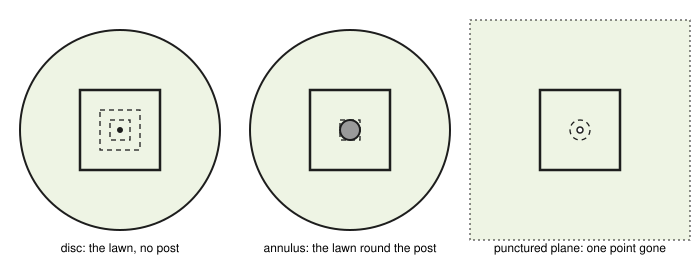

# Contractible and simply connected: no holes at all, and every loop can be shrunk

[Syllabus](../../../SYLLABUS.md) → [Topology](../README.md) → [Homotopy](../README.md#s04) → Contractible and simply connected

---

## General Overview

A park has a round lawn 20 m across. A lamp post stands at its centre, on a round concrete base 2 m across: a bigger lawn and a wider base than on [Homotopy](01-homotopy-and-homotopy-equivalence.md). An owner stands still and holds the lead. The dog runs once round the post on a square path 8 m on a side and comes back to the owner's hand, at a corner of the square.

Now the lead lies in a loop round the post. Pull it in, slide it, bunch it up, but keep the clip in the owner's hand and never lift it over the post. However it is pulled, the lead still runs out from the hand, round the base and back. Wound once, it cannot slide free.

On the same lawn with no post, the same pull shrinks the loop all the way to one point. More is true: the whole lawn can be squeezed, every point at once, to its centre. If the dog runs once round the post and then once round the other way, the lead slides free even with the post there.

Two properties are at work. A space is **contractible** when the whole of it can be squeezed continuously to one point. It is **simply connected** when it is in one piece and every loop in it shrinks to a point. Here one integer tells the spaces apart: how many times the loop winds round the hole.

The card tests three spaces: the disc (the lawn with no post), the annulus (a ring: the lawn with the base cut out) and the punctured plane (the plane with one point removed).

Holes have mattered before. On [Conservative fields](../../06-Calculus%20and%20analysis/09-Vector%20Calculus/04-conservative-fields-and-potentials.md), water circling a drain has zero curl, yet one lap gives 2π: the hole defeats the local test. [Cauchy's theorem](../../07-Complex%20analysis/03-Contour%20Integrals%20and%20Cauchy%27s%20Theorem/03-cauchys-theorem.md) defines a region with no holes as one where every loop shrinks to a point. This card makes "no holes" exact.

**A space is contractible when it can be squeezed continuously to one point, and simply connected when every loop in it shrinks to a point; a disc is both, while an annulus and a punctured plane are neither, because a loop once round the hole keeps winding number 1.**

**What kind of fact this is:** two definitions and four theorems, proved in Why it works, the last two with the winding-number fact proved on [Homotopy](01-homotopy-and-homotopy-equivalence.md): the disc is contractible; contractible implies simply connected; the annulus and the punctured plane are not simply connected, so not contractible. One more fact is stated, not proved: a sphere is simply connected but not contractible. The code checks finitely many stages of each squeeze; it illustrates and proves nothing on its own.

### The picture: the three spaces and the loop

<p align="center"></p>

To scale, 10 drawing units a metre. Left: the square shrinks through the dashed stages at t = 1/2 and t = 3/4 to the centre. Middle: it touches the base at t = 3/4 and stops. These straight squeezes move the whole square, the hand's corner too; Step 3 shows that no slide, with the hand held or not, frees the loop. Right: the plane runs on past the dotted frame, and the square slides onto the dashed circle of radius 1 m.

---

## The formula

Reminders from [Homotopy](01-homotopy-and-homotopy-equivalence.md): a **homotopy** $`H(x, t)`$ is a continuous map that slides one map into another as the time $`t`$ runs from 0 to 1. Two maps joined by a homotopy are **homotopic**, written $`\simeq`$. A **loop** at a point $`p`$ is a continuous map $`\gamma`$ from $`[0, 1]`$ into the space with $`\gamma(0) = \gamma(1) = p`$: the lead, from hand back to hand. The **constant loop** $`c_p`$ stays at $`p`$ the whole time.

The first definition squeezes the whole space at once:

```math
X \text{ is contractible} \iff \text{there is a continuous } H : X \times [0, 1] \to X \text{ with } H(x, 0) = x \text{ and } H(x, 1) = x_0 \text{ for every } x \text{ in } X
```

**Read it aloud:** a space is contractible exactly when there is a continuous squeeze that starts with every point where it is and ends with every point at one chosen point $`x_0`$.

The second definition squeezes one loop at a time, and holds its ends still:

```math
X \text{ is simply connected} \iff X \text{ is path-connected, and } \gamma \simeq c_p \text{ with both ends held at } p \text{, for every loop } \gamma \text{ at every point } p
```

**Read it aloud:** a space is simply connected exactly when it is in one piece and every loop shrinks to its own starting point inside the space, with both ends held still. Path-connected means any two points are joined by a path in the space ([Connected and path-connected](../02-Topological%20Spaces/07-connectedness-and-path-connectedness.md)).

The two are linked by a theorem, and a hole is detected by an integer:

```math
\text{contractible} \implies \text{simply connected}, \qquad n(\gamma, 0) = \frac{1}{2\pi} \sum_k \Delta\theta_k = (\text{ray crossings upward}) - (\text{ray crossings downward})
```

**Read it aloud:** every contractible space is simply connected. The **winding number** $`n(\gamma, 0)`$ of a loop round the post's centre is the total turn of the sight line from the post to the dog, in whole turns. It also equals the number of times the loop crosses a ray east from the post going up (anticlockwise), minus the times it crosses going down. For the 8 m square both give 1.

| Symbol | Plain meaning | In our example | Push it up and the answer… |
| --- | --- | --- | --- |
| $`X`$, $`x`$, $`x_0`$ | a space; one of its points; the point everything is squeezed to | the lawn; a spot on it; the lawn's centre | — |
| $`H(x, t)`$, $`t`$ | a homotopy; its time, 0 to 1 | the straight squeeze $`(1 - t)x`$; $`t = 1/2`$ halves every distance | larger $`t`$: closer to the end of the squeeze |
| $`\gamma`$, $`s`$, $`p`$ | a loop; the time along it, 0 to 1; its start and end | the dog's 8 m square; the hand at the square's corner | — |
| $`c_p`$, $`\simeq`$ | the constant loop at $`p`$; "is homotopic to" | the lead pulled in to the hand | — |
| $`D`$ | the disc of radius 10 m, all $`x`$ with $`\lvert x\rvert \le 10`$; a copy of $`D^2`$ | the lawn with no post | — |
| $`A`$ | the annulus, all $`x`$ with $`1 \le \lvert x\rvert \le 10`$ | the lawn round the 1 m base | a bigger base stops the squeeze sooner |
| $`\mathbb{R}^2 \setminus \{0\}`$, $`\mathbb{R}^3 \setminus \{0\}`$, $`S^2`$ | the plane, and space, each with one point removed; the sphere, the surface of a ball | a lamp post thinned to a point; a football's skin | — |
| $`\lvert x\rvert`$ | distance from the post's centre, in metres | 4 m to the square's nearest point | — |
| $`n(\gamma, 0)`$ | winding number: net turns of the loop round the centre | 1 | each extra lap anticlockwise adds 1 |
| $`\Delta\theta_k`$ | the turn of the sight line along edge $`k`$ of the loop | a quarter turn per side of the square | — |
| $`\iff`$, $`\implies`$, $`\times`$, $`\setminus`$ | exactly when; implies; pairs of a point and a time; remove | — | — |
| $`\delta`$, $`\bar\delta`$, $`\cdot`$, $`u`$ | in the proof of Step 2: the path the hand is dragged along, and the same path run backwards; "run one, then the next"; the stage of walking the hand back | — | — |

### When it holds

- **The squeeze must be continuous.** Cut the lead, or unclip it and clip it again, and any loop comes free. A jump is not a homotopy, and allowing one would make every space contractible.
- **The squeeze must stay in the space.** The straight squeeze $`(1 - t)x`$ works in the disc. In the annulus it touches the base at $`t = 3/4`$ and passes inside it after that, so it is not a homotopy in $`A`$.
- **The ends of the loop stay put.** The owner's hand does not move. In a space in one piece this makes no difference to the answer, but the proof in Step 2 has to work for it.
- **In one piece.** Two separate lawns: every loop shrinks inside its own lawn, yet the pair is not simply connected, since no path joins the lawns.
- **Holes depend on dimension.** In space, one missing point stops nothing: a loop round it lifts over the top and shrinks, never closer than 2.828427 m to the point.

---

## Why it works

### Step 0: one squeeze for everything, and one integer that cannot jump

Contractible is the stronger property. If the whole space can be squeezed to a point, every loop in it rides along with the squeeze and shrinks too. That is Step 2.

To show a loop cannot shrink, trying squeezes one by one is hopeless: there are infinitely many. Instead, find a whole number that cannot change under a small slide and differs between the loop and the constant loop. The winding number is that number.

### Step 1: the disc is contractible

[Homotopy](01-homotopy-and-homotopy-equivalence.md) (its Step 4) squashed a lawn to its centre with the straight squeeze $`H(x, t) = (1 - t)\,x`$, and the same film works for any **convex** set, one that holds the straight segment between any two of its points. That film starts with every point where it is and ends with every point at the centre: it is a contraction. Here the rim point $`(6, 8)`$, 10 m out, is at $`(3, 4)`$ when $`t = 1/2`$ and at $`(0, 0)`$ when $`t = 1`$.

In that card's terms, contractible means homotopy equivalent to a point. The round trip space → point → space sends everything to one point, and contractible says exactly that this constant map slides to the identity.

### Step 2: contractible implies simply connected

Take a loop $`\gamma`$ at a point $`p`$ and feed it through the squeeze: at time $`t`$ the loop is $`s \mapsto H(\gamma(s), t)`$. At $`t = 1`$ it is the constant loop at $`x_0`$. That shrinks the loop, but it drags the hand along the path $`\delta(t) = H(p, t)`$ from $`p`$ to $`x_0`$.

The fix is to walk the hand back: out along $`\delta`$ and back again shrinks to the constant loop, by going out a little less each stage. Being in one piece comes free: $`t \mapsto H(x, t)`$ joins any $`x`$ to $`x_0`$.

<details>
<summary>Detailed proof: a contractible space is simply connected</summary>

Let $`H`$ contract $`X`$ to $`x_0`$, and let $`\gamma`$ be a loop at $`p`$.

**In one piece.** For any $`x`$, the path $`t \mapsto H(x, t)`$ runs from $`x`$ to $`x_0`$. Any two points are joined through $`x_0`$.

**The square.** Define $`F`$ on the unit square of points $`(s, t)`$ by

$`\displaystyle F(s, t) = H(\gamma(s), t)`$

It is continuous. Its bottom edge $`t = 0`$ is $`\gamma`$. Its top edge $`t = 1`$ is the constant loop at $`x_0`$. Both sides $`s = 0`$ and $`s = 1`$ are the path $`\delta(t) = H(p, t)`$, because $`\gamma(0) = \gamma(1) = p`$.

**Two routes round the square.** In the square, consider two paths from the corner $`(0, 0)`$ to the corner $`(1, 0)`$: the bottom edge, and the route up the left side, along the top and down the right side. The square is convex, so the straight-line homotopy between these two paths stays in the square, and it holds both ends still. Apply $`F`$ to it. This gives a homotopy, with both ends held at $`p`$:

$`\displaystyle \gamma \simeq \delta \cdot c_{x_0} \cdot \bar\delta`$

Here $`\cdot`$ means "run one path, then the next", and $`\bar\delta`$ is $`\delta`$ run backwards.

**Walk the hand back.** At stage $`u`$, from 0 to 1, run $`\delta`$ only as far as time $`1 - u`$, stop there, and run the same stretch back. At $`u = 0`$ this is $`\delta \cdot c_{x_0} \cdot \bar\delta`$, up to a change of speed; at $`u = 1`$ it never leaves $`p`$. Each stage starts and ends at $`p`$, and the stages vary continuously. So $`\delta \cdot c_{x_0} \cdot \bar\delta \simeq c_p`$ with ends held, and $`\gamma \simeq c_p`$.

</details>

So the disc is simply connected. Every loop on the post-free lawn shrinks to the owner's hand.

### Step 3: the winding number cannot change while the loop avoids the post

[Homotopy](01-homotopy-and-homotopy-equivalence.md) proves this in its Step 2: along a homotopy of loops, every frame has the same winding number round the post's centre, as long as no frame touches that centre. A whole number cannot jump along a continuous film. The proof uses nothing else about the space, so it holds in the annulus and in the punctured plane alike.

The once-round square has winding number 1. The constant loop has winding number 0. No homotopy in the annulus joins them, with the hand held or not. **So the annulus is not simply connected, and by Step 2 it is not contractible.**

### Step 4: the punctured plane, and why it matches the annulus

The once-round square lies in the punctured plane $`\mathbb{R}^2 \setminus \{0\}`$ too, still with winding number 1. So by Step 3 the punctured plane is not simply connected, and not contractible.

The two answers match for a reason. Each space squeezes onto the circle of radius 1 m, every point moving along its own ray from the hole, as the ground squeezed onto its ring on [Homotopy](01-homotopy-and-homotopy-equivalence.md) (its Step 5). For the punctured plane:

```math
H(x, t) = \frac{x}{(1 - t) + t\,\lvert x\rvert}
```

The denominator is never 0, so no point ever reaches the hole. The point $`(3, 4)`$, 5 m out, moves to $`(1, 1.333333)`$ at $`t = 1/2`$ and to $`(0.6, 0.8)`$ at $`t = 1`$. The same formula squeezes the annulus onto its inner edge, the same circle. So both spaces are homotopy equivalent to that circle, and so to each other, and both properties on this card pass between homotopy equivalent spaces (stated here, not proved).

### Step 5: simply connected without being contractible

In space, remove only the post's centre, a single point. The once-round loop, a circle of radius 4 m, lifts over it:

```math
H(s, t) = \big((1 - t)\,4\cos 2\pi s,\ (1 - t)\,4\sin 2\pi s,\ 4t\big)
```

Its squared distance from the missing point is $`16\big((1 - t)^2 + t^2\big)`$, smallest at $`t = 1/2`$, where it is 8. So the loop never comes closer than $`2\sqrt{2} = 2.828427`$ m, and shrinks to the point 4 m above. Every loop in $`\mathbb{R}^3 \setminus \{0\}`$ can first be moved off one ray from the hole and then lifted like this; Hatcher (Proposition 1.14) proves the same for the sphere.

So $`\mathbb{R}^3 \setminus \{0\}`$ and the sphere $`S^2`$ are simply connected. Neither is contractible, but loops cannot see why: the hole is a hollow, and only a sphere wrapped round it detects it. That proof needs homology, on the Homology shelf; it is stated here, with Hatcher's Chapter 2 as the source. The converse of Step 2 fails.

---

## Worked numbers, by hand

The lamp post's centre is at $`(0, 0)`$, the base has radius 1 m, and the lawn has radius 10 m. The dog's loop is the square with corners $`(4, -4)`$, $`(4, 4)`$, $`(-4, 4)`$, $`(-4, -4)`$, run anticlockwise.

| Step | Arithmetic | Value |
| --- | --- | --- |
| Nearest point of the loop to the post | the middle of a side: half-side | 4 m |
| Farthest point | a corner: $`\sqrt{4^2 + 4^2}`$ | 5.656854 m, inside the 10 m lawn |
| Ray east from the post | crossed once, going up, at $`(4, 0)`$; never going down | signed crossings 1 − 0 = 1 |
| Turn of the sight line | each side subtends a quarter turn; 4 × 1/4 | 1.000000 turns |
| Disc: straight squeeze | half-side $`4(1 - t)`$: 2 m at $`t = 1/2`$, 0 at $`t = 1`$ | shrinks to the centre |
| Annulus: same squeeze | nearest point $`4(1 - t) = 1`$ | touches the base at $`t = 3/4`$ |
| Annulus: winding at each stage up to then | 7 stages, $`t = 0`$ to $`3/4`$ in eighths | 1 every time |
| Round, then back the other way | up 1, down 1 | signed 0: it can slide free |
| Punctured plane: slide onto the circle | 64 points of the square, sent to radius 1 m | 1.000000 turns, never nearer the hole than 1 m |
| **Verdict** | **winding 1 against 0** | **disc: contractible and simply connected; annulus and punctured plane: neither** |

Wound once round the post, the lead cannot slide free: no pulling, without cutting it or lifting it over the post, changes the 1.

### What breaks if you drop a piece

| Mistake | Comes out at | What went wrong |
| --- | --- | --- |
| Using the straight squeeze in the annulus | touches the base at $`t = 3/4`$; the nearest point is 0.5 m out at $`t = 7/8`$ | the squeeze left the space, so it is no homotopy there |
| Counting ray crossings without their direction | round and back: 2 crossings, as if wound twice | one up and one down cancel: winding 0, and the lead slides free |
| Treating one missing point in space as a hole | the loop lifts over it, never nearer than 2.828427 m | in space a point blocks no loop; only a hollow, seen by spheres, remains |
| Reading "beside the post" as "round the post" | the square from $`(3, -2)`$ to $`(7, 2)`$: up 1, down 1, winding 0 | a loop that does not go round the hole shrinks even in the annulus |

---

## Code, from first principles, and it actually runs

The checks take two independent roads to every winding number: exact signed crossings of the ray east from the post, and the total turn of the sight line from atan2 (the angle of a point from the x-axis). They run on five loops and on each stage of the straight squeeze, with exact squared distances to say when a stage touches the base. The slide onto the circle and the lift in space are checked against their formulas. All of this covers finitely many stages; the proofs are in Why it works.

### Python

```python
# Contractible and simply connected -- the check behind the card.  Standard library only.
# A round lawn, radius 10 m, centred on a lamp post whose base has radius 1 m.
# Disc: the lawn with no post.  Annulus: 1 <= |x| <= 10.  Punctured plane: |x| > 0.
# A walker's loop is a polygon with whole-metre corners.  Roads to its winding number:
# signed crossings of the ray east from the post (exact), and the total turn of the
# sight line from the post (atan2).  Homotopies are checked stage by stage: N cases.
from fractions import Fraction as Fr
from math import atan2, pi, sqrt

SQ = [(4, -4), (4, 4), (-4, 4), (-4, -4)]  # 8 m square round the post, anticlockwise
def scale(poly, k):
    return [(k * x, k * y) for x, y in poly]
def edges(poly):
    return [(poly[i], poly[(i + 1) % len(poly)]) for i in range(len(poly))]

def crossings(poly):  # road 1: signed crossings of the ray east from (0, 0)
    up = down = 0
    for (ax, ay), (bx, by) in edges(poly):
        if (ay <= 0) != (by <= 0) and ax + Fr(-ay) * (bx - ax) / (by - ay) > 0:
            if by > ay: up += 1
            else: down += 1
    return up, down

def turns(poly):  # road 2: total turn of the sight line, in whole turns
    t = 0.0
    for (ax, ay), (bx, by) in edges(poly):
        t += atan2(ax * by - ay * bx, ax * bx + ay * by)
    w = t / (2 * pi)
    return 0.0 if abs(w) < 1e-9 else w  # print 0, never -0

def near2(poly):  # exact squared distance from the post's centre to the nearest point
    best = None
    for (ax, ay), (bx, by) in edges(poly):
        dx, dy = bx - ax, by - ay
        L = dx * dx + dy * dy
        u = min(Fr(1), max(Fr(0), Fr(-(ax * dx + ay * dy)) / L)) if L else Fr(0)
        d = (ax + u * dx) ** 2 + (ay + u * dy) ** 2
        best = d if best is None else min(best, d)
    return best
far2 = lambda poly: max(x * x + y * y for x, y in poly)  # a polygon's farthest point is a corner

loops = [("once round, anticlockwise", SQ), ("once round, clockwise", SQ[::-1]),
         ("round, then back the other way", SQ + [(4, -4)] + SQ[::-1][:-1]),
         ("twice round", SQ + SQ), ("beside the post, not round it", [(3, -2), (7, -2), (7, 2), (3, 2)])]
wind = []
for name, p in loops:
    u, d = crossings(p); w = turns(p); wind.append((u - d, round(w)))
    print(f"{name:<31}: ray crossings up {u} down {d}, signed {u - d}; turns {w:.6f}; "
          f"nearest {sqrt(near2(p)):.6f} m")

print("shrink H(x, t) = (1 - t) x on the once-round square, stage by stage:")
stages = []
for k in range(9):
    t = Fr(k, 8); p = scale(SQ, 1 - t); n2 = near2(p)
    where = "disc and annulus" if n2 >= 1 else "disc only: inside the base"
    sig = crossings(p)[0] - crossings(p)[1] if n2 > 0 else "none: a point on the post"
    stages.append((t, n2, sig))
    print(f"  t = {str(t):<4} half-side {float(SQ[1][0] * (1 - t)):.1f} m, nearest {float(sqrt(n2)):.6f} m, "
          f"farthest {float(sqrt(far2(p))):.6f} m, winding {sig}; {where}")
t_hit = min(t for t, n2, s in stages if n2 <= 1)
print(f"straight shrink touches the 1 m base at t = {t_hit} (formula 1 - 1/4 = {1 - Fr(1, 4)})")

rim = (6, 8)  # a point on the disc's edge, 10 m out
half = tuple(Fr(c, 2) for c in rim)
print(f"disc contraction of the rim point (6, 8): t = 1/2 gives ({half[0]}, {half[1]}), t = 1 gives (0, 0)")

def retract(x, y, t):  # punctured plane onto the circle of radius 1 m, H(x, t) = x / ((1 - t) + t|x|)
    r = sqrt(x * x + y * y)
    return (x / ((1 - t) + t * r), y / ((1 - t) + t * r))
print("retract the punctured plane, (3, 4) at t = 0, 1/2, 1: " +
      " -> ".join("({:.6f}, {:.6f})".format(*retract(3.0, 4.0, t)) for t in (0.0, 0.5, 1.0)))
side = [(4 - 8 * Fr(j, 16), Fr(4)) for j in range(16)] + [(Fr(-4), 4 - 8 * Fr(j, 16)) for j in range(16)]
samples = side + [(-x, -y) for x, y in side]  # the square, 16 points a side, round from (4, 4)
circ = [retract(float(x), float(y), 1.0) for x, y in samples]
r_min = min(sqrt(x * x + y * y) for s in range(11) for x, y in
            [retract(float(a), float(b), s / 10) for a, b in samples])
print(f"retracted square, 64 sample points: turns {turns(circ):.6f}; nearest to the hole over 11 stages {r_min:.6f} m")

# in space, remove only one point: lift the loop of radius 4 m over it
grid = [Fr(k, 100) for k in range(101)]
d2 = [16 * ((1 - t) ** 2 + t * t) for t in grid]
best = min(d2); t_best = grid[d2.index(best)]
print(f"space minus a point: lift H(s, t) = ((1 - t) 4 cos 2 pi s, (1 - t) 4 sin 2 pi s, 4t); "
      f"nearest {sqrt(best):.6f} m at t = {t_best} (101 stages), formula 2 sqrt 2 = {2 * sqrt(2):.6f}")

print(f"figure, panel centres (120, 130) (350, 130) (580, 130); 10 units a metre; disc and lawn radius 100; "
      f"base radius 10; squares half-side 40, 20, 10")

assert [s for s, w in wind] == [w for s, w in wind] == [1, -1, 0, 2, 0], "two roads to the winding number"
assert near2(loops[4][1]) == 9, "beside the post: nearest 3 m, at (3, 0)"
assert all(s == 1 for t, n2, s in stages if n2 >= 1), "winding stays 1 while the loop avoids the base"
assert t_hit == 1 - Fr(1, 4) and stages[6][1] == 1, "the shrink meets the base exactly at t = 3/4"
assert all(far2(scale(SQ, 1 - t)) <= 100 for t, n2, s in stages), "every stage stays in the 10 m disc"
assert round(turns(circ)) == 1 and abs(r_min - 1) < 1e-12, "retraction keeps the winding and avoids the hole"
assert best == 8 and t_best == Fr(1, 2), "lift: nearest squared distance 8 m2 at t = 1/2"
print("ALL CHECKS PASS")
```

**Ran 2026-11-15 on macOS, Python 3.14.10, standard library only. All checks passed. Output, pasted from the run:**

```
once round, anticlockwise      : ray crossings up 1 down 0, signed 1; turns 1.000000; nearest 4.000000 m
once round, clockwise          : ray crossings up 0 down 1, signed -1; turns -1.000000; nearest 4.000000 m
round, then back the other way : ray crossings up 1 down 1, signed 0; turns 0.000000; nearest 4.000000 m
twice round                    : ray crossings up 2 down 0, signed 2; turns 2.000000; nearest 4.000000 m
beside the post, not round it  : ray crossings up 1 down 1, signed 0; turns 0.000000; nearest 3.000000 m
shrink H(x, t) = (1 - t) x on the once-round square, stage by stage:
  t = 0    half-side 4.0 m, nearest 4.000000 m, farthest 5.656854 m, winding 1; disc and annulus
  t = 1/8  half-side 3.5 m, nearest 3.500000 m, farthest 4.949747 m, winding 1; disc and annulus
  t = 1/4  half-side 3.0 m, nearest 3.000000 m, farthest 4.242641 m, winding 1; disc and annulus
  t = 3/8  half-side 2.5 m, nearest 2.500000 m, farthest 3.535534 m, winding 1; disc and annulus
  t = 1/2  half-side 2.0 m, nearest 2.000000 m, farthest 2.828427 m, winding 1; disc and annulus
  t = 5/8  half-side 1.5 m, nearest 1.500000 m, farthest 2.121320 m, winding 1; disc and annulus
  t = 3/4  half-side 1.0 m, nearest 1.000000 m, farthest 1.414214 m, winding 1; disc and annulus
  t = 7/8  half-side 0.5 m, nearest 0.500000 m, farthest 0.707107 m, winding 1; disc only: inside the base
  t = 1    half-side 0.0 m, nearest 0.000000 m, farthest 0.000000 m, winding none: a point on the post; disc only: inside the base
straight shrink touches the 1 m base at t = 3/4 (formula 1 - 1/4 = 3/4)
disc contraction of the rim point (6, 8): t = 1/2 gives (3, 4), t = 1 gives (0, 0)
retract the punctured plane, (3, 4) at t = 0, 1/2, 1: (3.000000, 4.000000) -> (1.000000, 1.333333) -> (0.600000, 0.800000)
retracted square, 64 sample points: turns 1.000000; nearest to the hole over 11 stages 1.000000 m
space minus a point: lift H(s, t) = ((1 - t) 4 cos 2 pi s, (1 - t) 4 sin 2 pi s, 4t); nearest 2.828427 m at t = 1/2 (101 stages), formula 2 sqrt 2 = 2.828427
figure, panel centres (120, 130) (350, 130) (580, 130); 10 units a metre; disc and lawn radius 100; base radius 10; squares half-side 40, 20, 10
ALL CHECKS PASS
```

### Rust

```rust
// Contractible and simply connected -- the check behind the card.  Rust std only.
// A round lawn, radius 10 m, centred on a lamp post whose base has radius 1 m.
// Disc: the lawn with no post.  Annulus: 1 <= |x| <= 10.  Punctured plane: |x| > 0.
// A walker's loop is a polygon with whole-metre corners.  Roads to its winding number:
// signed crossings of the ray east from the post (exact), and the total turn of the
// sight line from the post (atan2).  Homotopies are checked stage by stage: N cases.
use std::f64::consts::PI;

fn gcd(a: i128, b: i128) -> i128 { if b == 0 { a.abs() } else { gcd(b, a % b) } }
#[derive(Clone, Copy, PartialEq)]
struct Q { n: i128, d: i128 } // an exact fraction n/d, d > 0, in lowest terms
fn q(n: i128, d: i128) -> Q { let g = gcd(n, d).max(1); let s = if d < 0 { -1 } else { 1 }; Q { n: s * n / g, d: s * d / g } }
fn lt(a: Q, b: Q) -> bool { a.n * b.d < b.n * a.d }
fn qs(a: Q) -> String { if a.d == 1 { format!("{}", a.n) } else { format!("{}/{}", a.n, a.d) } }
fn qf(a: Q) -> f64 { a.n as f64 / a.d as f64 }

type P = (i128, i128); // corners in whole units; each caller says what a unit is
const SQ: [P; 4] = [(4, -4), (4, 4), (-4, 4), (-4, -4)]; // 8 m square round the post, anticlockwise

fn edges(p: &[P]) -> Vec<(P, P)> { (0..p.len()).map(|i| (p[i], p[(i + 1) % p.len()])).collect() }

fn crossings(p: &[P]) -> (i64, i64) { // road 1: signed crossings of the ray east from (0, 0)
    let (mut up, mut down) = (0, 0);
    for ((ax, ay), (bx, by)) in edges(p) {
        // x-intercept ax - ay (bx - ax) / (by - ay) > 0, cleared of its denominator
        if (ay <= 0) != (by <= 0) && (ax * (by - ay) - ay * (bx - ax)) * (by - ay) > 0 {
            if by > ay { up += 1 } else { down += 1 }
        }
    }
    (up, down)
}

fn turns(p: &[(f64, f64)]) -> f64 { // road 2: total turn of the sight line, in whole turns
    let mut t = 0.0;
    for i in 0..p.len() {
        let ((ax, ay), (bx, by)) = (p[i], p[(i + 1) % p.len()]);
        t += (ax * by - ay * bx).atan2(ax * bx + ay * by);
    }
    let w = t / (2.0 * PI);
    if w.abs() < 1e-9 { 0.0 } else { w } // print 0, never -0
}
fn fl(p: &[P]) -> Vec<(f64, f64)> { p.iter().map(|&(x, y)| (x as f64, y as f64)).collect() }

fn near2(p: &[P]) -> Q { // exact squared distance from the post's centre to the nearest point
    let mut best: Option<Q> = None;
    for ((ax, ay), (bx, by)) in edges(p) {
        let (dx, dy) = (bx - ax, by - ay);
        let l = dx * dx + dy * dy;
        let u = if l == 0 { q(0, 1) } else { let r = q(-(ax * dx + ay * dy), l);
            if lt(r, q(0, 1)) { q(0, 1) } else if lt(q(1, 1), r) { q(1, 1) } else { r } };
        let (x, y) = (ax * u.d + u.n * dx, ay * u.d + u.n * dy);
        let d = q(x * x + y * y, u.d * u.d);
        best = Some(match best { None => d, Some(b) => if lt(d, b) { d } else { b } });
    }
    best.unwrap()
}
fn far2(p: &[P]) -> i128 { p.iter().map(|&(x, y)| x * x + y * y).max().unwrap() }

fn main() {
    let rev: Vec<P> = SQ.iter().rev().cloned().collect();
    let mut back: Vec<P> = SQ.to_vec(); back.push((4, -4)); back.extend_from_slice(&rev[..3]);
    let twice: Vec<P> = SQ.iter().chain(SQ.iter()).cloned().collect();
    let loops: Vec<(&str, Vec<P>)> = vec![("once round, anticlockwise", SQ.to_vec()), ("once round, clockwise", rev.clone()),
        ("round, then back the other way", back), ("twice round", twice),
        ("beside the post, not round it", vec![(3, -2), (7, -2), (7, 2), (3, 2)])];
    let mut wind = vec![];
    for (name, p) in &loops {
        let (u, d) = crossings(p); let w = turns(&fl(p)); wind.push((u - d, w.round() as i64));
        println!("{:<31}: ray crossings up {} down {}, signed {}; turns {:.6}; nearest {:.6} m",
                 name, u, d, u - d, w, qf(near2(p)).sqrt());
    }

    println!("shrink H(x, t) = (1 - t) x on the once-round square, stage by stage:");
    let mut stages = vec![]; // corners in eighths of a metre, so (1 - t) x stays whole
    for k in 0..=8i128 {
        let t = q(k, 8);
        let p: Vec<P> = SQ.iter().map(|&(x, y)| (x * (8 - k), y * (8 - k))).collect();
        let n2r = near2(&p); let n2 = q(n2r.n, n2r.d * 64);
        let inb = !lt(n2, q(1, 1));
        let where_ = if inb { "disc and annulus" } else { "disc only: inside the base" };
        let sig = if n2.n > 0 { let (u, d) = crossings(&p); Some(u - d) } else { None };
        let sigs = match sig { Some(s) => format!("{}", s), None => "none: a point on the post".to_string() };
        stages.push((t, n2, sig, far2(&p)));
        println!("  t = {:<4} half-side {:.1} m, nearest {:.6} m, farthest {:.6} m, winding {}; {}",
                 qs(t), SQ[1].0 as f64 * (8 - k) as f64 / 8.0, qf(n2).sqrt(), (far2(&p) as f64 / 64.0).sqrt(), sigs, where_);
    }
    let t_hit = stages.iter().filter(|s| !lt(q(1, 1), s.1)).map(|s| s.0).next().unwrap();
    let formula = q(3, 4); // 1 - 1/4
    println!("straight shrink touches the 1 m base at t = {} (formula 1 - 1/4 = {})", qs(t_hit), qs(formula));

    let rim: (i128, i128) = (6, 8); // a point on the disc's edge, 10 m out
    println!("disc contraction of the rim point (6, 8): t = 1/2 gives ({}, {}), t = 1 gives (0, 0)",
             qs(q(rim.0, 2)), qs(q(rim.1, 2)));

    let retract = |x: f64, y: f64, t: f64| { let r = (x * x + y * y).sqrt(); (x / ((1.0 - t) + t * r), y / ((1.0 - t) + t * r)) };
    let parts: Vec<String> = [0.0, 0.5, 1.0].iter().map(|&t| { let (a, b) = retract(3.0, 4.0, t); format!("({:.6}, {:.6})", a, b) }).collect();
    println!("retract the punctured plane, (3, 4) at t = 0, 1/2, 1: {}", parts.join(" -> "));
    let mut side: Vec<(f64, f64)> = (0..16).map(|j| (4.0 - j as f64 / 2.0, 4.0)).collect();
    side.extend((0..16).map(|j| (-4.0, 4.0 - j as f64 / 2.0)));
    let mut samples = side.clone(); samples.extend(side.iter().map(|&(x, y)| (-x, -y)));
    let circ: Vec<(f64, f64)> = samples.iter().map(|&(x, y)| retract(x, y, 1.0)).collect();
    let mut r_min = f64::INFINITY;
    for s in 0..11 { for &(a, b) in &samples { let (x, y) = retract(a, b, s as f64 / 10.0); r_min = r_min.min((x * x + y * y).sqrt()); } }
    let tc = turns(&circ);
    println!("retracted square, 64 sample points: turns {:.6}; nearest to the hole over 11 stages {:.6} m", tc, r_min);

    // in space, remove only one point: lift the loop of radius 4 m over it
    let d2: Vec<Q> = (0..=100i128).map(|k| q(16 * ((100 - k) * (100 - k) + k * k), 10000)).collect();
    let mut kb = 0; for k in 0..d2.len() { if lt(d2[k], d2[kb]) { kb = k } }
    let (best, t_best) = (d2[kb], q(kb as i128, 100));
    println!("space minus a point: lift H(s, t) = ((1 - t) 4 cos 2 pi s, (1 - t) 4 sin 2 pi s, 4t); nearest {:.6} m at t = {} (101 stages), formula 2 sqrt 2 = {:.6}",
             qf(best).sqrt(), qs(t_best), 2.0 * 2f64.sqrt());

    println!("figure, panel centres (120, 130) (350, 130) (580, 130); 10 units a metre; disc and lawn radius 100; base radius 10; squares half-side 40, 20, 10");

    assert!(wind.iter().map(|w| w.0).collect::<Vec<_>>() == vec![1, -1, 0, 2, 0], "signed crossings");
    assert!(wind.iter().all(|w| w.0 == w.1), "two roads to the winding number");
    assert!(near2(&loops[4].1) == q(9, 1), "beside the post: nearest 3 m, at (3, 0)");
    assert!(stages.iter().filter(|s| !lt(s.1, q(1, 1))).all(|s| s.2 == Some(1)), "winding stays 1 while the loop avoids the base");
    assert!(t_hit == formula && stages[6].1 == q(1, 1), "the shrink meets the base exactly at t = 3/4");
    assert!(stages.iter().all(|s| s.3 <= 100 * 64), "every stage stays in the 10 m disc");
    assert!(tc.round() == 1.0 && (r_min - 1.0).abs() < 1e-12, "retraction keeps the winding and avoids the hole");
    assert!(best == q(8, 1) && t_best == q(1, 2), "lift: nearest squared distance 8 m2 at t = 1/2");
    println!("ALL CHECKS PASS");
}
```

**Ran 2026-11-15 on macOS, rustc 1.98.1, no crates. All checks passed. Output, pasted from the run:**

```
once round, anticlockwise      : ray crossings up 1 down 0, signed 1; turns 1.000000; nearest 4.000000 m
once round, clockwise          : ray crossings up 0 down 1, signed -1; turns -1.000000; nearest 4.000000 m
round, then back the other way : ray crossings up 1 down 1, signed 0; turns 0.000000; nearest 4.000000 m
twice round                    : ray crossings up 2 down 0, signed 2; turns 2.000000; nearest 4.000000 m
beside the post, not round it  : ray crossings up 1 down 1, signed 0; turns 0.000000; nearest 3.000000 m
shrink H(x, t) = (1 - t) x on the once-round square, stage by stage:
  t = 0    half-side 4.0 m, nearest 4.000000 m, farthest 5.656854 m, winding 1; disc and annulus
  t = 1/8  half-side 3.5 m, nearest 3.500000 m, farthest 4.949747 m, winding 1; disc and annulus
  t = 1/4  half-side 3.0 m, nearest 3.000000 m, farthest 4.242641 m, winding 1; disc and annulus
  t = 3/8  half-side 2.5 m, nearest 2.500000 m, farthest 3.535534 m, winding 1; disc and annulus
  t = 1/2  half-side 2.0 m, nearest 2.000000 m, farthest 2.828427 m, winding 1; disc and annulus
  t = 5/8  half-side 1.5 m, nearest 1.500000 m, farthest 2.121320 m, winding 1; disc and annulus
  t = 3/4  half-side 1.0 m, nearest 1.000000 m, farthest 1.414214 m, winding 1; disc and annulus
  t = 7/8  half-side 0.5 m, nearest 0.500000 m, farthest 0.707107 m, winding 1; disc only: inside the base
  t = 1    half-side 0.0 m, nearest 0.000000 m, farthest 0.000000 m, winding none: a point on the post; disc only: inside the base
straight shrink touches the 1 m base at t = 3/4 (formula 1 - 1/4 = 3/4)
disc contraction of the rim point (6, 8): t = 1/2 gives (3, 4), t = 1 gives (0, 0)
retract the punctured plane, (3, 4) at t = 0, 1/2, 1: (3.000000, 4.000000) -> (1.000000, 1.333333) -> (0.600000, 0.800000)
retracted square, 64 sample points: turns 1.000000; nearest to the hole over 11 stages 1.000000 m
space minus a point: lift H(s, t) = ((1 - t) 4 cos 2 pi s, (1 - t) 4 sin 2 pi s, 4t); nearest 2.828427 m at t = 1/2 (101 stages), formula 2 sqrt 2 = 2.828427
figure, panel centres (120, 130) (350, 130) (580, 130); 10 units a metre; disc and lawn radius 100; base radius 10; squares half-side 40, 20, 10
ALL CHECKS PASS
```

### Lean

Lean proves the card's four theorems and Step 4's match, for any base radius above 0 and any lawn at least as wide.

- The disc, the lawn with no post, is contractible and simply connected.
- The annulus is not simply connected, so it is not contractible.
- The punctured plane is not simply connected, so it is not contractible.
- Every contractible space is simply connected: it is in one piece, and every loop shrinks to its starting point with both ends held.
- The annulus and the punctured plane are homotopy equivalent.
- Lean also checks the hand arithmetic, such as the squeeze touching the base at $`t = 3/4`$.

The winding numbers of the five loops, the 64-point slide and the 101-stage lift are left to the Python and Rust checks.

```lean
-- Contractible and simply connected: a closed disc in the plane is contractible and simply connected, a contractible space is always simply connected, and an annulus and a punctured plane are neither, being homotopy equivalent to each other.
import Mathlib.Analysis.Convex.Contractible
import Mathlib.Analysis.InnerProductSpace.PiL2
import Mathlib.AlgebraicTopology.FundamentalGroupoid.SimplyConnected
import Mathlib.Topology.Covering.FundamentalGroupCircle
import Mathlib.Analysis.SpecialFunctions.Complex.Circle

open Metric ContinuousMap

/-- The plane annulus `r ≤ ‖x‖ ≤ R` and the punctured plane are homotopy equivalent. -/
noncomputable def annulusHomotopyEquivPuncturedPlane (r R : ℝ) (hr : 0 < r) (hrR : r ≤ R) :
    {x : EuclideanSpace ℝ (Fin 2) | r ≤ ‖x‖ ∧ ‖x‖ ≤ R} ≃ₕ
      ({0}ᶜ : Set (EuclideanSpace ℝ (Fin 2))) where
  toFun := ⟨fun x => ⟨x.1, by
      have := x.2.1
      simp only [Set.mem_compl_iff, Set.mem_singleton_iff]
      intro h; rw [h, norm_zero] at this; linarith⟩,
    by apply Continuous.subtype_mk; fun_prop⟩
  invFun := ⟨fun x => ⟨(r / ‖x.1‖) • x.1, by
      have hx : ‖x.1‖ ≠ 0 := norm_ne_zero_iff.mpr x.2
      have : ‖(r / ‖x.1‖) • x.1‖ = r := by
        rw [norm_smul, Real.norm_eq_abs, abs_of_nonneg (by positivity), div_mul_cancel₀ _ hx]
      simp only [Set.mem_ofPred_eq, this]; exact ⟨le_rfl, hrR⟩⟩, by
      have hc : Continuous fun x : ({0}ᶜ : Set (EuclideanSpace ℝ (Fin 2))) => ‖x.1‖ :=
        by fun_prop
      apply Continuous.subtype_mk
      fun_prop (disch := intro x; exact norm_ne_zero_iff.mpr x.2)⟩
  left_inv := ⟨{
    toFun := fun p => ⟨((1 - (p.1 : ℝ)) * (r / ‖p.2.1‖) + p.1) • p.2.1, by
      obtain ⟨t, x⟩ := p
      have hx0 : 0 < ‖x.1‖ := lt_of_lt_of_le hr x.2.1
      have ht0 : 0 ≤ (t : ℝ) := t.2.1
      have ht1 : (t : ℝ) ≤ 1 := t.2.2
      have hco : 0 ≤ (1 - (t : ℝ)) * (r / ‖x.1‖) + t := by positivity
      have : ‖((1 - (t : ℝ)) * (r / ‖x.1‖) + t) • x.1‖ = (1 - t) * r + t * ‖x.1‖ := by
        rw [norm_smul, Real.norm_eq_abs, abs_of_nonneg hco]
        field_simp
      simp only [Set.mem_ofPred_eq, this]
      have h1 := x.2.1; have h2 := x.2.2
      constructor <;> nlinarith⟩
    continuous_toFun := by
      have hc : Continuous fun x : {x : EuclideanSpace ℝ (Fin 2) | r ≤ ‖x‖ ∧ ‖x‖ ≤ R} => ‖x.1‖ :=
        by fun_prop
      apply Continuous.subtype_mk
      fun_prop (disch := intro p; exact (lt_of_lt_of_le hr p.2.2.1).ne')
    map_zero_left := by intro x; ext1; simp
    map_one_left := by intro x; ext1; simp }⟩
  right_inv := ⟨{
    toFun := fun p => ⟨((1 - (p.1 : ℝ)) * (r / ‖p.2.1‖) + p.1) • p.2.1, by
      obtain ⟨t, x⟩ := p
      have hx0 : 0 < ‖x.1‖ := norm_pos_iff.mpr x.2
      have ht0 : 0 ≤ (t : ℝ) := t.2.1
      have ht1 : (t : ℝ) ≤ 1 := t.2.2
      have hco : 0 < (1 - (t : ℝ)) * (r / ‖x.1‖) + t := by
        rcases eq_or_lt_of_le ht1 with h | h
        · rw [h]; norm_num
        · have : 0 < 1 - (t : ℝ) := by linarith
          positivity
      simp only [Set.mem_compl_iff, Set.mem_singleton_iff, smul_eq_zero, not_or]
      exact ⟨hco.ne', x.2⟩⟩
    continuous_toFun := by
      have hc : Continuous fun x : ({0}ᶜ : Set (EuclideanSpace ℝ (Fin 2))) => ‖x.1‖ :=
        by fun_prop
      apply Continuous.subtype_mk
      fun_prop (disch := intro p; exact norm_ne_zero_iff.mpr p.2.2)
    map_zero_left := by intro x; ext1; simp
    map_one_left := by intro x; ext1; simp }⟩

/-- The circle is not simply connected. -/
theorem not_simplyConnectedSpace_addCircle : ¬ SimplyConnectedSpace (AddCircle (2 * Real.pi)) := by
  intro h
  have : Fact (0 < 2 * Real.pi) := ⟨by positivity⟩
  have hs : Subsingleton (FundamentalGroup (AddCircle (2 * Real.pi)) 0) := inferInstance
  have : Subsingleton (Multiplicative ℤ) :=
    ((AddCircle.windingNumberIso (0 : AddCircle (2 * Real.pi))).toEquiv.subsingleton_congr).mp hs
  exact absurd (Subsingleton.elim (Multiplicative.ofAdd (1 : ℤ)) (Multiplicative.ofAdd 0)) (by decide)

/-- The unit circle in the Euclidean plane is homeomorphic to the circle `AddCircle (2π)`. -/
noncomputable def unitAnnulusHomeomorph :
    {x : EuclideanSpace ℝ (Fin 2) | 1 ≤ ‖x‖ ∧ ‖x‖ ≤ 1} ≃ₜ AddCircle (2 * Real.pi) :=
  let e : EuclideanSpace ℝ (Fin 2) ≃ₜ ℂ :=
    Complex.orthonormalBasisOneI.repr.symm.toHomeomorph
  let e2 : {x : EuclideanSpace ℝ (Fin 2) | 1 ≤ ‖x‖ ∧ ‖x‖ ≤ 1} ≃ₜ sphere (0 : ℂ) 1 :=
    e.subtype (fun x => by
      simp only [Set.mem_ofPred_eq, mem_sphere_zero_iff_norm, e,
        LinearIsometryEquiv.coe_toHomeomorph, LinearIsometryEquiv.norm_map]
      constructor
      · rintro ⟨h1, h2⟩; linarith
      · intro h; rw [h]; exact ⟨le_rfl, le_rfl⟩)
  let e3 : sphere (0 : ℂ) 1 ≃ₜ Circle := Homeomorph.refl _
  (e2.trans e3).trans AddCircle.homeomorphCircle'.symm

theorem not_simplyConnectedSpace_puncturedPlane :
    ¬ SimplyConnectedSpace ({0}ᶜ : Set (EuclideanSpace ℝ (Fin 2))) := by
  rw [← (annulusHomotopyEquivPuncturedPlane 1 1 one_pos le_rfl).simplyConnectedSpace_iff,
    unitAnnulusHomeomorph.toHomotopyEquiv.simplyConnectedSpace_iff]
  exact not_simplyConnectedSpace_addCircle

#print axioms annulusHomotopyEquivPuncturedPlane
#print axioms not_simplyConnectedSpace_addCircle
#print axioms unitAnnulusHomeomorph
#print axioms not_simplyConnectedSpace_puncturedPlane

/-- The card's verdict on its three plane spaces. A disc `|x| ≤ R` is contractible and simply
connected. An annulus `r ≤ |x| ≤ R` (with `0 < r ≤ R`) and the punctured plane `ℝ² \ {0}` are
neither simply connected nor contractible, because a loop once round the hole cannot shrink. -/
theorem disc_contractible_annulus_and_punctured_plane_not
    (r R : ℝ) (hr : 0 < r) (hrR : r ≤ R) :
    ContractibleSpace (closedBall (0 : EuclideanSpace ℝ (Fin 2)) R) ∧
    SimplyConnectedSpace (closedBall (0 : EuclideanSpace ℝ (Fin 2)) R) ∧
    ¬ SimplyConnectedSpace {x : EuclideanSpace ℝ (Fin 2) | r ≤ ‖x‖ ∧ ‖x‖ ≤ R} ∧
    ¬ ContractibleSpace {x : EuclideanSpace ℝ (Fin 2) | r ≤ ‖x‖ ∧ ‖x‖ ≤ R} ∧
    ¬ SimplyConnectedSpace ({0}ᶜ : Set (EuclideanSpace ℝ (Fin 2))) ∧
    ¬ ContractibleSpace ({0}ᶜ : Set (EuclideanSpace ℝ (Fin 2))) := by
  have hR : 0 ≤ R := hr.le.trans hrR
  have hc : ContractibleSpace (closedBall (0 : EuclideanSpace ℝ (Fin 2)) R) :=
    (convex_closedBall 0 R).contractibleSpace ⟨0, mem_closedBall_self hR⟩
  have hP := not_simplyConnectedSpace_puncturedPlane
  have hA : ¬ SimplyConnectedSpace {x : EuclideanSpace ℝ (Fin 2) | r ≤ ‖x‖ ∧ ‖x‖ ≤ R} := by
    rw [(annulusHomotopyEquivPuncturedPlane r R hr hrR).simplyConnectedSpace_iff]; exact hP
  exact ⟨hc, SimplyConnectedSpace.ofContractible _, hA,
    fun h => hA (@SimplyConnectedSpace.ofContractible _ _ h), hP,
    fun h => hP (@SimplyConnectedSpace.ofContractible _ _ h)⟩

/-- Contractible implies simply connected: if a space can be squeezed continuously to one point,
then it is in one piece (path-connected) and every loop at every point `p` shrinks to the
constant loop at `p` with both ends held at `p`. -/
theorem contractible_implies_simply_connected (X : Type*) [TopologicalSpace X]
    [ContractibleSpace X] :
    PathConnectedSpace X ∧ ∀ (p : X) (γ : Path p p), γ.Homotopic (Path.refl p) := by
  exact simply_connected_iff_loops_nullhomotopic.mp (SimplyConnectedSpace.ofContractible X)

/-- The annulus `r ≤ |x| ≤ R` (with `0 < r ≤ R`) and the punctured plane `ℝ² \ {0}` are
homotopy equivalent: both squeeze onto the circle of radius `r` along rays from the hole. -/
theorem annulus_homotopy_equivalent_punctured_plane
    (r R : ℝ) (hr : 0 < r) (hrR : r ≤ R) :
    Nonempty ({x : EuclideanSpace ℝ (Fin 2) | r ≤ ‖x‖ ∧ ‖x‖ ≤ R} ≃ₕ
      ({0}ᶜ : Set (EuclideanSpace ℝ (Fin 2)))) := by
  exact ⟨annulusHomotopyEquivPuncturedPlane r R hr hrR⟩

-- The square's farthest corner: 4² + 4² = 32 square metres, inside the 10 m lawn (32 ≤ 100).
example : (4 : ℤ) ^ 2 + 4 ^ 2 = 32 ∧ (32 : ℤ) ≤ 10 ^ 2 := by norm_num
-- Four sides, each a quarter turn: winding number 1.
example : (4 : ℚ) * (1 / 4) = 1 := by norm_num
-- Round, then back the other way: up 1, down 1, signed 0.
example : (1 : ℤ) - 1 = 0 := by norm_num
-- The straight squeeze in the annulus: nearest point 4(1 - t) is 1 m at t = 3/4, 1/2 m at t = 7/8.
example : (4 : ℚ) * (1 - 3 / 4) = 1 ∧ (4 : ℚ) * (1 - 7 / 8) = 1 / 2 := by norm_num
-- The disc's squeeze of the rim point (6, 8), 10 m out: (3, 4) at t = 1/2.
example : (6 : ℤ) ^ 2 + 8 ^ 2 = 10 ^ 2 ∧ (1 - 1 / 2 : ℚ) * 6 = 3 ∧ (1 - 1 / 2 : ℚ) * 8 = 4 := by
  norm_num
-- The slide of (3, 4), 5 m out, onto the circle: x / ((1 - t) + t |x|) at t = 1/2 and t = 1.
example : (3 : ℤ) ^ 2 + 4 ^ 2 = 5 ^ 2 ∧
    (3 : ℚ) / ((1 - 1 / 2) + 1 / 2 * 5) = 1 ∧ (4 : ℚ) / ((1 - 1 / 2) + 1 / 2 * 5) = 4 / 3 ∧
    (3 : ℚ) / ((1 - 1) + 1 * 5) = 3 / 5 ∧ (4 : ℚ) / ((1 - 1) + 1 * 5) = 4 / 5 := by norm_num
-- The lift in space: squared distance 16((1 - t)² + t²) is 8 at t = 1/2, so 2√2 m.
example : (16 : ℚ) * ((1 - 1 / 2) ^ 2 + (1 / 2) ^ 2) = 8 := by norm_num

#print axioms disc_contractible_annulus_and_punctured_plane_not
#print axioms contractible_implies_simply_connected
#print axioms annulus_homotopy_equivalent_punctured_plane
```

**Checked 2026-11-15 on macOS, Lean 4.36.0-rc2, Mathlib v4.36.0-rc2. Every proof is complete and uses only Lean's standard axioms. Output, pasted from the run:**

```
'annulusHomotopyEquivPuncturedPlane' depends on axioms: [propext, Classical.choice, Quot.sound]
'not_simplyConnectedSpace_addCircle' depends on axioms: [propext, Classical.choice, Quot.sound]
'unitAnnulusHomeomorph' depends on axioms: [propext, Classical.choice, Quot.sound]
'not_simplyConnectedSpace_puncturedPlane' depends on axioms: [propext, Classical.choice, Quot.sound]
'disc_contractible_annulus_and_punctured_plane_not' depends on axioms: [propext, Classical.choice, Quot.sound]
'contractible_implies_simply_connected' depends on axioms: [propext, Classical.choice, Quot.sound]
'annulus_homotopy_equivalent_punctured_plane' depends on axioms: [propext, Classical.choice, Quot.sound]
```

> [!TIP]
> **Try changing**
> - Guess first: does a loop that just reaches the base still go round it? Change the loop beside the post to `[(-1, -2), (7, -2), (7, 2), (-1, 2)]`. Both roads now give winding 1, nearest 1.000000 m: it encloses the post. The first assert stops the run, because it still expects 0.
> - Guess first: three laps? Change `SQ + SQ` to `SQ + SQ + SQ`. Up 3, down 0, and 3.000000 turns. The first assert stops the run.
> - Guess first: a dog that runs closer to the post? Change `SQ` to the square with corners at ±2. The straight squeeze now touches the base at $`t = 1/2`$, not $`3/4`$, and the third assert stops the run.

---

## The usual mistake

> [!warning]
> **Thinking simply connected means contractible.** The two agree for the disc, the annulus and the punctured plane. They part in higher dimensions. Space with one point removed lets every loop lift over the hole, never nearer than 2.828427 m, so it is simply connected. It is still not contractible. Loops are the wrong tool to see a hollow.
>
> - **Counting crossings without direction.** The there-and-back lead crosses the ray 2 times, but one up and one down give winding 0. It slides free.
> - **Squeezing in a straight line everywhere.** In the annulus the straight squeeze reaches the base at $`t = 3/4`$. Failing with one squeeze proves nothing; the winding number is what proves no squeeze works.
> - **Taking equal invariants as proof of sameness.** A loop beside the post and the constant loop both have winding 0. That shows they could be homotopic; the shrinking itself is the proof.
> - **Forgetting "in one piece".** Two separate discs: every loop shrinks, yet they are not simply connected, because no path joins them.

---

## Where you meet it in real life

- **Physics: fields round a wire or a drain.** The magnetic field round a straight current-carrying wire has zero curl outside the wire, yet a loop round the wire picks up a nonzero total. The region outside the wire is not simply connected, which is exactly the whirlpool of [Conservative fields](../../06-Calculus%20and%20analysis/09-Vector%20Calculus/04-conservative-fields-and-potentials.md).
- **Complex analysis.** On a simply connected region, a function with a complex derivative has an antiderivative, by [Cauchy's theorem](../../07-Complex%20analysis/03-Contour%20Integrals%20and%20Cauchy%27s%20Theorem/03-cauchys-theorem.md). On the punctured plane, 1/z has none: one lap gives 2πi.
- **Robot path planning.** Two routes past an obstacle on different sides cannot be slid into each other. Planners tag routes with a winding-type invariant so a search can ask for "pass left of the table" (Bhattacharya, Likhachev and Kumar, 2012).

> **Say it back**
> A space is contractible when the whole of it can be squeezed continuously to one point, and simply connected when it is in one piece and every loop shrinks to its own starting point. Contractible implies simply connected, because a loop rides along with the squeeze. The disc is contractible by the straight squeeze. The annulus and the punctured plane are neither: a loop once round the hole has winding number 1, a slide that avoids the hole cannot change it, and the constant loop has 0. In space a single missing point is no obstacle to loops, so simply connected does not imply contractible.

---

## What this builds on

- [Homotopy](01-homotopy-and-homotopy-equivalence.md): the homotopy $`H(x, t)`$, the sign $`\simeq`$ and homotopy equivalence, which Step 4 uses to match the punctured plane with the annulus.
- [Cauchy's theorem](../../07-Complex%20analysis/03-Contour%20Integrals%20and%20Cauchy%27s%20Theorem/03-cauchys-theorem.md): the working definition of a region with no holes, and the payoff, an antiderivative on every such region.
- [Conservative fields](../../06-Calculus%20and%20analysis/09-Vector%20Calculus/04-conservative-fields-and-potentials.md): the whirlpool round a drain, the hole that defeats the zero-curl test, and the reason to want this card's exact statement.

## Where this goes next

- [The fundamental group](03-the-fundamental-group.md): collects all the loops at a point, up to homotopy, into a group; simply connected means that group has one member.
- [The Poincare conjecture, solved](../../25-Frontier/02-The%20Millennium%20Problems/07-poincare-conjecture-solved.md): a closed three-dimensional space that is simply connected is a three-dimensional sphere, conjectured in 1904 and proved a century later.
- [Cofibrations](11-cofibrations-mapping-cylinders-and-mapping-cones.md): a homotopy on a piece always extends, so collapsing the piece is safe.

The winding number shows the annulus has some loop that cannot shrink; whether winding numbers capture every loop round the hole, so that the annulus's loops are exactly the integers, is the question this card leaves open.

---

## Sources

Verified 2026-11-15: every link below resolves to the publisher's page, except Hatcher's, which goes to the author's page carrying the full text.

- Hatcher, Allen. *Algebraic Topology*. Cambridge University Press, 2002. [Author's page, with the full text](https://pi.math.cornell.edu/~hatcher/AT/ATpage.html). Chapter 0 defines contractible spaces; Proposition 1.14 shows the spheres from $`S^2`$ up are simply connected; Chapter 2's homology shows they are not contractible.
- Fulton, William. *Algebraic Topology: A First Course*. Springer, Graduate Texts in Mathematics 153, 1995. [doi:10.1007/978-1-4612-4180-5](https://doi.org/10.1007/978-1-4612-4180-5). Winding numbers in the plane built from scratch, and their invariance under homotopies that avoid the point, as used in Step 3.
- Armstrong, M. A. *Basic Topology*. Springer, Undergraduate Texts in Mathematics, 1983. [doi:10.1007/978-1-4757-1793-8](https://doi.org/10.1007/978-1-4757-1793-8). Homotopy, simply connected and contractible spaces at an undergraduate pace.
- Bhattacharya, Subhrajit; Likhachev, Maxim; Kumar, Vijay. "Topological constraints in search-based robot path planning." *Autonomous Robots* 33 (2012), 273–290. [doi:10.1007/s10514-012-9304-1](https://doi.org/10.1007/s10514-012-9304-1). Routes past obstacles told apart by a winding-type invariant, used in planning.
