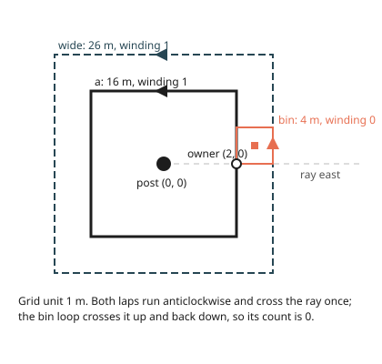
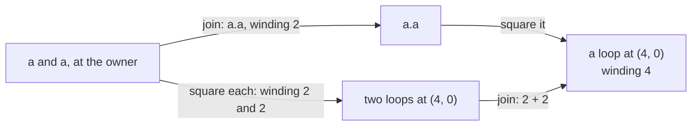

# The fundamental group: loops at a point, multiplied by running one after the other

[Syllabus](../../../SYLLABUS.md) → [Topology](../README.md) → [Homotopy](../README.md#s04) → The fundamental group

---

## General Overview

A dog on a lead stands with its owner on a pavement of 1 m paving slabs. A lamp post stands 2 m west of the owner. The dog runs once round the post, anticlockwise, and comes back to the owner's feet: 16 m along the slab edges.

The lead is now wound round the post. No amount of sliding it along the ground frees it, unless the lead passes through the post. If the dog runs round a second time, the lead is wound twice. If it then runs once round the other way, one turn comes off.

Each run is a **loop**: a walk that starts and ends at one fixed point, here the owner's feet ([Contractible and simply connected](02-contractible-and-simply-connected.md) asked only whether a loop shrinks). This card multiplies loops. Two loops are **joined** by running the first, then the second.

Joining is the operation of a group. Its members are **classes** of loops: two loops share a class when one slides into the other, the owner holding still and the lead never passing through the post. One lap anticlockwise, then one clockwise, is in the class of standing still: the lead comes free. Two laps anticlockwise are not.

**The loops at a fixed point, counted as the same when one slides into the other, form a group whose operation is "run one, then the other"; a continuous map between spaces carries this group to the other space's group and respects joining.**

**What kind of fact this is:** a construction, with theorems proved on this card in Why it works: joining is well defined on classes and passes all four group rules, and a continuous map gives a homomorphism. That this group is exactly the whole numbers is proved on the next card, for the circle, which the pavement-minus-post squashes onto.

### The picture: three walks from the owner

<p align="center"></p>

The solid square is the lap called a. The dashed square, called wide, takes a different route but winds the lead round the post the same way. The small loop round a bin, called bin, never goes round the post. The grey ray running east from the post is used to count laps.

---

## The formula

Notation first, in words. The space $`X`$ is the pavement with the post removed: the plane minus one point, the post at $`(0, 0)`$, distances in metres. The basepoint $`x_0 = (2, 0)`$ is the owner's feet.

A **loop at** $`x_0`$ is a continuous map $`\alpha`$ from the time interval $`[0, 1]`$ into $`X`$ with $`\alpha(0) = \alpha(1) = x_0`$. Read $`\alpha(s)`$ as "where the dog is at time $`s`$". Two loops are **homotopic**, written $`\alpha \simeq \beta`$, when one slides continuously into the other inside $`X`$ while both ends stay at $`x_0`$. The slide is a homotopy $`H(s, t)`$: at slide-time $`t = 0`$ it is $`\alpha`$, at $`t = 1`$ it is $`\beta`$ ([Homotopy](01-homotopy-and-homotopy-equivalence.md)). The class $`[\alpha]`$ is the set of all loops homotopic to $`\alpha`$.

Joining two loops runs each at double speed:

```math
(\alpha\cdot\beta)(s) = \begin{cases} \alpha(2s) & 0 \le s \le \tfrac12 \\ \beta(2s-1) & \tfrac12 \le s \le 1 \end{cases}
```

The fundamental group is the set of classes, with joining as its operation:

```math
\pi_1(X, x_0) = \{\text{loops at } x_0\} \,/\, \simeq, \qquad [\alpha]\,[\beta] = [\alpha\cdot\beta]
```

**Read it aloud:** "pi one of X at x nought" is the set of loop classes at the owner's feet, and the product of two classes is the class of "run the first, then the second".

A continuous map $`f`$ from $`X`$ to a space $`Y`$ carries each loop to a loop at $`f(x_0)`$. That gives the **induced map** $`f_*`$, read "f lower star":

```math
f_*[\alpha] = [f\circ\alpha], \qquad (g\circ f)_* = g_*\circ f_*, \qquad (\mathrm{id})_* = \mathrm{id}
```

**Read it aloud:** to carry a class across, carry any loop in it; carrying by two maps in a row is carrying by each in turn; the map that moves nothing carries every class to itself.

| Symbol | Plain meaning | In our example | Push it up and the answer… |
| --- | --- | --- | --- |
| $`X`$, $`Y`$ | the spaces the loops live in | the plane minus the post at $`(0, 0)`$ | fill the post in and every loop shrinks |
| $`x_0`$ | the basepoint: every loop starts and ends here | the owner, $`(2, 0)`$ | another basepoint, an isomorphic group here |
| $`\alpha`$, $`\beta`$, $`\gamma`$ | loops at $`x_0`$ | a: 16 m once round, anticlockwise | — |
| $`s`$ | time along a loop, from 0 to 1 | $`s = 1/4`$: a quarter of the way | — |
| $`\alpha\cdot\beta`$ | joining: $`\alpha`$, then $`\beta`$, each at double speed | a·a: 32 m, twice round | — |
| $`\bar\alpha`$ | the reverse: $`\bar\alpha(s) = \alpha(1-s)`$ | a-bar: 16 m once round, clockwise | — |
| $`c`$ | the constant loop: standing still at $`x_0`$ | the dog sits: 0 m | — |
| $`\simeq`$, $`H(s, t)`$, $`t`$ | homotopic; the slide that shows it; slide-time from 0 to 1 | a·a-bar ≃ standing still | — |
| $`[\alpha]`$ | the class of $`\alpha`$: every loop it slides into | the class of a·a-bar holds standing still | — |
| $`\pi_1(X, x_0)`$ | the fundamental group | its members include a, a·a, a·a·a, all different | — |
| $`f`$, $`g`$, $`f_*`$, $`\mathrm{id}`$ | continuous maps; the induced map on classes; the map that moves nothing | mirror: $`n \mapsto -n`$; squaring: $`n \mapsto 2n`$ | — |
| $`n(\alpha, 0)`$ | the winding number: signed laps round the post | 1 for a, −1 for a-bar, 0 for bin | — |

The winding number $`n(\alpha, 0)`$ is the one from complex analysis ([Deforming a loop](../../07-Complex%20analysis/03-Contour%20Integrals%20and%20Cauchy%27s%20Theorem/04-deforming-contours-and-winding-numbers.md)). Here it counts the times a loop crosses the ray east of the post going north, minus the times going south.

### When it holds

- **The slide keeps both ends at the owner.** If the far end may leave the owner mid-slide, any loop is reeled back along its own route to a point, and every loop lands in one class.
- **The slide stays inside $`X`$.** Squeezing lap a straight toward the owner runs through the post at slide-time $`t = 1/2`$. The winding number reads 1 at $`t = 1/4`$ and 0 at $`t = 3/4`$: that squeeze is not a homotopy in $`X`$.
- **The members are classes, not loops.** As timed walks, the two bracketings $`(\alpha\cdot\beta)\cdot\gamma`$ and $`\alpha\cdot(\beta\cdot\gamma)`$ differ: with all three equal to a, at time 1/4 one has the dog at $`(2, 0)`$ and the other at $`(-2, 0)`$.
- **The map is continuous.** A jump would tear a loop, and $`f\circ\alpha`$ would no longer be a walk.
- **The basepoint goes along.** $`f_*`$ lands in the loops at $`f(x_0)`$. Squaring sends the owner from $`(2, 0)`$ to $`(4, 0)`$. In a path-connected space (any two points joined by a path), groups at different basepoints are isomorphic.

---

## Why it works

### Step 0: every group rule is one slide

A homotopy is a film of loops. Films can be cut together, or played slower in one stretch and faster in another. Each group rule below is one such film that never leaves $`X`$ and never moves the owner.

The four rules come from [Groups](../../03-Algebra/08-Groups/01-groups.md): combining stays inside, brackets move, one member changes nothing, every member has an undo.

### Step 1: joining is well defined on classes

Suppose $`\alpha \simeq \alpha'`$ by one slide and $`\beta \simeq \beta'`$ by another. Run the first slide on the first half of the time and the second slide on the second half.

At the middle time $`s = 1/2`$ both slides sit at $`x_0`$, so the two halves meet. The result slides $`\alpha\cdot\beta`$ into $`\alpha'\cdot\beta'`$. So the class of a joined loop depends only on the classes joined. Joining two loops at $`x_0`$ gives a loop at $`x_0`$, so combining stays inside.

### Step 2: brackets move, but only up to a slide

Join three laps of a. The bracketing $`(a\cdot a)\cdot a`$ spends time 1/4, 1/4 and 1/2 on the three laps. The bracketing $`a\cdot(a\cdot a)`$ spends 1/2, 1/4 and 1/4.

Same route, different timetable. At time 1/4 the first has the dog back at the owner, $`(2, 0)`$, and the second has it halfway round, at $`(-2, 0)`$: different loops.

Slide the timetable: move the breakpoints in a straight line from 1/4 and 1/2 to 1/2 and 3/4. Every frame is the same route, so the film never leaves $`X`$, and the classes are equal.

### Step 3: standing still changes nothing

The constant loop $`c`$ is the dog sitting at the owner's feet. The joined loop $`c\cdot a`$ sits for the first half of the time, then runs a at double speed. At time 1/4 it is at $`(2, 0)`$, while a alone is at $`(0, 2)`$, 2 m north of the post.

Slide the timetable again, shrinking the sitting to nothing. So $`[c][\alpha] = [\alpha]`$, and the same works on the other side.

### Step 4: a walk backwards undoes it

The reverse $`\bar a`$ is a run clockwise, called a-bar. The loop $`a\cdot\bar a`$ goes out round the post and comes back the same way: 32 m.

Pull the far end in. At slide-time $`t`$, the dog runs along a only as far as time $`1 - t`$, then retraces its steps. At $`t = 1`$ it never leaves the owner. The film uses only points already visited, so it never touches the post.

In the code this film is 16 steps: each step pulls in one there-and-back spur of 1 m on the slabs, and 32 m shrink to 0 m.

<details>
<summary>Detailed proof: the four slides, written out</summary>

Each formula is continuous, since it is built from continuous pieces that agree where they meet. Each uses only values of the given loops, so it stays in $`X`$. Each is at $`x_0`$ when $`s = 0`$ and $`s = 1`$.

**Well defined.** If $`H`$ slides $`\alpha`$ to $`\alpha'`$ and $`K`$ slides $`\beta`$ to $`\beta'`$, take the following. At $`s = 1/2`$ both pieces equal $`x_0`$.

$`\displaystyle G(s, t) = H(2s, t) \text{ for } s \le \tfrac12, \qquad G(s, t) = K(2s - 1, t) \text{ for } s \ge \tfrac12`$

**Retiming lemma.** Let $`\varphi`$ be a continuous map of $`[0, 1]`$ to itself with $`\varphi(0) = 0`$ and $`\varphi(1) = 1`$. Then $`\lambda\circ\varphi \simeq \lambda`$ for any loop $`\lambda`$, by the slide below. Its time argument stays in $`[0, 1]`$, and it holds 0 and 1 fixed.

$`\displaystyle R(s, t) = \lambda\big((1 - t)\,\varphi(s) + t\,s\big)`$

**Brackets.** With $`\lambda = \alpha\cdot(\beta\cdot\gamma)`$, the loop $`(\alpha\cdot\beta)\cdot\gamma`$ is $`\lambda\circ\varphi`$, where $`\varphi`$ is $`2s`$ on $`[0, \tfrac14]`$, $`s + \tfrac14`$ on $`[\tfrac14, \tfrac12]`$ and $`\tfrac{s+1}{2}`$ on $`[\tfrac12, 1]`$. Check one piece: on $`[0, \tfrac14]`$ the left side is $`\alpha(4s)`$ and $`\lambda(2s) = \alpha(4s)`$.

**Identity.** The loop $`c\cdot\alpha`$ is $`\alpha\circ\varphi`$ with $`\varphi(s) = 0`$ on $`[0, \tfrac12]`$ and $`2s - 1`$ on $`[\tfrac12, 1]`$. The case $`\alpha\cdot c`$ is the mirror image.

**Inverse.** The slide below is $`\alpha\cdot\bar\alpha`$ at $`t = 0`$, since $`\bar\alpha(2s - 1) = \alpha(2 - 2s)`$. It is constant at $`t = 1`$, since $`\alpha(0) = x_0`$. Both pieces equal $`\alpha(1 - t)`$ at $`s = 1/2`$.

$`\displaystyle J(s, t) = \alpha\big(2s(1 - t)\big) \text{ for } s \le \tfrac12, \qquad J(s, t) = \alpha\big((2 - 2s)(1 - t)\big) \text{ for } s \ge \tfrac12`$

Swapping the roles of $`\alpha`$ and $`\bar\alpha`$ gives $`\bar\alpha\cdot\alpha \simeq c`$.

</details>

### Step 5: the group is not trivial here

Showing two loops are *not* homotopic needs an invariant: a number that cannot change during a slide. The winding number $`n(\alpha, 0)`$ is one. It changes only when the loop passes through the post, which a slide in $`X`$ never does ([Deforming a loop](../../07-Complex%20analysis/03-Contour%20Integrals%20and%20Cauchy%27s%20Theorem/04-deforming-contours-and-winding-numbers.md)). It also adds when loops are joined, because the crossings of the ray in the two halves add up. The code checks the adding on 25 pairs: an illustration, not a proof.

So a, a·a and a·a·a, with windings 1, 2 and 3, are three different classes. The lead wound twice cannot come free. Whether winding number is the whole story, so that every loop round the post is in the class of some number of laps, is [The circle's fundamental group is the integers](04-fundamental-group-of-the-circle.md).

### Step 6: a continuous map respects joining

Take any continuous $`f`$ from $`X`$ to $`Y`$. Carrying the joined loop gives the joined carried loops, exactly, at every instant:

```math
f\circ(\alpha\cdot\beta) = (f\circ\alpha)\cdot(f\circ\beta)
```

Both sides are $`f(\alpha(2s))`$ for the first half of the time and $`f(\beta(2s - 1))`$ for the second.

If a slide $`H`$ takes $`\alpha`$ to $`\alpha'`$, then $`f\circ H`$ takes $`f\circ\alpha`$ to $`f\circ\alpha'`$. So $`f_*`$ is well defined on classes, and the line above says it is a **homomorphism**: a map between groups that respects the operation ([Homomorphisms and isomorphisms](../../03-Algebra/08-Groups/05-homomorphisms-and-isomorphisms.md)).

Two maps of the pavement-minus-post to itself show it with numbers.

- **Mirror**, $`(x, y) \mapsto (x, -y)\,`$: north and south swap. Every anticlockwise lap becomes clockwise, so $`n \mapsto -n`$. The owner stays at $`(2, 0)`$.
- **Squaring**, $`(x, y) \mapsto (x^2 - y^2,\, 2xy)\,`$: each point's compass bearing from the post doubles, and its distance is squared. One lap of bearing becomes two, so $`n \mapsto 2n`$. The owner moves to $`(4, 0)`$.



Join then carry, or carry then join: the same loop, so the same class.

### Step 7: carrying twice, and carrying by nothing

Carrying by $`f`$ and then by $`g`$ gives $`g\circ(f\circ\alpha)`$. That is the loop $`(g\circ f)\circ\alpha`$, since composing maps is associative. So $`(g\circ f)_* = g_*\circ f_*`$. Squaring after the mirror sends a winding of 1 to −2, which is 2 × (−1).

The identity map $`\mathrm{id}`$ moves no point, so $`\mathrm{id}\circ\alpha = \alpha`$ and $`(\mathrm{id})_* = \mathrm{id}`$.

A rule that sends spaces to groups and maps to homomorphisms, keeping composition and the identity, is called a **functor**, taught in Categories and functors in the computability wing.

The rules pay at once. If $`f`$ is a homeomorphism, a continuous map with a continuous inverse $`f^{-1}`$, then $`f^{-1}_*\circ f_* = (f^{-1}\circ f)_* = (\mathrm{id})_* = \mathrm{id}`$, and the same on the other side. So $`f_*`$ is an isomorphism. Spaces with different fundamental groups cannot be homeomorphic. A homotopy equivalence (maps both ways whose composites each slide to the identity, from [Homotopy](01-homotopy-and-homotopy-equivalence.md)) also gives an isomorphism (Hatcher, Proposition 1.18, which needs care with the moving basepoint). That is how the pavement-minus-post inherits the circle's group.

---

## Worked numbers, by hand

The walks go along slab edges. Lap a is N 2 m, W 4 m, S 4 m, E 4 m, N 2 m from the owner.

| Step | Arithmetic | Value |
| --- | --- | --- |
| lap a | 2 + 4 + 4 + 4 + 2 m, crossing the ray going north once | 16 m, winding 1 |
| a·a | 16 + 16 m; windings 1 + 1 | 32 m, winding 2 |
| a·a·a | 16 + 16 + 16 m; windings 1 + 1 + 1 | 48 m, winding 3 |
| a·bin | 16 + 4 m; windings 1 + 0 | 20 m, winding 1 |
| a·a-bar | 16 + 16 m; windings 1 + (−1) | 32 m, winding 0 |
| pull in its spurs | one 1 m spur at a time | 16 spurs, **0 m left** |
| mirror, then squaring, of a | 1 becomes −1, then 2 × (−1) | **winding −2** |

Run round and then back round the other way, and the lead comes free: the joined loop is the class of standing still.

### What breaks if you drop a piece

| Mistake | Comes out at | What went wrong |
| --- | --- | --- |
| Joining loops, not classes | at time 1/4, $`(2, 0)`$ against $`(-2, 0)`$ | brackets move only up to a slide |
| Squeezing lap a straight toward the owner | winding 1 at $`t = 1/4`$, 0 at $`t = 3/4`$ | the squeeze runs through the post at $`t = 1/2`$ |
| Counting laps without a sign | a·a-bar: 2 laps, winding 0 | a clockwise lap undoes an anticlockwise one |
| Reading $`f_*`$ at the old basepoint | squaring sends $`(2, 0)`$ to $`(4, 0)`$ | the image loops start at $`f(x_0)`$ |

The code prints all four.

---

## Code, from first principles, and it actually runs

The walks are lists of slab corners, 1 m apart, so every number is whole or an exact fraction. Two independent roads find each winding number: signed crossings of the ray east of the post, and quarter turns of the compass bearing, which never uses the ray. A third road, pulling in there-and-back spurs, shows the inverse rule with no winding number at all. The maps' windings, read by quarter turns, are compared with $`2n`$ and $`-n`$ from the ray. Checks on 25 pairs illustrate; the proofs are in Why it works.

### Python

```python
# The fundamental group -- the check behind the card.  Only Fraction is
# imported.  A lamp post stands at (0, 0) on a pavement of 1 m slabs, and the
# owner stands at X0 = (2, 0).  A walk is the list of slab corners the dog
# visits, 1 m apart, from X0 back to X0: a loop.  Joining is one, then the other.
from fractions import Fraction as F
X0 = (2, 0)

def walk(moves):                         # "N2 W4" -> the corners visited, from X0
    pts, step = [X0], {"N": (0, 1), "S": (0, -1), "E": (1, 0), "W": (-1, 0)}
    for m in moves.split():
        for _ in range(int(m[1:])):
            pts.append((pts[-1][0] + step[m[0]][0], pts[-1][1] + step[m[0]][1]))
    return pts

def join(a, b): return a + b[1:]         # a, then b: a ends where b starts
def rev(a): return a[::-1]               # the same walk, backwards

def wind_ray(p):                         # road 1: signed crossings of the ray
    n = 0                                # running east from the post
    for (x0, y0), (x1, y1) in zip(p, p[1:]):
        c = x0 * y1 - x1 * y0            # c > 0: the post is on the walker's left
        if y0 <= 0 < y1 and c > 0: n += 1
        if y1 <= 0 < y0 and c < 0: n -= 1
    return n

def quad(x, y):                          # quarter of the compass, seen from the post
    return 0 if x > 0 <= y else 1 if y > 0 else 2 if x < 0 else 3

def wind_quad(p):                        # road 2: count quarter turns, no ray at all
    total = 0
    for a, b in zip(p, p[1:]):
        d = (quad(*b) - quad(*a)) % 4
        assert d != 2, "one step swept half the compass"
        total += {0: 0, 1: 1, 3: -1}[d]
    assert total % 4 == 0
    return total // 4

def laps(p):                             # the same crossings, sign ignored
    return sum(1 for (x0, y0), (x1, y1) in zip(p, p[1:])
               if (y0 <= 0 < y1 and x0 * y1 > x1 * y0) or (y1 <= 0 < y0 and x0 * y1 < x1 * y0))

def cancel(p):                           # pull in every there-and-back spur
    st, k = [], 0
    for v in p:
        if len(st) >= 2 and st[-2] == v: st.pop(); k += 1
        else: st.append(v)
    return st, k

def timed(p):                            # the walk as a function of time s in [0, 1]
    def go(s):
        i, r = divmod(s * (len(p) - 1), 1)
        (xa, ya), (xb, yb) = p[int(i)], p[min(int(i) + 1, len(p) - 1)]
        return (xa + r * (xb - xa), ya + r * (yb - ya))
    return go

def dot(f, g):                           # the card's product: f at double speed, then g
    return lambda s: f(2 * s) if s <= F(1, 2) else g(2 * s - 1)

def pt(v): return f"({v[0]}, {v[1]})"   # a point, fractions printed as 1/2
def yn(claim): return "yes" if claim else "no"

def sq(v): return (v[0] ** 2 - v[1] ** 2, 2 * v[0] * v[1])   # doubles every bearing
def mirror(v): return (v[0], -v[1])                        # swaps north and south
def carry(f, p): return [f(v) for v in p]                  # f applied to a walk

A = walk("N2 W4 S4 E4 N2")               # once round the post, anticlockwise
B = rev(A)                               # once round, clockwise
C = walk("E1 N1 W1 S1")                  # round a bin beside the owner, not the post
D = walk("E1 N3 W6 S6 E6 N3 W1")         # a wider lap round the post
loops = {"stand": [X0], "a": A, "a-bar": B, "bin": C, "wide": D}
for name, p in loops.items():
    print(f"loop {name:<6} {len(p) - 1:>2} m   winding by the ray {wind_ray(p):>2}, by quarter turns {wind_quad(p):>2}")
print(f"figure,post (0, 0); owner {X0}; a turns at {A[2]} {A[6]} {A[10]} {A[14]}; "
      f"wide turns at {D[4]} {D[10]} {D[16]} {D[22]}; bin {C[1]} {C[2]} {C[3]}")
pairs = [(x, y) for x in loops.values() for y in loops.values()]
adds = all(wind_ray(join(x, y)) == wind_ray(x) + wind_ray(y) == wind_quad(join(x, y)) for x, y in pairs)
print(f"windings add when two loops are joined: {yn(adds)}, checked on {len(pairs)} pairs")
print("joined   length  winding  spurs pulled in  left after pulling")
for name, p in [("a.a", join(A, A)), ("a.a-bar", join(A, B)), ("a-bar.a", join(B, A)),
                ("a.bin", join(A, C)), ("a.a.a", join(A, join(A, A)))]:
    red, k = cancel(p)
    print(f"{name:<8} {len(p) - 1:>4} m {wind_ray(p):>8} {k:>16} {len(red) - 1:>14} m")
ta, tc = timed(A), timed([X0])
left, right = dot(dot(ta, ta), ta), dot(ta, dot(ta, ta))
print(f"(a.a).a gives the three laps times {F(1, 4)}, {F(1, 4)}, {F(1, 2)}; "
      f"a.(a.a) gives {F(1, 2)}, {F(1, 4)}, {F(1, 4)}")
print(f"at time 1/4: (a.a).a is at {pt(left(F(1, 4)))}, a.(a.a) at {pt(right(F(1, 4)))}")
print(f"at time 1/4: stand.a is at {pt(dot(tc, ta)(F(1, 4)))}, a alone at {pt(ta(F(1, 4)))}")
squeeze = {t: [((1 - t) * x + t * X0[0], (1 - t) * y + t * X0[1]) for x, y in A] for t in (F(1, 4), F(1, 2), F(3, 4))}
on_post = (0, 0) in squeeze[F(1, 2)]
print(f"squeeze a straight toward the owner: winding {wind_ray(squeeze[F(1, 4)])} at t = 1/4, "
      f"{wind_ray(squeeze[F(3, 4)])} at t = 3/4; a corner on the post at t = 1/2: {yn(on_post)}")
print(f"a.a-bar: unsigned laps {laps(join(A, B))}, signed winding {wind_ray(join(A, B))}")
print(f"basepoint after each map: mirror {mirror(X0)}, squaring {sq(X0)}")
print(f"squaring a.a gives winding {wind_quad(carry(sq, join(A, A)))}; "
      f"squaring each a, then joining, gives {wind_quad(join(carry(sq, A), carry(sq, A)))}")
print("loop      n   mirror  squaring  squaring after mirror")
for name, p in loops.items():
    print(f"{name:<6} {wind_quad(p):>4} {wind_quad(carry(mirror, p)):>8} {wind_quad(carry(sq, p)):>9}"
          f" {wind_quad(carry(sq, carry(mirror, p))):>22}")
assert [wind_ray(p) for p in loops.values()] == [0, 1, -1, 0, 1]          # read off by hand
assert all(wind_ray(p) == wind_quad(p) for p in loops.values()) and adds  # two roads agree
assert laps(join(A, B)) == 2 and cancel(join(A, B)) == ([X0], 16) and cancel(join(A, A))[1] == 0    # a.a-bar shrinks
assert left(F(1, 4)) == A[16] and right(F(1, 4)) == (-2, 0)               # not equal on the nose
assert wind_ray(squeeze[F(1, 4)]) == 1 and wind_ray(squeeze[F(3, 4)]) == 0 and on_post
assert wind_quad(carry(sq, join(A, A))) == 2 * wind_ray(join(A, A)) == 4  # squaring a.a: 2 x 2
assert all(wind_quad(carry(sq, p)) == 2 * wind_ray(p) and wind_quad(carry(mirror, p)) == -wind_ray(p)
           and wind_quad(carry(sq, carry(mirror, p))) == -2 * wind_ray(p) for p in loops.values())
print("ALL CHECKS PASS")
```

**Ran 2026-11-15 on macOS, Python 3.14.10, standard library only. All checks passed. Output, pasted from the run:**

```
loop stand   0 m   winding by the ray  0, by quarter turns  0
loop a      16 m   winding by the ray  1, by quarter turns  1
loop a-bar  16 m   winding by the ray -1, by quarter turns -1
loop bin     4 m   winding by the ray  0, by quarter turns  0
loop wide   26 m   winding by the ray  1, by quarter turns  1
figure,post (0, 0); owner (2, 0); a turns at (2, 2) (-2, 2) (-2, -2) (2, -2); wide turns at (3, 3) (-3, 3) (-3, -3) (3, -3); bin (3, 0) (3, 1) (2, 1)
windings add when two loops are joined: yes, checked on 25 pairs
joined   length  winding  spurs pulled in  left after pulling
a.a        32 m        2                0             32 m
a.a-bar    32 m        0               16              0 m
a-bar.a    32 m        0               16              0 m
a.bin      20 m        1                0             20 m
a.a.a      48 m        3                0             48 m
(a.a).a gives the three laps times 1/4, 1/4, 1/2; a.(a.a) gives 1/2, 1/4, 1/4
at time 1/4: (a.a).a is at (2, 0), a.(a.a) at (-2, 0)
at time 1/4: stand.a is at (2, 0), a alone at (0, 2)
squeeze a straight toward the owner: winding 1 at t = 1/4, 0 at t = 3/4; a corner on the post at t = 1/2: yes
a.a-bar: unsigned laps 2, signed winding 0
basepoint after each map: mirror (2, 0), squaring (4, 0)
squaring a.a gives winding 4; squaring each a, then joining, gives 4
loop      n   mirror  squaring  squaring after mirror
stand     0        0         0                      0
a         1       -1         2                     -2
a-bar    -1        1        -2                      2
bin       0        0         0                      0
wide      1       -1         2                     -2
ALL CHECKS PASS
```

### Rust

Same numbers, same labels, built with `rustc --edition 2021 -O`. The squeeze uses corners scaled by 4 to stay in whole numbers; scaling about the post does not change a winding number.

```rust
// The fundamental group -- the same check as the Python, in Rust.  No crates.
// A lamp post stands at (0, 0) on a pavement of 1 m slabs, and the owner
// stands at X0 = (2, 0).  A walk is the list of slab corners the dog visits,
// 1 m apart, from X0 back to X0: a loop.  Joining is one, then the other.
type P = (i64, i64);
const X0: P = (2, 0);

fn walk(moves: &str) -> Vec<P> {                  // "N2 W4" -> the corners visited
    let mut pts = vec![X0];
    for m in moves.split_whitespace() {
        let (dx, dy) = match &m[..1] { "N" => (0, 1), "S" => (0, -1), "E" => (1, 0), _ => (-1, 0) };
        for _ in 0..m[1..].parse::<i64>().unwrap() {
            let l = pts[pts.len() - 1];
            pts.push((l.0 + dx, l.1 + dy));
        }
    }
    pts
}
fn join(a: &[P], b: &[P]) -> Vec<P> { let mut v = a.to_vec(); v.extend_from_slice(&b[1..]); v }
fn rev(a: &[P]) -> Vec<P> { a.iter().rev().copied().collect() }
fn wind_ray(p: &[P]) -> i64 {                     // road 1: signed crossings of the ray east
    let mut n = 0;
    for w in p.windows(2) {
        let ((x0, y0), (x1, y1)) = (w[0], w[1]);
        let c = x0 * y1 - x1 * y0;                // c > 0: the post is on the walker's left
        if y0 <= 0 && 0 < y1 && c > 0 { n += 1 }
        if y1 <= 0 && 0 < y0 && c < 0 { n -= 1 }
    }
    n
}
fn quad(x: i64, y: i64) -> i64 { if x > 0 && y >= 0 { 0 } else if y > 0 { 1 } else if x < 0 { 2 } else { 3 } }
fn wind_quad(p: &[P]) -> i64 {                    // road 2: count quarter turns, no ray at all
    let mut total = 0;
    for w in p.windows(2) {
        let d = (quad(w[1].0, w[1].1) - quad(w[0].0, w[0].1)).rem_euclid(4);
        assert!(d != 2, "one step swept half the compass");
        total += [0, 1, 0, -1][d as usize];
    }
    assert!(total % 4 == 0);
    total / 4
}
fn laps(p: &[P]) -> i64 {                         // the same crossings, sign ignored
    p.windows(2).filter(|w| { let ((x0, y0), (x1, y1)) = (w[0], w[1]);
        (y0 <= 0 && 0 < y1 && x0 * y1 > x1 * y0) || (y1 <= 0 && 0 < y0 && x0 * y1 < x1 * y0) }).count() as i64
}
fn cancel(p: &[P]) -> (Vec<P>, i64) {             // pull in every there-and-back spur
    let (mut st, mut k): (Vec<P>, i64) = (Vec::new(), 0);
    for &v in p {
        if st.len() >= 2 && st[st.len() - 2] == v { st.pop(); k += 1 } else { st.push(v) }
    }
    (st, k)
}
fn gcd(a: i64, b: i64) -> i64 { if b == 0 { a.abs() } else { gcd(b, a % b) } }
#[derive(Clone, Copy, PartialEq)]
struct Q(i64, i64);                               // an exact fraction n/d, d > 0
fn q(n: i64, d: i64) -> Q { let g = gcd(n, d).max(1); Q(n / g, d / g) }
fn show(a: Q) -> String { if a.1 == 1 { format!("{}", a.0) } else { format!("{}/{}", a.0, a.1) } }
fn pt(v: (Q, Q)) -> String { format!("({}, {})", show(v.0), show(v.1)) }
type T = Box<dyn Fn(Q) -> (Q, Q)>;
fn timed(p: Vec<P>) -> T {                        // the walk as a function of time s in [0, 1]
    Box::new(move |s: Q| {
        let len = (p.len() - 1) as i64;
        let (i, r) = ((s.0 * len).div_euclid(s.1), (s.0 * len).rem_euclid(s.1));
        let (a, b) = (p[i as usize], p[((i + 1) as usize).min(p.len() - 1)]);
        (q(a.0 * s.1 + r * (b.0 - a.0), s.1), q(a.1 * s.1 + r * (b.1 - a.1), s.1))
    })
}
fn dot(f: T, g: T) -> T {                         // the card's product: f at double speed, then g
    Box::new(move |s: Q| if 2 * s.0 <= s.1 { f(q(2 * s.0, s.1)) } else { g(q(2 * s.0 - s.1, s.1)) })
}
fn sq(v: P) -> P { (v.0 * v.0 - v.1 * v.1, 2 * v.0 * v.1) }   // doubles every bearing
fn mirror(v: P) -> P { (v.0, -v.1) }                          // swaps north and south
fn carry(f: fn(P) -> P, p: &[P]) -> Vec<P> { p.iter().map(|&v| f(v)).collect() }
fn yn(c: bool) -> &'static str { if c { "yes" } else { "no" } }
fn s2(v: P) -> String { format!("({}, {})", v.0, v.1) }

fn main() {
    let a = walk("N2 W4 S4 E4 N2");               // once round the post, anticlockwise
    let b = rev(&a);                              // once round, clockwise
    let c = walk("E1 N1 W1 S1");                  // round a bin beside the owner
    let d = walk("E1 N3 W6 S6 E6 N3 W1");         // a wider lap round the post
    let loops: Vec<(&str, Vec<P>)> = vec![("stand", vec![X0]), ("a", a.clone()), ("a-bar", b.clone()), ("bin", c.clone()), ("wide", d.clone())];
    for (name, p) in &loops {
        println!("loop {:<6} {:>2} m   winding by the ray {:>2}, by quarter turns {:>2}", name, p.len() - 1, wind_ray(p), wind_quad(p));
    }
    println!("figure,post (0, 0); owner {}; a turns at {} {} {} {}; wide turns at {} {} {} {}; bin {} {} {}",
             s2(X0), s2(a[2]), s2(a[6]), s2(a[10]), s2(a[14]), s2(d[4]), s2(d[10]), s2(d[16]), s2(d[22]), s2(c[1]), s2(c[2]), s2(c[3]));
    let mut pairs: Vec<(Vec<P>, Vec<P>)> = Vec::new();
    for (_, x) in &loops { for (_, y) in &loops { pairs.push((x.clone(), y.clone())) } }
    let adds = pairs.iter().all(|(x, y)| { let j = join(x, y); wind_ray(&j) == wind_ray(x) + wind_ray(y) && wind_ray(&j) == wind_quad(&j) });
    println!("windings add when two loops are joined: {}, checked on {} pairs", yn(adds), pairs.len());
    println!("joined   length  winding  spurs pulled in  left after pulling");
    let aaa = join(&a, &join(&a, &a));
    for (name, p) in [("a.a", join(&a, &a)), ("a.a-bar", join(&a, &b)), ("a-bar.a", join(&b, &a)), ("a.bin", join(&a, &c)), ("a.a.a", aaa)] {
        let (red, k) = cancel(&p);
        println!("{:<8} {:>4} m {:>8} {:>16} {:>14} m", name, p.len() - 1, wind_ray(&p), k, red.len() - 1);
    }
    let left = dot(dot(timed(a.clone()), timed(a.clone())), timed(a.clone()));
    let right = dot(timed(a.clone()), dot(timed(a.clone()), timed(a.clone())));
    let stand_a = dot(timed(vec![X0]), timed(a.clone()));
    let quarter = q(1, 4);
    println!("(a.a).a gives the three laps times 1/4, 1/4, 1/2; a.(a.a) gives 1/2, 1/4, 1/4");
    println!("at time 1/4: (a.a).a is at {}, a.(a.a) at {}", pt(left(quarter)), pt(right(quarter)));
    println!("at time 1/4: stand.a is at {}, a alone at {}", pt(stand_a(quarter)), pt(timed(a.clone())(quarter)));
    // the straight squeeze at t = k/4, every corner scaled by 4: winding ignores the scale
    let squeeze = |k: i64| -> Vec<P> { a.iter().map(|&(x, y)| ((4 - k) * x + 2 * k, (4 - k) * y)).collect() };
    let on_post = squeeze(2).contains(&(0, 0));
    println!("squeeze a straight toward the owner: winding {} at t = 1/4, {} at t = 3/4; a corner on the post at t = 1/2: {}",
             wind_ray(&squeeze(1)), wind_ray(&squeeze(3)), yn(on_post));
    println!("a.a-bar: unsigned laps {}, signed winding {}", laps(&join(&a, &b)), wind_ray(&join(&a, &b)));
    println!("basepoint after each map: mirror {}, squaring {}", s2(mirror(X0)), s2(sq(X0)));
    println!("squaring a.a gives winding {}; squaring each a, then joining, gives {}",
             wind_quad(&carry(sq, &join(&a, &a))), wind_quad(&join(&carry(sq, &a), &carry(sq, &a))));
    println!("loop      n   mirror  squaring  squaring after mirror");
    for (name, p) in &loops {
        println!("{:<6} {:>4} {:>8} {:>9} {:>22}", name, wind_quad(p), wind_quad(&carry(mirror, p)),
                 wind_quad(&carry(sq, p)), wind_quad(&carry(sq, &carry(mirror, p))));
    }
    assert!(loops.iter().map(|(_, p)| wind_ray(p)).collect::<Vec<i64>>() == vec![0, 1, -1, 0, 1]);
    assert!(loops.iter().all(|(_, p)| wind_ray(p) == wind_quad(p)) && adds);
    assert!(laps(&join(&a, &b)) == 2 && cancel(&join(&a, &b)) == (vec![X0], 16) && cancel(&join(&a, &a)).1 == 0);
    assert!(left(quarter) == (q(2, 1), q(0, 1)) && right(quarter) == (q(-2, 1), q(0, 1)));
    assert!(wind_ray(&squeeze(1)) == 1 && wind_ray(&squeeze(3)) == 0 && on_post);
    assert!(wind_quad(&carry(sq, &join(&a, &a))) == 2 * wind_ray(&join(&a, &a)) && 2 * wind_ray(&join(&a, &a)) == 4); // squaring a.a: 2 x 2
    assert!(loops.iter().all(|(_, p)| wind_quad(&carry(sq, p)) == 2 * wind_ray(p) && wind_quad(&carry(mirror, p)) == -wind_ray(p)
            && wind_quad(&carry(sq, &carry(mirror, p))) == -2 * wind_ray(p)));
    println!("ALL CHECKS PASS");
}
```

**Ran 2026-11-15 on macOS, rustc 1.98.1, no crates. All checks passed. Output, pasted from the run:**

```
loop stand   0 m   winding by the ray  0, by quarter turns  0
loop a      16 m   winding by the ray  1, by quarter turns  1
loop a-bar  16 m   winding by the ray -1, by quarter turns -1
loop bin     4 m   winding by the ray  0, by quarter turns  0
loop wide   26 m   winding by the ray  1, by quarter turns  1
figure,post (0, 0); owner (2, 0); a turns at (2, 2) (-2, 2) (-2, -2) (2, -2); wide turns at (3, 3) (-3, 3) (-3, -3) (3, -3); bin (3, 0) (3, 1) (2, 1)
windings add when two loops are joined: yes, checked on 25 pairs
joined   length  winding  spurs pulled in  left after pulling
a.a        32 m        2                0             32 m
a.a-bar    32 m        0               16              0 m
a-bar.a    32 m        0               16              0 m
a.bin      20 m        1                0             20 m
a.a.a      48 m        3                0             48 m
(a.a).a gives the three laps times 1/4, 1/4, 1/2; a.(a.a) gives 1/2, 1/4, 1/4
at time 1/4: (a.a).a is at (2, 0), a.(a.a) at (-2, 0)
at time 1/4: stand.a is at (2, 0), a alone at (0, 2)
squeeze a straight toward the owner: winding 1 at t = 1/4, 0 at t = 3/4; a corner on the post at t = 1/2: yes
a.a-bar: unsigned laps 2, signed winding 0
basepoint after each map: mirror (2, 0), squaring (4, 0)
squaring a.a gives winding 4; squaring each a, then joining, gives 4
loop      n   mirror  squaring  squaring after mirror
stand     0        0         0                      0
a         1       -1         2                     -2
a-bar    -1        1        -2                      2
bin       0        0         0                      0
wide      1       -1         2                     -2
ALL CHECKS PASS
```

The two outputs match line for line.

### Lean

Lean proves the group rules and the induced map's rules for every space, and checks the card's worked numbers on the pavement.

- Take any space $`X`$ and basepoint $`x_0`$. Then the loop classes at $`x_0`$ form a group with $`[\alpha][\beta] = [\alpha\cdot\beta]`$.
- In that group, standing still is the identity. The class of the reverse $`\bar\alpha`$ is the inverse of $`[\alpha]`$.
- Take a continuous map $`f`$ from $`X`$ to $`Y`$. Then $`f_*[\alpha] = [f\circ\alpha]`$ is well defined and lands in the loop classes at $`f(x_0)`$.
- That $`f_*`$ respects joining, so it is a homomorphism.
- Take continuous maps $`f`$, then $`g`$. Then $`(g\circ f)_* = g_*\circ f_*`$ and $`(\mathrm{id})_* = \mathrm{id}`$.
- Lap a is 16 m with winding 1, wide is 26 m with winding 1, and bin is 4 m with winding 0.
- The loop a·a is 32 m with winding 2, and a·a·a is 48 m with winding 3.
- The loop a·bin is 20 m with winding 1, and a·a-bar is 32 m with winding 0.
- Mirror sends the winding of a to −1, squaring sends it to 2, and squaring after mirror sends it to −2.
- Squaring a·a gives winding 4, the same as 2 + 2. Squaring moves the owner to $`(4, 0)`$, and mirror leaves it at $`(2, 0)`$.

The quarter-turn count, the spur pulling, the bracket timings, the straight squeeze and the 25-pair adding check stay with the Python and Rust checks.

```lean
-- The fundamental group: loop classes at a point form a group under joining, and a continuous map induces a homomorphism of these groups.
import Mathlib.Topology.Homotopy.Path
import Mathlib.Topology.ContinuousMap.Basic
import Mathlib.AlgebraicTopology.FundamentalGroupoid.Basic

variable {X Y Z : Type*} [TopologicalSpace X] [TopologicalSpace Y] [TopologicalSpace Z]

/-- The loops at a fixed point `x₀`, counted as the same when one slides into the other with
both ends held at `x₀`, form a group. Its operation is joining: the class of `α` times the
class of `β` is the class of "run `α`, then `β`". Standing still is the identity, and running a
loop backwards gives the inverse. -/
theorem loop_classes_form_a_group (x₀ : X) :
    ∃ G : Group (Path.Homotopic.Quotient x₀ x₀),
      (∀ α β : Path x₀ x₀,
        G.mul (Path.Homotopic.Quotient.mk α) (Path.Homotopic.Quotient.mk β) =
          Path.Homotopic.Quotient.mk (α.trans β)) ∧
      G.one = Path.Homotopic.Quotient.mk (Path.refl x₀) ∧
      (∀ α : Path x₀ x₀,
        G.inv (Path.Homotopic.Quotient.mk α) = Path.Homotopic.Quotient.mk α.symm) := by
  refine ⟨{ mul := Path.Homotopic.Quotient.trans,
            one := Path.Homotopic.Quotient.refl x₀,
            inv := Path.Homotopic.Quotient.symm,
            mul_assoc := Path.Homotopic.Quotient.trans_assoc,
            one_mul := Path.Homotopic.Quotient.refl_trans,
            mul_one := Path.Homotopic.Quotient.trans_refl,
            inv_mul_cancel := Path.Homotopic.Quotient.symm_trans }, ?_, ?_, ?_⟩
  · intro α β
    exact (Path.Homotopic.Quotient.mk_trans α β).symm
  · exact (Path.Homotopic.Quotient.mk_refl x₀).symm
  · intro α
    exact (Path.Homotopic.Quotient.mk_symm α).symm

/-- A continuous map `f` gives a well-defined map `f_*` on loop classes, `f_*[α] = [f ∘ α]`,
landing in the loop classes at `f x₀`, and `f_*` respects joining:
`f_*([α][β]) = f_*[α] f_*[β]`. So `f_*` is a homomorphism. -/
theorem continuous_map_induces_homomorphism (f : C(X, Y)) (x₀ : X) :
    ∃ fstar : Path.Homotopic.Quotient x₀ x₀ → Path.Homotopic.Quotient (f x₀) (f x₀),
      (∀ α : Path x₀ x₀,
        fstar (Path.Homotopic.Quotient.mk α) =
          Path.Homotopic.Quotient.mk (α.map f.continuous)) ∧
      (∀ P Q : Path.Homotopic.Quotient x₀ x₀,
        fstar (Path.Homotopic.Quotient.trans P Q) =
          Path.Homotopic.Quotient.trans (fstar P) (fstar Q)) := by
  refine ⟨fun P => P.map f, fun α => rfl, ?_⟩
  intro P Q
  induction P using Path.Homotopic.Quotient.ind with | mk α =>
  induction Q using Path.Homotopic.Quotient.ind with | mk β =>
  exact congrArg Path.Homotopic.Quotient.mk (Path.map_trans α β f.continuous)

/-- Carrying by `f` and then by `g` is carrying by `g ∘ f`, and the map that moves nothing
carries every loop class to itself: `(g ∘ f)_* = g_* ∘ f_*` and `(id)_* = id`. -/
theorem induced_map_comp_and_id (f : C(X, Y)) (g : C(Y, Z)) (x₀ : X)
    (P : Path.Homotopic.Quotient x₀ x₀) :
    P.map (g.comp f) = (P.map f).map g ∧ P.map (ContinuousMap.id X) = P := by
  refine ⟨Path.Homotopic.Quotient.map_comp, ?_⟩
  induction P using Path.Homotopic.Quotient.ind with | mk α =>
  rw [← Path.Homotopic.Quotient.mk_map]
  exact congrArg Path.Homotopic.Quotient.mk (Path.map_id α)

namespace Pavement

/-! The card's worked numbers. A walk is the list of 1 m slab corners the dog visits, starting
and ending at the owner `(2, 0)`; the post is at `(0, 0)`. Joining drops the repeated meeting
corner. The winding number counts crossings of the ray east of the post going north, minus
those going south, exactly as in the card's code. -/

/-- Corners visited by a list of moves `(dx, dy, metres)` from the owner at `(2, 0)`. -/
def walk (moves : List (ℤ × ℤ × ℕ)) : List (ℤ × ℤ) :=
  (moves.flatMap fun m => List.replicate m.2.2 (m.1, m.2.1)).scanl
    (fun p d => (p.1 + d.1, p.2 + d.2)) (2, 0)

def join (a b : List (ℤ × ℤ)) : List (ℤ × ℤ) := a ++ b.tail

def crossing (s : (ℤ × ℤ) × (ℤ × ℤ)) : ℤ :=
  let x0 := s.1.1; let y0 := s.1.2; let x1 := s.2.1; let y1 := s.2.2
  if y0 ≤ 0 ∧ 0 < y1 ∧ 0 < x0 * y1 - x1 * y0 then 1
  else if y1 ≤ 0 ∧ 0 < y0 ∧ x0 * y1 - x1 * y0 < 0 then -1 else 0

def wind (p : List (ℤ × ℤ)) : ℤ := ((p.zip p.tail).map crossing).sum

def metres (p : List (ℤ × ℤ)) : ℕ := p.length - 1

def mirror (v : ℤ × ℤ) : ℤ × ℤ := (v.1, -v.2)

def sq (v : ℤ × ℤ) : ℤ × ℤ := (v.1 ^ 2 - v.2 ^ 2, 2 * v.1 * v.2)

/-- Lap a: N 2, W 4, S 4, E 4, N 2. -/
def lapA : List (ℤ × ℤ) := walk [(0, 1, 2), (-1, 0, 4), (0, -1, 4), (1, 0, 4), (0, 1, 2)]
/-- The small loop round a bin: E 1, N 1, W 1, S 1. -/
def bin : List (ℤ × ℤ) := walk [(1, 0, 1), (0, 1, 1), (-1, 0, 1), (0, -1, 1)]
/-- The wider lap: E 1, N 3, W 6, S 6, E 6, N 3, W 1. -/
def wide : List (ℤ × ℤ) :=
  walk [(1, 0, 1), (0, 1, 3), (-1, 0, 6), (0, -1, 6), (1, 0, 6), (0, 1, 3), (-1, 0, 1)]

-- lap a: 16 m, winding 1; the wide lap: 26 m, winding 1; the bin loop: 4 m, winding 0
example : metres lapA = 16 ∧ wind lapA = 1 := by decide
example : metres wide = 26 ∧ wind wide = 1 := by decide
example : metres bin = 4 ∧ wind bin = 0 := by decide
-- a·a: 32 m, winding 2; a·a·a: 48 m, winding 3
-- a·bin: 20 m, winding 1; a·a-bar: 32 m, winding 0
example : metres (join lapA lapA) = 32 ∧ wind (join lapA lapA) = 2 := by decide
example : metres (join lapA (join lapA lapA)) = 48 ∧ wind (join lapA (join lapA lapA)) = 3 := by
  decide
example : metres (join lapA bin) = 20 ∧ wind (join lapA bin) = 1 := by decide
example : metres (join lapA lapA.reverse) = 32 ∧ wind (join lapA lapA.reverse) = 0 := by decide
-- mirror sends winding 1 to -1; squaring sends 1 to 2; squaring after mirror sends 1 to -2
example : wind (lapA.map mirror) = -1 := by decide
example : wind (lapA.map sq) = 2 := by decide
example : wind (lapA.map (sq ∘ mirror)) = -2 := by decide
-- squaring a·a gives winding 4, the same as 2 + 2; the owner moves to (4, 0)
example : wind ((join lapA lapA).map sq) = 4 ∧
    wind (lapA.map sq) + wind (lapA.map sq) = 4 := by decide
example : sq (2, 0) = (4, 0) ∧ mirror (2, 0) = (2, 0) := by decide

end Pavement

#print axioms loop_classes_form_a_group
#print axioms continuous_map_induces_homomorphism
#print axioms induced_map_comp_and_id
```

**Checked 2026-11-15 on macOS, Lean 4.36.0-rc2, Mathlib v4.36.0-rc2. Every proof is complete and uses only Lean's standard axioms. Output, pasted from the run:**

```
'loop_classes_form_a_group' depends on axioms: [propext, Classical.choice, Quot.sound]
'continuous_map_induces_homomorphism' depends on axioms: [propext, Classical.choice, Quot.sound]
'induced_map_comp_and_id' depends on axioms: [propext, Classical.choice, Quot.sound]
```

> [!TIP]
> **Try changing**
> Guess first, then run it. The asserts are pinned to the card's walks, so expect one to stop the program.
> - **Wind twice the other way.** Set `B = rev(join(A, A))`. Guess the winding of a·a-bar. It is −1: 16 spurs pull in and 16 m are left, one clockwise lap. The first assert stops it.
> - **Walk the bin loop round the post.** Set `C = walk("N1 W3 S2 E3 N1")`, a 10 m loop. Guess its winding. It is 1, and a·bin has winding 2. The first assert stops it.
> - **Triple every bearing.** Replace the squaring map by $`(x^3 - 3xy^2,\, 3x^2y - y^3)`$. Guess what happens to a. Its winding becomes 3, and the last assert, which expects 2, stops it.

---

## The usual mistake

> [!warning]
> **Treating single loops as the members of the group.** Joined loops are not associative as timed walks: at time 1/4, $`(a\cdot a)\cdot a`$ has the dog at $`(2, 0)`$ and $`a\cdot(a\cdot a)`$ at $`(-2, 0)`$. And a·a-bar is a 32 m walk, not the 0 m of standing still. Only the classes form a group.
>
> - **Counting laps without a sign.** a·a-bar crosses the ray twice, but its winding is 0 and the lead comes free.
> - **Allowing any squeeze.** The straight squeeze of a toward the owner reads winding 1 at $`t = 1/4`$ and 0 at $`t = 3/4`$, because it runs through the post.
> - **Forgetting the basepoint moves.** Squaring sends the owner from $`(2, 0)`$ to $`(4, 0)`$, so its image loops belong to the group at $`(4, 0)`$.

---

## Where you meet it in real life

- **Tethered robots.** An underwater vehicle or a ground robot on a cable must not wrap the cable round an obstacle. Planners sort candidate routes by homotopy class and search one class at a time.
- **Defects in materials.** A vortex in a superfluid, or a line defect in a liquid crystal, is labelled by a class of loops drawn round it. Two defects merging multiply their classes, and a defect can untangle only if its class is the identity.
- **Contour integrals.** In complex analysis, an integral of $`1/z`$ round a loop depends only on the loop's class in the plane minus 0: it is $`2\pi i`$ times the winding number ([Deforming a loop](../../07-Complex%20analysis/03-Contour%20Integrals%20and%20Cauchy%27s%20Theorem/04-deforming-contours-and-winding-numbers.md)).

> **Say it back**
> A loop is a walk that starts and ends at one fixed point. Two loops count as the same when one slides into the other without leaving the space or moving the point. Joining classes, by running one loop and then the other, passes all four group rules, each proved by one slide. A continuous map carries loops to loops and joined loops to joined loops, so it gives a homomorphism, and maps in a row give homomorphisms in a row. For the lamp post, one lap and then one lap back is standing still, and two laps cannot come free.

---

## What this builds on

- [Contractible and simply connected](02-contractible-and-simply-connected.md): spaces where every loop shrinks, which this card names as the spaces whose fundamental group has one member.
- [Groups](../../03-Algebra/08-Groups/01-groups.md): the four rules that the loop classes are checked against.
- [Homomorphisms and isomorphisms](../../03-Algebra/08-Groups/05-homomorphisms-and-isomorphisms.md): maps that respect the operation, which every continuous map induces here.
- [Homotopy](01-homotopy-and-homotopy-equivalence.md): the slides $`H(s, t)`$ that decide when two loops are in one class.
- [Deforming a loop](../../07-Complex%20analysis/03-Contour%20Integrals%20and%20Cauchy%27s%20Theorem/04-deforming-contours-and-winding-numbers.md): the winding number, and why a slide cannot change it.

## Where this goes next

- [The circle's fundamental group is the integers](04-fundamental-group-of-the-circle.md): winding number is the whole story for one post, so the group here is the whole numbers under addition.
- [Covering spaces](05-covering-spaces.md): unroll the space so that loops become paths, the tool behind that proof.
- [Van Kampen's theorem](06-van-kampens-theorem.md): the group for two posts, where the order of laps matters.
- [Brouwer and Borsuk-Ulam](08-brouwer-and-borsuk-ulam.md): the induced map and its two rules prove that a disc map fixes a point.
- [Ricci flow](../../23-Differential%20geometry%20and%20Lie%20groups/07-Geometric%20Analysis%20and%20Physics/01-ricci-flow-and-the-poincare-proof-in-outline.md): a way of smoothing a space, used to settle when trivial loops force a sphere.
- [The Poincare conjecture, solved](../../25-Frontier/02-The%20Millennium%20Problems/07-poincare-conjecture-solved.md): a closed three-dimensional space in which every loop shrinks is a sphere.
- [Categories and functors](../../24-Computability%20and%20complexity/07-Category%20Theory%20in%20Outline/01-categories-and-functors.md): the general pattern of spaces to groups and maps to homomorphisms.
- [Higher homotopy groups](../07-Higher%20Homotopy%20and%20Mapping%20Spaces/02-higher-homotopy-groups-and-fibrations.md): wrap a sphere around a space, and the Hopf fibration that wraps S^3 around S^2.

Left open: is every loop round the post in the class of some whole number of laps, or are there classes that winding number cannot see?

---

## Sources

Verified 2026-11-15: every link below resolves to the publisher's or author's page.

- Hatcher, Allen. *Algebraic Topology*. Cambridge University Press, 2002. [Author's page, with the free full text](https://pi.math.cornell.edu/~hatcher/AT/ATpage.html). Section 1.1 builds the fundamental group, proves the group rules by retiming, and gives induced homomorphisms and Proposition 1.18.
- Munkres, James R. *Topology*, Classic Version, 2nd ed. Pearson. [Publisher page](https://www.pearson.com/en-us/subject-catalog/p/topology-classic-version/P200000006299/9780137848669). Sections 51 and 52 set out path homotopy, the groupoid properties and the induced homomorphism.
- Mermin, N. D. "The topological theory of defects in ordered media." *Reviews of Modern Physics* 51 (1979). [doi:10.1103/RevModPhys.51.591](https://doi.org/10.1103/RevModPhys.51.591). Classifies line defects by classes of loops, and combining defects by joining loops.
- Bhattacharya, S., M. Likhachev and V. Kumar. "Topological constraints in search-based robot path planning." *Autonomous Robots* 33 (2012). [doi:10.1007/s10514-012-9304-1](https://doi.org/10.1007/s10514-012-9304-1). Plans robot routes one homotopy class at a time.
