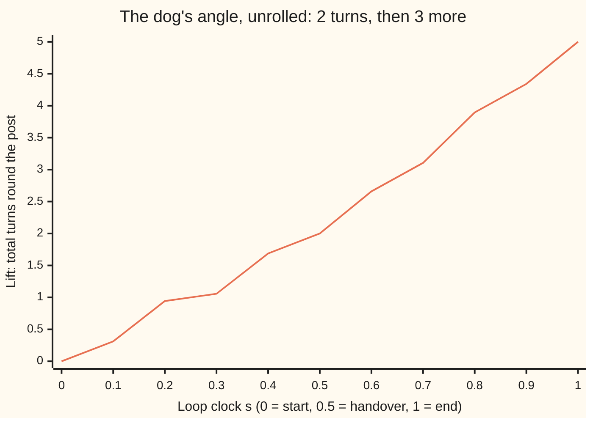

# The circle's fundamental group is the integers: winding number does all the counting

[Syllabus](../../../SYLLABUS.md) → [Topology](../README.md) → [Homotopy](../README.md#s04) → The circle's fundamental group is the integers

---

## General Overview

A dog on a lead starts 2 metres east of a lamp post. It runs round the post twice, anticlockwise, doubling back now and then. Then it runs round three more times. The lead is now wound round the post, and no amount of sliding will free it without the dog running back.

How many times is it wound? The dog has gone round 2 times, then 3, so the answer is 5. If instead it runs round 3 times and then 2 times the other way, the lead is wound once. If it reverses all its laps, the lead slides free.

This card proves that this count is the whole story. Two loops of the lead can be slid into each other exactly when they wind the same number of times. Running one loop after another adds the counts. So the loops, sorted by sliding, behave exactly like the whole numbers under addition.

The tool that makes it work is the **lift**: unroll the circle into an endless straight line, like peeling a spring flat, and follow the loop's angle on that line. The loop ends where it started, so its lift ends a whole number of turns from where it started. That whole number is the count.

**Loops on a circle that start and end at one point are classified by one whole number, the net turns their lift climbs, and joining two loops adds their numbers, so the circle's fundamental group is the integers.**

**What kind of fact this is:** a theorem, proved on this card in Why it works; the lift and the winding number are definitions. The code checks the theorem on finitely many loops, which illustrates it and does not prove it.

### The picture: the lift of two turns then three



The single line is the lift, the total angle the dog has turned through, counted in turns. It reaches 2.000 at the handover, when the first loop ends, and 5.000 at the end. The dog is back at its start, but the lift is 5 turns higher.

---

## The formula

Notation first, in words. The circle $`S^1`$ here is the set of directions seen from the post. A **loop at** $`x_0`$ is a continuous path $`\gamma`$ (gamma) on the circle that starts and ends at the base point $`x_0`$, the direction east. Its clock $`s`$ runs from 0 to 1.

[The fundamental group](03-the-fundamental-group.md) $`\pi_1(S^1, x_0)`$ (read "pi one") collects these loops into classes $`[\gamma]`$: two loops are in one class when one can be slid into the other with the ends held at $`x_0`$. Its product $`[\alpha]\cdot[\beta]`$ runs $`\alpha`$ (alpha) and then $`\beta`$ (beta), each at double speed.

This card introduces the **lift** $`\tilde\gamma`$ (read "gamma tilde"). The **wrap** $`w`$ sends a number of turns $`y`$ to a point of the circle:

```math
w(y) = (\cos 2\pi y,\ \sin 2\pi y)
```

A lift of $`\gamma`$ is a continuous path $`\tilde\gamma`$ on the real line with $`w(\tilde\gamma(s)) = \gamma(s)`$ for every $`s`$, starting at $`\tilde\gamma(0) = 0`$. The theorem is:

```math
\pi_1(S^1, x_0) \cong \mathbb{Z}, \qquad [\gamma] \mapsto n(\gamma) = \tilde\gamma(1), \qquad n(\alpha\cdot\beta) = n(\alpha) + n(\beta)
```

**Read it aloud:** the loop classes on the circle form a copy of the whole numbers; send each loop to where its lift ends, and joining two loops adds those numbers.

In the example, $`n(\alpha) = 2`$, $`n(\beta) = 3`$ and $`n(\alpha\cdot\beta) = 2 + 3 = 5`$.

The count $`n(\gamma)`$ is the winding number $`n(\gamma, 0)`$ of [Deforming a loop](../../07-Complex%20analysis/03-Contour%20Integrals%20and%20Cauchy%27s%20Theorem/04-deforming-contours-and-winding-numbers.md), round the post at 0, written $`n(\gamma)`$ for short. That card showed it is a whole number by following the angle. This card proves that it decides everything about the loop up to sliding.

| Symbol | Plain meaning | In our example | Push it up and the answer… |
| --- | --- | --- | --- |
| $`S^1`$ | the circle: here, the directions seen from the post | every compass direction | — |
| $`x_0`$ | the base point, where every loop starts and ends | east: the dog at (2, 0) m | — |
| $`\gamma`$, $`\alpha`$, $`\beta`$ | loops at $`x_0`$ | $`\alpha`$: 2 turns; $`\beta`$: 3 turns | more laps, bigger count |
| $`s`$ | the loop's clock, from 0 to 1 | 0.5 is the handover in $`\alpha\cdot\beta`$ | — |
| $`w(y)`$, $`y`$ | the wrap: $`y`$ turns round the circle from east | $`w(5) = w(0) = x_0`$ | add 1 to $`y`$, same point |
| $`\tilde\gamma`$ | the lift: the loop's angle in turns, unrolled onto the real line | climbs 0 to 5 for $`\alpha\cdot\beta`$ | — |
| $`n(\gamma)`$ | winding number: where the lift ends | 2, 3, 5, 1, 0 | one more lap, one more |
| $`\alpha\cdot\beta`$, $`\bar\beta`$ | $`\alpha`$ then $`\beta`$; $`\beta`$ run backwards | counts 5 and −3 | — |
| $`m`$, $`\gamma_m`$ | a whole number; the plain loop of $`m`$ steady turns | $`\gamma_2`$, the loop $`\alpha`$ slides to | one more lap, one more |
| $`H(s, t)`$, $`\simeq`$ | a homotopy: loops sliding as $`t`$ runs 0 to 1, ends held; "homotopic" | 11 stages, each count 2 | — |
| $`[\gamma]`$, $`\pi_1(S^1, x_0)`$ | the class of loops homotopic to $`\gamma`$; the group of classes | $`[\alpha\cdot\beta]`$ | — |
| $`\mathbb{Z}`$, $`\cong`$ | the whole numbers under addition; "is a copy of" | 2 + 3 = 5 | — |

### When it holds

- **The space is the circle, or something that slides onto it.** The plane with the post removed counts the same way, since each point can slide straight out or in to its direction from the post ([Homotopy](01-homotopy-and-homotopy-equivalence.md)). Put the post back, as a filled disc, and every loop shrinks to its start through the post's spot: the group is trivial.
- **The loop is closed.** An open path has a lift too, but it ends anywhere: $`\alpha`$ stopped at $`s = 0.875`$ has a lift ending at 1.643934 turns, no whole number.
- **Sliding keeps the ends at $`x_0`$.** Loops are compared with the ends held, so every stage of a slide is itself a loop at $`x_0`$ with a count.
- **The lift moves in small steps.** Read from samples, each step must be under half a turn. Five turns sampled at only 8 points reads −3.000000.

---

## Why it works

### Step 0: unroll the circle, and the count cannot change gradually

The wrap $`w`$ winds the real line round the circle, once per unit, like a spring squashed flat. Above each point of the circle sits a ladder of numbers one apart: above east sit …, −1, 0, 1, 2, ….

A loop on the circle has a lift on the line, its angle followed without resetting. The loop ends at east, so its lift ends on one rung of the ladder above east: a whole number. Sliding the loop slides the lift's end continuously, and a continuous whole number cannot move. That is the whole proof; the steps below make each part precise.

### Step 1: every path has exactly one lift from 0

The wrap is unrolled one short arc at a time. Over any arc shorter than a full circle, $`w`$ has continuous inverses, one per turn, like the separate levels of a spiral staircase above one stretch of floor. Chop the loop's clock into pieces so short that each piece stays inside an arc. On each piece, take the inverse that continues where the last piece ended.

Uniqueness follows from the ladder. Two lifts of one path differ, at each $`s`$, by a whole number. That difference is continuous, so it is constant. Both start at 0, so they agree.

<details>
<summary>Detailed proof: lifts exist and are unique</summary>

The loop $`\gamma`$ is continuous on the closed interval [0, 1], so it is uniformly continuous: there is a $`\delta > 0`$ with $`|\gamma(s) - \gamma(s')| < 1`$ whenever $`|s - s'| < \delta`$. Points of the unit circle closer than 1 are less than a sixth of a turn apart.

Cut [0, 1] at $`0 = s_0 < s_1 < \dots < s_M = 1`$ with steps under $`\delta`$. On piece $`k`$, $`\gamma`$ stays within a sixth of a turn of $`\gamma(s_k)`$, so inside the open arc $`A_k`$ of points less than a quarter turn from $`\gamma(s_k)`$.

Above that arc, $`w`$ splits into disjoint open intervals of length 1/2, one per turn, and $`w`$ maps each one onto $`A_k`$ with a continuous inverse. Suppose $`\tilde\gamma`$ is built up to $`s_k`$. Use the inverse $`g_k`$ whose interval contains $`\tilde\gamma(s_k)`$, and set

$`\displaystyle \tilde\gamma(s) = g_k(\gamma(s)) \quad \text{for } s_k \le s \le s_{k+1}.`$

The pieces agree at the cut points, so $`\tilde\gamma`$ is continuous, and $`w \circ \tilde\gamma = \gamma`$.

For uniqueness, let $`\tilde\gamma_1`$ and $`\tilde\gamma_2`$ be two lifts starting at 0. Then $`w(\tilde\gamma_1(s)) = w(\tilde\gamma_2(s))`$, so $`d(s) = \tilde\gamma_1(s) - \tilde\gamma_2(s)`$ is a whole number for each $`s`$. It is continuous, so by the intermediate value theorem it takes no value between two whole numbers: it is constant, and $`d(0) = 0`$.

</details>

The code's first road is this construction with tiny pieces. It cuts each single loop into 2000 small steps and adds each step's turn, read off by atan2 (the angle of a point, from −1/2 to 1/2 turn here). The biggest step on $`\alpha\cdot\beta`$ is 0.002414 turn, far under the half-turn limit.

### Step 2: the lift of a loop ends on a whole number

The loop ends at $`x_0`$, so $`w(\tilde\gamma(1)) = x_0 = w(0)`$. The numbers that wrap to east are the whole numbers, so $`n(\gamma) = \tilde\gamma(1)`$ is one. For the dog's loops: 2.000000, 3.000000 and 5.000000.

### Step 3: sliding a loop leaves its count alone

A homotopy $`H(s, t)`$ slides one loop into another: at each moment $`t`$ it is a loop in $`s`$, with both ends held at $`x_0`$. The same chopping lifts the whole square of $`(s, t)`$ values, cut into small squares instead of pieces. The lifted end $`\tilde H(1, t)`$ is then continuous in $`t`$ and always a whole number, so it never moves.

<details>
<summary>Detailed proof: homotopic loops have equal winding numbers</summary>

The square [0, 1] × [0, 1] is closed and bounded, so $`H`$ is uniformly continuous on it. Cut it into a grid of small squares on which $`H`$ moves less than a sixth of a turn. Lift row by row, square by square, each from a corner already lifted, using the inverse of $`w`$ over the arc that holds that square's image, as in Step 1. Neighbouring squares share an edge, and by uniqueness the two lifts agree there. Uniqueness also makes each lifted line $`\tilde H(\cdot, t)`$ the lift of the loop $`H(\cdot, t)`$.

The left edge $`\tilde H(0, t)`$ lifts the constant path at $`x_0`$, so it stays at 0. The right edge $`\tilde H(1, t)`$ satisfies $`w(\tilde H(1, t)) = x_0`$, so it is a whole number for every $`t`$. It is continuous in $`t`$, so by Step 1's argument it is constant. At $`t = 0`$ it is $`n(\gamma_0)`$ and at $`t = 1`$ it is $`n(\gamma_1)`$: they are equal.

</details>

The code slides $`\alpha`$ to the plain loop $`s \mapsto w(2s)`$ in 11 stages, wraps each stage back to the circle, and lifts it afresh from the points. Every stage counts 2.

### Step 4: every whole number is some loop's count

The plain loop $`\gamma_m(s) = w(ms)`$ runs $`m`$ turns at a steady pace. Its lift is $`ms`$, which ends at $`m`$. Negative $`m`$ runs clockwise. So every whole number is hit.

### Step 5: equal counts mean one loop slides into the other

Let $`\alpha`$ and $`\gamma`$ both have count $`m`$. Their lifts both run from 0 to $`m`$. On the line, slide one lift into the other in a straight line:

```math
H(s, t) = w\big((1 - t)\,\tilde\alpha(s) + t\,\tilde\gamma(s)\big)
```

**Read it aloud:** at moment $`t`$, take the point a fraction $`t`$ of the way from one lift to the other, and wrap it onto the circle.

At $`s = 0`$ the inside is 0 and at $`s = 1`$ it is $`m`$, so both ends stay at $`x_0`$ throughout. This is a homotopy from $`\alpha`$ to $`\gamma`$. Count 0 is the case of the lead sliding free: take $`\gamma`$ constant, and the loop shrinks to its start. The code shrinks $`\beta\cdot\bar\beta`$ this way in 11 stages, each counting 0.

Steps 3 and 5 together say: two loops are homotopic exactly when their counts are equal. So $`[\gamma] \mapsto n(\gamma)`$ is well defined and one to one, and Step 4 makes it onto.

### Step 6: joining loops adds their counts

Run $`\alpha`$ then $`\beta`$. For the first half, lift $`\alpha`$ at double speed; it ends at $`n(\alpha)`$. For the second half, lift $`\beta`$ at double speed, but shifted up by $`n(\alpha)`$, so it starts where the first half ended:

```math
\widetilde{\alpha\cdot\beta}(s) = \begin{cases} \tilde\alpha(2s) & 0 \le s \le \tfrac12 \\ n(\alpha) + \tilde\beta(2s - 1) & \tfrac12 \le s \le 1 \end{cases}
```

**Read it aloud:** the joined lift climbs the first loop's turns, then carries on from there through the second loop's turns.

The shift is allowed because adding a whole number does not change where $`w`$ lands. By uniqueness this is the lift, and it ends at $`n(\alpha) + n(\beta)`$: two turns then three makes five. Running $`\beta`$ backwards lifts to $`\tilde\beta(1 - s) - n(\beta)`$, which ends at $`-n(\beta)`$, so $`\bar\beta`$ counts −3 and is the inverse.

So $`n`$ turns the product of loops into the sum of whole numbers. A one-to-one, onto map that does this is an isomorphism ([Subgroups and cyclic groups](../../03-Algebra/08-Groups/02-subgroups-and-cyclic-groups.md) shows the whole numbers are the infinite cyclic group). The class of one anticlockwise turn generates everything.

One consequence: $`\alpha\cdot\beta`$ and $`\beta\cdot\alpha`$ are different paths, but both count 5, so they are homotopic. The circle's group does not care about order. The code checks the sum rule on 49 pairs of plain loops, $`m`$ then $`n`$ turns for $`m`$ and $`n`$ from −3 to 3.

---

## Worked numbers, by hand

| Step | Arithmetic | Value |
| --- | --- | --- |
| $`\alpha`$: the dog's first run | lift climbs from 0, wobbles, ends at a rung | 2 |
| $`\beta`$: the second run | lift from 0 | 3 |
| $`\alpha\cdot\beta`$ | second lift shifted up by 2: ends at 2 + 3 | **5** |
| $`\beta\cdot\alpha`$, the other order | 3 + 2 | 5 |
| $`\bar\beta`$: $`\beta`$ backwards | $`\tilde\beta(1 - s) - 3`$ ends at 0 − 3 | −3 |
| 3 turns, then 2 the other way | 3 + (−2) | **1** |
| $`\beta`$, then $`\beta`$ backwards | 3 + (−3), then the straight slide shrinks it | **0** |
| 8 compass sectors per turn | 5 turns cross 5 × 8 sector edges, net | 40 |

Five is the lead's state after two runs round the post and three more. Wound once after unwinding two, it still cannot slide free; at 0 it can.

### What breaks if you drop a piece

| Mistake | Comes out at | What went wrong |
| --- | --- | --- |
| Reading the final angle, not the lift | 0.000000 turns, not 5 | The dog ends at its start; the turns live in the lift |
| 5 turns sampled at only 8 points | −3.000000, not 5 | Each step is 5/8 turn, over half, so atan2 reads it as −3/8 |
| Crossings of a ray counted without sign | 5, not 1, for 3 turns then 2 back | Clockwise crossings must subtract |
| A path that is not closed | 1.643934 turns | Only a loop's lift ends on a whole number |

The code prints all four.

---

## Code, from first principles, and it actually runs

Each loop is the dog's real path: a wobbly angle and a distance from the post that swings in and out. The code takes three independent roads to each count. Road one lifts the loop by adding each small step's turn, read by atan2. Road two reads which of 8 compass sectors the dog is in, by atan2, then works in integers only: it walks the sector changes as +1 and −1 steps, and cancels each step followed by its undo. Every loop reduces to pure laps, 8 steps per turn. Road three is the contour integral of $`dz/z`$ divided by $`2\pi i`$ from [Deforming a loop](../../07-Complex%20analysis/03-Contour%20Integrals%20and%20Cauchy%27s%20Theorem/04-deforming-contours-and-winding-numbers.md). The code also slides loops in stages, re-lifting each stage, and checks the sum rule on 49 pairs. All of this is checked on finitely many cases: it illustrates the theorem and does not prove it.

### Python

```python
# The circle's fundamental group -- the check behind the card.  Standard library
# only.  Metres.  A lamp post at (0, 0); a dog on a lead starts and ends at (2, 0).
# A loop is a list of pieces; a piece turns a*s + c*sin(2 pi k s) turns round the
# post as s runs 0 to 1, at distance 2 + r*sin(2 pi 5 s), run backwards if rev.
# Three roads to the number of turns: lift the loop by adding small turns (atan2);
# read 8 compass sectors by atan2, then walk and cancel steps in integers only;
# and the contour integral of dz/z, divided by 2 pi i, from the winding-number card.
import math
TAU, N = 2 * math.pi, 2000                  # N samples per piece

def clean(x): return 0.0 if abs(x) < 5e-7 else x
def piece_at(p, s):
    a, c, k, r, rev = p
    s = 1 - s if rev else s
    turns, dist = a * s + c * math.sin(TAU * k * s), 2 + r * math.sin(TAU * 5 * s)
    return (dist * math.cos(TAU * turns), dist * math.sin(TAU * turns))
def points(loop, n=N):                      # run the pieces one after the other
    pts = [piece_at(loop[0], 0.0)]
    for p in loop:
        pts += [piece_at(p, j / n) for j in range(1, n + 1)]
    return pts
def lift(pts):                              # road 1: add up each small step's turn
    out, big = [0.0], 0.0
    for (x1, y1), (x2, y2) in zip(pts, pts[1:]):
        step = math.atan2(x1 * y2 - y1 * x2, x1 * x2 + y1 * y2) / TAU
        out.append(out[-1] + step)
        big = max(big, abs(step))
    return out, big
def compass(pts):                           # road 2: sectors 0..7, east in the middle of 0
    secs = [math.floor(8 * math.atan2(y, x) / TAU + 0.5) % 8 for x, y in pts]
    word, rays = [], []
    for k1, k2 in zip(secs, secs[1:]):
        d = (k2 - k1 + 4) % 8 - 4
        assert abs(d) <= 1                  # samples close enough: one sector at a time
        if d: word.append(d)
        if {k1, k2} == {7, 0}: rays.append(d)   # crossing the ray 1/16 turn south of east
    stack = []
    for d in word:                          # cancel a step and its undo
        if stack and stack[-1] == -d: stack.pop()
        else: stack.append(d)
    return word, stack, rays
def contour(pts):                           # road 3: trapezoid sum of dz/z, over 2 pi i
    s = sum((1 / complex(*u) + 1 / complex(*v)) / 2 * (complex(*v) - complex(*u)) for u, v in zip(pts, pts[1:]))
    return s / (TAU * 1j)
def circle(h): return [(math.cos(TAU * x), math.sin(TAU * x)) for x in h]

ALPHA, BETA = (2, 0.15, 3, 0.5, False), (3, 0.1, 2, 0.4, False)
def back(p): return p[:4] + (not p[4],)
loops = [("alpha, 2 turns", [ALPHA], 2), ("beta, 3 turns", [BETA], 3),
         ("alpha then beta", [ALPHA, BETA], 5), ("beta then alpha", [BETA, ALPHA], 5),
         ("beta reversed", [back(BETA)], -3), ("beta then alpha reversed", [BETA, back(ALPHA)], 1),
         ("beta then beta reversed", [BETA, back(BETA)], 0)]
print("post at (0, 0) m; the dog starts and ends at (2, 0) m")
for name, loop, hand in loops:
    pts = points(loop)
    L, big = lift(pts)
    word, red, rays = compass(pts)
    w = contour(pts)
    print(f"{name}: lift ends at {clean(L[-1]):.6f}; compass steps {len(word)}, net {sum(word)} = "
          f"{sum(word) // 8} x 8; after cancelling {len(red)} steps; integral {clean(w.real):.3f}")
    assert round(L[-1]) == hand and abs(L[-1] - hand) < 1e-9 and big < 0.25        # road 1 = hand count
    assert sum(word) == 8 * hand and len(red) == 8 * abs(hand) and len(set(red)) <= 1  # road 2: pure laps
    assert abs(w.real - hand) < 1e-3                                                # road 3 agrees
    if name == "alpha then beta":
        print(f"biggest single step of the lift: {big:.6f} turn (it must stay under 1/2)")
        print("chart, lift of alpha then beta at s = 0, 0.1, ..., 1:",
              ", ".join(f"{clean(L[2 * N * i // 10]):.3f}" for i in range(11)))
    if name == "alpha, 2 turns":
        designed = [2 * s + 0.15 * math.sin(TAU * 3 * s) for s in (j / N for j in range(N + 1))]
        gap = max(abs(u - v) for u, v in zip(L, designed))
        print(f"lift against the designed angle at {N + 1} samples: largest gap under 1e-9: {'yes' if gap < 1e-9 else 'no'}")
        assert gap < 1e-9                                                           # the lift is the angle
        stages = [lift(circle([(1 - u / 10) * x + u / 10 * 2 * j / N for j, x in enumerate(L)]))[0][-1]
                  for u in range(11)]
        print("slide alpha to the plain loop s -> 2s turns, 11 stages, each re-lifted:",
              " ".join(f"{round(e)}" for e in stages))
        assert all(abs(e - 2) < 1e-9 for e in stages)                               # the count never moves
    if name == "beta then beta reversed":
        ends = [lift(circle([(1 - u / 10) * x for x in L]))[0][-1] for u in range(11)]
        print("shrink it to the start, 11 stages, each re-lifted:", " ".join(f"{round(clean(e))}" for e in ends))
        assert all(abs(e) < 1e-9 for e in ends)
ok = 0
for m in range(-3, 4):
    for n in range(-3, 4):
        e = lift(points([(m, 0, 0, 0, False), (n, 0, 0, 0, False)]))[0][-1]
        ok += abs(e - (m + n)) < 1e-9
print(f"plain loops m then n, m and n from -3 to 3: count is m + n in {ok} of 49 cases")
assert ok == 49
five = points([(5, 0, 0, 0, False)])
print(f"mistake 1, 5 turns read by the final angle only: {clean(math.atan2(five[-1][1], five[-1][0]) / TAU):.6f} turns, not 5")
coarse = lift(points([(5, 0, 0, 0, False)], 8))[0][-1]
print(f"mistake 2, 5 turns sampled at 8 points: each step 5/8 turn reads as -3/8; total {coarse:.6f}, not 5")
rays = compass(points([BETA, back(ALPHA)]))[2]
print(f"mistake 3, beta then alpha reversed, ray crossings counted without sign: {len(rays)}, not {sum(rays)}")
part = lift(points([ALPHA])[: 7 * N // 8 + 1])[0][-1]
print(f"mistake 4, alpha stopped at s = 0.875, not closed: lift ends at {part:.6f}, no whole number")
assert abs(coarse + 3) < 1e-9 and sum(rays) == 1 and len(rays) == 5 and abs(part - round(part)) > 0.1
print("ALL CHECKS PASS")
```

**Ran 2026-11-15 on macOS, Python 3.14.10, standard library only. All checks passed. Output, pasted from the run:**

```
post at (0, 0) m; the dog starts and ends at (2, 0) m
alpha, 2 turns: lift ends at 2.000000; compass steps 20, net 16 = 2 x 8; after cancelling 16 steps; integral 2.000
lift against the designed angle at 2001 samples: largest gap under 1e-9: yes
slide alpha to the plain loop s -> 2s turns, 11 stages, each re-lifted: 2 2 2 2 2 2 2 2 2 2 2
beta, 3 turns: lift ends at 3.000000; compass steps 24, net 24 = 3 x 8; after cancelling 24 steps; integral 3.000
alpha then beta: lift ends at 5.000000; compass steps 44, net 40 = 5 x 8; after cancelling 40 steps; integral 5.000
biggest single step of the lift: 0.002414 turn (it must stay under 1/2)
chart, lift of alpha then beta at s = 0, 0.1, ..., 1: 0.000, 0.312, 0.943, 1.057, 1.688, 2.000, 2.659, 3.105, 3.895, 4.341, 5.000
beta then alpha: lift ends at 5.000000; compass steps 44, net 40 = 5 x 8; after cancelling 40 steps; integral 5.000
beta reversed: lift ends at -3.000000; compass steps 24, net -24 = -3 x 8; after cancelling 24 steps; integral -3.000
beta then alpha reversed: lift ends at 1.000000; compass steps 44, net 8 = 1 x 8; after cancelling 8 steps; integral 1.000
beta then beta reversed: lift ends at 0.000000; compass steps 48, net 0 = 0 x 8; after cancelling 0 steps; integral 0.000
shrink it to the start, 11 stages, each re-lifted: 0 0 0 0 0 0 0 0 0 0 0
plain loops m then n, m and n from -3 to 3: count is m + n in 49 of 49 cases
mistake 1, 5 turns read by the final angle only: 0.000000 turns, not 5
mistake 2, 5 turns sampled at 8 points: each step 5/8 turn reads as -3/8; total -3.000000, not 5
mistake 3, beta then alpha reversed, ray crossings counted without sign: 5, not 1
mistake 4, alpha stopped at s = 0.875, not closed: lift ends at 1.643934, no whole number
ALL CHECKS PASS
```

### Rust

Same numbers, same labels, built with `rustc --edition 2021 -O`.

```rust
// The circle's fundamental group -- the same check as the Python, in Rust.  No
// crates.  Metres.  A lamp post at (0, 0); a dog on a lead starts and ends at (2, 0).
// A loop is a list of pieces; a piece turns a*s + c*sin(2 pi k s) turns round the
// post as s runs 0 to 1, at distance 2 + r*sin(2 pi 5 s), run backwards if rev.
// Three roads to the number of turns: lift the loop by adding small turns (atan2);
// read 8 compass sectors by atan2, then walk and cancel steps in integers only;
// and the contour integral of dz/z, divided by 2 pi i, from the winding-number card.
use std::f64::consts::PI;
const TAU: f64 = 2.0 * PI;
const N: usize = 2000; // samples per piece
type Piece = (f64, f64, f64, f64, bool);
type Pt = (f64, f64);

fn clean(x: f64) -> f64 { if x.abs() < 5e-7 { 0.0 } else { x } }
fn piece_at(p: Piece, s: f64) -> Pt {
    let (a, c, k, r, rev) = p;
    let s = if rev { 1.0 - s } else { s };
    let (turns, dist) = (a * s + c * (TAU * k * s).sin(), 2.0 + r * (TAU * 5.0 * s).sin());
    (dist * (TAU * turns).cos(), dist * (TAU * turns).sin())
}
fn points(lp: &[Piece], n: usize) -> Vec<Pt> { // run the pieces one after the other
    let mut pts = vec![piece_at(lp[0], 0.0)];
    for &p in lp { for j in 1..=n { pts.push(piece_at(p, j as f64 / n as f64)) } }
    pts
}
fn lift(pts: &[Pt]) -> (Vec<f64>, f64) { // road 1: add up each small step's turn
    let (mut out, mut big) = (vec![0.0], 0.0f64);
    for w in pts.windows(2) {
        let ((x1, y1), (x2, y2)) = (w[0], w[1]);
        let step = (x1 * y2 - y1 * x2).atan2(x1 * x2 + y1 * y2) / TAU;
        out.push(out[out.len() - 1] + step);
        big = big.max(step.abs());
    }
    (out, big)
}
fn compass(pts: &[Pt]) -> (Vec<i64>, Vec<i64>, Vec<i64>) { // road 2: sectors 0..7, east in the middle of 0
    let secs: Vec<i64> = pts.iter().map(|&(x, y)| ((8.0 * y.atan2(x) / TAU + 0.5).floor() as i64).rem_euclid(8)).collect();
    let (mut word, mut rays) = (Vec::new(), Vec::new());
    for w in secs.windows(2) {
        let d = (w[1] - w[0] + 4).rem_euclid(8) - 4;
        assert!(d.abs() <= 1); // samples close enough: one sector at a time
        if d != 0 { word.push(d) }
        if (w[0] == 7 && w[1] == 0) || (w[0] == 0 && w[1] == 7) { rays.push(d) } // crossing the ray 1/16 turn south of east
    }
    let mut stack: Vec<i64> = Vec::new();
    for &d in &word { // cancel a step and its undo
        if stack.last() == Some(&-d) { stack.pop(); } else { stack.push(d) }
    }
    (word, stack, rays)
}
fn contour(pts: &[Pt]) -> f64 { // road 3: trapezoid sum of dz/z, over 2 pi i; the real part
    let inv = |(x, y): Pt| { let m = x * x + y * y; (x / m, -y / m) };
    let mut im = 0.0;
    for w in pts.windows(2) {
        let (a, b) = (inv(w[0]), inv(w[1]));
        let (fx, fy) = ((a.0 + b.0) / 2.0, (a.1 + b.1) / 2.0);
        let (dx, dy) = (w[1].0 - w[0].0, w[1].1 - w[0].1);
        im += fx * dy + fy * dx;
    }
    im / TAU
}
fn circle(h: &[f64]) -> Vec<Pt> { h.iter().map(|&x| ((TAU * x).cos(), (TAU * x).sin())).collect() }
fn back(p: Piece) -> Piece { (p.0, p.1, p.2, p.3, !p.4) }
fn plain(m: f64) -> Piece { (m, 0.0, 0.0, 0.0, false) }

fn main() {
    let (alpha, beta): (Piece, Piece) = ((2.0, 0.15, 3.0, 0.5, false), (3.0, 0.1, 2.0, 0.4, false));
    let loops: Vec<(&str, Vec<Piece>, i64)> = vec![("alpha, 2 turns", vec![alpha], 2), ("beta, 3 turns", vec![beta], 3),
        ("alpha then beta", vec![alpha, beta], 5), ("beta then alpha", vec![beta, alpha], 5),
        ("beta reversed", vec![back(beta)], -3), ("beta then alpha reversed", vec![beta, back(alpha)], 1),
        ("beta then beta reversed", vec![beta, back(beta)], 0)];
    println!("post at (0, 0) m; the dog starts and ends at (2, 0) m");
    for (name, lp, hand) in &loops {
        let pts = points(lp, N);
        let (l, big) = lift(&pts);
        let (word, red, _) = compass(&pts);
        let w = contour(&pts);
        let (end, net) = (l[l.len() - 1], word.iter().sum::<i64>());
        println!("{}: lift ends at {:.6}; compass steps {}, net {} = {} x 8; after cancelling {} steps; integral {:.3}",
                 name, clean(end), word.len(), net, net.div_euclid(8), red.len(), clean(w));
        assert!(end.round() as i64 == *hand && (end - *hand as f64).abs() < 1e-9 && big < 0.25); // road 1 = hand count
        assert!(net == 8 * hand && red.len() as i64 == 8 * hand.abs() && red.iter().all(|&d| d == red[0])); // road 2: pure laps
        assert!((w - *hand as f64).abs() < 1e-3); // road 3 agrees
        if *name == "alpha then beta" {
            println!("biggest single step of the lift: {:.6} turn (it must stay under 1/2)", big);
            let ch: Vec<String> = (0..11).map(|i| format!("{:.3}", clean(l[2 * N * i / 10]))).collect();
            println!("chart, lift of alpha then beta at s = 0, 0.1, ..., 1: {}", ch.join(", "));
        }
        if *name == "alpha, 2 turns" {
            let gap = (0..=N).map(|j| { let s = j as f64 / N as f64; (l[j] - (2.0 * s + 0.15 * (TAU * 3.0 * s).sin())).abs() })
                .fold(0.0f64, f64::max);
            println!("lift against the designed angle at {} samples: largest gap under 1e-9: {}", N + 1, if gap < 1e-9 { "yes" } else { "no" });
            assert!(gap < 1e-9); // the lift is the angle
            let stages: Vec<f64> = (0..11).map(|u| { let u = u as f64 / 10.0;
                let h: Vec<f64> = l.iter().enumerate().map(|(j, &x)| (1.0 - u) * x + u * 2.0 * j as f64 / N as f64).collect();
                let e = lift(&circle(&h)).0; e[e.len() - 1] }).collect();
            let st: Vec<String> = stages.iter().map(|e| format!("{}", e.round() as i64)).collect();
            println!("slide alpha to the plain loop s -> 2s turns, 11 stages, each re-lifted: {}", st.join(" "));
            assert!(stages.iter().all(|e| (e - 2.0).abs() < 1e-9)); // the count never moves
        }
        if *name == "beta then beta reversed" {
            let ends: Vec<f64> = (0..11).map(|u| { let u = u as f64 / 10.0;
                let h: Vec<f64> = l.iter().map(|&x| (1.0 - u) * x).collect();
                let e = lift(&circle(&h)).0; e[e.len() - 1] }).collect();
            let st: Vec<String> = ends.iter().map(|e| format!("{}", clean(*e).round() as i64)).collect();
            println!("shrink it to the start, 11 stages, each re-lifted: {}", st.join(" "));
            assert!(ends.iter().all(|e| e.abs() < 1e-9));
        }
    }
    let mut ok = 0;
    for m in -3..=3 { for n in -3..=3 {
        let e = lift(&points(&[plain(m as f64), plain(n as f64)], N)).0;
        if (e[e.len() - 1] - (m + n) as f64).abs() < 1e-9 { ok += 1 }
    } }
    println!("plain loops m then n, m and n from -3 to 3: count is m + n in {} of 49 cases", ok);
    assert!(ok == 49);
    let five = points(&[plain(5.0)], N);
    let last = five[five.len() - 1];
    println!("mistake 1, 5 turns read by the final angle only: {:.6} turns, not 5", clean(last.1.atan2(last.0) / TAU));
    let c = lift(&points(&[plain(5.0)], 8)).0;
    let coarse = c[c.len() - 1];
    println!("mistake 2, 5 turns sampled at 8 points: each step 5/8 turn reads as -3/8; total {:.6}, not 5", coarse);
    let rays = compass(&points(&[beta, back(alpha)], N)).2;
    println!("mistake 3, beta then alpha reversed, ray crossings counted without sign: {}, not {}", rays.len(), rays.iter().sum::<i64>());
    let pa = points(&[alpha], N);
    let pl = lift(&pa[..7 * N / 8 + 1]).0;
    let part = pl[pl.len() - 1];
    println!("mistake 4, alpha stopped at s = 0.875, not closed: lift ends at {:.6}, no whole number", part);
    assert!((coarse + 3.0).abs() < 1e-9 && rays.iter().sum::<i64>() == 1 && rays.len() == 5 && (part - part.round()).abs() > 0.1);
    println!("ALL CHECKS PASS");
}
```

**Ran 2026-11-15 on macOS, rustc 1.98.1, no crates. All checks passed. Output, pasted from the run:**

```
post at (0, 0) m; the dog starts and ends at (2, 0) m
alpha, 2 turns: lift ends at 2.000000; compass steps 20, net 16 = 2 x 8; after cancelling 16 steps; integral 2.000
lift against the designed angle at 2001 samples: largest gap under 1e-9: yes
slide alpha to the plain loop s -> 2s turns, 11 stages, each re-lifted: 2 2 2 2 2 2 2 2 2 2 2
beta, 3 turns: lift ends at 3.000000; compass steps 24, net 24 = 3 x 8; after cancelling 24 steps; integral 3.000
alpha then beta: lift ends at 5.000000; compass steps 44, net 40 = 5 x 8; after cancelling 40 steps; integral 5.000
biggest single step of the lift: 0.002414 turn (it must stay under 1/2)
chart, lift of alpha then beta at s = 0, 0.1, ..., 1: 0.000, 0.312, 0.943, 1.057, 1.688, 2.000, 2.659, 3.105, 3.895, 4.341, 5.000
beta then alpha: lift ends at 5.000000; compass steps 44, net 40 = 5 x 8; after cancelling 40 steps; integral 5.000
beta reversed: lift ends at -3.000000; compass steps 24, net -24 = -3 x 8; after cancelling 24 steps; integral -3.000
beta then alpha reversed: lift ends at 1.000000; compass steps 44, net 8 = 1 x 8; after cancelling 8 steps; integral 1.000
beta then beta reversed: lift ends at 0.000000; compass steps 48, net 0 = 0 x 8; after cancelling 0 steps; integral 0.000
shrink it to the start, 11 stages, each re-lifted: 0 0 0 0 0 0 0 0 0 0 0
plain loops m then n, m and n from -3 to 3: count is m + n in 49 of 49 cases
mistake 1, 5 turns read by the final angle only: 0.000000 turns, not 5
mistake 2, 5 turns sampled at 8 points: each step 5/8 turn reads as -3/8; total -3.000000, not 5
mistake 3, beta then alpha reversed, ray crossings counted without sign: 5, not 1
mistake 4, alpha stopped at s = 0.875, not closed: lift ends at 1.643934, no whole number
ALL CHECKS PASS
```

The two outputs match line for line.

### Lean

Lean proves Steps 1 to 6 for every loop on the circle, and checks the worked numbers.

- Take a path on the circle that starts at $`x_0`$. Then it has exactly one lift from 0.
- Take a loop at $`x_0`$. Then its lift ends on a whole number.
- Take loops $`\alpha`$ and $`\gamma`$ at $`x_0`$. Then they are homotopic, ends held, exactly when $`n(\alpha) = n(\gamma)`$.
- There is an isomorphism from $`\pi_1(S^1, x_0)`$ onto $`\mathbb{Z}`$. It sends each class $`[\gamma]`$ to $`n(\gamma)`$.
- Take loops $`\alpha`$ and $`\beta`$ at $`x_0`$. Then $`n(\alpha\cdot\beta) = n(\alpha) + n(\beta)`$.
- The sums in the worked-numbers table hold, and $`m`$ and $`n`$ from −3 to 3 give 49 pairs.

The dog's actual runs, the compass sectors, the integral and the four mistakes are left to the Python and Rust checks.

```lean
-- The circle's fundamental group is the integers: every loop on the unit circle at 1 is classified up to sliding by where its lift ends, and this whole number turns the fundamental group into the integers under addition.
import Mathlib.Analysis.SpecialFunctions.Complex.Circle
import Mathlib.Topology.Covering.FundamentalGroupCircle

open unitInterval Real

/-! The circle `S¹` is Mathlib's unit circle `Circle` in the complex plane, with base point
`x₀ = 1` (east). The loop clock `s` runs over `I = [0, 1]`.
The wrap `w(y) = (cos 2πy, sin 2πy)` is `Circle.exp (2 * π * y)`.
A lift from 0 of a path `γ` is a continuous `f : I → ℝ` with `f 0 = 0` and `w (f s) = γ s`
for every `s`. The winding number `n(γ)` is `f 1`.
The fundamental group `π₁(S¹, x₀)` is Mathlib's `FundamentalGroup Circle 1`; the class `[γ]`
of a loop is `FundamentalGroup.fromPath (Path.Homotopic.Quotient.mk γ)`.
The integers under addition are `Multiplicative ℤ` as a group; `toAdd` reads off the integer.
`α.trans β` runs `α` and then `β`, each at double speed: the card's `α · β`. -/

/-- **The circle's fundamental group is the integers.** There is a group isomorphism from
`π₁(S¹, x₀)` to the whole numbers under addition that sends the class of each loop `γ` to
`n(γ)`, where its lift from 0 ends; and running `α` then `β` adds the counts:
`n(α · β) = n(α) + n(β)`. -/
theorem circle_fundamental_group_iso_int :
    ∃ φ : FundamentalGroup Circle 1 ≃* Multiplicative ℤ,
      (∀ (γ : Path (1 : Circle) 1) (f : C(I, ℝ)), f 0 = 0 →
        (∀ s, Circle.exp (2 * π * f s) = γ s) →
          ((φ (FundamentalGroup.fromPath (Path.Homotopic.Quotient.mk γ))).toAdd : ℝ) = f 1) ∧
      (∀ α β : Path (1 : Circle) 1,
        (φ (FundamentalGroup.fromPath (Path.Homotopic.Quotient.mk (α.trans β)))).toAdd =
          (φ (FundamentalGroup.fromPath (Path.Homotopic.Quotient.mk α))).toAdd +
            (φ (FundamentalGroup.fromPath (Path.Homotopic.Quotient.mk β))).toAdd) := by
  have hp := Circle.isAddQuotientCoveringMap_exp
  have h2π : (2 * π) ≠ 0 := by positivity
  let e0 : Circle.exp ⁻¹' {1} := ⟨0, by simp⟩
  refine ⟨(hp.fundamentalGroupEquiv (x := 1) e0).trans <|
    MulOpposite.opMulEquiv.symm.trans (AddSubgroup.zmultiplesEquivInt h2π).toMultiplicative,
    ?_, ?_⟩
  · intro γ f hf0 hf
    obtain ⟨n, hn⟩ : ∃ n : ℤ, f 1 = n := by
      have := hf 1
      rw [γ.target, Circle.exp_eq_one] at this
      obtain ⟨n, hn⟩ := this
      refine ⟨n, ?_⟩
      have hπ : (0:ℝ) < π := pi_pos
      nlinarith
    let Γ : C(I, ℝ) := ⟨fun s => 2 * π * f s, by fun_prop⟩
    have h : hp.fundamentalGroupToMulOpposite (x := 1) e0 (.of (.mk γ)) =
        .op (.ofAdd ⟨n • (2 * π), n, rfl⟩) :=
      hp.fundamentalGroupToMulOpposite_apply_mk_eq (Γ := Γ) (funext fun s => hf s)
        (by simp [Γ, hf0, e0]) (by
          change 2 * π * f 1 = (n • (2 * π) : ℝ) + 0
          rw [hn, zsmul_eq_mul]; ring)
    have h' : hp.fundamentalGroupEquiv (x := 1) e0
        (FundamentalGroup.fromPath (Path.Homotopic.Quotient.mk γ)) =
        .op (.ofAdd ⟨n • (2 * π), n, rfl⟩) := h
    rw [hn]
    simp only [MulEquiv.trans_apply, h', MulOpposite.opMulEquiv_symm_apply,
      MulOpposite.unop_op]
    exact congrArg (fun z : ℤ => (z : ℝ)) (AddSubgroup.zmultiplesEquivInt_apply_zsmul h2π n)
  · intro α β
    rw [show FundamentalGroup.fromPath (Path.Homotopic.Quotient.mk (α.trans β)) =
      FundamentalGroup.fromPath (.mk β) * FundamentalGroup.fromPath (.mk α) from rfl]
    rw [map_mul, toAdd_mul, add_comm]

/-- **Every path has exactly one lift from 0, and a loop's lift ends on a whole number.**
A continuous path `γ` on the circle starting at `x₀` has exactly one continuous lift `f`
on the real line with `f 0 = 0` and `w (f s) = γ s`; if `γ` also ends at `x₀`, then `f 1`
is a whole number. -/
theorem path_lifts_uniquely_and_loop_lift_ends_on_integer (γ : C(I, Circle)) (h0 : γ 0 = 1) :
    (∃! f : C(I, ℝ), f 0 = 0 ∧ ∀ s, Circle.exp (2 * π * f s) = γ s) ∧
      (γ 1 = 1 → ∀ f : C(I, ℝ), f 0 = 0 → (∀ s, Circle.exp (2 * π * f s) = γ s) →
        ∃ n : ℤ, f 1 = n) := by
  have h2π : (2 * π) ≠ 0 := by positivity
  refine ⟨?_, ?_⟩
  · obtain ⟨Γ, hΓ, hΓ0⟩ :=
      Circle.isCoveringMap_exp.exists_path_lifts γ 0 (by simp [h0])
    refine ⟨⟨fun s => Γ s / (2 * π), by fun_prop⟩, ⟨?_, fun s => ?_⟩, ?_⟩
    · simp [hΓ0]
    · change Circle.exp (2 * π * (Γ s / (2 * π))) = γ s
      rw [mul_div_cancel₀ _ h2π]
      exact congrFun hΓ s
    · rintro g ⟨hg0, hg⟩
      have key : (fun s => 2 * π * g s) = (Γ : I → ℝ) :=
        Circle.isCoveringMap_exp.eq_of_comp_eq (by fun_prop) Γ.continuous
          (by funext s; simp only [Function.comp_apply, hg]; exact (congrFun hΓ s).symm)
          0 (by simp [hg0, hΓ0])
      ext s
      change g s = Γ s / (2 * π)
      rw [← congrFun key s]
      field_simp
  · intro h1 f _ hf
    have := hf 1
    rw [h1, Circle.exp_eq_one] at this
    obtain ⟨n, hn⟩ := this
    refine ⟨n, ?_⟩
    have hπ : (0:ℝ) < π := pi_pos
    nlinarith

/-- **Two loops slide into each other exactly when they wind the same number of times.**
Loops `α` and `γ` at `x₀` are homotopic with the ends held at `x₀` if and only if their
lifts from 0 end at the same number. -/
theorem loops_homotopic_iff_same_winding_number (α γ : Path (1 : Circle) 1) (fα fγ : C(I, ℝ))
    (hα0 : fα 0 = 0) (hα : ∀ s, Circle.exp (2 * π * fα s) = α s)
    (hγ0 : fγ 0 = 0) (hγ : ∀ s, Circle.exp (2 * π * fγ s) = γ s) :
    α.Homotopic γ ↔ fα 1 = fγ 1 := by
  obtain ⟨φ, hφ, -⟩ := circle_fundamental_group_iso_int
  rw [← hφ α fα hα0 hα, ← hφ γ fγ hγ0 hγ, Int.cast_inj, EmbeddingLike.apply_eq_iff_eq,
    φ.injective.eq_iff, ← Path.Homotopic.Quotient.eq]
  constructor
  · intro h; rw [h]
  · intro h; exact congrArg CategoryTheory.End.asHom h

/-! The card's whole-number worked examples. -/

-- Two turns then three: n(α · β) = 2 + 3 = 5.
example : (2 : ℤ) + 3 = 5 := by norm_num
-- The other order, β then α: 3 + 2 = 5.
example : (3 : ℤ) + 2 = 5 := by norm_num
-- β run backwards: its lift ends at 0 - 3 = -3.
example : (0 : ℤ) - 3 = -3 := by norm_num
-- Three turns, then two the other way: 3 + (-2) = 1.
example : (3 : ℤ) + (-2) = 1 := by norm_num
-- β, then β backwards: 3 + (-3) = 0, so the loop shrinks to its start.
example : (3 : ℤ) + (-3) = 0 := by norm_num
-- 8 compass sectors per turn: 5 turns cross 5 × 8 = 40 sector edges, net.
example : (5 : ℤ) * 8 = 40 := by norm_num
-- The sum rule is checked on 49 pairs: m and n each from -3 to 3.
example : ((Finset.Icc (-3 : ℤ) 3) ×ˢ (Finset.Icc (-3 : ℤ) 3)).card = 49 := by decide

#print axioms circle_fundamental_group_iso_int
#print axioms path_lifts_uniquely_and_loop_lift_ends_on_integer
#print axioms loops_homotopic_iff_same_winding_number
```

**Checked 2026-11-15 on macOS, Lean 4.36.0-rc2, Mathlib v4.36.0-rc2. Every proof is complete and uses only Lean's standard axioms. Output, pasted from the run:**

```
'circle_fundamental_group_iso_int' depends on axioms: [propext, Classical.choice, Quot.sound]
'path_lifts_uniquely_and_loop_lift_ends_on_integer' depends on axioms: [propext, Classical.choice, Quot.sound]
'loops_homotopic_iff_same_winding_number' depends on axioms: [propext, Classical.choice, Quot.sound]
```

> [!TIP]
> **Try changing**
> Guess first, then run it. The asserts are pinned to the dog's two runs, so a change may stop the program.
> - **Make the dog double back more.** In `BETA`, change the wobble 0.1 to 0.4. Guess: does the count change? The compass walk grows from 24 to 32 steps, cancelling still leaves 24, the count stays 3, and every check passes.
> - **Send the first run clockwise.** In `ALPHA`, change the first 2 to −2. Guess the new count. The lift ends at −2.000000 and the first assert stops it, since the hand count is still 2.
> - **Sample coarsely.** Set `N` to 40. Guess which road suffers. The lift still ends at 2.000000, but the integral reads 1.891, and the third assert stops it: the lift only needs steps under half a turn, while the integral needs fine steps.

---

## The usual mistake

> [!warning]
> **Reading the dog's final position instead of the lift.** Every loop ends where it started, so its final angle is always 0. Five turns read this way give 0.000000, and the lead looks free when it is wound five times. The count lives in the lift, the angle followed without resetting.
>
> - **Too few samples.** A step over half a turn is read the short way round. Five turns sampled at 8 points gives −3.000000.
> - **Counting laps without direction.** Three turns then two back crosses a fixed ray 5 times, but the lead is wound once: clockwise crossings subtract.
> - **Forgetting the loop must close.** The dog stopped at $`s = 0.875`$ has turned 1.643934 turns; there is no class to name until it returns east.
> - **Treating the order of joining as important.** $`\alpha\cdot\beta`$ and $`\beta\cdot\alpha`$ are different paths, but both count 5 and slide into each other. On the circle, order never matters; on other spaces it does ([Van Kampen's theorem](06-van-kampens-theorem.md)).

---

## Where you meet it in real life

- **Cable wrap on a turning mount.** A radio telescope or a security camera turns round and round, and its cables wind like the dog's lead. The controller tracks the lift, the total angle, not the pointing direction, so it knows when to unwind.
- **Phase unwrapping.** A sensor that reads an angle, such as a wheel encoder or the phase of a radar signal, reports only the angle within one turn. Software rebuilds the lift by adding small steps, as road one does, and fails exactly as mistake 2 does when samples are too far apart.
- **Counting zeros of a polynomial.** Follow a polynomial's value round a large circle in the complex plane; its winding number round 0 counts the zeros inside. This is the topological core of the fundamental theorem of algebra.
- **Fixed points.** The count proves that a disc cannot be pushed onto its rim while keeping the rim in place, which gives [Brouwer and Borsuk-Ulam](08-brouwer-and-borsuk-ulam.md).

> **Say it back**
> A loop on the circle is lifted by unrolling the circle into a line and following the angle without resetting. The lift exists, is unique, and ends on a whole number: the winding number. Sliding the loop cannot change a whole number, and two loops with equal counts slide into each other along a straight line between their lifts. Joining loops adds their counts, so two turns then three makes five. The circle's loop classes are therefore a copy of the whole numbers under addition.

---

## What this builds on

- [The fundamental group](03-the-fundamental-group.md): loops at a point, sorted by sliding, multiplied by running one after the other.
- [Subgroups and cyclic groups](../../03-Algebra/08-Groups/02-subgroups-and-cyclic-groups.md): the whole numbers under addition are the infinite cyclic group, generated by one step.
- [Deforming a loop](../../07-Complex%20analysis/03-Contour%20Integrals%20and%20Cauchy%27s%20Theorem/04-deforming-contours-and-winding-numbers.md): the winding number as an integral, and why it is whole.

## Where this goes next

- [Covering spaces](05-covering-spaces.md): the wrap $`w`$ is the first covering space, and lifting works the same way over any covering.
- [Brouwer and Borsuk-Ulam](08-brouwer-and-borsuk-ulam.md): the count shows the rim of a disc is not a retract, which forces fixed points.
- Turning and winding numbers: the count applied to a curve's tangent direction, the way a car's steering winds over a closed drive.

This card counts loops on one circle; what the loops on two circles joined at a point, or on a torus, look like is the question [Van Kampen's theorem](06-van-kampens-theorem.md) answers.

---

## Sources

Verified 2026-11-15: every link below resolves to the publisher's page, except Hatcher's, which goes to the author's page carrying the full text.

- Hatcher, Allen. *Algebraic Topology*. Cambridge University Press, 2002. [Author's page with the free full text](https://pi.math.cornell.edu/~hatcher/AT/ATpage.html). Section 1.1 proves this theorem by lifting paths and homotopies.
- Munkres, James R. *Topology*, 2nd ed., Classic Version. Pearson. [Publisher page](https://www.pearson.com/en-us/subject-catalog/p/topology-classic-version/P200000006150/9780134689517). Chapter 9 gives the lifting lemmas in full detail.
- Fulton, William. *Algebraic Topology: A First Course*. Springer, 1995. [DOI 10.1007/978-1-4612-4180-5](https://doi.org/10.1007/978-1-4612-4180-5). Builds the subject from winding numbers in the plane.
- Licata, Daniel R., and Michael Shulman. "Calculating the Fundamental Group of the Circle in Homotopy Type Theory." 2013 28th Annual ACM/IEEE Symposium on Logic in Computer Science. [DOI 10.1109/LICS.2013.28](https://doi.org/10.1109/LICS.2013.28). A machine-checked proof of the same theorem, built on the same unrolling idea.
