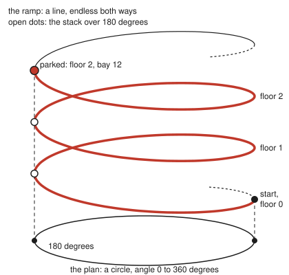

# Covering spaces: unroll a space so its loops become paths you can follow

[Syllabus](../../../SYLLABUS.md) → [Topology](../README.md) → [Homotopy](../README.md#s04) → Covering spaces

---

## General Overview

A multi-storey car park has one spiral ramp. One full circuit of the ramp climbs one floor, 3 m. A circuit has 24 bays, one every 15 degrees round the centre. Seen from above, on the plan, the ramp is a circle: bay 12 on the ground floor and bay 12 two floors up sit at the same spot.

A car's tracker logs only its plan position, as an angle round the centre, every 30 seconds: 0, 100, 200, 300, 40, 140, 240, 340, 80 and 180 degrees. The last reading says 180 degrees. Which floor is the car on? The last reading alone cannot say. The whole log can. Each step is short, less than half a circuit, so there is only one way to follow it up the ramp. The steps add to 900 degrees: 2.5 circuits, so the car is on floor 2, at bay 12, 7.5 m up.

The ramp is a **covering space** of the plan: a space lying over another. Above each small patch of the plan sit separate, identical copies of that patch, one per floor. Following a path on the plan up into the ramp is called **lifting** it. On the ramp a loop of the plan becomes a path you can follow, and where that path ends counts the loop's turns as a whole number.

**A covering space lies over a space in separate identical layers, so every path below has exactly one lift from a chosen start; a map lifts exactly when its loops land inside the cover's own loop subgroup; and for the line over the circle, the end of a lifted loop is the integer that counts its turns.**

**What kind of fact this is:** path lifting, homotopy lifting and the lifting criterion are theorems, proved on this card in Why it works. The classification of all covers is stated with its key steps and a named source (Hatcher, Section 1.3), not proved in full. The code checks finite cases: it illustrates, and proves nothing about general covers.

### The picture: the ramp over the plan

<p align="center"></p>

Schematic: the ramp is drawn in a slanted view, not to scale, and the crossings of the drawn curve belong to the drawing, not to the ramp. Drawing units: start at (370, 290), parked at (50, 102.5), the stack over 180 degrees at heights 252.5, 177.5 and 102.5, the plan spot at (50, 350). The thick line is the car's lifted route.

---

## The formula

Notation first, in words. A **covering map** is a continuous map $`p`$ from a space $`\tilde X`$, the **cover**, onto a space $`X`$, the **base**. Here $`\tilde X`$ is the ramp, $`X`$ is the plan and $`p`$ means "look straight down". The condition is local: every point of $`X`$ has an open patch $`U`$ around it that is **evenly covered**.

```math
p^{-1}(U) = U_1 \sqcup U_2 \sqcup U_3 \sqcup \cdots, \qquad p \text{ maps each } U_i \text{ onto } U \text{ as a homeomorphism}
```

**Read it aloud:** everything above the patch $`U`$ is a pile of separate pieces, the **sheets**, and looking down maps each sheet onto the patch one for one, both ways continuous.

The symbol $`\sqcup`$ means a union of pieces that do not overlap. A homeomorphism is a continuous map with a continuous inverse ([Continuity by pre-images, and homeomorphism](../02-Topological%20Spaces/03-continuity-and-homeomorphism.md)).

The ramp is the real line $`\mathbb{R}`$, measured in circuits (turns) from the entrance. The plan is the circle $`S^1`$. The covering map is

```math
p(s) = (\cos 2\pi s,\ \sin 2\pi s), \qquad p^{-1}\big(p(s)\big) = \{\, s + m : m \in \mathbb{Z} \,\}
```

**Read it aloud:** a ramp position s turns up lands on the plan at angle s turns, and the spots above that plan point are s plus every whole number of floors.

A **lift** of a path $`\gamma`$ in $`X`$ is a path $`\tilde\gamma`$ in $`\tilde X`$ that lies over it: $`p \circ \tilde\gamma = \gamma`$. Two facts drive the card. First, every path has exactly one lift from each chosen start. Second, a map lifts exactly when its loops pass a test in the fundamental group.

Reminder: $`\pi_1(X, x_0)`$ is the group of loops at $`x_0`$, up to sliding, and a map $`f`$ sends loops to loops, giving $`f_*`$ ([The fundamental group](03-the-fundamental-group.md)).

```math
\text{a lift } \tilde f \text{ with } p \circ \tilde f = f \text{ exists} \iff f_*\big(\pi_1(Y, y_0)\big) \subseteq p_*\big(\pi_1(\tilde X, \tilde x_0)\big)
```

**Read it aloud:** a map $`f`$ from a space $`Y`$ can be lifted to the cover exactly when every loop it draws below is, up to sliding, the shadow of a loop up in the cover.

For the line over the circle, a loop $`\gamma`$ on the plan lifts to a path whose two ends sit in the same stack:

```math
\tilde\gamma(1) - \tilde\gamma(0) \in \mathbb{Z}
```

**Read it aloud:** lift the loop, and the number of floors climbed is a whole number, the loop's winding number.

| Symbol | Plain meaning | In our example | Push it up and the answer… |
| --- | --- | --- | --- |
| $`X`$, $`\tilde X`$ | the base; the cover above it | the plan $`S^1`$; the ramp $`\mathbb{R}`$ | — |
| $`p`$ | the covering map: look straight down | position s to angle s turns | — |
| $`U`$, $`U_i`$, $`\sqcup`$ | an evenly covered patch; one sheet above it; a union of pieces that do not overlap | an arc under half a circuit; that arc on floor $`i`$ | — |
| $`s`$, $`m`$ | ramp position in turns; a whole number of floors | 2.5; 0, 1, 2 | higher on the ramp |
| $`\gamma`$, $`\tilde\gamma`$ | a path on the plan; its lift | the tracker log; 0 to 900 degrees | — |
| $`x_0`$, $`\tilde x_0`$ | base point; a chosen point above it | angle 0; floor 0 | start one floor up, end one floor up |
| $`f`$, $`\tilde f`$, $`Y`$, $`y_0`$ | a map from a space $`Y`$ into the base, its lift, a base point of $`Y`$ | $`z \mapsto z^k`$ on the circle | — |
| $`\pi_1`$, $`f_*`$, $`p_*`$ | the loop group; what a map does to loops | $`\pi_1(S^1) = \mathbb{Z}`$ | — |
| $`z`$, $`k`$, $`n`$ | a plan point as a complex number of size 1; turns of the map $`z \mapsto z^k`$; sheets of the cover $`z \mapsto z^n`$ | angle 180 degrees is $`z = -1`$; −3 to 3; 1 to 4 | more floors climbed; fewer maps lift |
| $`\mathbb{Z}`$, $`n\mathbb{Z}`$ | the integers; the multiples of $`n`$, a subgroup | 3ℤ: …, −3, 0, 3, 6, … | — |
| $`\circ`$, $`\simeq`$, $`\#`$ | do one map after another; slides into (homotopic); number of points | $`p \circ \tilde\gamma = \gamma`$; 3 sheets | — |
| $`\tilde\gamma(1) - \tilde\gamma(0)`$ | floors a lifted loop climbs: its winding number | 0 for up and back down | — |

### When it holds

- **Every patch evenly covered.** The half-open interval $`[0, 1)`$ also maps onto the circle one for one, but near angle 0 there is no sheet on one side. The tracker step from 340 to 80 degrees would have to jump from 17/18 of a turn back to 2/9: no continuous lift.
- **Steps short enough, for sampled data.** A log lifts correctly only if each step stays inside one evenly covered patch, here under half a circuit. Sampled every 60 seconds, the same drive lifts to −640 degrees, floor −2.
- **Connected $`Y`$, for uniqueness.** If $`Y`$ is in two separate pieces, each piece can start on a different floor.
- **Path-connected and locally path-connected $`Y`$, for the criterion.** The proof builds the lift along paths from $`y_0`$, so every point needs a path to it and small path-connected patches round it. Every space on this card has both.

---

## Why it works

### Step 0: a short step has only one place to go

Above a short arc of the plan sit separate copies, one per floor. A car on floor 2 that drives a short arc stays on floor 2: the other copies are a whole floor away. So a short step lifts in exactly one way, and a long path is a chain of short steps.

In the tracker log every step is 100 degrees. From 340 degrees on floor 1, at ramp position 700, the step to 80 degrees has candidates 80, 440, 800 and 1160 on the ramp. Only 800 is within half a circuit of 700.

### Step 1: path lifting, cut into short pieces

Any path $`\gamma`$ from the time interval $`[0, 1]`$ into $`X`$ can be cut into finitely many short pieces, each lying in one evenly covered patch. That is compactness: the interval is compact, so the open cover of $`[0, 1]`$ by pre-images of evenly covered patches (a family of open sets that together contain it, not a covering space) has a **Lebesgue number** ([Compactness three ways](../01-Metric%20Spaces/06-compactness-in-metric-spaces.md)): a length below which every piece fits inside one patch.

Lift piece by piece. Each piece lies in a patch $`U`$, and the lift so far ends in one sheet $`U_i`$ above it. Running the piece through the inverse of $`p`$ on that sheet extends the lift.

<details>
<summary>Detailed proof: the lift exists and is unique</summary>

Existence. Choose $`0 = t_0 < t_1 < \dots < t_N = 1`$ so that each $`\gamma([t_{j-1}, t_j])`$ lies in an evenly covered $`U`$. Suppose $`\tilde\gamma`$ is built on $`[0, t_{j-1}]`$. The point $`\tilde\gamma(t_{j-1})`$ lies in one sheet $`U_i`$. Write $`p|_{U_i}`$ for $`p`$ used only on the sheet $`U_i`$. Set $`\tilde\gamma = (p|_{U_i})^{-1} \circ \gamma`$ on $`[t_{j-1}, t_j]`$. The two pieces agree at $`t_{j-1}`$, so the joined path is continuous, and $`p \circ \tilde\gamma = \gamma`$.

Uniqueness. Let $`\tilde\gamma`$ and $`\hat\gamma`$ be two lifts with the same start.

The set of times where they agree is open: if they agree at $`t`$, both lie in one sheet near $`t`$, and on a sheet $`p`$ is one for one, so they agree near $`t`$. The set where they disagree is also open: if they disagree at $`t`$, they lie in different sheets near $`t`$, which do not meet.

So the agreement set is both open and closed, and it contains 0. A non-empty subset of $`[0, 1]`$ that is both open and closed is all of it ([Connected and path-connected](../02-Topological%20Spaces/07-connectedness-and-path-connectedness.md)).

Homotopy lifting. A homotopy of paths, a sliding of one path into another with the ends held fixed, is a map from the unit square into $`X`$: its bottom edge is the first path, its top edge the second, and its two sides stay at the fixed end points. The square is compact too, so the same Lebesgue-number argument cuts it into a grid of small squares, each sent into one evenly covered patch. Choose a point above the image of the bottom-left corner, then lift the small squares one at a time, row by row from the bottom, each row left to right.

When a small square comes up, the part of its edge already lifted (the starting corner, its left side, its bottom side, or both sides) is connected, and the sheets above its patch do not meet, so its lift lies in one sheet $`U_i`$. On the new square, follow the homotopy by the inverse of $`p`$ on that sheet. This agrees with the squares already lifted on every shared edge, so the pieces join into one continuous lift. It is the only one: path uniqueness fixes it along the left side, then along each horizontal line across the square.

</details>

### Step 2: sliding a path does not change where its lift ends

A **homotopy** slides one path into another continuously, written $`\gamma \simeq \delta`$ ([Homotopy](01-homotopy-and-homotopy-equivalence.md)). Lift the whole sliding square piece by piece, as in Step 1. The end of the lift moves continuously but must stay in the stack above the fixed end point. The stack is separate points, so the end cannot move.

The house example shows it. A dog's lead wound round a lamp post three times, then unwound, can be slid back to no winding at all. Its lift climbs 3 floors and comes back down: it ends at 0. The car that drives up to floor 2 and back down to the entrance also ends at floor 0.

### Step 3: read the integers off the line

For the line over the circle, lift a loop at angle 0 from ramp position 0. It ends above angle 0, so at a whole number of turns. By Step 2 that number depends only on the loop's homotopy class. Run a loop of 2 turns, then a loop of −1 turn. The second loop's lift starts 2 floors up, so it is its own lift shifted up 2 floors, and the whole lift ends at 2 − 1 = 1.

That map from loops to integers is a group isomorphism, $`\pi_1(S^1) \cong \mathbb{Z}`$, proved on [The circle's fundamental group is the integers](04-fundamental-group-of-the-circle.md). Steps 1 and 2 hold for every cover, not only the line.

[The complex logarithm](../../07-Complex%20analysis/02-Holomorphic%20Functions/04-complex-logarithm.md) used this ramp to list the values of $`\log z`$, one per floor. Following $`\log z`$ continuously along a path is lifting through the exponential map, which sends each floor's value to the same plan point $`z`$.

### Step 4: which loops close up in the cover

Loops up in the cover give loops below, so $`p_*`$ sends $`\pi_1(\tilde X, \tilde x_0)`$ into $`\pi_1(X, x_0)`$. Two facts follow from Step 2.

- **$`p_*`$ is one-for-one (injective): it loses no loop.** If a loop in the cover, looked at from above, slides to a constant on the base, lift that sliding: it slides the loop itself to a constant.
- **Its image is the loops whose lift closes.** A loop below is in $`p_*\big(\pi_1(\tilde X)\big)`$ exactly when its lift from $`\tilde x_0`$ comes back to $`\tilde x_0`$.

For the line $`\mathbb{R}`$, no loop on the plan lifts to a closed loop except a zero-turn loop. So the subgroup is $`\{0\}`$.

### Step 5: the lifting criterion

If $`f`$ has a lift $`\tilde f`$, then $`f = p \circ \tilde f`$, so every loop of $`f`$ is $`p`$ of a loop of $`\tilde f`$. That gives the inclusion.

For the converse, define $`\tilde f(y)`$ by walking: take a path from $`y_0`$ to $`y`$ in $`Y`$, push it down by $`f`$, lift it from $`\tilde x_0`$, and take the end.

<details>
<summary>Detailed proof: the walking definition is well defined and continuous</summary>

Well defined. Two paths $`\alpha`$, $`\beta`$ from $`y_0`$ to $`y`$ make a loop: $`\alpha`$ then $`\beta`$ backwards. Its image under $`f`$ is a loop in $`f_*\big(\pi_1(Y, y_0)\big)`$, hence in $`p_*\big(\pi_1(\tilde X, \tilde x_0)\big)`$ by assumption. By Step 4 its lift from $`\tilde x_0`$ closes. So the lift of $`f \circ \alpha`$ and the lift of $`f \circ \beta`$ end at the same point.

Continuous. Take $`y`$ and an evenly covered $`U`$ around $`f(y)`$, with $`\tilde f(y)`$ in the sheet $`U_i`$. Choose a path-connected open $`V`$ around $`y`$ with $`f(V) \subseteq U`$; this is where local path-connectedness is used. For $`y'`$ in $`V`$, reach it by the path to $`y`$ followed by a path inside $`V`$. The last part lifts inside $`U_i`$, so on $`V`$ the lift is $`(p|_{U_i})^{-1} \circ f`$, which is continuous.

</details>

Two uses on the plan:

- **No ramp position from the plan alone.** A continuous rule choosing, for each plan spot, a point of the ramp above it would be a lift of the identity map of $`S^1`$ to $`\mathbb{R}`$. The identity sends the loop group $`\mathbb{Z}`$ to all of $`\mathbb{Z}`$, which is not inside $`\{0\}`$. So no such rule exists: one circuit's lift ends 360 degrees up, not back at the start. This is why the logarithm needs a branch cut.
- **Every path lifts.** The interval $`[0, 1]`$ has only the trivial loop, so the test always passes, as Step 1 found.

### Step 6: sheets are cosets

Keep only the floor's remainder after dividing by $`n`$. Floors 0, 3, 6 become one layer, 1, 4, 7 another, 2, 5, 8 a third, for $`n = 3`$. The result is a circle running $`n`$ times round the plan, the **n-fold cover** $`z \mapsto z^n`$. Its loop subgroup is $`n\mathbb{Z}`$: a plan loop closes up there when its turns are a multiple of $`n`$.

A loop of $`k`$ turns, lifted from sheet 0, ends on sheet $`k`$ mod $`n`$. Loops ending on the same sheet differ by a multiple of $`n`$: they lie in one coset of $`n\mathbb{Z}`$. So the sheets match the cosets one for one, and the number of sheets is the index: the number of cosets of the subgroup, written in square brackets below ([Cosets and Lagrange's theorem](../../03-Algebra/08-Groups/04-cosets-and-lagranges-theorem.md)):

```math
\#\, p^{-1}(x_0) = \big[\pi_1(X, x_0) : p_*\pi_1(\tilde X, \tilde x_0)\big], \qquad 3 = [\mathbb{Z} : 3\mathbb{Z}]
```

**Read it aloud:** for a connected cover, the points above the base point number as many as the cosets of the cover's loop subgroup.

For the map $`f = z^k`$ on the circle, $`f_*`$ sends $`\mathbb{Z}`$ onto $`k\mathbb{Z}`$. The criterion says $`f`$ lifts to the n-fold cover exactly when $`k\mathbb{Z} \subseteq n\mathbb{Z}`$, that is when $`n`$ divides $`k`$. Then $`z^{k/n}`$ is the lift.

### Step 7: symmetries of the cover, and every cover of the circle

A **deck transformation** is a homeomorphism of the cover onto itself that keeps every point above the same plan spot. For the ramp these are the shifts by whole floors, $`s \mapsto s + m`$, and they form the group $`\mathbb{Z}`$, a copy of $`\pi_1(S^1)`$. That match holds because $`\mathbb{R}`$ has no loops at all: it is the **universal cover**, the cover that unrolls every loop.

The classification theorem, stated here and not proved: for a connected, locally path-connected base with a universal cover, connected covers match subgroups of $`\pi_1(X, x_0)`$, up to conjugation (Hatcher, Theorem 1.38). The circle's subgroups are $`\{0\}`$ and $`n\mathbb{Z}`$, so its connected covers are the line and the n-fold circles, and nothing else. The key steps: build each cover from the universal cover by gluing together points that differ by a deck transformation in the subgroup; then use the lifting criterion to show two covers with the same subgroup are homeomorphic over the base.

---

## Worked numbers, by hand

| Step | Arithmetic | Value |
| --- | --- | --- |
| first step | 0 to 100, short way | +100 |
| step across angle 0 | 300 to 40 is 100 the short way, not −260 | ramp 400 |
| step from 340 on floor 1 | candidates 80, 440, 800, 1160; within 180 of 700 | 800 |
| end of lift | nine steps of +100 | 900 degrees |
| turns | 900 / 360 | 5/2 |
| floor and bay | 2 whole turns; 180 / 15 | floor 2, bay 12 |
| height | 2.5 × 3 m | **7.5 m** |

Read step by step, the log puts the car on floor 2, bay 12, 7.5 m up, though no single reading says so.

| Lifting criterion | Loop subgroup of $`z^k`$ | Inside $`n\mathbb{Z}`$? | Lift closes? |
| --- | --- | --- | --- |
| $`k = 2`$, $`n = 2`$ | 2ℤ | yes | yes |
| $`k = 3`$, $`n = 2`$ | 3ℤ | no: 3 is odd | no, ends on sheet 1 |
| $`k = 3`$, $`n = 3`$ | 3ℤ | yes | yes |
| identity, into $`\mathbb{R}`$ | ℤ | not inside $`\{0\}`$ | no, ends at 360 |

### What breaks if you drop a piece

| Mistake | Comes out at | What went wrong |
| --- | --- | --- |
| Floor read from the last reading alone | floor 0, bay 12 | the plan forgets the floor; the lift needs the whole path |
| Readings every 60 s: 0, 200, 40, 240, 80 | −640 degrees, floor −2 | steps of 200 degrees leave the evenly covered patch, so the short way is the wrong way |
| $`[0, 1)`$ used as the cover | a jump of −13/18 turn | no sheet on one side of angle 0, so no continuous lift |
| $`z^3`$ lifted to the double cover | ends at 360, sheet 1 | 3ℤ is not inside 2ℤ, so the lifting criterion fails |

---

## Code, from first principles, and it actually runs

The code lifts the tracker log by three independent roads: shortest-step arithmetic, a search through the stack above each reading, and adding turning angles between plan arrows with atan2. It then tests the lifting criterion against the lift on 28 cases, maps $`z^k`$ for $`k`$ from −3 to 3 into the n-fold covers for $`n`$ from 1 to 4, and counts sheets against cosets. Positions are whole degrees, so the arithmetic is exact, apart from the atan2 road.

### Python

```python
# Covering spaces -- the check behind the card.  Standard library only.
# The plan of a spiral car park is the circle; the ramp above it is the line.
# Positions are whole degrees: a plan angle is taken mod 360, a ramp position
# is not.  One circuit = 360 degrees = one floor, 3 m up; 24 bays a circuit.
from fractions import Fraction
from math import atan2, cos, sin, radians, degrees

READ = [0, 100, 200, 300, 40, 140, 240, 340, 80, 180]  # plan angle every 30 s

def step(a, b):            # road one: the short way from a to b, in (-180, 180]
    return (b - a + 179) % 360 - 179

def lift(angles, start=0):  # follow the readings up the ramp, one step at a time
    out = [start]
    for a, b in zip(angles, angles[1:]):
        out.append(out[-1] + step(a, b))
    return out

def lift_by_search(angles, start=0):  # road two: search the stack above each reading
    out = [start]
    for b in angles[1:]:
        near = [b + 360 * m for m in range(-20, 21) if abs(b + 360 * m - out[-1]) < 180]
        assert len(near) == 1                        # one copy in reach: the lift is unique
        out.append(near[0])
    return out

def turns_by_arrows(angles):  # road three: add the turning angle between plan arrows
    tot = 0.0
    for a, b in zip(angles, angles[1:]):
        x1, y1, x2, y2 = cos(radians(a)), sin(radians(a)), cos(radians(b)), sin(radians(b))
        tot += degrees(atan2(x1 * y2 - y1 * x2, x1 * x2 + y1 * y2))
    return tot / 360

def floor_of(pos):
    return pos // 360

def loop(k, per_turn=12):  # z -> z^k on the plan: k turns, 30 degrees a sample
    return [(30 * k * j) % 360 for j in range(per_turn + 1)]

def lift_mod(angles, n):   # lift into the n-fold cover: ramp positions kept mod 360 n
    return [p % (360 * n) for p in lift(angles)]

up = lift(READ)
end = up[-1]
s = Fraction(end, 360)
print("readings (deg):", READ)
print("lift, step by step (deg):", up)
cands = [80 + 360 * m for m in range(4)]                  # the stack over 80 deg, floors 0 to 3
near = [c for c in cands if abs(c - up[7]) < 180]
print(f"step 340 -> 80 from ramp {up[7]}: candidates {cands}; within 180 of {up[7]}: {near}")
print(f"end of lift: {end} deg = {s} turns; floor {floor_of(end)}, bay {end % 360 // 15}, height {float(s * 3)} m")
print("same lift by searching the stack over each reading:", "yes" if lift_by_search(READ) == up else "no")
print(f"turns by adding plan-arrow angles: {turns_by_arrows(READ):.6f}")
print("lift started on floor 1 = first lift + 360 everywhere:",
      "yes" if [a - b for a, b in zip(lift(READ, 360), up)] == [360] * len(up) else "no")
back = READ + READ[-2::-1]
print(f"drive up and back down: lift ends at {lift(back)[-1]} deg, floor {floor_of(lift(back)[-1])}")
lead = [(90 * j) % 360 for j in range(13)] + [(90 * j) % 360 for j in range(11, -1, -1)]
print(f"lead wound 3 times, then unwound: lift ends at {lift(lead)[-1]} deg")
two_then_back = loop(2) + loop(-1)[1:]
print(f"loop of 2 turns then loop of -1: lift ends at {lift(two_then_back)[-1] // 360} turn")
print(f"identity map, a ramp point above each plan spot: lift of one circuit ends at "
      f"{lift(loop(1))[-1]} deg, not 0, so no such rule")
print("lifting criterion, maps z^k through the n-fold cover: lift closes?")
table = {}
for n in range(1, 5):
    row = []
    for k in range(-3, 4):
        closes = lift_mod(loop(k), n)[-1] == 0
        in_sub = set(range(k * -10, k * 10 + 1, k) if k else [0]) <= set(range(-120 * n, 120 * n + 1, n))
        table[(n, k)] = (closes, in_sub)
        row.append("Y" if closes else ".")
    print(f"  n = {n}, k = -3..3: {' '.join(row)}")
agree = sum(1 for v in table.values() if v[0] == v[1])
print(f"criterion k Z inside n Z agrees with the lift: {agree} of {len(table)} cases")
sheets = [lift_mod(loop(k), 3)[-1] // 360 for k in range(6)]
print("loop of k turns lifted into the 3-fold cover ends on sheet:", sheets)
fibre = sorted({(0 + 360 * j) % (360 * 3) for j in range(-9, 10)})
cosets = sorted({tuple(x for x in range(-9, 10) if (x - g) % 3 == 0) for g in range(-9, 10)})
print(f"3-fold cover: fibre over 0 = {fibre}; cosets of 3Z in Z: {len(cosets)}")
decks = [m for m in range(0, 721) if all((x + m) % 360 == x % 360 for x in range(-720, 721))]
print("shifts m in 0..720 that keep every plan spot:", decks)
coarse = READ[::2]
bad = lift(coarse)[-1]
print(f"mistake, readings every 60 s {coarse}: lift ends at {bad} deg = {bad / 360:.2f} turns, floor {floor_of(bad)}")
print(f"mistake, last reading alone: {READ[-1]} deg, floor 0, bay {READ[-1] // 15}")
print(f"mistake, [0, 1) as the cover: 340 deg -> {Fraction(340, 360)} turn, 80 deg -> {Fraction(80, 360)} turn, "
      f"a jump of {Fraction(80 - 340, 360)} turn")
odd = lift_mod(loop(3), 2)[-1]
print(f"mistake, z^3 through the double cover: lift ends at {odd} deg, sheet {odd // 360}, not closed")
stack = ", ".join(f"(50, {290 - 75 * (m + 0.5):.1f})" for m in range(3))
print(f"figure, start (370, 290); end (50, {290 - 75 * float(s):.1f}); stack over 180 deg: {stack}; plan spot (50, 350)")
assert lift_by_search(READ) == up and end == 900                      # two roads, one lift
assert abs(turns_by_arrows(READ) - float(s)) < 1e-9                    # third road
assert lift(back)[-1] == 0 and lift(lead)[-1] == 0 and lift(two_then_back)[-1] == 360
assert agree == len(table) and lift(loop(1))[-1] == 360                # criterion vs lift
assert sheets == [k % 3 for k in range(6)] and len(fibre) == len(cosets)  # sheets match cosets
assert decks == [0, 360, 720]                                         # shifts by whole floors only
assert (floor_of(end), floor_of(bad), bad, odd) == (2, -2, -640, 360)  # hand values
assert near == [up[8]]                                                # the one copy in reach
print("ALL CHECKS PASS")
```

**Ran 2026-11-15 on macOS, Python 3.14.10, standard library only. All checks passed. Output, pasted from the run:**

```
readings (deg): [0, 100, 200, 300, 40, 140, 240, 340, 80, 180]
lift, step by step (deg): [0, 100, 200, 300, 400, 500, 600, 700, 800, 900]
step 340 -> 80 from ramp 700: candidates [80, 440, 800, 1160]; within 180 of 700: [800]
end of lift: 900 deg = 5/2 turns; floor 2, bay 12, height 7.5 m
same lift by searching the stack over each reading: yes
turns by adding plan-arrow angles: 2.500000
lift started on floor 1 = first lift + 360 everywhere: yes
drive up and back down: lift ends at 0 deg, floor 0
lead wound 3 times, then unwound: lift ends at 0 deg
loop of 2 turns then loop of -1: lift ends at 1 turn
identity map, a ramp point above each plan spot: lift of one circuit ends at 360 deg, not 0, so no such rule
lifting criterion, maps z^k through the n-fold cover: lift closes?
  n = 1, k = -3..3: Y Y Y Y Y Y Y
  n = 2, k = -3..3: . Y . Y . Y .
  n = 3, k = -3..3: Y . . Y . . Y
  n = 4, k = -3..3: . . . Y . . .
criterion k Z inside n Z agrees with the lift: 28 of 28 cases
loop of k turns lifted into the 3-fold cover ends on sheet: [0, 1, 2, 0, 1, 2]
3-fold cover: fibre over 0 = [0, 360, 720]; cosets of 3Z in Z: 3
shifts m in 0..720 that keep every plan spot: [0, 360, 720]
mistake, readings every 60 s [0, 200, 40, 240, 80]: lift ends at -640 deg = -1.78 turns, floor -2
mistake, last reading alone: 180 deg, floor 0, bay 12
mistake, [0, 1) as the cover: 340 deg -> 17/18 turn, 80 deg -> 2/9 turn, a jump of -13/18 turn
mistake, z^3 through the double cover: lift ends at 360 deg, sheet 1, not closed
figure, start (370, 290); end (50, 102.5); stack over 180 deg: (50, 252.5), (50, 177.5), (50, 102.5); plan spot (50, 350)
ALL CHECKS PASS
```

### Rust

Same numbers, same labels, built with `rustc --edition 2021 -O`.

```rust
// Covering spaces -- the same check as the Python, in Rust.  No crates.
// The plan of a spiral car park is the circle; the ramp above it is the line.
// Positions are whole degrees: a plan angle is taken mod 360, a ramp position
// is not.  One circuit = 360 degrees = one floor, 3 m up; 24 bays a circuit.
const READ: [i64; 10] = [0, 100, 200, 300, 40, 140, 240, 340, 80, 180]; // every 30 s

fn step(a: i64, b: i64) -> i64 { (b - a + 179).rem_euclid(360) - 179 } // road one

fn lift(angles: &[i64], start: i64) -> Vec<i64> {   // follow the readings up the ramp
    let mut out = vec![start];
    for w in angles.windows(2) { let last = *out.last().unwrap(); out.push(last + step(w[0], w[1])) }
    out
}

fn lift_by_search(angles: &[i64]) -> Vec<i64> {     // road two: search the stack above each reading
    let mut out = vec![0];
    for &b in &angles[1..] {
        let last = *out.last().unwrap();
        let near: Vec<i64> = (-20..=20).map(|m| b + 360 * m).filter(|p| (p - last).abs() < 180).collect();
        assert!(near.len() == 1);                    // one copy in reach: the lift is unique
        out.push(near[0]);
    }
    out
}

fn turns_by_arrows(angles: &[i64]) -> f64 {         // road three: add the turning angles
    let mut tot = 0.0;
    for w in angles.windows(2) {
        let (a, b) = ((w[0] as f64).to_radians(), (w[1] as f64).to_radians());
        let (x1, y1, x2, y2) = (a.cos(), a.sin(), b.cos(), b.sin());
        tot += (x1 * y2 - y1 * x2).atan2(x1 * x2 + y1 * y2).to_degrees();
    }
    tot / 360.0
}

fn floor_of(pos: i64) -> i64 { pos.div_euclid(360) }

fn lp(k: i64) -> Vec<i64> { (0..=12).map(|j| (30 * k * j).rem_euclid(360)).collect() } // z -> z^k

fn lift_mod(angles: &[i64], n: i64) -> Vec<i64> { lift(angles, 0).iter().map(|p| p.rem_euclid(360 * n)).collect() }

fn gcd(a: i64, b: i64) -> i64 { if b == 0 { a.abs() } else { gcd(b, a % b) } }

fn frac(p: i64, q: i64) -> String {
    let g = gcd(p, q);
    if q / g == 1 { format!("{}", p / g) } else { format!("{}/{}", p / g, q / g) }
}

fn yn(c: bool) -> &'static str { if c { "yes" } else { "no" } }

fn main() {
    let up = lift(&READ, 0);
    let end = *up.last().unwrap();
    println!("readings (deg): {:?}", READ);
    println!("lift, step by step (deg): {:?}", up);
    let cands: Vec<i64> = (0..4).map(|m| 80 + 360 * m).collect();   // the stack over 80 deg, floors 0 to 3
    let near: Vec<i64> = cands.iter().copied().filter(|c| (c - up[7]).abs() < 180).collect();
    println!("step 340 -> 80 from ramp {}: candidates {:?}; within 180 of {}: {:?}", up[7], cands, up[7], near);
    println!("end of lift: {} deg = {} turns; floor {}, bay {}, height {} m",
             end, frac(end, 360), floor_of(end), end.rem_euclid(360) / 15, end as f64 / 360.0 * 3.0);
    println!("same lift by searching the stack over each reading: {}", yn(lift_by_search(&READ) == up));
    println!("turns by adding plan-arrow angles: {:.6}", turns_by_arrows(&READ));
    let shifted: Vec<i64> = lift(&READ, 360).iter().zip(&up).map(|(a, b)| a - b).collect();
    println!("lift started on floor 1 = first lift + 360 everywhere: {}", yn(shifted.iter().all(|&d| d == 360)));
    let mut back = READ.to_vec();
    back.extend(READ[..9].iter().rev());
    let bend = *lift(&back, 0).last().unwrap();
    println!("drive up and back down: lift ends at {} deg, floor {}", bend, floor_of(bend));
    let mut lead: Vec<i64> = (0..13).map(|j| (90 * j) % 360).collect();
    lead.extend((0..12).rev().map(|j| (90 * j) % 360));
    let lend = *lift(&lead, 0).last().unwrap();
    println!("lead wound 3 times, then unwound: lift ends at {} deg", lend);
    let mut two = lp(2);
    two.extend(&lp(-1)[1..]);
    let tend = *lift(&two, 0).last().unwrap();
    println!("loop of 2 turns then loop of -1: lift ends at {} turn", tend / 360);
    let iend = *lift(&lp(1), 0).last().unwrap();
    println!("identity map, a ramp point above each plan spot: lift of one circuit ends at {} deg, not 0, so no such rule", iend);
    println!("lifting criterion, maps z^k through the n-fold cover: lift closes?");
    let (mut agree, mut cases) = (0, 0);
    for n in 1..5i64 {
        let mut row: Vec<&str> = Vec::new();
        for k in -3..4i64 {
            let closes = *lift_mod(&lp(k), n).last().unwrap() == 0;
            let sub: Vec<i64> = if k == 0 { vec![0] } else { (-10..=10).map(|j| k * j).collect() };
            let in_sub = sub.iter().all(|x| x.rem_euclid(n) == 0 && x.abs() <= 120 * n);
            if closes == in_sub { agree += 1 }
            cases += 1;
            row.push(if closes { "Y" } else { "." });
        }
        println!("  n = {}, k = -3..3: {}", n, row.join(" "));
    }
    println!("criterion k Z inside n Z agrees with the lift: {} of {} cases", agree, cases);
    let sheets: Vec<i64> = (0..6).map(|k| *lift_mod(&lp(k), 3).last().unwrap() / 360).collect();
    println!("loop of k turns lifted into the 3-fold cover ends on sheet: {:?}", sheets);
    let mut fibre: Vec<i64> = (-9..10i64).map(|j| (360 * j).rem_euclid(1080)).collect();
    fibre.sort();
    fibre.dedup();
    let mut cosets: Vec<Vec<i64>> = Vec::new();
    for g in -9..10i64 {
        let c: Vec<i64> = (-9..10).filter(|x: &i64| (x - g).rem_euclid(3) == 0).collect();
        if !cosets.contains(&c) { cosets.push(c) }
    }
    println!("3-fold cover: fibre over 0 = {:?}; cosets of 3Z in Z: {}", fibre, cosets.len());
    let decks: Vec<i64> = (0..721).filter(|m| (-720..721).all(|x: i64| (x + m).rem_euclid(360) == x.rem_euclid(360))).collect();
    println!("shifts m in 0..720 that keep every plan spot: {:?}", decks);
    let coarse: Vec<i64> = READ.iter().step_by(2).copied().collect();
    let bad = *lift(&coarse, 0).last().unwrap();
    println!("mistake, readings every 60 s {:?}: lift ends at {} deg = {:.2} turns, floor {}",
             coarse, bad, bad as f64 / 360.0, floor_of(bad));
    println!("mistake, last reading alone: {} deg, floor 0, bay {}", READ[9], READ[9] / 15);
    println!("mistake, [0, 1) as the cover: 340 deg -> {} turn, 80 deg -> {} turn, a jump of {} turn",
             frac(340, 360), frac(80, 360), frac(80 - 340, 360));
    let odd = *lift_mod(&lp(3), 2).last().unwrap();
    println!("mistake, z^3 through the double cover: lift ends at {} deg, sheet {}, not closed", odd, odd / 360);
    let stack: Vec<String> = (0..3).map(|m| format!("(50, {:.1})", 290.0 - 75.0 * (m as f64 + 0.5))).collect();
    println!("figure, start (370, 290); end (50, {:.1}); stack over 180 deg: {}; plan spot (50, 350)",
             290.0 - 75.0 * end as f64 / 360.0, stack.join(", "));
    assert!(lift_by_search(&READ) == up && end == 900);                // two roads, one lift
    assert!((turns_by_arrows(&READ) - end as f64 / 360.0).abs() < 1e-9); // third road
    assert!(bend == 0 && lend == 0 && tend == 360);
    assert!(agree == cases && iend == 360);                             // criterion vs lift
    assert!(sheets == (0..6).map(|k| k % 3).collect::<Vec<i64>>() && fibre.len() == cosets.len()); // sheets match cosets
    assert!(decks == vec![0, 360, 720]);                               // shifts by whole floors only
    assert!((floor_of(end), floor_of(bad), bad, odd) == (2, -2, -640, 360)); // hand values
    assert!(near == vec![up[8]]);                                      // the one copy in reach
    println!("ALL CHECKS PASS");
}
```

**Ran 2026-11-15 on macOS, rustc 1.98.1, no crates. All checks passed. Output, pasted from the run:**

```
readings (deg): [0, 100, 200, 300, 40, 140, 240, 340, 80, 180]
lift, step by step (deg): [0, 100, 200, 300, 400, 500, 600, 700, 800, 900]
step 340 -> 80 from ramp 700: candidates [80, 440, 800, 1160]; within 180 of 700: [800]
end of lift: 900 deg = 5/2 turns; floor 2, bay 12, height 7.5 m
same lift by searching the stack over each reading: yes
turns by adding plan-arrow angles: 2.500000
lift started on floor 1 = first lift + 360 everywhere: yes
drive up and back down: lift ends at 0 deg, floor 0
lead wound 3 times, then unwound: lift ends at 0 deg
loop of 2 turns then loop of -1: lift ends at 1 turn
identity map, a ramp point above each plan spot: lift of one circuit ends at 360 deg, not 0, so no such rule
lifting criterion, maps z^k through the n-fold cover: lift closes?
  n = 1, k = -3..3: Y Y Y Y Y Y Y
  n = 2, k = -3..3: . Y . Y . Y .
  n = 3, k = -3..3: Y . . Y . . Y
  n = 4, k = -3..3: . . . Y . . .
criterion k Z inside n Z agrees with the lift: 28 of 28 cases
loop of k turns lifted into the 3-fold cover ends on sheet: [0, 1, 2, 0, 1, 2]
3-fold cover: fibre over 0 = [0, 360, 720]; cosets of 3Z in Z: 3
shifts m in 0..720 that keep every plan spot: [0, 360, 720]
mistake, readings every 60 s [0, 200, 40, 240, 80]: lift ends at -640 deg = -1.78 turns, floor -2
mistake, last reading alone: 180 deg, floor 0, bay 12
mistake, [0, 1) as the cover: 340 deg -> 17/18 turn, 80 deg -> 2/9 turn, a jump of -13/18 turn
mistake, z^3 through the double cover: lift ends at 360 deg, sheet 1, not closed
figure, start (370, 290); end (50, 102.5); stack over 180 deg: (50, 252.5), (50, 177.5), (50, 102.5); plan spot (50, 350)
ALL CHECKS PASS
```

The two outputs match line for line. The criterion is checked on 28 cases, which illustrates it and proves nothing.

### Lean

Lean proves the three facts in the card's bold summary, and rechecks the worked numbers and the 28 criterion cases.

- Take a covering map $`p`$, a path $`\gamma`$ in the base, and a point above $`\gamma(0)`$. Then $`\gamma`$ has exactly one lift that starts at that point.
- Suppose $`p`$ is a covering map, $`Y`$ is path-connected and locally path-connected, and $`\tilde x_0`$ lies above $`f(y_0)`$. Then a lift of $`f`$ sending $`y_0`$ to $`\tilde x_0`$ exists exactly when $`f`$'s loops land inside the cover's loop subgroup.
- Take $`p(s) = (\cos 2\pi s,\ \sin 2\pi s)`$ from the line to the circle. Then $`p(t) = p(s)`$ exactly when $`t = s + m`$ for a whole number $`m`$.
- Take a loop $`\gamma`$ on the circle and any lift $`\tilde\gamma`$ of it to the line. Then $`\tilde\gamma(1) - \tilde\gamma(0)`$ is a whole number.
- The tracker log lifts to 900 degrees: floor 2, bay 12, 7.5 m up. From ramp 700, only 800 is in reach. Driving back down ends at floor 0.
- Take $`k`$ from −3 to 3 and $`n`$ from 1 to 4. Then the lift of $`z^k`$ to the n-fold cover closes exactly when $`n`$ divides $`k`$.
- In the 3-fold cover, loops of 0 to 5 turns end on sheets 0, 1, 2, 0, 1, 2.
- Three mistakes come out as the table says: −640 degrees, a jump of −13/18 turn, and 360 degrees on sheet 1.

The search and atan2 roads, the dog's lead, the coset count and the whole-floor shifts are left to the Python and Rust checks.

```lean
-- Covering spaces: every path in the base of a covering map has exactly one lift from a chosen start, a map from a path-connected, locally path-connected space lifts exactly when its loops land inside the cover's loop subgroup, and for the line over the circle a lifted loop climbs a whole number of turns.
import Mathlib.Analysis.SpecialFunctions.Complex.Circle
import Mathlib.Topology.Homotopy.Lifting

open unitInterval Real

/-! A covering map `p : E → X` is Mathlib's `IsCoveringMap p`: every point of the base `X` has an
open patch `U` that is evenly covered, `p⁻¹(U)` being a disjoint union of sheets, each mapped onto
`U` by a homeomorphism. A path is a continuous map from the time interval `I = [0, 1]`.
A lift of `γ : C(I, X)` is a continuous `Γ : C(I, E)` with `p ∘ Γ = γ`.
For a map `f : C(A, X)`, `FundamentalGroup.map f a₀` is `f_*` on `π₁(A, a₀)`, and
`FundamentalGroup.mapOfEq ⟨p, _⟩ he` is `p_*` from `π₁(E, e₀)` into `π₁(X, f a₀)`.
The circle `S¹` is Mathlib's unit circle `Circle` in the complex plane, and the line covers it by
`p(s) = (cos 2πs, sin 2πs)`, which is `Circle.exp (2 * π * s)`, with `s` measured in turns. -/

/-- **Path lifting.** For a covering map `p : E → X` (every patch evenly covered), every path `γ`
in the base and every chosen start `e` above `γ(0)`, there is exactly one lift of `γ` that starts
at `e`: one continuous path `Γ` in the cover with `p ∘ Γ = γ` and `Γ(0) = e`. -/
theorem path_lifts_uniquely {E X : Type*} [TopologicalSpace E] [TopologicalSpace X]
    {p : E → X} (cov : IsCoveringMap p) (γ : C(I, X)) (e : E) (he : p e = γ 0) :
    ∃! Γ : C(I, E), p ∘ Γ = γ ∧ Γ 0 = e := by
  refine ⟨cov.liftPath γ e he.symm, ⟨cov.liftPath_lifts γ e he.symm, cov.liftPath_zero γ e he.symm⟩,
    fun Γ hΓ => (cov.eq_liftPath_iff' he.symm).mpr hΓ⟩

/-- **The lifting criterion.** Let `p : E → X` be a covering map, `Y` a path-connected and
locally path-connected space, `f : Y → X` continuous, and `e₀` a point of the cover above
`f(y₀)`. A lift `F` with `p ∘ F = f` and `F(y₀) = e₀` exists exactly when
`f_*(π₁(Y, y₀)) ⊆ p_*(π₁(E, e₀))`: every loop `f` draws below is, up to sliding, the shadow of
a loop up in the cover. -/
theorem lift_exists_iff_loops_inside_cover_subgroup {E X Y : Type*} [TopologicalSpace E]
    [TopologicalSpace X] [TopologicalSpace Y] [PathConnectedSpace Y]
    [LocallyPathConnectedSpace Y] {p : E → X} (cov : IsCoveringMap p) (f : C(Y, X)) (y₀ : Y)
    (e₀ : E) (he₀ : p e₀ = f y₀) :
    (∃ F : C(Y, E), F y₀ = e₀ ∧ p ∘ F = f) ↔
      (FundamentalGroup.map f y₀).range ≤
        (FundamentalGroup.mapOfEq ⟨p, cov.continuous⟩ he₀).range := by
  constructor
  · rintro ⟨F, hF0, hFp⟩
    subst hF0
    obtain rfl : f = (⟨p, cov.continuous⟩ : C(E, X)).comp F := by
      ext y; exact (congr_fun hFp y).symm
    rintro _ ⟨g, rfl⟩
    refine ⟨FundamentalGroup.map F y₀ g, ?_⟩
    rw [FundamentalGroup.mapOfEq_apply]
    obtain ⟨g⟩ := g
    induction g using Quotient.inductionOn with
    | h a => rfl
  · intro h
    exact (cov.existsUnique_continuousMap_lifts_of_range_le he₀ h).exists

/-- **The line over the circle reads off integers.** For `p(s) = (cos 2πs, sin 2πs)`, the points
of the line above `p(s)` are exactly `s + m` for whole numbers `m`; and if `γ` is a loop on the
circle (`γ(0) = γ(1)`) and `Γ` is any continuous lift of it to the line, then `Γ(1) − Γ(0)` is a
whole number: the floors the lifted loop climbs. -/
theorem line_over_circle_lifted_loop_climbs_whole_turns :
    (∀ s t : ℝ, Circle.exp (2 * π * t) = Circle.exp (2 * π * s) ↔ ∃ m : ℤ, t = s + m) ∧
      ∀ (γ : C(I, Circle)) (Γ : C(I, ℝ)), γ 0 = γ 1 →
        (∀ u, Circle.exp (2 * π * Γ u) = γ u) → ∃ m : ℤ, Γ 1 - Γ 0 = m := by
  have key : ∀ s t : ℝ, Circle.exp (2 * π * t) = Circle.exp (2 * π * s) ↔ ∃ m : ℤ, t = s + m := by
    intro s t
    rw [Circle.exp_eq_exp]
    have hπ : (2 * π) ≠ 0 := by positivity
    constructor
    · rintro ⟨m, hm⟩
      refine ⟨m, ?_⟩
      apply mul_left_cancel₀ hπ
      linear_combination hm
    · rintro ⟨m, rfl⟩
      exact ⟨m, by ring⟩
  refine ⟨key, fun γ Γ h0 hΓ => ?_⟩
  obtain ⟨m, hm⟩ := (key (Γ 0) (Γ 1)).mp (by rw [hΓ, hΓ, h0])
  exact ⟨m, by rw [hm]; ring⟩

/-! Worked numbers. Positions are whole degrees: a plan angle is taken mod 360, a ramp position is
not; one circuit is 360 degrees, one floor, 3 m up, with 24 bays of 15 degrees. -/

/-- The short way from plan angle `a` to plan angle `b`, in `(-180, 180]` degrees. -/
def rampStep (a b : ℤ) : ℤ := (b - a + 179) % 360 - 179

/-- Follow a log of plan angles up the ramp from ramp position 0, one short step at a time. -/
def rampLift (angles : List ℤ) : List ℤ :=
  List.scanl (· + ·) 0 (List.zipWith rampStep angles angles.tail)

/-- The car's tracker log: its plan angle every 30 seconds. -/
def tracker : List ℤ := [0, 100, 200, 300, 40, 140, 240, 340, 80, 180]

/-- The loop `z ↦ z^k` on the plan, sampled every 30 degrees of `z`: 13 readings. -/
def loopAngles (k : ℤ) : List ℤ := (List.range 13).map fun j => (30 * k * j) % 360

-- The tracker log lifts, step by step, to 0, 100, ..., 900 degrees up the ramp.
example : rampLift tracker = [0, 100, 200, 300, 400, 500, 600, 700, 800, 900] := by
  decide

-- From ramp 700, of the candidates 80, 440, 800, 1160 above 80 degrees, only 800 is in reach.
example : ([80, 440, 800, 1160] : List ℤ).filter (fun c => |c - 700| < 180) = [800] := by
  decide

-- End of lift: 900 degrees is 5/2 turns; floor 2, bay 12, height 15/2 m.
example : (900 : ℚ) / 360 = 5 / 2 ∧ (900 : ℤ) / 360 = 2 ∧ (180 : ℤ) / 15 = 12 ∧
    (5 / 2 : ℚ) * 3 = 15 / 2 := by
  norm_num

-- Drive up and back down: the lift ends at 0 degrees, floor 0.
example : (rampLift (tracker ++ tracker.reverse.tail)).getLast? = some 0 := by
  decide

-- Mistake: readings every 60 s lift to -640 degrees, floor -2.
example : rampLift [0, 200, 40, 240, 80] = [0, -160, -320, -480, -640] ∧
    (-640 : ℤ) / 360 = -2 := by
  decide

-- Mistake: [0, 1) as the cover sends 340 degrees to 17/18 turn and 80 to 2/9, a jump of -13/18.
example : (340 : ℚ) / 360 = 17 / 18 ∧ (80 : ℚ) / 360 = 2 / 9 ∧
    ((80 : ℚ) - 340) / 360 = -13 / 18 := by
  norm_num

-- Lifting criterion on all 28 cases: z^k lifts to a closed loop in the n-fold cover iff n ∣ k.
example : ∀ n ∈ ([1, 2, 3, 4] : List ℤ), ∀ k ∈ ([-3, -2, -1, 0, 1, 2, 3] : List ℤ),
    ((rampLift (loopAngles k)).getLast?.map (· % (360 * n)) = some 0 ↔ n ∣ k) := by
  decide

-- A loop of k turns lifted into the 3-fold cover ends on sheet k mod 3, for k = 0..5.
example : ((List.range 6).map fun k : ℕ =>
    (rampLift (loopAngles k)).getLast?.map (fun e => e % 1080 / 360)) =
    [some 0, some 1, some 2, some 0, some 1, some 2] := by
  decide

-- Mistake: z^3 through the double cover ends at 360 degrees, sheet 1, since 2 does not divide 3.
example : (rampLift (loopAngles 3)).getLast?.map (· % 720) = some 360 ∧ ¬ (2 : ℤ) ∣ 3 := by
  decide

#print axioms path_lifts_uniquely
#print axioms lift_exists_iff_loops_inside_cover_subgroup
#print axioms line_over_circle_lifted_loop_climbs_whole_turns
```

**Checked 2026-11-15 on macOS, Lean 4.36.0-rc2, Mathlib v4.36.0-rc2. Every proof is complete and uses only Lean's standard axioms. Output, pasted from the run:**

```
'path_lifts_uniquely' depends on axioms: [propext, Classical.choice, Quot.sound]
'lift_exists_iff_loops_inside_cover_subgroup' depends on axioms: [propext, Classical.choice, Quot.sound]
'line_over_circle_lifted_loop_climbs_whole_turns' depends on axioms: [propext, Classical.choice, Quot.sound]
```

> [!TIP]
> **Try changing**
> - Guess first: change `READ` to log every 40 seconds, `[0, 133, 266, 39, 172, 305, 78, 211, 344, 117]`. Steps of 133 degrees are still under half a circuit, so the lift still works: 1197 degrees, floor 3. The first assert stops the run, since it expects 900.
> - Guess first: in `step`, change both 179s to 279, so a forward step must be under 81 degrees. Every 100-degree step now lifts as −260, the lift ends at −2340 degrees, and the first assert stops the run, since the search road still finds 900.
> - Guess first: extend the criterion table to `n` up to 6. The rows for `n = 5` and `n = 6` show a single "Y", at `k = 0`, since no other `k` from −3 to 3 is a multiple of 5 or 6.
> - Guess first: unwind the lead only twice, by changing `range(11, -1, -1)` to `range(11, 3, -1)`. The lift ends at 360 degrees, one turn still wound, and the third assert stops the run.

---

## The usual mistake

> [!warning]
> **Reading the floor from the plan position alone.** The plan forgets the floor: 180 degrees could be floor 0, 1, 2 or any other. The last reading alone says floor 0, bay 12; the truth is floor 2. A lift needs the whole path and a chosen start, and Step 5 proves no continuous rule can choose, for each plan spot, a point of the ramp above it.
>
> - **Steps too long.** Sampled every 60 seconds, the drive lifts to −640 degrees, floor −2.
> - **A one-for-one map taken as a cover.** On $`[0, 1)`$ the step from 340 to 80 degrees is a jump of −13/18 turn.
> - **Lifting without the criterion.** $`z^3`$ lifted to the double cover ends on sheet 1, at 360 degrees, not back at 0.
> - **Half-floor shifts.** Shifting the ramp 180 degrees moves every plan spot; only shifts of 0, 360 and 720 among 0 to 720 keep them.

---

## Where you meet it in real life

- **Radar and laser phase unwrapping.** Satellite radar measures phase only modulo one cycle. Turning it into ground height is lifting through the line over the circle, and it fails exactly where neighbouring readings differ by more than half a cycle (Itoh, 1982; Goldstein, Zebker and Werner, 1988).
- **Rotary encoders and turn counters.** A shaft sensor that reads angle only must count turns by tracking short steps, as the tracker did. Spin it faster than half a turn per sample and the count goes wrong.
- **Branches of logarithms and roots.** A continuous branch of $`\log z`$ along a path is a lift through the exponential map; the square root is the double cover $`z \mapsto z^2`$. Step 5 says why no branch covers a whole loop round 0.
- **Simulations in a periodic box.** Molecular simulations wrap atoms back into a box; to measure how far an atom really travelled, the code unwraps positions, which is lifting from a torus to its universal cover.

> **Say it back**
> A covering space lies over a base so that above each small patch sit separate identical sheets. So any path below has exactly one lift once its start is chosen, and sliding the path does not move the lift's end. For the ramp over the plan, a lifted loop ends a whole number of floors up, which reads the circle's loop group as the integers. A map lifts exactly when its loops lie inside the cover's loop subgroup, so no continuous rule picks a ramp point above every plan spot. The sheets of a cover match the cosets of that subgroup.

---

## What this builds on

- [The circle's fundamental group is the integers](04-fundamental-group-of-the-circle.md): the result $`\pi_1(S^1) \cong \mathbb{Z}`$, read here off the line.
- [Cosets and Lagrange's theorem](../../03-Algebra/08-Groups/04-cosets-and-lagranges-theorem.md): cosets and the index, which count the sheets.
- [The complex logarithm](../../07-Complex%20analysis/02-Holomorphic%20Functions/04-complex-logarithm.md): the spiral car-park ramp, first used to list the values of $`\log z`$.
- [Compactness three ways](../01-Metric%20Spaces/06-compactness-in-metric-spaces.md): the Lebesgue number that cuts a path into short pieces.

## Where this goes next

- [Van Kampen's theorem](06-van-kampens-theorem.md): computes the loop group of a glued space, such as two circles joined at a point; its subgroups then name that space's covers, as Step 7 did for the circle.
- [Nielsen-Schreier](10-nielsen-schreier-and-covers-of-graphs.md): every subgroup of a free group is free, read off a covering graph.
- [Higher homotopy groups](../07-Higher%20Homotopy%20and%20Mapping%20Spaces/02-higher-homotopy-groups-and-fibrations.md): wrap a sphere around a space, and the Hopf fibration that wraps S^3 around S^2.
- [Lie's theorems](../../23-Differential%20geometry%20and%20Lie%20groups/06-Lie%20Groups/11-lies-theorems-and-covering-groups.md): the Lie algebra decides the group, up to a covering.

Every cover of the circle is the line or an n-fold circle; which spaces have a universal cover at all, and what their deck groups look like, is the question this card leaves open.

---

## Sources

Verified 2026-11-15: every link below resolves to the publisher's page, except Hatcher's author page, which carries the full text.

- Hatcher, Allen. *Algebraic Topology*. Cambridge University Press, 2002. [Author's page for the book, with full text](https://pi.math.cornell.edu/~hatcher/AT/ATpage.html). Section 1.3: path and homotopy lifting, the lifting criterion, sheets as an index, and the classification of covers.
- Itoh, Kazuyoshi. "Analysis of the phase unwrapping algorithm." *Applied Optics* 21 (1982), 2470. [doi:10.1364/AO.21.002470](https://doi.org/10.1364/AO.21.002470). Unwrapping is correct when neighbouring samples differ by less than half a cycle.
- Goldstein, Richard M., Howard A. Zebker and Charles L. Werner. "Satellite radar interferometry: Two-dimensional phase unwrapping." *Radio Science* 23 (1988), 713–720. [doi:10.1029/RS023i004p00713](https://doi.org/10.1029/RS023i004p00713). Unwrapping radar phase into terrain height.
- Ghiglia, Dennis C., and Mark D. Pritt. *Two-Dimensional Phase Unwrapping: Theory, Algorithms, and Software*. Wiley, 1998. [Publisher page](https://www.wiley.com/en-us/Two+Dimensional+Phase+Unwrapping%3A+Theory%2C+Algorithms%2C+and+Software-p-9780471249351). Phase unwrapping in practice, and where it fails.
