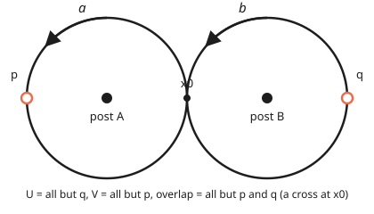

# Van Kampen's theorem: glue two pieces together and glue their loop groups together

[Syllabus](../../../SYLLABUS.md) → [Topology](../README.md) → [Homotopy](../README.md#s04) → Van Kampen's theorem

---

## General Overview

A dog on a lead runs once round a lamp post, then once round it the other way. The net turns are 0, and the lead comes free. With one post, counting net turns tells the whole story.

Now put two lamp posts on the pavement, post A and post B, with the walker standing between them. The dog runs round A, then round B, then round A the other way, then round B the other way. Each post has been circled once each way: the net turns are 0 round A and 0 round B. Yet the lead is caught. No sliding along the pavement frees it without lifting it over a post.

Pull either post out of the ground and the lead falls free at once. This is the picture-hanging puzzle: a string wound this way round two nails holds a picture, and removing either nail drops it.

The space here is the pavement with two posts taken out. It shrinks onto a **figure eight**: two circles joined at one point. Its loop group (the fundamental group: the loops from one base point, with two loops counted as one when one deforms into the other) is too big to guess by counting turns.

Van Kampen's theorem computes it. Cut the space into two open, overlapping pieces whose loop groups are already known; each piece and the overlap must be path-connected (all in one piece). Then glue the groups the same way the pieces glue.

**Cut a space into two overlapping pieces: its loop group is the pieces' loop groups joined freely, with each overlap loop's two readings set equal.**

**What kind of fact this is:** a theorem. That every loop is spelled by the pieces' loops is proved on this card in Why it works; that the overlap rules are the only rules gets its key steps and a named source (Hatcher, Theorem 1.20).

### The picture: the figure eight and its two pieces

<p align="center"></p>

Schematic. Piece U is the figure eight with the point q removed, so it keeps loop a whole. Piece V is the figure eight with p removed, so it keeps loop b. The overlap, with both points removed, is an open cross at the joining point $`x_0`$ and holds no loop at all.

---

## The formula

Three pieces of algebra come first, one short section each. No earlier card builds them.

### Free groups: words that only cancel neighbours

Write $`a`$ for the lead run once round post A, and $`b`$ for once round post B. Write $`a^{-1}`$ and $`b^{-1}`$ for the same loops run backwards. A **word** is a row of these four letters, read left to right. The code writes $`a^{-1}`$ as A and $`b^{-1}`$ as B.

A word is **reduced** when no letter stands next to its own backwards letter. To multiply two words, write one after the other, then cancel neighbouring pairs such as $`a\,a^{-1}`$ until none is left.

The reduced words with this multiplication form the **free group** on $`a`$ and $`b`$, written $`F_2`$. "Free" means no rule holds except cancelling neighbours. So $`ab`$ and $`ba`$ are different words, and $`aba^{-1}b^{-1}`$ is not the empty word.

Counting them: a reduced word has 4 choices for its first letter, then 3 for each later letter, since only the undo of the letter before is banned. Lengths 1 to 4 give 4, 12, 36 and 108 words.

### Presentations: a free group with some words forced to equal 1

A **presentation** $`\langle a, b \mid r\rangle`$ lists the letters, then a bar, then words $`r`$ called **relations**. It means: the free group on those letters, with each relation set equal to the empty word.

Setting $`r = 1`$ also forces everything that follows from it: $`r`$ inside other words, $`r`$ run backwards, and $`g\,r\,g^{-1}`$ for any word $`g`$. Those words together form the smallest normal subgroup containing $`r`$, and the presentation is the quotient group by it ([Normal subgroups and quotient groups](../../03-Algebra/08-Groups/06-normal-subgroups-and-quotient-groups.md)).

The example of this card: $`\langle a, b \mid aba^{-1}b^{-1}\rangle`$. Multiply $`aba^{-1}b^{-1} = 1`$ on the right by $`ba`$ and it says $`ab = ba`$. The letters now commute, so every word sorts to $`a^m b^n`$.

### Free products: two groups side by side, sharing nothing

Given groups $`G`$ and $`H`$, the **free product** $`G * H`$ is all words that alternate between members of $`G`$ and members of $`H`$, none of them the do-nothing member. Multiply by joining two words; where two neighbours come from the same group, combine them inside that group.

The free product of the integers with themselves, $`\mathbb{Z} * \mathbb{Z}`$, is $`F_2`$: one copy supplies the powers of $`a`$, the other the powers of $`b`$.

Compare the direct product $`G \times H`$ ([Direct products](../../03-Algebra/08-Groups/07-direct-products.md)). There, members of $`G`$ and $`H`$ commute: $`\mathbb{Z} \times \mathbb{Z}`$ is $`\langle a, b \mid aba^{-1}b^{-1}\rangle`$. The free product forces no such rule.

### The theorem

Let $`X`$ be a space covered by two open sets $`U`$ and $`V`$. Each of $`U`$, $`V`$ and the overlap $`U \cap V`$ is path-connected (one piece, any two points joined by a path). The base point $`x_0`$ lies in the overlap. Write $`\pi_1(X, x_0)`$ for the loop group of $`X`$ at $`x_0`$ ([The fundamental group](03-the-fundamental-group.md)), and $`\cong`$ for "is isomorphic to" (the same group under new names). Then:

```math
\pi_1(X, x_0) \;\cong\; \bigl(\pi_1(U, x_0) * \pi_1(V, x_0)\bigr) \,/\, N
```

For a loop $`\omega`$ in the overlap, $`i_U(\omega)`$ is that loop read as a loop of $`U`$, and $`i_V(\omega)`$ the same loop read as a loop of $`V`$. Here $`N`$ is the smallest normal subgroup containing $`i_U(\omega)\, i_V(\omega)^{-1}`$ for every such $`\omega`$.

**Read it aloud:** the loop group of the whole is the two pieces' loop groups joined freely, with each overlap loop's two spellings declared equal.

In presentation form: list both pieces' letters and both pieces' relations, then add $`i_U(\omega) = i_V(\omega)`$ for each generating loop $`\omega`$ of the overlap.

| Symbol | Plain meaning | In our example | Push it up and the answer… |
| --- | --- | --- | --- |
| $`X`$; $`S^1 \vee S^1`$; $`T^2`$ | the whole space; the figure eight, two circles joined at one point; the torus, an inner tube | pavement minus two posts, which shrinks to $`S^1 \vee S^1`$; $`T^2`$ is the second example | more posts: one more letter each |
| $`U`$, $`V`$ | two open pieces that cover $`X`$ | $`U`$: all but point q; $`V`$: all but point p | more loops in a piece: more letters |
| $`U \cap V`$ | the overlap of the pieces | an open cross at $`x_0`$, no loops | more overlap loops: more relations, a smaller group |
| $`x_0`$ | the base point, inside the overlap | where the circles touch | — |
| $`\pi_1(X, x_0)`$; $`\cong`$, $`\simeq`$ | the loop group: loops at $`x_0`$ up to deformation, combined by running one then the other; "is isomorphic to"; "deforms into" (homotopic) | the free group $`F_2`$ | — |
| $`a`$, $`b`$; $`a^{-1}`$, $`b^{-1}`$ | the loop once round post A, once round post B; the same loops run backwards (A and B in the code) | the two circles | — |
| $`G * H`$; $`F_2`$; $`\mathbb{Z}`$ | the free product: alternating words, no rule between the factors; the free group on two letters; the integers | $`\mathbb{Z} * \mathbb{Z} = F_2`$ | — |
| $`\langle a, b \mid r\rangle`$; $`g`$ | a presentation: letters, with the relations $`r`$ set to 1; any word, used to conjugate $`r`$ | torus: $`r = aba^{-1}b^{-1}`$ | each new relation collapses more words |
| $`\omega`$; $`i_U(\omega)`$, $`i_V(\omega)`$ | a loop inside the overlap; the same loop read as a loop of $`U`$ or of $`V`$ | torus: a small loop round the cut-out point, $`aba^{-1}b^{-1}`$ in $`U`$, empty in $`V`$ | — |
| $`N`$ | the smallest normal subgroup holding every $`i_U(\omega)\, i_V(\omega)^{-1}`$ | trivial for the figure eight | a bigger $`N`$ collapses more |
| $`m`$, $`n`$; $`L`$ | net turns: letters $`a`$ minus $`a^{-1}`$, letters $`b`$ minus $`b^{-1}`$; a word length in the counts | (0, 0) for the caught lead; $`L`$ = 0 to 4 | — |
| $`\gamma`$, $`\gamma_j`$, $`c_j`$, $`\delta`$, $`s_j`$; $`P`$, $`Q`$, $`k`$, $`u`$, $`v`$, $`w`$ | in the proofs: a loop of $`X`$, its stretches, tie-back paths in the overlap, a step length, the cut times; the ping-pong regions, a power, reduced words | — | — |

### When it holds

- **The pieces are open.** The proof cuts each loop into finitely many short stretches, each inside one piece, and openness leaves room to do so. The figure eight's two closed circles are not open sets in it, so the theorem does not apply to them as stated: a loop can swap between them infinitely often, with ever smaller swings through $`x_0`$, and then no finite cut exists. Slightly thickened open copies, which have the same loops, fix it.
- **The overlap is path-connected.** Each stretch of a loop must be tied back to $`x_0`$ inside the overlap. Cut a circle into two arcs and the overlap is 2 separate arcs; the formula then gives the trivial group, but the circle's group is the integers.
- **Each piece is path-connected and holds $`x_0`$.** Otherwise a piece's loop group at $`x_0`$ misses part of that piece.
- **Two pieces at a time.** For more pieces, every pairwise and triple overlap must be path-connected; the usual route is to glue two, then glue the result to the next.

---

## Why it works

### Step 0: every loop is spelled by the pieces, with one ambiguity

A loop in $`X`$ wanders between $`U`$ and $`V`$. Chop it into short stretches, each inside one piece. Tie each stretch's ends back to $`x_0`$ through the overlap and it becomes a loop of $`U`$ or of $`V`$. So the whole loop is a word in the free product.

The spelling is not unique. A loop $`\omega`$ in the overlap can be spelled as a $`U`$-loop or as a $`V`$-loop. Both spellings name the same loop of $`X`$, so they must be declared equal. The theorem says this ambiguity, and nothing else, is what gluing adds.

### Step 1: the pieces' loops reach every loop of X

Run the loop $`\gamma`$ over time 0 to 1. Each moment of time has a short time window that $`\gamma`$ spends inside one open piece. The time interval [0, 1] is compact, so one window length serves every moment. Cut at that spacing, and each stretch lies in $`U`$ or in $`V`$.

Where two neighbouring stretches lie in the same piece, merge them; then every cut point lies in both pieces, so in $`U \cap V`$. Join each cut point to $`x_0`$ by a path $`c_j`$ inside the overlap; it exists because the overlap is path-connected. Insert $`c_j^{-1}`$ then $`c_j`$ at every cut: out to $`x_0`$ and back. The loop is unchanged, and now reads as a product of closed loops, each inside one piece.

<details>
<summary>Detailed proof: cutting the loop</summary>

Let $`\gamma : [0, 1] \to X`$ with $`\gamma(0) = \gamma(1) = x_0`$. The sets $`\gamma^{-1}(U)`$ and $`\gamma^{-1}(V)`$ are open in [0, 1] and cover it. By compactness there is a length $`\delta > 0`$ such that every interval shorter than $`\delta`$ lies inside one of them (the Lebesgue number of the cover).

Choose $`0 = s_0 < s_1 < \dots < s_k = 1`$ with steps below $`\delta`$. Each stretch $`\gamma_j`$ on $`[s_{j-1}, s_j]`$ lies in one piece. Where two neighbouring stretches lie in the same piece, merge them. After merging, every interior cut point $`\gamma(s_j)`$ lies in both pieces, so in $`U \cap V`$.

Pick a path $`c_j`$ in $`U \cap V`$ from $`x_0`$ to $`\gamma(s_j)`$, with $`c_0`$ and $`c_k`$ constant. Then

$`\displaystyle \gamma \;\simeq\; (c_0\,\gamma_1\,c_1^{-1}) \cdot (c_1\,\gamma_2\,c_2^{-1}) \cdots (c_{k-1}\,\gamma_k\,c_k^{-1}),`$

because each inserted $`c_j^{-1} c_j`$ is a there-and-back path, which shrinks to a point. Each bracket is a loop at $`x_0`$ inside a single piece. So the map from $`\pi_1(U) * \pi_1(V)`$ to $`\pi_1(X)`$ hits every class.

</details>

### Step 2: the overlap rules hold

A loop $`\omega`$ in $`U \cap V`$ is one loop of $`X`$. Read as a loop of $`U`$ it is $`i_U(\omega)`$; read in $`V`$ it is $`i_V(\omega)`$. Both are $`\omega`$ itself in $`X`$, so $`i_U(\omega)\, i_V(\omega)^{-1}`$ is the trivial loop in $`X`$.

The map from the free product to $`\pi_1(X)`$ therefore sends every member of $`N`$ to 1. It passes to a well-defined map from the quotient by $`N`$, and Step 1 says that map reaches everything.

### Step 3: no other rule appears

Suppose two words in the free product name the same loop of $`X`$. Then a deformation joins the two loops: a map from the unit square into $`X`$.

Cut the square into small rectangles, each mapped into $`U`$ or into $`V`$, by the same compactness argument. Pass from the bottom edge to the top edge one rectangle at a time. Crossing one rectangle changes the word by a deformation inside one piece, which that piece's own group already allows, or by re-reading a stretch in the overlap from one piece to the other, which is a relation in $`N`$.

So the two words differ by members of $`N`$, and the map from the quotient is one-to-one. The bookkeeping for the rectangle corners is long; it is written out in full in Hatcher, Theorem 1.20, and in Massey, Chapter 4. This card states it with these key steps and does not prove every case.

### Step 4: the figure eight is the free group on two letters

Apply the theorem to the picture.

1. Piece $`U`$, the figure eight minus q, keeps circle $`a`$ whole and a dangling arc of circle $`b`$. The arc shrinks back to $`x_0`$, so $`U`$ deforms onto one circle. Its group is the integers, generated by $`a`$ ([The circle's fundamental group is the integers](04-fundamental-group-of-the-circle.md)).
2. Piece $`V`$, minus p, deforms onto circle $`b`$: the integers, generated by $`b`$.
3. The overlap is an open cross at $`x_0`$. It shrinks to $`x_0`$, so it holds no loops and adds no relation.

So $`\pi_1`$ of the figure eight is $`\mathbb{Z} * \mathbb{Z} = F_2`$, the free group on $`a`$ and $`b`$. The figure eight is also written $`S^1 \vee S^1`$: two circles $`S^1`$ joined at one point, the wedge symbol $`\vee`$ meaning that join.

The caught lead is the word $`aba^{-1}b^{-1}`$. It is reduced and not empty, so it is not the trivial loop. It cannot slide free, even though both net turns are 0.

<details>
<summary>Detailed proof: distinct reduced words really are distinct (the ping-pong argument)</summary>

The free group is only useful if no hidden rule makes two reduced words equal. The code tests this with matrices; here is why it works for every length.

Send $`a`$ to the matrix with rows (1, 2) and (0, 1), and $`b`$ to the matrix with rows (1, 0) and (2, 1). They act on vectors $`(x, y)`$. Let $`P`$ be the vectors with $`|x| > |y|`$ and $`Q`$ those with $`|x| < |y|`$.

A power $`a^k`$ with $`k \neq 0`$ sends $`(x, y)`$ to $`(x + 2ky, y)`$. If $`(x, y)`$ is in $`Q`$, then

$`\displaystyle |x + 2ky| \;\ge\; 2|k|\,|y| - |x| \;>\; 2|y| - |y| \;=\; |y|,`$

so $`a^k`$ sends $`Q`$ into $`P`$. In the same way $`b^k`$ sends $`P`$ into $`Q`$.

Take a non-empty reduced word that starts and ends with a power of $`a`$. Apply it to $`(0, 1)`$, which is in $`Q`$. The powers alternate, so the vector bounces $`Q \to P \to Q \to \dots \to P`$. It ends in $`P`$, so it moved, and the word's matrix is not the identity.

Any other non-empty reduced word $`w`$ becomes such a word after conjugating, $`a^m w a^{-m}`$, for a suitable $`m`$. If $`w`$ gave the identity, so would its conjugate, which is impossible. So only the empty word gives the identity, and two distinct reduced words $`u`$, $`v`$ give distinct matrices, since $`u v^{-1}`$ reduces to a non-empty word.

</details>

### Step 5: the torus is a pair of integers

The torus is the inner tube: a square with opposite edges glued, read round its edge as $`aba^{-1}b^{-1}`$. Loop $`a`$ runs round the tube; loop $`b`$ runs through the hole.

1. Piece $`U`$ is the torus minus one point in the middle of the square. Push the punctured square outward onto its edges; the edges, glued, are a figure eight. So $`\pi_1(U) = F_2`$, on $`a`$ and $`b`$.
2. Piece $`V`$ is a small open disc round that point. It shrinks to a point: trivial group.
3. The overlap is a ring (an annulus) round the point. Its loop group is the integers, generated by one small loop $`\omega`$ round the hole.
4. In $`U`$, $`\omega`$ pushes outward onto the square's edge and reads $`aba^{-1}b^{-1}`$. In $`V`$, $`\omega`$ shrinks to nothing.

The theorem gives $`\pi_1(T^2) = \langle a, b \mid aba^{-1}b^{-1}\rangle`$, where $`T^2`$ is the torus. That is $`\mathbb{Z} \times \mathbb{Z}`$: every loop sorts to $`a^m b^n`$, read off as the pair of net turns $`(m, n)`$.

Distinct pairs are distinct loops. The torus is a circle times a circle, and a loop's two shadows on the two circles have winding numbers $`m`$ and $`n`$, which no deformation changes. So the caught lead's word, which was not trivial on the figure eight, is trivial on the torus: there the square's face fills it in.

---

## Worked numbers, by hand

| Step | Arithmetic | Value |
| --- | --- | --- |
| one post, wound then unwound | $`a\,a^{-1}`$ cancels | empty word: the lead comes free |
| two posts, $`aba^{-1}b^{-1}`$ | no neighbours are undos of each other | stays, length 4 |
| net turns round A and round B | 1 − 1 and 1 − 1 | (0, 0) |
| its matrix, letter by letter | a: `[[1, 2], [0, 1]]`; ab: `[[5, 2], [2, 1]]`; abA: `[[5, -8], [2, -3]]` | abAB: `[[21, -8], [8, -3]]`, not the identity |
| pull post A out | drop every $`a^{\pm 1}`$: $`b\,b^{-1}`$ cancels | empty: the picture falls |
| reduced words, lengths 1 to 4 | 4, then × 3 each step | 4, 12, 36, 108 |
| figure eight as a graph | 6 edges − 5 vertices + 1 piece | 2 independent loops |
| van Kampen on the figure eight | $`U`$: 1 letter, $`V`$: 1 letter, overlap: 0 loops in 1 piece | **$`F_2`$, free of rank 2** |
| torus relation | overlap loop reads $`aba^{-1}b^{-1}`$ in $`U`$, empty in $`V`$ | $`aba^{-1}b^{-1} = 1`$ |
| words within 2 letters | free group: 1 + 4 + 12; torus: pairs with $`\lvert m\rvert + \lvert n\rvert \le 2`$ | 17 and 13 |

The figure eight's loop group is free on two letters, so the caught lead, $`aba^{-1}b^{-1}`$, is a genuine snag; on the torus the same word is the trivial loop.

The torus counts follow the formula $`2L^2 + 2L + 1`$: 1, 5, 13, 25, 41 for word lengths $`L`$ = 0 to 4. The free group counts grow by roughly three times per letter: 1, 5, 17, 53, 161.

### What breaks if you drop a piece

| Mistake | Comes out at | What went wrong |
| --- | --- | --- |
| Circle cut into two arcs, overlap in 2 pieces | 0 + 0 = 0 letters: the trivial group; true answer the integers, rank 1 | the overlap is not path-connected, so the loop round the circle is never tied back |
| Direct product instead of free product on the figure eight | $`aba^{-1}b^{-1}`$ has net turns (0, 0), so "trivial"; its matrix `[[21, -8], [8, -3]]` says not | the pieces' letters were made to commute |
| Torus with the relation forgotten | 17 members within 2 letters; true 13 | the overlap loop's two readings were never equated |
| Letters never cancelled | 21 strings within 2 letters; true 17 | $`a\,a^{-1}`$ and the empty word were counted as different |

The code prints all four.

---

## Code, from first principles, and it actually runs

The code checks three facts that van Kampen's answer for the figure eight, the free group $`F_2`$, predicts. Road 1 builds every reduced word up to length 4 and counts them against $`4 \times 3^{L-1}`$. Road 2 sends each word to a 2 × 2 whole-number matrix and checks that 161 words give 161 different matrices, with only the empty word giving the identity. Road 3 draws the figure eight as a graph of 5 vertices and 6 edges and counts independent loops as edges minus vertices plus pieces, the rank of a graph's free loop group, for the whole and for both pieces.

For the torus it counts members within $`L`$ letters by two roads: rewriting with $`ab = ba`$, and reading net turns. Both are set against $`2L^2 + 2L + 1`$. All of this is checked on the 161 words of length at most 4; it illustrates the theorem and does not prove it.

### Python

```python
# Van Kampen's theorem -- the check behind the card.  Nothing is imported.
# A word is a string of loops: a = once round post A, b = once round post B,
# and the capitals A, B are the same loops run backwards (a^-1, b^-1).
INV = {"a": "A", "A": "a", "b": "B", "B": "b"}

def reduce(word):                         # cancel neighbours like aA until none is left
    out = []
    for c in word:
        if out and out[-1] == INV[c]:
            out.pop()
        else:
            out.append(c)
    return "".join(out)

def reduced_words(n):                     # road 1: build every reduced word of length n
    words = [""]
    for _ in range(n):
        words = [w + c for w in words for c in "abAB" if not (w and w[-1] == INV[c])]
    return words

M = {"a": ((1, 2), (0, 1)), "A": ((1, -2), (0, 1)),   # road 2: each letter becomes
     "b": ((1, 0), (2, 1)), "B": ((1, 0), (-2, 1))}   # a 2 x 2 whole-number matrix
I2 = ((1, 0), (0, 1))

def mul(p, q):
    return tuple(tuple(sum(p[i][k] * q[k][j] for k in range(2)) for j in range(2)) for i in range(2))

def matrix(word):
    out = I2
    for c in word:
        out = mul(out, M[c])
    return out

def show(m):
    return f"[[{m[0][0]}, {m[0][1]}], [{m[1][0]}, {m[1][1]}]]"

def windings(word):                       # net turns round post A and round post B
    return (word.count("a") - word.count("A"), word.count("b") - word.count("B"))

def torus_form(word):                     # torus road 1: use ab = ba to move every a-letter
    return reduce(sorted(word, key=lambda c: c in "bB"))   # left, then cancel

def rank(vertices, edges):                # road 3: loops in a graph = E - V + pieces
    parent = {v: v for v in vertices}
    def find(v):
        while parent[v] != v:
            v = parent[v]
        return v
    for u, v in edges:
        parent[find(u)] = find(v)
    pieces = len({find(v) for v in vertices})
    return len(edges) - len(vertices) + pieces, pieces

def drop(word, letters):                  # pull a post out: its loops become nothing
    return reduce("".join(c for c in word if c not in letters))

w = "abAB"
print("one post, wound then unwound: aA reduces to '" + reduce("aA") + "', the lead comes free")
print(f"two posts, wound then unwound in turn: {w} reduces to '{reduce(w)}', length {len(reduce(w))}")
print(f"{w} net turns round post A and round post B: {windings(w)}")
print("matrix after each letter: " + ", ".join(f"{w[:k]} {show(matrix(w[:k]))}" for k in range(1, 5)))
print(f"{w} as a matrix: {show(matrix(w))}; the identity: {'yes' if matrix(w) == I2 else 'no'}")
print(f"pull post A out: {w} becomes '{drop(w, 'aA')}'; pull post B out: '{drop(w, 'bB')}'")

counts = [len(reduced_words(n)) for n in range(5)]
formula = [1] + [4 * 3 ** (n - 1) for n in range(1, 5)]
ball = [x for n in range(5) for x in reduced_words(n)]
mats = {matrix(x) for x in ball}
only_empty = [x for x in ball if matrix(x) == I2] == [""]
print(f"free group on a, b: reduced words of length 0 to 4: {counts}")
print(f"formula 4 x 3^(L-1) for L = 1 to 4: {formula[1:]}")
print(f"words of length at most 4: {len(ball)}; distinct matrices: {len(mats)}; "
      f"only the empty word gives the identity: {'yes' if only_empty else 'no'}")

V8 = ["x0", "a1", "a2", "b1", "b2"]       # the figure eight as two triangles at x0
E8 = [("x0", "a1"), ("a1", "a2"), ("a2", "x0"), ("x0", "b1"), ("b1", "b2"), ("b2", "x0")]
rX, _ = rank(V8, E8)
rU, _ = rank(V8, [e for e in E8 if e != ("b1", "b2")])      # U: cut the point q on loop b
rV, _ = rank(V8, [e for e in E8 if e != ("a1", "a2")])      # V: cut the point p on loop a
rW, pW = rank(V8, [e for e in E8 if e not in (("a1", "a2"), ("b1", "b2"))])
print(f"figure eight as a graph: V = {len(V8)}, E = {len(E8)}, independent loops {rX}")
print(f"piece U (cut q): {rU} loop; piece V (cut p): {rV} loop; overlap: {rW} loops in {pW} piece")
print(f"van Kampen: U gives {rU} letter, V gives {rV}, the overlap adds no relation: free, rank {rU + rV}")

print(f"torus: overlap loop read in U = {w}, read in V = '' (it bounds the disc), so {w} = 1")
tor_swap = [len({torus_form(x) for x in ball if len(x) <= n}) for n in range(5)]
tor_sums = [len({windings(x) for x in ball if len(x) <= n}) for n in range(5)]
tor_formula = [2 * n * n + 2 * n + 1 for n in range(5)]
print(f"torus, {w} by swaps: '{torus_form(w)}'; abaB stays '{reduce('abaB')}' in the free group, "
      f"by swaps on the torus: '{torus_form('abaB')}'")
print(f"torus elements within L letters, L = 0 to 4, by swaps: {tor_swap}")
print(f"the same, by net turns: {tor_sums}; formula 2L^2 + 2L + 1: {tor_formula}")
print(f"free group within L letters, L = 0 to 4: {[sum(counts[:n + 1]) for n in range(5)]}")

VC, EC = ["x0", "y", "z"], [("x0", "y"), ("y", "z"), ("z", "x0")]
rC, _ = rank(VC, EC)                                           # the whole circle
rCU, _ = rank(VC, EC[:1] + EC[2:])                             # U: cut a point on y-z
rCV, _ = rank(VC, EC[:2])                                      # V: cut a point on z-x0
_, pC = rank(VC, EC[:1])                                       # overlap: both cuts
print(f"mistake 1, circle cut into two arcs: overlap in {pC} pieces; naive answer {rCU} + {rCV} = {rCU + rCV} "
      f"letters, the trivial group; true rank {rC}, the integers")
print(f"mistake 2, product instead of free product: {w} has net turns {windings(w)} and would be 1; "
      f"its matrix {show(matrix(w))} says it is not")
print(f"mistake 3, torus with its relation forgotten: {sum(counts[:3])} elements within 2 letters, "
      f"true {tor_swap[2]}")
print(f"mistake 4, letters never cancelled: {sum(4 ** n for n in range(3))} strings within "
      f"2 letters, true {sum(counts[:3])}")
print("figure, circles centred (120, 110) and (300, 110), radius 90, x0 = (210, 110), "
      "p = (30, 110), q = (390, 110)")
assert counts == formula and len(mats) == len(ball) == 161 and only_empty   # words against matrices
assert windings(w) == (0, 0) and matrix(w) != I2 and reduce(w) == w        # stuck, though net 0
assert rX == rU + rV == 2 and rW == 0 and pW == 1                           # graph road
assert tor_swap == tor_sums == tor_formula and torus_form(w) == ""         # torus, three roads
assert rC == 1 and rCU + rCV == 0 and pC == 2                                                 # the bad cut
print("ALL CHECKS PASS")
```

**Ran 2026-11-15 on macOS, Python 3.14.10, standard library only. All checks passed. Output, pasted from the run:**

```
one post, wound then unwound: aA reduces to '', the lead comes free
two posts, wound then unwound in turn: abAB reduces to 'abAB', length 4
abAB net turns round post A and round post B: (0, 0)
matrix after each letter: a [[1, 2], [0, 1]], ab [[5, 2], [2, 1]], abA [[5, -8], [2, -3]], abAB [[21, -8], [8, -3]]
abAB as a matrix: [[21, -8], [8, -3]]; the identity: no
pull post A out: abAB becomes ''; pull post B out: ''
free group on a, b: reduced words of length 0 to 4: [1, 4, 12, 36, 108]
formula 4 x 3^(L-1) for L = 1 to 4: [4, 12, 36, 108]
words of length at most 4: 161; distinct matrices: 161; only the empty word gives the identity: yes
figure eight as a graph: V = 5, E = 6, independent loops 2
piece U (cut q): 1 loop; piece V (cut p): 1 loop; overlap: 0 loops in 1 piece
van Kampen: U gives 1 letter, V gives 1, the overlap adds no relation: free, rank 2
torus: overlap loop read in U = abAB, read in V = '' (it bounds the disc), so abAB = 1
torus, abAB by swaps: ''; abaB stays 'abaB' in the free group, by swaps on the torus: 'aa'
torus elements within L letters, L = 0 to 4, by swaps: [1, 5, 13, 25, 41]
the same, by net turns: [1, 5, 13, 25, 41]; formula 2L^2 + 2L + 1: [1, 5, 13, 25, 41]
free group within L letters, L = 0 to 4: [1, 5, 17, 53, 161]
mistake 1, circle cut into two arcs: overlap in 2 pieces; naive answer 0 + 0 = 0 letters, the trivial group; true rank 1, the integers
mistake 2, product instead of free product: abAB has net turns (0, 0) and would be 1; its matrix [[21, -8], [8, -3]] says it is not
mistake 3, torus with its relation forgotten: 17 elements within 2 letters, true 13
mistake 4, letters never cancelled: 21 strings within 2 letters, true 17
figure, circles centred (120, 110) and (300, 110), radius 90, x0 = (210, 110), p = (30, 110), q = (390, 110)
ALL CHECKS PASS
```

### Rust

Same numbers, same labels, built with `rustc --edition 2021 -O`.

```rust
// Van Kampen's theorem -- the same check as the Python, in Rust.  No crates.
// A word is a string of loops: a = once round post A, b = once round post B,
// and the capitals A, B are the same loops run backwards (a^-1, b^-1).
use std::collections::BTreeSet;
type Mat = [[i64; 2]; 2];
const I2: Mat = [[1, 0], [0, 1]];

fn inv(c: char) -> char {
    match c { 'a' => 'A', 'A' => 'a', 'b' => 'B', _ => 'b' }
}

fn reduce(word: &str) -> String {               // cancel neighbours like aA until none is left
    let mut out: Vec<char> = Vec::new();
    for c in word.chars() {
        if out.last() == Some(&inv(c)) { out.pop(); } else { out.push(c); }
    }
    out.into_iter().collect()
}

fn reduced_words(n: usize) -> Vec<String> {     // road 1: build every reduced word of length n
    let mut words = vec![String::new()];
    for _ in 0..n {
        let mut next = Vec::new();
        for w in &words {
            for c in "abAB".chars() {
                if w.chars().last() != Some(inv(c)) { next.push(format!("{}{}", w, c)); }
            }
        }
        words = next;
    }
    words
}

fn letter(c: char) -> Mat {                     // road 2: each letter becomes a 2 x 2 matrix
    match c {
        'a' => [[1, 2], [0, 1]], 'A' => [[1, -2], [0, 1]],
        'b' => [[1, 0], [2, 1]], _ => [[1, 0], [-2, 1]],
    }
}

fn mul(p: Mat, q: Mat) -> Mat {
    let mut r = [[0i64; 2]; 2];
    for i in 0..2 { for j in 0..2 { for k in 0..2 { r[i][j] += p[i][k] * q[k][j]; } } }
    r
}

fn matrix(word: &str) -> Mat {
    word.chars().fold(I2, |m, c| mul(m, letter(c)))
}

fn show(m: Mat) -> String {
    format!("[[{}, {}], [{}, {}]]", m[0][0], m[0][1], m[1][0], m[1][1])
}

fn windings(word: &str) -> (i64, i64) {         // net turns round post A and round post B
    let n = |x: char| word.chars().filter(|&c| c == x).count() as i64;
    (n('a') - n('A'), n('b') - n('B'))
}

fn torus_form(word: &str) -> String {           // torus road 1: use ab = ba to move a-letters left
    let mut cs: Vec<char> = word.chars().collect();
    cs.sort_by_key(|&c| c == 'b' || c == 'B');
    reduce(&cs.into_iter().collect::<String>())
}

fn rank(vertices: &[&str], edges: &[(&str, &str)]) -> (i64, i64) {  // road 3: E - V + pieces
    let mut parent: Vec<usize> = (0..vertices.len()).collect();
    let idx = |v: &str| vertices.iter().position(|&x| x == v).unwrap();
    fn find(p: &Vec<usize>, mut v: usize) -> usize { while p[v] != v { v = p[v]; } v }
    for &(u, v) in edges {
        let (ru, rv) = (find(&parent, idx(u)), find(&parent, idx(v)));
        parent[ru] = rv;
    }
    let pieces = (0..vertices.len()).map(|v| find(&parent, v)).collect::<BTreeSet<_>>().len() as i64;
    (edges.len() as i64 - vertices.len() as i64 + pieces, pieces)
}

fn drop(word: &str, letters: &str) -> String {  // pull a post out: its loops become nothing
    reduce(&word.chars().filter(|&c| !letters.contains(c)).collect::<String>())
}

fn yn(b: bool) -> &'static str { if b { "yes" } else { "no" } }

fn main() {
    let w = "abAB";
    let (wa, wb) = windings(w);
    println!("one post, wound then unwound: aA reduces to '{}', the lead comes free", reduce("aA"));
    println!("two posts, wound then unwound in turn: {} reduces to '{}', length {}", w, reduce(w), reduce(w).len());
    println!("{} net turns round post A and round post B: ({}, {})", w, wa, wb);
    let steps: Vec<String> = (1..5).map(|k| format!("{} {}", &w[..k], show(matrix(&w[..k])))).collect();
    println!("matrix after each letter: {}", steps.join(", "));
    println!("{} as a matrix: {}; the identity: {}", w, show(matrix(w)), yn(matrix(w) == I2));
    println!("pull post A out: {} becomes '{}'; pull post B out: '{}'", w, drop(w, "aA"), drop(w, "bB"));

    let counts: Vec<usize> = (0..5).map(|n| reduced_words(n).len()).collect();
    let formula: Vec<usize> = (1..5).map(|n| 4 * 3usize.pow(n - 1)).collect();
    let ball: Vec<String> = (0..5).flat_map(reduced_words).collect();
    let mats: BTreeSet<Mat> = ball.iter().map(|x| matrix(x)).collect();
    let ids: Vec<&String> = ball.iter().filter(|x| matrix(x) == I2).collect();
    let only_empty = ids.len() == 1 && ids[0].is_empty();
    println!("free group on a, b: reduced words of length 0 to 4: {:?}", counts);
    println!("formula 4 x 3^(L-1) for L = 1 to 4: {:?}", formula);
    println!("words of length at most 4: {}; distinct matrices: {}; only the empty word gives the identity: {}",
             ball.len(), mats.len(), yn(only_empty));

    let v8 = ["x0", "a1", "a2", "b1", "b2"];        // the figure eight as two triangles at x0
    let e8 = [("x0", "a1"), ("a1", "a2"), ("a2", "x0"), ("x0", "b1"), ("b1", "b2"), ("b2", "x0")];
    let keep = |cut: &[(&str, &str)]| -> Vec<(&str, &str)> { e8.iter().filter(|e| !cut.contains(e)).copied().collect() };
    let (rx, _) = rank(&v8, &e8);
    let (ru, _) = rank(&v8, &keep(&[("b1", "b2")]));
    let (rv, _) = rank(&v8, &keep(&[("a1", "a2")]));
    let (rw, pw) = rank(&v8, &keep(&[("a1", "a2"), ("b1", "b2")]));
    println!("figure eight as a graph: V = {}, E = {}, independent loops {}", v8.len(), e8.len(), rx);
    println!("piece U (cut q): {} loop; piece V (cut p): {} loop; overlap: {} loops in {} piece", ru, rv, rw, pw);
    println!("van Kampen: U gives {} letter, V gives {}, the overlap adds no relation: free, rank {}", ru, rv, ru + rv);

    println!("torus: overlap loop read in U = {}, read in V = '' (it bounds the disc), so {} = 1", w, w);
    let within = |n: usize| ball.iter().filter(move |x| x.len() <= n);
    let tor_swap: Vec<usize> = (0..5).map(|n| within(n).map(|x| torus_form(x)).collect::<BTreeSet<_>>().len()).collect();
    let tor_sums: Vec<usize> = (0..5).map(|n| within(n).map(|x| windings(x)).collect::<BTreeSet<_>>().len()).collect();
    let tor_formula: Vec<usize> = (0..5).map(|n| 2 * n * n + 2 * n + 1).collect();
    let free_ball: Vec<usize> = (0..5).map(|n| counts[..=n].iter().sum()).collect();
    println!("torus, {} by swaps: '{}'; abaB stays '{}' in the free group, by swaps on the torus: '{}'",
             w, torus_form(w), reduce("abaB"), torus_form("abaB"));
    println!("torus elements within L letters, L = 0 to 4, by swaps: {:?}", tor_swap);
    println!("the same, by net turns: {:?}; formula 2L^2 + 2L + 1: {:?}", tor_sums, tor_formula);
    println!("free group within L letters, L = 0 to 4: {:?}", free_ball);

    let vc = ["x0", "y", "z"];
    let ec = [("x0", "y"), ("y", "z"), ("z", "x0")];
    let (rc, _) = rank(&vc, &ec);                    // the whole circle
    let (rcu, _) = rank(&vc, &[ec[0], ec[2]]);       // U: cut a point on y-z
    let (rcv, _) = rank(&vc, &ec[..2]);              // V: cut a point on z-x0
    let (_, pc) = rank(&vc, &ec[..1]);               // overlap: both cuts
    println!("mistake 1, circle cut into two arcs: overlap in {} pieces; naive answer {} + {} = {} letters, the trivial group; true rank {}, the integers",
             pc, rcu, rcv, rcu + rcv, rc);
    println!("mistake 2, product instead of free product: {} has net turns ({}, {}) and would be 1; its matrix {} says it is not",
             w, wa, wb, show(matrix(w)));
    println!("mistake 3, torus with its relation forgotten: {} elements within 2 letters, true {}", free_ball[2], tor_swap[2]);
    println!("mistake 4, letters never cancelled: {} strings within 2 letters, true {}", 1 + 4 + 16, free_ball[2]);
    println!("figure, circles centred (120, 110) and (300, 110), radius 90, x0 = (210, 110), p = (30, 110), q = (390, 110)");
    assert!(counts[1..] == formula[..] && mats.len() == ball.len() && ball.len() == 161 && only_empty);
    assert!((wa, wb) == (0, 0) && matrix(w) != I2 && reduce(w) == w);
    assert!(rx == ru + rv && rx == 2 && rw == 0 && pw == 1);
    assert!(tor_swap == tor_sums && tor_sums == tor_formula && torus_form(w).is_empty());
    assert!(rc == 1 && rcu + rcv == 0 && pc == 2);
    println!("ALL CHECKS PASS");
}
```

**Ran 2026-11-15 on macOS, rustc 1.98.1, no crates. All checks passed. Output, pasted from the run:**

```
one post, wound then unwound: aA reduces to '', the lead comes free
two posts, wound then unwound in turn: abAB reduces to 'abAB', length 4
abAB net turns round post A and round post B: (0, 0)
matrix after each letter: a [[1, 2], [0, 1]], ab [[5, 2], [2, 1]], abA [[5, -8], [2, -3]], abAB [[21, -8], [8, -3]]
abAB as a matrix: [[21, -8], [8, -3]]; the identity: no
pull post A out: abAB becomes ''; pull post B out: ''
free group on a, b: reduced words of length 0 to 4: [1, 4, 12, 36, 108]
formula 4 x 3^(L-1) for L = 1 to 4: [4, 12, 36, 108]
words of length at most 4: 161; distinct matrices: 161; only the empty word gives the identity: yes
figure eight as a graph: V = 5, E = 6, independent loops 2
piece U (cut q): 1 loop; piece V (cut p): 1 loop; overlap: 0 loops in 1 piece
van Kampen: U gives 1 letter, V gives 1, the overlap adds no relation: free, rank 2
torus: overlap loop read in U = abAB, read in V = '' (it bounds the disc), so abAB = 1
torus, abAB by swaps: ''; abaB stays 'abaB' in the free group, by swaps on the torus: 'aa'
torus elements within L letters, L = 0 to 4, by swaps: [1, 5, 13, 25, 41]
the same, by net turns: [1, 5, 13, 25, 41]; formula 2L^2 + 2L + 1: [1, 5, 13, 25, 41]
free group within L letters, L = 0 to 4: [1, 5, 17, 53, 161]
mistake 1, circle cut into two arcs: overlap in 2 pieces; naive answer 0 + 0 = 0 letters, the trivial group; true rank 1, the integers
mistake 2, product instead of free product: abAB has net turns (0, 0) and would be 1; its matrix [[21, -8], [8, -3]] says it is not
mistake 3, torus with its relation forgotten: 17 elements within 2 letters, true 13
mistake 4, letters never cancelled: 21 strings within 2 letters, true 17
figure, circles centred (120, 110) and (300, 110), radius 90, x0 = (210, 110), p = (30, 110), q = (390, 110)
ALL CHECKS PASS
```

The two outputs match line for line.

### Lean

Lean proves the theorem in full, Step 3 included, then both examples, and checks the card's worked numbers.

- Suppose open sets $`U`$ and $`V`$ cover $`X`$, with $`U`$, $`V`$ and $`U \cap V`$ path-connected and $`x_0`$ in $`U \cap V`$. Then $`\pi_1(X, x_0) \cong (\pi_1(U, x_0) * \pi_1(V, x_0)) / N`$. The isomorphism sends each word to the same loops read in $`X`$.
- Take the figure eight as two circles of radius 1 in the plane, touching at $`x_0`$. Then its loop group at $`x_0`$ is isomorphic to $`F_2`$.
- Take the torus as a circle times a circle. Then its loop group is isomorphic to $`\mathbb{Z} \times \mathbb{Z}`$.
- One post, wound then unwound: $`a\,a^{-1}`$ reduces to the empty word. The caught lead $`aba^{-1}b^{-1}`$ is already reduced, of length 4.
- On the figure eight, $`aba^{-1}b^{-1}`$ is not the trivial loop. Its matrix, letter by letter, is `[[21, -8], [8, -3]]`, not the identity.
- Pull post A out, sending $`a`$ to 1. Then $`aba^{-1}b^{-1}`$ becomes the empty word.
- Reduced words of lengths 1 to 4 number 4, 12, 36 and 108.
- Within 2 letters the free group has 1 + 4 + 12 = 17 members, against 21 strings never cancelled.
- Take the pairs $`(m, n)`$ with $`\lvert m\rvert + \lvert n\rvert \le L`$. Then $`L`$ = 2 gives 13 pairs, and $`L`$ = 4 gives 41.
- The figure eight as a graph has 6 − 5 + 1 = 2 independent loops.

The 161 matrices, the torus rewriting, the graph's edges and the four mistakes stay with the Python and Rust checks.

```lean
-- Van Kampen's theorem: gluing two open path-connected pieces with a path-connected overlap glues their loop groups as a free product divided by the overlap rules, so the figure eight has the free group on two letters and the torus has the integer pairs.
import Mathlib.AlgebraicTopology.FundamentalGroupoid.FundamentalGroup
import Mathlib.GroupTheory.Coprod.Basic
import Mathlib.GroupTheory.FreeGroup.Reduce
import Mathlib.Topology.Instances.AddCircle.Defs
import Mathlib.LinearAlgebra.Matrix.Notation
import Mathlib.AlgebraicTopology.FundamentalGroupoid.SimplyConnected
import Mathlib.Analysis.Convex.Contractible
import Mathlib.Analysis.SpecialFunctions.Complex.Circle
import Mathlib.GroupTheory.QuotientGroup.Basic
import Mathlib.Topology.Covering.FundamentalGroupCircle
import Mathlib.Topology.Homotopy.Product
import Mathlib.Topology.MetricSpace.Pseudo.Lemmas

open scoped Monoid.Coprod

namespace VK

open unitInterval

/-- The straight path from `a` to `b` in the unit interval. -/
noncomputable def segI (a b : I) : Path a b where
  toFun := Set.Icc.convexComb a b
  continuous_toFun := Set.Icc.continuous_convexComb a b
  source' := by simp
  target' := by simp

theorem segI_coe (a b : I) (t : I) : ((segI a b t : I) : ℝ) = (1 - t) * a + t * b := rfl
#print axioms segI_coe

/-- A continuous map from the interval, seen as a path between its end values. -/
def toPathC {X : Type*} [TopologicalSpace X] (γ : C(I, X)) : Path (γ 0) (γ 1) where
  toContinuousMap := γ
  source' := rfl
  target' := rfl

/-- A path lying in `W`, seen as a path of the subspace `W`. -/
def liftP {X : Type*} [TopologicalSpace X] {W : Set X} {x y : X} (ρ : Path x y)
    (h : ∀ t, ρ t ∈ W) : Path (⟨x, by simpa using h 0⟩ : W) ⟨y, by simpa using h 1⟩ where
  toFun t := ⟨ρ t, h t⟩
  continuous_toFun := by fun_prop
  source' := by ext; simp
  target' := by ext; simp

theorem psi_congr {Y G : Type*} [TopologicalSpace Y] (ψ : ∀ a b : Y, Path a b → G)
    {a b a' b' : Y} (ρ : Path a b) (κ : Path a' b') (h : ∀ t, ρ t = κ t) :
    ψ a b ρ = ψ a' b' κ := by
  obtain rfl : a = a' := by simpa using h 0
  obtain rfl : b = b' := by simpa using h 1
  obtain rfl : ρ = κ := Path.ext (funext h)
  rfl
#print axioms psi_congr

/-- A point of the square lies in the box `[a, b] × [c, d]`. -/
def InBox (a b c d : I) (z : I × I) : Prop := a ≤ z.1 ∧ z.1 ≤ b ∧ c ≤ z.2 ∧ z.2 ≤ d

theorem convexComb_mem {a b x y : I} (hx : a ≤ x ∧ x ≤ b) (hy : a ≤ y ∧ y ≤ b) (s : I) :
    a ≤ Set.Icc.convexComb x y s ∧ Set.Icc.convexComb x y s ≤ b := by
  obtain ⟨hx1, hx2⟩ := hx
  obtain ⟨hy1, hy2⟩ := hy
  rw [← Subtype.coe_le_coe] at hx1 hx2 hy1 hy2
  constructor <;> rw [← Subtype.coe_le_coe] <;> simp only [Set.Icc.coe_convexComb] <;>
    nlinarith [s.2.1, s.2.2]
#print axioms convexComb_mem

/-- The straight-line homotopy inside a box, read in a subspace `W` that contains the box's
image. -/
theorem homotopic_of_box {X : Type*} [TopologicalSpace X] {W : Set X} (H : C(I × I, X))
    {a b c d : I} (hW : ∀ z, InBox a b c d z → H z ∈ W) {z w : I × I} (α β : Path z w)
    (hα : ∀ t, InBox a b c d (α t)) (hβ : ∀ t, InBox a b c d (β t))
    (h1 : ∀ t, (α.map H.continuous) t ∈ W) (h2 : ∀ t, (β.map H.continuous) t ∈ W) :
    (liftP (α.map H.continuous) h1).Homotopic (liftP (β.map H.continuous) h2) := by
  let L : I × I → I × I := fun p =>
    (Set.Icc.convexComb (α p.2).1 (β p.2).1 p.1, Set.Icc.convexComb (α p.2).2 (β p.2).2 p.1)
  have hLc : Continuous L := by
    have h := @Set.Icc.continuous_convexComb_prod 0 1
    refine Continuous.prodMk ?_ ?_
    · exact h.comp (f := fun p : I × I => ((α p.2).1, (β p.2).1, p.1)) (by fun_prop)
    · exact h.comp (f := fun p : I × I => ((α p.2).2, (β p.2).2, p.1)) (by fun_prop)
  have hLbox : ∀ p, InBox a b c d (L p) := by
    intro p
    obtain ⟨a1, a2, a3, a4⟩ := hα p.2
    obtain ⟨b1, b2, b3, b4⟩ := hβ p.2
    have e1 := convexComb_mem ⟨a1, a2⟩ ⟨b1, b2⟩ p.1
    have e2 := convexComb_mem ⟨a3, a4⟩ ⟨b3, b4⟩ p.1
    exact ⟨e1.1, e1.2, e2.1, e2.2⟩
  refine ⟨{ toFun := fun p => ⟨H (L p), hW _ (hLbox p)⟩
            continuous_toFun := by fun_prop
            map_zero_left := ?_
            map_one_left := ?_
            prop' := ?_ }⟩
  · intro t; ext; simp [L, liftP]
  · intro t; ext; simp [L, liftP]
  · intro s t ht
    rcases ht with rfl | ht
    · ext; simp [L, liftP]
    · rw [Set.mem_singleton_iff] at ht; subst ht; ext; simp [L, liftP]
#print axioms homotopic_of_box

theorem trans_mem {Y : Type*} [TopologicalSpace Y] {P : Y → Prop} {x y z : Y} (p : Path x y)
    (q : Path y z) (hp : ∀ t, P (p t)) (hq : ∀ t, P (q t)) (t : I) : P ((p.trans q) t) := by
  rw [Path.trans_apply]; split_ifs
  · exact hp _
  · exact hq _
#print axioms trans_mem

theorem segI_mem (a b : I) (hab : a ≤ b) (t : I) : a ≤ segI a b t ∧ segI a b t ≤ b :=
  convexComb_mem ⟨le_rfl, hab⟩ ⟨hab, le_rfl⟩ t
#print axioms segI_mem

/-- `Ψ` is a local value on `W`: it comes from a value on paths of `W` that is unchanged by
homotopy and turns joining into multiplication (in reverse order). -/
def IsLocal {X G : Type*} [TopologicalSpace X] [Group G] (W : Set X) (Ψ : C(I, X) → G) : Prop :=
  ∃ ψ : ∀ a b : W, Path a b → G,
    (∀ a b (p q : Path a b), p.Homotopic q → ψ a b p = ψ a b q) ∧
    (∀ a b c (p : Path a b) (q : Path b c), ψ a c (p.trans q) = ψ b c q * ψ a b p) ∧
    (∀ γ (h : ∀ t, γ t ∈ W), Ψ γ = ψ _ _ (liftP (toPathC γ) h))

section Local

variable {X G : Type*} [TopologicalSpace X] [Group G] {W : Set X} {Ψ : C(I, X) → G}

theorem IsLocal.mul2 (hL : IsLocal W Ψ) (H : C(I × I, X)) {z w v : I × I} (α : Path z w)
    (β : Path w v) (hα : ∀ t, H (α t) ∈ W) (hβ : ∀ t, H (β t) ∈ W) :
    Ψ (H.comp (α.trans β).toContinuousMap) =
      Ψ (H.comp β.toContinuousMap) * Ψ (H.comp α.toContinuousMap) := by
  obtain ⟨ψ, -, htrans, hΨ⟩ := hL
  have hab : ∀ t, H ((α.trans β) t) ∈ W := trans_mem (P := fun z => H z ∈ W) α β hα hβ
  rw [hΨ (H.comp (α.trans β).toContinuousMap) hab, hΨ (H.comp α.toContinuousMap) hα,
    hΨ (H.comp β.toContinuousMap) hβ]
  have h1 : ∀ t, (α.map H.continuous) t ∈ W := hα
  have h2 : ∀ t, (β.map H.continuous) t ∈ W := hβ
  rw [psi_congr ψ _ ((liftP _ h1).trans (liftP _ h2)), htrans]
  · congr 1
    · exact psi_congr ψ _ _ (fun t => rfl)
    · exact psi_congr ψ _ _ (fun t => rfl)
  · intro t
    ext
    show H ((α.trans β) t) = (((liftP _ h1).trans (liftP _ h2)) t : X)
    rw [Path.trans_apply, Path.trans_apply]
    split_ifs <;> rfl
#print axioms IsLocal.mul2

theorem IsLocal.conv2 (hL : IsLocal W Ψ) (H : C(I × I, X)) {a b c d : I}
    (hW : ∀ z, InBox a b c d z → H z ∈ W) {z w : I × I} (α β : Path z w)
    (hα : ∀ t, InBox a b c d (α t)) (hβ : ∀ t, InBox a b c d (β t)) :
    Ψ (H.comp α.toContinuousMap) = Ψ (H.comp β.toContinuousMap) := by
  obtain ⟨ψ, hhom, -, hΨ⟩ := hL
  have h1 : ∀ t, (α.map H.continuous) t ∈ W := fun t => hW _ (hα t)
  have h2 : ∀ t, (β.map H.continuous) t ∈ W := fun t => hW _ (hβ t)
  rw [hΨ (H.comp α.toContinuousMap) (fun t => hW _ (hα t)),
    hΨ (H.comp β.toContinuousMap) (fun t => hW _ (hβ t))]
  exact (psi_congr ψ (liftP (toPathC (H.comp α.toContinuousMap)) _) (liftP _ h1)
    (fun t => rfl)).trans ((hhom _ _ _ _ (homotopic_of_box H hW α β hα hβ h1 h2)).trans
      (psi_congr ψ (liftP _ h2) (liftP (toPathC (H.comp β.toContinuousMap)) _) (fun t => rfl)))
#print axioms IsLocal.conv2

theorem IsLocal.const (hL : IsLocal W Ψ) (γ : C(I, X)) {x : X} (hx : x ∈ W)
    (hγ : ∀ t, γ t = x) : Ψ γ = 1 := by
  obtain ⟨ψ, hhom, htrans, hΨ⟩ := hL
  have h : ∀ t, γ t ∈ W := fun t => (hγ t).symm ▸ hx
  have e1 : ψ _ _ (Path.refl (⟨x, hx⟩ : W)) = 1 := by
    have := htrans _ _ _ (Path.refl (⟨x, hx⟩ : W)) (Path.refl _)
    rw [hhom _ _ _ _ ⟨Path.Homotopy.reflTrans (Path.refl _)⟩] at this
    simpa using this
  rw [hΨ _ h, psi_congr ψ _ (Path.refl (⟨x, hx⟩ : W)) (fun t => by ext; simp [liftP, toPathC, hγ]),
    e1]
#print axioms IsLocal.const

end Local


/-- The grid point `k / n` of the unit interval (cut off at `1`). -/
noncomputable def pt (n k : ℕ) : I := Set.projIcc (0 : ℝ) 1 zero_le_one ((k : ℝ) / n)

theorem pt_coe {n k : ℕ} (hk : k ≤ n) : ((pt n k : I) : ℝ) = k / n := by
  rcases Nat.eq_zero_or_pos n with rfl | hn
  · simp [pt]
  rw [pt, Set.projIcc_of_mem]
  exact ⟨by positivity, div_le_one_of_le₀ (by exact_mod_cast hk) (by positivity)⟩
#print axioms pt_coe

theorem pt_mono (n : ℕ) : Monotone (pt n) := by
  intro a b hab
  apply Set.monotone_projIcc
  gcongr
#print axioms pt_mono

theorem pt_zero (n : ℕ) : pt n 0 = 0 := by
  ext; simp [pt]
#print axioms pt_zero

theorem pt_self {n : ℕ} (hn : 0 < n) : pt n n = 1 := by
  ext; rw [pt_coe le_rfl]; simp [hn.ne']
#print axioms pt_self

theorem pt_mul {n m k : ℕ} (hm : 0 < m) : pt (n * m) (k * m) = pt n k := by
  simp only [pt]
  congr 1
  push_cast
  rw [mul_div_mul_right _ _ (by positivity)]
#print axioms pt_mul

theorem pt_succ_sub {n k : ℕ} : ((pt n (k + 1) : I) : ℝ) - pt n k ≤ 1 / n := by
  simp only [pt]
  refine (le_abs_self _).trans ((Set.abs_projIcc_sub_projIcc _).trans ?_)
  rcases Nat.eq_zero_or_pos n with rfl | hn
  · simp
  push_cast
  rw [add_div, add_sub_cancel_left, abs_of_pos (by positivity)]
#print axioms pt_succ_sub

/-- The row of a map of the square at height `s`. -/
def rowMap {X : Type*} [TopologicalSpace X] (H : C(I × I, X)) (s : I) : C(I, X) :=
  H.comp ((ContinuousMap.const I s).prodMk (ContinuousMap.id I))

/-- The column of a map of the square at position `t`. -/
def colMap {X : Type*} [TopologicalSpace X] (H : C(I × I, X)) (t : I) : C(I, X) :=
  H.comp ((ContinuousMap.id I).prodMk (ContinuousMap.const I t))

/-- A box is good for `H` when `H` maps it into `U` or into `V`. -/
def GoodBox {X : Type*} [TopologicalSpace X] (U V : Set X) (H : C(I × I, X)) (a b c d : I) :
    Prop :=
  (∀ z, InBox a b c d z → H z ∈ U) ∨ (∀ z, InBox a b c d z → H z ∈ V)

/-- The ordered product of the values on the pieces `[P k, P (k+1)]` of `f`, for `k < m`. -/
noncomputable def R1 {X G : Type*} [TopologicalSpace X] [Group G] (Ψ : C(I, X) → G) (f : C(I, X))
    (P : ℕ → I) : ℕ → G
  | 0 => 1
  | m + 1 => Ψ (f.comp (segI (P m) (P (m + 1))).toContinuousMap) * R1 Ψ f P m

section Grid

variable {X G : Type*} [TopologicalSpace X] [Group G] {U V : Set X} {Ψ : C(I, X) → G}

theorem square (hU : IsLocal U Ψ) (hV : IsLocal V Ψ) (H : C(I × I, X)) {s0 s1 t0 t1 : I}
    (hs : s0 ≤ s1) (ht : t0 ≤ t1) (hg : GoodBox U V H s0 s1 t0 t1) :
    Ψ ((colMap H t1).comp (segI s0 s1).toContinuousMap) *
        Ψ ((rowMap H s0).comp (segI t0 t1).toContinuousMap) =
      Ψ ((rowMap H s1).comp (segI t0 t1).toContinuousMap) *
        Ψ ((colMap H t0).comp (segI s0 s1).toContinuousMap) := by
  let bot := (Path.refl s0).prod (segI t0 t1)
  let rig := (segI s0 s1).prod (Path.refl t1)
  let lef := (segI s0 s1).prod (Path.refl t0)
  let top := (Path.refl s1).prod (segI t0 t1)
  have mb : ∀ t, InBox s0 s1 t0 t1 (bot t) := fun t =>
    ⟨le_rfl, hs, (segI_mem _ _ ht t).1, (segI_mem _ _ ht t).2⟩
  have mr : ∀ t, InBox s0 s1 t0 t1 (rig t) := fun t =>
    ⟨(segI_mem _ _ hs t).1, (segI_mem _ _ hs t).2, ht, le_rfl⟩
  have ml : ∀ t, InBox s0 s1 t0 t1 (lef t) := fun t =>
    ⟨(segI_mem _ _ hs t).1, (segI_mem _ _ hs t).2, le_rfl, ht⟩
  have mt : ∀ t, InBox s0 s1 t0 t1 (top t) := fun t =>
    ⟨hs, le_rfl, (segI_mem _ _ ht t).1, (segI_mem _ _ ht t).2⟩
  have e1 : (colMap H t1).comp (segI s0 s1).toContinuousMap = H.comp rig.toContinuousMap := rfl
  have e2 : (rowMap H s0).comp (segI t0 t1).toContinuousMap = H.comp bot.toContinuousMap := rfl
  have e3 : (rowMap H s1).comp (segI t0 t1).toContinuousMap = H.comp top.toContinuousMap := rfl
  have e4 : (colMap H t0).comp (segI s0 s1).toContinuousMap = H.comp lef.toContinuousMap := rfl
  rw [e1, e2, e3, e4]
  rcases hg with hg | hg
  · rw [← hU.mul2 H bot rig (fun t => hg _ (mb t)) (fun t => hg _ (mr t)),
      ← hU.mul2 H lef top (fun t => hg _ (ml t)) (fun t => hg _ (mt t))]
    exact hU.conv2 H hg _ _ (trans_mem (P := InBox s0 s1 t0 t1) _ _ mb mr)
      (trans_mem (P := InBox s0 s1 t0 t1) _ _ ml mt)
  · rw [← hV.mul2 H bot rig (fun t => hg _ (mb t)) (fun t => hg _ (mr t)),
      ← hV.mul2 H lef top (fun t => hg _ (ml t)) (fun t => hg _ (mt t))]
    exact hV.conv2 H hg _ _ (trans_mem (P := InBox s0 s1 t0 t1) _ _ mb mr)
      (trans_mem (P := InBox s0 s1 t0 t1) _ _ ml mt)
#print axioms square

theorem split1 (hU : IsLocal U Ψ) (hV : IsLocal V Ψ) (f : C(I, X)) {x y z : I} (hxy : x ≤ y)
    (hyz : y ≤ z)
    (hg : (∀ t, x ≤ t → t ≤ z → f t ∈ U) ∨ (∀ t, x ≤ t → t ≤ z → f t ∈ V)) :
    Ψ (f.comp (segI x z).toContinuousMap) =
      Ψ (f.comp (segI y z).toContinuousMap) * Ψ (f.comp (segI x y).toContinuousMap) := by
  let H : C(I × I, X) := f.comp ContinuousMap.snd
  let p1 := (Path.refl (0 : I)).prod (segI x y)
  let p2 := (Path.refl (0 : I)).prod (segI y z)
  let p3 := (Path.refl (0 : I)).prod (segI x z)
  have m1 : ∀ t, InBox 0 0 x z (p1 t) := fun t =>
    ⟨le_rfl, le_rfl, (segI_mem _ _ hxy t).1, (segI_mem _ _ hxy t).2.trans hyz⟩
  have m2 : ∀ t, InBox 0 0 x z (p2 t) := fun t =>
    ⟨le_rfl, le_rfl, hxy.trans (segI_mem _ _ hyz t).1, (segI_mem _ _ hyz t).2⟩
  have m3 : ∀ t, InBox 0 0 x z (p3 t) := fun t =>
    ⟨le_rfl, le_rfl, (segI_mem _ _ (hxy.trans hyz) t).1, (segI_mem _ _ (hxy.trans hyz) t).2⟩
  have e1 : f.comp (segI x y).toContinuousMap = H.comp p1.toContinuousMap := rfl
  have e2 : f.comp (segI y z).toContinuousMap = H.comp p2.toContinuousMap := rfl
  have e3 : f.comp (segI x z).toContinuousMap = H.comp p3.toContinuousMap := rfl
  rw [e1, e2, e3]
  rcases hg with hg | hg
  · have hW : ∀ w, InBox 0 0 x z w → H w ∈ U := fun w hw => hg _ hw.2.2.1 hw.2.2.2
    rw [← hU.mul2 H p1 p2 (fun t => hW _ (m1 t)) (fun t => hW _ (m2 t))]
    exact hU.conv2 H hW _ _ m3 (trans_mem (P := InBox 0 0 x z) _ _ m1 m2)
  · have hW : ∀ w, InBox 0 0 x z w → H w ∈ V := fun w hw => hg _ hw.2.2.1 hw.2.2.2
    rw [← hV.mul2 H p1 p2 (fun t => hW _ (m1 t)) (fun t => hW _ (m2 t))]
    exact hV.conv2 H hW _ _ m3 (trans_mem (P := InBox 0 0 x z) _ _ m1 m2)
#print axioms split1

end Grid


/-- Every piece `[k/n, (k+1)/n]` of `f` lies in `U` or in `V`. -/
def Good1 {X : Type*} [TopologicalSpace X] (U V : Set X) (f : C(I, X)) (n : ℕ) : Prop :=
  ∀ k < n, (∀ t, pt n k ≤ t → t ≤ pt n (k + 1) → f t ∈ U) ∨
    (∀ t, pt n k ≤ t → t ≤ pt n (k + 1) → f t ∈ V)

section Grid2

variable {X G : Type*} [TopologicalSpace X] [Group G] {U V : Set X} {Ψ : C(I, X) → G}

theorem R1_add (f : C(I, X)) (P : ℕ → I) (a b : ℕ) :
    R1 Ψ f P (a + b) = R1 Ψ f (fun i => P (a + i)) b * R1 Ψ f P a := by
  induction b with
  | zero => simp [R1]
  | succ b ih =>
    rw [← add_assoc, R1, ih, R1, mul_assoc]
    rfl
#print axioms R1_add

theorem R1_block (hU : IsLocal U Ψ) (hV : IsLocal V Ψ) (f : C(I, X)) (P : ℕ → I)
    (hP : Monotone P) (m : ℕ)
    (hg : (∀ t, P 0 ≤ t → t ≤ P m → f t ∈ U) ∨ (∀ t, P 0 ≤ t → t ≤ P m → f t ∈ V)) :
    R1 Ψ f P m = Ψ (f.comp (segI (P 0) (P m)).toContinuousMap) := by
  induction m with
  | zero =>
    have hc : ∀ t, (f.comp (segI (P 0) (P 0)).toContinuousMap) t = f (P 0) := fun t => by
      show f (segI (P 0) (P 0) t) = f (P 0)
      exact congrArg f (Set.Icc.convexComb_eq _ _)
    rcases hg with hg | hg
    · rw [hU.const _ (hg _ le_rfl le_rfl) hc]; rfl
    · rw [hV.const _ (hg _ le_rfl le_rfl) hc]; rfl
  | succ m ih =>
    have hm : P m ≤ P (m + 1) := hP (Nat.le_succ m)
    have h0 : P 0 ≤ P m := hP (Nat.zero_le m)
    rw [R1, ih, split1 hU hV f h0 hm hg]
    rcases hg with hg | hg
    · exact Or.inl fun t h1 h2 => hg t h1 (h2.trans hm)
    · exact Or.inr fun t h1 h2 => hg t h1 (h2.trans hm)
#print axioms R1_block

theorem R1_refine (hU : IsLocal U Ψ) (hV : IsLocal V Ψ) (f : C(I, X)) {n m : ℕ} (hm : 0 < m)
    (hg : Good1 U V f n) : R1 Ψ f (pt (n * m)) (n * m) = R1 Ψ f (pt n) n := by
  suffices h : ∀ k ≤ n, R1 Ψ f (pt (n * m)) (k * m) = R1 Ψ f (pt n) k from h n le_rfl
  intro k
  induction k with
  | zero => intro; simp [R1]
  | succ k ih =>
    intro hk
    have e0 : pt (n * m) (k * m + 0) = pt n k := by rw [add_zero, pt_mul hm]
    have e1 : pt (n * m) (k * m + m) = pt n (k + 1) := by rw [← Nat.succ_mul, pt_mul hm]
    rw [Nat.succ_mul, R1_add, ih (Nat.le_of_succ_le hk), R1_block hU hV]
    · rw [e0, e1]
      rfl
    · exact fun a b hab => pt_mono _ (by omega)
    · rw [e0, e1]
      exact hg k hk
#print axioms R1_refine

theorem R1_homotopy (hU : IsLocal U Ψ) (hV : IsLocal V Ψ) (H : C(I × I, X)) {x : X}
    (hx : x ∈ U) (h0 : ∀ s, H (s, 0) = x) (h1 : ∀ s, H (s, 1) = x) {n : ℕ} (hn : 0 < n)
    (hg : ∀ j < n, ∀ k < n, GoodBox U V H (pt n j) (pt n (j + 1)) (pt n k) (pt n (k + 1))) :
    R1 Ψ (rowMap H 0) (pt n) n = R1 Ψ (rowMap H 1) (pt n) n := by
  have step : ∀ j < n, R1 Ψ (rowMap H (pt n j)) (pt n) n =
      R1 Ψ (rowMap H (pt n (j + 1))) (pt n) n := by
    intro j hj
    have claim : ∀ m ≤ n,
        Ψ ((colMap H (pt n m)).comp (segI (pt n j) (pt n (j + 1))).toContinuousMap) *
          R1 Ψ (rowMap H (pt n j)) (pt n) m =
        R1 Ψ (rowMap H (pt n (j + 1))) (pt n) m *
          Ψ ((colMap H (pt n 0)).comp (segI (pt n j) (pt n (j + 1))).toContinuousMap) := by
      intro m
      induction m with
      | zero => intro; simp [R1]
      | succ m ih =>
        intro hm
        rw [R1, R1, ← mul_assoc, square hU hV H (pt_mono n (Nat.le_succ j))
          (pt_mono n (Nat.le_succ m)) (hg j hj m hm), mul_assoc, ih (Nat.le_of_succ_le hm),
          mul_assoc]
    have hc : ∀ t' : I, (∀ s, H (s, t') = x) →
        Ψ ((colMap H t').comp (segI (pt n j) (pt n (j + 1))).toContinuousMap) = 1 :=
      fun t' ht' => hU.const _ hx (fun t => ht' _)
    have := claim n le_rfl
    rwa [hc _ (by rw [pt_self hn]; exact h1), hc _ (by rw [pt_zero]; exact h0), one_mul,
      mul_one] at this
  have all : ∀ j ≤ n, R1 Ψ (rowMap H (pt n j)) (pt n) n = R1 Ψ (rowMap H (pt n 0)) (pt n) n := by
    intro j
    induction j with
    | zero => intro; rfl
    | succ j ih => intro hj; rw [← step j hj, ih (Nat.le_of_succ_le hj)]
  have := all n le_rfl
  rw [pt_self hn, pt_zero] at this
  exact this.symm
#print axioms R1_homotopy

end Grid2

theorem exists_good {X : Type*} [TopologicalSpace X] {U V : Set X} (H : C(I × I, X))
    (hU : IsOpen U) (hV : IsOpen V) (hcov : ∀ x, x ∈ U ∨ x ∈ V) :
    ∃ δ > (0 : ℝ), ∀ n : ℕ, 0 < n → 1 / (n : ℝ) < δ →
      ∀ j < n, ∀ k < n, GoodBox U V H (pt n j) (pt n (j + 1)) (pt n k) (pt n (k + 1)) := by
  obtain ⟨δ, hδ, hball⟩ := lebesgue_number_lemma_of_metric (s := (Set.univ : Set (I × I)))
    (c := fun b : Bool => if b then H ⁻¹' U else H ⁻¹' V) isCompact_univ
    (by intro b; cases b
        · exact hV.preimage H.continuous
        · exact hU.preimage H.continuous)
    (by intro z _; rcases hcov (H z) with h | h
        · exact Set.mem_iUnion.2 ⟨true, h⟩
        · exact Set.mem_iUnion.2 ⟨false, h⟩)
  refine ⟨δ, hδ, fun n hn hnδ j hj k hk => ?_⟩
  obtain ⟨b, hb⟩ := hball (pt n j, pt n k) trivial
  have hin : ∀ z, InBox (pt n j) (pt n (j + 1)) (pt n k) (pt n (k + 1)) z →
      z ∈ Metric.ball (pt n j, pt n k) δ := by
    rintro z ⟨h1, h2, h3, h4⟩
    rw [Metric.mem_ball, Prod.dist_eq, max_lt_iff, Subtype.dist_eq, Subtype.dist_eq,
      Real.dist_eq, Real.dist_eq]
    rw [← Subtype.coe_le_coe] at h1 h2 h3 h4
    have := @pt_succ_sub n j
    have := @pt_succ_sub n k
    constructor <;> rw [abs_of_nonneg (by linarith)] <;> linarith
  cases b
  · exact Or.inr fun z hz => by simpa using hb (hin z hz)
  · exact Or.inl fun z hz => by simpa using hb (hin z hz)
#print axioms exists_good

theorem exists_good1 {X : Type*} [TopologicalSpace X] {U V : Set X} (f : C(I, X))
    (hU : IsOpen U) (hV : IsOpen V) (hcov : ∀ x, x ∈ U ∨ x ∈ V) :
    ∃ δ > (0 : ℝ), ∀ n : ℕ, 0 < n → 1 / (n : ℝ) < δ → Good1 U V f n := by
  obtain ⟨δ, hδ, h⟩ := exists_good (f.comp ContinuousMap.snd) hU hV hcov
  refine ⟨δ, hδ, fun n hn hnδ k hk => ?_⟩
  have hb : ∀ t, pt n k ≤ t → t ≤ pt n (k + 1) →
      InBox (pt n 0) (pt n (0 + 1)) (pt n k) (pt n (k + 1)) (0, t) := fun t h1 h2 =>
    ⟨by rw [pt_zero], by show (0 : I) ≤ _; rw [← pt_zero n]; exact pt_mono n (Nat.zero_le _), h1, h2⟩
  rcases h n hn hnδ 0 hn k hk with h' | h'
  · exact Or.inl fun t h1 h2 => h' _ (hb t h1 h2)
  · exact Or.inr fun t h1 h2 => h' _ (hb t h1 h2)
#print axioms exists_good1

section Gen

variable {Y G : Type*} [TopologicalSpace Y] [Group G] {y₀ : Y}

/-- The value of a path `p` from `a` to `b`: close it into a loop with the chosen paths from the
base point, then apply `j`. -/
noncomputable def psiG (g : ∀ y : Y, Path y₀ y) (j : FundamentalGroup Y y₀ →* G) (a b : Y)
    (p : Path a b) : G :=
  j (FundamentalGroup.fromPath (Path.Homotopic.Quotient.mk ((g a).trans (p.trans (g b).symm))))

theorem psiG_hom (g : ∀ y : Y, Path y₀ y) (j : FundamentalGroup Y y₀ →* G) (a b : Y)
    (p q : Path a b) (h : p.Homotopic q) : psiG g j a b p = psiG g j a b q := by
  unfold psiG
  rw [Path.Homotopic.Quotient.eq.2
    ((Path.Homotopic.refl (g a)).hcomp (h.hcomp (Path.Homotopic.refl (g b).symm)))]
#print axioms psiG_hom

theorem psiG_trans (g : ∀ y : Y, Path y₀ y) (j : FundamentalGroup Y y₀ →* G) (a b c : Y)
    (p : Path a b) (q : Path b c) :
    psiG g j a c (p.trans q) = psiG g j b c q * psiG g j a b p := by
  unfold psiG
  rw [← map_mul]
  congr 1
  apply CategoryTheory.End.ext
  simp only [CategoryTheory.End.mul_asHom, FundamentalGroupoid.comp_eq,
    Path.Homotopic.Quotient.mk_trans, Path.Homotopic.Quotient.mk_symm,
    Path.Homotopic.Quotient.trans_assoc]
  rw [← Path.Homotopic.Quotient.trans_assoc (Path.Homotopic.Quotient.symm _),
    Path.Homotopic.Quotient.symm_trans, Path.Homotopic.Quotient.refl_trans]
#print axioms psiG_trans

theorem psiG_refl (g : ∀ y : Y, Path y₀ y) (j : FundamentalGroup Y y₀ →* G) (a : Y) :
    psiG g j a a (Path.refl a) = 1 := by
  unfold psiG
  rw [← map_one j]
  congr 1
  apply CategoryTheory.End.ext
  simp only [CategoryTheory.End.one_asHom, FundamentalGroupoid.id_eq_path_refl,Path.Homotopic.Quotient.mk_trans, Path.Homotopic.Quotient.mk_symm,
    Path.Homotopic.Quotient.mk_refl, Path.Homotopic.Quotient.refl_trans,
    Path.Homotopic.Quotient.trans_symm]
  rfl
#print axioms psiG_refl

theorem psiG_base (g : ∀ y : Y, Path y₀ y) (j : FundamentalGroup Y y₀ →* G)
    (hg : g y₀ = Path.refl y₀) (l : Path y₀ y₀) :
    psiG g j y₀ y₀ l = j (FundamentalGroup.fromPath (Path.Homotopic.Quotient.mk l)) := by
  unfold psiG
  rw [hg]
  congr 2
  simp only [Path.Homotopic.Quotient.mk_trans, Path.Homotopic.Quotient.mk_symm,
    Path.Homotopic.Quotient.mk_refl]
  rw [← Path.Homotopic.Quotient.mk_refl, ← Path.Homotopic.Quotient.mk_symm]
  simp
#print axioms psiG_base

end Gen

/-- The data of van Kampen's theorem. -/
structure Data (X : Type*) [TopologicalSpace X] where
  U : Set X
  V : Set X
  x₀ : X
  hx₀ : x₀ ∈ U ∩ V
  hU : IsOpen U
  hV : IsOpen V
  hcov : ∀ x, x ∈ U ∨ x ∈ V
  hUc : IsPathConnected U
  hVc : IsPathConnected V
  hUVc : IsPathConnected (U ∩ V)

namespace Data

variable {X : Type*} [TopologicalSpace X] (D : Data X)

/-- The base point in the overlap. -/
def b0 : ↥(D.U ∩ D.V) := ⟨D.x₀, D.hx₀⟩

open scoped Classical in
/-- Chosen paths in the overlap from the base point, the constant path at the base point. -/
noncomputable def gI (z : ↥(D.U ∩ D.V)) : Path D.b0 z :=
  if h : z = D.b0 then (Path.refl D.b0).cast rfl h
  else @PathConnectedSpace.somePath _ _ (isPathConnected_iff_pathConnectedSpace.1 D.hUVc) _ _

theorem gI_b0 : D.gI D.b0 = Path.refl D.b0 := by
  simp [gI]
#print axioms gI_b0

open scoped Classical in
/-- Chosen paths in a piece `W ⊇ U ∩ V` from the base point; on the overlap they are `gI`. -/
noncomputable def gW (W : Set X) (hW : D.U ∩ D.V ⊆ W) (hWc : IsPathConnected W) (z : W) :
    Path (⟨D.x₀, Set.mem_of_mem_of_subset D.hx₀ hW⟩ : W) z :=
  if h : (z : X) ∈ D.U ∩ D.V then (D.gI ⟨z, h⟩).map (ContinuousMap.inclusion hW).continuous
  else @PathConnectedSpace.somePath _ _ (isPathConnected_iff_pathConnectedSpace.1 hWc) _ _

theorem gW_of_mem (W : Set X) (hW : D.U ∩ D.V ⊆ W) (hWc : IsPathConnected W) (z : W)
    (h : (z : X) ∈ D.U ∩ D.V) :
    D.gW W hW hWc z = (D.gI ⟨z, h⟩).map (ContinuousMap.inclusion hW).continuous := by
  unfold gW; simp [h]; rfl
#print axioms gW_of_mem

theorem gW_b0 (W : Set X) (hW : D.U ∩ D.V ⊆ W) (hWc : IsPathConnected W) :
    D.gW W hW hWc ⟨D.x₀, Set.mem_of_mem_of_subset D.hx₀ hW⟩ = Path.refl _ := by
  rw [gW_of_mem _ _ _ _ _ D.hx₀]
  ext t
  show ((D.gI D.b0 t : ↥(D.U ∩ D.V)) : X) = D.x₀
  rw [gI_b0]; rfl
#print axioms gW_b0

end Data


theorem map_fromPath {Y Z : Type*} [TopologicalSpace Y] [TopologicalSpace Z] (f : C(Y, Z)) {y : Y}
    (l : Path y y) :
    FundamentalGroup.map f y (FundamentalGroup.fromPath (Path.Homotopic.Quotient.mk l)) =
      FundamentalGroup.fromPath (Path.Homotopic.Quotient.mk (l.map f.continuous)) := rfl
#print axioms map_fromPath

theorem trans_map3 {Y Z : Type*} [TopologicalSpace Y] [TopologicalSpace Z] (f : C(Y, Z))
    {y0 y1 y2 y3 : Y} (a : Path y0 y1) (l : Path y1 y2) (b : Path y3 y2)
    (l' : Path (f y1) (f y2)) (hl : l' = l.map f.continuous) :
    (a.map f.continuous).trans (l'.trans (b.map f.continuous).symm) =
      (a.trans (l.trans b.symm)).map f.continuous := by
  subst hl
  rw [Path.map_trans, Path.map_trans, Path.map_symm]
#print axioms trans_map3

namespace Data

variable {X : Type*} [TopologicalSpace X] (D : Data X)

/-- The loop group of `U`. -/
abbrev FU := FundamentalGroup D.U ⟨D.x₀, D.hx₀.1⟩
/-- The loop group of `V`. -/
abbrev FV := FundamentalGroup D.V ⟨D.x₀, D.hx₀.2⟩

/-- Loops of the overlap read in `U`. -/
noncomputable def iU : FundamentalGroup ↥(D.U ∩ D.V) ⟨D.x₀, D.hx₀⟩ →* D.FU :=
  FundamentalGroup.map (ContinuousMap.inclusion Set.inter_subset_left) ⟨D.x₀, D.hx₀⟩
/-- Loops of the overlap read in `V`. -/
noncomputable def iV : FundamentalGroup ↥(D.U ∩ D.V) ⟨D.x₀, D.hx₀⟩ →* D.FV :=
  FundamentalGroup.map (ContinuousMap.inclusion Set.inter_subset_right) ⟨D.x₀, D.hx₀⟩

/-- The overlap rules. -/
noncomputable abbrev N : Subgroup (D.FU ∗ D.FV) :=
  Subgroup.normalClosure
    (Set.range fun ω => Monoid.Coprod.inl (D.iU ω) * (Monoid.Coprod.inr (D.iV ω))⁻¹)

/-- The free product divided by the overlap rules. -/
noncomputable abbrev G := (D.FU ∗ D.FV) ⧸ D.N

/-- `U`'s loops in `G`. -/
noncomputable def jU : D.FU →* D.G := (QuotientGroup.mk' D.N).comp Monoid.Coprod.inl
/-- `V`'s loops in `G`. -/
noncomputable def jV : D.FV →* D.G := (QuotientGroup.mk' D.N).comp Monoid.Coprod.inr

/-- Chosen paths in `U`. -/
noncomputable def gU : ∀ z : D.U, Path (⟨D.x₀, D.hx₀.1⟩ : D.U) z :=
  D.gW D.U Set.inter_subset_left D.hUc
/-- Chosen paths in `V`. -/
noncomputable def gV : ∀ z : D.V, Path (⟨D.x₀, D.hx₀.2⟩ : D.V) z :=
  D.gW D.V Set.inter_subset_right D.hVc

open scoped Classical in
/-- The value in `G` of a path that stays in `U` or in `V`. -/
noncomputable def Ψ (γ : C(I, X)) : D.G :=
  if h : ∀ t, γ t ∈ D.U then psiG D.gU D.jU _ _ (liftP (toPathC γ) h)
  else if h : ∀ t, γ t ∈ D.V then psiG D.gV D.jV _ _ (liftP (toPathC γ) h) else 1

theorem psi_overlap {K : Type*} [Group K] (W : Set X) (hW : D.U ∩ D.V ⊆ W)
    (hWc : IsPathConnected W) (j : FundamentalGroup W ⟨D.x₀, Set.mem_of_mem_of_subset D.hx₀ hW⟩ →* K) (γ : C(I, X))
    (h : ∀ t, γ t ∈ D.U ∩ D.V) (hw : ∀ t, γ t ∈ W) :
    psiG (D.gW W hW hWc) j _ _ (liftP (toPathC γ) hw) =
      j (FundamentalGroup.map (ContinuousMap.inclusion hW) D.b0
        (FundamentalGroup.fromPath (Path.Homotopic.Quotient.mk
          ((D.gI _).trans ((liftP (toPathC γ) h).trans (D.gI _).symm))))) := by
  unfold psiG
  rw [map_fromPath]
  congr 3
  rw [gW_of_mem _ _ _ _ _ (h 0), gW_of_mem _ _ _ _ _ (h 1)]
  exact trans_map3 _ _ _ _ _ (by ext; rfl)
#print axioms psi_overlap

theorem jU_eq_jV (ω : FundamentalGroup ↥(D.U ∩ D.V) ⟨D.x₀, D.hx₀⟩) :
    D.jU (D.iU ω) = D.jV (D.iV ω) := by
  simp only [jU, jV, MonoidHom.comp_apply, QuotientGroup.mk'_apply]
  rw [QuotientGroup.eq_iff_div_mem, div_eq_mul_inv]
  exact Subgroup.subset_normalClosure ⟨ω, rfl⟩
#print axioms jU_eq_jV

theorem Ψ_U (γ : C(I, X)) (h : ∀ t, γ t ∈ D.U) :
    D.Ψ γ = psiG D.gU D.jU _ _ (liftP (toPathC γ) h) := by
  unfold Ψ; exact dif_pos h
#print axioms Ψ_U

theorem Ψ_V (γ : C(I, X)) (h : ∀ t, γ t ∈ D.V) :
    D.Ψ γ = psiG D.gV D.jV _ _ (liftP (toPathC γ) h) := by
  unfold Ψ
  split_ifs with hu
  · have huv : ∀ t, γ t ∈ D.U ∩ D.V := fun t => ⟨hu t, h t⟩
    have e1 := psi_overlap D D.U Set.inter_subset_left D.hUc D.jU γ huv hu
    have e2 := psi_overlap D D.V Set.inter_subset_right D.hVc D.jV γ huv h
    exact e1.trans ((D.jU_eq_jV _).trans e2.symm)
  · rfl
#print axioms Ψ_V

theorem isLocalU : IsLocal D.U D.Ψ :=
  ⟨psiG D.gU D.jU, psiG_hom _ _, psiG_trans _ _, D.Ψ_U⟩
#print axioms isLocalU

theorem isLocalV : IsLocal D.V D.Ψ :=
  ⟨psiG D.gV D.jV, psiG_hom _ _, psiG_trans _ _, D.Ψ_V⟩
#print axioms isLocalV

/-- The gluing map. -/
noncomputable def glue : D.FU ∗ D.FV →* FundamentalGroup X D.x₀ :=
  Monoid.Coprod.lift (FundamentalGroup.map (ContinuousMap.subtypeVal D.U) ⟨D.x₀, D.hx₀.1⟩)
    (FundamentalGroup.map (ContinuousMap.subtypeVal D.V) ⟨D.x₀, D.hx₀.2⟩)

theorem N_le : D.N ≤ D.glue.ker := by
  refine Subgroup.normalClosure_le_normal ?_
  rintro _ ⟨ω, rfl⟩
  rw [SetLike.mem_coe, MonoidHom.mem_ker, map_mul, map_inv, mul_inv_eq_one]
  obtain ⟨q⟩ := ω
  induction q using Path.Homotopic.Quotient.ind
  rfl
#print axioms N_le

/-- The gluing map on the quotient. -/
noncomputable def glueBar : D.G →* FundamentalGroup X D.x₀ :=
  QuotientGroup.lift D.N D.glue D.N_le

open scoped Classical in
/-- Chosen paths in `X` from the base point. -/
noncomputable def Γ (x : X) : Path D.x₀ x :=
  if h : x ∈ D.U then (D.gU ⟨x, h⟩).map continuous_subtype_val
  else (D.gV ⟨x, (D.hcov x).resolve_left h⟩).map continuous_subtype_val

theorem Γ_U (x : X) (h : x ∈ D.U) : D.Γ x = (D.gU ⟨x, h⟩).map continuous_subtype_val := by
  unfold Γ; exact dif_pos h
#print axioms Γ_U

theorem Γ_V (x : X) (h : x ∈ D.V) : D.Γ x = (D.gV ⟨x, h⟩).map continuous_subtype_val := by
  unfold Γ
  split_ifs with hu
  · rw [gU, gV, gW_of_mem _ _ _ _ _ ⟨hu, h⟩, gW_of_mem _ _ _ _ _ ⟨hu, h⟩]
    rfl
  · rfl
#print axioms Γ_V

theorem Γ_base : D.Γ D.x₀ = Path.refl D.x₀ := by
  rw [D.Γ_U _ D.hx₀.1, gU, gW_b0]
  rfl
#print axioms Γ_base

theorem glue_jU (e : D.FU) :
    D.glueBar (D.jU e) = FundamentalGroup.map (ContinuousMap.subtypeVal D.U) _ e := rfl
#print axioms glue_jU

theorem glue_jV (e : D.FV) :
    D.glueBar (D.jV e) = FundamentalGroup.map (ContinuousMap.subtypeVal D.V) _ e := rfl
#print axioms glue_jV

theorem glue_Ψ (γ : C(I, X)) (hγ : (∀ t, γ t ∈ D.U) ∨ (∀ t, γ t ∈ D.V)) :
    D.glueBar (D.Ψ γ) = psiG D.Γ (MonoidHom.id _) _ _ (toPathC γ) := by
  rcases hγ with h | h
  · rw [D.Ψ_U γ h]
    unfold psiG
    rw [glue_jU, map_fromPath, D.Γ_U _ (h 0), D.Γ_U _ (h 1), MonoidHom.id_apply]
    congr 2
    exact (trans_map3 (ContinuousMap.subtypeVal D.U) _ _ _ _ (by ext; rfl)).symm
  · rw [D.Ψ_V γ h]
    unfold psiG
    rw [glue_jV, map_fromPath, D.Γ_V _ (h 0), D.Γ_V _ (h 1), MonoidHom.id_apply]
    congr 2
    exact (trans_map3 (ContinuousMap.subtypeVal D.V) _ _ _ _ (by ext; rfl)).symm
#print axioms glue_Ψ

theorem paths_homotopic_I {a b : I} (p q : Path a b) : p.Homotopic q := by
  have : ContractibleSpace I :=
    (convex_Icc (0 : ℝ) 1).contractibleSpace ⟨0, by simp⟩
  exact SimplyConnectedSpace.paths_homotopic p q
#print axioms paths_homotopic_I

theorem glue_R1 (f : C(I, X)) {n : ℕ} (hg : Good1 D.U D.V f n) :
    ∀ m ≤ n, D.glueBar (R1 D.Ψ f (pt n) m) =
      psiG D.Γ (MonoidHom.id _) _ _ ((segI 0 (pt n m)).map f.continuous) := by
  intro m
  induction m with
  | zero =>
    intro
    rw [psi_congr (psiG D.Γ (MonoidHom.id _)) _ (Path.refl (f 0)), psiG_refl]
    · rfl
    · intro t
      show f (segI 0 (pt n 0) t) = f 0
      rw [pt_zero]
      exact congrArg f (Set.Icc.convexComb_eq _ _)
  | succ m ih =>
    intro hm
    have hseg : ∀ t, pt n m ≤ segI (pt n m) (pt n (m + 1)) t ∧
        segI (pt n m) (pt n (m + 1)) t ≤ pt n (m + 1) :=
      segI_mem _ _ (pt_mono n (Nat.le_succ m))
    have hγ : (∀ t, (f.comp (segI (pt n m) (pt n (m + 1))).toContinuousMap) t ∈ D.U) ∨
        (∀ t, (f.comp (segI (pt n m) (pt n (m + 1))).toContinuousMap) t ∈ D.V) := by
      rcases hg m hm with h | h
      · exact Or.inl fun t => h _ (hseg t).1 (hseg t).2
      · exact Or.inr fun t => h _ (hseg t).1 (hseg t).2
    rw [R1, map_mul, ih (Nat.le_of_succ_le hm), D.glue_Ψ _ hγ,
      psi_congr (psiG D.Γ (MonoidHom.id _))
        (toPathC (f.comp (segI (pt n m) (pt n (m + 1))).toContinuousMap))
        ((segI (pt n m) (pt n (m + 1))).map f.continuous) (fun t => rfl), ← psiG_trans,
      ← Path.map_trans]
    exact psiG_hom _ _ _ _ _ _ ((paths_homotopic_I _ _).map _)
#print axioms glue_R1

theorem small_n {ε : ℝ} (hε : 0 < ε) : ∃ n : ℕ, 0 < n ∧ 1 / (n : ℝ) < ε := by
  obtain ⟨n, hn⟩ := exists_nat_one_div_lt hε
  exact ⟨n + 1, n.succ_pos, by exact_mod_cast hn⟩
#print axioms small_n

theorem exists_n (f : C(I, X)) : ∃ n, 0 < n ∧ Good1 D.U D.V f n := by
  obtain ⟨δ, hδ, h⟩ := exists_good1 f D.hU D.hV D.hcov
  obtain ⟨n, hn, hnδ⟩ := small_n hδ
  exact ⟨n, hn, h n hn hnδ⟩
#print axioms exists_n

/-- The value in `G` of a loop of `X`: cut it into pieces that each stay in `U` or `V`. -/
noncomputable def val (p : Path D.x₀ D.x₀) : D.G :=
  R1 D.Ψ p.toContinuousMap (pt (Classical.choose (D.exists_n p.toContinuousMap)))
    (Classical.choose (D.exists_n p.toContinuousMap))

theorem val_eq (p : Path D.x₀ D.x₀) {n : ℕ} (hn : 0 < n) (hg : Good1 D.U D.V p.toContinuousMap n) :
    D.val p = R1 D.Ψ p.toContinuousMap (pt n) n := by
  obtain ⟨hN, hgN⟩ := Classical.choose_spec (D.exists_n p.toContinuousMap)
  unfold val
  rw [← R1_refine D.isLocalU D.isLocalV _ hn hgN, ← R1_refine D.isLocalU D.isLocalV _ hN hg,
    mul_comm]
#print axioms val_eq

theorem val_homotopic {p q : Path D.x₀ D.x₀} (F : Path.Homotopy p q) : D.val p = D.val q := by
  let K : C(I × I, X) := F.toContinuousMap
  obtain ⟨δ, hδ, hK⟩ := exists_good K D.hU D.hV D.hcov
  obtain ⟨δp, hδp, hp⟩ := exists_good1 p.toContinuousMap D.hU D.hV D.hcov
  obtain ⟨δq, hδq, hq⟩ := exists_good1 q.toContinuousMap D.hU D.hV D.hcov
  obtain ⟨n, hn, hnδ⟩ := small_n (lt_min hδ (lt_min hδp hδq))
  have h1 := lt_of_lt_of_le hnδ (min_le_left _ _)
  have h2 := lt_of_lt_of_le hnδ ((min_le_right _ _).trans (min_le_left _ _))
  have h3 := lt_of_lt_of_le hnδ ((min_le_right _ _).trans (min_le_right _ _))
  have e0 : rowMap K 0 = p.toContinuousMap := by ext t; exact F.apply_zero t
  have e1 : rowMap K 1 = q.toContinuousMap := by ext t; exact F.apply_one t
  rw [D.val_eq p hn (hp n hn h2), D.val_eq q hn (hq n hn h3), ← e0, ← e1]
  exact R1_homotopy D.isLocalU D.isLocalV K D.hx₀.1 (fun s => F.source s) (fun s => F.target s)
    hn (hK n hn h1)
#print axioms val_homotopic

theorem seg_pt_coe {N k : ℕ} (hk : k + 1 ≤ N) (t : I) :
    ((segI (pt N k) (pt N (k + 1)) t : I) : ℝ) = (k + t) / N := by
  rw [segI_coe, pt_coe (Nat.le_of_succ_le hk), pt_coe hk]
  have hN : (0 : ℝ) < N := by exact_mod_cast (show 0 < N by omega)
  field_simp
  push_cast
  ring
#print axioms seg_pt_coe

theorem R1_congr (Ψ' : C(I, X) → D.G) (f f' : C(I, X)) (P P' : ℕ → I) (m : ℕ)
    (h : ∀ k < m, f.comp (segI (P k) (P (k + 1))).toContinuousMap =
      f'.comp (segI (P' k) (P' (k + 1))).toContinuousMap) :
    R1 Ψ' f P m = R1 Ψ' f' P' m := by
  induction m with
  | zero => rfl
  | succ m ih =>
    rw [R1, R1, h m (Nat.lt_succ_self m), ih (fun k hk => h k (Nat.lt_succ_of_lt hk))]
#print axioms R1_congr

theorem val_trans (p q : Path D.x₀ D.x₀) : D.val (q.trans p) = D.val p * D.val q := by
  obtain ⟨δp, hδp, hp⟩ := exists_good1 p.toContinuousMap D.hU D.hV D.hcov
  obtain ⟨δq, hδq, hq⟩ := exists_good1 q.toContinuousMap D.hU D.hV D.hcov
  obtain ⟨δr, hδr, hr⟩ := exists_good1 (q.trans p).toContinuousMap D.hU D.hV D.hcov
  obtain ⟨n, hn, hnδ⟩ := small_n (lt_min hδr (lt_min hδp hδq))
  have h1 := lt_of_lt_of_le hnδ (min_le_left _ _)
  have h2 := lt_of_lt_of_le hnδ ((min_le_right _ _).trans (min_le_left _ _))
  have h3 := lt_of_lt_of_le hnδ ((min_le_right _ _).trans (min_le_right _ _))
  have hnn : 0 < n + n := by omega
  have hnR : (0 : ℝ) < n := by exact_mod_cast hn
  have h1' : 1 / ((n + n : ℕ) : ℝ) < δr := by
    refine lt_of_le_of_lt (one_div_le_one_div_of_le hnR ?_) h1
    push_cast; linarith
  rw [D.val_eq _ hnn (hr _ hnn h1'), D.val_eq p hn (hp n hn h2), D.val_eq q hn (hq n hn h3),
    R1_add]
  congr 1
  · apply R1_congr
    intro k hk
    ext t
    have hu := seg_pt_coe (N := n + n) (k := n + k) (by omega) t
    have hv := seg_pt_coe (N := n) (k := k) (by omega) t
    push_cast at hu
    show (q.trans p) (segI (pt (n + n) (n + k)) (pt (n + n) (n + k + 1)) t) =
      p (segI (pt n k) (pt n (k + 1)) t)
    rw [Path.trans_apply]
    split_ifs with h
    · have hk0 : (k : ℝ) + t = 0 := by
        have := t.2.1; have : (0 : ℝ) ≤ k := by positivity
        rw [hu] at h
        rw [div_le_iff₀ (by positivity)] at h
        linarith
      have e2 : segI (pt n k) (pt n (k + 1)) t = 0 := by ext; rw [hv, hk0]; simp
      rw [e2, p.source]
      convert q.target using 2
      ext
      show 2 * ((segI (pt (n + n) (n + k)) (pt (n + n) (n + k + 1)) t : I) : ℝ) = 1
      rw [hu]
      field_simp
      linarith
    · congr 1
      ext
      show 2 * ((segI (pt (n + n) (n + k)) (pt (n + n) (n + k + 1)) t : I) : ℝ) - 1 =
        ((segI (pt n k) (pt n (k + 1)) t : I) : ℝ)
      rw [hu, hv]
      field_simp
      ring
  · apply R1_congr
    intro k hk
    ext t
    have hu := seg_pt_coe (N := n + n) (k := k) (by omega) t
    have hv := seg_pt_coe (N := n) (k := k) (by omega) t
    push_cast at hu
    show (q.trans p) (segI (pt (n + n) k) (pt (n + n) (k + 1)) t) =
      q (segI (pt n k) (pt n (k + 1)) t)
    rw [Path.trans_apply]
    split_ifs with h
    · congr 1
      ext
      show 2 * ((segI (pt (n + n) k) (pt (n + n) (k + 1)) t : I) : ℝ) =
        ((segI (pt n k) (pt n (k + 1)) t : I) : ℝ)
      rw [hu, hv]
      field_simp
      ring
    · exfalso
      apply h
      rw [hu, div_le_iff₀ (by positivity)]
      have : (k : ℝ) + 1 ≤ n := by exact_mod_cast hk
      linarith [t.2.2]
#print axioms val_trans

/-- The inverse of the gluing map, on loops of `X`. -/
noncomputable def Φ (e : FundamentalGroup X D.x₀) : D.G :=
  Quotient.lift (s := Path.Homotopic.setoid D.x₀ D.x₀) D.val
    (fun _ _ h => D.val_homotopic h.some) e.asHom

theorem Φ_mul (a b : FundamentalGroup X D.x₀) : D.Φ (a * b) = D.Φ a * D.Φ b := by
  obtain ⟨a⟩ := a
  obtain ⟨b⟩ := b
  induction a using Path.Homotopic.Quotient.ind with | mk p =>
  induction b using Path.Homotopic.Quotient.ind with | mk q =>
  exact D.val_trans p q
#print axioms Φ_mul

theorem val_one_piece (p : Path D.x₀ D.x₀) (hg : Good1 D.U D.V p.toContinuousMap 1) :
    D.val p = D.Ψ p.toContinuousMap := by
  rw [D.val_eq p one_pos hg]
  show D.Ψ _ * 1 = _
  rw [mul_one]
  congr 1
  ext t
  show p (segI (pt 1 0) (pt 1 (0 + 1)) t) = p t
  rw [pt_zero, zero_add, pt_self one_pos]
  congr 1
  exact Set.Icc.convexComb_zero_one t
#print axioms val_one_piece

theorem Φ_glue (g : D.G) : D.Φ (D.glueBar g) = g := by
  induction g using QuotientGroup.induction_on with | H c =>
  induction c using Monoid.Coprod.induction_on with
  | inl a =>
    obtain ⟨a⟩ := a
    induction a using Path.Homotopic.Quotient.ind with | mk l =>
    have h : ∀ t, (l.map continuous_subtype_val) t ∈ D.U := fun t => (l t).2
    change D.val (l.map continuous_subtype_val) = _
    rw [D.val_one_piece _ (fun k _ => Or.inl fun t _ _ => h t), D.Ψ_U _ h]
    refine (psi_congr (psiG D.gU D.jU)
      (liftP (toPathC (l.map continuous_subtype_val).toContinuousMap) h)
      (l : Path (⟨D.x₀, D.hx₀.1⟩ : D.U) ⟨D.x₀, D.hx₀.1⟩) (fun t => rfl)).trans ?_
    exact psiG_base D.gU D.jU (D.gW_b0 _ _ _) l
  | inr b =>
    obtain ⟨b⟩ := b
    induction b using Path.Homotopic.Quotient.ind with | mk l =>
    have h : ∀ t, (l.map continuous_subtype_val) t ∈ D.V := fun t => (l t).2
    change D.val (l.map continuous_subtype_val) = _
    rw [D.val_one_piece _ (fun k _ => Or.inr fun t _ _ => h t), D.Ψ_V _ h]
    refine (psi_congr (psiG D.gV D.jV)
      (liftP (toPathC (l.map continuous_subtype_val).toContinuousMap) h)
      (l : Path (⟨D.x₀, D.hx₀.2⟩ : D.V) ⟨D.x₀, D.hx₀.2⟩) (fun t => rfl)).trans ?_
    exact psiG_base D.gV D.jV (D.gW_b0 _ _ _) l
  | mul c₁ c₂ h₁ h₂ =>
    rw [QuotientGroup.mk_mul, map_mul, Φ_mul, h₁, h₂]
#print axioms Φ_glue

theorem glue_Φ (e : FundamentalGroup X D.x₀) : D.glueBar (D.Φ e) = e := by
  obtain ⟨e⟩ := e
  induction e using Path.Homotopic.Quotient.ind with | mk p =>
  change D.glueBar (D.val p) = _
  obtain ⟨n, hn, hg⟩ := D.exists_n p.toContinuousMap
  rw [D.val_eq p hn hg, D.glue_R1 _ hg n le_rfl]
  refine (psi_congr (psiG D.Γ (MonoidHom.id _))
    ((segI 0 (pt n n)).map p.toContinuousMap.continuous) p (fun t => ?_)).trans
    (psiG_base D.Γ (MonoidHom.id _) D.Γ_base p)
  show p (segI 0 (pt n n) t) = p t
  rw [pt_self hn]
  exact congrArg p (Set.Icc.convexComb_zero_one t)
#print axioms glue_Φ

end Data

end VK

/-- **Van Kampen's theorem.** Let `X` be covered by two open sets `U` and `V`, with `U`, `V` and
the overlap `U ∩ V` each path-connected, and the base point `x₀` in the overlap. Then the loop
group of `X` is the free product of the pieces' loop groups divided by `N`, the smallest normal
subgroup containing `i_U(ω) * i_V(ω)⁻¹` for every loop `ω` of the overlap. The isomorphism is the
gluing map: a word in the pieces' loops goes to the same loops read in `X`. -/
theorem van_kampen {X : Type*} [TopologicalSpace X] (U V : Set X)
    (hU : IsOpen U) (hV : IsOpen V) (hcover : U ∪ V = Set.univ)
    (hUc : IsPathConnected U) (hVc : IsPathConnected V) (hUVc : IsPathConnected (U ∩ V))
    (x₀ : X) (hx₀ : x₀ ∈ U ∩ V) :
    let iU : FundamentalGroup (U ∩ V : Set X) ⟨x₀, hx₀⟩ →* FundamentalGroup U ⟨x₀, hx₀.1⟩ :=
      FundamentalGroup.map (ContinuousMap.inclusion Set.inter_subset_left) ⟨x₀, hx₀⟩
    let iV : FundamentalGroup (U ∩ V : Set X) ⟨x₀, hx₀⟩ →* FundamentalGroup V ⟨x₀, hx₀.2⟩ :=
      FundamentalGroup.map (ContinuousMap.inclusion Set.inter_subset_right) ⟨x₀, hx₀⟩
    let N : Subgroup (FundamentalGroup U ⟨x₀, hx₀.1⟩ ∗ FundamentalGroup V ⟨x₀, hx₀.2⟩) :=
      Subgroup.normalClosure
        (Set.range fun ω => Monoid.Coprod.inl (iU ω) * (Monoid.Coprod.inr (iV ω))⁻¹)
    let glue : FundamentalGroup U ⟨x₀, hx₀.1⟩ ∗ FundamentalGroup V ⟨x₀, hx₀.2⟩ →*
        FundamentalGroup X x₀ :=
      Monoid.Coprod.lift (FundamentalGroup.map (ContinuousMap.subtypeVal U) ⟨x₀, hx₀.1⟩)
        (FundamentalGroup.map (ContinuousMap.subtypeVal V) ⟨x₀, hx₀.2⟩)
    ∃ e : (FundamentalGroup U ⟨x₀, hx₀.1⟩ ∗ FundamentalGroup V ⟨x₀, hx₀.2⟩) ⧸ N ≃*
        FundamentalGroup X x₀,
      ∀ g, e (QuotientGroup.mk g) = glue g := by
  intro iU iV N glue
  let D : VK.Data X := ⟨U, V, x₀, hx₀, hU, hV, fun x => by
      have : x ∈ U ∪ V := hcover ▸ Set.mem_univ x
      exact this, hUc, hVc, hUVc⟩
  refine ⟨MulEquiv.ofBijective D.glueBar ⟨fun a b hab => ?_, fun e => ⟨D.Φ e, D.glue_Φ e⟩⟩,
    fun g => rfl⟩
  exact (D.Φ_glue a).symm.trans ((congrArg D.Φ hab).trans (D.Φ_glue b))

/-- The figure eight: two circles of radius 1 in the plane, centred at `(-1, 0)` and `(1, 0)`,
touching at the origin. -/
def figureEight : Set (ℝ × ℝ) :=
  {p | (p.1 + 1) ^ 2 + p.2 ^ 2 = 1 ∨ (p.1 - 1) ^ 2 + p.2 ^ 2 = 1}

namespace FE

open unitInterval

theorem homotopic_deform {Y : Type*} [TopologicalSpace Y] {y₀ : Y} (H : C(I × Y, Y))
    (h1 : ∀ z, H (1, z) = z) (hy : ∀ t, H (t, y₀) = y₀) (γ : Path y₀ y₀) :
    γ.Homotopic ⟨⟨fun t => H (0, γ t), by fun_prop⟩, by simp [hy], by simp [hy]⟩ := by
  refine ⟨{ toFun := fun p => H (σ p.1, γ p.2)
            continuous_toFun := by fun_prop
            map_zero_left := fun t => by simp [h1]
            map_one_left := fun t => by simp
            prop' := ?_ }⟩
  intro s t ht
  rcases ht with rfl | ht
  · simp [hy]
  · rw [Set.mem_singleton_iff] at ht; subst ht; simp [hy]
#print axioms homotopic_deform

theorem retract_equiv {Y A : Type*} [TopologicalSpace Y] [TopologicalSpace A] {y₀ : Y} {a₀ : A}
    (r : C(Y, A)) (s : C(A, Y)) (hr : r y₀ = a₀) (hs : s a₀ = y₀) (hrs : ∀ a, r (s a) = a)
    (H : C(I × Y, Y)) (h0 : ∀ z, H (0, z) = s (r z)) (h1 : ∀ z, H (1, z) = z)
    (hy : ∀ t, H (t, y₀) = y₀) : Nonempty (FundamentalGroup Y y₀ ≃* FundamentalGroup A a₀) := by
  subst hr
  have key : ∀ γ : Path y₀ y₀, γ.Homotopic (((γ.map r.continuous).map s.continuous).cast
      hs.symm hs.symm) := by
    intro γ
    convert homotopic_deform H h1 hy γ using 1
    ext t
    simp [h0]
  refine ⟨MulEquiv.ofBijective (FundamentalGroup.map r y₀) ⟨?_, ?_⟩⟩
  · rintro ⟨a⟩ ⟨b⟩ hab
    induction a using Path.Homotopic.Quotient.ind with | mk γ₁ =>
    induction b using Path.Homotopic.Quotient.ind with | mk γ₂ =>
    have hab' : (γ₁.map r.continuous).Homotopic (γ₂.map r.continuous) :=
      Path.Homotopic.Quotient.eq.1 (congrArg CategoryTheory.End.asHom hab)
    congr 1
    apply Path.Homotopic.Quotient.eq.2
    exact (key γ₁).trans ((Path.Homotopic.pathCast (hab'.map s) _ _).trans (key γ₂).symm)
  · rintro ⟨b⟩
    induction b using Path.Homotopic.Quotient.ind with | mk δ =>
    refine ⟨FundamentalGroup.fromPath
      (Path.Homotopic.Quotient.mk ((δ.map s.continuous).cast hs.symm hs.symm)), ?_⟩
    change FundamentalGroup.fromPath (Path.Homotopic.Quotient.mk _) = _
    congr 2
    ext t
    simp [hrs]
#print axioms retract_equiv

theorem pc_of_retract {Y A : Type*} [TopologicalSpace Y] [TopologicalSpace A]
    [PathConnectedSpace A] (y₀ : Y) (s : C(A, Y)) (H : C(I × Y, Y))
    (h0 : ∀ z, ∃ a, H (0, z) = s a) (h1 : ∀ z, H (1, z) = z) : PathConnectedSpace Y := by
  have hj : ∀ z, Joined (H (0, z)) z := fun z =>
    ⟨⟨⟨fun t => H (t, z), by fun_prop⟩, rfl, h1 z⟩⟩
  refine ⟨⟨y₀⟩, fun x y => ?_⟩
  obtain ⟨a, ha⟩ := h0 x
  obtain ⟨b, hb⟩ := h0 y
  have hab : Joined (H (0, x)) (H (0, y)) := by
    rw [ha, hb]; exact ⟨(PathConnectedSpace.somePath a b).map s.continuous⟩
  exact (hj x).symm.trans (hab.trans (hj y))
#print axioms pc_of_retract

/-- The base point of the figure eight. -/
def o : figureEight := ⟨(0, 0), Or.inl (by norm_num)⟩

/-- A point on the circle centred at `(ε, 0)`, `t` of the way up from the origin. -/
noncomputable def φ (ε t y : ℝ) : ℝ × ℝ := (ε * (1 - Real.sqrt (1 - (t * y) ^ 2)), t * y)

theorem sign_sq {ε : ℝ} (hε : ε = 1 ∨ ε = -1) : ε * ε = 1 := by
  rcases hε with rfl | rfl <;> norm_num
#print axioms sign_sq

theorem continuous_φ (ε : ℝ) : Continuous fun q : ℝ × ℝ => φ ε q.1 q.2 := by
  unfold φ; fun_prop
#print axioms continuous_φ

theorem φ_zero (ε y : ℝ) : φ ε 0 y = (0, 0) := by
  simp [φ]
#print axioms φ_zero

theorem φ_y0 (ε t : ℝ) : φ ε t 0 = (0, 0) := by
  simp [φ]
#print axioms φ_y0

theorem φ_mem {ε t y : ℝ} (hε : ε = 1 ∨ ε = -1) (ht0 : 0 ≤ t) (ht1 : t ≤ 1) (hy : y ^ 2 < 1) :
    φ ε t y ∈ figureEight ∧ ε * (φ ε t y).1 < 1 ∧ 0 ≤ ε * (φ ε t y).1 := by
  have hty : (t * y) ^ 2 < 1 := by
    have ht2 : t ^ 2 ≤ 1 := by nlinarith
    rw [mul_pow]; nlinarith [sq_nonneg y]
  set s := Real.sqrt (1 - (t * y) ^ 2) with hs
  have hs2 : s ^ 2 = 1 - (t * y) ^ 2 := Real.sq_sqrt (by linarith)
  have hs0 : 0 < s := Real.sqrt_pos.2 (by linarith)
  have hs1 : s ≤ 1 := by rw [hs, Real.sqrt_le_one]; linarith [sq_nonneg (t * y)]
  have hεε := sign_sq hε
  refine ⟨?_, ?_, ?_⟩
  · rcases hε with rfl | rfl
    · right; simp only [φ]; nlinarith
    · left; simp only [φ]; nlinarith
  · simp only [φ]; nlinarith
  · simp only [φ]; nlinarith
#print axioms φ_mem

theorem φ_one {ε x y : ℝ} (hε : ε = 1 ∨ ε = -1) (h : (x - ε) ^ 2 + y ^ 2 = 1)
    (hx : ε * x < 1) : φ ε 1 y = (x, y) := by
  have hεε := sign_sq hε
  have e : 1 - y ^ 2 = (1 - ε * x) ^ 2 := by nlinarith
  simp only [φ, one_mul]
  rw [e, Real.sqrt_sq (by linarith : (0 : ℝ) ≤ 1 - ε * x), Prod.mk.injEq]
  constructor
  · nlinarith
  · rfl
#print axioms φ_one

/-- A point of the figure eight with `ε x ≤ 0` lies on the circle centred at `(-ε, 0)`. -/
theorem near_circle {ε : ℝ} (hε : ε = 1 ∨ ε = -1) (p : figureEight) (h : ε * p.1.1 ≤ 0) :
    (p.1.1 + ε) ^ 2 + p.1.2 ^ 2 = 1 := by
  rcases p.2 with hp | hp <;> rcases hε with rfl | rfl <;> nlinarith [sq_nonneg p.1.2]
#print axioms near_circle

/-- A point of the figure eight with `ε x > 0` lies on the circle centred at `(ε, 0)`. -/
theorem far_circle {ε : ℝ} (hε : ε = 1 ∨ ε = -1) (p : figureEight) (h : 0 < ε * p.1.1) :
    (p.1.1 - ε) ^ 2 + p.1.2 ^ 2 = 1 := by
  rcases p.2 with hp | hp <;> rcases hε with rfl | rfl <;> nlinarith [sq_nonneg p.1.2]
#print axioms far_circle

theorem origin_of {p : figureEight} (h : p.1.1 = 0) : p.1.2 = 0 := by
  rcases p.2 with hp | hp <;> rw [h] at hp <;> nlinarith [sq_nonneg p.1.2]
#print axioms origin_of

/-- The part of the figure eight with `ε x < 1`. -/
def U (ε : ℝ) : Set figureEight := {p | ε * p.1.1 < 1}

theorem isOpen_U (ε : ℝ) : IsOpen (U ε) :=
  isOpen_lt (by fun_prop) continuous_const
#print axioms isOpen_U

theorem o_mem_U (ε : ℝ) : o ∈ U ε := by simp [U, o]
#print axioms o_mem_U

theorem y_sq_lt {ε : ℝ} (hε : ε = 1 ∨ ε = -1) (p : figureEight) (h : 0 < ε * p.1.1)
    (h' : ε * p.1.1 < 1) : p.1.2 ^ 2 < 1 := by
  have := far_circle hε p h
  have hεε := sign_sq hε
  nlinarith
#print axioms y_sq_lt

/-- Pull the far circle of `U ε` into the origin. -/
noncomputable def gU (ε : ℝ) (q : I × U ε) : ℝ × ℝ :=
  if ε * q.2.1.1.1 ≤ 0 then q.2.1.1 else φ ε q.1 q.2.1.1.2

theorem gU_mem {ε : ℝ} (hε : ε = 1 ∨ ε = -1) (q : I × U ε) :
    gU ε q ∈ figureEight ∧ ε * (gU ε q).1 < 1 := by
  unfold gU
  split_ifs with h
  · exact ⟨q.2.1.2, q.2.2⟩
  · have := φ_mem hε q.1.2.1 q.1.2.2 (y_sq_lt hε q.2.1 (not_le.1 h) q.2.2)
    exact ⟨this.1, this.2.1⟩
#print axioms gU_mem

theorem continuous_gU (ε : ℝ) (hε : ε = 1 ∨ ε = -1) : Continuous (gU ε) := by
  unfold gU
  refine Continuous.if_le (by fun_prop)
    ((continuous_φ ε).comp (f := fun q : I × U ε => ((q.1 : ℝ), q.2.1.1.2)) (by fun_prop))
    (by fun_prop)
    continuous_const ?_
  intro q hq
  have hx : q.2.1.1.1 = 0 := by
    rcases hε with rfl | rfl <;> simpa using hq
  have hy := origin_of hx
  simp only [hy, φ_y0]
  exact Prod.ext hx hy
#print axioms continuous_gU

/-- The homotopy that pulls `U ε` onto its near circle. -/
noncomputable def HU (ε : ℝ) (hε : ε = 1 ∨ ε = -1) : C(I × U ε, U ε) where
  toFun q := ⟨⟨gU ε q, (gU_mem hε q).1⟩, (gU_mem hε q).2⟩
  continuous_toFun := by
    have := continuous_gU ε hε
    fun_prop


/-- The base point in `U ε`. -/
def oU (ε : ℝ) : U ε := ⟨o, o_mem_U ε⟩

theorem re_im_sq (z : Circle) : (z : ℂ).re ^ 2 + (z : ℂ).im ^ 2 = 1 := by
  have := Circle.normSq_coe z
  rw [Complex.normSq_apply] at this
  nlinarith
#print axioms re_im_sq

/-- The point of `U ε`'s near circle at angle `z`. -/
noncomputable def sU (ε : ℝ) (hε : ε = 1 ∨ ε = -1) : C(Circle, U ε) where
  toFun z := ⟨⟨(ε * ((z : ℂ).re - 1), (z : ℂ).im), by
      have := re_im_sq z
      rcases hε with rfl | rfl
      · left; simp only; nlinarith
      · right; simp only; nlinarith⟩, by
      have := re_im_sq z
      have hεε := sign_sq hε
      have hre : (z : ℂ).re ≤ 1 := by nlinarith [sq_nonneg ((z : ℂ).im), sq_nonneg ((z : ℂ).re - 1)]
      show ε * (ε * ((z : ℂ).re - 1)) < 1
      rw [← mul_assoc, hεε, one_mul]
      linarith⟩
  continuous_toFun := by fun_prop

/-- The angle of a point of `U ε`'s near circle; the far part goes to the base point. -/
noncomputable def rU (ε : ℝ) (hε : ε = 1 ∨ ε = -1) : C(U ε, Circle) where
  toFun p := ⟨if ε * p.1.1.1 ≤ 0 then ((ε * p.1.1.1 + 1 : ℝ) : ℂ) + (p.1.1.2 : ℂ) * Complex.I
      else 1, by
    apply mem_sphere_zero_iff_norm.2
    split_ifs with h
    · rw [Complex.norm_add_mul_I]
      have := near_circle hε p.1 h
      have hεε := sign_sq hε
      rw [show (ε * p.1.1.1 + 1) ^ 2 + p.1.1.2 ^ 2 = 1 by nlinarith, Real.sqrt_one]
    · simp⟩
  continuous_toFun := by
    refine Continuous.subtype_mk (Continuous.if_le (by fun_prop) continuous_const (by fun_prop)
      continuous_const ?_) _
    intro p hp
    have hx : p.1.1.1 = 0 := by rcases hε with rfl | rfl <;> simpa using hp
    have hy := origin_of hx
    simp [hx, hy]

theorem rU_apply (ε : ℝ) (hε : ε = 1 ∨ ε = -1) (p : U ε) :
    ((rU ε hε p : Circle) : ℂ) = if ε * p.1.1.1 ≤ 0 then
      ((ε * p.1.1.1 + 1 : ℝ) : ℂ) + (p.1.1.2 : ℂ) * Complex.I else 1 := rfl
#print axioms rU_apply

theorem sU_apply (ε : ℝ) (hε : ε = 1 ∨ ε = -1) (z : Circle) :
    ((sU ε hε z : U ε) : figureEight).1 = (ε * ((z : ℂ).re - 1), (z : ℂ).im) := rfl
#print axioms sU_apply

theorem HU_apply (ε : ℝ) (hε : ε = 1 ∨ ε = -1) (q : I × U ε) :
    ((HU ε hε q : U ε) : figureEight).1 = gU ε q := rfl
#print axioms HU_apply

theorem rU_o (ε : ℝ) (hε : ε = 1 ∨ ε = -1) : rU ε hε (oU ε) = 1 := by
  ext1; rw [rU_apply]; simp [oU, o]
#print axioms rU_o

theorem sU_one (ε : ℝ) (hε : ε = 1 ∨ ε = -1) : sU ε hε 1 = oU ε := by
  apply Subtype.ext; apply Subtype.ext
  rw [sU_apply]; simp [oU, o]
#print axioms sU_one

theorem rU_sU (ε : ℝ) (hε : ε = 1 ∨ ε = -1) (z : Circle) : rU ε hε (sU ε hε z) = z := by
  have hεε := sign_sq hε
  have hre : (z : ℂ).re ≤ 1 := by
    nlinarith [re_im_sq z, sq_nonneg ((z : ℂ).im), sq_nonneg ((z : ℂ).re - 1)]
  have hle : ε * (ε * ((z : ℂ).re - 1)) ≤ 0 := by
    rw [← mul_assoc, hεε, one_mul]; linarith
  ext1
  rw [rU_apply, sU_apply]
  dsimp only
  rw [if_pos hle]
  apply Complex.ext <;> simp
  rw [← mul_assoc, hεε]; ring
#print axioms rU_sU

theorem HU_zero (ε : ℝ) (hε : ε = 1 ∨ ε = -1) (p : U ε) :
    HU ε hε (0, p) = sU ε hε (rU ε hε p) := by
  have hεε := sign_sq hε
  apply Subtype.ext; apply Subtype.ext
  rw [HU_apply, sU_apply, rU_apply]
  unfold gU
  dsimp only
  split_ifs with h
  · apply Prod.ext <;> simp
    rw [← mul_assoc, hεε, one_mul]
  · simp [φ_zero]
#print axioms HU_zero

theorem HU_one (ε : ℝ) (hε : ε = 1 ∨ ε = -1) (p : U ε) : HU ε hε (1, p) = p := by
  apply Subtype.ext; apply Subtype.ext
  rw [HU_apply]
  unfold gU
  dsimp only
  split_ifs with h
  · rfl
  · exact φ_one hε (far_circle hε p.1 (not_le.1 h)) p.2
#print axioms HU_one

theorem HU_o (ε : ℝ) (hε : ε = 1 ∨ ε = -1) (t : I) : HU ε hε (t, oU ε) = oU ε := by
  apply Subtype.ext; apply Subtype.ext
  rw [HU_apply]; simp [gU, oU, o]
#print axioms HU_o

theorem fg_U (ε : ℝ) (hε : ε = 1 ∨ ε = -1) :
    Nonempty (FundamentalGroup (U ε) (oU ε) ≃* FundamentalGroup Circle 1) :=
  retract_equiv (rU ε hε) (sU ε hε) (rU_o ε hε) (sU_one ε hε) (rU_sU ε hε) (HU ε hε)
    (HU_zero ε hε) (HU_one ε hε) (HU_o ε hε)
#print axioms fg_U

theorem pc_U (ε : ℝ) (hε : ε = 1 ∨ ε = -1) : IsPathConnected (U ε) :=
  isPathConnected_iff_pathConnectedSpace.2 <|
    pc_of_retract (oU ε) (sU ε hε) (HU ε hε) (fun z => ⟨_, HU_zero ε hε z⟩) (HU_one ε hε)
#print axioms pc_U

theorem fg_circle : Nonempty (FundamentalGroup Circle 1 ≃* Multiplicative ℤ) := by
  have : Fact ((0 : ℝ) < 1) := ⟨one_pos⟩
  let e := AddCircle.homeomorphCircle (one_ne_zero : (1 : ℝ) ≠ 0)
  have he : e 0 = 1 := by simp [e, AddCircle.homeomorphCircle_apply]
  obtain ⟨f⟩ := retract_equiv (Y := Circle) (A := AddCircle (1 : ℝ)) (y₀ := 1) (a₀ := 0)
    ⟨e.symm, e.symm.continuous⟩ ⟨e, e.continuous⟩ (by simp [← he]) he (fun a => e.symm_apply_apply a)
    ContinuousMap.snd (fun z => (e.apply_symm_apply z).symm) (fun z => rfl) (fun t => rfl)
  exact ⟨f.trans (AddCircle.windingNumberIso 0)⟩
#print axioms fg_circle

/-- The overlap `U 1 ∩ U (-1)`, the part with `-1 < x < 1`. -/
noncomputable def gW (q : I × ↥(U 1 ∩ U (-1))) : ℝ × ℝ :=
  if q.2.1.1.1 ≤ 0 then φ (-1) q.1 q.2.1.1.2 else φ 1 q.1 q.2.1.1.2

theorem y_sq_lt_W (p : ↥(U 1 ∩ U (-1))) : p.1.1.2 ^ 2 < 1 := by
  have h1 : 1 * p.1.1.1 < 1 := p.2.1
  have h2 : -1 * p.1.1.1 < 1 := p.2.2
  rcases p.1.2 with hp | hp <;> nlinarith
#print axioms y_sq_lt_W

theorem gW_mem (q : I × ↥(U 1 ∩ U (-1))) :
    gW q ∈ figureEight ∧ 1 * (gW q).1 < 1 ∧ -1 * (gW q).1 < 1 := by
  unfold gW
  split_ifs
  · have := φ_mem (Or.inr rfl) q.1.2.1 q.1.2.2 (y_sq_lt_W q.2)
    exact ⟨this.1, by linarith [this.2.2], this.2.1⟩
  · have := φ_mem (Or.inl rfl) q.1.2.1 q.1.2.2 (y_sq_lt_W q.2)
    exact ⟨this.1, this.2.1, by linarith [this.2.2]⟩
#print axioms gW_mem

/-- The contraction of the overlap to the origin. -/
noncomputable def HW : C(I × ↥(U 1 ∩ U (-1)), ↥(U 1 ∩ U (-1))) where
  toFun q := ⟨⟨gW q, (gW_mem q).1⟩, (gW_mem q).2.1, (gW_mem q).2.2⟩
  continuous_toFun := by
    have : Continuous gW := by
      unfold gW
      refine Continuous.if_le
        ((continuous_φ (-1)).comp
          (f := fun q : I × ↥(U 1 ∩ U (-1)) => ((q.1 : ℝ), q.2.1.1.2)) (by fun_prop))
        ((continuous_φ 1).comp
          (f := fun q : I × ↥(U 1 ∩ U (-1)) => ((q.1 : ℝ), q.2.1.1.2)) (by fun_prop))
        (by fun_prop) continuous_const ?_
      intro q hq
      have hy := origin_of hq
      simp [hy, φ_y0]
    fun_prop

/-- The base point in the overlap. -/
def oW : ↥(U 1 ∩ U (-1)) := ⟨o, o_mem_U 1, o_mem_U (-1)⟩

theorem HW_zero (q : ↥(U 1 ∩ U (-1))) : HW (0, q) = oW := by
  apply Subtype.ext; apply Subtype.ext
  simp only [HW, gW, ContinuousMap.coe_mk]
  split_ifs <;> simp [φ_zero, oW, o]
#print axioms HW_zero

theorem HW_one (q : ↥(U 1 ∩ U (-1))) : HW (1, q) = q := by
  apply Subtype.ext; apply Subtype.ext
  simp only [HW, gW, ContinuousMap.coe_mk]
  split_ifs with h
  · have := near_circle (Or.inl rfl) q.1 (by linarith)
    exact φ_one (Or.inr rfl) (by rw [sub_neg_eq_add]; exact this) q.2.2
  · exact φ_one (Or.inl rfl) (far_circle (Or.inl rfl) q.1 (by linarith)) q.2.1
#print axioms HW_one

theorem HW_o (t : I) : HW (t, oW) = oW := by
  apply Subtype.ext; apply Subtype.ext
  simp [HW, gW, oW, o, φ_y0]
#print axioms HW_o

theorem fg_W_trivial (ω : FundamentalGroup ↥(U 1 ∩ U (-1)) oW) : ω = 1 := by
  obtain ⟨f⟩ := retract_equiv (A := Unit) (a₀ := ()) (ContinuousMap.const _ ())
    (ContinuousMap.const _ oW) rfl rfl (fun _ => rfl) HW HW_zero HW_one HW_o
  exact f.injective (Subsingleton.elim _ _)
#print axioms fg_W_trivial

theorem pc_W : IsPathConnected (U 1 ∩ U (-1)) :=
  isPathConnected_iff_pathConnectedSpace.2 <|
    pc_of_retract (A := Unit) oW (ContinuousMap.const _ oW) HW
      (fun z => ⟨(), HW_zero z⟩) HW_one
#print axioms pc_W

theorem inl_mul_inr_one {A B C : Type*} [Group A] [Group B] [Group C] (f : C →* A)
    (g : C →* B) : (Monoid.Coprod.inl (f 1) * (Monoid.Coprod.inr (g 1))⁻¹ : A ∗ B) = 1 := by
  simp
#print axioms inl_mul_inr_one

theorem free_two : Nonempty (Multiplicative ℤ ∗ Multiplicative ℤ ≃* FreeGroup (Fin 2)) := by
  let φ : FreeGroup (Fin 2) →* Multiplicative ℤ ∗ Multiplicative ℤ :=
    FreeGroup.lift ![Monoid.Coprod.inl (Multiplicative.ofAdd 1),
      Monoid.Coprod.inr (Multiplicative.ofAdd 1)]
  let ψ : Multiplicative ℤ ∗ Multiplicative ℤ →* FreeGroup (Fin 2) :=
    Monoid.Coprod.lift (zpowersHom _ (FreeGroup.of 0)) (zpowersHom _ (FreeGroup.of 1))
  have h1 : ψ.comp φ = MonoidHom.id _ := by
    apply FreeGroup.ext_hom
    intro i
    fin_cases i <;> simp [φ, ψ]
  have h2 : φ.comp ψ = MonoidHom.id _ := by
    apply Monoid.Coprod.hom_ext
    · ext; simp [φ, ψ]
    · ext; simp [φ, ψ]
  exact ⟨{ toFun := ψ, invFun := φ
           left_inv := fun x => DFunLike.congr_fun h2 x
           right_inv := fun x => DFunLike.congr_fun h1 x
           map_mul' := map_mul ψ }⟩
#print axioms free_two

theorem quotient_free {A B : Type*} [Group A] [Group B] (N : Subgroup (A ∗ B)) [N.Normal]
    (hN : N = ⊥) (eA : A ≃* Multiplicative ℤ) (eB : B ≃* Multiplicative ℤ) :
    Nonempty ((A ∗ B) ⧸ N ≃* FreeGroup (Fin 2)) := by
  obtain ⟨f⟩ := free_two
  exact ⟨(QuotientGroup.quotientMulEquivOfEq hN).trans
    (QuotientGroup.quotientBot.trans ((MulEquiv.coprodCongr eA eB).trans f))⟩
#print axioms quotient_free

end FE

/-- **The figure eight.** The loop group of the figure eight, based where its two circles touch,
is the free group on two letters `a` and `b`. -/
theorem figure_eight_fundamental_group_free :
    Nonempty (FundamentalGroup figureEight ⟨(0, 0), Or.inl (by norm_num)⟩ ≃*
      FreeGroup (Fin 2)) := by
  have hcov : FE.U 1 ∪ FE.U (-1) = Set.univ := by
    ext p
    simp only [FE.U, Set.mem_union, Set.mem_setOf_eq, Set.mem_univ, iff_true]
    by_contra h
    rw [not_or, not_lt, not_lt] at h
    linarith [h.1, h.2]
  obtain ⟨e, -⟩ := van_kampen (FE.U 1) (FE.U (-1)) (FE.isOpen_U 1) (FE.isOpen_U (-1)) hcov
    (FE.pc_U 1 (Or.inl rfl)) (FE.pc_U (-1) (Or.inr rfl)) FE.pc_W FE.o
    ⟨FE.o_mem_U 1, FE.o_mem_U (-1)⟩
  obtain ⟨eU⟩ := FE.fg_U 1 (Or.inl rfl)
  obtain ⟨eV⟩ := FE.fg_U (-1) (Or.inr rfl)
  obtain ⟨c⟩ := FE.fg_circle
  refine ⟨e.symm.trans (Classical.choice (FE.quotient_free _ ?_ (eU.trans c) (eV.trans c)))⟩
  rw [eq_bot_iff]
  refine Subgroup.normalClosure_le_normal ?_
  rintro _ ⟨ω, rfl⟩
  rw [FE.fg_W_trivial ω]
  exact Subgroup.mem_bot.2 (FE.inl_mul_inr_one _ _)

noncomputable def fgProdEquiv {A B : Type*} [TopologicalSpace A] [TopologicalSpace B] (a : A) (b : B) :
    FundamentalGroup (A × B) (a, b) ≃* FundamentalGroup A a × FundamentalGroup B b where
  toFun p := (FundamentalGroup.map (ContinuousMap.fst) (a, b) p,
    FundamentalGroup.map (ContinuousMap.snd) (a, b) p)
  invFun q := .of (Path.Homotopic.prod q.1.asHom q.2.asHom)
  left_inv p := by
    ext1
    exact Path.Homotopic.prod_projLeft_projRight p.asHom
  right_inv q := by
    ext1
    · ext1; exact Path.Homotopic.projLeft_prod q.1.asHom q.2.asHom
    · ext1; exact Path.Homotopic.projRight_prod q.1.asHom q.2.asHom
  map_mul' p q := by
    exact Prod.ext (map_mul _ p q) (map_mul _ p q)

/-- **The torus.** The torus, a circle times a circle, has loop group `ℤ × ℤ`: a loop is read
off as its pair of net turns `(m, n)`. -/
theorem torus_fundamental_group_int_prod :
    Nonempty (FundamentalGroup (AddCircle (1 : ℝ) × AddCircle (1 : ℝ)) (0, 0) ≃*
      Multiplicative (ℤ × ℤ)) := by
  have : Fact ((0 : ℝ) < 1) := ⟨one_pos⟩
  exact ⟨(fgProdEquiv (0 : AddCircle (1:ℝ)) 0).trans
    (((AddCircle.windingNumberIso _).prodCongr (AddCircle.windingNumberIso _)).trans
      (MulEquiv.prodMultiplicative ℤ ℤ).symm)⟩

/-! Worked numbers from the card. Letters: `(0, true)` is `a`, `(0, false)` is `a⁻¹`,
`(1, true)` is `b`, `(1, false)` is `b⁻¹`. -/

-- One post, wound then unwound: `a a⁻¹` reduces to the empty word.
example : FreeGroup.reduce [((0 : Fin 2), true), (0, false)] = [] := by decide

-- Two posts: `a b a⁻¹ b⁻¹` is already reduced, length 4.
example : FreeGroup.reduce [((0 : Fin 2), true), (1, true), (0, false), (1, false)] =
    [((0 : Fin 2), true), (1, true), (0, false), (1, false)] := by decide

-- On the figure eight the caught lead `a b a⁻¹ b⁻¹` is not the trivial loop.
example : FreeGroup.of (0 : Fin 2) * FreeGroup.of 1 * (FreeGroup.of 0)⁻¹ * (FreeGroup.of 1)⁻¹ ≠ 1 := by
  decide

-- Its matrix, letter by letter: `[[21, -8], [8, -3]]`, not the identity.
example : (!![1, 2; 0, 1] * !![1, 0; 2, 1] * !![1, -2; 0, 1] * !![1, 0; -2, 1] :
    Matrix (Fin 2) (Fin 2) ℤ) = !![21, -8; 8, -3] := by decide

-- Pull post A out (send `a` to 1): the caught lead becomes the empty word.
example : FreeGroup.lift (fun i : Fin 2 => if i = 0 then 1 else FreeGroup.of (1 : Fin 2))
    (FreeGroup.of 0 * FreeGroup.of 1 * (FreeGroup.of 0)⁻¹ * (FreeGroup.of 1)⁻¹) = 1 := by decide

-- Reduced words of lengths 1 to 4: 4, 12, 36, 108.
example : ((Finset.univ : Finset (Fin 1 → Fin 2 × Bool)).filter
    fun f => FreeGroup.reduce (List.ofFn f) = List.ofFn f).card = 4 := by decide
example : ((Finset.univ : Finset (Fin 2 → Fin 2 × Bool)).filter
    fun f => FreeGroup.reduce (List.ofFn f) = List.ofFn f).card = 12 := by decide
example : ((Finset.univ : Finset (Fin 3 → Fin 2 × Bool)).filter
    fun f => FreeGroup.reduce (List.ofFn f) = List.ofFn f).card = 36 := by decide
example : ((Finset.univ : Finset (Fin 4 → Fin 2 × Bool)).filter
    fun f => FreeGroup.reduce (List.ofFn f) = List.ofFn f).card = 108 := by decide

-- Free group within 2 letters: 1 + 4 + 12 = 17 members; raw strings without cancelling: 21.
example : 1 + 4 + 12 = 17 ∧ 1 + 4 + 4 ^ 2 = 21 := by decide

-- Torus members within 2 and within 4 letters: pairs with |m| + |n| ≤ L, which is 13 and 41.
example : ((Finset.Icc (-2 : ℤ) 2 ×ˢ Finset.Icc (-2 : ℤ) 2).filter
    fun p : ℤ × ℤ => |p.1| + |p.2| ≤ 2).card = 13 := by decide
example : ((Finset.Icc (-4 : ℤ) 4 ×ˢ Finset.Icc (-4 : ℤ) 4).filter
    fun p : ℤ × ℤ => |p.1| + |p.2| ≤ 4).card = 41 := by decide

-- The figure eight as a graph: 6 edges − 5 vertices + 1 piece = 2 independent loops.
example : (6 : ℤ) - 5 + 1 = 2 := by decide

#print axioms van_kampen
#print axioms figure_eight_fundamental_group_free
#print axioms torus_fundamental_group_int_prod
```

**Checked 2026-11-15 on macOS, Lean 4.36.0-rc2, Mathlib v4.36.0-rc2. Every proof is complete and uses only Lean's standard axioms. Output, pasted from the run:**

```
'VK.segI_coe' depends on axioms: [propext, Classical.choice, Quot.sound]
'VK.psi_congr' depends on axioms: [propext, Classical.choice, Quot.sound]
'VK.convexComb_mem' depends on axioms: [propext, Classical.choice, Quot.sound]
'VK.homotopic_of_box' depends on axioms: [propext, Classical.choice, Quot.sound]
'VK.trans_mem' depends on axioms: [propext, Classical.choice, Quot.sound]
'VK.segI_mem' depends on axioms: [propext, Classical.choice, Quot.sound]
'VK.IsLocal.mul2' depends on axioms: [propext, Classical.choice, Quot.sound]
'VK.IsLocal.conv2' depends on axioms: [propext, Classical.choice, Quot.sound]
'VK.IsLocal.const' depends on axioms: [propext, Classical.choice, Quot.sound]
'VK.pt_coe' depends on axioms: [propext, Classical.choice, Quot.sound]
'VK.pt_mono' depends on axioms: [propext, Classical.choice, Quot.sound]
'VK.pt_zero' depends on axioms: [propext, Classical.choice, Quot.sound]
'VK.pt_self' depends on axioms: [propext, Classical.choice, Quot.sound]
'VK.pt_mul' depends on axioms: [propext, Classical.choice, Quot.sound]
'VK.pt_succ_sub' depends on axioms: [propext, Classical.choice, Quot.sound]
'VK.square' depends on axioms: [propext, Classical.choice, Quot.sound]
'VK.split1' depends on axioms: [propext, Classical.choice, Quot.sound]
'VK.R1_add' depends on axioms: [propext, Classical.choice, Quot.sound]
'VK.R1_block' depends on axioms: [propext, Classical.choice, Quot.sound]
'VK.R1_refine' depends on axioms: [propext, Classical.choice, Quot.sound]
'VK.R1_homotopy' depends on axioms: [propext, Classical.choice, Quot.sound]
'VK.exists_good' depends on axioms: [propext, Classical.choice, Quot.sound]
'VK.exists_good1' depends on axioms: [propext, Classical.choice, Quot.sound]
'VK.psiG_hom' depends on axioms: [propext, Classical.choice, Quot.sound]
'VK.psiG_trans' depends on axioms: [propext, Classical.choice, Quot.sound]
'VK.psiG_refl' depends on axioms: [propext, Classical.choice, Quot.sound]
'VK.psiG_base' depends on axioms: [propext, Classical.choice, Quot.sound]
'VK.Data.gI_b0' depends on axioms: [propext, Classical.choice, Quot.sound]
'VK.Data.gW_of_mem' depends on axioms: [propext, Classical.choice, Quot.sound]
'VK.Data.gW_b0' depends on axioms: [propext, Classical.choice, Quot.sound]
'VK.map_fromPath' depends on axioms: [propext, Classical.choice, Quot.sound]
'VK.trans_map3' depends on axioms: [propext, Classical.choice, Quot.sound]
'VK.Data.psi_overlap' depends on axioms: [propext, Classical.choice, Quot.sound]
'VK.Data.jU_eq_jV' depends on axioms: [propext, Classical.choice, Quot.sound]
'VK.Data.Ψ_U' depends on axioms: [propext, Classical.choice, Quot.sound]
'VK.Data.Ψ_V' depends on axioms: [propext, Classical.choice, Quot.sound]
'VK.Data.isLocalU' depends on axioms: [propext, Classical.choice, Quot.sound]
'VK.Data.isLocalV' depends on axioms: [propext, Classical.choice, Quot.sound]
'VK.Data.N_le' depends on axioms: [propext, Classical.choice, Quot.sound]
'VK.Data.Γ_U' depends on axioms: [propext, Classical.choice, Quot.sound]
'VK.Data.Γ_V' depends on axioms: [propext, Classical.choice, Quot.sound]
'VK.Data.Γ_base' depends on axioms: [propext, Classical.choice, Quot.sound]
'VK.Data.glue_jU' depends on axioms: [propext, Classical.choice, Quot.sound]
'VK.Data.glue_jV' depends on axioms: [propext, Classical.choice, Quot.sound]
'VK.Data.glue_Ψ' depends on axioms: [propext, Classical.choice, Quot.sound]
'VK.Data.paths_homotopic_I' depends on axioms: [propext, Classical.choice, Quot.sound]
'VK.Data.glue_R1' depends on axioms: [propext, Classical.choice, Quot.sound]
'VK.Data.small_n' depends on axioms: [propext, Classical.choice, Quot.sound]
'VK.Data.exists_n' depends on axioms: [propext, Classical.choice, Quot.sound]
'VK.Data.val_eq' depends on axioms: [propext, Classical.choice, Quot.sound]
'VK.Data.val_homotopic' depends on axioms: [propext, Classical.choice, Quot.sound]
'VK.Data.seg_pt_coe' depends on axioms: [propext, Classical.choice, Quot.sound]
'VK.Data.R1_congr' depends on axioms: [propext, Classical.choice, Quot.sound]
'VK.Data.val_trans' depends on axioms: [propext, Classical.choice, Quot.sound]
'VK.Data.Φ_mul' depends on axioms: [propext, Classical.choice, Quot.sound]
'VK.Data.val_one_piece' depends on axioms: [propext, Classical.choice, Quot.sound]
'VK.Data.Φ_glue' depends on axioms: [propext, Classical.choice, Quot.sound]
'VK.Data.glue_Φ' depends on axioms: [propext, Classical.choice, Quot.sound]
'FE.homotopic_deform' depends on axioms: [propext, Classical.choice, Quot.sound]
'FE.retract_equiv' depends on axioms: [propext, Classical.choice, Quot.sound]
'FE.pc_of_retract' depends on axioms: [propext, Classical.choice, Quot.sound]
'FE.sign_sq' depends on axioms: [propext, Classical.choice, Quot.sound]
'FE.continuous_φ' depends on axioms: [propext, Classical.choice, Quot.sound]
'FE.φ_zero' depends on axioms: [propext, Classical.choice, Quot.sound]
'FE.φ_y0' depends on axioms: [propext, Classical.choice, Quot.sound]
'FE.φ_mem' depends on axioms: [propext, Classical.choice, Quot.sound]
'FE.φ_one' depends on axioms: [propext, Classical.choice, Quot.sound]
'FE.near_circle' depends on axioms: [propext, Classical.choice, Quot.sound]
'FE.far_circle' depends on axioms: [propext, Classical.choice, Quot.sound]
'FE.origin_of' depends on axioms: [propext, Classical.choice, Quot.sound]
'FE.isOpen_U' depends on axioms: [propext, Classical.choice, Quot.sound]
'FE.o_mem_U' depends on axioms: [propext, Classical.choice, Quot.sound]
'FE.y_sq_lt' depends on axioms: [propext, Classical.choice, Quot.sound]
'FE.gU_mem' depends on axioms: [propext, Classical.choice, Quot.sound]
'FE.continuous_gU' depends on axioms: [propext, Classical.choice, Quot.sound]
'FE.re_im_sq' depends on axioms: [propext, Classical.choice, Quot.sound]
'FE.rU_apply' depends on axioms: [propext, Classical.choice, Quot.sound]
'FE.sU_apply' depends on axioms: [propext, Classical.choice, Quot.sound]
'FE.HU_apply' depends on axioms: [propext, Classical.choice, Quot.sound]
'FE.rU_o' depends on axioms: [propext, Classical.choice, Quot.sound]
'FE.sU_one' depends on axioms: [propext, Classical.choice, Quot.sound]
'FE.rU_sU' depends on axioms: [propext, Classical.choice, Quot.sound]
'FE.HU_zero' depends on axioms: [propext, Classical.choice, Quot.sound]
'FE.HU_one' depends on axioms: [propext, Classical.choice, Quot.sound]
'FE.HU_o' depends on axioms: [propext, Classical.choice, Quot.sound]
'FE.fg_U' depends on axioms: [propext, Classical.choice, Quot.sound]
'FE.pc_U' depends on axioms: [propext, Classical.choice, Quot.sound]
'FE.fg_circle' depends on axioms: [propext, Classical.choice, Quot.sound]
'FE.y_sq_lt_W' depends on axioms: [propext, Classical.choice, Quot.sound]
'FE.gW_mem' depends on axioms: [propext, Classical.choice, Quot.sound]
'FE.HW_zero' depends on axioms: [propext, Classical.choice, Quot.sound]
'FE.HW_one' depends on axioms: [propext, Classical.choice, Quot.sound]
'FE.HW_o' depends on axioms: [propext, Classical.choice, Quot.sound]
'FE.fg_W_trivial' depends on axioms: [propext, Classical.choice, Quot.sound]
'FE.pc_W' depends on axioms: [propext, Classical.choice, Quot.sound]
'FE.inl_mul_inr_one' depends on axioms: [propext, Quot.sound]
'FE.free_two' depends on axioms: [propext, Classical.choice, Quot.sound]
'FE.quotient_free' depends on axioms: [propext, Classical.choice, Quot.sound]
'van_kampen' depends on axioms: [propext, Classical.choice, Quot.sound]
'figure_eight_fundamental_group_free' depends on axioms: [propext, Classical.choice, Quot.sound]
'torus_fundamental_group_int_prod' depends on axioms: [propext, Classical.choice, Quot.sound]
```

> [!TIP]
> **Try changing**
> Guess first, then run the Python. The asserts are pinned to this card's numbers, so expect one to stop the program.
> - **Weaker matrices.** Change the 2 and −2 in the four letter matrices to 1 and −1. Guess first: do 161 words still give 161 matrices? They give 115, and the first assert stops it. These matrices satisfy extra rules, so they do not show the group is free.
> - **A lead that does come free.** Set `w = "abBA"`. Guess first: is it caught? It reduces to the empty word, and the second assert stops it.
> - **Break a circle.** Delete the edge `("a2", "x0")` from `E8`. Guess first: how many loops are left? The graph counts 1, piece U gives 0 letters, and the third assert stops it.

---

## The usual mistake

> [!warning]
> **Counting net turns and calling the lead free.** The word $`aba^{-1}b^{-1}`$ circles each post once each way, so both net turns are 0. On the figure eight it is still not trivial: it is a reduced, non-empty word, and its matrix is `[[21, -8], [8, -3]]`, not the identity. Net turns are the loop group made commutative; they forget exactly the order of the letters, which is what snags the lead.
>
> - **An overlap in two pieces.** A circle cut into two arcs overlaps in 2 separate arcs. The formula then gives 0 + 0 = 0 letters, the trivial group, but the circle's group is the integers.
> - **Direct product for free product.** $`\mathbb{Z} \times \mathbb{Z}`$ makes $`a`$ and $`b`$ commute. That is the torus, not the figure eight.
> - **Forgetting the overlap's loop.** The torus without its relation is the free group: 17 members within 2 letters instead of 13.
> - **Skipping the cancelling.** Counting raw strings gives 21 within 2 letters; the group has 17.

---

## Where you meet it in real life

- **Hanging a picture.** A string wound as $`aba^{-1}b^{-1}`$ round two nails holds the picture, and pulling either nail drops it, because deleting either letter leaves a word that cancels to nothing. Longer words do the same for more nails.
- **Robot path planning.** A robot crossing a floor with pillars has routes that differ by which side of each pillar they pass. Planners often label each route by its homology class, which records only its net winding round each pillar, and search for the best route of each class. The label is cheap, but it cannot tell $`aba^{-1}b^{-1}`$ from staying put: it is this card's usual mistake, accepted as a fair stand-in.
- **Tethered vehicles and cables.** A tethered underwater robot or a cable-laying vehicle must not wrap its tether round obstacles. The tether's word records the wrapping, and a non-empty reduced word means it is snagged.
- **Building groups to order.** Glue a disc onto a space along a loop and van Kampen adds that loop as one relation. Every presentation can be realised this way, which is how [CW complexes](07-cw-complexes-and-gluing-cells.md) read a group off a recipe.

> **Say it back**
> A loop group can be computed by cutting the space into two open, path-connected pieces with a path-connected overlap. Every loop splits into stretches inside one piece, so the pieces' loops spell it, joined freely. The only new rule is that an overlap loop read in either piece is the same loop. The figure eight's overlap has no loops, so its group is free on two letters, and a lead wound round two posts and back stays caught. The torus adds one overlap loop, $`aba^{-1}b^{-1} = 1`$, which turns the free group into pairs of integers.

---

## What this builds on

- [Covering spaces](05-covering-spaces.md): unrolling a space so its loops become paths. Unrolled that way, the figure eight becomes an infinite tree with 4 edges at every point, whose paths from the start are exactly the reduced words: a second road to the same group.
- [Direct products](../../03-Algebra/08-Groups/07-direct-products.md): pairs from two groups that commute, so the torus's group is $`\mathbb{Z} \times \mathbb{Z}`$.
- [Normal subgroups and quotient groups](../../03-Algebra/08-Groups/06-normal-subgroups-and-quotient-groups.md): the quotient by $`N`$, which collapses the overlap rules to 1.

Shelf companions it uses: [The fundamental group](03-the-fundamental-group.md) defines the loop group, [The circle's fundamental group is the integers](04-fundamental-group-of-the-circle.md) supplies each piece's group, and [Homotopy](01-homotopy-and-homotopy-equivalence.md) and [Contractible and simply connected](02-contractible-and-simply-connected.md) justify shrinking pieces and the overlap. Later on the shelf, [Brouwer and Borsuk-Ulam](08-brouwer-and-borsuk-ulam.md) uses loop groups to prove fixed-point theorems.

## Where this goes next

- [CW complexes](07-cw-complexes-and-gluing-cells.md): build a space by gluing cells. Van Kampen there says each 2-cell adds one relation, its boundary word, so a recipe of cells is a presentation.
- [Nielsen-Schreier](10-nielsen-schreier-and-covers-of-graphs.md): every subgroup of a free group is free, read off a covering graph.

The question this card leaves open: two presentations can look different yet give the same group, so how can anyone tell whether two spaces' loop groups are really different?

---

## Sources

Verified 2026-11-15: every link below resolves to the publisher's page, except Hatcher's author page, which carries the full text.

- Hatcher, Allen. *Algebraic Topology*. Cambridge University Press, 2002. [Author's page for the book, with the full text](https://pi.math.cornell.edu/~hatcher/AT/ATpage.html). Section 1.2: free products, presentations and van Kampen's theorem with full proof (Theorem 1.20), including the torus and the figure eight.
- Massey, William S. *A Basic Course in Algebraic Topology*. Springer, 1991. [doi:10.1007/978-1-4939-9063-4](https://doi.org/10.1007/978-1-4939-9063-4). Free groups, free products and the Seifert–van Kampen theorem at textbook pace.
- Lyndon, Roger C., and Paul E. Schupp. *Combinatorial Group Theory*. Springer, 2001. [doi:10.1007/978-3-642-61896-3](https://doi.org/10.1007/978-3-642-61896-3). Reduced words, presentations, and the ping-pong argument for free groups of matrices.
- Demaine, Erik D., and others. "Picture-Hanging Puzzles." *Theory of Computing Systems* 54 (2014). [doi:10.1007/s00224-013-9501-0](https://doi.org/10.1007/s00224-013-9501-0). Hanging a picture on nails so that removing any one drops it, built from free-group words.
- Bhattacharya, Subhrajit, Maxim Likhachev, and Vijay Kumar. "Topological constraints in search-based robot path planning." *Autonomous Robots* 33 (2012). [doi:10.1007/s10514-012-9304-1](https://doi.org/10.1007/s10514-012-9304-1). Labelling routes round obstacles by their homology class (the H-signature), which tracks net winding, as a stand-in for homotopy class when planning paths of each kind.
