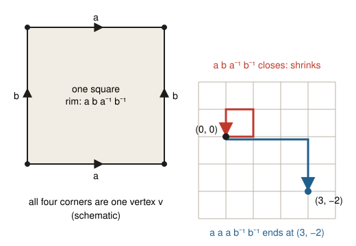

# CW complexes: build a space by gluing cells, then read its invariants off the recipe

[Syllabus](../../../SYLLABUS.md) → [Topology](../README.md) → [Homotopy](../README.md#s04) → CW complexes

---

## General Overview

A robot arm on a factory bench has two joints that can turn without limit: a shoulder and an elbow. Its pose is two angles, one per joint. Each angle runs once round a circle, so the set of all poses is a circle times a circle: a torus, the surface of an inner tube.

Each joint carries a cable. A full turn of a joint winds its cable once, like a dog's lead wound round a lamp post. The engineer's question: after a motion plan that ends back at the home pose, which plans can be smoothed into doing nothing, and which leave a cable wound?

The torus can be built from four pieces, and the answer can be read off that list:

- **one point**, the home pose, both angles at 0;
- **two loops**: $`a`$, the shoulder turns once with the elbow held at 0, and $`b`$, the elbow turns once with the shoulder held at 0;
- **one square**, every pair of angles at once, glued in along the path $`a`$, then $`b`$, then $`a`$ backwards, then $`b`$ backwards.

The loops give the moves. The square gives one rule: "shoulder, elbow, shoulder back, elbow back" can be shrunk to staying still, by sliding it across the square. So the order of turns does not matter, only the totals. A plan with 3 shoulder turns and 2 elbow turns backwards must leave both cables wound.

**Build a space by gluing pieces of dimension 0, 1, 2 and up, each along its rim; then each 1-dimensional piece that closes a circuit adds a loop, each 2-dimensional piece adds one rule saying its rim shrinks, and the loop group and the Euler characteristic can be read straight off the list.**

**What kind of fact this is:** a definition, the CW complex, and a theorem, the loop group from cells and relations, proved on this card in Why it works from [Van Kampen's theorem](06-van-kampens-theorem.md). That the Euler characteristic does not depend on the chosen cells is stated here with a source; [Cellular homology](../05-Homology/05-cellular-homology.md) proves it.

### The picture: the recipe, and the plans lifted to a grid

<p align="center"></p>

Left: the recipe. The two edges marked $`a`$ are glued into one loop, the two marked $`b`$ into another, and all four corners into one point. Right: each plan drawn on an endless grid, one step right per shoulder turn, one step up per elbow turn. A plan shrinks to nothing exactly when its drawing closes up. The left half is schematic: a real torus is curved, and only which pieces touch matters.

---

## The formula

A **cell** of dimension $`n`$, written $`e^n`$, is a copy of the inside of the $`n`$-dimensional **disc** $`D^n`$ (the solid ball: a point for $`n = 0`$, an interval for $`n = 1`$, a filled disc for $`n = 2`$, a solid ball for $`n = 3`$). The rim of $`D^n`$ is a sphere one dimension down: two end points for an interval, a circle for a disc.

A **CW complex** $`X`$ is built in stages. Start with a set of points, the 0-cells. Then, for $`n = 1, 2, 3, \dots`$ in turn, glue $`n`$-cells on: each $`D^n`$ is attached by a continuous map $`\varphi`$ from its rim into what is already built, and points of the rim are identified with their images. That gluing is a quotient, the operation of [Subspace, product and quotient](../02-Topological%20Spaces/04-subspace-product-and-quotient-topologies.md):

```math
X^{n} = X^{n-1} \cup_{\varphi} D^{n} \cup_{\varphi'} D^{n} \cup \cdots
```

**Read it aloud:** the stage-$`n`$ space is the stage before it with discs glued on, each along its rim. The stage $`X^n`$ is the **$`n`$-skeleton**. The name CW records two technical conditions (closure-finite, weak topology) that only matter for infinitely many cells; every complex on this card is finite.

The recipe gives two invariants. Write $`c_n`$ for the number of $`n`$-cells. Suppose $`X`$ is connected and its 1-skeleton (points and edges, a graph) has a **spanning tree** $`T`$: a set of edges reaching every vertex with no loop ([Spanning trees](../../04-Combinatorics%20and%20graphs/10-Trees%20and%20Cheapest%20Routes/03-spanning-trees-and-cayleys-formula.md)). Then

```math
\chi(X) = c_0 - c_1 + c_2 - c_3 + \cdots, \qquad \pi_1(X) \cong \langle\, a_1, \dots, a_k \mid r_1, \dots, r_m \,\rangle
```

**Read it aloud:** the Euler characteristic is the cell counts with signs plus, minus, plus, minus; and the fundamental group has one generator for each edge outside the tree and one relation for each 2-cell, the word read round its rim with tree edges deleted.

A presentation $`\langle\, a, b \mid r \,\rangle`$, met on [Van Kampen's theorem](06-van-kampens-theorem.md), means the group of all words in $`a`$, $`b`$ and their inverses, where neighbouring pairs such as $`a\,a^{-1}`$ cancel and $`r`$ or its inverse may be inserted or deleted anywhere in a word. A capital letter is an inverse: $`A`$ is $`a^{-1}`$, $`a`$ run backwards.

| Symbol | Plain meaning | In our example | Push it up and the answer… |
| --- | --- | --- | --- |
| $`X`$, $`X^n`$ | the space being built; its $`n`$-skeleton, all cells of dimension up to $`n`$ | the torus of arm poses; $`X^1`$ is the figure eight of the two loops | — |
| $`e^n`$, $`D^n`$ | an $`n`$-cell, the inside of the $`n`$-disc $`D^n`$ | the home pose $`e^0`$, the loops $`a`$, $`b`$, the square $`e^2`$ | — |
| $`S^{n-1}`$ | the rim of $`D^n`$, a sphere one dimension down | the square's rim, a circle | — |
| $`\varphi`$ | attaching map: where the rim of a disc is glued | the square's rim goes round $`a\,b\,a^{-1}b^{-1}`$ | a different word makes a different space |
| $`c_n`$ | number of $`n`$-cells | $`c_0 = 1`$, $`c_1 = 2`$, $`c_2 = 1`$ | an extra edge lowers $`\chi`$ by 1 |
| $`\chi`$ | Euler characteristic, $`c_0 - c_1 + c_2 - \cdots`$ | $`1 - 2 + 1 = 0`$ | fixed by the space, not the recipe |
| $`T`$ | spanning tree of the 1-skeleton | no edges: one vertex needs none | each tree edge is shrunk away |
| $`a_i`$, $`k`$ | generators: the edges outside $`T`$, and how many | $`a`$, $`b`$; $`k = 2`$ | one more edge, one more free loop |
| $`r_j`$, $`m`$ | relations: the rim words of the 2-cells, and how many | $`r_1 = abAB`$; $`m = 1`$ | each new 2-cell makes its rim shrink |
| $`\pi_1(X)`$ | the fundamental group: loops at the base point, up to sliding ([The fundamental group](03-the-fundamental-group.md)) | $`\langle\, a, b \mid abAB \,\rangle \cong \mathbb{Z}^2`$ | — |
| $`\langle\, \cdot \mid \cdot \,\rangle`$, $`A`$ | a presentation: generators, then relations; a capital is an inverse | the arm's plans, with one rule; $`A`$ is the shoulder turned back | — |
| $`Y`$, $`U`$, $`V`$, $`\gamma`$, $`z`$, $`x_0`$, $`s`$, $`i_U`$, $`i_V`$ | in the proof: the space before a disc is glued, two open pieces of the result, the loop round their overlap, a point of the disc, the rim's start point in $`Y`$, a base point in the overlap, and the maps that view an overlap loop inside $`U`$ or $`V`$ | $`Y`$ is the figure eight, $`V`$ the open square, $`\gamma`$ a small circle in it, $`x_0`$ the home pose | — |

### When it holds

- **Cells are glued only onto lower cells.** A 2-cell's rim must land in the points and edges, and its word is read along whole edges. A disc glued across the middle of another disc is not a CW gluing, and the counts above no longer apply.
- **The tree is shrunk before edges become generators.** On a circle built from 2 vertices and 2 edges, taking both edges as generators gives rank 2. The tree edge is not a loop; shrinking it leaves rank 1, the true answer for a circle.
- **The arrows are part of the recipe.** Flip one $`b`$ on the square and the rim reads $`abAb`$: that is the Klein bottle. Its abelianised group (the group with every pair of letters made to commute) has rank 1 and torsion $`[2]`$, not the torus's rank 2. The torsion says that once letters commute, $`b`$ taken twice is zero; in the loop group itself $`bb`$ does not shrink.
- **Cells of dimension 3 and up do not touch $`\pi_1`$, but they do touch $`\chi`$.** Filling the sphere with a solid ball keeps the group trivial and moves $`\chi`$ from 2 to 1.
- **$`X`$ is connected.** With two pieces there is no single base point, so each piece gets its own group. $`\chi`$ still adds over the pieces.

---

## Why it works

### Step 0: each cell does one job

A 1-cell glued at both ends to one point is a new loop, and nothing yet stops it from winding. A 2-cell is a disc glued along a loop; once the disc is there, that loop can be pulled across it to a point. So 1-cells add generators and 2-cells add relations.

Higher cells add nothing to the loop group. A 3-cell is glued along a sphere, and every loop on a sphere already shrinks ([Contractible and simply connected](02-contractible-and-simply-connected.md)). The rest is making these two sentences exact with [Van Kampen's theorem](06-van-kampens-theorem.md): the loop group of a union of two open pieces is built from the pieces' groups, with the overlap's loops identified.

### Step 1: a graph's loop group is free

The 1-skeleton $`X^1`$ is a graph. A tree has no loops and squashes to a point. Shrinking a spanning tree $`T`$ to one vertex is therefore a homotopy equivalence, a change that keeps the loop group ([Homotopy](01-homotopy-and-homotopy-equivalence.md); Hatcher, Proposition 0.17, in Sources, proves it for any subcomplex that squashes to a point). It leaves a bouquet: one vertex with one loop for each edge outside $`T`$.

The number of such edges is $`c_1 - (c_0 - 1)`$, because a tree on $`c_0`$ vertices has $`c_0 - 1`$ edges. A bouquet of $`k`$ loops has the free group on $`k`$ letters as its loop group: [Van Kampen's theorem](06-van-kampens-theorem.md) proves it for two loops, and gluing one loop at a time gives any $`k`$.

The circle from 2 vertices $`v`$, $`w`$ and 2 edges $`p`$ (from $`v`$ to $`w`$) and $`q`$ (back) shows the count. The tree is $`p`$, so $`k = 2 - 1 = 1`$ and the generator is $`q`$, which now reads "go round once". The group is $`\mathbb{Z}`$, as [The circle's fundamental group is the integers](04-fundamental-group-of-the-circle.md) proves by another road.

### Step 2: a 2-cell adds one relation

Glue one disc $`D^2`$ to a connected space $`Y`$ along a loop whose word is $`r`$. Call the result $`X`$. Then $`\pi_1(X) = \pi_1(Y)`$ with the extra relation $`r = 1`$.

The shape of the proof: cover $`X`$ by two open sets. $`U`$ is $`X`$ with the disc's centre removed; it squashes onto $`Y`$ by pushing every point of the disc straight out to the rim, so $`U`$ has the group of $`Y`$. $`V`$ is the open disc, which has no loops. Their overlap is a disc with its centre removed, a ring, whose one loop goes round the rim and reads $`r`$. Van Kampen glues the two groups and sets $`r`$ equal to the trivial loop from $`V`$.

<details>
<summary>Detailed proof: gluing a disc adds exactly the relation r = 1</summary>

Let $`\varphi`$ send the rim circle of $`D^2`$ to $`Y`$, and let $`x_0 = \varphi(1)`$ be where the rim's start point lands. Let $`0`$ be the disc's centre.

1. Set $`U = X \setminus \{0\}`$. The map that slides each disc point $`z \neq 0`$ along the ray from $`0`$ through $`z`$ to the rim, at time $`t`$ moving it to $`(1 - t)z + t\, z/|z|`$, is a deformation of $`U`$ onto $`Y`$ that never moves points of $`Y`$. So $`\pi_1(U) \cong \pi_1(Y)`$.

2. Set $`V`$ to the open disc $`\{ |z| < 1 \}`$. It is convex, so every loop in it shrinks: $`\pi_1(V) = 1`$.

3. The overlap $`U \cap V`$ is the open disc less its centre. It squashes onto the circle $`|z| = 1/2`$, so its group is $`\mathbb{Z}`$, generated by one loop $`\gamma`$ round that circle. $`U`$, $`V`$ and $`U \cap V`$ are each path-connected, as van Kampen requires.

4. Take the base point $`s = 1/2`$ on that circle. In $`U`$, the radial slide carries $`\gamma`$ to the rim loop, which $`\varphi`$ sends to the word $`r`$; the straight segment from $`1/2`$ to the rim point $`1`$, followed into $`Y`$, moves the base point to $`x_0`$ without changing anything else.

5. Van Kampen, with these three sets, gives

$`\displaystyle \pi_1(X, s) \cong \pi_1(U, s) * \pi_1(V, s) \,/\, \langle\langle\, i_U(\gamma)\, i_V(\gamma)^{-1} \,\rangle\rangle .`$

Here $`i_U`$ and $`i_V`$ send a loop of the overlap to the same loop seen in $`U`$ or $`V`$, $`*`$ is the free product and $`\langle\langle \cdot \rangle\rangle`$ the smallest normal subgroup holding the element. Since $`\pi_1(V) = 1`$, $`i_V(\gamma) = 1`$ and the free product is just $`\pi_1(U)`$. The quotient sets $`i_U(\gamma) = r`$ equal to 1. Moving the base point to $`x_0`$ along the segment of step 4 gives $`\pi_1(X, x_0) \cong \pi_1(Y, x_0) / \langle\langle r \rangle\rangle`$.

Several 2-cells are glued one at a time, each adding its own relation. A 2-cell whose rim is the constant loop at a vertex has $`r`$ empty: it adds the relation $`1 = 1`$, which is nothing.

</details>

### Step 3: cells of dimension 3 and up change nothing

The same three open sets work for an $`n`$-cell. Now the overlap is a solid ball less its centre, which squashes onto a sphere $`S^{n-1}`$ of dimension $`n - 1 \geq 2`$. That sphere is simply connected, so the overlap brings no loop to identify, and van Kampen returns $`\pi_1(X) = \pi_1(X^{n-1})`$. So $`\pi_1(X) = \pi_1(X^2)`$: the group is fixed once the 2-cells are on.

### Step 4: the three spaces of the job

| Space | Recipe | $`\chi`$ | $`\pi_1`$ |
| --- | --- | --- | --- |
| circle | 1 point, 1 edge $`a`$ | $`1 - 1 = 0`$ | $`\langle\, a \mid \;\rangle \cong \mathbb{Z}`$ |
| torus | 1 point, edges $`a`$, $`b`$, 1 square on $`abAB`$ | $`1 - 2 + 1 = 0`$ | $`\langle\, a, b \mid abAB \,\rangle \cong \mathbb{Z}^2`$ |
| sphere | 1 point, 1 disc on the constant loop | $`1 + 1 = 2`$ | trivial |
| sphere, again | 2 poles, 2 edges, 2 hemispheres | $`2 - 2 + 2 = 2`$ | $`\langle\, q \mid q^{-1}, q \,\rangle`$, trivial |

The sphere's one disc is a bag pulled shut: the whole rim is glued to one point. No edges means no generators, so every loop shrinks.

The torus's relation $`abAB = 1`$ rearranges to $`ab = ba`$: the two generators commute. Every word then sorts to $`a^m b^n`$, and $`(m, n)`$ are the net shoulder and elbow turns. So the group is the pairs of whole numbers under addition, $`\mathbb{Z}^2`$.

The same counts come out of triangles. [Euler characteristic](../03-Surfaces%20and%20Manifolds/04-euler-characteristic-and-triangulations.md) cut the torus into 9 corners, 27 edges and 18 triangles, $`9 - 27 + 18 = 0`$. The cell recipe gets the same 0 from 4 cells instead of 9 + 27 + 18 pieces. That every cell structure of a space gives the same $`\chi`$ is a theorem, proved on [Cellular homology](../05-Homology/05-cellular-homology.md) by building $`\chi`$ from hole counts that do not refer to cells.

### Step 5: a second road, through the cover

[Covering spaces](05-covering-spaces.md) gives an independent test. The torus is covered by the plane: tile the plane with copies of the square, and every plan lifts to a path on the square grid, one step right for $`a`$, one up for $`b`$. A loop shrinks on the torus exactly when its lift closes up. The figure eight $`X^1`$ is covered the same way by an endless tree with four branches at every node, and a loop shrinks there exactly when its word cancels down to nothing.

The code tries every word of length $`L`$ = 2, 4 and 6, 4,368 words in all, and counts those whose lift closes. On the grid there is a formula to check against. Turn the grid by 45 degrees: each step then moves both new coordinates by plus or minus 1, independently. So a closed walk is two independent closed walks on a line, and a line has $`\binom{L}{L/2}`$ of them (choose which half of the $`L`$ steps go forward).

| Length $`L`$ | Words | Close on the torus | Formula $`\binom{L}{L/2}^2`$ | Close on the figure eight | Tree walks |
| ---: | ---: | ---: | ---: | ---: | ---: |
| 2 | 16 | 4 | 4 | 4 | 4 |
| 4 | 256 | 36 | 36 | 28 | 28 |
| 6 | 4,096 | 400 | 400 | 232 | 232 |

At length 4 the torus closes 8 more loops than the figure eight. They are exactly $`abAB`$ read from each of the square's 4 corners, in each of 2 directions. This is checked on 4,368 words; the proof is Steps 1 to 3.

---

## Worked numbers, by hand

| Step | Arithmetic | Value |
| --- | --- | --- |
| torus cells | 1 point, 2 edges, 1 square | $`c = (1, 2, 1)`$ |
| torus $`\chi`$ | $`1 - 2 + 1`$ | 0 |
| torus $`\chi`$, by triangles | $`9 - 27 + 18`$ | 0 |
| spanning tree | 1 vertex needs no edge | generators $`a`$, $`b`$ |
| relation | rim of the square | $`abAB`$ |
| net turns in the relation | $`a`$: $`1 - 1`$; $`b`$: $`1 - 1`$ | $`(0, 0)`$ |
| group | $`2`$ generators, relation adds nothing to the totals | $`\mathbb{Z}^2`$, rank 2 |
| plan $`abAB`$ | lift: right, up, left, down | ends at $`(0, 0)`$: shrinks |
| plan $`aaaBB`$ | lift: 3 right, 2 down | ends at $`(3, -2)`$ |
| sphere, ball | $`1 + 1`$; $`1 + 1 - 1`$ | 2; 1 |
| short loops closing, length 4 | torus $`6^2`$, figure eight 28 | 36, 28 |

**The arm's loop group is $`\mathbb{Z}^2`$: the plan $`aaaBB`$ is the pair $`(3, -2)`$ and can only be undone by 3 shoulder turns back and 2 elbow turns forward.**

In the arm's terms: the shoulder cable stays wound 3 times and the elbow cable twice the other way, whatever smooth change is made to the plan.

### What breaks if you drop a piece

| Mistake | Comes out at | What went wrong |
| --- | --- | --- |
| The square left out | $`abAB`$ cancels to $`abAB`$, not 1 | the figure eight: no disc to slide across |
| Every edge a generator, 2-vertex circle | rank 2, not 1 | the tree edge is not a loop |
| One arrow flipped, rim $`abAb`$ | rank 1, torsion $`[2]`$ | that recipe is the Klein bottle |
| Cells counted without signs | $`1 + 2 + 1 = 4`$, not 0 | $`\chi`$ alternates plus and minus |

The code prints all four.

The first row is a real arm under a safety rule that allows only one joint away from home at a time. The allowed poses are then the two loops without the square, and the plan $`abAB`$ cannot be smoothed away.

---

## Code, from first principles, and it actually runs

The code stores each complex as its recipe: vertices, named edges with their ends, and 2-cell rim words, lower case forwards and capitals backwards. It takes three roads. Road 1 reads the presentation off the recipe by shrinking a spanning tree, then computes the abelianised group from the greatest common divisors of minors of the exponent table. One extra complex, two discs glued on $`aabb`$ and $`aaBB`$, has two torsion numbers, $`[2, 4]`$, so the 2 × 2 minors are tested too. Road 2 lifts every word up to length 6 to the grid and to the tree and counts closed lifts against two formulas. Road 3 recounts $`\chi`$ from triangulations. All arithmetic is whole numbers.

### Python

```python
# CW complexes -- the check behind the card.  Standard library only.
# A complex is a recipe: vertices, edges (name: tail, head) and 2-cells, each
# 2-cell the word read round its rim.  Lower case runs an edge forwards and the
# capital runs it backwards, so A is a^-1.  Road 1 reads the loop group off the
# recipe: a spanning tree of edges is shrunk, the other edges are generators and
# each 2-cell gives one relation.  Road 2 lifts every short loop to a cover where
# a loop shrinks only if its lift closes up: the square grid for the torus, the
# branching tree for the figure eight.  The closed lifts are counted against
# formulas.  Chi is counted from the cells and, separately, from triangles.
from itertools import combinations, product
from math import comb, gcd

INV = {"a": "A", "A": "a", "b": "B", "B": "b"}

def chi(X):                                # cells counted with signs + - + -
    V, E, F, C3 = X
    return len(V) - len(E) + len(F) - C3

def presentation(X):                       # road 1: shrink a spanning tree
    V, E, F, C3 = X
    boss = {v: v for v in V}
    def find(x):
        return x if boss[x] == x else find(boss[x])
    gens = []
    for name, (tail, head) in E.items():
        if find(tail) == find(head):
            gens.append(name)              # this edge closes a loop: a generator
        else:
            boss[find(tail)] = find(head)  # this edge joins the tree
    rels = ["".join(c for c in w if c.lower() in gens) for w in F]
    return gens, rels

def det(m):                                # whole-number determinant, by rows
    if not m:
        return 1
    return sum((-1) ** j * m[0][j] * det([r[:j] + r[j + 1:] for r in m[1:]])
               for j in range(len(m)) if m[0][j])

def abelianised(gens, rels):               # rank and torsion, from the gcds of minors
    m = [[w.count(g) - w.count(g.upper()) for g in gens] for w in rels]
    d, inv = [1], []
    for k in range(1, min(len(m), len(gens)) + 1):
        g = 0
        for rows in combinations(m, k):
            for cols in combinations(range(len(gens)), k):
                g = gcd(g, det([[r[c] for c in cols] for r in rows]))
        if g == 0:
            break
        inv.append(g // d[-1])
        d.append(g)
    return len(gens) - len(inv), [t for t in inv if t > 1]

def show(label, X):
    gens, rels = presentation(X)
    rank, tors = abelianised(gens, rels)
    rel = ", ".join(r or "1" for r in rels) or "no relations"
    return (f"{label}: cells {len(X[0])}, {len(X[1])}, {len(X[2])}, {X[3]}; chi {chi(X)}; "
            f"pi1 = <{', '.join(gens)} | {rel}>; abelianised rank {rank}, torsion {tors}")

def free_reduce(w):                        # lift to the tree: cancel aA, Bb, ...
    out = []
    for c in w:
        if out and out[-1] == INV[c]:
            out.pop()
        else:
            out.append(c)
    return "".join(out)

def grid_end(w):                           # lift to the square grid: a is one step right
    return (w.count("a") - w.count("A"), w.count("b") - w.count("B"))

def tree_closed(n):                        # closed walks on the 4-branch tree, by depth
    ways = [1] + [0] * n
    for _ in range(n):
        ways = [ways[1]] + [ways[d - 1] * (4 if d == 1 else 3) + (ways[d + 1] if d < n else 0)
                            for d in range(1, n + 1)]
    return ways[0]

one = ["v"]
circle1 = (one, {"a": ("v", "v")}, [], 0)
circle2 = (["v", "w"], {"p": ("v", "w"), "q": ("w", "v")}, [], 0)
eight = (one, {"a": ("v", "v"), "b": ("v", "v")}, [], 0)
torus = (one, {"a": ("v", "v"), "b": ("v", "v")}, ["abAB"], 0)
sphere1 = (one, {}, [""], 0)
sphere2 = (["n", "s"], {"p": ("n", "s"), "q": ("n", "s")}, ["pQ", "qP"], 0)
ball = (one, {}, [""], 1)
klein = (one, {"a": ("v", "v"), "b": ("v", "v")}, ["abAb"], 0)
rp2 = (one, {"a": ("v", "v")}, ["aa"], 0)
box = (one, {"a": ("v", "v"), "b": ("v", "v"), "c": ("v", "v")}, ["abAB", "acAC", "bcBC"], 1)
twist = (one, {"a": ("v", "v"), "b": ("v", "v")}, ["aabb", "aaBB"], 0)  # two torsion numbers: tests 2 x 2 minors
for label, X in (("circle, 1 vertex + 1 edge", circle1), ("circle, 2 vertices + 2 edges", circle2),
                 ("figure eight, 1 vertex + 2 edges", eight), ("torus, 1 vertex + 2 edges + 1 square", torus),
                 ("sphere, 1 vertex + 1 disc", sphere1), ("sphere, 2 vertices + 2 edges + 2 discs", sphere2),
                 ("ball, sphere + 1 solid ball", ball), ("klein bottle, square abAb", klein),
                 ("projective plane, disc aa", rp2), ("3-torus box, 1 + 3 + 3 + 1 cells", box),
                 ("two discs, rims aabb and aaBB", twist)):
    print(show(label, X))
tor_tri = {tuple(sorted(t)) for i, j in product(range(3), repeat=2) for t in
           ((3 * i + j, 3 * ((i + 1) % 3) + j, 3 * ((i + 1) % 3) + (j + 1) % 3),
            (3 * i + j, 3 * i + (j + 1) % 3, 3 * ((i + 1) % 3) + (j + 1) % 3))}
tor_edges = {e for t in tor_tri for e in combinations(t, 2)}
tet = list(combinations(range(4), 3))
tet_edges = {e for t in tet for e in combinations(t, 2)}
chi_tor, chi_tet = 9 - len(tor_edges) + len(tor_tri), 4 - len(tet_edges) + len(tet)
print(f"chi from triangles: torus 9 - {len(tor_edges)} + {len(tor_tri)} = {chi_tor}; "
      f"sphere 4 - {len(tet_edges)} + {len(tet)} = {chi_tet}")
print("loops of length n that shrink to a point (road 2, every word of n letters):")
counts = {}
for n in (2, 4, 6):
    words = ["".join(w) for w in product("aAbB", repeat=n)]
    t = [w for w in words if grid_end(w) == (0, 0)]
    e = [w for w in words if free_reduce(w) == ""]
    counts[n] = (len(t), len(e), set(t) - set(e))
    print(f"  n {n}: of {len(words)} words, torus {len(t)} (formula C({n},{n // 2})^2 = "
          f"{comb(n, n // 2) ** 2}), figure eight {len(e)} (tree walk {tree_closed(n)})")
print(f"  checked on {sum(4 ** n for n in counts)} words")
extra = sorted(counts[4][2])
rims = sorted({r[i:] + r[:i] for r in ("abAB", "baBA") for i in range(4)})
print(f"length 4, closed on the torus only: {len(extra)} words: {' '.join(extra)}")
print(f"  the square's rim abAB read from each corner, either way round: {'yes' if extra == rims else 'no'}")
plan = "aaaBB"
print(f"arm plan abAB: torus lift ends at {grid_end('abAB')}, so it shrinks to staying at home")
print(f"arm plan {plan}: torus lift ends at {grid_end(plan)}, so shoulder 3 turns, elbow -2 turns")
print(f"mistake 1, square left out: abAB on the figure eight reduces to {free_reduce('abAB')}, not 1")
print(f"mistake 2, every edge a generator on the 2-vertex circle: rank {abelianised(list(circle2[1]), [])[0]}, not 1")
print(f"mistake 3, square read abAb (one arrow flipped): rank {abelianised(*presentation(klein))[0]}, "
      f"torsion {abelianised(*presentation(klein))[1]}")
print(f"mistake 4, torus cells counted without signs: 1 + 2 + 1 = {len(torus[0]) + len(torus[1]) + len(torus[2])}, "
      f"not {chi(torus)}")
print("figure, schematic square side 200 at (40, 40); grid unit 40, origin (330, 200); "
      f"abAB corners (0, 0) (1, 0) (1, 1) (0, 1); {plan} ends {grid_end(plan)}")
assert [chi(X) for X in (circle1, circle2, torus, sphere1, sphere2, ball, box)] == [0, 0, 0, 2, 2, 1, 0]
assert chi(torus) == chi_tor and chi(sphere1) == chi_tet          # cells against triangles
assert all(counts[n][0] == comb(n, n // 2) ** 2 and counts[n][1] == tree_closed(n) for n in counts)
assert extra == rims and free_reduce("abAB") == "abAB" and grid_end("abAB") == (0, 0)
assert presentation(circle2) == (["q"], []) and presentation(sphere2) == (["q"], ["Q", "q"])  # tree edge p shrunk
assert [abelianised(*presentation(X)) for X in (circle2, torus, sphere2, klein, rp2, box, twist)] == \
    [(1, []), (2, []), (0, []), (1, [2]), (0, [2]), (3, []), (0, [2, 4])]
print("ALL CHECKS PASS")
```

**Ran 2026-11-15 on macOS, Python 3.14.10, standard library only. All checks passed. Output, pasted from the run:**

```
circle, 1 vertex + 1 edge: cells 1, 1, 0, 0; chi 0; pi1 = <a | no relations>; abelianised rank 1, torsion []
circle, 2 vertices + 2 edges: cells 2, 2, 0, 0; chi 0; pi1 = <q | no relations>; abelianised rank 1, torsion []
figure eight, 1 vertex + 2 edges: cells 1, 2, 0, 0; chi -1; pi1 = <a, b | no relations>; abelianised rank 2, torsion []
torus, 1 vertex + 2 edges + 1 square: cells 1, 2, 1, 0; chi 0; pi1 = <a, b | abAB>; abelianised rank 2, torsion []
sphere, 1 vertex + 1 disc: cells 1, 0, 1, 0; chi 2; pi1 = < | 1>; abelianised rank 0, torsion []
sphere, 2 vertices + 2 edges + 2 discs: cells 2, 2, 2, 0; chi 2; pi1 = <q | Q, q>; abelianised rank 0, torsion []
ball, sphere + 1 solid ball: cells 1, 0, 1, 1; chi 1; pi1 = < | 1>; abelianised rank 0, torsion []
klein bottle, square abAb: cells 1, 2, 1, 0; chi 0; pi1 = <a, b | abAb>; abelianised rank 1, torsion [2]
projective plane, disc aa: cells 1, 1, 1, 0; chi 1; pi1 = <a | aa>; abelianised rank 0, torsion [2]
3-torus box, 1 + 3 + 3 + 1 cells: cells 1, 3, 3, 1; chi 0; pi1 = <a, b, c | abAB, acAC, bcBC>; abelianised rank 3, torsion []
two discs, rims aabb and aaBB: cells 1, 2, 2, 0; chi 1; pi1 = <a, b | aabb, aaBB>; abelianised rank 0, torsion [2, 4]
chi from triangles: torus 9 - 27 + 18 = 0; sphere 4 - 6 + 4 = 2
loops of length n that shrink to a point (road 2, every word of n letters):
  n 2: of 16 words, torus 4 (formula C(2,1)^2 = 4), figure eight 4 (tree walk 4)
  n 4: of 256 words, torus 36 (formula C(4,2)^2 = 36), figure eight 28 (tree walk 28)
  n 6: of 4096 words, torus 400 (formula C(6,3)^2 = 400), figure eight 232 (tree walk 232)
  checked on 4368 words
length 4, closed on the torus only: 8 words: ABab AbaB BAba BabA aBAb abAB bABa baBA
  the square's rim abAB read from each corner, either way round: yes
arm plan abAB: torus lift ends at (0, 0), so it shrinks to staying at home
arm plan aaaBB: torus lift ends at (3, -2), so shoulder 3 turns, elbow -2 turns
mistake 1, square left out: abAB on the figure eight reduces to abAB, not 1
mistake 2, every edge a generator on the 2-vertex circle: rank 2, not 1
mistake 3, square read abAb (one arrow flipped): rank 1, torsion [2]
mistake 4, torus cells counted without signs: 1 + 2 + 1 = 4, not 0
figure, schematic square side 200 at (40, 40); grid unit 40, origin (330, 200); abAB corners (0, 0) (1, 0) (1, 1) (0, 1); aaaBB ends (3, -2)
ALL CHECKS PASS
```

### Rust

Same numbers, same labels, built with `rustc --edition 2021 -O`.

```rust
// CW complexes -- the same check as the Python, in Rust.  No crates.
// A complex is a recipe: vertices, edges (name: tail, head) and 2-cells, each
// 2-cell the word read round its rim.  Lower case runs an edge forwards and the
// capital runs it backwards, so A is a^-1.  Road 1 reads the loop group off the
// recipe: a spanning tree of edges is shrunk, the other edges are generators and
// each 2-cell gives one relation.  Road 2 lifts every short loop to a cover where
// a loop shrinks only if its lift closes up: the square grid for the torus, the
// branching tree for the figure eight.  The closed lifts are counted against
// formulas.  Chi is counted from the cells and, separately, from triangles.
use std::collections::BTreeSet;

struct Cx { v: Vec<&'static str>, e: Vec<(char, &'static str, &'static str)>, f: Vec<&'static str>, c3: i64 }

fn chi(x: &Cx) -> i64 { x.v.len() as i64 - x.e.len() as i64 + x.f.len() as i64 - x.c3 }   // + - + -

fn find(boss: &[usize], x: usize) -> usize { if boss[x] == x { x } else { find(boss, boss[x]) } }

fn presentation(x: &Cx) -> (Vec<char>, Vec<String>) {     // road 1: shrink a spanning tree
    let mut boss: Vec<usize> = (0..x.v.len()).collect();
    let ix = |n: &str| x.v.iter().position(|&w| w == n).unwrap();
    let mut gens = vec![];
    for &(name, tail, head) in &x.e {
        let (t, h) = (find(&boss, ix(tail)), find(&boss, ix(head)));
        if t == h { gens.push(name) } else { boss[t] = h }  // a generator, or a tree edge
    }
    let rels = x.f.iter().map(|w| w.chars().filter(|c| gens.contains(&c.to_ascii_lowercase())).collect()).collect();
    (gens, rels)
}

fn gcd(a: i64, b: i64) -> i64 { if b == 0 { a.abs() } else { gcd(b, a % b) } }

fn det(m: &[Vec<i64>]) -> i64 {                            // whole-number determinant, by rows
    if m.is_empty() { return 1 }
    (0..m.len()).filter(|&j| m[0][j] != 0).map(|j| {
        let minor: Vec<Vec<i64>> = m[1..].iter().map(|r| r.iter().enumerate().filter(|&(c, _)| c != j).map(|(_, &x)| x).collect()).collect();
        (if j % 2 == 0 { 1 } else { -1 }) * m[0][j] * det(&minor)
    }).sum()
}

fn combos(n: usize, k: usize) -> Vec<Vec<usize>> {         // k-element subsets of 0..n, in order
    if k == 0 { return vec![vec![]] }
    (0..n).flat_map(|i| combos(n, k - 1).into_iter().filter(move |c| c.iter().all(|&x| x < i)).map(move |mut c| { c.push(i); c })).collect()
}

fn count(w: &str, c: char) -> i64 { w.chars().filter(|&x| x == c).count() as i64 }

fn abelianised(gens: &[char], rels: &[String]) -> (usize, Vec<i64>) {   // rank and torsion, from gcds of minors
    let m: Vec<Vec<i64>> = rels.iter().map(|w| gens.iter().map(|&g| count(w, g) - count(w, g.to_ascii_uppercase())).collect()).collect();
    let (mut d, mut inv) = (vec![1i64], vec![]);
    for k in 1..=m.len().min(gens.len()) {
        let mut g = 0;
        for rows in combos(m.len(), k) {
            for cols in combos(gens.len(), k) {
                g = gcd(g, det(&rows.iter().map(|&r| cols.iter().map(|&c| m[r][c]).collect()).collect::<Vec<_>>()));
            }
        }
        if g == 0 { break }
        inv.push(g / d[d.len() - 1]);
        d.push(g);
    }
    (gens.len() - inv.len(), inv.into_iter().filter(|&t| t > 1).collect())
}

fn show(label: &str, x: &Cx) -> String {
    let (gens, rels) = presentation(x);
    let (rank, tors) = abelianised(&gens, &rels);
    let mut rel = rels.iter().map(|r| if r.is_empty() { "1".to_string() } else { r.clone() }).collect::<Vec<_>>().join(", ");
    if rel.is_empty() { rel = "no relations".to_string() }
    let g = gens.iter().map(|c| c.to_string()).collect::<Vec<_>>().join(", ");
    format!("{}: cells {}, {}, {}, {}; chi {}; pi1 = <{} | {}>; abelianised rank {}, torsion {:?}",
            label, x.v.len(), x.e.len(), x.f.len(), x.c3, chi(x), g, rel, rank, tors)
}

fn inv(c: char) -> char { if c.is_ascii_lowercase() { c.to_ascii_uppercase() } else { c.to_ascii_lowercase() } }

fn free_reduce(w: &str) -> String {                        // lift to the tree: cancel aA, Bb, ...
    let mut out: Vec<char> = vec![];
    for c in w.chars() { if out.last() == Some(&inv(c)) { out.pop(); } else { out.push(c) } }
    out.into_iter().collect()
}

fn grid_end(w: &str) -> (i64, i64) { (count(w, 'a') - count(w, 'A'), count(w, 'b') - count(w, 'B')) }

fn tree_closed(n: usize) -> i64 {                          // closed walks on the 4-branch tree, by depth
    let mut ways = vec![0i64; n + 1];
    ways[0] = 1;
    for _ in 0..n {
        let mut nw = vec![ways[1]];
        for d in 1..=n { nw.push(ways[d - 1] * if d == 1 { 4 } else { 3 } + if d < n { ways[d + 1] } else { 0 }) }
        ways = nw;
    }
    ways[0]
}

fn comb(n: i64, k: i64) -> i64 { (1..=k).fold(1, |acc, i| acc * (n - k + i) / i) }

fn main() {
    let lp = |n: char| (n, "v", "v");
    let one = || vec!["v"];
    let circle1 = Cx { v: one(), e: vec![lp('a')], f: vec![], c3: 0 };
    let circle2 = Cx { v: vec!["v", "w"], e: vec![('p', "v", "w"), ('q', "w", "v")], f: vec![], c3: 0 };
    let eight = Cx { v: one(), e: vec![lp('a'), lp('b')], f: vec![], c3: 0 };
    let torus = Cx { v: one(), e: vec![lp('a'), lp('b')], f: vec!["abAB"], c3: 0 };
    let sphere1 = Cx { v: one(), e: vec![], f: vec![""], c3: 0 };
    let sphere2 = Cx { v: vec!["n", "s"], e: vec![('p', "n", "s"), ('q', "n", "s")], f: vec!["pQ", "qP"], c3: 0 };
    let ball = Cx { v: one(), e: vec![], f: vec![""], c3: 1 };
    let klein = Cx { v: one(), e: vec![lp('a'), lp('b')], f: vec!["abAb"], c3: 0 };
    let rp2 = Cx { v: one(), e: vec![lp('a')], f: vec!["aa"], c3: 0 };
    let bx = Cx { v: one(), e: vec![lp('a'), lp('b'), lp('c')], f: vec!["abAB", "acAC", "bcBC"], c3: 1 };
    let twist = Cx { v: one(), e: vec![lp('a'), lp('b')], f: vec!["aabb", "aaBB"], c3: 0 };  // two torsion numbers: tests 2 x 2 minors
    for (label, x) in [("circle, 1 vertex + 1 edge", &circle1), ("circle, 2 vertices + 2 edges", &circle2),
                       ("figure eight, 1 vertex + 2 edges", &eight), ("torus, 1 vertex + 2 edges + 1 square", &torus),
                       ("sphere, 1 vertex + 1 disc", &sphere1), ("sphere, 2 vertices + 2 edges + 2 discs", &sphere2),
                       ("ball, sphere + 1 solid ball", &ball), ("klein bottle, square abAb", &klein),
                       ("projective plane, disc aa", &rp2), ("3-torus box, 1 + 3 + 3 + 1 cells", &bx),
                       ("two discs, rims aabb and aaBB", &twist)] {
        println!("{}", show(label, x));
    }
    let mut tor_tri: BTreeSet<Vec<usize>> = BTreeSet::new();
    for i in 0..3 { for j in 0..3 {
        let (i1, j1) = ((i + 1) % 3, (j + 1) % 3);
        for mut t in [vec![3 * i + j, 3 * i1 + j, 3 * i1 + j1], vec![3 * i + j, 3 * i + j1, 3 * i1 + j1]] { t.sort(); tor_tri.insert(t); }
    } }
    let edges_of = |tris: &Vec<Vec<usize>>| tris.iter().flat_map(|t| [(t[0], t[1]), (t[0], t[2]), (t[1], t[2])]).collect::<BTreeSet<_>>().len() as i64;
    let tor: Vec<Vec<usize>> = tor_tri.into_iter().collect();
    let tet: Vec<Vec<usize>> = combos(4, 3);
    let (te, ke) = (edges_of(&tor), edges_of(&tet));
    let (chi_tor, chi_tet) = (9 - te + tor.len() as i64, 4 - ke + tet.len() as i64);
    println!("chi from triangles: torus 9 - {} + {} = {}; sphere 4 - {} + {} = {}", te, tor.len(), chi_tor, ke, tet.len(), chi_tet);
    println!("loops of length n that shrink to a point (road 2, every word of n letters):");
    let mut counts = vec![];
    for n in [2usize, 4, 6] {
        let mut words = vec![String::new()];
        for _ in 0..n { words = words.iter().flat_map(|w| "aAbB".chars().map(move |c| format!("{}{}", w, c))).collect() }
        let t: BTreeSet<String> = words.iter().filter(|w| grid_end(w) == (0, 0)).cloned().collect();
        let e: BTreeSet<String> = words.iter().filter(|w| free_reduce(w).is_empty()).cloned().collect();
        let h = (n / 2) as i64;
        println!("  n {}: of {} words, torus {} (formula C({},{})^2 = {}), figure eight {} (tree walk {})",
                 n, words.len(), t.len(), n, h, comb(n as i64, h).pow(2), e.len(), tree_closed(n));
        counts.push((n, t.len() as i64, e.len() as i64, t.difference(&e).cloned().collect::<Vec<String>>()));
    }
    println!("  checked on {} words", counts.iter().map(|c| 4i64.pow(c.0 as u32)).sum::<i64>());
    let extra = counts[1].3.clone();
    let rims: Vec<String> = ["abAB", "baBA"].iter().flat_map(|r| (0..4).map(move |i| format!("{}{}", &r[i..], &r[..i]))).collect::<BTreeSet<_>>().into_iter().collect();
    println!("length 4, closed on the torus only: {} words: {}", extra.len(), extra.join(" "));
    println!("  the square's rim abAB read from each corner, either way round: {}", if extra == rims { "yes" } else { "no" });
    let plan = "aaaBB";
    println!("arm plan abAB: torus lift ends at {:?}, so it shrinks to staying at home", grid_end("abAB"));
    println!("arm plan {}: torus lift ends at {:?}, so shoulder 3 turns, elbow -2 turns", plan, grid_end(plan));
    let gens2: Vec<char> = circle2.e.iter().map(|e| e.0).collect();
    let (kg, kr) = presentation(&klein);
    let ka = abelianised(&kg, &kr);
    println!("mistake 1, square left out: abAB on the figure eight reduces to {}, not 1", free_reduce("abAB"));
    println!("mistake 2, every edge a generator on the 2-vertex circle: rank {}, not 1", abelianised(&gens2, &[]).0);
    println!("mistake 3, square read abAb (one arrow flipped): rank {}, torsion {:?}", ka.0, ka.1);
    println!("mistake 4, torus cells counted without signs: 1 + 2 + 1 = {}, not {}", torus.v.len() + torus.e.len() + torus.f.len(), chi(&torus));
    println!("figure, schematic square side 200 at (40, 40); grid unit 40, origin (330, 200); abAB corners (0, 0) (1, 0) (1, 1) (0, 1); {} ends {:?}", plan, grid_end(plan));
    assert!([&circle1, &circle2, &torus, &sphere1, &sphere2, &ball, &bx].iter().map(|x| chi(x)).collect::<Vec<_>>() == vec![0, 0, 0, 2, 2, 1, 0]);
    assert!(chi(&torus) == chi_tor && chi(&sphere1) == chi_tet);                   // cells against triangles
    assert!(counts.iter().all(|c| c.1 == comb(c.0 as i64, c.0 as i64 / 2).pow(2) && c.2 == tree_closed(c.0)));
    assert!(extra == rims && free_reduce("abAB") == "abAB" && grid_end("abAB") == (0, 0));
    assert!(presentation(&circle2) == (vec!['q'], vec![]) && presentation(&sphere2) == (vec!['q'], vec!["Q".to_string(), "q".to_string()]));
    let ab: Vec<(usize, Vec<i64>)> = [&circle2, &torus, &sphere2, &klein, &rp2, &bx, &twist].iter().map(|x| { let (g, r) = presentation(x); abelianised(&g, &r) }).collect();
    assert!(ab == vec![(1, vec![]), (2, vec![]), (0, vec![]), (1, vec![2]), (0, vec![2]), (3, vec![]), (0, vec![2, 4])]);
    println!("ALL CHECKS PASS");
}
```

**Ran 2026-11-15 on macOS, rustc 1.98.1, no crates. All checks passed. Output, pasted from the run:**

```
circle, 1 vertex + 1 edge: cells 1, 1, 0, 0; chi 0; pi1 = <a | no relations>; abelianised rank 1, torsion []
circle, 2 vertices + 2 edges: cells 2, 2, 0, 0; chi 0; pi1 = <q | no relations>; abelianised rank 1, torsion []
figure eight, 1 vertex + 2 edges: cells 1, 2, 0, 0; chi -1; pi1 = <a, b | no relations>; abelianised rank 2, torsion []
torus, 1 vertex + 2 edges + 1 square: cells 1, 2, 1, 0; chi 0; pi1 = <a, b | abAB>; abelianised rank 2, torsion []
sphere, 1 vertex + 1 disc: cells 1, 0, 1, 0; chi 2; pi1 = < | 1>; abelianised rank 0, torsion []
sphere, 2 vertices + 2 edges + 2 discs: cells 2, 2, 2, 0; chi 2; pi1 = <q | Q, q>; abelianised rank 0, torsion []
ball, sphere + 1 solid ball: cells 1, 0, 1, 1; chi 1; pi1 = < | 1>; abelianised rank 0, torsion []
klein bottle, square abAb: cells 1, 2, 1, 0; chi 0; pi1 = <a, b | abAb>; abelianised rank 1, torsion [2]
projective plane, disc aa: cells 1, 1, 1, 0; chi 1; pi1 = <a | aa>; abelianised rank 0, torsion [2]
3-torus box, 1 + 3 + 3 + 1 cells: cells 1, 3, 3, 1; chi 0; pi1 = <a, b, c | abAB, acAC, bcBC>; abelianised rank 3, torsion []
two discs, rims aabb and aaBB: cells 1, 2, 2, 0; chi 1; pi1 = <a, b | aabb, aaBB>; abelianised rank 0, torsion [2, 4]
chi from triangles: torus 9 - 27 + 18 = 0; sphere 4 - 6 + 4 = 2
loops of length n that shrink to a point (road 2, every word of n letters):
  n 2: of 16 words, torus 4 (formula C(2,1)^2 = 4), figure eight 4 (tree walk 4)
  n 4: of 256 words, torus 36 (formula C(4,2)^2 = 36), figure eight 28 (tree walk 28)
  n 6: of 4096 words, torus 400 (formula C(6,3)^2 = 400), figure eight 232 (tree walk 232)
  checked on 4368 words
length 4, closed on the torus only: 8 words: ABab AbaB BAba BabA aBAb abAB bABa baBA
  the square's rim abAB read from each corner, either way round: yes
arm plan abAB: torus lift ends at (0, 0), so it shrinks to staying at home
arm plan aaaBB: torus lift ends at (3, -2), so shoulder 3 turns, elbow -2 turns
mistake 1, square left out: abAB on the figure eight reduces to abAB, not 1
mistake 2, every edge a generator on the 2-vertex circle: rank 2, not 1
mistake 3, square read abAb (one arrow flipped): rank 1, torsion [2]
mistake 4, torus cells counted without signs: 1 + 2 + 1 = 4, not 0
figure, schematic square side 200 at (40, 40); grid unit 40, origin (330, 200); abAB corners (0, 0) (1, 0) (1, 1) (0, 1); aaaBB ends (3, -2)
ALL CHECKS PASS
```

The two outputs match line for line. The "abelianised" line is the group with commuting forced; for the torus it equals $`\pi_1`$, because the relation already makes $`a`$ and $`b`$ commute.

### Lean

Lean proves the group algebra behind the torus, figure eight and Klein bottle recipes, not the gluing theorem itself.

- Take the torus recipe, with one square glued on $`abAB`$. Then its group $`\langle\, a, b \mid abAB \,\rangle`$ is the pairs of whole numbers under addition. Lean's match sends $`a`$ to $`(1, 0)`$ and $`b`$ to $`(0, 1)`$.
- Take the figure eight: the same point and two edges, with no square. Then $`abAB`$ is not the trivial loop in its free group on $`a`$ and $`b`$.
- Take the Klein bottle recipe, with the square glued on $`abAb`$ instead. Then its abelianised group has rank 1 and torsion $`[2]`$.
- Lean also checks the hand arithmetic, starting with nine Euler characteristics from cell counts. It checks the lifts: $`abAB`$ ends at $`(0, 0)`$ and $`aaaBB`$ at $`(3, -2)`$. It finds 36 closing words among the 256 of length 4, and the formula values 4, 36, 400 and 4,900.

Reading groups off recipes, the figure eight's closed-word counts and the other complexes are left to the Python and Rust checks.

```lean
-- CW complexes: the torus recipe of one point, two edges a and b and one square glued on abAB gives the loop group ⟨a, b | abAB⟩, which is the pairs of whole numbers under addition, while without the square abAB never shrinks and with one arrow flipped the commuting group has rank 1 and torsion 2.
import Mathlib.GroupTheory.PresentedGroup
import Mathlib.GroupTheory.Abelianization.Defs
import Mathlib.GroupTheory.FreeGroup.Reduce
import Mathlib.Data.ZMod.Defs
import Mathlib.Data.Fintype.Pi
import Mathlib.Tactic.Group
import Mathlib.Tactic.FinCases
import Mathlib.Data.ZMod.Basic

/-! The edges `a` and `b` are the generators `FreeGroup.of 0` and `FreeGroup.of 1` of the free
group on two letters, `FreeGroup (Fin 2)`: the loop group of the figure eight, the 1-skeleton.
A capital letter is an inverse: `A` is `a⁻¹`, `B` is `b⁻¹`.
A presentation `⟨a, b | r⟩` is Mathlib's `PresentedGroup {r}`: words in `a`, `b` and their
inverses, with the rim word `r` of each 2-cell set equal to 1.
The pairs of whole numbers `ℤ²` under addition are `Multiplicative (ℤ × ℤ)` as a group;
`ofAdd (m, n)` is the pair `(m, n)`: `m` net shoulder turns, `n` net elbow turns.
The lift of a word to the square grid, one step right for `a` and one step up for `b`, is
`gridEnd`, the group map from the free group sending `a` to `(1, 0)` and `b` to `(0, 1)`. -/

/-- The rim word `abAB` of the torus's square. -/
def torusRim : FreeGroup (Fin 2) :=
  FreeGroup.of 0 * FreeGroup.of 1 * (FreeGroup.of 0)⁻¹ * (FreeGroup.of 1)⁻¹

/-- The rim word `abAb` of the Klein bottle's square: the torus's square with one `b` flipped. -/
def kleinRim : FreeGroup (Fin 2) :=
  FreeGroup.of 0 * FreeGroup.of 1 * (FreeGroup.of 0)⁻¹ * FreeGroup.of 1

/-- Where a word's lift to the square grid ends: one step right per `a`, one step up per `b`. -/
def gridEnd : FreeGroup (Fin 2) →* Multiplicative (ℤ × ℤ) :=
  FreeGroup.lift fun i => Multiplicative.ofAdd (if i = 0 then ((1 : ℤ), (0 : ℤ)) else (0, 1))

abbrev TG := PresentedGroup ({torusRim} : Set (FreeGroup (Fin 2)))
#print axioms TG

theorem torus_of_commute : Commute (PresentedGroup.of 0 : TG) (PresentedGroup.of 1) := by
  have h : PresentedGroup.mk ({torusRim} : Set (FreeGroup (Fin 2))) torusRim = 1 :=
    PresentedGroup.one_of_mem rfl
  simp only [torusRim] at h
  change (PresentedGroup.of 0 : TG) * PresentedGroup.of 1 * (PresentedGroup.of 0)⁻¹ *
    (PresentedGroup.of 1)⁻¹ = 1 at h
  rw [mul_inv_eq_one, mul_inv_eq_iff_eq_mul] at h
  exact h
#print axioms torus_of_commute

theorem gridEnd_torusRim : gridEnd torusRim = 1 := by decide
#print axioms gridEnd_torusRim

def torusInv : Multiplicative (ℤ × ℤ) →* TG :=
  MonoidHom.mk' (fun x => (PresentedGroup.of 0 : TG) ^ (Multiplicative.toAdd x).1 *
      (PresentedGroup.of 1 : TG) ^ (Multiplicative.toAdd x).2) (by
    intro x y
    simp only [toAdd_mul, Prod.fst_add, Prod.snd_add, zpow_add]
    have := (torus_of_commute.zpow_zpow (Multiplicative.toAdd y).1
      (Multiplicative.toAdd x).2)
    simp only [mul_assoc]
    rw [← mul_assoc (_ ^ (Multiplicative.toAdd y).1), this.eq]
    simp only [mul_assoc])
#print axioms torusInv

def torusFwd : TG →* Multiplicative (ℤ × ℤ) :=
  PresentedGroup.toGroup (f := fun i => Multiplicative.ofAdd (if i = 0 then ((1 : ℤ), (0 : ℤ)) else (0, 1)))
    (by rintro r rfl; exact gridEnd_torusRim)
#print axioms torusFwd

abbrev KG := PresentedGroup ({kleinRim} : Set (FreeGroup (Fin 2)))
#print axioms KG

theorem klein_lift_rim :
    FreeGroup.lift (fun i : Fin 2 => Multiplicative.ofAdd
      (if i = 0 then ((1 : ℤ), (0 : ZMod 2)) else (0, 1))) kleinRim = 1 := by decide
#print axioms klein_lift_rim

def kleinFwd : Abelianization KG →* Multiplicative (ℤ × ZMod 2) :=
  Abelianization.lift (PresentedGroup.toGroup (by rintro r rfl; exact klein_lift_rim))
#print axioms kleinFwd

theorem klein_sq_eq_one :
    (Abelianization.of (PresentedGroup.of 1 : KG)) ^ 2 = 1 := by
  have h : Abelianization.of (PresentedGroup.mk ({kleinRim} : Set (FreeGroup (Fin 2))) kleinRim) = 1 := by
    rw [PresentedGroup.one_of_mem rfl, map_one]
  simp only [kleinRim] at h
  change Abelianization.of (PresentedGroup.of 0 : KG) * Abelianization.of (PresentedGroup.of 1 : KG) *
    (Abelianization.of (PresentedGroup.of 0 : KG))⁻¹ * Abelianization.of (PresentedGroup.of 1 : KG) = 1 at h
  rw [mul_right_comm (Abelianization.of (PresentedGroup.of 0 : KG)), mul_inv_cancel, one_mul] at h
  rw [pow_two]; exact h
#print axioms klein_sq_eq_one

theorem klein_b_two :
    zmultiplesHom _ (Additive.ofMul (Abelianization.of (PresentedGroup.of 1 : KG))) (2 : ℤ) = 0 := by
  simp only [zmultiplesHom_apply]
  rw [← ofMul_zpow]
  simp [klein_sq_eq_one]
#print axioms klein_b_two

def kleinBackAdd : ℤ × ZMod 2 →+ Additive (Abelianization KG) :=
  (zmultiplesHom _ (Additive.ofMul (Abelianization.of (PresentedGroup.of 0 : KG)))).coprod
    (ZMod.lift 2 ⟨zmultiplesHom _ (Additive.ofMul (Abelianization.of (PresentedGroup.of 1 : KG))),
      klein_b_two⟩)
#print axioms kleinBackAdd

def kleinBack : Multiplicative (ℤ × ZMod 2) →* Abelianization KG :=
  AddMonoidHom.toMultiplicativeLeft kleinBackAdd
#print axioms kleinBack

theorem kleinBack_b :
    kleinBack (Multiplicative.ofAdd (0, 1)) = Abelianization.of (PresentedGroup.of 1 : KG) := by
  have h := ZMod.lift_coe 2 ⟨zmultiplesHom _ (Additive.ofMul (Abelianization.of (PresentedGroup.of 1 : KG))),
    klein_b_two⟩ (1 : ℤ)
  rw [Int.cast_one] at h
  simp [kleinBack, kleinBackAdd, h]
#print axioms kleinBack_b

theorem mult_int_zmod_two_hom_ext {M : Type*} [Group M] {F G : Multiplicative (ℤ × ZMod 2) →* M}
    (h1 : F (Multiplicative.ofAdd (1, 0)) = G (Multiplicative.ofAdd (1, 0)))
    (h2 : F (Multiplicative.ofAdd (0, 1)) = G (Multiplicative.ofAdd (0, 1))) : F = G := by
  refine MonoidHom.ext fun x => ?_
  obtain ⟨j, hj⟩ := ZMod.intCast_surjective (Multiplicative.toAdd x).2
  have hx : x = Multiplicative.ofAdd ((1 : ℤ), (0 : ZMod 2)) ^ (Multiplicative.toAdd x).1 *
      Multiplicative.ofAdd ((0 : ℤ), (1 : ZMod 2)) ^ j := by
    rw [← ofAdd_zsmul, ← ofAdd_zsmul, ← ofAdd_add, ← ofAdd_toAdd x]
    congr 1
    ext <;> simp [hj]
  rw [hx, map_mul, map_mul, map_zpow, map_zpow, map_zpow, map_zpow, h1, h2]
#print axioms mult_int_zmod_two_hom_ext

/-- **The torus's loop group is ℤ².** The group `⟨a, b | abAB⟩` read off the torus's cells
(one point, two edges `a` and `b`, one square glued along `abAB`) is isomorphic to the pairs
of whole numbers under addition, by the map that sends `a` to `(1, 0)` and `b` to `(0, 1)`:
every word is sent to its net shoulder and elbow turns, so a plan shrinks to nothing exactly
when its lift to the grid closes up. -/
theorem torus_presentation_iso_int_prod_int :
    ∃ e : PresentedGroup ({torusRim} : Set (FreeGroup (Fin 2))) ≃* Multiplicative (ℤ × ℤ),
      e (PresentedGroup.of 0) = Multiplicative.ofAdd (1, 0) ∧
        e (PresentedGroup.of 1) = Multiplicative.ofAdd (0, 1) := by
  refine ⟨MonoidHom.toMulEquiv torusFwd torusInv ?_ ?_, ?_, ?_⟩
  · apply PresentedGroup.ext
    intro i
    fin_cases i <;> simp [torusFwd, torusInv, PresentedGroup.toGroup.of]
  · refine MonoidHom.ext fun x => ?_
    simp [torusFwd, torusInv, PresentedGroup.toGroup.of, ← ofAdd_zsmul]
    rw [← ofAdd_add, Prod.mk_add_mk, add_zero, zero_add, ofAdd_toAdd]
  · simp [torusFwd, PresentedGroup.toGroup.of]
  · simp [torusFwd, PresentedGroup.toGroup.of]

/-- **Without the square, `abAB` does not shrink.** On the figure eight, whose loop group is
the free group on `a` and `b`, the torus's rim word `abAB` is not the trivial loop. -/
theorem figure_eight_rim_ne_one : torusRim ≠ 1 := by
  decide

/-- **One arrow flipped gives the Klein bottle.** For the recipe with rim `abAb`, the
abelianised group (every pair of letters made to commute) is `ℤ × ℤ/2`: rank 1, torsion `[2]`. -/
theorem klein_abelianization_iso_int_prod_zmod_two :
    Nonempty (Abelianization (PresentedGroup ({kleinRim} : Set (FreeGroup (Fin 2)))) ≃*
      Multiplicative (ℤ × ZMod 2)) := by
  refine ⟨MonoidHom.toMulEquiv kleinFwd kleinBack ?_ ?_⟩
  · apply Abelianization.hom_ext
    apply PresentedGroup.ext
    intro i
    fin_cases i
    · simp [kleinFwd, kleinBack, kleinBackAdd, PresentedGroup.toGroup.of]
    · have h := kleinBack_b
      simp only [MonoidHom.comp_apply, MonoidHom.id_apply]
      simp [kleinFwd, PresentedGroup.toGroup.of]
      simpa using h
  · apply mult_int_zmod_two_hom_ext
    · simp [kleinFwd, kleinBack, kleinBackAdd, PresentedGroup.toGroup.of]
    · rw [MonoidHom.comp_apply, kleinBack_b]
      simp [kleinFwd, PresentedGroup.toGroup.of]

-- Euler characteristics from the cell counts c₀ - c₁ + c₂ - c₃.
example : (1 : ℤ) - 1 = 0 := by decide                    -- circle, 1 point and 1 edge
example : (1 : ℤ) - 2 + 1 = 0 := by decide                -- torus, 1 point, 2 edges, 1 square
example : (1 : ℤ) - 2 = -1 := by decide                   -- figure eight
example : (1 : ℤ) + 1 = 2 := by decide                    -- sphere, 1 point and 1 disc
example : (2 : ℤ) - 2 + 2 = 2 := by decide                -- sphere, 2 poles, 2 edges, 2 discs
example : (1 : ℤ) + 1 - 1 = 1 := by decide                -- solid ball
example : (1 : ℤ) - 3 + 3 - 1 = 0 := by decide            -- 3-torus box
example : (9 : ℤ) - 27 + 18 = 0 := by decide              -- torus by triangles
example : (4 : ℤ) - 6 + 4 = 2 := by decide                -- sphere by triangles

-- The arm plans lifted to the grid: abAB closes at (0, 0); aaaBB ends at (3, -2).
example : gridEnd torusRim = Multiplicative.ofAdd (0, 0) := by decide
example : gridEnd (FreeGroup.of 0 ^ 3 * (FreeGroup.of 1)⁻¹ ^ 2) =
    Multiplicative.ofAdd (3, -2) := by decide

-- Closed lifts on the grid against the formula C(L, L/2)²: 4, 36 and 400.
example : (Nat.choose 2 1) ^ 2 = 4 := by decide
example : (Nat.choose 4 2) ^ 2 = 36 := by decide
example : (Nat.choose 6 3) ^ 2 = 400 := by decide
example : (Nat.choose 8 4) ^ 2 = 4900 := by decide

-- Of the 256 words of length 4 in a, A, b, B, exactly 36 have net turns (0, 0).
example : (Finset.univ.filter fun w : Fin 4 → Fin 4 =>
    ((Finset.univ.filter fun i => w i = 0).card : ℤ) - (Finset.univ.filter fun i => w i = 1).card = 0 ∧
    ((Finset.univ.filter fun i => w i = 2).card : ℤ) - (Finset.univ.filter fun i => w i = 3).card = 0).card
    = 36 := by decide

#print axioms torus_presentation_iso_int_prod_int
#print axioms figure_eight_rim_ne_one
#print axioms klein_abelianization_iso_int_prod_zmod_two
```

**Checked 2026-11-15 on macOS, Lean 4.36.0-rc2, Mathlib v4.36.0-rc2. Every proof is complete and uses only Lean's standard axioms. Output, pasted from the run:**

```
'TG' depends on axioms: [propext, Classical.choice, Quot.sound]
'torus_of_commute' depends on axioms: [propext, Classical.choice, Quot.sound]
'gridEnd_torusRim' depends on axioms: [propext, Quot.sound]
'torusInv' depends on axioms: [propext, Classical.choice, Quot.sound]
'torusFwd' depends on axioms: [propext, Classical.choice, Quot.sound]
'KG' depends on axioms: [propext, Classical.choice, Quot.sound]
'klein_lift_rim' depends on axioms: [propext, Quot.sound]
'kleinFwd' depends on axioms: [propext, Classical.choice, Quot.sound]
'klein_sq_eq_one' depends on axioms: [propext, Classical.choice, Quot.sound]
'klein_b_two' depends on axioms: [propext, Classical.choice, Quot.sound]
'kleinBackAdd' depends on axioms: [propext, Classical.choice, Quot.sound]
'kleinBack' depends on axioms: [propext, Classical.choice, Quot.sound]
'kleinBack_b' depends on axioms: [propext, Classical.choice, Quot.sound]
'mult_int_zmod_two_hom_ext' depends on axioms: [propext, Quot.sound]
'torus_presentation_iso_int_prod_int' depends on axioms: [propext, Classical.choice, Quot.sound]
'figure_eight_rim_ne_one' depends on axioms: [propext, Classical.choice, Quot.sound]
'klein_abelianization_iso_int_prod_zmod_two' depends on axioms: [propext, Classical.choice, Quot.sound]
```

> [!TIP]
> **Try changing**
> - **Guess first: flip one arrow.** Change the torus's `["abAB"]` to `["abAb"]`. It prints rank 1, torsion [2], the Klein bottle. The last assert stops the run.
> - **Guess first: remove the square.** Change the torus's `["abAB"]` to `[]`. It prints chi -1 and no relations, the figure eight. The first assert stops the run.
> - **Guess first: longer loops.** Change `(2, 4, 6)` to `(2, 4, 6, 8)`. Of 65,536 words of length 8, 4,900 close on the torus, which is $`70^2`$, and 2,092 on the figure eight.
> - **Guess first: wrap three times.** Change the projective plane's `["aa"]` to `["aaa"]`. It prints rank 0, torsion [3]: a disc glued round a loop three times gives a group of order 3.

---

## The usual mistake

> [!warning]
> **Reading the group off the edges alone.** Edges give generators; the 2-cells decide which loops shrink. The torus and the figure eight have the same two edges. On the torus, $`abAB`$ is the trivial loop; on the figure eight no letters cancel, so it never shrinks. At length 4, 36 words close on the torus and only 28 on the figure eight.
>
> - **Every edge taken as a generator.** The circle from 2 vertices and 2 edges comes out at rank 2, not 1.
> - **An arrow read the wrong way.** The rim $`abAb`$ gives rank 1, torsion $`[2]`$: the Klein bottle, not the torus.
> - **Cells counted without signs.** The torus comes out at $`1 + 2 + 1 = 4`$ instead of 0.
> - **The abelianised group taken as the whole group.** The figure eight's abelianised group has rank 2, like the torus's. But its loop group is free: 28 short words close, not 36. Equal invariants prove nothing.

---

## Where you meet it in real life

- **Robot motion planning.** The poses of an arm with turning joints form a space built from cells; two joints give the torus. Farber's topological complexity, in Sources, counts how many continuous motion rules a planner needs on such a space, and computes it for tori.
- **Crystals and electrons.** In a crystal, an electron's momentum lives on a square with opposite sides glued: the same torus recipe. Band theory reads whole numbers, such as the steps of the quantum Hall effect, off that torus.
- **Wrap-around simulations.** Molecular simulations put particles in a box whose opposite faces are glued, so a particle leaving one side comes back on the other. The box is a 3-dimensional torus: 1 point, 3 loops, 3 squares and 1 cube, $`\chi = 1 - 3 + 3 - 1 = 0`$, and a loop group of rank 3, one whole number per direction.

> **Say it back**
> A CW complex is built by gluing discs of rising dimension, each along its rim, onto what is already there. The Euler characteristic is the cell counts with alternating signs. After shrinking a spanning tree, each remaining edge is a generator of the loop group and each 2-cell's rim word is a relation; higher cells change nothing. The torus from one point, two edges $`a`$, $`b`$ and one square on $`abAB`$ has $`\chi = 0`$ and loop group $`\mathbb{Z}^2`$. Leave the square out and the same rim word no longer shrinks.

---

## What this builds on

- [Van Kampen's theorem](06-van-kampens-theorem.md): the loop group of a union from its pieces, with free groups and presentations; each step of this card's proof is one use of it.

## Where this goes next

- [Brouwer and Borsuk-Ulam](08-brouwer-and-borsuk-ulam.md): spheres and discs, the simplest cell complexes, used to prove that a disc map fixes a point.
- [Cellular homology](../05-Homology/05-cellular-homology.md): hole counts in every dimension, computed from the same recipe with a boundary matrix per dimension, and the proof that $`\chi`$ does not depend on the cells chosen.
- [Nielsen-Schreier](10-nielsen-schreier-and-covers-of-graphs.md): every subgroup of a free group is free, read off a covering graph.
- [Cofibrations](11-cofibrations-mapping-cylinders-and-mapping-cones.md): a homotopy on a piece always extends, so collapsing the piece is safe.
- [Hurewicz and Whitehead](../07-Higher%20Homotopy%20and%20Mapping%20Spaces/03-hurewicz-and-whitehead-theorems.md): the first hole that homotopy sees, homology sees too.
- [Morse theory](../../23-Differential%20geometry%20and%20Lie%20groups/03-Manifolds/12-morse-theory-critical-points-and-handles.md): a height function's critical points build the shape.

This card reads the loop group off the 2-skeleton and ignores the higher cells. It leaves open what the 3-cells and higher do count, which homology answers.

---

## Sources

Verified 2026-11-15: every link below resolves to the publisher's page, except Hatcher's author page, which carries the full text; every DOI was checked against Crossref for title and first author.

- Whitehead, J. H. C. "Combinatorial homotopy. I." *Bulletin of the American Mathematical Society* 55, no. 3 (1949): 213–245. [doi:10.1090/S0002-9904-1949-09175-9](https://doi.org/10.1090/S0002-9904-1949-09175-9). The paper that defines CW complexes.
- Hatcher, Allen. *Algebraic Topology*. Cambridge University Press, 2002. [Author's page, with the free edition](https://pi.math.cornell.edu/~hatcher/AT/ATpage.html). Chapter 0 builds cell complexes; Proposition 1.26 is Step 2 and Step 3 of this card.
- Massey, William S. *A Basic Course in Algebraic Topology*. Springer, 1991. [doi:10.1007/978-1-4939-9063-4](https://doi.org/10.1007/978-1-4939-9063-4). Fundamental groups of 2-dimensional complexes from their cells, with many worked surfaces.
- Lundell, Albert T., and Stephen Weingram. *The Topology of CW Complexes*. Springer, 1969. [doi:10.1007/978-1-4684-6254-8](https://doi.org/10.1007/978-1-4684-6254-8). The careful general theory, including the closure-finite and weak-topology conditions for infinitely many cells.
- Farber, Michael. "Topological Complexity of Motion Planning." *Discrete and Computational Geometry* 29, no. 2 (2003): 211–221. [doi:10.1007/s00454-002-0760-9](https://doi.org/10.1007/s00454-002-0760-9). Topological complexity of motion planning on spaces of robot poses, computed for spheres and tori.
