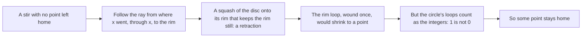

# Brouwer and Borsuk-Ulam: a disc map fixes a point, and antipodes give equal readings

[Syllabus](../../../SYLLABUS.md) → [Topology](../README.md) → [Homotopy](../README.md#s04) → Brouwer and Borsuk-Ulam

---

## General Overview

Stir a cup of coffee, then lift the spoon out. The surface is a disc 4 cm in radius, and every bit of it has been swept round and pushed sideways. Has every bit moved?

No. As long as the coffee stays in the cup and does not tear, at least one surface point ends exactly where it started. This is **Brouwer's fixed-point theorem**. In its language the stir is a **continuous map**: a rule that sends each point to a new point, with nearby points landing near each other, so nothing tears. A **fixed point** is a point that the map sends to itself.

The check on this card models one stir: the middle turns 1.5 radians, the edge 1.2 radians, then the surface sloshes east. The point that came home is at (0.632911160, 0.690691237) cm, 0.9368 cm from the centre. Repeating the stir from the centre does not home in on it: after 200 presses the reading is still 0.8841 cm away. Unlike the contraction rule of [Fixed points](../../06-Calculus%20and%20analysis/03-What%20Derivatives%20Tell%20You/07-fixed-point-iteration-and-the-contraction-principle.md), Brouwer proves the point exists but gives no route to it.

The second theorem, **Borsuk-Ulam**, is about opposite points. Round the rim of the cup, some two opposite points have the same temperature. On the Earth, at any moment, some two opposite points share both temperature and air pressure. Its best-known consequence: one straight cut can halve a slice of toast and a slice of cheese at once.

**A continuous map of a closed disc into itself leaves some point where it was, because otherwise the disc could be squashed onto its rim without moving the rim, and a loop wound once round the rim cannot be unwound; the same loop count shows that any two continuous readings on a sphere agree at some pair of opposite points.**

**What kind of fact this is:** two theorems. Brouwer in the plane is proved on this card in Why it works, from the circle's loop group. Borsuk-Ulam is proved here for the circle and the ordinary sphere; for higher dimensions it is stated, with its source.

### The picture: the proof as a chain



The middle box is the key object. The last two boxes are the loop count from [The circle's fundamental group is the integers](04-fundamental-group-of-the-circle.md).

---

## The formula

Notation first, in words. $`D^n`$ is the closed **disc** of dimension $`n`$: all points within distance 1 of the centre, edge included. $`D^2`$ is the coffee's surface; its radius, 4 cm, does not matter to topology. $`S^{n-1}`$ is its edge, the **sphere** of dimension $`n - 1`$: $`S^1`$ is the rim circle, $`S^2`$ the surface of a ball such as the Earth.

```math
f : D^n \to D^n \ \text{continuous} \quad \Longrightarrow \quad f(x^*) = x^* \ \text{for some } x^* \in D^n
```

**Read it aloud:** every continuous map of a closed disc into itself has a fixed point. For the stir, $`x^* = (0.632911160, 0.690691237)`$ cm.

A **retraction** of the disc onto its rim is a continuous map $`r : D^2 \to S^1`$ with $`r(x) = x`$ for every rim point $`x`$. It squashes the whole disc onto the rim and keeps the rim still.

```math
\text{there is no retraction } r : D^2 \to S^1
```

**Read it aloud:** the disc cannot be squashed onto its rim, continuously, without moving some rim point.

The **antipode** of a point $`x`$ on a sphere is $`-x`$, the point straight through the centre.

```math
g : S^n \to \mathbb{R}^n \ \text{continuous} \quad \Longrightarrow \quad g(x) = g(-x) \ \text{for some } x \in S^n
```

**Read it aloud:** any $`n`$ continuous readings on an $`n`$-sphere agree, all at once, at some pair of opposite points. For the rim, $`n = 1`$, one reading, temperature: equal at 78.228958° and its opposite, both 68.624850 °C.

| Symbol | Plain meaning | In our example | Push it up and the answer… |
| --- | --- | --- | --- |
| $`D^n`$, $`D^2`$ | closed disc of dimension $`n`$, edge included | the coffee's surface, radius 4 cm | more dimensions: still a fixed point |
| $`S^{n-1}`$, $`S^1`$, $`S^2`$ | the disc's edge; the circle; the ball's surface | the rim; the Earth | — |
| $`f`$ | a continuous map of the disc into itself | one stir: twist 1.5 to 1.2 rad, slosh 0.3 | stronger slosh: the point moves out |
| $`x^*`$ | a fixed point: $`f(x^*) = x^*`$ | (0.632911160, 0.690691237) cm | — |
| $`r`$ | a retraction: disc onto rim, rim kept still | none exists on the disc | — |
| $`-x`$ | the antipode: the opposite point | rim angle plus 180° | — |
| $`g`$ | $`n`$ continuous readings on $`S^n`$ | rim temperature; Earth's temperature and pressure | more readings than $`n`$: can fail |
| $`\pi_1(X, x_0)`$, $`f_*`$ | the loop group at $`x_0`$; what a map does to loops | $`\pi_1(S^1) \cong \mathbb{Z}`$, $`\pi_1(D^2) = 0`$ | — |
| $`w`$ | winding number: net turns of an arrow round a loop | 1 for the displacement on the rim | a zero inside changes it |
| $`i`$, $`\mathrm{id}`$ | the inclusion of the rim in the disc; the map that leaves every point alone | each rim point, seen as a point of the coffee | — |
| $`d`$ | the difference $`g(x) - g(-x)`$, an odd map: $`d(-x) = -d(x)`$ | rim: $`8\cos\phi + 2\sin 3\phi`$ at rim angle $`\phi`$ | zero exactly at an opposite pair that reads the same |
| $`h(\theta)`$ | cheese on one side of the cut that halves the toast, minus half the cheese | 0 at the cut found | flips sign when $`\theta`$ gains 180° |

The loop group $`\pi_1`$ and the induced map $`f_*`$ come from [The fundamental group](03-the-fundamental-group.md): $`f_*`$ sends the class of a loop $`\gamma`$ to the class of $`f \circ \gamma`$.

### When it holds

- **Continuous: nothing tears.** Pouring the coffee into another cup so that each point lands at the rim point opposite it tears at the centre. Every point moves at least 4 cm.
- **Closed: the rim is included.** On the open disc, halving the distance to the east wall drifts toward the wall forever, never reaching it.
- **No hole.** Coffee in a ring-shaped dish round a central pillar, turned 30°, has no fixed point.
- **Into itself.** A spill that shifts everything 1 cm east has no fixed point: points near the wall leave the cup.
- **Borsuk-Ulam: $`n`$ readings on $`S^n`$, not more.** Three readings on $`S^2`$, such as the position $`g(p) = p`$, disagree at every opposite pair.

---

## Why it works

### Step 0: the idea

Suppose a stir moved every point. At each point, draw the ray from where the point went, through where it started, and follow it out to the rim. This sends the whole disc to the rim, continuously, and leaves rim points alone: a retraction. So it is enough to show that no retraction exists, and loops show that.

### Step 1: the two loop groups

From [The circle's fundamental group is the integers](04-fundamental-group-of-the-circle.md): loops in the rim circle $`S^1`$, up to sliding, are counted by their winding number, and $`\pi_1(S^1) \cong \mathbb{Z}`$. The rim loop, once round, is the class $`1`$.

From [Contractible and simply connected](02-contractible-and-simply-connected.md): the disc $`D^2`$ can be squashed to its centre, so every loop in it shrinks to a point, and $`\pi_1(D^2) = 0`$.

In the shelf's house example: a dog's lead wound once round a lamp post cannot slide free, count 1; on a lawn with no post every lead slides free, count 0.

### Step 2: no retraction

Let $`i : S^1 \to D^2`$ be the inclusion: each rim point, seen as a point of the disc. A retraction $`r`$ would satisfy $`r \circ i = \mathrm{id}`$, the identity on the rim. Apply $`\pi_1`$, which turns maps into group maps and keeps composition:

```math
\mathbb{Z} \xrightarrow{\ i_*\ } 0 \xrightarrow{\ r_*\ } \mathbb{Z}, \qquad r_* \circ i_* = \mathrm{id}_{\mathbb{Z}}
```

**Read it aloud:** the rim's loops go into the disc, where they all become trivial, and then come back to the rim; the round trip should give every loop back unchanged.

It cannot. Anything that passes through the trivial group $`0`$ comes out as $`0`$, but the identity sends $`1`$ to $`1`$. The retraction would slide a once-wound lead free. So no retraction exists.

### Step 3: Brouwer from no retraction

Let $`f : D^2 \to D^2`$ be continuous and suppose $`f(x) \ne x`$ for every $`x`$. Define $`r(x)`$ as the point where the ray from $`f(x)`$ through $`x`$ meets the rim. Then:

1. $`r(x)`$ lies on the rim, by construction.
2. If $`x`$ is already on the rim, the ray leaves the disc at $`x`$ itself, so $`r(x) = x`$.
3. $`r`$ is continuous. The ray's direction $`x - f(x)`$ is never zero, and the crossing point has a formula built from continuous pieces, with a square root of a number that is never negative.

So $`r`$ is a retraction, which Step 2 forbids. The supposition fails: some $`x^*`$ has $`f(x^*) = x^*`$.

<details>
<summary>Detailed proof: the formula for the ray's crossing point, and why it is continuous</summary>

Let the disc have radius $`R`$. For each $`x`$ let $`u`$ be the unit vector in the direction $`x - f(x)`$, which is not zero by assumption:

$`\displaystyle u = \frac{x - f(x)}{|x - f(x)|}`$

The ray is $`x + t\,u`$ for $`t \ge 0`$. It meets the rim where $`|x + t\,u|^2 = R^2`$, a quadratic in $`t`$:

$`\displaystyle t^2 + 2\,(x \cdot u)\,t + |x|^2 - R^2 = 0`$

Since $`|x| \le R`$, the constant term is at most 0, so the larger root is at least 0:

$`\displaystyle t(x) = -\,x \cdot u + \sqrt{(x \cdot u)^2 + R^2 - |x|^2}`$

Set $`r(x) = x + t(x)\,u`$. Each piece is continuous: $`f`$ by assumption, the division because the denominator is never 0, the square root because its argument is at least 0. If $`|x| = R`$, then the constant term is 0. The roots are $`0`$ and $`-2\,x \cdot u`$. The point $`f(x)`$ is in the disc and $`x`$ is on the rim, so $`x \cdot (x - f(x)) \ge R^2 - R \cdot R = 0`$, and $`x \cdot u \ge 0`$. The larger root is therefore $`t = 0`$, and $`r(x) = x`$.

The check runs this formula on a ring stir turned 30°, which has no fixed point. It is a genuine retraction of the ring onto its outer circle, and no contradiction: the ring's loop group is $`\mathbb{Z}`$, not $`0`$. Step 2 is where the disc's lack of a hole is used.

</details>

### Step 4: the same proof as a count, which the code follows

The **displacement** at $`x`$ is the arrow $`f(x) - x`$, from where a point started to where it went. Walk round a circle centred in the cup and count the net turns of that arrow: its winding number $`w`$.

- **On the rim, $`w = 1`$.** A rim point cannot move outward, or even along the rim's tangent line, without leaving the cup. So unless it stays home, its arrow always leans inward, toward the cup's side of the tangent line. Such an arrow can be slid, never passing through zero, to the arrow $`-x`$ pointing at the centre, which turns once.
- **On a tiny circle round the centre, $`w = 0`$.** The stir moves the centre, so on a tiny circle round the centre the arrow points almost the same way all round and turns 0 times.
- **Shrinking the circle changes $`w`$ only where the arrow vanishes.** Between the rim and the tiny circle, $`w`$ drops from 1 to 0, so some circle passes through a point whose arrow is zero: a fixed point.

For the stir, $`w`$ is 1 on circles of radius 3, 2 and 1 cm, and 0 at 0.9 and 0.5 cm: the fixed point is at 0.9368 cm. The code hunts it the same way, quartering squares and keeping a quarter whose rim still winds.

### Step 5: higher dimensions, and the hairy ball

The proof is the same in every dimension: a fixed-point-free map of $`D^n`$ gives a retraction onto $`S^{n-1}`$. What changes is Step 2. Loops cannot detect the hole inside $`S^2`$, since every loop on a sphere shrinks. The higher no-retraction theorem needs the homology of spheres, which [Homology of spheres, and degree](../05-Homology/07-homology-of-spheres-and-degree.md) computes. For $`n = 1`$, Brouwer is the intermediate value theorem: a continuous map of $`[-1, 1]`$ into itself crosses the line $`y = x`$.

A relative, stated only: the **hairy ball theorem** says every continuous field of arrows tangent to $`S^2`$ is zero somewhere. Its usual proof uses the degree of a map, from the same homology card; the card Hairy ball theorem (planned, in the differential geometry wing) proves it.

### Step 6: Borsuk-Ulam

Write $`d(x) = g(x) - g(-x)`$. Then $`d(-x) = -d(x)`$: $`d`$ is an **odd** map. The theorem says an odd map from $`S^n`$ to $`\mathbb{R}^n`$ is zero somewhere.

- **$`n = 1`$, the rim.** For the rim temperature, $`d(0°) = 8.0`$ and $`d(180°) = -8.0`$. A continuous function that changes sign is zero in between, by the intermediate value theorem. The check finds it at 78.228958°.
- **$`n = 2`$, the Earth.** Round the equator an odd map turns an odd number of times, but a zero-free map on the northern half would make the count 0. The fold has the details.
- **Higher $`n`$.** Stated without proof here; the 1933 paper in the Sources proves it, and the same parity idea works with degree in place of winding number.

<details>
<summary>Detailed proof: Borsuk-Ulam on the ordinary sphere</summary>

Suppose $`d : S^2 \to \mathbb{R}^2`$ is continuous, odd, and never zero. Walk the equator once, from angle $`0`$ to $`2\pi`$, and lift the direction of $`d`$ to a continuous angle $`\phi(s)`$, as on [The circle's fundamental group is the integers](04-fundamental-group-of-the-circle.md).

Since $`d`$ at the opposite equator point is $`-d`$, its direction is turned by half a turn:

$`\displaystyle \phi(s + \pi) = \phi(s) + (2k + 1)\,\pi`$

for some whole number $`k`$, the same for all $`s`$ by continuity. Apply it twice: the total turn over the full equator is $`\phi(2\pi) - \phi(0) = 2\,(2k + 1)\,\pi`$, so the winding number is $`2k + 1`$, which is odd.

But the equator is the rim of the northern half of the sphere, which is a disc. On that disc $`d`$ is defined and never zero, so shrinking the equator over the half sphere shrinks the arrow loop without passing through zero. A loop that shrinks to a point has winding number 0, which is even. This contradiction proves the theorem.

</details>

**The sandwich corollary.** In $`\mathbb{R}^n`$, any $`n`$ solid objects can be halved, all at once, by one flat cut. For three objects in space (bread, ham, cheese), the proof uses Borsuk-Ulam on $`S^2`$. On a plate, with two slices, it uses $`n = 1`$:

1. For each direction $`\theta`$, take the straight cut facing that way that halves the toast.
2. Let $`h(\theta)`$ be the cheese on the low side of that cut, minus half the cheese.
3. Turning the direction by 180° gives the same cut with sides swapped, so $`h(\theta + 180°) = -h(\theta)`$.
4. So $`h`$ changes sign on $`[0°, 180°]`$, and is zero somewhere: that cut halves both.

---

## Worked numbers, by hand

The stir, the ring stir, the rim temperature and the sandwich, with the check's numbers.

| Step | Arithmetic | Value |
| --- | --- | --- |
| One press from the centre | the twist leaves the centre still; the slosh moves it east by $`0.3 \times 4`$ cm | (1.2000, 0.0000) |
| Displacement at rim points 0°, 90°, 180°, 270° | heading of each arrow | 110.2°, −154.2°, −38.2°, 39.2° |
| Turn along the rim | 110.2 → 205.8 → 321.8 → 399.2 → 470.2, each step under 180° | 360°: $`w = 1`$ |
| Winding on circles | radii 3, 2, 1, 0.9, 0.5 cm | 1, 1, 1, 0, 0 |
| Fixed point | squares that wind, quartered 40 times; Newton's method agrees | (0.632911160, 0.690691237) cm |
| Ring stir, retraction of (3, 0) | ray from its turned image, through it, to the rim | (3.512688, −1.913379), on the rim: $`3.512688^2 + 1.913379^2 = 4^2`$ |
| Rim temperature $`70 + 4\cos\phi + 1.5\cos 2\phi + \sin 3\phi`$ °C at angle $`\phi`$, so $`d = 8\cos\phi + 2\sin 3\phi`$ | $`d(0°) = 8.0`$, $`d(180°) = -8.0`$, bisection | equal at 78.228958° and opposite: 68.624850 °C |
| Earth, modelled readings | squares that wind on the northern half, quartered; a one-variable bisection agrees | (0.228836256, −0.476115004, 0.849086845) |
| Readings there and opposite | temperature and pressure at $`p`$ and $`-p`$ | −3.023712 °C, 1012.028491 hPa, both |
| **Sandwich cut** | **bisect on direction until $`h(\theta) = 0`$** | **$`-0.032947773\,x + 0.999457075\,y = 4.832546507`$: toast 50.000000 of 100.0 cm², cheese 17.000000 of 34.0 cm²** |

The cut runs almost level, through the toast's centre (5, 5), as any cut that halves a square must. A grid count every 0.02 cm agrees: 0.5000 of each slice on one side.

### What breaks if you drop a piece

| Mistake | Comes out at | What went wrong |
| --- | --- | --- |
| Pour into another cup: each point to the rim point opposite | every point moves at least 4 cm | not continuous: the map tears at the centre |
| Open disc, $`z \mapsto (z + 4)/2`$ | 0.003906 cm from the wall after 10 presses, never there | not closed: the only candidate is on the missing rim |
| Ring-shaped dish, turned 30° | every point moves at least 1.035276 cm | a hole: the ring's loop group is $`\mathbb{Z}`$, so Step 2 fails |
| Spill, $`z \mapsto z + 1`$ cm | every point moves 1 cm | not into itself: points leave the cup |
| Antipodal map on a sphere of radius 4 cm | every point moves 8 cm | a sphere is not a disc |
| Three readings on $`S^2`$: $`g(p) = p`$ | $`g(p)`$ and $`g(-p)`$ always 2 apart | Borsuk-Ulam needs $`n`$ readings on $`S^n`$ |

---

## Code, from first principles, and it actually runs

The code takes two roads to each answer. The fixed point: quartering squares whose displacement still winds, against Newton's method. Equal opposite readings: bisection against a count of sign changes on the rim, and quartering squares against a one-variable bisection on the modelled Earth. The sandwich cut: bisection on direction, against a grid count. It also builds the proof's retraction for a ring stir, and runs each broken map in the What-breaks table on sample points. Everything is checked on finitely many cases, so it illustrates the theorems and proves nothing.

### Python

```python
# Brouwer and Borsuk-Ulam -- the check behind the card.  Standard library only.
# A stir of a coffee cup of radius 4 cm.  Roads: winding numbers and a hunt by cells, against Newton's
# method and a one-variable bisection; a cut that halves two slices, by bisection against a grid count.
from math import atan2, cos, sin, sqrt, pi, dist, hypot
R, A = 4.0, 0.3  # cup radius in cm; how far the slosh pushes the middle, as a share of R

def stir(x, y):  # twist each ring by 1.5 - 0.3 s^2 radians (s = r/R), then slosh east
    s2 = (x * x + y * y) / (R * R); t = 1.5 - 0.3 * s2
    u, v = (x * cos(t) - y * sin(t)) / R, (x * sin(t) + y * cos(t)) / R
    d = (1 + A * u) * (1 + A * u) + A * v * A * v  # the slosh (u + A) / (1 + A u), u + iv complex
    nu, nv = (u + A) * (1 + A * u) + v * A * v, v * (1 + A * u) - (u + A) * A * v
    return R * nu / d, R * nv / d

def disp(x, y):  # where a point goes minus where it was; outside the cup, use the rim point
    r = sqrt(x * x + y * y)
    if r > R: x, y = x * R / r, y * R / r
    fx, fy = stir(x, y); return fx - x, fy - y

def winding(g, pts):  # net turns of g along a closed path: the lift of card 04, step by step
    tot, (px, py) = 0.0, g(*pts[-1])
    for p in pts:
        qx, qy = g(*p); tot += atan2(px * qy - py * qx, px * qx + py * qy); px, py = qx, qy
    return round(tot / (2 * pi))

def circle(r, n=720): return [(r * cos(2 * pi * k / n), r * sin(2 * pi * k / n)) for k in range(n)]
def square(x0, y0, h, n=32):
    sides = [(x0 + h * k / n, y0) for k in range(n)] + [(x0 + h, y0 + h * k / n) for k in range(n)]
    return sides + [(x0 + h - h * k / n, y0 + h) for k in range(n)] + [(x0, y0 + h - h * k / n) for k in range(n)]

def hunt(g, x0, y0, h, levels=40):  # keep a quarter whose rim still winds; it shrinks onto a zero
    for _ in range(levels):
        h /= 2
        x0, y0 = next((a, b) for a in (x0, x0 + h) for b in (y0, y0 + h) if winding(g, square(a, b, h)) != 0)
    return x0 + h / 2, y0 + h / 2

def newton(g, x, y, steps=30, e=1e-6):
    for _ in range(steps):
        gx, gy = g(x, y); ax, ay = g(x + e, y); bx, by = g(x, y + e)
        a, b, c, d = (ax - gx) / e, (bx - gx) / e, (ay - gy) / e, (by - gy) / e; det = a * d - b * c
        x, y = x - (d * gx - b * gy) / det, y - (a * gy - c * gx) / det
    return x, y

def bisect(g, lo, hi):  # halve the bracket 60 times, keeping a sign change of g inside
    for _ in range(60): mid = (lo + hi) / 2; lo, hi = (mid, hi) if g(lo) * g(mid) > 0 else (lo, mid)
    return lo

w_rim = winding(disp, circle(R)); print(f"stir: winding of the displacement round the rim r = 4 cm: {w_rim}")
assert w_rim == 1
dirs = [disp(R * cos(k * pi / 4), R * sin(k * pi / 4)) for k in range(0, 8, 2)]
print("stir: rim points at 0, 90, 180, 270 deg move by", "; ".join(f"({a:.4f}, {b:.4f}), heading {atan2(b, a) * 180 / pi:.1f} deg" for a, b in dirs))
hd = [atan2(b, a) * 180 / pi for a, b in dirs + dirs[:1]]  # the headings round the rim, back to 0 deg
un = [hd[0] + sum((y - x + 180) % 360 - 180 for x, y in zip(hd[:k], hd[1:k + 1])) for k in range(5)]  # each step the short way
print("stir: headings unwrapped:", " -> ".join(f"{u:.1f}" for u in un), f"deg; total turn {un[4] - un[0]:.1f} deg")
print("stir: winding round circles r = 3, 2, 1, 0.9, 0.5 cm:", [winding(disp, circle(r)) for r in (3, 2, 1, 0.9, 0.5)])
cells = sum(winding(disp, square(-4 + i, -4 + j, 1)) != 0 for i in range(8) for j in range(8))
print(f"stir: 1 cm cells whose rim winds: {cells} of 64 (checked on 64 cells; proves nothing about pairs)")
px, py = hunt(disp, -4.0, -4.0, 8.0); nx, ny = newton(disp, 0.0, 0.0)
print(f"fixed point by cell hunt: ({px:.9f}, {py:.9f}) cm; by Newton from the centre: ({nx:.9f}, {ny:.9f}) cm")
fx, fy = stir(px, py); moved = sqrt((fx - px) ** 2 + (fy - py) ** 2)
print(f"it lands at ({fx:.9f}, {fy:.9f}); moved under 1e-9 cm: {moved < 1e-9}; {sqrt(px*px+py*py):.4f} cm from the centre")
assert abs(px - nx) < 1e-8 and abs(py - ny) < 1e-8 and moved < 1e-9 and abs(un[4] - un[0] - 360 * w_rim) < 1e-9
x, y, near = 0.0, 0.0, []
for n in range(1, 201):
    x, y = stir(x, y); near.append(sqrt((x - px) ** 2 + (y - py) ** 2))
    if n in (1, 2, 3, 10, 100, 200): print(f"press {n:3}: at ({x:.4f}, {y:.4f}), {near[-1]:.4f} cm from the fixed point")
print(f"presses 101 to 200: closest {min(near[100:]):.4f} cm -- pressing does not find the point")
assert min(near[100:]) > 0.1
# the proof's retraction, built from a ring stir with no fixed point: rotate a ring 2 <= r <= 4 by 30 degrees
rot = lambda x, y: (x * cos(pi / 6) - y * sin(pi / 6), x * sin(pi / 6) + y * cos(pi / 6))
def retract(x, y, f):  # follow the ray from f(x) through x out to the rim
    fx, fy = f(x, y); ux, uy = x - fx, y - fy; L = sqrt(ux * ux + uy * uy); ux, uy = ux / L, uy / L
    b = x * ux + y * uy; t = -b + sqrt(b * b + R * R - x * x - y * y); return x + t * ux, y + t * uy
ring_min = min(sqrt((rot(x, y)[0] - x) ** 2 + (rot(x, y)[1] - y) ** 2) for x, y in circle(2) + circle(3) + circle(4))
print(f"ring stir: smallest move {ring_min:.6f} cm = 2 x 2 x sin 15 deg = {4 * sin(pi / 12):.6f}; no fixed point")
rim_err = max(abs(a - x) + abs(b - y) for x, y in circle(R) for a, b in [retract(x, y, rot)])
print(f"ring stir: retraction fixes the rim to 1e-9 cm: {rim_err < 1e-9}; (3, 0) goes to "
      f"({retract(3, 0, rot)[0]:.6f}, {retract(3, 0, rot)[1]:.6f}) on the rim")
least = lambda f, pts: min(dist(p, f(*p)) for p in pts)  # what breaks: the smallest move of a map over sample points
cup, neg, z = circle(1e-9) + circle(R), lambda *p: tuple(-c for c in p), 0.0  # cup points, from almost the centre
ball = lambda r: [(r * sin(a) * cos(b), r * sin(a) * sin(b), r * cos(a)) for a in (0.5, 1.5, 2.5) for b in range(6)]
for _ in range(10): z = (z + 4) / 2  # the open cup, pressed 10 times from the centre
pour = least(lambda x, y: (-R * x / hypot(x, y), -R * y / hypot(x, y)), cup)
print(f"breaks: open cup, z -> (z + 4)/2: after 10 presses {R - z:.6f} cm from the wall, never there")
print(f"breaks: pour into another cup, z -> rim point opposite: every point moves at least {pour:.0f} cm")
print(f"breaks: spill, z -> z + 1 cm: every point moves {least(lambda x, y: (x + 1, y), cup):.0f} cm; the map leaves the cup")
print(f"breaks: sphere, p -> -p on a sphere of radius 4 cm: every point moves {least(neg, ball(R)):.0f} cm")
print(f"breaks: Borsuk-Ulam with 3 readings, g(p) = p on the unit sphere: g(p) and g(-p) always {least(neg, ball(1)):.0f} apart")
assert rim_err < 1e-9 and abs(ring_min - 4 * sin(pi / 12)) < 1e-12 and abs(R - z - R / 2 ** 10) < 1e-12
T = lambda p: 70 + 4 * cos(p) + 1.5 * cos(2 * p) + sin(3 * p)  # Borsuk-Ulam, n = 1: rim temperature, deg C, modelled
g1 = lambda p: T(p) - T(p + pi)  # = 8 cos p + 2 sin 3p
lo = bisect(g1, 0.0, pi)
flips = sum(g1(pi * k / 3600) * g1(pi * (k + 1) / 3600) < 0 for k in range(3600))
print(f"rim: g(0) = {g1(0):.1f}, g(180 deg) = {g1(pi):.1f}; equal readings at {lo * 180 / pi:.6f} deg and opposite, "
      f"{T(lo):.6f} and {T(lo + pi):.6f} deg C; sign changes on half the rim: {flips}")
assert flips % 2 == 1 and abs(T(lo) - T(lo + pi)) < 1e-9
Tp = lambda x, y, z: 15 - 25 * z * z + 6 * x + 4 * y * z * z  # Borsuk-Ulam, n = 2: modelled deg C on a unit Earth
Pp = lambda x, y, z: 1013 + 9 * y - 5 * x * z + 7 * z * z * z  # and modelled hPa
def g2(x, y):  # north half of the sphere seen from above; outside the disc, use the equator
    r = sqrt(x * x + y * y)
    if r > 1: x, y = x / r, y / r
    z = sqrt(max(0.0, 1 - x * x - y * y))
    return Tp(x, y, z) - Tp(-x, -y, -z), Pp(x, y, z) - Pp(-x, -y, -z)
w_eq = winding(g2, circle(1)); print(f"earth: winding of the antipodal difference round the equator: {w_eq} (odd)")
ex, ey = hunt(g2, -1.0, -1.0, 2.0); ez = sqrt(1 - ex * ex - ey * ey)
def sumsq(z): x, y = 14 * z * z * z * z * z / 27, -7 * z * z * z / 9; return x * x + y * y + z * z
lo = bisect(lambda z: sumsq(z) - 1, 0.0, 1.0)  # by hand: zero needs y = -7z^3/9, x = 14z^5/27; solve sumsq(z) = 1
print(f"earth: point by cell hunt ({ex:.9f}, {ey:.9f}, {ez:.9f}); z by bisection {lo:.9f}")
print(f"earth: there {Tp(ex, ey, ez):.6f} deg C, {Pp(ex, ey, ez):.6f} hPa; opposite {Tp(-ex, -ey, -ez):.6f} deg C, {Pp(-ex, -ey, -ez):.6f} hPa")
assert w_eq % 2 == 1 and abs(ez - lo) < 1e-8 and abs(ex - 14 * lo * lo * lo * lo * lo / 27) < 1e-8
# the sandwich in the plane: one straight cut halves a square of toast and a triangle of cheese (cm)
toast, cheese = [(0, 0), (10, 0), (10, 10), (0, 10)], [(13, 2), (21, 4), (15, 11)]
def area(P): return sum(P[i][0] * P[i - 1][1] - P[i - 1][0] * P[i][1] for i in range(len(P))) / -2
def left(P, nx, ny, c):  # area of P where nx x + ny y <= c: clip the polygon, then shoelace
    out = []
    for i in range(len(P)):
        (ax, ay), (bx, by) = P[i - 1], P[i]; sa, sb = nx * ax + ny * ay - c, nx * bx + ny * by - c
        if sa * sb < 0: out.append((ax + sa / (sa - sb) * (bx - ax), ay + sa / (sa - sb) * (by - ay)))
        if sb <= 0: out.append((bx, by))
    return area(out) if len(out) > 2 else 0.0
def halve(P, nx, ny, lo=-40.0, hi=40.0):
    for _ in range(80):
        mid = (lo + hi) / 2; lo, hi = (mid, hi) if left(P, nx, ny, mid) < area(P) / 2 else (lo, mid)
    return lo
def h(th): return left(cheese, cos(th), sin(th), halve(toast, cos(th), sin(th))) - area(cheese) / 2
lo = bisect(h, 0.0, pi)
nx, ny = cos(lo), sin(lo); c = halve(toast, nx, ny)
print(f"sandwich: areas toast {area(toast):.1f}, cheese {area(cheese):.1f} cm2; h(0) = {h(0):.6f}, h(180 deg) = {h(pi):.6f}")
print(f"sandwich: cut {nx:.9f} x + {ny:.9f} y = {c:.9f}; halves {left(toast, nx, ny, c):.6f} and {left(cheese, nx, ny, c):.6f} cm2")
def share(P, step=0.02):  # independent road: count grid points inside P and on the cut's left
    xs, ys = [p[0] for p in P], [p[1] for p in P]; n = k = 0
    for i in range(int(min(xs) / step), int(max(xs) / step) + 1):
        for j in range(int(min(ys) / step), int(max(ys) / step) + 1):
            x, y = (i + 0.5) * step, (j + 0.5) * step
            if all((b[0] - a[0]) * (y - a[1]) - (b[1] - a[1]) * (x - a[0]) >= 0 for a, b in zip(P, P[1:] + P[:1])):
                n += 1; k += nx * x + ny * y <= c
    return k / n
st, sc = share(toast), share(cheese)
print(f"sandwich: grid count, 0.02 cm spacing: toast {st:.4f}, cheese {sc:.4f} on one side; cut misses the toast's centre by under 1e-9: {abs(5 * nx + 5 * ny - c) < 1e-9}")
assert abs(st - 0.5) < 0.002 and abs(sc - 0.5) < 0.002 and abs(5 * nx + 5 * ny - c) < 1e-9
print("ALL CHECKS PASS")
```

**Ran 2026-11-15 on macOS, Python 3.14.10, standard library only. All checks passed. Output, pasted from the run:**

```
stir: winding of the displacement round the rim r = 4 cm: 1
stir: rim points at 0, 90, 180, 270 deg move by (-0.9559, 2.5949), heading 110.2 deg; (-3.1344, -1.5150), heading -154.2 deg; (4.9399, -3.8880), heading -38.2 deg; (3.9192, 3.2002), heading 39.2 deg
stir: headings unwrapped: 110.2 -> 205.8 -> 321.8 -> 399.2 -> 470.2 deg; total turn 360.0 deg
stir: winding round circles r = 3, 2, 1, 0.9, 0.5 cm: [1, 1, 1, 0, 0]
stir: 1 cm cells whose rim winds: 1 of 64 (checked on 64 cells; proves nothing about pairs)
fixed point by cell hunt: (0.632911160, 0.690691237) cm; by Newton from the centre: (0.632911160, 0.690691237) cm
it lands at (0.632911160, 0.690691237); moved under 1e-9 cm: True; 0.9368 cm from the centre
press   1: at (1.2000, 0.0000), 0.8937 cm from the fixed point
press   2: at (1.3998, 1.0596), 0.8510 cm from the fixed point
press   3: at (0.5430, 1.5642), 0.8782 cm from the fixed point
press  10: at (0.7823, -0.2180), 0.9209 cm from the fixed point
press 100: at (1.4869, 0.6107), 0.8577 cm from the fixed point
press 200: at (0.3692, 1.5346), 0.8841 cm from the fixed point
presses 101 to 200: closest 0.8509 cm -- pressing does not find the point
ring stir: smallest move 1.035276 cm = 2 x 2 x sin 15 deg = 1.035276; no fixed point
ring stir: retraction fixes the rim to 1e-9 cm: True; (3, 0) goes to (3.512688, -1.913379) on the rim
breaks: open cup, z -> (z + 4)/2: after 10 presses 0.003906 cm from the wall, never there
breaks: pour into another cup, z -> rim point opposite: every point moves at least 4 cm
breaks: spill, z -> z + 1 cm: every point moves 1 cm; the map leaves the cup
breaks: sphere, p -> -p on a sphere of radius 4 cm: every point moves 8 cm
breaks: Borsuk-Ulam with 3 readings, g(p) = p on the unit sphere: g(p) and g(-p) always 2 apart
rim: g(0) = 8.0, g(180 deg) = -8.0; equal readings at 78.228958 deg and opposite, 68.624850 and 68.624850 deg C; sign changes on half the rim: 1
earth: winding of the antipodal difference round the equator: 1 (odd)
earth: point by cell hunt (0.228836256, -0.476115004, 0.849086845); z by bisection 0.849086845
earth: there -3.023712 deg C, 1012.028491 hPa; opposite -3.023712 deg C, 1012.028491 hPa
sandwich: areas toast 100.0, cheese 34.0 cm2; h(0) = -17.000000, h(180 deg) = 17.000000
sandwich: cut -0.032947773 x + 0.999457075 y = 4.832546507; halves 50.000000 and 17.000000 cm2
sandwich: grid count, 0.02 cm spacing: toast 0.5000, cheese 0.5000 on one side; cut misses the toast's centre by under 1e-9: True
ALL CHECKS PASS
```

### Rust

```rust
// Brouwer and Borsuk-Ulam -- the check behind the card.  Standard library only.
// A stir of a coffee cup of radius 4 cm.  Roads: winding numbers and a hunt by cells, against Newton's
// method and a one-variable bisection; a cut that halves two slices, by bisection against a grid count.
use std::f64::consts::PI;
const R: f64 = 4.0; const A: f64 = 0.3; // cup radius in cm; how far the slosh pushes the middle, as a share of R
type P = (f64, f64);

fn stir(x: f64, y: f64) -> P { // twist each ring by 1.5 - 0.3 s^2 radians (s = r/R), then slosh east
    let t = 1.5 - 0.3 * ((x * x + y * y) / (R * R));
    let (u, v) = ((x * t.cos() - y * t.sin()) / R, (x * t.sin() + y * t.cos()) / R);
    let d = (1.0 + A * u) * (1.0 + A * u) + A * v * A * v;
    let (nu, nv) = ((u + A) * (1.0 + A * u) + v * A * v, v * (1.0 + A * u) - (u + A) * A * v);
    (R * nu / d, R * nv / d)
}
fn disp(x: f64, y: f64) -> P { // where a point goes minus where it was; outside the cup, use the rim point
    let r = (x * x + y * y).sqrt(); let (x, y) = if r > R { (x * R / r, y * R / r) } else { (x, y) };
    let (fx, fy) = stir(x, y); (fx - x, fy - y)
}
fn winding(g: &dyn Fn(f64, f64) -> P, pts: &[P]) -> i64 { // the lift of card 04, step by step
    let (mut tot, last) = (0.0, pts[pts.len() - 1]); let (mut px, mut py) = g(last.0, last.1);
    for p in pts {
        let (qx, qy) = g(p.0, p.1);
        tot += (px * qy - py * qx).atan2(px * qx + py * qy); px = qx; py = qy;
    }
    (tot / (2.0 * PI)).round() as i64
}
fn circle(r: f64) -> Vec<P> { (0..720).map(|k| { let a = 2.0 * PI * k as f64 / 720.0; (r * a.cos(), r * a.sin()) }).collect() }
fn square(x0: f64, y0: f64, h: f64) -> Vec<P> {
    let n = 32; let f = |k: i32| h * k as f64 / n as f64; let mut s = vec![];
    for k in 0..n { s.push((x0 + f(k), y0)); } for k in 0..n { s.push((x0 + h, y0 + f(k))); }
    for k in 0..n { s.push((x0 + h - f(k), y0 + h)); } for k in 0..n { s.push((x0, y0 + h - f(k))); } s
}
fn hunt(g: &dyn Fn(f64, f64) -> P, mut x0: f64, mut y0: f64, mut h: f64) -> P {
    for _ in 0..40 { // keep a quarter whose rim still winds; it shrinks onto a zero
        h /= 2.0;
        let c = [(x0, y0), (x0, y0 + h), (x0 + h, y0), (x0 + h, y0 + h)];
        let k = c.iter().position(|&(a, b)| winding(g, &square(a, b, h)) != 0).unwrap();
        x0 = c[k].0; y0 = c[k].1;
    }
    (x0 + h / 2.0, y0 + h / 2.0)
}
fn newton(g: &dyn Fn(f64, f64) -> P, mut x: f64, mut y: f64) -> P {
    let e = 1e-6; for _ in 0..30 {
        let ((gx, gy), (ax, ay), (bx, by)) = (g(x, y), g(x + e, y), g(x, y + e));
        let (a, b, c, d) = ((ax - gx) / e, (bx - gx) / e, (ay - gy) / e, (by - gy) / e); let det = a * d - b * c;
        let nx = x - (d * gx - b * gy) / det; y -= (a * gy - c * gx) / det; x = nx;
    }
    (x, y)
}
fn py(b: bool) -> &'static str { if b { "True" } else { "False" } }
fn least<T>(pts: &[T], moved: impl Fn(&T) -> f64) -> f64 { pts.iter().map(moved).fold(f64::INFINITY, f64::min) } // smallest move
fn area(p: &[P]) -> f64 {
    let n = p.len(); (0..n).map(|i| { let j = (i + n - 1) % n; p[i].0 * p[j].1 - p[j].0 * p[i].1 }).sum::<f64>() / -2.0
}
fn left(p: &[P], nx: f64, ny: f64, c: f64) -> f64 { // area where nx x + ny y <= c: clip, then shoelace
    let n = p.len(); let mut out = vec![];
    for i in 0..n {
        let ((ax, ay), (bx, by)) = (p[(i + n - 1) % n], p[i]);
        let (sa, sb) = (nx * ax + ny * ay - c, nx * bx + ny * by - c);
        if sa * sb < 0.0 { out.push((ax + sa / (sa - sb) * (bx - ax), ay + sa / (sa - sb) * (by - ay))); }
        if sb <= 0.0 { out.push((bx, by)); }
    }
    if out.len() > 2 { area(&out) } else { 0.0 }
}
fn halve(p: &[P], nx: f64, ny: f64) -> f64 {
    let (mut lo, mut hi) = (-40.0, 40.0);
    for _ in 0..80 { let mid = (lo + hi) / 2.0; if left(p, nx, ny, mid) < area(p) / 2.0 { lo = mid } else { hi = mid } }
    lo
}
fn bisect(g: &dyn Fn(f64) -> f64, mut lo: f64, mut hi: f64) -> f64 {
    for _ in 0..60 { let mid = (lo + hi) / 2.0; if g(lo) * g(mid) > 0.0 { lo = mid } else { hi = mid } }
    lo
}
fn main() {
    let w_rim = winding(&disp, &circle(R)); println!("stir: winding of the displacement round the rim r = 4 cm: {}", w_rim);
    assert!(w_rim == 1);
    let dv: Vec<P> = (0..4).map(|k| { let a = (2 * k) as f64 * PI / 4.0; disp(R * a.cos(), R * a.sin()) }).collect();
    let dirs: Vec<String> = dv.iter().map(|&(dx, dy)| format!("({:.4}, {:.4}), heading {:.1} deg", dx, dy, dy.atan2(dx) * 180.0 / PI)).collect();
    println!("stir: rim points at 0, 90, 180, 270 deg move by {}", dirs.join("; "));
    let hd: Vec<f64> = (0..5).map(|k| dv[k % 4].1.atan2(dv[k % 4].0) * 180.0 / PI).collect(); // the headings round the rim, back to 0 deg
    let un: Vec<f64> = (0..5).map(|k| hd[0] + (0..k).map(|j| (hd[j + 1] - hd[j] + 180.0).rem_euclid(360.0) - 180.0).sum::<f64>()).collect();
    println!("stir: headings unwrapped: {} deg; total turn {:.1} deg", un.iter().map(|u| format!("{:.1}", u)).collect::<Vec<_>>().join(" -> "), un[4] - un[0]);
    let ws: Vec<String> = [3.0, 2.0, 1.0, 0.9, 0.5].iter().map(|&r| winding(&disp, &circle(r)).to_string()).collect();
    println!("stir: winding round circles r = 3, 2, 1, 0.9, 0.5 cm: [{}]", ws.join(", "));
    let mut cells = 0;
    for i in 0..8 { for j in 0..8 { if winding(&disp, &square(-4.0 + i as f64, -4.0 + j as f64, 1.0)) != 0 { cells += 1; } } }
    println!("stir: 1 cm cells whose rim winds: {} of 64 (checked on 64 cells; proves nothing about pairs)", cells);
    let (px, py_) = hunt(&disp, -4.0, -4.0, 8.0); let (nx, ny) = newton(&disp, 0.0, 0.0);
    println!("fixed point by cell hunt: ({:.9}, {:.9}) cm; by Newton from the centre: ({:.9}, {:.9}) cm", px, py_, nx, ny);
    let (fx, fy) = stir(px, py_); let moved = ((fx - px).powi(2) + (fy - py_).powi(2)).sqrt();
    println!("it lands at ({:.9}, {:.9}); moved under 1e-9 cm: {}; {:.4} cm from the centre", fx, fy, py(moved < 1e-9), (px * px + py_ * py_).sqrt());
    assert!((px - nx).abs() < 1e-8 && (py_ - ny).abs() < 1e-8 && moved < 1e-9 && (un[4] - un[0] - 360.0 * w_rim as f64).abs() < 1e-9);
    let (mut x, mut y, mut near) = (0.0, 0.0, vec![]);
    for n in 1..=200 {
        let s = stir(x, y); x = s.0; y = s.1; near.push(((x - px).powi(2) + (y - py_).powi(2)).sqrt());
        if [1, 2, 3, 10, 100, 200].contains(&n) { println!("press {:3}: at ({:.4}, {:.4}), {:.4} cm from the fixed point", n, x, y, near[n - 1]); }
    }
    let closest = near[100..].iter().cloned().fold(f64::INFINITY, f64::min);
    println!("presses 101 to 200: closest {:.4} cm -- pressing does not find the point", closest);
    assert!(closest > 0.1);
    // the proof's retraction, built from a ring stir with no fixed point: rotate a ring 2 <= r <= 4 by 30 degrees
    let rot = |x: f64, y: f64| -> P { (x * (PI / 6.0).cos() - y * (PI / 6.0).sin(), x * (PI / 6.0).sin() + y * (PI / 6.0).cos()) };
    let retract = |x: f64, y: f64| -> P { // follow the ray from f(x) through x out to the rim
        let (fx, fy) = rot(x, y); let (ux, uy) = (x - fx, y - fy); let l = (ux * ux + uy * uy).sqrt(); let (ux, uy) = (ux / l, uy / l);
        let b = x * ux + y * uy; let t = -b + (b * b + R * R - x * x - y * y).sqrt(); (x + t * ux, y + t * uy)
    };
    let mut ring_min = f64::INFINITY;
    for r in [2.0, 3.0, 4.0] { for (x, y) in circle(r) { let q = rot(x, y); ring_min = ring_min.min(((q.0 - x).powi(2) + (q.1 - y).powi(2)).sqrt()); } }
    println!("ring stir: smallest move {:.6} cm = 2 x 2 x sin 15 deg = {:.6}; no fixed point", ring_min, 4.0 * (PI / 12.0).sin());
    let rim_err = circle(R).iter().map(|&(x, y)| { let q = retract(x, y); (q.0 - x).abs() + (q.1 - y).abs() }).fold(0.0, f64::max);
    let q = retract(3.0, 0.0);
    println!("ring stir: retraction fixes the rim to 1e-9 cm: {}; (3, 0) goes to ({:.6}, {:.6}) on the rim", py(rim_err < 1e-9), q.0, q.1);
    let cup: Vec<P> = [circle(1e-9), circle(R)].concat(); // what breaks: cup points, from almost the centre
    let ball = |r: f64| -> Vec<[f64; 3]> { (0..18).map(|k| { let (a, b) = (0.5 + (k / 6) as f64, (k % 6) as f64);
        [r * a.sin() * b.cos(), r * a.sin() * b.sin(), r * a.cos()] }).collect() };
    let apart = |p: &[f64; 3]| p.iter().map(|c| (c - -c) * (c - -c)).sum::<f64>().sqrt(); // p against its antipode -p
    let mut z = 0.0; for _ in 0..10 { z = (z + 4.0) / 2.0; } // the open cup, pressed 10 times from the centre
    let pour = least(&cup, |&(x, y)| { let l = x.hypot(y); (x + R * x / l).hypot(y + R * y / l) });
    println!("breaks: open cup, z -> (z + 4)/2: after 10 presses {:.6} cm from the wall, never there", R - z);
    println!("breaks: pour into another cup, z -> rim point opposite: every point moves at least {:.0} cm", pour);
    println!("breaks: spill, z -> z + 1 cm: every point moves {:.0} cm; the map leaves the cup", least(&cup, |&(x, y)| (x + 1.0 - x).hypot(y - y)));
    println!("breaks: sphere, p -> -p on a sphere of radius 4 cm: every point moves {:.0} cm", least(&ball(R), apart));
    println!("breaks: Borsuk-Ulam with 3 readings, g(p) = p on the unit sphere: g(p) and g(-p) always {:.0} apart", least(&ball(1.0), apart));
    assert!(rim_err < 1e-9 && (ring_min - 4.0 * (PI / 12.0).sin()).abs() < 1e-12 && (R - z - R / 1024.0).abs() < 1e-12);
    let t = |p: f64| 70.0 + 4.0 * p.cos() + 1.5 * (2.0 * p).cos() + (3.0 * p).sin(); // Borsuk-Ulam, n = 1: rim deg C, modelled
    let g1 = |p: f64| t(p) - t(p + PI);
    let lo = bisect(&g1, 0.0, PI); let flips = (0..3600).filter(|&k| g1(PI * k as f64 / 3600.0) * g1(PI * (k + 1) as f64 / 3600.0) < 0.0).count();
    println!("rim: g(0) = {:.1}, g(180 deg) = {:.1}; equal readings at {:.6} deg and opposite, {:.6} and {:.6} deg C; sign changes on half the rim: {}",
        g1(0.0), g1(PI), lo * 180.0 / PI, t(lo), t(lo + PI), flips);
    assert!(flips % 2 == 1 && (t(lo) - t(lo + PI)).abs() < 1e-9);
    let tp = |x: f64, y: f64, z: f64| 15.0 - 25.0 * z * z + 6.0 * x + 4.0 * y * z * z; // Borsuk-Ulam, n = 2: modelled deg C
    let pp = |x: f64, y: f64, z: f64| 1013.0 + 9.0 * y - 5.0 * x * z + 7.0 * z * z * z; // and modelled hPa, on a unit Earth
    let g2 = |x: f64, y: f64| -> P {
        let r = (x * x + y * y).sqrt(); let (x, y) = if r > 1.0 { (x / r, y / r) } else { (x, y) };
        let z = (1.0 - x * x - y * y).max(0.0).sqrt();
        (tp(x, y, z) - tp(-x, -y, -z), pp(x, y, z) - pp(-x, -y, -z))
    };
    let w_eq = winding(&g2, &circle(1.0)); println!("earth: winding of the antipodal difference round the equator: {} (odd)", w_eq);
    let (ex, ey) = hunt(&g2, -1.0, -1.0, 2.0); let ez = (1.0 - ex * ex - ey * ey).sqrt();
    let sumsq = |z: f64| { let (x, y) = (14.0 * z * z * z * z * z / 27.0, -7.0 * z * z * z / 9.0); x * x + y * y + z * z };
    let lo = bisect(&|z: f64| sumsq(z) - 1.0, 0.0, 1.0); // by hand: zero needs y = -7z^3/9, x = 14z^5/27; solve sumsq(z) = 1
    println!("earth: point by cell hunt ({:.9}, {:.9}, {:.9}); z by bisection {:.9}", ex, ey, ez, lo);
    println!("earth: there {:.6} deg C, {:.6} hPa; opposite {:.6} deg C, {:.6} hPa", tp(ex, ey, ez), pp(ex, ey, ez), tp(-ex, -ey, -ez), pp(-ex, -ey, -ez));
    assert!(w_eq % 2 == 1 && (ez - lo).abs() < 1e-8 && (ex - 14.0 * lo * lo * lo * lo * lo / 27.0).abs() < 1e-8);
    // the sandwich in the plane: one straight cut halves a square of toast and a triangle of cheese (cm)
    let toast: Vec<P> = vec![(0.0, 0.0), (10.0, 0.0), (10.0, 10.0), (0.0, 10.0)];
    let cheese: Vec<P> = vec![(13.0, 2.0), (21.0, 4.0), (15.0, 11.0)];
    let h = |th: f64| left(&cheese, th.cos(), th.sin(), halve(&toast, th.cos(), th.sin())) - area(&cheese) / 2.0;
    let th = bisect(&h, 0.0, PI); let (nx, ny) = (th.cos(), th.sin()); let c = halve(&toast, nx, ny);
    println!("sandwich: areas toast {:.1}, cheese {:.1} cm2; h(0) = {:.6}, h(180 deg) = {:.6}", area(&toast), area(&cheese), h(0.0), h(PI));
    println!("sandwich: cut {:.9} x + {:.9} y = {:.9}; halves {:.6} and {:.6} cm2", nx, ny, c, left(&toast, nx, ny, c), left(&cheese, nx, ny, c));
    let share = |p: &[P]| -> f64 { // independent road: count grid points inside the slice and on the cut's left
        let step = 0.02; let (mut n, mut k) = (0u64, 0u64);
        let xs = p.iter().map(|q| q.0); let ys = p.iter().map(|q| q.1);
        let (x0, x1) = (xs.clone().fold(f64::INFINITY, f64::min), xs.fold(f64::NEG_INFINITY, f64::max));
        let (y0, y1) = (ys.clone().fold(f64::INFINITY, f64::min), ys.fold(f64::NEG_INFINITY, f64::max));
        for i in (x0 / step) as i64..=(x1 / step) as i64 { for j in (y0 / step) as i64..=(y1 / step) as i64 {
            let (x, y) = ((i as f64 + 0.5) * step, (j as f64 + 0.5) * step);
            if (0..p.len()).all(|m| { let (a, b) = (p[m], p[(m + 1) % p.len()]); (b.0 - a.0) * (y - a.1) - (b.1 - a.1) * (x - a.0) >= 0.0 }) {
                n += 1; if nx * x + ny * y <= c { k += 1; }
            }
        } }
        k as f64 / n as f64
    };
    let (st, sc) = (share(&toast), share(&cheese));
    println!("sandwich: grid count, 0.02 cm spacing: toast {:.4}, cheese {:.4} on one side; cut misses the toast's centre by under 1e-9: {}",
        st, sc, py((5.0 * nx + 5.0 * ny - c).abs() < 1e-9));
    assert!((st - 0.5).abs() < 0.002 && (sc - 0.5).abs() < 0.002 && (5.0 * nx + 5.0 * ny - c).abs() < 1e-9);
    println!("ALL CHECKS PASS");
}
```

**Ran 2026-11-15 on macOS, rustc 1.98.1, no crates. All checks passed. Output, pasted from the run:**

```
stir: winding of the displacement round the rim r = 4 cm: 1
stir: rim points at 0, 90, 180, 270 deg move by (-0.9559, 2.5949), heading 110.2 deg; (-3.1344, -1.5150), heading -154.2 deg; (4.9399, -3.8880), heading -38.2 deg; (3.9192, 3.2002), heading 39.2 deg
stir: headings unwrapped: 110.2 -> 205.8 -> 321.8 -> 399.2 -> 470.2 deg; total turn 360.0 deg
stir: winding round circles r = 3, 2, 1, 0.9, 0.5 cm: [1, 1, 1, 0, 0]
stir: 1 cm cells whose rim winds: 1 of 64 (checked on 64 cells; proves nothing about pairs)
fixed point by cell hunt: (0.632911160, 0.690691237) cm; by Newton from the centre: (0.632911160, 0.690691237) cm
it lands at (0.632911160, 0.690691237); moved under 1e-9 cm: True; 0.9368 cm from the centre
press   1: at (1.2000, 0.0000), 0.8937 cm from the fixed point
press   2: at (1.3998, 1.0596), 0.8510 cm from the fixed point
press   3: at (0.5430, 1.5642), 0.8782 cm from the fixed point
press  10: at (0.7823, -0.2180), 0.9209 cm from the fixed point
press 100: at (1.4869, 0.6107), 0.8577 cm from the fixed point
press 200: at (0.3692, 1.5346), 0.8841 cm from the fixed point
presses 101 to 200: closest 0.8509 cm -- pressing does not find the point
ring stir: smallest move 1.035276 cm = 2 x 2 x sin 15 deg = 1.035276; no fixed point
ring stir: retraction fixes the rim to 1e-9 cm: True; (3, 0) goes to (3.512688, -1.913379) on the rim
breaks: open cup, z -> (z + 4)/2: after 10 presses 0.003906 cm from the wall, never there
breaks: pour into another cup, z -> rim point opposite: every point moves at least 4 cm
breaks: spill, z -> z + 1 cm: every point moves 1 cm; the map leaves the cup
breaks: sphere, p -> -p on a sphere of radius 4 cm: every point moves 8 cm
breaks: Borsuk-Ulam with 3 readings, g(p) = p on the unit sphere: g(p) and g(-p) always 2 apart
rim: g(0) = 8.0, g(180 deg) = -8.0; equal readings at 78.228958 deg and opposite, 68.624850 and 68.624850 deg C; sign changes on half the rim: 1
earth: winding of the antipodal difference round the equator: 1 (odd)
earth: point by cell hunt (0.228836256, -0.476115004, 0.849086845); z by bisection 0.849086845
earth: there -3.023712 deg C, 1012.028491 hPa; opposite -3.023712 deg C, 1012.028491 hPa
sandwich: areas toast 100.0, cheese 34.0 cm2; h(0) = -17.000000, h(180 deg) = 17.000000
sandwich: cut -0.032947773 x + 0.999457075 y = 4.832546507; halves 50.000000 and 17.000000 cm2
sandwich: grid count, 0.02 cm spacing: toast 0.5000, cheese 0.5000 on one side; cut misses the toast's centre by under 1e-9: True
ALL CHECKS PASS
```

### Lean

Lean proves Brouwer and no retraction on $`D^2`$, Borsuk-Ulam on $`S^2`$, and the sandwich's two areas.

- Take a continuous map $`f : D^2 \to D^2`$. Then $`f(x^*) = x^*`$ for some $`x^*`$ in $`D^2`$.
- There is no retraction of the disc onto its rim: no continuous squash of $`D^2`$ onto $`S^1`$ keeps every rim point still.
- Take a continuous map $`g : S^2 \to \mathbb{R}^2`$, two readings on the ordinary sphere. Then $`g(x) = g(-x)`$ for some $`x`$ on $`S^2`$.
- From their corners, the toast has area 100 cm² and the cheese 34 cm².

The rim case, the stir's fixed point, the sandwich cut and the broken maps are left to the Python and Rust checks.

```lean
-- Brouwer and Borsuk-Ulam: every continuous map of the closed disc into itself fixes a point, the disc has no retraction onto its rim, and two continuous readings on the sphere agree at some opposite pair.
import Mathlib.Analysis.InnerProductSpace.PiL2
import Mathlib.Topology.MetricSpace.Pseudo.Defs
import Mathlib.Analysis.Complex.CoveringMap
import Mathlib.Topology.Homotopy.Lifting
import Mathlib.Analysis.SpecialFunctions.Complex.Log

open Metric Set

section helpers
open Complex Real

theorem bb_exp_const (m : ℝ → ℂ) {a b : ℝ} (hab : a ≤ b) (hm : ContinuousOn m (Icc a b))
    (h1 : ∀ t ∈ Icc a b, exp (m t) = 1) : m a = m b := by
  refine isCoveringMap_exp.constOn_of_comp isPreconnected_Icc hm ?_
    (left_mem_Icc.2 hab) (right_mem_Icc.2 hab)
  intro x hx y hy
  exact Subtype.ext (by simp [h1 x hx, h1 y hy])

theorem bb_lift_loop (G : ℂ → ℂ) (hG : ContinuousOn G (closedBall 0 1))
    (hG0 : ∀ z ∈ closedBall (0 : ℂ) 1, G z ≠ 0) :
    ∃ ℓ : ℝ → ℂ, Continuous ℓ ∧
      (∀ t ∈ Icc (0 : ℝ) 1, exp (ℓ t) = G (exp (↑(2 * π * t) * I))) ∧ ℓ 1 = ℓ 0 := by
  let e : unitInterval × unitInterval → ℂ := fun p => ((p.1 : ℝ) : ℂ) * exp (↑(2 * π * (p.2 : ℝ)) * I)
  have he_cont : Continuous e := by fun_prop
  have he_mem : ∀ p, e p ∈ closedBall (0 : ℂ) 1 := by
    intro p
    simp only [e, mem_closedBall_zero_iff, norm_mul, norm_exp_ofReal_mul_I, mul_one,
      Complex.norm_real, Real.norm_eq_abs]
    rw [abs_of_nonneg p.1.2.1]; exact p.1.2.2
  let H : C(unitInterval × unitInterval, {z : ℂ // z ≠ 0}) :=
    ⟨fun p => ⟨G (e p), hG0 _ (he_mem p)⟩,
      (hG.comp_continuous he_cont he_mem).subtype_mk _⟩
  let f : C(unitInterval, ℂ) := ContinuousMap.const _ (log (G 0))
  have H_0 : ∀ a, H (0, a) = (fun z : ℂ ↦ (⟨_, z.exp_ne_zero⟩ : {z : ℂ // z ≠ 0})) (f a) := by
    intro a
    apply Subtype.ext
    simp only [H, f, e, ContinuousMap.coe_mk, ContinuousMap.const_apply, Set.Icc.coe_zero,
      Complex.ofReal_zero, zero_mul]
    rw [exp_log (hG0 0 (by simp))]
  let L := isCoveringMap_exp.liftHomotopy H f H_0
  have hL : ∀ p, exp (L p) = G (e p) := by
    intro p
    have := congrFun (isCoveringMap_exp.liftHomotopy_lifts H f H_0) p
    exact congrArg Subtype.val this
  have hL0 : ∀ a, L (0, a) = log (G 0) := fun a => isCoveringMap_exp.liftHomotopy_zero H f H_0 a
  -- the difference across the seam is constant in s
  have hd : ∀ s : unitInterval, L (s, 1) = L (s, 0) := by
    have hc : Continuous fun s : unitInterval => L (s, 1) - L (s, 0) := by fun_prop
    have h1 : ∀ s : unitInterval, e (s, 1) = e (s, 0) := by
      intro s
      simp only [e, Set.Icc.coe_one, Set.Icc.coe_zero, mul_one, mul_zero, Complex.ofReal_zero,
        zero_mul, Complex.exp_zero]
      rw [show (↑(2 * π) : ℂ) * I = 2 * π * I by push_cast; ring, exp_two_pi_mul_I, mul_one]
    have key := isCoveringMap_exp.const_of_comp hc (fun a a' => by
      apply Subtype.ext
      simp only [Complex.exp_sub, hL]
      rw [h1 a, h1 a', div_self (hG0 _ (he_mem _)), div_self (hG0 _ (he_mem _))])
    intro s
    have := key s 0
    simp only [hL0, sub_self] at this
    exact sub_eq_zero.1 this
  refine ⟨fun t => L (1, projIcc 0 1 zero_le_one t), by fun_prop, ?_, ?_⟩
  · intro t ht
    simp only [projIcc_of_mem _ ht]
    rw [hL]
    simp [e]
  · simp only [projIcc_right, projIcc_left]
    exact hd 1

theorem bb_norm_circle (t : ℝ) : ‖exp (↑(2 * π * t) * I)‖ = 1 := norm_exp_ofReal_mul_I _

theorem bb_no_slit_map (G : ℂ → ℂ) (hG : ContinuousOn G (closedBall 0 1))
    (hG0 : ∀ z ∈ closedBall (0 : ℂ) 1, G z ≠ 0)
    (hslit : ∀ z : ℂ, ‖z‖ = 1 → G z / z ∈ slitPlane) : False := by
  obtain ⟨ℓ, hℓc, hℓ, hℓ1⟩ := bb_lift_loop G hG hG0
  set γ : ℝ → ℂ := fun t => exp (↑(2 * π * t) * I) with hγ
  have hγc : Continuous γ := by fun_prop
  have hγ0 : ∀ t, γ t ≠ 0 := fun t => Complex.exp_ne_zero _
  have hγmem : ∀ t, γ t ∈ closedBall (0 : ℂ) 1 := fun t => by
    rw [mem_closedBall_zero_iff]; exact (bb_norm_circle t).le
  have hℓ' : ∀ t ∈ Icc (0 : ℝ) 1, exp (ℓ t) = G (γ t) := hℓ
  let m : ℝ → ℂ := fun t => ℓ t - ↑(2 * π * t) * I - log (G (γ t) / γ t)
  have hw : ContinuousOn (fun t => G (γ t) / γ t) (Icc 0 1) :=
    ((hG.comp_continuous hγc hγmem).div hγc hγ0).continuousOn
  have hm : ContinuousOn m (Icc 0 1) := by
    refine (hℓc.continuousOn.sub (by fun_prop)).sub (hw.clog fun t _ => hslit _ (bb_norm_circle t))
  have h1 : ∀ t ∈ Icc (0 : ℝ) 1, exp (m t) = 1 := by
    intro t ht
    have hne : G (γ t) / γ t ≠ 0 := div_ne_zero (hG0 _ (hγmem t)) (hγ0 t)
    simp only [m]
    rw [Complex.exp_sub, Complex.exp_sub, hℓ' t ht, exp_log hne]
    exact div_self hne
  have := bb_exp_const m zero_le_one hm h1
  simp only [m, hℓ1, γ] at this
  have e1 : exp (↑(2 * π * (1:ℝ)) * I) = exp (↑(2 * π * (0:ℝ)) * I) := by
    rw [show (↑(2 * π * (1:ℝ)) : ℂ) * I = 2 * π * I by push_cast; ring, exp_two_pi_mul_I]
    simp
  rw [e1] at this
  push_cast at this
  exact two_pi_I_ne_zero (by linear_combination this)

theorem bb_no_odd_map (G : ℂ → ℂ) (hG : ContinuousOn G (closedBall 0 1))
    (hG0 : ∀ z ∈ closedBall (0 : ℂ) 1, G z ≠ 0)
    (hodd : ∀ z : ℂ, ‖z‖ = 1 → G (-z) = - G z) : False := by
  obtain ⟨ℓ, hℓc, hℓ, hℓ1⟩ := bb_lift_loop G hG hG0
  set γ : ℝ → ℂ := fun t => exp (↑(2 * π * t) * I) with hγ
  have hγmem : ∀ t, γ t ∈ closedBall (0 : ℂ) 1 := fun t => by
    rw [mem_closedBall_zero_iff]; exact (bb_norm_circle t).le
  have hℓ' : ∀ t ∈ Icc (0 : ℝ) 1, exp (ℓ t) = G (γ t) := hℓ
  have hhalf : ∀ t, γ (t + 1/2) = - γ t := by
    intro t
    simp only [γ]
    rw [show (↑(2 * π * (t + 1/2)) : ℂ) * I = ↑(2 * π * t) * I + π * I by push_cast; ring,
      Complex.exp_add, exp_pi_mul_I]
    ring
  let m : ℝ → ℂ := fun t => ℓ (t + 1/2) - ℓ t - π * I
  have hm : ContinuousOn m (Icc 0 (1/2)) := by
    refine Continuous.continuousOn ?_
    fun_prop
  have h1 : ∀ t ∈ Icc (0 : ℝ) (1/2), exp (m t) = 1 := by
    intro t ht
    have ht1 : t ∈ Icc (0:ℝ) 1 := ⟨ht.1, by linarith [ht.2]⟩
    have ht2 : t + 1/2 ∈ Icc (0:ℝ) 1 := ⟨by linarith [ht.1], by linarith [ht.2]⟩
    simp only [m]
    rw [Complex.exp_sub, Complex.exp_sub, hℓ' t ht1, hℓ' _ ht2, exp_pi_mul_I, hhalf,
      hodd (γ t) (bb_norm_circle t), neg_div, div_self (hG0 _ (hγmem t))]
    norm_num
  have hconst := bb_exp_const m (by norm_num) hm h1
  obtain ⟨n, hn⟩ := Complex.exp_eq_one_iff.1 (h1 0 ⟨le_refl _, by norm_num⟩)
  simp only [m] at hconst hn
  norm_num at hconst hn
  rw [hℓ1] at hconst
  have key : ((2 * n + 1 : ℤ) : ℂ) * (2 * π * I) = 0 := by
    push_cast
    linear_combination -2 * hn + hconst
  rcases mul_eq_zero.1 key with h | h
  · have : (2 * n + 1 : ℤ) = 0 := by exact_mod_cast h
    omega
  · exact two_pi_I_ne_zero h

theorem bb_one_sub_mem_slit (u : ℂ) (hu : ‖u‖ ≤ 1) (h1 : u ≠ 1) : 1 - u ∈ slitPlane := by
  rw [mem_slitPlane_iff, sub_re, sub_im, one_re, one_im]
  by_contra hcon
  push Not at hcon
  have := Complex.re_le_norm u
  exact h1 (Complex.ext (by simp; linarith [hcon.1]) (by simp; linarith [hcon.2]))

/-- The point of the upper hemisphere of `S²` lying over `z` in the unit disc. -/
noncomputable def bbLift (z : ℂ) : EuclideanSpace ℝ (Fin 3) :=
  WithLp.toLp 2 ![z.re, z.im, √(1 - ‖z‖ ^ 2)]

theorem bbLift_continuous : Continuous bbLift := by
  unfold bbLift
  refine (PiLp.continuous_toLp 2 _).comp ?_
  refine continuous_pi fun i => ?_
  fin_cases i <;> simp <;> fun_prop

theorem bbLift_mem (z : ℂ) (hz : z ∈ closedBall (0 : ℂ) 1) :
    bbLift z ∈ sphere (0 : EuclideanSpace ℝ (Fin 3)) 1 := by
  rw [mem_closedBall_zero_iff] at hz
  have h0 : 0 ≤ 1 - ‖z‖ ^ 2 := by nlinarith [norm_nonneg z]
  rw [mem_sphere_zero_iff_norm, EuclideanSpace.norm_eq, Fin.sum_univ_three]
  simp only [bbLift, Real.norm_eq_abs, sq_abs]
  simp only [Matrix.cons_val_zero, Matrix.cons_val_one, Matrix.cons_val_two,
    Matrix.head_cons, Matrix.tail_cons, Real.sq_sqrt h0]
  have hn : ‖z‖ ^ 2 = z.re ^ 2 + z.im ^ 2 := by
    rw [Complex.sq_norm, Complex.normSq_apply]; ring
  rw [hn, show z.re ^ 2 + z.im ^ 2 + (1 - (z.re ^ 2 + z.im ^ 2)) = 1 by ring, Real.sqrt_one]

theorem bbLift_neg (z : ℂ) (hz : ‖z‖ = 1) : bbLift (-z) = - bbLift z := by
  ext i
  fin_cases i <;> simp [bbLift, hz]

end helpers

#print axioms bb_exp_const
#print axioms bb_lift_loop
#print axioms bb_norm_circle
#print axioms bb_no_slit_map
#print axioms bb_no_odd_map
#print axioms bb_one_sub_mem_slit
#print axioms bbLift_continuous
#print axioms bbLift_mem
#print axioms bbLift_neg

/-- Brouwer's fixed-point theorem in the plane: every continuous map of the closed disc
`D²` into itself leaves some point where it was. -/
theorem brouwer_fixed_point_disc (f : EuclideanSpace ℝ (Fin 2) → EuclideanSpace ℝ (Fin 2))
    (hf : ContinuousOn f (closedBall 0 1)) (hmaps : MapsTo f (closedBall 0 1) (closedBall 0 1)) :
    ∃ x ∈ closedBall (0 : EuclideanSpace ℝ (Fin 2)) 1, f x = x := by
  by_contra hno
  push Not at hno
  set φ := Complex.orthonormalBasisOneI.repr
  have hφ : ∀ z : ℂ, z ∈ closedBall (0 : ℂ) 1 → φ z ∈ closedBall 0 1 := by
    intro z hz; simpa using hz
  refine bb_no_slit_map (fun z => z - φ.symm (f (φ z))) ?_ ?_ ?_
  · exact continuousOn_id.sub
      (φ.symm.continuous.comp_continuousOn (hf.comp φ.continuous.continuousOn hφ))
  · intro z hz h
    apply hno (φ z) (hφ z hz)
    rw [sub_eq_zero] at h
    conv_rhs => rw [h]
    simp
  · intro z hz
    have hz0 : z ≠ 0 := by rintro rfl; simp at hz
    have hw : ‖φ.symm (f (φ z))‖ ≤ 1 := by
      rw [LinearIsometryEquiv.norm_map]
      simpa using hmaps (hφ z (by simp [hz]))
    rw [sub_div, div_self hz0]
    refine bb_one_sub_mem_slit _ (by rw [norm_div, hz, div_one]; exact hw) ?_
    intro h1
    rw [div_eq_one_iff_eq hz0] at h1
    apply hno (φ z) (hφ z (by simp [hz]))
    exact (φ.apply_symm_apply _).symm.trans (congrArg φ h1)

/-- No retraction: there is no continuous map of the closed disc `D²` onto its rim circle `S¹`
that keeps every rim point still. -/
theorem no_retraction_disc_to_circle :
    ¬ ∃ r : EuclideanSpace ℝ (Fin 2) → EuclideanSpace ℝ (Fin 2),
      ContinuousOn r (closedBall 0 1) ∧ MapsTo r (closedBall 0 1) (sphere 0 1) ∧
      ∀ x ∈ sphere (0 : EuclideanSpace ℝ (Fin 2)) 1, r x = x := by
  rintro ⟨r, hr, hmaps, hfix⟩
  set φ := Complex.orthonormalBasisOneI.repr
  have hφ : ∀ z : ℂ, z ∈ closedBall (0 : ℂ) 1 → φ z ∈ closedBall 0 1 := by
    intro z hz; simpa using hz
  refine bb_no_slit_map (fun z => φ.symm (r (φ z))) ?_ ?_ ?_
  · exact φ.symm.continuous.comp_continuousOn (hr.comp φ.continuous.continuousOn hφ)
  · intro z hz h
    have h1 := hmaps (hφ z hz)
    rw [mem_sphere_zero_iff_norm] at h1
    have h2 : ‖φ.symm (r (φ z))‖ = 1 := by rw [LinearIsometryEquiv.norm_map]; exact h1
    rw [h, norm_zero] at h2
    exact zero_ne_one h2
  · intro z hz
    have hz0 : z ≠ 0 := by rintro rfl; simp at hz
    rw [hfix _ (by simpa using hz), LinearIsometryEquiv.symm_apply_apply, div_self hz0]
    exact Complex.one_mem_slitPlane

/-- Borsuk-Ulam on the ordinary sphere: two continuous readings on `S²` (a map into `ℝ²`)
agree at some pair of opposite points `x` and `-x`. -/
theorem borsuk_ulam_sphere_two (g : EuclideanSpace ℝ (Fin 3) → EuclideanSpace ℝ (Fin 2))
    (hg : ContinuousOn g (sphere 0 1)) :
    ∃ x ∈ sphere (0 : EuclideanSpace ℝ (Fin 3)) 1, g x = g (-x) := by
  by_contra hno
  push Not at hno
  set φ := Complex.orthonormalBasisOneI.repr
  have hneg : ∀ z ∈ closedBall (0 : ℂ) 1, -bbLift z ∈ sphere (0 : EuclideanSpace ℝ (Fin 3)) 1 :=
    fun z hz => by simpa using bbLift_mem z hz
  refine bb_no_odd_map (fun z => φ.symm (g (bbLift z) - g (-bbLift z))) ?_ ?_ ?_
  · refine φ.symm.continuous.comp_continuousOn (ContinuousOn.sub ?_ ?_)
    · exact hg.comp bbLift_continuous.continuousOn bbLift_mem
    · exact hg.comp bbLift_continuous.neg.continuousOn hneg
  · intro z hz h
    apply hno _ (bbLift_mem z hz)
    rw [LinearIsometryEquiv.map_eq_zero_iff, sub_eq_zero] at h
    exact h
  · intro z hz
    rw [bbLift_neg z hz, neg_neg, ← map_neg, neg_sub]

-- The sandwich's slices by the shoelace formula (twice the area, in cm²):
-- toast (0,0), (10,0), (10,10), (0,10) has area 100; cheese (13,2), (21,4), (15,11) has area 34.
example : ((0 * 0 - 10 * 0) + (10 * 10 - 10 * 0) + (10 * 10 - 0 * 10) + (0 * 0 - 0 * 10) : ℤ) = 2 * 100 := by
  norm_num
example : ((13 * 4 - 21 * 2) + (21 * 11 - 15 * 4) + (15 * 2 - 13 * 11) : ℤ) = 2 * 34 := by
  norm_num

#print axioms brouwer_fixed_point_disc
#print axioms no_retraction_disc_to_circle
#print axioms borsuk_ulam_sphere_two
```

**Checked 2026-11-15 on macOS, Lean 4.36.0-rc2, Mathlib v4.36.0-rc2. Every proof is complete and uses only Lean's standard axioms. Output, pasted from the run:**

```
'bb_exp_const' depends on axioms: [propext, Classical.choice, Quot.sound]
'bb_lift_loop' depends on axioms: [propext, Classical.choice, Quot.sound]
'bb_norm_circle' depends on axioms: [propext, Classical.choice, Quot.sound]
'bb_no_slit_map' depends on axioms: [propext, Classical.choice, Quot.sound]
'bb_no_odd_map' depends on axioms: [propext, Classical.choice, Quot.sound]
'bb_one_sub_mem_slit' depends on axioms: [propext, Classical.choice, Quot.sound]
'bbLift_continuous' depends on axioms: [propext, Classical.choice, Quot.sound]
'bbLift_mem' depends on axioms: [propext, Classical.choice, Quot.sound]
'bbLift_neg' depends on axioms: [propext, Classical.choice, Quot.sound]
'brouwer_fixed_point_disc' depends on axioms: [propext, Classical.choice, Quot.sound]
'no_retraction_disc_to_circle' depends on axioms: [propext, Classical.choice, Quot.sound]
'borsuk_ulam_sphere_two' depends on axioms: [propext, Classical.choice, Quot.sound]
```

> [!TIP]
> **Try changing**
> - Guess first: does a harder slosh lose the fixed point? Change `A = 0.3` to `A = 0.5`. The point moves out to (1.212048657, 1.386981096) cm, 1.8419 cm from the centre, and the winding on the 1 cm circle drops to 0.
> - Guess first: can the fixed point sit on the rim? Change the twist `1.5 - 0.3 * s2` to `1.2 - 0.6 * s2`. Some rim point now comes home, the rim count is no longer defined, the code reads 0, and the first assert stops the run. Brouwer still holds; the fixed point is on the edge.
> - Guess first: how many opposite pairs read the same? Change `sin(3 * p)` to `5 * sin(3 * p)`. The sign changes on half the rim go from 1 to 3, still odd, and bisection lands at 66.262154°.
> - Guess first: does the shape of the cheese matter? Move the cheese corner `(15, 11)` to `(30, 11)`. The cheese shrinks to 19.0 cm², and a new cut still halves both.

---

## The usual mistake

> [!warning]
> **Expecting Brouwer to say where the point is, or how to reach it.** The theorem proves existence only. Pressing the stir 200 times from the centre still leaves the reading 0.8841 cm from the fixed point, never closer than 0.8509 cm on presses 101 to 200. Finding the point took a separate search. Banach's theorem on [Fixed points](../../06-Calculus%20and%20analysis/03-What%20Derivatives%20Tell%20You/07-fixed-point-iteration-and-the-contraction-principle.md) gives a route, but only for maps that shrink distances.
>
> - **Forgetting the hole.** A ring-shaped dish turned 30° moves every point at least 1.035276 cm. Brouwer is a fact about discs.
> - **Reading "one point" as "exactly one".** One cell of 64 winds for this stir, but a cell holding two opposite-turning fixed points would read 0. The count says nothing about uniqueness.
> - **Asking Borsuk-Ulam for too much.** Three readings on the Earth's surface can disagree at every opposite pair, as the position itself does, always 2 apart.

---

## Where you meet it in real life

- **Economics.** Every finite game has an equilibrium, a randomised choice for each player that no one wants to change alone; the standard proof is a fixed-point theorem of Brouwer's kind. Proofs that a market has prices where supply meets demand use it too.
- **Maps.** Drop a city's street map inside the city, even crumpled: some point of the map lies over the place it shows. Paper does not stretch, and looking straight down only shortens distances, so at its scale the map still shrinks every distance; Banach's rule applies, and pressing finds the point. Now crumple a sheet of paper and lay it inside the outline of an identical flat sheet. At full size distances need not shrink, so Banach's rule does not apply, but Brouwer still puts some point of the crumpled sheet directly over the same point of the flat one.
- **Weather.** At any instant, two opposite points of the Earth have the same temperature and pressure. For the check's modelled readings: −3.023712 °C and 1012.028491 hPa.
- **Fair division.** One plane halves bread, ham and cheese, and the same theorem splits a necklace of mixed beads fairly between two people with few cuts.

> **Say it back**
> A continuous map of a closed disc into itself leaves at least one point where it was: Brouwer's theorem. If no point stayed, the ray from each point's image through the point would squash the disc onto its rim, keeping the rim still. That squash would unwind the rim loop, which counts 1 in the circle's loop group, through the disc, where every loop counts 0. The theorem gives the point's existence, not a route to it. Borsuk-Ulam adds that $`n`$ readings on an $`n`$-sphere agree at some opposite pair, which is why one cut can halve the toast and the cheese.

---

## What this builds on

- [CW complexes](07-cw-complexes-and-gluing-cells.md): the disc is a circle with one 2-cell glued along it, and the gluing is what kills the rim loop: $`\pi_1(D^2) = 0`$.
- [The circle's fundamental group is the integers](04-fundamental-group-of-the-circle.md): $`\pi_1(S^1) \cong \mathbb{Z}`$, the count that forbids the retraction, and the lifting used in the Borsuk-Ulam fold.
- [Fixed points](../../06-Calculus%20and%20analysis/03-What%20Derivatives%20Tell%20You/07-fixed-point-iteration-and-the-contraction-principle.md): fixed points and Banach's contraction rule, which gives a route where Brouwer gives only existence.

## Where this goes next

- [Schauder](../../18-Functional%20analysis/06-Banach%20Algebras%20and%20Fixed%20Points/05-schauder-fixed-point-theorem.md): Brouwer for maps of a compact convex set in a space of infinitely many dimensions, used to prove that differential equations have solutions.
- [Homology of spheres, and degree](../05-Homology/07-homology-of-spheres-and-degree.md): the hole counts of $`S^{n-1}`$ that prove no retraction in every dimension, and the degree of a map.
- Hairy ball theorem (planned, in the differential geometry wing): every tangent arrow field on $`S^2`$ vanishes somewhere, proved with degree.
- [Covering dimension](09-lebesgue-covering-dimension.md): count how many pieces of a fine cover must overlap at one point.

Brouwer guarantees a point that stays put, and the cell hunt found this one; how many steps such a search needs in the worst case is the question this card leaves open.

---

## Sources

Verified 2026-11-15: every link below resolves to the publisher's page.

- Brouwer, L. E. J. "Über Abbildung von Mannigfaltigkeiten." *Mathematische Annalen* 71 (1911), 97–115. [doi:10.1007/BF01456931](https://doi.org/10.1007/BF01456931). The fixed-point theorem in every dimension.
- Borsuk, Karol. "Drei Sätze über die n-dimensionale euklidische Sphäre." *Fundamenta Mathematicae* 20 (1933), 177–190. [doi:10.4064/fm-20-1-177-190](https://doi.org/10.4064/fm-20-1-177-190). The antipodal theorem of Step 6.
- Stone, A. H., and J. W. Tukey. "Generalized 'sandwich' theorems." *Duke Mathematical Journal* 9 (1942), 356–359. [doi:10.1215/S0012-7094-42-00925-6](https://doi.org/10.1215/S0012-7094-42-00925-6). The sandwich corollary, for $`n`$ objects in $`n`$ dimensions.
- Milnor, John. "Analytic proofs of the 'hairy ball theorem' and the Brouwer fixed point theorem." *The American Mathematical Monthly* 85 (1978), 521–524. [doi:10.1080/00029890.1978.11994635](https://doi.org/10.1080/00029890.1978.11994635). A second proof of Brouwer, and the hairy ball theorem.
- Matoušek, Jiří. *Using the Borsuk–Ulam Theorem*. Springer, 2008. [doi:10.1007/978-3-540-76649-0](https://doi.org/10.1007/978-3-540-76649-0). Proofs of Borsuk-Ulam and its uses in fair division, including necklace splitting.
