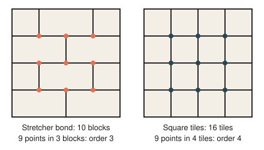

# Covering dimension: count how many pieces of a fine cover must overlap at one point

[Syllabus](../../../SYLLABUS.md) → [Topology](../README.md) → [Homotopy](../README.md#s04) → Covering dimension

---

## General Overview

A square wall panel is 900 mm on each side. A builder fills it with concrete blocks on a 450 by 225 mm grid, joint included. Look at the points where mortar joints meet.

Laid in **stretcher bond**, each course (row) is shifted half a block from the one below. Then a vertical joint always ends on the middle of a block above or below it. Every meeting point inside the panel touches 3 blocks, never 4. Laid as **square tiles** of 225 mm, straight up in a grid, the joints run through, and 9 corners each touch 4 tiles.

Can a clever builder do better than 3? The one rule: no piece may reach from one side of the panel to the opposite side. Otherwise the shapes are free. The answer is no. However the panel is cut into small closed pieces, some point touches at least 3 of them. That is a fact about the square, not about bricks, and it is what "the square has dimension 2" means.

Cut a dog's lead into short pieces instead, and the best possible is 2 at a point: a curve has dimension 1. The count says how many directions a space spreads in.

**The covering dimension of a space is one less than the smallest number of pieces that must meet at some point, however finely the space is cut into closed pieces; a square has covering dimension 2, because offset bricks keep every meeting to 3 pieces, and Brouwer's theorem forces 3 somewhere.**

**What kind of fact this is:** a definition, then theorems. That the square has dimension 2, a graph dimension 1 and the Cantor set dimension 0 is proved on this card. The lower bound for the square is Lebesgue's covering theorem, proved here from the no-retraction theorem behind Brouwer's. For the cube, a brick cover of order 4 is built and checked here, so its dimension is at most 3. That a cube of $`n`$ dimensions has dimension exactly $`n`$, and the Menger–Nöbeling embedding theorem, are stated with their sources.

<p align="center"></p>

Drawn to scale. The dots are the meeting points the check finds by scanning every cell of each layout.

---

## The formula

Notation first, in words. $`X`$ is a compact metric space ([Compactness three ways](../01-Metric%20Spaces/06-compactness-in-metric-spaces.md)): here the panel, a graph, or the Cantor set. A **closed cover** $`\mathcal{F} = \{F_1, \ldots, F_m\}`$ is a finite list of closed sets whose union is $`X`$. The blocks are one.

- The **order** of the cover, $`\mathrm{ord}\,\mathcal{F}`$, is the largest number of pieces that share one point.
- The **mesh** of the cover is the diameter of its largest piece: the longest distance between two points of one piece.
- A cover is **fine** when its mesh is small; "every $`\varepsilon`$" below means "however small".

```math
\mathrm{ord}\,\mathcal{F} = \max_{x \in X}\ \#\{\, i : x \in F_i \,\}
```

**Read it aloud:** the order is the most pieces any one point lies in ($`\#`$ means "the number of"). For the stretcher bond, 3; for the tiles, 4.

```math
\dim X \le n \iff \text{for every } \varepsilon > 0 \text{ some closed cover of } X \text{ has mesh} < \varepsilon \text{ and order} \le n + 1
```

**Read it aloud:** a space has covering dimension at most $`n`$ when it can be cut as finely as wished with no point in more than $`n + 1`$ pieces. Its **covering dimension** $`\dim X`$ is the smallest such $`n`$.

Some books count the order one lower, as "pieces minus one". This card counts pieces.

The two theorems this card is about. $`I^n`$ is the cube $`[0, 1]^n`$: $`I^1`$ an interval, $`I^2`$ a square such as the panel. Two **opposite faces** are its two sides across one coordinate, such as the left and right edges of the panel.

```math
\text{Lebesgue: every closed cover of } I^n \text{ in which no piece meets two opposite faces has order} \ge n + 1
```

**Read it aloud:** if no piece stretches from one face to the opposite one, some point lies in at least $`n + 1`$ pieces. For the panel, pieces under 900 mm across force a point in 3.

```math
\text{Menger–Nöbeling: } X \text{ compact metric and } \dim X \le n \implies X \text{ embeds in } \mathbb{R}^{2n+1}
```

**Read it aloud:** a compact space of dimension $`n`$ sits inside flat space of $`2n + 1`$ coordinates, with no tearing and no gluing. For a graph, $`n = 1`$ and $`2 \times 1 + 1 = 3`$: every finite graph can be built in space with straight wires that never cross.

| Symbol | Plain meaning | In our example | Push it up and the answer… |
| --- | --- | --- | --- |
| $`X`$, $`x`$ | a compact metric space; a point of it | the 900 mm panel; K5; the Cantor set | — |
| $`\mathcal{F}`$, $`F_i`$, $`m`$ | a closed cover, its pieces, their count | 10 blocks; 16 tiles | more, smaller blocks in stretcher bond: order stays 3 |
| $`\mathrm{ord}\,\mathcal{F}`$ | most pieces at one point | 3 for bricks, 4 for tiles | — |
| mesh, $`\varepsilon`$ | largest piece's diameter; the bound it must beat | 503.1 mm for a block | larger mesh: the count can cheat |
| $`\dim X`$, $`n`$ | covering dimension; a whole number tested against it | 2 for the panel | — |
| $`I^n`$, $`S^{n-1}`$ | the cube $`[0, 1]^n`$; the sphere of dimension $`n - 1`$ | the panel, scaled; the triangle's rim, a circle | each extra coordinate adds 1 |
| $`\delta`$ | thickening: how far each block grows when made open | 100 mm | past half a course: order 6 |
| $`U_i`$, $`\lambda`$ | the sets of an open cover; its Lebesgue number: every set narrower than $`\lambda`$ lies in one $`U_i`$ | the blocks thickened by 100 mm; $`\lambda`$ = 200 mm | — |
| $`A_1, A_2, A_3`$, $`d_i`$ | the three groups of pieces in Lebesgue's proof; distance to group $`i`$ | 4, 1 and 5 blocks | — |
| $`h`$, $`v_i`$ | the proof's map to a triangle's rim; the triangle's corners | lands at a triple point when hunted | — |
| $`\mathbb{R}^{2n+1}`$, $`t`$ | flat space with $`2n + 1`$ coordinates; a vertex's place on the moment curve | $`\mathbb{R}^3`$; $`t`$ = 1 to 5 for K5 | — |

### When it holds

- **Fine covers only.** Two half panels, each 450 by 900 mm, have order 2. Each half spans bottom to top, so Lebesgue's rule does not apply.
- **Closed or open pieces: the dimension is the same.** Open blocks thickened by 100 mm still have order 3, and the fold in Step 4 turns a fine open cover into a closed one of no higher order. Pieces that are neither are not allowed: hand each meeting point of the panel to just one of its blocks, and no point lies in 2 pieces, which would make a square 0-dimensional.
- **Compact metric spaces, for the fine-cover test.** There it agrees with the general definition by open covers (fold in Step 4). The whole line $`\mathbb{R}`$ is not compact: no finite list of pieces of small mesh covers it, so the test cannot start, and the open-cover definition of the fold takes over.
- **Covering dimension is not fractal dimension.** The Cantor set has covering dimension 0, but box count 0.630930.
- **Embedding needs $`2n + 1`$, not $`2n`$.** K5, the complete graph on 5 vertices, has dimension 1 but does not fit in the plane.

---

## Why it works

### Step 0: the idea

An upper bound needs one good cover at every scale: bricks give that. A lower bound must beat every cover at once. Group the pieces by which sides of the square they touch. If no point were in 3 pieces, distances to the groups would give a map from the square to the rim of a triangle whose edge loop winds once round the rim. A loop that winds once cannot be shrunk, but every loop in the square can. Lebesgue's theorem is the same obstacle as Brouwer's.

### Step 1: bricks give order 3 at every scale

Take any brick size. A point of the panel lies:

1. in at most 2 courses, since it is on at most one bed joint (a horizontal joint);
2. in at most 2 blocks of each course, since it is on at most one vertical joint of that course.

So 4 is the worst case, and it needs a vertical joint of the course below to meet a vertical joint of the course above at a single point. Stretcher bond shifts the joints by half a block, so they never meet. The order is at most 3.

The argument does not use the bricks' size. The check confirms 3 for blocks of 450 by 225 mm, 150 by 75 mm and 90 by 45 mm, with mesh 503.1, 167.7 and 100.6 mm. So $`\dim I^2 \le 2`$. The tiles fail this step: their vertical joints line up.

### Step 2: Lebesgue's covering theorem for the square

Let $`F_1, \ldots, F_m`$ be a closed cover of the panel in which no piece meets two opposite sides. Suppose no point lies in 3 pieces. Sort the pieces into three groups:

- $`A_1`$: the pieces that touch the left side;
- $`A_2`$: the remaining pieces that touch the bottom;
- $`A_3`$: all the rest.

Read off which sides each group misses. $`A_1`$ misses the right side. $`A_2`$ misses the left and the top. $`A_3`$ misses the left and the bottom. Each group's union is closed, and no point lies in all three, since that point would lie in 3 different pieces. No group is empty: the bottom-right corner can only be in $`A_2`$, the top-right only in $`A_3`$.

Now let $`d_i(x)`$ be the distance from $`x`$ to group $`A_i`$, and send $`x`$ to the point of a triangle with weights $`d_1 : d_2 : d_3`$:

```math
h(x) = \frac{d_1(x)\, v_1 + d_2(x)\, v_2 + d_3(x)\, v_3}{d_1(x) + d_2(x) + d_3(x)}
```

**Read it aloud:** $`h`$ places $`x`$ in the triangle with corners $`v_1, v_2, v_3`$, pulled toward each corner by how far $`x`$ is from that group.

The bottom line is never zero, since no point is in all three groups, so $`h`$ is continuous. Every point is in some group, so some weight is 0, and $`h(x)`$ lands on the triangle's rim, a loop of three edges.

### Step 3: the rim of the panel winds once

Walk round the panel's edge and watch $`h`$. Each side of the panel misses one group, so its image avoids one edge of the triangle:

| Panel side | Group it misses | Where $`h`$ goes |
| --- | --- | --- |
| left | $`A_2`$ and $`A_3`$ | stays on the edge opposite $`v_1`$ |
| bottom | $`A_3`$ | passes round $`v_3`$ |
| right | $`A_1`$ | passes round $`v_1`$ |
| top | $`A_2`$ | passes round $`v_2`$ |

The corners pin it down. The bottom-right corner lies only in $`A_2`$; the top-right only in $`A_3`$. So the walk goes round $`v_3`$, then $`v_1`$, then $`v_2`$ and home: once round the triangle.

The triangle's rim is a circle. By [The circle's fundamental group is the integers](04-fundamental-group-of-the-circle.md), a loop that winds once is not the trivial loop. But the panel is a disc, every loop in it shrinks to a point, and $`h`$ carries that shrinking to the rim. This is the contradiction of Step 2 in [Brouwer and Borsuk-Ulam](08-brouwer-and-borsuk-ulam.md): there, a retraction of the disc onto its rim; here, a map of the panel onto the triangle's rim that winds once on the edge. So some point lies in 3 pieces.

For the stretcher bond the check builds the three groups (4, 1 and 5 blocks), finds the winding 1, and quarters squares whose rim still winds. The hunt lands at (450, 225) mm, a point in 3 blocks, as the proof says it must.

### Step 4: the square has dimension exactly 2

Step 1 gives covers of order 3 at every scale, so $`\dim I^2 \le 2`$. For the lower bound, any cover with mesh under 900 mm has no piece touching two opposite sides, since those sides are 900 mm apart. Step 3 then gives a point in 3 pieces. So no fine cover has order 2, and $`\dim I^2 = 2`$.

<details>
<summary>Detailed proof: from closed covers to the open-cover definition</summary>

Many books define dimension by open covers: $`\dim X \le n`$ when every finite open cover has a finite open refinement (a cover whose pieces each lie inside one of the original sets) of order at most $`n + 1`$. On a compact metric space the two tests agree, and the panel shows why.

From bricks to open covers. Given an open cover, take its Lebesgue number $`\lambda`$ ([Uniform continuity](../01-Metric%20Spaces/07-uniform-continuity-and-heine-cantor.md)): every set of diameter below $`\lambda`$ lies inside one open set. Lay bricks whose thickened size stays below $`\lambda`$, and thicken each by $`\delta`$, less than half a course and a quarter of a block. A point is then near at most one bed joint and near at most one vertical joint per course, and the vertical joints of neighbouring courses stay apart, so the order is still 3.

From open covers to closed ones. Given an open cover $`U_1, \ldots, U_m`$ with Lebesgue number $`\lambda`$, set the cut-off at a third of $`\lambda`$:

$`\displaystyle F_i = \{\, x : \text{the distance from } x \text{ to the outside of } U_i \text{ is at least } \lambda / 3 \,\}`$

Each $`F_i`$ is closed and lies in $`U_i`$. The ball of radius $`\lambda / 3`$ round any point has diameter below $`\lambda`$, so it lies inside some $`U_i`$: every point is at least $`\lambda / 3`$ inside some $`U_i`$, and the $`F_i`$ cover. Shrinking can only lower the order. So a fine open cover of order 2 would give a fine closed cover of order 2, which Step 3 forbids.

</details>

### Step 5: the cube by bricks, and every cube stated

Stack 4 copies of the panel, each 225 mm deep, into a 900 mm cube, so each layer is a stretcher bond. A point inside one layer lies in at most 3 blocks, by Step 1. A point on the face between two layers lies in blocks of both, so the danger is a triple point of one layer landing on a joint of the next. Stacked straight, triple points meet triple points: 3 + 3 = 6 blocks.

So move every odd layer a quarter block (112.5 mm) along the courses and half a course (112.5 mm) up. Each layer's triple points then fall inside single blocks of the next, joints cross joints at worst (2 + 2), and no point lies in more than 3 + 1 = 4 blocks. The check scans all 50 blocks and finds order 4, with mesh 551.1 mm. A move only along the courses, or only up, leaves triple points on joints. The argument does not use the blocks' size, so $`\dim I^3 \le 3`$.

The same two halves work in every dimension. Bricks laid in $`n`$ directions, each layer moved against the one before so that crowded points never line up, give order $`n + 1`$. The lower bound uses $`n + 1`$ groups and a map onto the rim of an $`n`$-dimensional triangle, which is a sphere $`S^{n-1}`$. That sphere's hole cannot be detected by loops once $`n \ge 3`$; it needs [Homology of spheres, and degree](../05-Homology/07-homology-of-spheres-and-degree.md). So $`\dim I^n = n`$ is stated here, with Hurewicz and Wallman's book as the source. Lebesgue announced it in 1911; Brouwer gave the first full proof in 1913.

So cubes of different dimensions are never homeomorphic, and neither are $`\mathbb{R}^n`$ and $`\mathbb{R}^m`$ when $`n \ne m`$ (stated: the same source extends dimension to spaces that are not compact). And a [Topological manifold](../03-Surfaces%20and%20Manifolds/01-topological-manifolds.md) of dimension $`n`$, built from patches of $`\mathbb{R}^n`$, has covering dimension $`n`$ (stated, same source).

### Step 6: a graph has dimension 1, the Cantor set 0

**A graph.** Cut each edge of K5 into thirds. Round each vertex take a **star**: the third of every edge next to it, 4 edges in all. Each edge keeps its middle third. That is 5 stars and 10 middles. A point is in at most 2 of them, so the order is 2; the check tests 55 points, each vertex and 5 along each edge. Cutting the edges finer shrinks the mesh, so $`\dim \le 1`$.

Order 1 would mean pieces that never meet. A graph that is in one piece cannot be split into two or more disjoint closed pieces ([Connected and path-connected](../02-Topological%20Spaces/07-connectedness-and-path-connectedness.md)), and a fine cover needs more than one piece. So $`\dim = 1`$.

**The Cantor set.** After 5 rounds of deleting middle thirds, the Cantor set ([The test spaces](../02-Topological%20Spaces/09-standard-examples-and-counterexamples.md)) lies in 32 closed pieces, each 1/243 long, at least 1/243 apart. They never overlap: order 1, at a mesh that shrinks with every round. So the Cantor set has covering dimension 0.

Its box count, from [Fractals](../../05-Geometry%20and%20trig/07-Points%2C%20Convexity%20and%20Fractals/05-self-similarity-and-fractal-dimension.md), is log 32 / log 243 = 0.630930. It measures how the piece count grows as pieces shrink; covering dimension asks only how pieces must overlap. Both give 2 for the panel; they part on fractals.

### Step 7: embedding, and why a graph needs 3 coordinates

Menger–Nöbeling is stated, with Nöbeling's 1931 paper as the source. The key idea: a map into $`\mathbb{R}^{2n+1}`$ in **general position** (no more coincidences than counting forces) never folds two parts of an $`n`$-dimensional space onto each other, because two $`n`$-dimensional pieces in $`2n + 1`$ coordinates generally miss.

For a graph the proof fits on one line. Put vertex $`t`$ at $`(t, t^2, t^3)`$, a point on the **moment curve**. For four points on it, the $`3 \times 3`$ determinant of their differences equals the product of the six differences of the $`t`$ values (the **Vandermonde product**), which is never 0. So no four of them lie in one plane. Two disjoint straight edges that met would put their four ends in one plane, so they never meet. The check computes all 15 pairs of disjoint edges of K5; the smallest determinant is 12.

K5 shows that $`2n + 1`$ cannot drop to $`2n`$ here. By [Why some graphs cannot be drawn flat](../../04-Combinatorics%20and%20graphs/12-Planarity%20and%20Colouring/02-edge-bound-and-kuratowski.md), a flat drawing of a simple graph with 5 vertices allows at most 3 × 5 − 6 = 9 edges, and K5 has 10.

---

## Worked numbers, by hand

| Step | Arithmetic | Value |
| --- | --- | --- |
| Blocks per course | 900 / 450 = 2 in even courses; a half, a whole and a half, so 3, in odd courses | [2, 3, 2, 3], 10 blocks |
| Block mesh | $`\sqrt{450^2 + 225^2}`$ | 503.1 mm, under 900 |
| Triple points by hand | each inner bed joint meets 1 joint below and 2 above, or 2 and 1: 3 per joint, 3 inner joints | 9 |
| Triple points, exhaustive scan | every cell of the layout | 9, at (225, 225) to (675, 675) |
| Tiles | 3 × 3 inner corners, each in 4 tiles | order 4 |
| Cube, 4 layers of the panel's bond | odd layers moved 112.5 mm along and 112.5 mm up; 3 in a layer + 1 in the next | 50 blocks, order 4 |
| Lebesgue's groups | left side; bottom, not left; the rest | 4, 1, 5 blocks |
| Winding of $`h`$ round the panel | sides pass $`v_3`$, $`v_1`$, $`v_2`$ in turn | 1 |
| Hunt for the triple point | 30 rounds of quartering | (450, 225) mm, in 3 blocks |
| Cantor set, round 5 | $`2^5`$ pieces, each $`1/3^5`$ long | 32 pieces, 1/243 long |
| K5 in space | 15 disjoint pairs, Vandermonde product | smallest 12, never 0 |
| **Panel** | **order 3 at every scale; order 3 forced** | **$`\dim = 2`$** |

The panel can be cut as finely as wished with only 3 pieces meeting, and never with 2: it spreads in exactly 2 directions.

### What breaks if you drop a piece

| Mistake | Comes out at | What went wrong |
| --- | --- | --- |
| Square tiles instead of offset blocks | order 4 | a poor cover: it only shows $`\dim \le 3`$ |
| Two half panels, 450 by 900 mm | order 2, mesh 1006.2 mm | not fine: each half spans bottom to top |
| Open blocks thickened by 125 mm | order 6 | thickened past half a course |
| Cube layers stacked straight | order 6 | a triple point of one layer sits on a triple point of the next: 3 + 3 |
| Box count for the Cantor set | 0.630930 instead of 0 | fractal dimension, not covering dimension |
| K5 drawn in the plane | 10 edges, 9 allowed | embedding needs $`2n + 1 = 3`$ coordinates |

---

## Code, from first principles, and it actually runs

The code takes two roads to each answer. The order of each cover: an exhaustive scan of every cell, edge and corner of the layout, in doubled whole millimetres, against the joint count by hand; for the cube, the same scan in 3 dimensions against the panel's order plus 1. The Lebesgue number of the thickened blocks: every box with sides on the cut lines, against the 200 mm overlap at each joint by hand. Lebesgue's theorem: the proof's winding number and a hunt by quartering, which must land on a scanned triple point. K5 in space: each determinant against the Vandermonde product. The scans are exhaustive, so they prove their finite claims; the theorems are proved in Why it works, and the code only illustrates them.

### Python

```python
# Covering dimension -- the check behind the card.  Standard library only.
# A 900 mm square wall panel laid in 450 x 225 mm blocks (stretcher bond) or 225 mm square tiles (stack bond).
# Roads: the order of each cover by an exhaustive scan of every cell of its arrangement, against a count of
# joints by hand (for the cube, the panel's order + 1); Lebesgue's theorem by the proof's winding number, whose
# hunt must land on a listed triple point; K5 on the moment curve by 3 x 3 determinants, against the Vandermonde product.
from math import atan2, pi, sqrt, log
from fractions import Fraction
from itertools import combinations, product
S = 900  # panel side, mm

def bond(w, h, shift):  # closed blocks (x0, y0, x1, y1), mm; with shift, odd courses start half a block in
    out = []
    for j in range(S // h):
        xs = sorted({0, S} | set(range(w // 2 if shift and j % 2 else 0, S, w)))
        out += [(a, j * h, b, j * h + h) for a, b in zip(xs, xs[1:])]
    return out

def order(rects, grow=0, closed=True):  # most pieces sharing one point of the panel, and where (exhaustive)
    R = [(2 * (a - grow), 2 * (b - grow), 2 * (c + grow), 2 * (d + grow)) for a, b, c, d in rects]  # doubled
    def cand(i):  # every cut line inside the panel and the middle of every cell between cut lines
        cuts = sorted({v for r in R for v in (r[i], r[i + 2]) if 0 <= v <= 2 * S} | {0, 2 * S})
        mids = [(u + v) // 2 for u, v in zip(cuts, cuts[1:])]
        return sorted(mids + (cuts if closed else []))
    count = {}
    for x in cand(0):
        for y in cand(1):
            k = sum((a <= x <= c and b <= y <= d) if closed else (a < x < c and b < y < d) for a, b, c, d in R)
            count.setdefault(k, []).append((x / 2, y / 2))
    return max(count), count

def mesh(rects): return max(sqrt((c - a) ** 2 + (d - b) ** 2) for a, b, c, d in rects)
def pts(P): return " ".join(f"({x:g},{y:g})" for x, y in P)

blocks, tiles = bond(450, 225, True), bond(225, 225, False)
ob, cb = order(blocks); ot, ct = order(tiles)
print(f"stretcher bond: {len(blocks)} blocks, mesh {mesh(blocks):.1f} mm, order {ob}; points in 3 blocks: {len(cb[3])}")
print(f"stack bond tiles: {len(tiles)} tiles, mesh {mesh(tiles):.1f} mm, order {ot}; points in 4 tiles: {len(ct[4])}")
course = [sum(r[1] == j * 225 for r in blocks) for j in range(4)]  # by hand: a bed joint meets the joints above and below
by_hand = sum(course[j] - 1 + course[j + 1] - 1 for j in range(3))
print(f"by hand: blocks per course {course}; joints meeting the 3 inner bed joints: {by_hand}; tiles: 3 x 3 = 9 corners")
print("figure, triple points:", pts(cb[3]))
print("figure, quadruple points:", pts(ct[4]))
assert ob == 3 and ot == 4 and len(cb[3]) == by_hand == 9 and len(ct[4]) == 9
for w, h in [(150, 75), (90, 45)]:
    o, _ = order(bond(w, h, True)); print(f"finer bond {w} x {h} mm: {len(bond(w, h, True))} blocks, mesh {mesh(bond(w, h, True)):.1f} mm, order {o}")
    assert o == 3
for g in (100, 125):  # thicken every block into an open box g mm bigger on each side
    o, _ = order(blocks, g, False); big = [(a - g, b - g, c + g, d + g) for a, b, c, d in blocks]
    print(f"open blocks thickened by {g} mm: mesh {mesh(big):.1f} mm, order {o}")
    assert o == (3 if g < 112.5 else 6)
U = [(2 * (a - 100), 2 * (b - 100), 2 * (c + 100), 2 * (d + 100)) for a, b, c, d in blocks]  # open, doubled mm
cut = sorted({v for u in U for v in u if 0 < v < 2 * S} | {0, 2 * S}); cut += [(u + v) // 2 for u, v in zip(cut, cut[1:])]
# a set lies in an open box exactly when its bounding box does, and a bounding box can shrink onto these cuts
lam = min(max(x1 - x0, y1 - y0) for x0 in cut for x1 in cut if x0 <= x1 for y0 in cut for y1 in cut if y0 <= y1
          if not any(a < x0 and x1 < c and b < y0 and y1 < d for a, b, c, d in U)) / 2
print(f"open blocks thickened by 100 mm: Lebesgue number {lam:g} mm (every set under {lam:g} mm across lies in one)")
assert lam == 2 * 100  # by hand: each joint is overlapped 100 mm on each side
halves = [(0, 0, 450, 900), (450, 0, 900, 900)]
print(f"coarse cover, two halves: mesh {mesh(halves):.1f} mm (not under 900), order {order(halves)[0]}")
def layer(k, d):  # layer k of a 900 mm cube, 225 mm deep: stretcher bond moved d along and d up; half-mm units
    out = []
    for j in range(-1, 5):
        y0, y1 = max(d + 450 * j, 0), min(d + 450 * j + 450, 2 * S)
        xs = sorted({0, 2 * S} | {x for x in range(d + 450 * (j % 2) - 900, 2 * S, 900) if x > 0})
        out += [(a, y0, 450 * k, b, y1, 450 * k + 450) for a, b in zip(xs, xs[1:]) if y0 < y1]
    return out
def order3(bx):  # the same exhaustive scan in 3 dimensions: every cut plane, and the middle of every cell between
    cand = [sorted({q[i] for q in bx} | {q[i + 3] for q in bx}) for i in range(3)]
    cand = [c + [(u + v) // 2 for u, v in zip(c, c[1:])] for c in cand]
    return max(sum(all(q[i] <= p[i] <= q[i + 3] for i in range(3)) for q in bx) for p in product(*cand))
for d in (225, 0):  # a quarter block along and half a course up are both 112.5 mm, 225 in half-mm
    cube = [q for k in range(4) for q in layer(k, d * (k % 2))]
    o, cm = order3(cube), max(sqrt(sum((q[i + 3] - q[i]) ** 2 for i in range(3))) for q in cube) / 2
    how = f"odd layers moved {d / 2:g} mm along the courses and {d / 2:g} mm up" if d else "layers stacked straight"
    print(f"cube 900 mm, 4 layers 225 mm deep, {how}: {len(cube)} blocks, mesh {cm:.1f} mm, order {o}")
    assert o == (ob + 1 if d else 2 * ob)  # by hand: 3 in one layer + 1 in the next, or 3 + 3 when triple points meet
# Lebesgue's proof: group 1 = blocks on the left side, group 2 = others on the bottom, group 3 = the rest
L = [r for r in blocks if r[0] == 0]; B = [r for r in blocks if r[1] == 0 and r not in L]
A = [L, B, [r for r in blocks if r not in L and r not in B]]
def dist(p, rs): return min(sqrt(max(a - p[0], 0, p[0] - c) ** 2 + max(b - p[1], 0, p[1] - d) ** 2) for a, b, c, d in rs)
V = [(0.0, 1.0), (-sqrt(3) / 2, -0.5), (sqrt(3) / 2, -0.5)]  # the triangle's corners v1, v2, v3
def tri(x, y):  # the point of the triangle's rim with weights d1 : d2 : d3 (some d is 0: every point is covered)
    p = (min(max(x, 0), S), min(max(y, 0), S)); d = [dist(p, g) for g in A]; s = sum(d)
    return sum(d[i] * V[i][0] for i in range(3)) / s, sum(d[i] * V[i][1] for i in range(3)) / s
def winding(x0, y0, size, n=64):  # net turns of tri round the rim of a square, sampled n times per side
    P = [(x0 + size * k / n, y0) for k in range(n)] + [(x0 + size, y0 + size * k / n) for k in range(n)]
    P += [(x0 + size - size * k / n, y0 + size) for k in range(n)] + [(x0, y0 + size - size * k / n) for k in range(n)]
    tot, (px, py) = 0.0, tri(*P[-1])
    for p in P:
        qx, qy = tri(*p); tot += atan2(px * qy - py * qx, px * qx + py * qy); px, py = qx, qy
    return round(tot / (2 * pi))
print(f"proof: groups of {len(A[0])}, {len(A[1])}, {len(A[2])} blocks; winding round the panel's rim: {winding(0, 0, S)}")
x0, y0, size = -37.0, -53.0, 1000.0
for _ in range(30):  # keep a quarter whose rim still winds: it closes in on a point in all three groups
    size /= 2
    x0, y0 = next((a, b) for a in (x0, x0 + size) for b in (y0, y0 + size) if winding(a, b, size) != 0)
hx, hy = x0 + size / 2, y0 + size / 2
inside = sum(a - 1e-6 <= hx <= c + 1e-6 and b - 1e-6 <= hy <= d + 1e-6 for a, b, c, d in blocks)
print(f"proof: the hunt lands at ({hx:.6f}, {hy:.6f}) mm, in {inside} blocks")
assert abs(winding(0, 0, S)) == 1 and inside == 3 and min(abs(hx - x) + abs(hy - y) for x, y in cb[3]) < 1e-6
# Cantor set, level 5: 2^5 closed pieces 1/3^5 long, pairwise apart, so order 1 at every level
I = [(Fraction(0), Fraction(1))]
for _ in range(5): I = [q for a, b in I for q in ((a, a + (b - a) / 3), (b - (b - a) / 3, b))]
gap = min(c - b for (a, b), (c, d) in zip(I, I[1:]))
print(f"Cantor level 5: {len(I)} pieces, each {I[0][1] - I[0][0]} long, smallest gap {gap}: order 1, so dimension 0")
print(f"Cantor box count: log {len(I)} / log 243 = {log(len(I)) / log(243):.6f} = log 2 / log 3 = {log(2) / log(3):.6f}")
assert gap > 0 and abs(log(len(I)) / log(243) - log(2) / log(3)) < 1e-12
# a graph: K5, each edge cut in thirds; a point is a vertex, or (edge, t) at t sixths from the edge's first end
K = list(combinations(range(5), 2))
stars = [{v} | {(e, t) for e in K for t in range(1, 6) if (e[0] == v and t <= 2) or (e[1] == v and t >= 4)} for v in range(5)]
spots = list(range(5)) + [(e, t) for e in K for t in range(1, 6)]  # every vertex, every cut and every cell between
star_mid = [sum(p in s for s in stars) + sum(p in {(e, 2), (e, 3), (e, 4)} for e in K) for p in spots]
print(f"K5 cover: 5 stars (a vertex and the near third of its {sum(0 in e for e in K)} edges) + 10 middles, "
      f"order {max(star_mid)} (checked at {len(spots)} points), so dimension 1")
P = {t: (t, t * t, t * t * t) for t in range(1, 6)}  # K5 on the moment curve (t, t^2, t^3) in R^3
def det(u, v, w): return u[0] * (v[1] * w[2] - v[2] * w[1]) - u[1] * (v[0] * w[2] - v[2] * w[0]) + u[2] * (v[0] * w[1] - v[1] * w[0])
def sub(p, q): return tuple(a - b for a, b in zip(p, q))
dets = []
for (a, b), (c, d) in combinations(combinations(range(1, 6), 2), 2):
    if len({a, b, c, d}) == 4:  # disjoint edges: their 4 corners must not lie in one plane
        s = sorted((a, b, c, d)); vd = 1
        for i, j in combinations(range(4), 2): vd *= s[j] - s[i]
        dk = det(*(sub(P[q], P[s[0]]) for q in s[1:])); dets.append(dk)
        assert dk == vd and dk != 0
print(f"K5 in R^3: {len(dets)} pairs of disjoint edges, smallest determinant {min(dets)}, all equal the Vandermonde product")
E, Vn = sum(1 for _ in combinations(P, 2)), len(P)  # counted from the vertices placed above
print(f"K5 in R^2: {E} edges, but a flat drawing allows at most 3 x {Vn} - 6 = {3 * Vn - 6}; 2n + 1 = 3 for a graph")
assert max(star_mid) == 2 and E > 3 * Vn - 6
print("ALL CHECKS PASS")
```

**Ran 2026-11-24 on macOS, Python 3.14.10, standard library only. All checks passed. Output, pasted from the run:**

```
stretcher bond: 10 blocks, mesh 503.1 mm, order 3; points in 3 blocks: 9
stack bond tiles: 16 tiles, mesh 318.2 mm, order 4; points in 4 tiles: 9
by hand: blocks per course [2, 3, 2, 3]; joints meeting the 3 inner bed joints: 9; tiles: 3 x 3 = 9 corners
figure, triple points: (225,225) (225,450) (225,675) (450,225) (450,450) (450,675) (675,225) (675,450) (675,675)
figure, quadruple points: (225,225) (225,450) (225,675) (450,225) (450,450) (450,675) (675,225) (675,450) (675,675)
finer bond 150 x 75 mm: 78 blocks, mesh 167.7 mm, order 3
finer bond 90 x 45 mm: 210 blocks, mesh 100.6 mm, order 3
open blocks thickened by 100 mm: mesh 776.6 mm, order 3
open blocks thickened by 125 mm: mesh 845.9 mm, order 6
open blocks thickened by 100 mm: Lebesgue number 200 mm (every set under 200 mm across lies in one)
coarse cover, two halves: mesh 1006.2 mm (not under 900), order 2
cube 900 mm, 4 layers 225 mm deep, odd layers moved 112.5 mm along the courses and 112.5 mm up: 50 blocks, mesh 551.1 mm, order 4
cube 900 mm, 4 layers 225 mm deep, layers stacked straight: 40 blocks, mesh 551.1 mm, order 6
proof: groups of 4, 1, 5 blocks; winding round the panel's rim: 1
proof: the hunt lands at (450.000000, 225.000000) mm, in 3 blocks
Cantor level 5: 32 pieces, each 1/243 long, smallest gap 1/243: order 1, so dimension 0
Cantor box count: log 32 / log 243 = 0.630930 = log 2 / log 3 = 0.630930
K5 cover: 5 stars (a vertex and the near third of its 4 edges) + 10 middles, order 2 (checked at 55 points), so dimension 1
K5 in R^3: 15 pairs of disjoint edges, smallest determinant 12, all equal the Vandermonde product
K5 in R^2: 10 edges, but a flat drawing allows at most 3 x 5 - 6 = 9; 2n + 1 = 3 for a graph
ALL CHECKS PASS
```

### Rust

```rust
// Covering dimension -- the check behind the card.  Standard library only.
// A 900 mm square wall panel laid in 450 x 225 mm blocks (stretcher bond) or 225 mm square tiles (stack bond).
// Roads: the order of each cover by an exhaustive scan of every cell of its arrangement, against a count of
// joints by hand (for the cube, the panel's order + 1); Lebesgue's theorem by the proof's winding number, whose
// hunt must land on a listed triple point; K5 on the moment curve by 3 x 3 determinants, against the Vandermonde product.
use std::collections::BTreeMap;
use std::f64::consts::PI;
const S: i64 = 900; // panel side, mm
type Rect = (i64, i64, i64, i64);

fn bond(w: i64, h: i64, shift: bool) -> Vec<Rect> { // closed blocks, mm; with shift, odd courses start half a block in
    let mut out = vec![];
    for j in 0..S / h {
        let start = if shift && j % 2 == 1 { w / 2 } else { 0 };
        let mut xs: Vec<i64> = (0..).map(|k| start + k * w).take_while(|&x| x < S).collect();
        xs.push(0); xs.push(S); xs.sort(); xs.dedup();
        for k in 0..xs.len() - 1 { out.push((xs[k], j * h, xs[k + 1], j * h + h)); }
    }
    out
}
// most pieces sharing one point of the panel, and where (exhaustive); coordinates doubled so midpoints are whole
fn order(rects: &[Rect], grow: i64, closed: bool) -> (usize, BTreeMap<usize, Vec<(i64, i64)>>) {
    let r: Vec<[i64; 4]> = rects.iter().map(|&(a, b, c, d)| [2 * (a - grow), 2 * (b - grow), 2 * (c + grow), 2 * (d + grow)]).collect();
    let cand = |i: usize| -> Vec<i64> {
        let mut cuts: Vec<i64> = r.iter().flat_map(|q| [q[i], q[i + 2]]).filter(|&v| 0 <= v && v <= 2 * S).collect();
        cuts.push(0); cuts.push(2 * S); cuts.sort(); cuts.dedup();
        let mut c: Vec<i64> = cuts.windows(2).map(|p| (p[0] + p[1]) / 2).collect();
        if closed { c.extend(cuts.iter()); } c.sort(); c
    };
    let mut count: BTreeMap<usize, Vec<(i64, i64)>> = BTreeMap::new();
    for &x in &cand(0) { for &y in &cand(1) {
        let k = r.iter().filter(|q| if closed { q[0] <= x && x <= q[2] && q[1] <= y && y <= q[3] } else { q[0] < x && x < q[2] && q[1] < y && y < q[3] }).count();
        count.entry(k).or_default().push((x, y));
    } }
    (*count.keys().max().unwrap(), count)
}
fn layer(k: i64, d: i64) -> Vec<[i64; 6]> { // layer k of a 900 mm cube, 225 mm deep: stretcher bond moved d along and d up; half-mm
    let mut out = vec![];
    for j in -1..5i64 {
        let (y0, y1) = ((d + 450 * j).max(0), (d + 450 * j + 450).min(2 * S));
        let mut xs: Vec<i64> = (0..4).map(|m| d + 450 * j.rem_euclid(2) - 900 + 900 * m).filter(|&x| 0 < x && x < 2 * S).collect();
        xs.push(0); xs.push(2 * S); xs.sort(); xs.dedup();
        if y0 < y1 { for w in xs.windows(2) { out.push([w[0], y0, 450 * k, w[1], y1, 450 * k + 450]) } }
    }
    out
}
fn order3(bx: &[[i64; 6]]) -> usize { // the same exhaustive scan in 3 dimensions: every cut plane, and the middle of every cell between
    let cand: Vec<Vec<i64>> = (0..3).map(|i| { let mut c: Vec<i64> = bx.iter().flat_map(|q| [q[i], q[i + 3]]).collect(); c.sort(); c.dedup();
        let m: Vec<i64> = c.windows(2).map(|w| (w[0] + w[1]) / 2).collect(); c.extend(m); c }).collect();
    let c = &cand;
    c[0].iter().flat_map(|&x| c[1].iter().flat_map(move |&y| c[2].iter().map(move |&z| [x, y, z])))
        .map(|p| bx.iter().filter(|q| (0..3).all(|i| q[i] <= p[i] && p[i] <= q[i + 3])).count()).max().unwrap()
}
fn mesh(rects: &[Rect]) -> f64 { rects.iter().map(|&(a, b, c, d)| (((c - a) * (c - a) + (d - b) * (d - b)) as f64).sqrt()).fold(0.0, f64::max) }
fn pts(p: &[(i64, i64)]) -> String { p.iter().map(|&(x, y)| format!("({},{})", x as f64 / 2.0, y as f64 / 2.0)).collect::<Vec<_>>().join(" ") }
fn dist(p: (f64, f64), rs: &[Rect]) -> f64 {
    rs.iter().map(|&(a, b, c, d)| {
        let dx = (a as f64 - p.0).max(0.0).max(p.0 - c as f64); let dy = (b as f64 - p.1).max(0.0).max(p.1 - d as f64);
        (dx * dx + dy * dy).sqrt() }).fold(f64::INFINITY, f64::min)
}
fn tri(groups: &[Vec<Rect>], x: f64, y: f64) -> (f64, f64) { // the point of the triangle's rim with weights d1 : d2 : d3
    let v = [(0.0, 1.0), (-(3f64.sqrt()) / 2.0, -0.5), (3f64.sqrt() / 2.0, -0.5)];
    let p = (x.max(0.0).min(S as f64), y.max(0.0).min(S as f64));
    let d: Vec<f64> = groups.iter().map(|g| dist(p, g)).collect(); let s: f64 = d.iter().sum();
    ((0..3).map(|i| d[i] * v[i].0).sum::<f64>() / s, (0..3).map(|i| d[i] * v[i].1).sum::<f64>() / s)
}
fn winding(groups: &[Vec<Rect>], x0: f64, y0: f64, size: f64) -> i64 { // net turns of tri round a square's rim
    let n = 64; let f = |k: i32| size * k as f64 / n as f64; let mut p = vec![];
    for k in 0..n { p.push((x0 + f(k), y0)); } for k in 0..n { p.push((x0 + size, y0 + f(k))); }
    for k in 0..n { p.push((x0 + size - f(k), y0 + size)); } for k in 0..n { p.push((x0, y0 + size - f(k))); }
    let last = p[p.len() - 1]; let (mut px, mut py) = tri(groups, last.0, last.1); let mut tot = 0.0;
    for q in &p { let (qx, qy) = tri(groups, q.0, q.1); tot += (px * qy - py * qx).atan2(px * qx + py * qy); px = qx; py = qy; }
    (tot / (2.0 * PI)).round() as i64
}
fn gcd(a: i64, b: i64) -> i64 { if b == 0 { a } else { gcd(b, a % b) } }
fn sub(p: [i64; 3], q: [i64; 3]) -> [i64; 3] { [p[0] - q[0], p[1] - q[1], p[2] - q[2]] }
fn det(u: [i64; 3], v: [i64; 3], w: [i64; 3]) -> i64 {
    u[0] * (v[1] * w[2] - v[2] * w[1]) - u[1] * (v[0] * w[2] - v[2] * w[0]) + u[2] * (v[0] * w[1] - v[1] * w[0])
}
fn main() {
    let (blocks, tiles) = (bond(450, 225, true), bond(225, 225, false));
    let (ob, cb) = order(&blocks, 0, true); let (ot, ct) = order(&tiles, 0, true);
    println!("stretcher bond: {} blocks, mesh {:.1} mm, order {}; points in 3 blocks: {}", blocks.len(), mesh(&blocks), ob, cb[&3].len());
    println!("stack bond tiles: {} tiles, mesh {:.1} mm, order {}; points in 4 tiles: {}", tiles.len(), mesh(&tiles), ot, ct[&4].len());
    let course: Vec<i64> = (0..4).map(|j| blocks.iter().filter(|r| r.1 == j * 225).count() as i64).collect();
    let by_hand: i64 = (0..3).map(|j| course[j] - 1 + course[j + 1] - 1).sum();
    println!("by hand: blocks per course {:?}; joints meeting the 3 inner bed joints: {}; tiles: 3 x 3 = 9 corners", course, by_hand);
    println!("figure, triple points: {}", pts(&cb[&3]));
    println!("figure, quadruple points: {}", pts(&ct[&4]));
    assert!(ob == 3 && ot == 4 && cb[&3].len() as i64 == by_hand && by_hand == 9 && ct[&4].len() == 9);
    for (w, h) in [(150, 75), (90, 45)] {
        let fb = bond(w, h, true); let (o, _) = order(&fb, 0, true);
        println!("finer bond {} x {} mm: {} blocks, mesh {:.1} mm, order {}", w, h, fb.len(), mesh(&fb), o);
        assert!(o == 3);
    }
    for g in [100, 125] { // thicken every block into an open box g mm bigger on each side
        let (o, _) = order(&blocks, g, false); let big: Vec<Rect> = blocks.iter().map(|&(a, b, c, d)| (a - g, b - g, c + g, d + g)).collect();
        println!("open blocks thickened by {} mm: mesh {:.1} mm, order {}", g, mesh(&big), o);
        assert!(o == if (g as f64) < 112.5 { 3 } else { 6 });
    }
    let u: Vec<Rect> = blocks.iter().map(|&(a, b, c, d)| (2 * (a - 100), 2 * (b - 100), 2 * (c + 100), 2 * (d + 100))).collect(); // open, doubled mm
    let mut cut: Vec<i64> = u.iter().flat_map(|q| [q.0, q.1, q.2, q.3]).filter(|&v| 0 < v && v < 2 * S).collect();
    cut.push(0); cut.push(2 * S); cut.sort(); cut.dedup(); let m: Vec<i64> = cut.windows(2).map(|w| (w[0] + w[1]) / 2).collect(); cut.extend(m);
    let mut lam = i64::MAX; // a set lies in an open box exactly when its bounding box does, and a bounding box can shrink onto these cuts
    for &x0 in &cut { for &x1 in &cut { for &y0 in &cut { for &y1 in &cut {
        if x0 <= x1 && y0 <= y1 && !u.iter().any(|&(a, b, c, d)| a < x0 && x1 < c && b < y0 && y1 < d) { lam = lam.min((x1 - x0).max(y1 - y0)) }
    } } } }
    println!("open blocks thickened by 100 mm: Lebesgue number {} mm (every set under {} mm across lies in one)", lam / 2, lam / 2);
    assert!(lam / 2 == 2 * 100); // by hand: each joint is overlapped 100 mm on each side
    let halves = [(0, 0, 450, 900), (450, 0, 900, 900)];
    println!("coarse cover, two halves: mesh {:.1} mm (not under 900), order {}", mesh(&halves), order(&halves, 0, true).0);
    for d in [225, 0] { // a quarter block along and half a course up are both 112.5 mm, 225 in half-mm
        let cube: Vec<[i64; 6]> = (0..4).flat_map(|k| layer(k, d * (k % 2))).collect();
        let (o, cm) = (order3(&cube), cube.iter().map(|q| ((0..3).map(|i| (q[i + 3] - q[i]).pow(2)).sum::<i64>() as f64).sqrt()).fold(0.0, f64::max) / 2.0);
        let how = if d > 0 { format!("odd layers moved {} mm along the courses and {} mm up", d as f64 / 2.0, d as f64 / 2.0) } else { "layers stacked straight".to_string() };
        println!("cube 900 mm, 4 layers 225 mm deep, {}: {} blocks, mesh {:.1} mm, order {}", how, cube.len(), cm, o);
        assert!(o == if d > 0 { ob + 1 } else { 2 * ob }); // by hand: 3 in one layer + 1 in the next, or 3 + 3 when triple points meet
    }
    // Lebesgue's proof: group 1 = blocks on the left side, group 2 = others on the bottom, group 3 = the rest
    let l: Vec<Rect> = blocks.iter().cloned().filter(|r| r.0 == 0).collect();
    let b: Vec<Rect> = blocks.iter().cloned().filter(|r| r.1 == 0 && !l.contains(r)).collect();
    let rest: Vec<Rect> = blocks.iter().cloned().filter(|r| !l.contains(r) && !b.contains(r)).collect();
    let groups = vec![l, b, rest];
    let w0 = winding(&groups, 0.0, 0.0, S as f64);
    println!("proof: groups of {}, {}, {} blocks; winding round the panel's rim: {}", groups[0].len(), groups[1].len(), groups[2].len(), w0);
    let (mut x0, mut y0, mut size) = (-37.0, -53.0, 1000.0);
    for _ in 0..30 { // keep a quarter whose rim still winds: it closes in on a point in all three groups
        size /= 2.0;
        let c = [(x0, y0), (x0, y0 + size), (x0 + size, y0), (x0 + size, y0 + size)];
        let k = c.iter().position(|&(a, bb)| winding(&groups, a, bb, size) != 0).unwrap(); x0 = c[k].0; y0 = c[k].1;
    }
    let (hx, hy) = (x0 + size / 2.0, y0 + size / 2.0);
    let inside = blocks.iter().filter(|&&(a, b, c, d)| a as f64 - 1e-6 <= hx && hx <= c as f64 + 1e-6 && b as f64 - 1e-6 <= hy && hy <= d as f64 + 1e-6).count();
    println!("proof: the hunt lands at ({:.6}, {:.6}) mm, in {} blocks", hx, hy, inside);
    let near = cb[&3].iter().map(|&(x, y)| (hx - x as f64 / 2.0).abs() + (hy - y as f64 / 2.0).abs()).fold(f64::INFINITY, f64::min);
    assert!(w0.abs() == 1 && inside == 3 && near < 1e-6);
    // Cantor set, level 5, in units of 1/243: 2^5 closed pieces, pairwise apart, so order 1 at every level
    let mut iv: Vec<(i64, i64)> = vec![(0, 243)];
    for _ in 0..5 { iv = iv.iter().flat_map(|&(a, b)| [(a, a + (b - a) / 3), (b - (b - a) / 3, b)]).collect(); }
    let gap = iv.windows(2).map(|p| p[1].0 - p[0].1).min().unwrap(); let len = iv[0].1 - iv[0].0;
    let frac = |n: i64| format!("{}/{}", n / gcd(n, 243), 243 / gcd(n, 243));
    println!("Cantor level 5: {} pieces, each {} long, smallest gap {}: order 1, so dimension 0", iv.len(), frac(len), frac(gap));
    let bc = (iv.len() as f64).ln() / 243f64.ln();
    println!("Cantor box count: log {} / log 243 = {:.6} = log 2 / log 3 = {:.6}", iv.len(), bc, 2f64.ln() / 3f64.ln());
    assert!(gap > 0 && (bc - 2f64.ln() / 3f64.ln()).abs() < 1e-12);
    // a graph: K5, each edge cut in thirds; a point is a vertex (v, v, 0), or edge (a, b) at t sixths from a
    let k5: Vec<(i64, i64)> = (0..5).flat_map(|a| (a + 1..5).map(move |b| (a, b))).collect();
    let star = |v: i64, p: &(i64, i64, i64)| if p.2 == 0 { p.0 == v } else { (p.0 == v && p.2 <= 2) || (p.1 == v && p.2 >= 4) };
    let spots: Vec<(i64, i64, i64)> = (0..5).map(|v| (v, v, 0)).chain(k5.iter().flat_map(|&(a, b)| (1..6).map(move |t| (a, b, t)))).collect();
    let star_mid: Vec<usize> = spots.iter().map(|p| (0..5).filter(|&v| star(v, p)).count() + k5.iter().filter(|e| p.2 > 0 && (p.0, p.1) == **e && 2 <= p.2 && p.2 <= 4).count()).collect();
    println!("K5 cover: 5 stars (a vertex and the near third of its {} edges) + 10 middles, order {} (checked at {} points), so dimension 1",
             k5.iter().filter(|e| e.0 == 0 || e.1 == 0).count(), star_mid.iter().max().unwrap(), spots.len());
    let p = |t: i64| [t, t * t, t * t * t]; // K5 on the moment curve (t, t^2, t^3) in R^3
    let edges: Vec<(i64, i64)> = (1..6).flat_map(|a| (a + 1..6).map(move |b| (a, b))).collect();
    let mut dets = vec![];
    for i in 0..edges.len() { for j in i + 1..edges.len() {
        let mut s = vec![edges[i].0, edges[i].1, edges[j].0, edges[j].1]; s.sort(); s.dedup();
        if s.len() == 4 { // disjoint edges: their 4 corners must not lie in one plane
            let mut vd = 1; for a in 0..4 { for bb in a + 1..4 { vd *= s[bb] - s[a]; } }
            let dk = det(sub(p(s[1]), p(s[0])), sub(p(s[2]), p(s[0])), sub(p(s[3]), p(s[0]))); dets.push(dk);
            assert!(dk == vd && dk != 0);
        }
    } }
    println!("K5 in R^3: {} pairs of disjoint edges, smallest determinant {}, all equal the Vandermonde product", dets.len(), dets.iter().min().unwrap());
    let (e, vn) = (edges.len() as i64, edges.iter().map(|q| q.1).max().unwrap()); // counted from the edge list
    println!("K5 in R^2: {} edges, but a flat drawing allows at most 3 x {} - 6 = {}; 2n + 1 = 3 for a graph", e, vn, 3 * vn - 6);
    assert!(*star_mid.iter().max().unwrap() == 2 && e > 3 * vn - 6);
    println!("ALL CHECKS PASS");
}
```

**Ran 2026-11-24 on macOS, rustc 1.98.1, no crates. All checks passed. Output, pasted from the run:**

```
stretcher bond: 10 blocks, mesh 503.1 mm, order 3; points in 3 blocks: 9
stack bond tiles: 16 tiles, mesh 318.2 mm, order 4; points in 4 tiles: 9
by hand: blocks per course [2, 3, 2, 3]; joints meeting the 3 inner bed joints: 9; tiles: 3 x 3 = 9 corners
figure, triple points: (225,225) (225,450) (225,675) (450,225) (450,450) (450,675) (675,225) (675,450) (675,675)
figure, quadruple points: (225,225) (225,450) (225,675) (450,225) (450,450) (450,675) (675,225) (675,450) (675,675)
finer bond 150 x 75 mm: 78 blocks, mesh 167.7 mm, order 3
finer bond 90 x 45 mm: 210 blocks, mesh 100.6 mm, order 3
open blocks thickened by 100 mm: mesh 776.6 mm, order 3
open blocks thickened by 125 mm: mesh 845.9 mm, order 6
open blocks thickened by 100 mm: Lebesgue number 200 mm (every set under 200 mm across lies in one)
coarse cover, two halves: mesh 1006.2 mm (not under 900), order 2
cube 900 mm, 4 layers 225 mm deep, odd layers moved 112.5 mm along the courses and 112.5 mm up: 50 blocks, mesh 551.1 mm, order 4
cube 900 mm, 4 layers 225 mm deep, layers stacked straight: 40 blocks, mesh 551.1 mm, order 6
proof: groups of 4, 1, 5 blocks; winding round the panel's rim: 1
proof: the hunt lands at (450.000000, 225.000000) mm, in 3 blocks
Cantor level 5: 32 pieces, each 1/243 long, smallest gap 1/243: order 1, so dimension 0
Cantor box count: log 32 / log 243 = 0.630930 = log 2 / log 3 = 0.630930
K5 cover: 5 stars (a vertex and the near third of its 4 edges) + 10 middles, order 2 (checked at 55 points), so dimension 1
K5 in R^3: 15 pairs of disjoint edges, smallest determinant 12, all equal the Vandermonde product
K5 in R^2: 10 edges, but a flat drawing allows at most 3 x 5 - 6 = 9; 2n + 1 = 3 for a graph
ALL CHECKS PASS
```

### Lean

Lean proves Lebesgue's theorem and $`\dim I^2 = 2`$ for the square, straight edges on the moment curve, and the worked counts.

- Take a closed cover of $`I^2`$ in which no piece meets two opposite sides. Then some point of $`I^2`$ lies in at least 3 pieces.
- Closed covers of $`I^2`$ with order at most 3 exist at every mesh, but not with order at most 2. So $`\dim I^2 = 2`$.
- Take four different values $`a, b, c, d`$ of $`t`$. Then the straight edge from $`a`$ to $`b`$ on the moment curve misses the edge from $`c`$ to $`d`$.
- The stretcher bond's 10 blocks have order 3, met at 9 points. The 16 tiles have order 4, met at 9 corners.
- For K5 vertices 1, 2, 3 and 4, the determinant of differences and the Vandermonde product both equal 12.
- K5 has 10 edges, but a flat drawing allows only 9.

The cube, the open blocks, the hunt for a triple point and the K5 and Cantor covers are left to the Python and Rust checks.

```lean
-- Covering dimension: the unit square has covering dimension exactly 2, every fine closed cover of it has a point in 3 pieces, and K5 drawn on the moment curve in space has no crossing edges.
import Mathlib.Analysis.InnerProductSpace.PiL2
import Mathlib.Analysis.Convex.Segment
import Mathlib.Data.Set.Card
import Mathlib.LinearAlgebra.Matrix.Determinant.Basic
import Mathlib.Analysis.Complex.CoveringMap
import Mathlib.Topology.Homotopy.Lifting
import Mathlib.Topology.Algebra.Order.Floor
import Mathlib.Topology.MetricSpace.HausdorffDistance
import Mathlib.Data.Int.Interval
import Mathlib.AlgebraicTopology.FundamentalGroupoid.SimplyConnected
import Mathlib.Analysis.Convex.Contractible
import Mathlib.Analysis.Complex.Convex

open Metric Set

/-- The card's fine-cover test, `dim X ≤ n`: for every `ε > 0` some finite closed cover of `X`
has mesh (largest diameter of a piece) below `ε` and order at most `n + 1`, that is, no point of
`X` lies in more than `n + 1` pieces. Mathlib has no covering dimension, so it is spelled out. -/
def CoveringDimLE {α : Type*} [PseudoMetricSpace α] (X : Set α) (n : ℕ) : Prop :=
  ∀ ε > 0, ∃ (m : ℕ) (F : Fin m → Set α), (∀ i, IsClosed (F i)) ∧ (⋃ i, F i) = X ∧
    (∀ i, diam (F i) < ε) ∧ ∀ x ∈ X, {i | x ∈ F i}.ncard ≤ n + 1

/-- The unit square `I² = [0, 1]²` in the Euclidean plane: the panel, scaled. -/
def unitSquare : Set (EuclideanSpace ℝ (Fin 2)) := {x | ∀ j, x j ∈ Icc (0 : ℝ) 1}

section LcdAux

open Complex


theorem lcd_exists_log_of_ne_zero (h : ℂ → ℂ) (hc : Continuous h) (hne : ∀ z, h z ≠ 0) :
    ∃ M : ℂ → ℂ, Continuous M ∧ ∀ z, Complex.exp (M z) = h z := by
  obtain ⟨F, ⟨-, hF⟩, -⟩ := IsCoveringMapOn.existsUnique_continuousMap_lifts
    Complex.isCoveringMapOn_exp ⟨h, hc⟩ (a₀ := 0) (e₀ := Complex.log (h 0))
    (Complex.exp_log (hne 0)) (fun a => hne a)
  exact ⟨F, F.continuous, fun z => congr_fun hF z⟩
#print axioms lcd_exists_log_of_ne_zero

theorem lcd_cos_nonpos_band (y : ℝ) (hy : Real.cos y ≤ 0) :
    ∃ j : ℤ, Real.pi / 2 + 2 * Real.pi * j ≤ y ∧ y ≤ 3 * Real.pi / 2 + 2 * Real.pi * j := by
  have hpi := Real.pi_pos
  set j0 : ℤ := ⌊(y + Real.pi / 2) / (2 * Real.pi)⌋
  have h1 : (j0 : ℝ) ≤ (y + Real.pi / 2) / (2 * Real.pi) := Int.floor_le _
  have h2 : (y + Real.pi / 2) / (2 * Real.pi) < j0 + 1 := Int.lt_floor_add_one _
  rw [le_div_iff₀ (by positivity)] at h1
  rw [div_lt_iff₀ (by positivity)] at h2
  have hc : Real.cos (y - j0 * (2 * Real.pi)) = Real.cos y := Real.cos_sub_int_mul_two_pi y j0
  by_cases hr : y - j0 * (2 * Real.pi) < Real.pi / 2
  · by_cases hr2 : -(Real.pi / 2) < y - j0 * (2 * Real.pi)
    · have := Real.cos_pos_of_mem_Ioo ⟨hr2, hr⟩
      linarith
    · refine ⟨j0 - 1, ?_, ?_⟩ <;> push_cast <;> nlinarith
  · exact ⟨j0, by nlinarith, by nlinarith⟩
#print axioms lcd_cos_nonpos_band

theorem lcd_arg_band (θ : ℝ → ℝ) {u v : ℝ} (huv : u ≤ v) (hθ : ContinuousOn θ (Icc u v)) (φ : ℝ)
    (hcos : ∀ t ∈ Icc u v, Real.cos (θ t - φ) ≤ 0) :
    ∃ k : ℤ, ∀ t ∈ Icc u v, Real.pi / 2 + 2 * Real.pi * k ≤ θ t - φ ∧
      θ t - φ ≤ 3 * Real.pi / 2 + 2 * Real.pi * k := by
  have hpi := Real.pi_pos
  obtain ⟨k, hk1, hk2⟩ := lcd_cos_nonpos_band _ (hcos u ⟨le_rfl, huv⟩)
  refine ⟨k, fun t ht => ?_⟩
  obtain ⟨j, hj1, hj2⟩ := lcd_cos_nonpos_band _ (hcos t ht)
  have hsub : Icc u t ⊆ Icc u v := Icc_subset_Icc le_rfl ht.2
  have hc' : ContinuousOn θ (Icc u t) := hθ.mono hsub
  have hjk : j = k := by
    by_contra hne
    rcases lt_or_gt_of_ne hne with hlt | hgt
    · -- j ≤ k - 1: value 2πk in between
      have hjk' : (j : ℝ) ≤ k - 1 := by exact_mod_cast (show j ≤ k - 1 by omega)
      obtain ⟨t', ht', heq⟩ := intermediate_value_Icc' ht.1 hc'
        (show 2 * Real.pi * k + φ ∈ Icc (θ t) (θ u) by constructor <;> nlinarith)
      have := hcos t' (hsub ht')
      rw [heq, show 2 * Real.pi * k + φ - φ = (k : ℝ) * (2 * Real.pi) by ring,
        Real.cos_int_mul_two_pi] at this
      linarith
    · have hjk' : (k : ℝ) + 1 ≤ j := by exact_mod_cast (show k + 1 ≤ j by omega)
      obtain ⟨t', ht', heq⟩ := intermediate_value_Icc ht.1 hc'
        (show 2 * Real.pi * (k + 1) + φ ∈ Icc (θ u) (θ t) by constructor <;> nlinarith)
      have := hcos t' (hsub ht')
      rw [heq, show 2 * Real.pi * (k + 1) + φ - φ = ((k + 1 : ℤ) : ℝ) * (2 * Real.pi) by
        push_cast; ring, Real.cos_int_mul_two_pi] at this
      linarith
  subst hjk
  exact ⟨hj1, hj2⟩
#print axioms lcd_arg_band

theorem lcd_int_nonpos_of {a : ℤ} {c : ℝ} (hc : c < 1) (h : 2 * Real.pi * (a : ℝ) ≤ 2 * Real.pi * c) :
    a ≤ 0 := by
  have h1 : (a : ℝ) ≤ c := le_of_mul_le_mul_left h (by positivity)
  have h2 : (a : ℝ) < 1 := by linarith
  have : a < 1 := by exact_mod_cast h2
  omega
#print axioms lcd_int_nonpos_of

/-- Poincaré–Miranda in two dimensions. -/
theorem lcd_box_zero (F : ℝ → ℝ → ℂ) (hF : Continuous fun p : ℝ × ℝ => F p.1 p.2)
    {s0 s1 t0 t1 : ℝ} (hs : s0 ≤ s1) (ht : t0 ≤ t1)
    (hL : ∀ t ∈ Icc t0 t1, (F s0 t).re ≤ 0) (hR : ∀ t ∈ Icc t0 t1, 0 ≤ (F s1 t).re)
    (hB : ∀ s ∈ Icc s0 s1, (F s t0).im ≤ 0) (hT : ∀ s ∈ Icc s0 s1, 0 ≤ (F s t1).im) :
    ∃ s ∈ Icc s0 s1, ∃ t ∈ Icc t0 t1, F s t = 0 := by
  by_contra hne
  push Not at hne
  have hpi := Real.pi_pos
  set cs : ℝ → ℝ := fun s => max s0 (min s s1)
  set ct : ℝ → ℝ := fun t => max t0 (min t t1)
  have hcs : ∀ s, cs s ∈ Icc s0 s1 := fun s => ⟨le_max_left _ _, max_le hs (min_le_right _ _)⟩
  have hct : ∀ t, ct t ∈ Icc t0 t1 := fun t => ⟨le_max_left _ _, max_le ht (min_le_right _ _)⟩
  have hcs' : ∀ s ∈ Icc s0 s1, cs s = s := fun s h => by
    simp only [cs]; rw [min_eq_left h.2, max_eq_right h.1]
  have hct' : ∀ t ∈ Icc t0 t1, ct t = t := fun t h => by
    simp only [ct]; rw [min_eq_left h.2, max_eq_right h.1]
  set G : ℂ → ℂ := fun z => F (cs z.re) (ct z.im)
  have hG : Continuous G := by
    have : Continuous fun z : ℂ => (cs z.re, ct z.im) := by
      simp only [cs, ct]; fun_prop
    exact hF.comp this
  obtain ⟨M, hM, hMG⟩ := lcd_exists_log_of_ne_zero G hG (fun z => hne _ (hcs _) _ (hct _))
  set Θ : ℝ → ℝ → ℝ := fun s t => (M (s + t * I)).im
  set P : ℝ → ℝ → ℝ := fun s t => (M (s + t * I)).re
  have key : ∀ s ∈ Icc s0 s1, ∀ t ∈ Icc t0 t1, exp (M (s + t * I)) = F s t := by
    intro s hs t ht
    rw [hMG]; simp only [G]; simp [hcs' s hs, hct' t ht]
  have hre : ∀ s ∈ Icc s0 s1, ∀ t ∈ Icc t0 t1, (F s t).re = Real.exp (P s t) * Real.cos (Θ s t) :=
    fun s hs t ht => by rw [← key s hs t ht, exp_re]
  have him : ∀ s ∈ Icc s0 s1, ∀ t ∈ Icc t0 t1, (F s t).im = Real.exp (P s t) * Real.sin (Θ s t) :=
    fun s hs t ht => by rw [← key s hs t ht, exp_im]
  have hs0 : s0 ∈ Icc s0 s1 := ⟨le_rfl, hs⟩
  have hs1 : s1 ∈ Icc s0 s1 := ⟨hs, le_rfl⟩
  have ht0 : t0 ∈ Icc t0 t1 := ⟨le_rfl, ht⟩
  have ht1 : t1 ∈ Icc t0 t1 := ⟨ht, le_rfl⟩
  have pos : ∀ s t, 0 < Real.exp (P s t) := fun s t => Real.exp_pos _
  -- left edge
  obtain ⟨k1, hk1⟩ := lcd_arg_band (fun t => Θ s0 t) ht (by simp only [Θ]; fun_prop) 0
    (fun t htt => by
      have h := hL t htt; rw [hre s0 hs0 t htt] at h
      rw [sub_zero]; by_contra hc; push Not at hc; nlinarith [pos s0 t])
  obtain ⟨k2, hk2⟩ := lcd_arg_band (fun s => Θ s t0) hs (by simp only [Θ]; fun_prop) (Real.pi / 2)
    (fun s hss => by
      have h := hB s hss; rw [him s hss t0 ht0] at h
      rw [Real.cos_sub_pi_div_two]; by_contra hc; push Not at hc; nlinarith [pos s t0])
  obtain ⟨k3, hk3⟩ := lcd_arg_band (fun t => Θ s1 t) ht (by simp only [Θ]; fun_prop) Real.pi
    (fun t htt => by
      have h := hR t htt; rw [hre s1 hs1 t htt] at h
      rw [Real.cos_sub_pi]; by_contra hc; push Not at hc; nlinarith [pos s1 t])
  obtain ⟨k4, hk4⟩ := lcd_arg_band (fun s => Θ s t1) hs (by simp only [Θ]; fun_prop) (-(Real.pi / 2))
    (fun s hss => by
      have h := hT s hss; rw [him s hss t1 ht1] at h
      rw [sub_neg_eq_add, Real.cos_add_pi_div_two]; by_contra hc; push Not at hc
      nlinarith [pos s t1])
  obtain ⟨a1, a2⟩ := hk1 t0 ht0
  obtain ⟨b1, b2⟩ := hk2 s0 hs0
  obtain ⟨c1, c2⟩ := hk2 s1 hs1
  obtain ⟨d1, d2⟩ := hk3 t0 ht0
  obtain ⟨e1, e2⟩ := hk3 t1 ht1
  obtain ⟨f1, f2⟩ := hk4 s1 hs1
  obtain ⟨g1, g2⟩ := hk4 s0 hs0
  obtain ⟨h1, h2⟩ := hk1 t1 ht1
  -- corner (s0,t0): k1 = k2
  have q1 : k2 - k1 ≤ 0 := lcd_int_nonpos_of (c := 1/4) (by norm_num) (by push_cast; linarith)
  have q2 : k1 - k2 ≤ 0 := lcd_int_nonpos_of (c := 3/4) (by norm_num) (by push_cast; linarith)
  have q3 : k3 - k2 ≤ 0 := lcd_int_nonpos_of (c := 1/4) (by norm_num) (by push_cast; linarith)
  have q4 : k2 - k3 ≤ 0 := lcd_int_nonpos_of (c := 3/4) (by norm_num) (by push_cast; linarith)
  have q5 : k4 - k3 - 1 ≤ 0 := lcd_int_nonpos_of (c := 1/4) (by norm_num) (by push_cast; linarith)
  have q6 : k3 + 1 - k4 ≤ 0 := lcd_int_nonpos_of (c := 3/4) (by norm_num) (by push_cast; linarith)
  have q7 : k1 - k4 ≤ 0 := lcd_int_nonpos_of (c := 1/4) (by norm_num) (by push_cast; linarith)
  have q8 : k4 - k1 ≤ 0 := lcd_int_nonpos_of (c := 3/4) (by norm_num) (by push_cast; linarith)
  omega
#print axioms lcd_box_zero

end LcdAux

theorem lcd_dist_le (x y : EuclideanSpace ℝ (Fin 2)) : dist x y ≤ |x 0 - y 0| + |x 1 - y 1| := by
  rw [EuclideanSpace.dist_eq, Fin.sum_univ_two, Real.dist_eq, Real.dist_eq]
  calc Real.sqrt (|x 0 - y 0| ^ 2 + |x 1 - y 1| ^ 2)
      ≤ Real.sqrt ((|x 0 - y 0| + |x 1 - y 1|) ^ 2) :=
        Real.sqrt_le_sqrt (by nlinarith [abs_nonneg (x 0 - y 0), abs_nonneg (x 1 - y 1)])
    _ = |x 0 - y 0| + |x 1 - y 1| := Real.sqrt_sq (by positivity)
#print axioms lcd_dist_le

theorem lcd_coord_le_dist (x y : EuclideanSpace ℝ (Fin 2)) (j : Fin 2) :
    |x j - y j| ≤ dist x y := by
  rw [EuclideanSpace.dist_eq]
  apply Real.abs_le_sqrt
  simp only [Real.dist_eq, sq_abs]
  exact Finset.single_le_sum (f := fun i => (x i - y i) ^ 2) (fun i _ => by positivity)
    (Finset.mem_univ j)
#print axioms lcd_coord_le_dist

theorem lcd_square_mem (s t : ℝ) (hs : s ∈ Icc (0 : ℝ) 1) (ht : t ∈ Icc (0 : ℝ) 1) :
    (!₂[s, t] : EuclideanSpace ℝ (Fin 2)) ∈ unitSquare := by
  intro j
  fin_cases j <;> simp [hs, ht]
#print axioms lcd_square_mem

theorem lcd_square_bounded : Bornology.IsBounded unitSquare := by
  refine Metric.isBounded_iff.2 ⟨2, fun x hx y hy => ?_⟩
  have h0 : |x 0 - y 0| ≤ 1 := abs_sub_le_iff.2 ⟨by linarith [(hx 0).1, (hx 0).2, (hy 0).1,
    (hy 0).2], by linarith [(hx 0).1, (hx 0).2, (hy 0).1, (hy 0).2]⟩
  have h1 : |x 1 - y 1| ≤ 1 := abs_sub_le_iff.2 ⟨by linarith [(hx 1).1, (hx 1).2, (hy 1).1,
    (hy 1).2], by linarith [(hx 1).1, (hx 1).2, (hy 1).1, (hy 1).2]⟩
  linarith [lcd_dist_le x y]
#print axioms lcd_square_bounded

/-- Three closed sets covering the square, placed like the corners of a triangle, share a
point (from Poincaré–Miranda). -/
theorem lcd_three (C1 C2 C3 : Set (EuclideanSpace ℝ (Fin 2))) (h1 : IsClosed C1)
    (h2 : IsClosed C2) (h3 : IsClosed C3)
    (hcov : ∀ x ∈ unitSquare, x ∈ C1 ∨ x ∈ C2 ∨ x ∈ C3)
    (hA1 : ∀ x ∈ unitSquare, x 0 = 0 → x ∈ C1) (hB1 : ∀ x ∈ C1, x 0 ≠ 1)
    (hA2 : ∀ x ∈ C3, x 1 ≠ 0) (hB2 : ∀ x ∈ C2, x 1 ≠ 1) :
    ∃ x, x ∈ C1 ∧ x ∈ C2 ∧ x ∈ C3 := by
  by_contra hno
  push Not at hno
  set P : Set (EuclideanSpace ℝ (Fin 2)) := {x | x 1 = 0} ∪ (C1 ∩ C2) with hPdef
  set Q : Set (EuclideanSpace ℝ (Fin 2)) := {x | x 1 = 1} ∪ (C1 ∩ C3) with hQdef
  have hP : IsClosed P := (isClosed_eq (by fun_prop) continuous_const).union (h1.inter h2)
  have hQ : IsClosed Q := (isClosed_eq (by fun_prop) continuous_const).union (h1.inter h3)
  have hPQ : ∀ x, x ∈ P → x ∈ Q → False := by
    intro x hxP hxQ
    rcases hxP with h | ⟨hc1, hc2⟩ <;> rcases hxQ with h' | ⟨hc1', hc3⟩
    · have e1 : x 1 = 0 := h
      have e2 : x 1 = 1 := h'
      rw [e1] at e2; norm_num at e2
    · exact hA2 x hc3 h
    · exact hB2 x hc2 h'
    · exact hno x hc1 hc2 hc3
  have i01 : (0 : ℝ) ∈ Icc (0 : ℝ) 1 := ⟨le_rfl, zero_le_one⟩
  have i11 : (1 : ℝ) ∈ Icc (0 : ℝ) 1 := ⟨zero_le_one, le_rfl⟩
  have hP0 : P.Nonempty := ⟨!₂[0, 0], Or.inl (by simp)⟩
  have hQ0 : Q.Nonempty := ⟨!₂[0, 1], Or.inl (by simp)⟩
  have hC1 : C1.Nonempty := ⟨!₂[0, 0], hA1 _ (lcd_square_mem _ _ i01 i01) (by simp)⟩
  have hR : ∀ t ∈ Icc (0 : ℝ) 1, (!₂[1, t] : EuclideanSpace ℝ (Fin 2)) ∈ C2 ∪ C3 := by
    intro t ht
    rcases hcov _ (lcd_square_mem _ _ i11 ht) with h | h | h
    · exact absurd (by simp) (hB1 _ h)
    · exact Or.inl h
    · exact Or.inr h
  have hC23 : (C2 ∪ C3).Nonempty := ⟨_, hR 0 i01⟩
  set u : EuclideanSpace ℝ (Fin 2) → ℝ := fun z => infDist z C1 - infDist z (C2 ∪ C3) with hu
  set v : EuclideanSpace ℝ (Fin 2) → ℝ := fun z => infDist z P - infDist z Q with hv
  have huc : Continuous u := (continuous_infDist_pt _).sub (continuous_infDist_pt _)
  have hvc : Continuous v := (continuous_infDist_pt _).sub (continuous_infDist_pt _)
  have hpt : Continuous fun p : ℝ × ℝ => (!₂[p.1, p.2] : EuclideanSpace ℝ (Fin 2)) := by
    fun_prop
  set F : ℝ → ℝ → ℂ := fun s t => ((u !₂[s, t] : ℝ) : ℂ) + ((v !₂[s, t] : ℝ) : ℂ) * Complex.I
    with hF
  have hFre : ∀ s t, (F s t).re = u !₂[s, t] := fun s t => by simp [hF]
  have hFim : ∀ s t, (F s t).im = v !₂[s, t] := fun s t => by simp [hF]
  have hFc : Continuous fun p : ℝ × ℝ => F p.1 p.2 :=
    (Complex.continuous_ofReal.comp (huc.comp hpt)).add
      ((Complex.continuous_ofReal.comp (hvc.comp hpt)).mul continuous_const)
  obtain ⟨s, hs, t, ht, hz⟩ := lcd_box_zero F hFc zero_le_one zero_le_one
    (fun t ht => by
      rw [hFre]
      have : (!₂[0, t] : EuclideanSpace ℝ (Fin 2)) ∈ C1 :=
        hA1 _ (lcd_square_mem _ _ i01 ht) (by simp)
      simp only [hu, infDist_zero_of_mem this]
      linarith [infDist_nonneg (x := (!₂[0, t] : EuclideanSpace ℝ (Fin 2))) (s := C2 ∪ C3)])
    (fun t ht => by
      rw [hFre]
      simp only [hu, infDist_zero_of_mem (hR t ht)]
      linarith [infDist_nonneg (x := (!₂[1, t] : EuclideanSpace ℝ (Fin 2))) (s := C1)])
    (fun s hs => by
      rw [hFim]
      have : (!₂[s, 0] : EuclideanSpace ℝ (Fin 2)) ∈ P := Or.inl (by simp)
      simp only [hv, infDist_zero_of_mem this]
      linarith [infDist_nonneg (x := (!₂[s, 0] : EuclideanSpace ℝ (Fin 2))) (s := Q)])
    (fun s hs => by
      rw [hFim]
      have : (!₂[s, 1] : EuclideanSpace ℝ (Fin 2)) ∈ Q := Or.inl (by simp)
      simp only [hv, infDist_zero_of_mem this]
      linarith [infDist_nonneg (x := (!₂[s, 1] : EuclideanSpace ℝ (Fin 2))) (s := P)])
  set z : EuclideanSpace ℝ (Fin 2) := !₂[s, t] with hzdef
  have hu0 : u z = 0 := by rw [← hFre, hz]; simp
  have hv0 : v z = 0 := by rw [← hFim, hz]; simp
  simp only [hu, sub_eq_zero] at hu0
  simp only [hv, sub_eq_zero] at hv0
  have hzC1 : z ∈ C1 ∧ z ∈ C2 ∪ C3 := by
    rcases hcov z (lcd_square_mem _ _ hs ht) with h | h | h
    · refine ⟨h, ?_⟩
      rw [(h2.union h3).mem_iff_infDist_zero hC23, ← hu0, infDist_zero_of_mem h]
    · have h' : z ∈ C2 ∪ C3 := Or.inl h
      refine ⟨?_, h'⟩
      rw [h1.mem_iff_infDist_zero hC1, hu0, infDist_zero_of_mem h']
    · have h' : z ∈ C2 ∪ C3 := Or.inr h
      refine ⟨?_, h'⟩
      rw [h1.mem_iff_infDist_zero hC1, hu0, infDist_zero_of_mem h']
  rcases hzC1 with ⟨hz1, hz2 | hz3⟩
  · have hzP : z ∈ P := Or.inr ⟨hz1, hz2⟩
    have hzQ : z ∈ Q := by
      rw [hQ.mem_iff_infDist_zero hQ0, ← hv0, infDist_zero_of_mem hzP]
    exact hPQ z hzP hzQ
  · have hzQ : z ∈ Q := Or.inr ⟨hz1, hz3⟩
    have hzP : z ∈ P := by
      rw [hP.mem_iff_infDist_zero hP0, hv0, infDist_zero_of_mem hzQ]
    exact hPQ z hzP hzQ
#print axioms lcd_three

/-- The covering theorem itself, proved here so the dimension theorem above it can use it. -/
theorem lcd_lebesgue (m : ℕ) (F : Fin m → Set (EuclideanSpace ℝ (Fin 2)))
    (hclosed : ∀ i, IsClosed (F i)) (hcover : (⋃ i, F i) = unitSquare)
    (hsides : ∀ i, ∀ j : Fin 2, ¬ ((∃ x ∈ F i, x j = 0) ∧ (∃ y ∈ F i, y j = 1))) :
    ∃ x ∈ unitSquare, 3 ≤ {i | x ∈ F i}.ncard := by
  set P1 : Fin m → Prop := fun i => ∃ x ∈ F i, x 0 = 0 with hP1
  set P2 : Fin m → Prop := fun i => ∃ x ∈ F i, x 1 = 0 with hP2
  have hFsub : ∀ i, F i ⊆ unitSquare := fun i => hcover ▸ subset_iUnion F i
  have hin : ∀ x ∈ unitSquare, ∃ i, x ∈ F i := fun x hx => by
    rw [← hcover] at hx; exact mem_iUnion.1 hx
  obtain ⟨x, ⟨hx1, hx2, hx3⟩⟩ := lcd_three (⋃ i ∈ {i | P1 i}, F i)
    (⋃ i ∈ {i | ¬ P1 i ∧ P2 i}, F i) (⋃ i ∈ {i | ¬ P1 i ∧ ¬ P2 i}, F i)
    ((Set.toFinite _).isClosed_biUnion fun i _ => hclosed i)
    ((Set.toFinite _).isClosed_biUnion fun i _ => hclosed i)
    ((Set.toFinite _).isClosed_biUnion fun i _ => hclosed i)
    (fun x hx => by
      obtain ⟨i, hi⟩ := hin x hx
      by_cases a : P1 i
      · exact Or.inl (mem_biUnion a hi)
      · by_cases b : P2 i
        · exact Or.inr (Or.inl (mem_biUnion (show i ∈ {i | ¬ P1 i ∧ P2 i} from ⟨a, b⟩) hi))
        · exact Or.inr (Or.inr (mem_biUnion (show i ∈ {i | ¬ P1 i ∧ ¬ P2 i} from ⟨a, b⟩) hi)))
    (fun x hx h0 => by
      obtain ⟨i, hi⟩ := hin x hx
      exact mem_biUnion (show i ∈ {i | P1 i} from ⟨x, hi, h0⟩) hi)
    (fun x hx h0 => by
      obtain ⟨i, hi, hxi⟩ := mem_iUnion₂.1 hx
      exact hsides i 0 ⟨hi, ⟨x, hxi, h0⟩⟩)
    (fun x hx h0 => by
      obtain ⟨i, hi, hxi⟩ := mem_iUnion₂.1 hx
      exact hi.2 ⟨x, hxi, h0⟩)
    (fun x hx h0 => by
      obtain ⟨i, hi, hxi⟩ := mem_iUnion₂.1 hx
      exact hsides i 1 ⟨hi.2, ⟨x, hxi, h0⟩⟩)
  obtain ⟨i1, hi1, hxi1⟩ := mem_iUnion₂.1 hx1
  obtain ⟨i2, hi2, hxi2⟩ := mem_iUnion₂.1 hx2
  obtain ⟨i3, hi3, hxi3⟩ := mem_iUnion₂.1 hx3
  have h12 : i1 ≠ i2 := fun h => hi2.1 (h ▸ hi1)
  have h13 : i1 ≠ i3 := fun h => hi3.1 (h ▸ hi1)
  have h23 : i2 ≠ i3 := fun h => hi3.2 (h ▸ hi2.2)
  refine ⟨x, hFsub i1 hxi1, ?_⟩
  have h3 : ({i1, i2, i3} : Set (Fin m)).ncard = 3 :=
    Set.ncard_eq_three.2 ⟨i1, i2, i3, h12, h13, h23, rfl⟩
  rw [← h3]
  apply Set.ncard_le_ncard _ (Set.toFinite _)
  intro i hi
  rcases hi with rfl | rfl | rfl
  · exact hxi1
  · exact hxi2
  · exact hxi3
#print axioms lcd_lebesgue

theorem lcd_transfer {α : Type*} [PseudoMetricSpace α] (X : Set α) (n : ℕ) (ε : ℝ) {ι : Type*}
    [Fintype ι] (F : ι → Set α) (hc : ∀ i, IsClosed (F i)) (hu : (⋃ i, F i) = X)
    (hd : ∀ i, diam (F i) < ε) (ho : ∀ x ∈ X, {i | x ∈ F i}.ncard ≤ n + 1) :
    ∃ (m : ℕ) (G : Fin m → Set α), (∀ i, IsClosed (G i)) ∧ (⋃ i, G i) = X ∧
      (∀ i, diam (G i) < ε) ∧ ∀ x ∈ X, {i | x ∈ G i}.ncard ≤ n + 1 := by
  set e := Fintype.equivFin ι
  refine ⟨_, fun i => F (e.symm i), fun i => hc _, ?_, fun i => hd _, ?_⟩
  · rw [← hu]; exact e.symm.surjective.iUnion_comp F
  · intro x hx
    have : {i | x ∈ F (e.symm i)} = e.symm ⁻¹' {i | x ∈ F i} := rfl
    rw [this, Set.ncard_preimage_of_injective_subset_range e.symm.injective (by simp)]
    exact ho x hx
#print axioms lcd_transfer

/-- Offset bricks: for every `ε > 0` a fine closed cover of the square with order at most 3. -/
theorem lcd_upper : CoveringDimLE unitSquare 2 := by
  intro ε hε
  set N : ℕ := ⌈2 / ε⌉₊ + 1 with hNdef
  have hNpos : (0 : ℝ) < N := by positivity
  have hN0 : 0 < N := by omega
  have hNε : 2 / (N : ℝ) < ε := by
    have h1 : 2 / ε < N := by
      have := Nat.le_ceil (2 / ε); rw [hNdef]; push_cast; linarith
    rw [div_lt_iff₀ hNpos]; rw [div_lt_iff₀ hε] at h1; linarith
  refine lcd_transfer unitSquare 2 ε (ι := Fin N × Fin (N + 1))
    (fun p => {x | x ∈ unitSquare ∧ ((p.1 : ℕ) : ℝ) ≤ N * x 1 ∧ N * x 1 ≤ (p.1 : ℕ) + 1 ∧
      2 * ((p.2 : ℕ) : ℝ) - (((p.1 : ℕ) % 2 : ℕ) : ℝ) ≤ 2 * N * x 0 ∧
      2 * N * x 0 ≤ 2 * ((p.2 : ℕ) : ℝ) + 2 - (((p.1 : ℕ) % 2 : ℕ) : ℝ)}) ?_ ?_ ?_ ?_
  · intro p
    have hsq : IsClosed unitSquare := by
      have : unitSquare = ⋂ j : Fin 2, (fun x : EuclideanSpace ℝ (Fin 2) => x j) ⁻¹' Icc 0 1 := by
        ext x; simp [unitSquare]
      rw [this]
      exact isClosed_iInter fun j => isClosed_Icc.preimage (by fun_prop)
    have c0 : Continuous fun x : EuclideanSpace ℝ (Fin 2) => x 0 := by fun_prop
    have c1 : Continuous fun x : EuclideanSpace ℝ (Fin 2) => x 1 := by fun_prop
    exact hsq.inter ((isClosed_le continuous_const (continuous_const.mul c1)).inter
      ((isClosed_le (continuous_const.mul c1) continuous_const).inter
      ((isClosed_le continuous_const (continuous_const.mul c0)).inter
      (isClosed_le (continuous_const.mul c0) continuous_const))))
  · apply Subset.antisymm
    · exact iUnion_subset fun p x hx => hx.1
    · intro x hx
      have hx0 := hx 0
      have hx1 := hx 1
      set k : ℕ := min ⌊(N : ℝ) * x 1⌋₊ (N - 1) with hk
      have hkN : k < N := by omega
      set q : ℝ := ((k % 2 : ℕ) : ℝ) with hq
      have hq0 : 0 ≤ q := by positivity
      have hq1 : q ≤ 1 := by
        have : k % 2 ≤ 1 := by omega
        rw [hq]; exact_mod_cast this
      set j : ℕ := min ⌊(N : ℝ) * x 0 + q / 2⌋₊ N with hj
      have hjN : j < N + 1 := by omega
      refine mem_iUnion.2 ⟨(⟨k, hkN⟩, ⟨j, hjN⟩), hx, ?_, ?_, ?_, ?_⟩
      · have : (k : ℝ) ≤ ⌊(N : ℝ) * x 1⌋₊ := by exact_mod_cast min_le_left _ _
        exact this.trans (Nat.floor_le (by nlinarith [hx1.1]))
      · show (N : ℝ) * x 1 ≤ k + 1
        by_cases h : ⌊(N : ℝ) * x 1⌋₊ ≤ N - 1
        · have : k = ⌊(N : ℝ) * x 1⌋₊ := min_eq_left h
          rw [this]; exact (Nat.lt_floor_add_one _).le
        · have : k + 1 = N := by omega
          have : (k : ℝ) + 1 = N := by exact_mod_cast this
          rw [this]; nlinarith [hx1.2]
      · show 2 * (j : ℝ) - q ≤ 2 * N * x 0
        have : (j : ℝ) ≤ ⌊(N : ℝ) * x 0 + q / 2⌋₊ := by exact_mod_cast min_le_left _ _
        have h2 := Nat.floor_le (show 0 ≤ (N : ℝ) * x 0 + q / 2 by nlinarith [hx0.1])
        linarith
      · show 2 * N * x 0 ≤ 2 * (j : ℝ) + 2 - q
        by_cases h : ⌊(N : ℝ) * x 0 + q / 2⌋₊ ≤ N
        · have : j = ⌊(N : ℝ) * x 0 + q / 2⌋₊ := min_eq_left h
          rw [this]
          have := Nat.lt_floor_add_one ((N : ℝ) * x 0 + q / 2)
          linarith
        · have : j = N := by omega
          rw [this]; nlinarith [hx0.2]
  · intro p
    refine lt_of_le_of_lt ?_ hNε
    refine Metric.diam_le_of_forall_dist_le (by positivity) fun x hx y hy => ?_
    obtain ⟨-, a1, a2, a3, a4⟩ := hx
    obtain ⟨-, b1, b2, b3, b4⟩ := hy
    have e1 : |x 1 - y 1| ≤ 1 / N := by
      rw [le_div_iff₀ hNpos, ← abs_of_pos hNpos, ← abs_mul]
      exact abs_le.2 ⟨by nlinarith, by nlinarith⟩
    have e0 : |x 0 - y 0| ≤ 1 / N := by
      rw [le_div_iff₀ hNpos, ← abs_of_pos hNpos, ← abs_mul]
      exact abs_le.2 ⟨by nlinarith, by nlinarith⟩
    calc dist x y ≤ |x 0 - y 0| + |x 1 - y 1| := lcd_dist_le x y
      _ ≤ 1 / N + 1 / N := add_le_add e0 e1
      _ = 2 / N := by ring
  · intro x hx
    set S := {p : Fin N × Fin (N + 1) | x ∈ {x | x ∈ unitSquare ∧ ((p.1 : ℕ) : ℝ) ≤ N * x 1 ∧
      N * x 1 ≤ (p.1 : ℕ) + 1 ∧ 2 * ((p.2 : ℕ) : ℝ) - (((p.1 : ℕ) % 2 : ℕ) : ℝ) ≤ 2 * N * x 0 ∧
      2 * N * x 0 ≤ 2 * ((p.2 : ℕ) : ℝ) + 2 - (((p.1 : ℕ) % 2 : ℕ) : ℝ)}} with hS
    classical
    rw [Set.ncard_eq_toFinset_card']
    set f : Fin N × Fin (N + 1) → ℤ := fun p => 2 * ((p.2 : ℕ) : ℤ) - (((p.1 : ℕ) % 2 : ℕ) : ℤ)
      with hf
    set w : ℤ := ⌈2 * (N : ℝ) * x 0⌉ - 2 with hw
    have hcard : (Finset.Icc w (w + 2)).card = 3 := by
      rw [Int.card_Icc]; omega
    show S.toFinset.card ≤ 3
    rw [← hcard]
    refine Finset.card_le_card_of_injOn f ?_ ?_
    · intro p hp
      have hp' : p ∈ S := by simpa using hp
      obtain ⟨-, -, -, c3, c4⟩ := hp'
      have hfr : ((f p : ℤ) : ℝ) = 2 * ((p.2 : ℕ) : ℝ) - (((p.1 : ℕ) % 2 : ℕ) : ℝ) := by
        simp only [hf, Int.cast_sub, Int.cast_mul, Int.cast_ofNat, Int.cast_natCast]
      rw [Finset.mem_coe, Finset.mem_Icc]
      constructor
      · have : ⌈2 * (N : ℝ) * x 0⌉ ≤ f p + 2 := by
          rw [Int.ceil_le]; push_cast; rw [hfr]; linarith
        omega
      · have h1 : ((f p : ℤ) : ℝ) ≤ ⌈2 * (N : ℝ) * x 0⌉ := by
          rw [hfr]; exact c3.trans (Int.le_ceil _)
        have : f p ≤ ⌈2 * (N : ℝ) * x 0⌉ := by exact_mod_cast h1
        omega
    · intro p hp p' hp' hpp
      have hp1 : p ∈ S := by simpa using hp
      have hp1' : p' ∈ S := by simpa using hp'
      obtain ⟨-, c1, c2, -, -⟩ := hp1
      obtain ⟨-, d1, d2, -, -⟩ := hp1'
      have k1 : ((p.1 : ℕ) : ℝ) ≤ ((p'.1 : ℕ) + 1 : ℕ) := by push_cast; linarith
      have k2 : ((p'.1 : ℕ) : ℝ) ≤ ((p.1 : ℕ) + 1 : ℕ) := by push_cast; linarith
      have k1' : (p.1 : ℕ) ≤ (p'.1 : ℕ) + 1 := by exact_mod_cast k1
      have k2' : (p'.1 : ℕ) ≤ (p.1 : ℕ) + 1 := by exact_mod_cast k2
      simp only [hf] at hpp
      have e1 : (p.1 : ℕ) = p'.1 := by omega
      have e2 : (p.2 : ℕ) = p'.2 := by omega
      exact Prod.ext (Fin.ext e1) (Fin.ext e2)
#print axioms lcd_upper

/-- The square has covering dimension exactly 2: it can be cut into closed pieces as finely as
wished with no point in more than 3 of them (offset bricks), but not with no point in more than 2
(Lebesgue's covering theorem, from Brouwer). -/
theorem square_covering_dimension_eq_two :
    CoveringDimLE unitSquare 2 ∧ ¬ CoveringDimLE unitSquare 1 := by
  exact ⟨lcd_upper, fun h => by
    obtain ⟨m, F, hc, hu, hd, ho⟩ := h 1 one_pos
    have hFsub : ∀ i, F i ⊆ unitSquare := fun i => hu ▸ subset_iUnion F i
    obtain ⟨x, hx, h3⟩ := lcd_lebesgue m F hc hu (by
      rintro i j ⟨⟨x, hx, hx0⟩, ⟨y, hy, hy1⟩⟩
      have hb := lcd_square_bounded.subset (hFsub i)
      have := lt_of_le_of_lt (lcd_coord_le_dist x y j)
        ((Metric.dist_le_diam_of_mem hb hx hy).trans_lt (hd i))
      rw [hx0, hy1] at this; norm_num at this)
    have := ho x hx
    omega⟩

/-- Lebesgue's covering theorem for the square: in every finite closed cover of the square in
which no piece meets two opposite sides, some point of the square lies in at least 3 pieces. -/
theorem lebesgue_covering_theorem_square (m : ℕ) (F : Fin m → Set (EuclideanSpace ℝ (Fin 2)))
    (hclosed : ∀ i, IsClosed (F i)) (hcover : (⋃ i, F i) = unitSquare)
    (hsides : ∀ i, ∀ j : Fin 2, ¬ ((∃ x ∈ F i, x j = 0) ∧ (∃ y ∈ F i, y j = 1))) :
    ∃ x ∈ unitSquare, 3 ≤ {i | x ∈ F i}.ncard := by
  exact lcd_lebesgue m F hclosed hcover hsides

/-- The point at `t` on the moment curve `(t, t², t³)` in space. -/
def momentCurve (t : ℝ) : Fin 3 → ℝ := ![t, t ^ 2, t ^ 3]

/-- A graph embeds in space with straight edges: put vertex `t` at `(t, t², t³)`. Two edges with
four different ends never meet, since no four points of the moment curve lie in one plane. -/
theorem moment_curve_disjoint_edges_never_meet (a b c d : ℝ) (hab : a ≠ b) (hac : a ≠ c)
    (had : a ≠ d) (hbc : b ≠ c) (hbd : b ≠ d) (hcd : c ≠ d) :
    segment ℝ (momentCurve a) (momentCurve b) ∩ segment ℝ (momentCurve c) (momentCurve d) = ∅ := by
  ext z
  simp only [mem_inter_iff, mem_empty_iff_false, iff_false, not_and]
  rintro ⟨α, β, hα, hβ, hαβ, rfl⟩ ⟨γ, δ, hγ, hδ, hγδ, h⟩
  have e1 := congrFun h 0
  have e2 := congrFun h 1
  have e3 := congrFun h 2
  simp [momentCurve] at e1 e2 e3
  have hA : α * ((a - b) * (a - c) * (a - d)) = 0 := by
    linear_combination (-1 : ℝ) * e3 + (b + c + d) * e2 - (b * c + b * d + c * d) * e1
      + b * c * d * (hγδ - hαβ)
  have hB : β * ((b - a) * (b - c) * (b - d)) = 0 := by
    linear_combination (-1 : ℝ) * e3 + (a + c + d) * e2 - (a * c + a * d + c * d) * e1
      + a * c * d * (hγδ - hαβ)
  have ha : α = 0 := by
    rcases mul_eq_zero.1 hA with h | h
    · exact h
    · exfalso; simp [sub_eq_zero, hab, hac, had] at h
  have hb : β = 0 := by
    rcases mul_eq_zero.1 hB with h | h
    · exact h
    · exfalso; simp [sub_eq_zero, hab.symm, hbc, hbd] at h
  rw [ha, hb] at hαβ; norm_num at hαβ

/-! The card's whole-number worked examples. -/

/-- A closed box `[x₀, x₁] × [y₀, y₁]`, in eighths of the panel's side. -/
def boxCount (boxes : List (ℕ × ℕ × ℕ × ℕ)) (x y : ℕ) : ℕ :=
  (boxes.filter fun r => decide (r.1 ≤ x ∧ x ≤ r.2.1 ∧ r.2.2.1 ≤ y ∧ y ≤ r.2.2.2)).length

/-- Stretcher bond: 4 courses of blocks half the panel wide and a quarter high; odd courses start
half a block in, so they hold a half, a whole and a half block. -/
def stretcherBond : List (ℕ × ℕ × ℕ × ℕ) :=
  [(0, 4, 0, 2), (4, 8, 0, 2), (0, 2, 2, 4), (2, 6, 2, 4), (6, 8, 2, 4),
   (0, 4, 4, 6), (4, 8, 4, 6), (0, 2, 6, 8), (2, 6, 6, 8), (6, 8, 6, 8)]

/-- Square tiles a quarter of the panel on a side, joints running straight through. -/
def stackBond : List (ℕ × ℕ × ℕ × ℕ) :=
  (List.range 4).flatMap fun i => (List.range 4).map fun j => (2 * i, 2 * i + 2, 2 * j, 2 * j + 2)

/-- Every point of the scan: each cut line and the middle of each cell, in eighths of the side. -/
def scan (boxes : List (ℕ × ℕ × ℕ × ℕ)) : List ℕ :=
  (List.range 9).flatMap fun x => (List.range 9).map fun y => boxCount boxes x y

-- blocks per course [2, 3, 2, 3]: 10 blocks
example : stretcherBond.length = 2 + 3 + 2 + 3 := by decide
-- stretcher bond has order 3, at exactly 9 points; the tiles have order 4, at 9 corners
example : (scan stretcherBond).all (· ≤ 3) = true := by decide
example : (scan stretcherBond).count 3 = 9 := by decide
example : stackBond.length = 16 := by decide
example : (scan stackBond).all (· ≤ 4) = true := by decide
example : (scan stackBond).count 4 = 3 * 3 := by decide
-- the cube: 3 in a layer + 1 in the next, against 3 + 3 when layers stack straight
example : (3 + 1 : ℕ) = 4 ∧ (3 + 3 : ℕ) = 6 := by norm_num
-- Cantor set, round 5: 2^5 = 32 pieces, each 1/3^5 = 1/243 long
example : (2 : ℕ) ^ 5 = 32 ∧ (3 : ℕ) ^ 5 = 243 := by norm_num
-- K5 on the moment curve, vertices 1, 2, 3, 4: the determinant of differences is 12,
-- the Vandermonde product of the six differences
example : Matrix.det !![(2 : ℤ) - 1, 2 ^ 2 - 1 ^ 2, 2 ^ 3 - 1 ^ 3;
    3 - 1, 3 ^ 2 - 1 ^ 2, 3 ^ 3 - 1 ^ 3; 4 - 1, 4 ^ 2 - 1 ^ 2, 4 ^ 3 - 1 ^ 3] = 12 := by
  norm_num [Matrix.det_fin_three]
example : ((2 - 1) * (3 - 1) * (4 - 1) * (3 - 2) * (4 - 2) * (4 - 3) : ℤ) = 12 := by norm_num
-- a graph embeds in R^(2 x 1 + 1) = R^3; K5 has 10 edges, a flat drawing allows 3 x 5 - 6 = 9
example : 2 * 1 + 1 = 3 := by norm_num
example : Nat.choose 5 2 = 10 ∧ 3 * 5 - 6 = 9 ∧ 3 * 5 - 6 < Nat.choose 5 2 := by decide

#print axioms square_covering_dimension_eq_two
#print axioms lebesgue_covering_theorem_square
#print axioms moment_curve_disjoint_edges_never_meet
```

**Checked 2026-11-24 on macOS, Lean 4.36.0-rc2, Mathlib v4.36.0-rc2. Every proof is complete and uses only Lean's standard axioms. Output, pasted from the run:**

```
'lcd_exists_log_of_ne_zero' depends on axioms: [propext, Classical.choice, Quot.sound]
'lcd_cos_nonpos_band' depends on axioms: [propext, Classical.choice, Quot.sound]
'lcd_arg_band' depends on axioms: [propext, Classical.choice, Quot.sound]
'lcd_int_nonpos_of' depends on axioms: [propext, Classical.choice, Quot.sound]
'lcd_box_zero' depends on axioms: [propext, Classical.choice, Quot.sound]
'lcd_dist_le' depends on axioms: [propext, Classical.choice, Quot.sound]
'lcd_coord_le_dist' depends on axioms: [propext, Classical.choice, Quot.sound]
'lcd_square_mem' depends on axioms: [propext, Classical.choice, Quot.sound]
'lcd_square_bounded' depends on axioms: [propext, Classical.choice, Quot.sound]
'lcd_three' depends on axioms: [propext, Classical.choice, Quot.sound]
'lcd_lebesgue' depends on axioms: [propext, Classical.choice, Quot.sound]
'lcd_transfer' depends on axioms: [propext, Classical.choice, Quot.sound]
'lcd_upper' depends on axioms: [propext, Classical.choice, Quot.sound]
'square_covering_dimension_eq_two' depends on axioms: [propext, Classical.choice, Quot.sound]
'lebesgue_covering_theorem_square' depends on axioms: [propext, Classical.choice, Quot.sound]
'moment_curve_disjoint_edges_never_meet' depends on axioms: [propext, Classical.choice, Quot.sound]
```

> [!TIP]
> **Try changing**
> - Guess first: does a little more thickening break the bricks? Change `for g in (100, 125)` to `for g in (110, 125)`. Order still 3, mesh 804.3 mm: under half a course, the head joints of neighbouring courses stay apart.
> - Guess first: do tiny bricks need more overlap? Change `(90, 45)` to `(60, 30)`. 465 blocks, mesh 67.1 mm, order still 3.
> - Guess first: does a bigger graph still fit in space? In the two lines that build `P` and loop over `combinations(range(1, 6), 2)`, change `range(1, 6)` to `range(1, 8)`, putting K7 on the moment curve. 105 pairs of disjoint edges, smallest determinant still 12, none 0 (the printed labels still say K5).

---

## The usual mistake

> [!warning]
> **Judging dimension by one cover.** A single cover only gives an upper bound, and a coarse one proves nothing. The two half panels have order 2, which would suggest a dimension of 1; but each half spans the panel from bottom to top. Lebesgue's theorem speaks about every cover with no piece spanning opposite sides, and those all have a point in 3 pieces.
>
> - **Trusting a bad cover.** Square tiles give order 4, which shows only $`\dim \le 3`$.
> - **Thickening too far.** Open blocks thickened by 125 mm: order 6.
> - **Mixing up the two dimensions.** The Cantor set's box count, 0.630930, is not its covering dimension, which is 0.
> - **Reading $`2n`$ for $`2n + 1`$.** A graph has dimension 1, but K5 needs 3 coordinates: in the plane it has 10 edges where 9 are allowed.

---

## Where you meet it in real life

- **Building.** Masons lay stretcher bond so no vertical joint runs through two courses. A side effect is the count on this card: at most 3 blocks meet at any point, against 4 in stack bond.
- **Phone networks.** Cell towers cover a region with overlapping cells. In a flat region, Lebesgue's theorem says some spot must hear at least 3 cells whenever no cell spans the region. Hexagon-style plans reach that minimum.
- **Data analysis.** The nerve of a cover, from [Vietoris-Rips, Cech and alpha complexes](../06-Topological%20Data%20Analysis/02-vietoris-rips-and-cech-complexes.md), has a corner for each piece and a filled simplex for each group of pieces that share a point. A cover of order $`n + 1`$ gives a nerve of dimension $`n`$. This is why Mapper, built on overlapping bands with order 2, draws a graph.
- **Knots.** The dog's lead wound round the lamp post is a curve, dimension 1, and a single loop fits flat with no crossings at all. The crossings in a knot diagram record how one given loop is placed in space, not a lack of room. What truly needs the third coordinate is a graph such as K5, and 3 coordinates are enough for every finite graph.

> **Say it back**
> The order of a cover is the most pieces at one point. A space has covering dimension $`n`$ when it can be cut as finely as wished with order $`n + 1`$, but not $`n`$. Offset bricks cut a square with order 3 at every scale. Lebesgue's theorem, proved from the same loop obstacle as Brouwer's, says no fine cut does better, so the square has dimension 2. Graphs have dimension 1 and fit in 3 coordinates, as Menger–Nöbeling's $`2n + 1`$ predicts, while K5 shows the plane is not enough.

---

## What this builds on

- [Brouwer and Borsuk-Ulam](08-brouwer-and-borsuk-ulam.md): the no-retraction argument that Lebesgue's theorem repeats with a triangle's rim.
- [The circle's fundamental group is the integers](04-fundamental-group-of-the-circle.md): a loop that winds once does not shrink.
- [Compactness three ways](../01-Metric%20Spaces/06-compactness-in-metric-spaces.md): finite covers, and why compact metric spaces are where the fine-cover test works.
- [Uniform continuity](../01-Metric%20Spaces/07-uniform-continuity-and-heine-cantor.md): the Lebesgue number that links open covers to fine ones.
- [The test spaces](../02-Topological%20Spaces/09-standard-examples-and-counterexamples.md): the Cantor set, the space of dimension 0.
- [Topological manifold](../03-Surfaces%20and%20Manifolds/01-topological-manifolds.md): spaces built from patches of $`\mathbb{R}^n`$, which have dimension $`n`$.
- [Why some graphs cannot be drawn flat](../../04-Combinatorics%20and%20graphs/12-Planarity%20and%20Colouring/02-edge-bound-and-kuratowski.md): K5 does not fit in the plane.
- [Fractals](../../05-Geometry%20and%20trig/07-Points%2C%20Convexity%20and%20Fractals/05-self-similarity-and-fractal-dimension.md): the other dimension, which can be a fraction.

## Where this goes next

- [Homology of spheres, and degree](../05-Homology/07-homology-of-spheres-and-degree.md): the hole in $`S^{n-1}`$ that proves Lebesgue's theorem for every cube.
- [Vietoris-Rips, Cech and alpha complexes](../06-Topological%20Data%20Analysis/02-vietoris-rips-and-cech-complexes.md): the nerve of a cover, whose dimension is the cover's order minus one.
- [Mapper and Reeb graphs](../06-Topological%20Data%20Analysis/06-mapper-and-reeb-graphs.md): a cover of order 2 turned into a graph that summarises data.
- [Persistence in practice](../06-Topological%20Data%20Analysis/07-persistence-in-practice.md): sliding windows place a time series in many coordinates, the practical side of embedding.

The panel needs 3 pieces at a point and a graph needs 3 coordinates; which compact spaces of dimension $`n`$ already fit in $`2n`$ coordinates is the question this card leaves open.

---

## Sources

Verified 2026-11-24: every link below resolves to the publisher's page.

- Lebesgue, Henri. "Sur la non-applicabilité de deux domaines appartenant respectivement à des espaces à n et n+p dimensions." *Mathematische Annalen* 70 (1911), 166–168. [doi:10.1007/BF01461155](https://doi.org/10.1007/BF01461155). The covering idea and the brick cover.
- Brouwer, L. E. J. "Über den natürlichen Dimensionsbegriff." *Journal für die reine und angewandte Mathematik* 142 (1913), 146–152. [doi:10.1515/crll.1913.142.146](https://doi.org/10.1515/crll.1913.142.146). The first full proof that the cube of $`n`$ dimensions has dimension $`n`$.
- Nöbeling, Georg. "Über eine n-dimensionale Universalmenge im R2n+1." *Mathematische Annalen* 104 (1931), 71–80. [doi:10.1007/BF01457921](https://doi.org/10.1007/BF01457921). The embedding theorem of Step 7.
- Hurewicz, Witold, and Henry Wallman. *Dimension Theory*. Princeton University Press, 1941. [doi:10.1515/9781400875665](https://doi.org/10.1515/9781400875665). Chapters IV and V: the dimension of cubes, covering theorems and embedding.
- Engelking, Ryszard. *Theory of Dimensions, Finite and Infinite*. Heldermann, 1995. [Publisher's page](https://www.heldermann.de/SSPM/SSPM10/sspm10.htm). Chapter 1: covering dimension of separable metric spaces, including its forms by closed covers and by fine covers.
