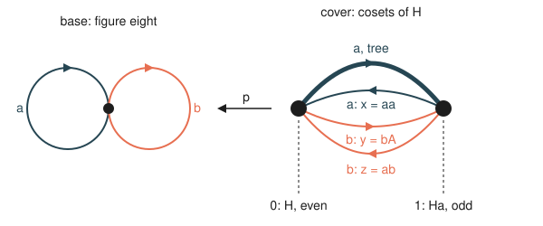

# Nielsen-Schreier: every subgroup of a free group is free, read off a covering graph

[Syllabus](../../../SYLLABUS.md) → [Topology](../README.md) → [Homotopy](../README.md#s04) → Nielsen-Schreier

---

## General Overview

A dog on a lead runs round two lamp posts, the a-post and the b-post, with the walker standing between them. Each run is a word. The letter a means once round the a-post, and the capital A means once round it the other way; b and B do the same for the b-post. Neighbouring pairs such as aA cancel, because the lead comes straight back. These words form the **free group** on a and b, the loop group of the figure eight ([Van Kampen's theorem](06-van-kampens-theorem.md)).

Now keep only the runs with an **even** number of laps once cancelling is done, counting laps round either post in either direction. Two even runs joined make an even run, since cancelling removes letters in pairs. The undo of an even run is even. So these runs form a **subgroup** H: a part of the group that is a group in its own right ([Cosets and Lagrange's theorem](../../03-Algebra/08-Groups/04-cosets-and-lagranges-theorem.md)).

Which runs build all of H, and do they obey any hidden rule? A map with two dots answers both questions. One dot means "even so far", the other "odd so far", and every lap moves the dog to the other dot. That map has 2 dots and 4 arrows. Network designers call a map like this a 2-lift, and repeat it to build well-connected networks and error-correcting codes; a run closes up on it exactly when the run lies in H. Keep one arrow as a **spanning tree**: a set of arrows that reaches every dot and closes no circuit. Each of the other 3 arrows gives one run that builds H:

- x = aa: twice round the a-post;
- y = bA: round the b-post, then back round the a-post;
- z = ab: round the a-post, then round the b-post.

Every even run is exactly one reduced word in x, y and z: for example bb = yz. So H is itself a free group, on 3 letters. The whole group needed only 2.

**Every subgroup of a free group is the loop group of a covering graph, every graph's loop group is free with one free letter for each edge outside a spanning tree, so every subgroup of a free group is free; if it has index k in the free group on n letters, it is free on 1 + k(n − 1) letters.**

**What kind of fact this is:** a theorem, the Nielsen-Schreier theorem, proved on this card in Why it works for free groups on finitely many letters. Jakob Nielsen proved the finitely generated case in 1921 and Otto Schreier the general case, with the count, in 1927. The code checks finitely many words: it illustrates the theorem and proves nothing beyond them.

### The picture: the figure eight and its two-sheeted cover

<p align="center"></p>

Schematic: only which arrows join which dots matters. Each dot of the cover has one a-arrow and one b-arrow leaving it, and one of each arriving, just as the single dot of the figure eight does. That is what makes it a cover: looking down by the map $`p`$, every small patch of it looks like the figure eight.

---

## The formula

Notation first, in words.

- $`F_n`$ is the free group on $`n`$ letters; here $`F_2`$ on a and b. The capital letters A and B stand for $`a^{-1}`$ and $`b^{-1}`$, as in the code.
- A **free basis** of a group is a list of its members such that every member is exactly one reduced word in them. The **rank** of a free group is the length of a free basis.
- A **right coset** $`Hw`$ is the subgroup with the word $`w`$ written after each member. The **index** $`k = [F_n : H]`$ counts the different cosets ([Cosets and Lagrange's theorem](../../03-Algebra/08-Groups/04-cosets-and-lagranges-theorem.md) uses left cosets; right ones come in the same number).
- The **coset graph** $`\Gamma_H`$ has one vertex for each coset, and an arrow labelled $`x`$ from $`Hw`$ to $`Hwx`$ for each letter $`x`$. In the example, $`H`$ is vertex 0 (even) and $`Ha`$ is vertex 1 (odd).

Fix a spanning tree $`T`$ of $`\Gamma_H`$. For a vertex $`u`$, write $`\bar u`$ for the word read along the tree from vertex 0 to $`u`$. Each edge $`e`$ outside the tree, from $`u`$ to $`v`$ with label $`x`$, gives one word:

```math
s_e = \bar u \; x \; \bar v^{-1}
```

**Read it aloud:** walk the tree out to the edge's start, cross the edge, and walk the tree home from its end.

In the example $`\bar 0`$ is the empty word and $`\bar 1 = a`$. The edge $`b`$ from 0 to 1 gives $`s = b\,a^{-1}`$, the run y. The words $`s_e`$ form a free basis of $`H`$, and there are this many of them:

```math
\mathrm{rank}(H) = E - V + 1 = 1 + k\,(n - 1) = 1 - \chi(\Gamma_H)
```

**Read it aloud:** the rank is the number of edges left after a spanning tree, which is one plus the index times one less than the number of letters, which is one minus the graph's Euler characteristic.

With the example's numbers: 4 − 2 + 1 = 3, and 1 + 2 × (2 − 1) = 3, and 1 − (−2) = 3.

| Symbol | Plain meaning | In our example | Push it up and the answer… |
| --- | --- | --- | --- |
| $`F_n`$, $`n`$; $`a`$, $`b`$, $`A`$, $`B`$ | the free group and its number of letters; once round the a-post or the b-post, and the same run backwards | $`F_2`$; ab is round the a-post, then the b-post | each extra letter adds $`k`$ to the rank |
| $`H`$ | the subgroup | the even-length words | — |
| $`k = [F_n : H]`$ | the index: how many cosets | 2: even and odd | each extra coset adds $`n - 1`$ to the rank |
| $`Hw`$ | a right coset: $`H`$ with $`w`$ written after each member | $`Ha`$, the odd words | — |
| $`\Gamma_H`$, $`p`$, $`p_*`$ | the coset graph; the map down to the figure eight, sending each arrow to the loop with its label; what $`p`$ does to loops | 2 vertices, 4 arrows | — |
| $`T`$ | a spanning tree: reaches every vertex, closes no circuit | the a-edge from 0 to 1 | always $`V - 1`$ edges |
| $`\bar u`$ | the word read along $`T`$ from vertex 0 to $`u`$ | $`\bar 0`$ empty, $`\bar 1 = a`$ | — |
| $`s_e`$; x, y, z | the basis word of a non-tree edge; the example's three | aa, bA, ab | — |
| $`V`$, $`E`$, $`\chi`$ | vertices and edges of $`\Gamma_H`$; its Euler characteristic $`V - E`$ | 2 and 4; figure eight $`1 - 2 = -1`$, cover $`-2`$ | more edges, more basis words; $`\chi`$ multiplies by $`k`$ in a $`k`$-sheeted cover |
| $`\mathrm{rank}`$ | the length of a free basis | 3 | — |
| $`\mathbb{Z} \times \mathbb{Z}`$ | pairs of whole numbers added place by place: the torus group, where ab = ba | aa becomes (2, 0) | — |
| $`x_i`$, $`u_i`$, $`m`$; $`\varepsilon_i`$, $`r`$ | in the proof: a word's i-th letter, the vertex reached after it, the word's length; a sign 1 or −1, a count of basis factors | bb: $`m = 2`$, $`u_1 = 1`$; yz: $`r = 2`$ | — |

### When it holds

- **The big group must be free.** In the torus group $`\mathbb{Z} \times \mathbb{Z}`$, where a and b commute, the three loops become the pairs (2, 0), (−1, 1) and (1, 1), and x = z − y there. That is a rule among them, so they are no free basis; two generators suffice where the formula says 3.
- **Finite index, for the count.** The runs with zero net laps round each post separately form a subgroup of infinite index. Its coset graph is the endless square grid: each coset is a grid point (net laps round a, net laps round b), which the code checks on the first 61 cosets. It is still free, but boxes of 2, 3, 4 and 5 vertices a side already hold 1, 4, 9 and 16 independent loops: no finite rank.
- **Finitely many letters, for this proof.** Then each vertex has finitely many edges, and a search outward from vertex 0 builds the tree. With infinitely many letters the theorem still holds, but finding the tree needs Zorn's lemma.

---

## Why it works

### Step 0: a subgroup is a cover, a cover of a graph is a graph, and a graph's loops are free

The figure eight's loop group is $`F_2`$. By [Covering spaces](05-covering-spaces.md), each subgroup belongs to a cover whose sheets match its cosets. A cover of a graph is again a graph: above each dot sit $`k`$ dots, above each loop $`k`$ arrows. And a graph's loop group is free: squash a spanning tree to a point and a bouquet is left, one vertex with loops attached ([CW complexes](07-cw-complexes-and-gluing-cells.md), Step 1). The steps below build each link by hand.

### Step 1: the coset graph is a cover of the figure eight

Each vertex $`Hw`$ has exactly one $`x`$-arrow leaving it, to $`Hwx`$. It has exactly one arriving, from $`Hwx^{-1}`$. So near each vertex the graph looks like the figure eight near its vertex: an $`a`$ in and out, a $`b`$ in and out. That is the evenly covered condition of [Covering spaces](05-covering-spaces.md), with $`k`$ sheets.

In the example, each lap from vertex 0 goes to vertex 1, and each lap from vertex 1 comes back. The code checks the one-in, one-out rule at every vertex.

### Step 2: closed walks from vertex 0 spell exactly the words of H

Read a word $`w`$ letter by letter from vertex 0: forward along an $`x`$-arrow for $`x`$, backward along one for $`x^{-1}`$. The walk ends at the coset $`Hw`$. That coset is $`H`$ itself exactly when $`w`$ lies in $`H`$. So the walk closes up exactly for the words of $`H`$.

In the language of covers, $`p_*`$ maps the cover's loop group one for one onto $`H`$ ([Covering spaces](05-covering-spaces.md), Step 4). For the even runs, bb goes from 0 to 1 and back to 0, so it closes; b alone stops at 1. The code tests all 1,457 reduced words up to 6 letters: the walk closes for exactly the even ones.

### Step 3: a spanning tree turns the other edges into a free basis

A tree has no circuits, so walking out along the tree and straight back cancels to nothing. A closed walk can therefore be cut at every non-tree edge it crosses. Each piece is "tree out, one edge, tree home", which is one $`s_e`$ or its inverse. That shows the $`s_e`$ build all of $`H`$.

No hidden rule holds among them, for one reason: at each vertex each letter leaves along exactly one arrow and arrives along exactly one. So a walk that never turns straight back spells a word with no cancelling neighbours. A nonempty reduced word in the $`s_e`$ crosses at least one non-tree edge that nothing cancels, so it spells a nonempty reduced word in a and b, which is not 1.

A different tree gives a different basis, of the same length. With the b-edge from 0 to 1 as the tree, $`\bar 1 = b`$ and the basis is aB, ba, bb.

<details>
<summary>Detailed proof: the words s_e generate H and obey no relation</summary>

A walk **backtracks** when it crosses an edge and at once crosses the same edge back.

*Fact A: a walk that never backtracks spells a reduced word.* Suppose it reads $`x`$ and then $`x^{-1}`$. The first step crossed an $`x`$-arrow forward, into a vertex $`v`$. The second crossed an $`x`$-arrow backward, out of $`v`$, so that arrow also ends at $`v`$. Only one $`x`$-arrow arrives at $`v`$, so it is the same arrow: a backtrack. Reading $`x^{-1}`$ then $`x`$ is the same argument with "leaves" for "arrives".

*The tree edges spell nothing.* If a tree edge with label $`x`$ runs from $`u`$ to $`v`$, the tree path to one end is the tree path to the other end plus this edge. So $`\bar v = \bar u\,x`$ or $`\bar u = \bar v\,x^{-1}`$, and either way $`\bar u\,x\,\bar v^{-1}`$ cancels to the empty word.

*Generation.* Let $`w = x_1 x_2 \cdots x_m`$ lie in $`H`$, each $`x_i`$ a letter or an inverse letter. Its walk visits $`u_0 = 0, u_1, \dots, u_m = 0`$. Insert $`\bar u_i^{-1}\bar u_i`$, which is the empty word, between each pair of letters. Since $`\bar 0`$ is empty:

$`\displaystyle w = (\bar u_0\, x_1\, \bar u_1^{-1})(\bar u_1\, x_2\, \bar u_2^{-1}) \cdots (\bar u_{m-1}\, x_m\, \bar u_m^{-1})`$

Each bracket is 1 for a tree step, and $`s_e`$ or $`s_e^{-1}`$ for a step across a non-tree edge $`e`$. So $`w`$ is a product of the $`s_e`$ and their inverses.

*Freeness.* Take a nonempty reduced word $`s_{e_1}^{\varepsilon_1} \cdots s_{e_r}^{\varepsilon_r}`$, each $`\varepsilon_i`$ equal to 1 or −1. Replace each factor by its walk: tree out, edge $`e_i`$ crossed forward or backward, tree home. Join the walks into one closed walk. Remove backtracks one at a time; each removal deletes a cancelling pair of letters, so the spelled word stays the same member of $`F_n`$.

Between two consecutive non-tree crossings lies a walk in the tree. Removing its backtracks leaves the tree's only path between those two points. A non-tree crossing could be removed only if the next crossing were the same edge straight back, with an empty tree path between. That means $`e_{i+1} = e_i`$ and $`\varepsilon_{i+1} = -\varepsilon_i`$, which a reduced word forbids. So after all removals the walk still crosses $`r \ge 1`$ non-tree edges and never backtracks. By Fact A it spells a nonempty reduced word, which is not the identity.

The argument nowhere needs the graph to be finite, only a spanning tree. For finitely many letters a breadth-first search from vertex 0 gives one, since every vertex $`Hw`$ is reached by walking $`w`$.

</details>

### Step 4: count the basis, two ways

A tree on $`V`$ vertices has $`V - 1`$ edges ([Spanning trees](../../04-Combinatorics%20and%20graphs/10-Trees%20and%20Cheapest%20Routes/03-spanning-trees-and-cayleys-formula.md)). So the basis has $`E - (V - 1) = E - V + 1`$ words.

In the coset graph $`V = k`$, and each vertex sends out one arrow per letter, so $`E = kn`$. Then the rank is $`kn - k + 1 = 1 + k(n - 1)`$. That is Schreier's formula.

The same count reads as an Euler characteristic ([Euler characteristic](../03-Surfaces%20and%20Manifolds/04-euler-characteristic-and-triangulations.md)). The bouquet of $`n`$ loops has $`\chi = 1 - n`$. A $`k`$-sheeted cover has $`k`$ copies of every vertex and of every edge, so its $`\chi`$ is $`k(1 - n)`$. For a connected graph the rank is $`1 - \chi`$. Here $`\chi = 2 \times (1 - 2) = -2`$ and the rank is 3.

### Step 5: rewrite any member of H in the basis

Step 3's proof is also an algorithm, Reidemeister-Schreier rewriting. Walk the word from vertex 0 and write down the name of each non-tree edge crossed: its letter forward, its inverse backward.

- bb: the b-edge 0 to 1 is y, the b-edge 1 to 0 is z. So bb = yz, and y z = bA·ab = bb.
- ba: the b-edge 0 to 1 is y, the a-edge 1 to 0 is x. So ba = yx = bA·aa.
- abab: the a-edges from 0 are the tree, the b-edges from 1 are z. So abab = zz.

The code rewrites all 1,093 even reduced words up to 6 letters this way and expands each back to itself. It also expands all 937 reduced words in x, y, z up to 4 letters and gets 937 different words in a and b, with only the empty word giving 1. That is a check on finitely many words; the proof in Step 3 covers the rest.

---

## Worked numbers, by hand

| Step | Arithmetic | Value |
| --- | --- | --- |
| cosets | the empty word is even, a is odd, and every word is one or the other | 2: $`H`$ and $`Ha`$ |
| arrows | 2 vertices × 2 letters | 4 |
| spanning tree | 2 vertices need 2 − 1 edges; take a from 0 to 1 | 1 edge |
| a from 1 to 0 | $`\bar 1\, a\, \bar 0^{-1} = a \cdot a`$ | x = aa |
| b from 0 to 1 | $`\bar 0\, b\, \bar 1^{-1} = b \cdot a^{-1}`$ | y = bA |
| b from 1 to 0 | $`\bar 1\, b\, \bar 0^{-1} = a \cdot b`$ | z = ab |
| rank by edges | 4 − 2 + 1 | 3 |
| rank by Schreier | 1 + 2 × (2 − 1) | 3 |
| rank by Euler | 1 − 2 × (1 − 2) | **3** |

The even runs of the dog are built from three runs, aa, bA and ab, and no shorter list does it: H is free of rank 3.

A second subgroup on the same posts: runs whose net laps, round both posts together and counting direction, are a multiple of 3. The code finds index 3 and the basis aaa, bA, abAA, aab: rank 4 = 6 − 3 + 1 = 1 + 3 × (2 − 1).

### What breaks if you drop a piece

| Mistake | Comes out at | What went wrong |
| --- | --- | --- |
| Keep the tree edge as a generator too | its word a·A = 1, the empty word | tree edges spell nothing; only non-tree edges are free letters |
| Count edges minus vertices, no + 1 | 4 − 2 = 2 | a tree has $`V - 1`$ edges, not $`V`$; true rank 3 |
| Infinite index: zero net laps round each post | cosets still growing at 61; grid boxes hold 1, 4, 9, 16 loops | the formula needs finite $`k`$; the subgroup is free but not finitely generated |
| Torus group $`\mathbb{Z} \times \mathbb{Z}`$, not free | x, y, z become (2, 0), (−1, 1), (1, 1), and x = z − y | a rule holds among them; in $`F_2`$, $`z y^{-1}`$ is abaB, not aa |

The code prints all four.

---

## Code, from first principles, and it actually runs

The code knows $`H`$ only through a membership test: words $`u`$ and $`v`$ name the same coset when $`u v^{-1}`$ lies in $`H`$. It takes two roads, then reads one count three ways.

- **Road 1** builds the coset graph by a breadth-first search. The arrow that first reaches a coset joins the spanning tree; the other arrows give the basis.
- **Road 2** rewrites every even reduced word up to 6 letters in the basis and expands it back. It also expands every reduced word in x, y, z up to 4 letters and checks that no two agree.
- **The count.** The rank by edges, by Schreier's formula and by the Euler characteristic is one count rearranged, since the enumeration gives every vertex one arrow per letter (Step 4). What is checked is that the basis Road 2 verified has $`1 + k(n - 1)`$ words.

All of this is checked on finitely many words: it illustrates the theorem and does not prove it.

### Python

```python
# Nielsen-Schreier -- the check behind the card.  Nothing is imported.
# The free group on a, b; A and B are the same loops run backwards.  A subgroup
# H is given only by a membership test.  Road 1 enumerates the cosets H w as a
# covering graph, grows a spanning tree, and reads a basis off the other edges.
# Road 2 rewrites every short word of H in that basis and tests freeness.
# The rank is then one count read three ways: by edges, by Schreier's formula, by Euler.
INV = {"a": "A", "A": "a", "b": "B", "B": "b", "x": "X", "X": "x",
       "y": "Y", "Y": "y", "z": "Z", "Z": "z"}

def reduce(w):                                   # cancel neighbouring pairs such as aA
    out = []
    for c in w:
        if out and out[-1] == INV[c]:
            out.pop()
        else:
            out.append(c)
    return "".join(out)

def inverse(w):
    return "".join(INV[c] for c in reversed(w))

def even(w):                                     # the card's subgroup: even length
    return len(w) % 2 == 0

def turns3(w):                                   # net turns, both posts, a multiple of 3
    return (w.count("a") + w.count("b") - w.count("A") - w.count("B")) % 3 == 0

def net_zero(w):                                 # net turns 0 round each post separately
    return w.count("a") == w.count("A") and w.count("b") == w.count("B")

def coset_graph(member, cap=60):                 # road 1: vertices are the cosets H w
    reps, out, tree, i = [""], {}, set(), 0
    while i < len(reps) and len(reps) <= cap:
        for x in "ab":
            w = reduce(reps[i] + x)              # same coset as r exactly when w r^-1 is in H
            j = next((k for k, r in enumerate(reps) if member(reduce(w + inverse(r)))), None)
            if j is None:
                j = len(reps)
                reps.append(w)
                tree.add((i, x))                 # the edge that found a vertex joins the tree
            out[(i, x)] = j
        i += 1
    return reps, out, tree

def basis(reps, out, tree):                      # one loop per edge outside the tree
    return [(u, x, out[(u, x)], reduce(reps[u] + x + inverse(reps[out[(u, x)]])))
            for x in "ab" for u in range(len(reps)) if (u, x) not in tree]

def reduced_words(alphabet, n):                  # every reduced word of length 0 to n
    words, layer = [""], [""]
    for _ in range(n):
        layer = [w + c for w in layer for c in alphabet if not w or w[-1] != INV[c]]
        words += layer
    return words

def show(w):
    return w if w else "1"

reps, out, tree = coset_graph(even)
k, V, E = len(reps), len(reps), len(out)
B = basis(reps, out, tree)
names = {(u, x): "xyz"[i] for i, (u, x, v, w) in enumerate(B)}
meaning = {"xyz"[i]: w for i, (u, x, v, w) in enumerate(B)}

def rewrite(w):                                  # road 2: walk w, note each non-tree edge
    v, word = 0, ""
    for c in w:
        if c in "ab":
            word, v = word + names.get((v, c), ""), out[(v, c)]
        else:
            u = next(u for u in range(k) if out[(u, INV[c])] == v)
            word, v = word + INV[names[(u, INV[c])]] if (u, INV[c]) in names else word, u
    return v, word

def expand(word):
    return reduce("".join(meaning[c] if c in meaning else inverse(meaning[INV[c]]) for c in word))

print("subgroup H: reduced words of even length in a, b (A, B: a, b run backwards)")
print(f"cosets found by enumeration: {k}, representatives {', '.join(show(r) for r in reps)}")
for (u, x) in sorted(tree):
    print(f"edge {u} -{x}-> {out[(u, x)]}: spanning tree")
for (u, x, v, w) in B:
    print(f"edge {u} -{x}-> {v}: loop {show(reps[u])}.{x}.{show(inverse(reps[v]))} = {w}, named {names[(u, x)]}")
cover = all(sum(out[(u, x)] == v for u in range(k)) == 1 for v in range(k) for x in "ab")
print(f"one a-edge and one b-edge out of and into every vertex (a cover): {'yes' if cover else 'no'}")
print(f"each basis loop lies in H: {'yes' if all(even(w) for (_, _, _, w) in B) else 'no'}")
B2 = basis(["", "b"], out, {(0, "b")})             # the other tree: the b-edge from 0 to 1, so vertex 1 is read b
print(f"another spanning tree, the b-edge from 0 to 1: basis {', '.join(w for *_, w in B2)}, again {len(B2)} words")
chi = V - E
print(f"rank three ways: E - V + 1 = {E} - {V} + 1 = {E - V + 1}; Schreier 1 + {k} x (2 - 1) = "
      f"{1 + k * (2 - 1)}; Euler chi = {k} x (1 - 2) = {chi}, rank 1 - chi = {1 - chi}")
for w in ["bb", "ba", "abab"]:
    end, word = rewrite(w)
    print(f"rewrite {w}: path ends at vertex {end}, crosses {word}; expands back to {expand(word)}")
F = reduced_words("abAB", 6)
ok = [w for w in F if even(w) and rewrite(w)[0] == 0 and expand(rewrite(w)[1]) == w]
closes = all((rewrite(w)[0] == 0) == even(w) for w in F)
print(f"reduced words up to length 6: {len(F)}; walk closes exactly for the even ones: {'yes' if closes else 'no'}")
print(f"even ones rewritten in x, y, z and expanded back unchanged: {len(ok)} of {sum(even(w) for w in F)}")
G = reduced_words("xyzXYZ", 4)
images = {expand(g) for g in G}
print(f"reduced words in x, y, z up to length 4: {len(G)}; distinct words in a, b they expand to: "
      f"{len(images)}; only the empty word gives 1: {'yes' if [g for g in G if expand(g) == ''] == [''] else 'no'}")
reps3, out3, tree3 = coset_graph(turns3)
B3 = basis(reps3, out3, tree3)
print(f"second subgroup, net turns a multiple of 3: index {len(reps3)}, basis {', '.join(w for *_, w in B3)}")
print(f"  rank: E - V + 1 = {len(out3)} - {len(reps3)} + 1 = {len(out3) - len(reps3) + 1}; "
      f"Schreier 1 + {len(reps3)} x (2 - 1) = {1 + len(reps3)}")
print("figure, vertex 0 at (330, 120), vertex 1 at (490, 120), tree edge a from 0 to 1, base eight at (120, 120)")
print(f"mistake 1, keep the tree edge as a generator: its loop 1.a.A = {show(reduce('a' + inverse(reps[1])))}, the empty word")
print(f"mistake 2, edges minus vertices with no + 1: {E} - {V} = {E - V}, true rank {E - V + 1}")
repsC, outC, _ = coset_graph(net_zero)
pt = [(r.count("a") - r.count("A"), r.count("b") - r.count("B")) for r in repsC]   # each coset's (net a, net b)
grid = len(set(pt)) == len(pt) and all(pt[j] == (pt[i][0] + (x == "a"), pt[i][1] + (x == "b")) for (i, x), j in outC.items())
box = [{i for i, (p, q) in enumerate(pt) if 0 <= p < n and 0 <= q < n} for n in range(2, 6)]
boxes = [sum(i in s and j in s for (i, _), j in outC.items()) - len(s) + 1 for s in box]   # edges - vertices + 1
print(f"mistake 3, infinite index (net turns 0 round each post): cosets still growing at {len(repsC)}; each is a grid "
      f"point (net a, net b), each arrow one step: {'yes' if grid else 'no'}; n by n boxes of it, n = 2 to 5, hold {boxes} loops")
vec = {w: (w.count("a") - w.count("A"), w.count("b") - w.count("B")) for (*_, w) in B}
rel = all(vec["aa"][d] == vec["ab"][d] - vec["bA"][d] for d in (0, 1))
print(f"mistake 4, the torus group Z x Z: x, y, z become {vec['aa']}, {vec['bA']}, {vec['ab']}, and x = z - y "
      f"there: {'yes' if rel else 'no'}; in F2, x = z y^-1 reads {expand('zY')}, not aa")
assert k == 2 and [w for *_, w in B] == ["aa", "bA", "ab"] and [w for *_, w in B2] == ["aB", "ba", "bb"]  # by hand
assert len(B) == 1 + k * (2 - 1) == 3                                      # the verified basis has Schreier's count
assert closes and len(ok) == 1 + 12 + 108 + 972                            # generates H, 1093 words
assert len(images) == len(G) == 1 + 6 + 30 + 150 + 750                     # no hidden relation
assert [w for *_, w in B3] == ["aaa", "bA", "abAA", "aab"] and len(repsC) > 60
assert grid and boxes == [1, 4, 9, 16] and rel and expand("zY") != "aa"
print("ALL CHECKS PASS")
```

**Ran 2026-11-24 on macOS, Python 3.14.10, standard library only. All checks passed. Output, pasted from the run:**

```
subgroup H: reduced words of even length in a, b (A, B: a, b run backwards)
cosets found by enumeration: 2, representatives 1, a
edge 0 -a-> 1: spanning tree
edge 1 -a-> 0: loop a.a.1 = aa, named x
edge 0 -b-> 1: loop 1.b.A = bA, named y
edge 1 -b-> 0: loop a.b.1 = ab, named z
one a-edge and one b-edge out of and into every vertex (a cover): yes
each basis loop lies in H: yes
another spanning tree, the b-edge from 0 to 1: basis aB, ba, bb, again 3 words
rank three ways: E - V + 1 = 4 - 2 + 1 = 3; Schreier 1 + 2 x (2 - 1) = 3; Euler chi = 2 x (1 - 2) = -2, rank 1 - chi = 3
rewrite bb: path ends at vertex 0, crosses yz; expands back to bb
rewrite ba: path ends at vertex 0, crosses yx; expands back to ba
rewrite abab: path ends at vertex 0, crosses zz; expands back to abab
reduced words up to length 6: 1457; walk closes exactly for the even ones: yes
even ones rewritten in x, y, z and expanded back unchanged: 1093 of 1093
reduced words in x, y, z up to length 4: 937; distinct words in a, b they expand to: 937; only the empty word gives 1: yes
second subgroup, net turns a multiple of 3: index 3, basis aaa, bA, abAA, aab
  rank: E - V + 1 = 6 - 3 + 1 = 4; Schreier 1 + 3 x (2 - 1) = 4
figure, vertex 0 at (330, 120), vertex 1 at (490, 120), tree edge a from 0 to 1, base eight at (120, 120)
mistake 1, keep the tree edge as a generator: its loop 1.a.A = 1, the empty word
mistake 2, edges minus vertices with no + 1: 4 - 2 = 2, true rank 3
mistake 3, infinite index (net turns 0 round each post): cosets still growing at 61; each is a grid point (net a, net b), each arrow one step: yes; n by n boxes of it, n = 2 to 5, hold [1, 4, 9, 16] loops
mistake 4, the torus group Z x Z: x, y, z become (2, 0), (-1, 1), (1, 1), and x = z - y there: yes; in F2, x = z y^-1 reads abaB, not aa
ALL CHECKS PASS
```

### Rust

Same numbers, same labels, built with `rustc --edition 2021 -O`.

```rust
// Nielsen-Schreier -- the same check as the Python, in Rust.  No crates.
// The free group on a, b; A and B are the same loops run backwards.  A subgroup
// H is given only by a membership test.  Road 1 enumerates the cosets H w as a
// covering graph, grows a spanning tree, and reads a basis off the other edges.
// Road 2 rewrites every short word of H in that basis and tests freeness.
// The rank is then one count read three ways: by edges, by Schreier's formula, by Euler.
use std::collections::{BTreeMap, BTreeSet};

type Graph = (Vec<String>, BTreeMap<(usize, char), usize>, BTreeSet<(usize, char)>);

fn inv(c: char) -> char { if c.is_lowercase() { c.to_ascii_uppercase() } else { c.to_ascii_lowercase() } }

fn reduce(w: &str) -> String {                     // cancel neighbouring pairs such as aA
    let mut out: Vec<char> = Vec::new();
    for c in w.chars() {
        if out.last() == Some(&inv(c)) { out.pop(); } else { out.push(c); }
    }
    out.into_iter().collect()
}

fn inverse(w: &str) -> String { w.chars().rev().map(inv).collect() }
fn count(w: &str, c: char) -> i64 { w.chars().filter(|&d| d == c).count() as i64 }
fn even(w: &str) -> bool { w.len() % 2 == 0 }      // the card's subgroup: even length
fn turns3(w: &str) -> bool {                       // net turns, both posts, a multiple of 3
    (count(w, 'a') + count(w, 'b') - count(w, 'A') - count(w, 'B')).rem_euclid(3) == 0
}
fn net_zero(w: &str) -> bool { count(w, 'a') == count(w, 'A') && count(w, 'b') == count(w, 'B') }

fn coset_graph(member: fn(&str) -> bool, cap: usize) -> Graph {   // road 1: cosets H w
    let (mut reps, mut out, mut tree, mut i) = (vec![String::new()], BTreeMap::new(), BTreeSet::new(), 0);
    while i < reps.len() && reps.len() <= cap {
        for x in ['a', 'b'] {
            let w = reduce(&format!("{}{}", reps[i], x));   // same coset as r when w r^-1 is in H
            let found = reps.iter().position(|r| member(&reduce(&format!("{}{}", w, inverse(r)))));
            let j = match found {
                Some(j) => j,
                None => { reps.push(w); tree.insert((i, x)); reps.len() - 1 }
            };
            out.insert((i, x), j);
        }
        i += 1;
    }
    (reps, out, tree)
}

fn basis(g: &Graph) -> Vec<(usize, char, usize, String)> {        // one loop per non-tree edge
    let (reps, out, tree) = g;
    let mut b = Vec::new();
    for x in ['a', 'b'] {
        for u in 0..reps.len() {
            if tree.contains(&(u, x)) { continue }
            let v = out[&(u, x)];
            b.push((u, x, v, reduce(&format!("{}{}{}", reps[u], x, inverse(&reps[v])))));
        }
    }
    b
}

fn reduced_words(alphabet: &str, n: usize) -> Vec<String> {      // every reduced word, length 0 to n
    let (mut words, mut layer) = (vec![String::new()], vec![String::new()]);
    for _ in 0..n {
        let mut next = Vec::new();
        for w in &layer {
            for c in alphabet.chars() {
                if w.chars().last() != Some(inv(c)) { next.push(format!("{}{}", w, c)) }
            }
        }
        words.extend(next.iter().cloned());
        layer = next;
    }
    words
}

fn show(w: &str) -> String { if w.is_empty() { "1".to_string() } else { w.to_string() } }
fn yn(b: bool) -> &'static str { if b { "yes" } else { "no" } }

fn main() {
    let g = coset_graph(even, 60);
    let (reps, out, tree) = (&g.0, &g.1, &g.2);
    let (k, v_n, e_n) = (reps.len(), reps.len() as i64, out.len() as i64);
    let b = basis(&g);
    let mut names: BTreeMap<(usize, char), char> = BTreeMap::new();
    let mut meaning: BTreeMap<char, String> = BTreeMap::new();
    for (i, (u, x, _, w)) in b.iter().enumerate() {
        let n = ['x', 'y', 'z'][i];
        names.insert((*u, *x), n);
        meaning.insert(n, w.clone());
    }
    let rewrite = |w: &str| -> (usize, String) {   // road 2: walk w, note each non-tree edge
        let (mut v, mut word) = (0usize, String::new());
        for c in w.chars() {
            if c == 'a' || c == 'b' {
                if let Some(n) = names.get(&(v, c)) { word.push(*n) }
                v = out[&(v, c)];
            } else {
                let u = (0..k).find(|&u| out[&(u, inv(c))] == v).unwrap();
                if let Some(n) = names.get(&(u, inv(c))) { word.push(inv(*n)) }
                v = u;
            }
        }
        (v, word)
    };
    let expand = |word: &str| -> String {
        reduce(&word.chars().map(|c| match meaning.get(&c) {
            Some(m) => m.clone(),
            None => inverse(&meaning[&inv(c)]),
        }).collect::<String>())
    };
    println!("subgroup H: reduced words of even length in a, b (A, B: a, b run backwards)");
    println!("cosets found by enumeration: {}, representatives {}", k,
             reps.iter().map(|r| show(r)).collect::<Vec<_>>().join(", "));
    for (u, x) in tree.iter() { println!("edge {} -{}-> {}: spanning tree", u, x, out[&(*u, *x)]) }
    for (u, x, v, w) in &b {
        println!("edge {} -{}-> {}: loop {}.{}.{} = {}, named {}", u, x, v, show(&reps[*u]), x,
                 show(&inverse(&reps[*v])), w, names[&(*u, *x)]);
    }
    let cover = (0..k).all(|v| ['a', 'b'].iter().all(|&x| (0..k).filter(|&u| out[&(u, x)] == v).count() == 1));
    println!("one a-edge and one b-edge out of and into every vertex (a cover): {}", yn(cover));
    println!("each basis loop lies in H: {}", yn(b.iter().all(|t| even(&t.3))));
    let b2: Vec<String> = basis(&(vec![String::new(), "b".to_string()], out.clone(), [(0, 'b')].into_iter().collect())).into_iter().map(|t| t.3).collect(); // tree: b-edge 0 -> 1
    println!("another spanning tree, the b-edge from 0 to 1: basis {}, again {} words", b2.join(", "), b2.len());
    let chi = v_n - e_n;
    let ki = k as i64;
    println!("rank three ways: E - V + 1 = {} - {} + 1 = {}; Schreier 1 + {} x (2 - 1) = {}; Euler chi = {} x (1 - 2) = {}, rank 1 - chi = {}",
             e_n, v_n, e_n - v_n + 1, k, 1 + ki * (2 - 1), k, chi, 1 - chi);
    for w in ["bb", "ba", "abab"] {
        let (end, word) = rewrite(w);
        println!("rewrite {}: path ends at vertex {}, crosses {}; expands back to {}", w, end, word, expand(&word));
    }
    let f = reduced_words("abAB", 6);
    let ok = f.iter().filter(|w| even(w) && { let (e, r) = rewrite(w); e == 0 && expand(&r) == **w }).count();
    let closes = f.iter().all(|w| (rewrite(w).0 == 0) == even(w));
    println!("reduced words up to length 6: {}; walk closes exactly for the even ones: {}", f.len(), yn(closes));
    println!("even ones rewritten in x, y, z and expanded back unchanged: {} of {}", ok,
             f.iter().filter(|w| even(w)).count());
    let gw = reduced_words("xyzXYZ", 4);
    let images: BTreeSet<String> = gw.iter().map(|w| expand(w)).collect();
    let trivial: Vec<&String> = gw.iter().filter(|w| expand(w).is_empty()).collect();
    println!("reduced words in x, y, z up to length 4: {}; distinct words in a, b they expand to: {}; only the empty word gives 1: {}",
             gw.len(), images.len(), yn(trivial.len() == 1 && trivial[0].is_empty()));
    let g3 = coset_graph(turns3, 60);
    let b3: Vec<String> = basis(&g3).into_iter().map(|t| t.3).collect();
    let (k3, e3) = (g3.0.len() as i64, g3.1.len() as i64);
    println!("second subgroup, net turns a multiple of 3: index {}, basis {}", k3, b3.join(", "));
    println!("  rank: E - V + 1 = {} - {} + 1 = {}; Schreier 1 + {} x (2 - 1) = {}", e3, k3, e3 - k3 + 1, k3, 1 + k3);
    println!("figure, vertex 0 at (330, 120), vertex 1 at (490, 120), tree edge a from 0 to 1, base eight at (120, 120)");
    println!("mistake 1, keep the tree edge as a generator: its loop 1.a.A = {}, the empty word",
             show(&reduce(&format!("a{}", inverse(&reps[1])))));
    println!("mistake 2, edges minus vertices with no + 1: {} - {} = {}, true rank {}", e_n, v_n, e_n - v_n, e_n - v_n + 1);
    let gc = coset_graph(net_zero, 60);
    let pt: Vec<(i64, i64)> = gc.0.iter().map(|r| (count(r, 'a') - count(r, 'A'), count(r, 'b') - count(r, 'B'))).collect(); // (net a, net b)
    let grid = pt.iter().collect::<BTreeSet<_>>().len() == pt.len() && gc.1.iter().all(|(&(i, x), &j)| pt[j] == (pt[i].0 + (x == 'a') as i64, pt[i].1 + (x == 'b') as i64));
    let boxes: Vec<i64> = (2..6i64).map(|n| { let inb = |v: usize| (0..n).contains(&pt[v].0) && (0..n).contains(&pt[v].1);
        gc.1.iter().filter(|(&(i, _), &j)| inb(i) && inb(j)).count() as i64 - (0..pt.len()).filter(|&v| inb(v)).count() as i64 + 1 }).collect(); // edges - vertices + 1
    println!("mistake 3, infinite index (net turns 0 round each post): cosets still growing at {}; each is a grid point (net a, net b), each arrow one step: {}; n by n boxes of it, n = 2 to 5, hold {:?} loops",
             gc.0.len(), yn(grid), boxes);
    let vec = |w: &str| (count(w, 'a') - count(w, 'A'), count(w, 'b') - count(w, 'B'));
    let (vx, vy, vz) = (vec("aa"), vec("bA"), vec("ab"));
    let rel = vx.0 == vz.0 - vy.0 && vx.1 == vz.1 - vy.1;
    println!("mistake 4, the torus group Z x Z: x, y, z become {:?}, {:?}, {:?}, and x = z - y there: {}; in F2, x = z y^-1 reads {}, not aa",
             vx, vy, vz, yn(rel), expand("zY"));
    assert!(k == 2 && b.iter().map(|t| t.3.as_str()).collect::<Vec<_>>() == ["aa", "bA", "ab"] && b2 == ["aB", "ba", "bb"]); // by hand
    assert!(b.len() as i64 == 1 + ki * (2 - 1) && b.len() == 3);   // the verified basis has Schreier's count
    assert!(closes && ok == 1 + 12 + 108 + 972);                   // generates H, 1093 words
    assert!(images.len() == gw.len() && gw.len() == 1 + 6 + 30 + 150 + 750);   // no hidden relation
    assert!(b3 == ["aaa", "bA", "abAA", "aab"] && gc.0.len() > 60);
    assert!(grid && boxes == [1, 4, 9, 16] && rel && expand("zY") != "aa");
    println!("ALL CHECKS PASS");
}
```

**Ran 2026-11-24 on macOS, rustc 1.98.1, no crates. All checks passed. Output, pasted from the run:**

```
subgroup H: reduced words of even length in a, b (A, B: a, b run backwards)
cosets found by enumeration: 2, representatives 1, a
edge 0 -a-> 1: spanning tree
edge 1 -a-> 0: loop a.a.1 = aa, named x
edge 0 -b-> 1: loop 1.b.A = bA, named y
edge 1 -b-> 0: loop a.b.1 = ab, named z
one a-edge and one b-edge out of and into every vertex (a cover): yes
each basis loop lies in H: yes
another spanning tree, the b-edge from 0 to 1: basis aB, ba, bb, again 3 words
rank three ways: E - V + 1 = 4 - 2 + 1 = 3; Schreier 1 + 2 x (2 - 1) = 3; Euler chi = 2 x (1 - 2) = -2, rank 1 - chi = 3
rewrite bb: path ends at vertex 0, crosses yz; expands back to bb
rewrite ba: path ends at vertex 0, crosses yx; expands back to ba
rewrite abab: path ends at vertex 0, crosses zz; expands back to abab
reduced words up to length 6: 1457; walk closes exactly for the even ones: yes
even ones rewritten in x, y, z and expanded back unchanged: 1093 of 1093
reduced words in x, y, z up to length 4: 937; distinct words in a, b they expand to: 937; only the empty word gives 1: yes
second subgroup, net turns a multiple of 3: index 3, basis aaa, bA, abAA, aab
  rank: E - V + 1 = 6 - 3 + 1 = 4; Schreier 1 + 3 x (2 - 1) = 4
figure, vertex 0 at (330, 120), vertex 1 at (490, 120), tree edge a from 0 to 1, base eight at (120, 120)
mistake 1, keep the tree edge as a generator: its loop 1.a.A = 1, the empty word
mistake 2, edges minus vertices with no + 1: 4 - 2 = 2, true rank 3
mistake 3, infinite index (net turns 0 round each post): cosets still growing at 61; each is a grid point (net a, net b), each arrow one step: yes; n by n boxes of it, n = 2 to 5, hold [1, 4, 9, 16] loops
mistake 4, the torus group Z x Z: x, y, z become (2, 0), (-1, 1), (1, 1), and x = z - y there: yes; in F2, x = z y^-1 reads abaB, not aa
ALL CHECKS PASS
```

The two outputs match line for line.

### Lean

Lean proves the theorem for every free group, Schreier's count for every subgroup of finite index, and the even-runs example.

- Take any free group and any subgroup of it. Then that subgroup is itself a free group.
- Take a subgroup H of $`F_n`$ with finite index k. Then H has a free basis of exactly $`1 + k(n - 1)`$ words.
- Take the runs with an even number of laps once cancelling is done. Then they form a subgroup H of index 2.
- Take x = aa, y = bA and z = ab. Then together they build all of H.
- In $`F_2`$, bb = yz, ba = yx and abab = zz.
- The rank three ways: 4 − 2 + 1, 1 + 2 × (2 − 1) and 1 − (−2) all equal 3.
- For the second subgroup, 6 − 3 + 1 and 1 + 3 × (2 − 1) both equal 4.
- The code's word counts add up: 1 + 12 + 108 + 972 = 1093 and 1 + 6 + 30 + 150 + 750 = 937.

That x, y and z obey no hidden rule, the second subgroup's basis and the failing cases are left to the Python and Rust checks.

```lean
-- Nielsen-Schreier: every subgroup of a free group is free, a subgroup of index k in the free group on n letters has a free basis of 1 + k(n - 1) words, and the even-length words in a and b form a subgroup of index 2 generated by aa, ba⁻¹ and ab.
import Mathlib.GroupTheory.FreeGroup.NielsenSchreier
import Mathlib.GroupTheory.FreeGroup.Reduce
import Mathlib.GroupTheory.Index
import Mathlib.Data.ZMod.Basic
import Mathlib.Tactic.NormNum
import Mathlib.GroupTheory.FreeGroup.GeneratorEquiv
import Mathlib.Tactic.LinearCombination
import Mathlib.Algebra.Group.Subgroup.Pointwise

section NSHelpers

open CategoryTheory CategoryTheory.ActionCategory CategoryTheory.SingleObj Quiver FreeGroup
open IsFreeGroupoid IsFreeGroupoid.SpanningTree

universe u v

set_option backward.isDefEq.respectTransparency false in
open scoped Classical in
noncomputable def nsEndBasis {G : Type u} [Groupoid.{u} G] [IsFreeGroupoid G]
    (T : WideSubquiver (Symmetrify <| Generators G)) [Arborescence T] :
    FreeGroupBasis ((wideSubquiverEquivSetTotal <| wideSubquiverSymmetrify T)ᶜ : Set _)
      (End (show G from root T)) :=
  FreeGroupBasis.ofUniqueLift ((wideSubquiverEquivSetTotal <| wideSubquiverSymmetrify T)ᶜ : Set _)
    (fun e => loopOfHom T (of e.val.hom))
    (by
      intro X _ f
      let f' : Labelling (Generators G) X := fun a b e =>
        if h : e ∈ wideSubquiverSymmetrify T a b then 1 else f ⟨⟨a, b, e⟩, h⟩
      rcases unique_lift f' with ⟨F', hF', uF'⟩
      refine ⟨(SingleObj.toEnd X).symm.toMonoidHom.comp (F'.mapEnd _), ?_, ?_⟩
      · suffices ∀ {x y} (q : x ⟶ y), F'.map (loopOfHom T q).asHom = (F'.map q : X) by
          rintro ⟨⟨a, b, e⟩, h⟩
          dsimp
          rw [toEnd_symm_apply]
          erw [F'.mapEnd_apply_asHom]
          rw [this, hF']
          apply dite_eq_right h
        intro x y q
        suffices ∀ {a} (p : Path (root T) a), F'.map (homOfPath T p) = 1 by
          simp only [this, treeHom, comp_as_mul, inv_as_inv, loopOfHom, inv_one, mul_one,
            one_mul, Functor.map_inv, Functor.map_comp]
        intro a p
        induction p with
        | nil => rw [homOfPath, F'.map_id, id_as_one]
        | cons p e ih =>
          rw [homOfPath, F'.map_comp, comp_as_mul, ih, mul_one]
          rcases e with ⟨e | e, eT⟩
          · rw [hF']
            exact dite_eq_left (Or.inl eT)
          · rw [F'.map_inv, inv_as_inv, inv_eq_one, hF']
            exact dite_eq_left (Or.inr eT)
      · intro E hE
        ext x
        have h1 : treeHom T (show G from root T) = 𝟙 _ := treeHom_root T
        suffices h : (functorOfMonoidHom T E).map x.asHom = F'.map x.asHom by
          simp only [loopOfHom, functorOfMonoidHom, IsIso.inv_id, h1,
            Category.id_comp] at h
          refine Eq.trans ?_ h
          congr 1
          ext
          exact (Category.comp_id _).symm
        congr
        apply uF'
        intro a b e
        change E (loopOfHom T _) = dite _ _ _
        split_ifs with h
        · simp [loopOfHom_eq_id T e h]
        · exact hE ⟨⟨a, b, e⟩, h⟩)

#print axioms nsEndBasis

theorem ns_tree_into {V : Type u} [Quiver.{v} V] (T : WideSubquiver (Symmetrify V))
    [Arborescence T] {a a' c : T} (x : a ⟶ c) (y : a' ⟶ c) : a = a' ∧ x ≍ y := by
  have h : (default : Path (root T) a).cons x = (default : Path (root T) a').cons y :=
    Subsingleton.elim _ _
  exact ⟨Path.obj_eq_of_cons_eq_cons h, Path.hom_heq_of_cons_eq_cons h⟩

#print axioms ns_tree_into

theorem ns_tree_not_into_root {V : Type u} [Quiver.{v} V] (T : WideSubquiver (Symmetrify V))
    [Arborescence T] {a : T} (x : a ⟶ root T) : False :=
  Path.cons_ne_nil _ _ (Subsingleton.elim ((default : Path (root T) a).cons x) Path.nil)

#print axioms ns_tree_not_into_root

theorem ns_tree_no_two_cycle {V : Type u} [Quiver.{v} V] (T : WideSubquiver (Symmetrify V))
    [Arborescence T] {a b : V} (e : a ⟶ b) (h1 : Sum.inl e ∈ T a b) (h2 : Sum.inr e ∈ T b a) :
    False := by
  have hb : (default : Path (root T) (show T from b)) =
      (default : Path (root T) (show T from a)).cons ⟨Sum.inl e, h1⟩ := Subsingleton.elim _ _
  have ha : (default : Path (root T) (show T from a)) =
      (default : Path (root T) (show T from b)).cons ⟨Sum.inr e, h2⟩ := Subsingleton.elim _ _
  have l1 := congrArg Path.length hb
  have l2 := congrArg Path.length ha
  rw [Path.length_cons] at l1 l2
  omega

#print axioms ns_tree_no_two_cycle

theorem ns_tree_exists_into {V : Type u} [Quiver.{v} V] (T : WideSubquiver (Symmetrify V))
    [Arborescence T] (c : T) (hc : c ≠ root T) : ∃ (a : T) (_ : a ⟶ c), True := by
  have p : Path (root T) c := default
  cases p with
  | nil => exact absurd rfl hc
  | cons p x => exact ⟨_, x, trivial⟩

#print axioms ns_tree_exists_into

open scoped Classical in
theorem ns_tree_card {V : Type u} [Quiver.{v} V] (T : WideSubquiver (Symmetrify V))
    [Arborescence T] [Finite V] :
    Nat.card (wideSubquiverEquivSetTotal (wideSubquiverSymmetrify T)) + 1 = Nat.card V := by
  set S := wideSubquiverEquivSetTotal (wideSubquiverSymmetrify T) with hS
  let g : S → V := fun e =>
    if Sum.inl e.1.hom ∈ T e.1.left e.1.right then e.1.right else e.1.left
  have hg : Function.Injective g := by
    rintro ⟨⟨a1, b1, h1⟩, m1⟩ ⟨⟨a2, b2, h2⟩, m2⟩ hgg
    simp only [g] at hgg
    split_ifs at hgg with c1 c2 c2
    · subst hgg
      obtain ⟨rfl, hh⟩ := ns_tree_into T (c := (show T from b1))
        (a := (show T from a1)) (a' := (show T from a2)) ⟨_, c1⟩ ⟨_, c2⟩
      have := Subtype.ext_iff.mp (eq_of_heq hh)
      cases Sum.inl_injective this
      rfl
    · have m2' : Sum.inl h2 ∈ T a2 b2 ∨ Sum.inr h2 ∈ T b2 a2 := m2
      have d2 := m2'.resolve_left c2
      subst hgg
      obtain ⟨rfl, hh⟩ := ns_tree_into T (c := (show T from b1))
        (a := (show T from a1)) (a' := (show T from b2)) ⟨_, c1⟩ ⟨_, d2⟩
      exact absurd (Subtype.ext_iff.mp (eq_of_heq hh)) Sum.inl_ne_inr
    · have m1' : Sum.inl h1 ∈ T a1 b1 ∨ Sum.inr h1 ∈ T b1 a1 := m1
      have d1 := m1'.resolve_left c1
      subst hgg
      obtain ⟨rfl, hh⟩ := ns_tree_into T (c := (show T from a1))
        (a := (show T from b1)) (a' := (show T from a2)) ⟨_, d1⟩ ⟨_, c2⟩
      exact absurd (Subtype.ext_iff.mp (eq_of_heq hh)) Sum.inr_ne_inl
    · have m1' : Sum.inl h1 ∈ T a1 b1 ∨ Sum.inr h1 ∈ T b1 a1 := m1
      have d1 := m1'.resolve_left c1
      have m2' : Sum.inl h2 ∈ T a2 b2 ∨ Sum.inr h2 ∈ T b2 a2 := m2
      have d2 := m2'.resolve_left c2
      subst hgg
      obtain ⟨rfl, hh⟩ := ns_tree_into T (c := (show T from a1))
        (a := (show T from b1)) (a' := (show T from b2)) ⟨_, d1⟩ ⟨_, d2⟩
      cases Sum.inr_injective (Subtype.ext_iff.mp (eq_of_heq hh))
      rfl
  have hrange : Set.range g = ({(root T : V)}ᶜ : Set V) := by
    ext c
    simp only [Set.mem_range, Set.mem_compl_iff]
    constructor
    · rintro ⟨⟨⟨a, b, h⟩, m⟩, rfl⟩
      simp only [g]
      split_ifs with c1
      · exact fun hb => ns_tree_not_into_root T (a := (show T from a))
          (hb ▸ (⟨_, c1⟩ : (show T from a) ⟶ (show T from b)))
      · have m' : Sum.inl h ∈ T a b ∨ Sum.inr h ∈ T b a := m
        have d := m'.resolve_left c1
        exact fun ha => ns_tree_not_into_root T (a := (show T from b))
          (ha ▸ (⟨_, d⟩ : (show T from b) ⟶ (show T from a)))
    · intro hc
      obtain ⟨a, ⟨x, hx⟩, -⟩ := ns_tree_exists_into T c hc
      rcases x with e | e
      · refine ⟨⟨⟨a, c, e⟩, Or.inl hx⟩, ?_⟩
        exact ite_eq_left_iff.mpr (fun h => absurd hx h)
      · refine ⟨⟨⟨c, a, e⟩, Or.inr hx⟩, ?_⟩
        exact ite_eq_right_iff.mpr (fun h => absurd hx (fun hx => ns_tree_no_two_cycle T e h hx))
  have h1 : Nat.card S = Nat.card (Set.range g) := Nat.card_congr (Equiv.ofInjective g hg)
  rw [h1, hrange, Nat.card_coe_set_eq]
  have aux : ∀ r : V, ({r}ᶜ : Set V).ncard + 1 = Nat.card V := fun r => by
    rw [← Set.ncard_add_ncard_compl {r}, Set.ncard_singleton, add_comm]
  exact aux _

#print axioms ns_tree_card

noncomputable def nsTotalEquiv (G A : Type) [Group G] [IsFreeGroup G] [MulAction G A] :
    Total (IsFreeGroupoid.Generators (ActionCategory G A)) ≃
      ActionCategory G A × IsFreeGroup.Generators G := by
  let φ : Total (IsFreeGroupoid.Generators (ActionCategory G A)) →
      ActionCategory G A × IsFreeGroup.Generators G :=
    fun e => (e.left, (e.hom : {x : IsFreeGroup.Generators G //
      IsFreeGroup.of x • (show ActionCategory G A from e.left).back =
        (show ActionCategory G A from e.right).back}).1)
  have hφ : Function.Bijective φ := by
    constructor
    · rintro ⟨a1, b1, ⟨g1, h1⟩⟩ ⟨a2, b2, ⟨g2, h2⟩⟩ he
      simp only [φ] at he
      obtain ⟨rfl, rfl⟩ := he
      have hb : b1 = b2 := by
        have := h1.symm.trans h2
        rw [← ActionCategory.back_coe b1, ← ActionCategory.back_coe b2]
        exact congrArg _ this
      subst hb
      rfl
    · rintro ⟨a, g⟩
      exact ⟨⟨a, ActionCategory.objEquiv G A (IsFreeGroup.of g • a.back), ⟨g, rfl⟩⟩, rfl⟩
  exact Equiv.ofBijective φ hφ

#print axioms nsTotalEquiv

theorem ns_parity_word (L : List (Fin 2 × Bool)) :
    (L.map fun x => cond x.2 ((fun _ : Fin 2 => Multiplicative.ofAdd (1 : ZMod 2)) x.1)
      ((fun _ : Fin 2 => Multiplicative.ofAdd (1 : ZMod 2)) x.1)⁻¹).prod =
      Multiplicative.ofAdd (L.length : ZMod 2) := by
  induction L with
  | nil => rfl
  | cons x L ih =>
    rw [List.map_cons, List.prod_cons, ih, List.length_cons]
    rcases x with ⟨i, _ | _⟩
    · simp only [Bool.cond_false]
      rw [← ofAdd_neg, ← ofAdd_add]
      congr 1
      push_cast
      have : (-1 : ZMod 2) = 1 := by decide
      rw [this, add_comm]
    · simp only [Bool.cond_true]
      rw [← ofAdd_add]
      congr 1
      push_cast
      rw [add_comm]

#print axioms ns_parity_word

theorem ns_schreier_rank (n : ℕ) (H : Subgroup (FreeGroup (Fin n))) (hk : H.index ≠ 0) :
    ∃ m : ℕ, (m : ℤ) = 1 + (H.index : ℤ) * ((n : ℤ) - 1) ∧ Nonempty (FreeGroupBasis (Fin m) H) := by
  classical
  have : H.FiniteIndex := ⟨hk⟩
  let G := FreeGroup (Fin n)
  let C := ActionCategory G (G ⧸ H)
  let r : C := ActionCategory.objEquiv G (G ⧸ H) ↑(1 : G)
  let r' : Symmetrify (IsFreeGroupoid.Generators C) := r
  have : RootedConnected r' := IsFreeGroupoid.generators_connected C r
  let T := geodesicSubtree r'
  let b := nsEndBasis T
  let e : End (show C from root T) ≃* H := endMulEquivSubgroup H
  have hgen : Nat.card (IsFreeGroup.Generators G) = n := by
    rw [← Nat.card_congr (Equiv.ofFreeGroupEquiv (IsFreeGroup.toFreeGroup G)), Nat.card_fin]
  have : Finite (IsFreeGroup.Generators G) :=
    Finite.of_equiv _ (Equiv.ofFreeGroupEquiv (IsFreeGroup.toFreeGroup G))
  have : Finite (IsFreeGroupoid.Generators C) :=
    Finite.of_equiv _ (ActionCategory.objEquiv G (G ⧸ H))
  have hV : Nat.card (IsFreeGroupoid.Generators C) = H.index :=
    (Nat.card_congr (ActionCategory.objEquiv G (G ⧸ H))).symm
  have hTot : Nat.card (Total (IsFreeGroupoid.Generators C)) = H.index * n := by
    rw [Nat.card_congr (nsTotalEquiv G (G ⧸ H)), Nat.card_prod, hgen,
      Nat.card_congr (ActionCategory.objEquiv G (G ⧸ H)).symm]
    rfl
  have : Finite C := Finite.of_equiv _ (ActionCategory.objEquiv G (G ⧸ H))
  have : Finite (Total (IsFreeGroupoid.Generators C)) :=
    Finite.of_equiv _ (nsTotalEquiv G (G ⧸ H)).symm
  have htree := ns_tree_card T
  set S := wideSubquiverEquivSetTotal (wideSubquiverSymmetrify T)
  have hS := Set.ncard_add_ncard_compl S
  rw [← Nat.card_coe_set_eq, ← Nat.card_coe_set_eq, hTot] at hS
  rw [hV] at htree
  refine ⟨Nat.card (Sᶜ : Set _), ?_, ⟨(b.map e).reindex (Finite.equivFin _)⟩⟩
  have hk1 : 1 ≤ H.index := Nat.one_le_iff_ne_zero.mpr hk
  zify at hS htree
  linear_combination hS - htree

#print axioms ns_schreier_rank

end NSHelpers


/-- Schreier's rank formula: a subgroup `H` of finite index `k` in the free group on `n`
letters is free, with a free basis of exactly `1 + k (n - 1)` words. -/
theorem schreier_rank_formula (n : ℕ) (H : Subgroup (FreeGroup (Fin n))) (hk : H.index ≠ 0) :
    ∃ m : ℕ, (m : ℤ) = 1 + (H.index : ℤ) * ((n : ℤ) - 1) ∧ Nonempty (FreeGroupBasis (Fin m) H) := by
  exact ns_schreier_rank n H hk

/-- Nielsen-Schreier: every subgroup of a free group is itself a free group. -/
theorem subgroup_of_free_group_is_free {G : Type} [Group G] [IsFreeGroup G] (H : Subgroup G) :
    IsFreeGroup H := by
  exact Subgroup.isFreeGroupOfIsFreeGroup H

/-- The card's example: in the free group on `a` and `b`, the words whose reduced length is even
form the kernel of the parity map; this subgroup has index 2 and is generated by the three loops
x = aa, y = ba⁻¹ and z = ab read off the covering graph. -/
theorem even_subgroup_index_two_generated_by_aa_bA_ab :
    let a : FreeGroup (Fin 2) := FreeGroup.of 0
    let b : FreeGroup (Fin 2) := FreeGroup.of 1
    let H := (FreeGroup.lift fun _ : Fin 2 => Multiplicative.ofAdd (1 : ZMod 2)).ker
    (∀ w : FreeGroup (Fin 2), w ∈ H ↔ Even w.norm) ∧ H.index = 2 ∧
      Subgroup.closure {a * a, b * a⁻¹, a * b} = H := by
  intro a b H
  set f := FreeGroup.lift fun _ : Fin 2 => Multiplicative.ofAdd (1 : ZMod 2) with hf
  have hval : ∀ w : FreeGroup (Fin 2), f w = Multiplicative.ofAdd (w.norm : ZMod 2) := by
    intro w
    conv_lhs => rw [← FreeGroup.mk_toWord (x := w)]
    rw [hf, FreeGroup.lift_mk, ns_parity_word]
    rfl
  have hmem : ∀ w : FreeGroup (Fin 2), w ∈ H ↔ Even w.norm := by
    intro w
    rw [MonoidHom.mem_ker, hval, ← ZMod.natCast_eq_zero_iff_even]
    exact ofAdd_eq_one
  have ha : f a = Multiplicative.ofAdd 1 := by simp [hf, a]
  have hb : f b = Multiplicative.ofAdd 1 := by simp [hf, b]
  have haH : a ∉ H := by
    rw [MonoidHom.mem_ker, ha]
    decide
  refine ⟨hmem, ?_, ?_⟩
  · rw [Subgroup.index_ker]
    have : f.range = ⊤ := by
      rw [MonoidHom.range_eq_top]
      intro y
      obtain ⟨z, rfl⟩ : ∃ z : ZMod 2, Multiplicative.ofAdd z = y := ⟨y.toAdd, rfl⟩
      fin_cases z
      · exact ⟨1, by rw [map_one]; rfl⟩
      · exact ⟨a, ha⟩
    rw [this, Subgroup.card_top, Nat.card_congr Multiplicative.toAdd, Nat.card_zmod]
  · set K := Subgroup.closure {a * a, b * a⁻¹, a * b} with hK
    have hKH : K ≤ H := by
      rw [hK, Subgroup.closure_le]
      intro x hx
      simp only [Set.mem_insert_iff, Set.mem_singleton_iff] at hx
      rcases hx with rfl | rfl | rfl
      · show f (a * a) = 1
        rw [map_mul, ha]; decide
      · show f (b * a⁻¹) = 1
        rw [map_mul, map_inv, ha, hb]; decide
      · show f (a * b) = 1
        rw [map_mul, ha, hb]; decide
    have aa : a * a ∈ K := Subgroup.subset_closure (by simp)
    have bA : b * a⁻¹ ∈ K := Subgroup.subset_closure (by simp)
    have ab : a * b ∈ K := Subgroup.subset_closure (by simp)
    have key : ∀ w : FreeGroup (Fin 2), w ∈ K ∨ a⁻¹ * w ∈ K := by
      intro w
      have hw : w ∈ Subgroup.closure (Set.range (FreeGroup.of : Fin 2 → FreeGroup (Fin 2))) := by
        rw [FreeGroup.closure_range_of]; trivial
      induction hw using Subgroup.closure_induction_left with
      | one => exact Or.inl (one_mem _)
      | mul_left x hx y _ ih =>
        obtain ⟨i, rfl⟩ := hx
        fin_cases i
        · -- left multiplication by a
          rcases ih with h | h
          · right; simpa [a] using h
          · left
            have := mul_mem aa h
            simpa [a, mul_assoc] using this
        · -- left multiplication by b
          rcases ih with h | h
          · right
            have : a⁻¹ * b ∈ K := by
              have := mul_mem (inv_mem aa) ab
              simpa [mul_assoc] using this
            have := mul_mem this h
            simpa [b, mul_assoc] using this
          · left
            have := mul_mem (mul_mem bA aa) h
            simpa [a, b, mul_assoc] using this
      | inv_mul_cancel x hx y _ ih =>
        obtain ⟨i, rfl⟩ := hx
        fin_cases i
        · rcases ih with h | h
          · right
            have := mul_mem (inv_mem aa) h
            simpa [a, mul_assoc] using this
          · left; simpa [a] using h
        · rcases ih with h | h
          · right
            have hba : b * a ∈ K := by
              have := mul_mem bA aa
              simpa [mul_assoc] using this
            have := mul_mem (inv_mem hba) h
            simpa [a, b, mul_assoc] using this
          · left
            have : a⁻¹ * b ∈ K := by
              have := mul_mem (inv_mem aa) ab
              simpa [mul_assoc] using this
            have := mul_mem (inv_mem this) h
            simpa [a, b, mul_assoc] using this
    apply le_antisymm hKH
    intro w hw
    rcases key w with h | h
    · exact h
    · exfalso
      apply haH
      have h2 := hKH h
      have : a = w * (a⁻¹ * w)⁻¹ := by rw [mul_inv_rev, inv_inv, mul_inv_cancel_left]
      rw [this]
      exact mul_mem hw (inv_mem h2)

-- The rank three ways for the even-length subgroup: k = 2, n = 2, V = 2, E = 4.
example : 4 - 2 + 1 = 3 := by decide
example : 1 + 2 * (2 - 1) = 3 := by decide
example : (2 : ℤ) * (1 - 2) = -2 ∧ 1 - (-2 : ℤ) = 3 := by norm_num
-- The second subgroup (net turns a multiple of 3): index 3, 6 edges, rank 4.
example : 6 - 3 + 1 = 4 ∧ 1 + 3 * (2 - 1) = 4 := by decide
-- Counts of reduced words checked by the code.
example : 1 + 12 + 108 + 972 = 1093 := by decide
example : 1 + 6 + 30 + 150 + 750 = 937 := by decide
-- Rewriting in the basis x = aa, y = ba⁻¹, z = ab: bb = yz, ba = yx, abab = zz.
example :
    let a : FreeGroup (Fin 2) := FreeGroup.of 0
    let b : FreeGroup (Fin 2) := FreeGroup.of 1
    b * b = (b * a⁻¹) * (a * b) ∧ b * a = (b * a⁻¹) * (a * a) ∧ a * b * a * b = (a * b) * (a * b) := by
  decide

#print axioms schreier_rank_formula
#print axioms subgroup_of_free_group_is_free
#print axioms even_subgroup_index_two_generated_by_aa_bA_ab
```

**Checked 2026-11-24 on macOS, Lean 4.36.0-rc2, Mathlib v4.36.0-rc2. Every proof is complete and uses only Lean's standard axioms. Output, pasted from the run:**

```
'nsEndBasis' depends on axioms: [propext, Classical.choice, Quot.sound]
'ns_tree_into' does not depend on any axioms
'ns_tree_not_into_root' does not depend on any axioms
'ns_tree_no_two_cycle' depends on axioms: [propext, Quot.sound]
'ns_tree_exists_into' does not depend on any axioms
'ns_tree_card' depends on axioms: [propext, Classical.choice, Quot.sound]
'nsTotalEquiv' depends on axioms: [propext, Classical.choice, Quot.sound]
'ns_parity_word' depends on axioms: [propext, Quot.sound]
'ns_schreier_rank' depends on axioms: [propext, Classical.choice, Quot.sound]
'schreier_rank_formula' depends on axioms: [propext, Classical.choice, Quot.sound]
'subgroup_of_free_group_is_free' depends on axioms: [propext, Classical.choice, Quot.sound]
'even_subgroup_index_two_generated_by_aa_bA_ab' depends on axioms: [propext, Classical.choice, Quot.sound]
```

> [!TIP]
> **Try changing**
> Guess first, then run it. The asserts are pinned to the card's numbers, so expect one to stop the program.
> - **Grow a different tree.** In `coset_graph`, change `for x in "ab":` to `for x in "ba":`. Guess the new basis first. The search now finds vertex 1 along b, so the tree is the b-edge and the basis is aB, ba, bb: still 3 words. The run stops at mistake 4, which looks the old word aa up by name.
> - **A bigger index.** In `turns3`, change `% 3` to `% 4`. Guess the rank first. The second subgroup gets index 4 and basis aaaa, bA, abAA, aabAAA, aaab: rank 5 = 1 + 4 × (2 − 1). The fifth assert stops it.
> - **Search longer.** Change `cap=60` to `cap=200`. Guess whether the zero-net-laps subgroup ever closes up. It does not: the cosets are still growing at 201, because its index is infinite. Every check still passes.

---

## The usual mistake

> [!warning]
> **"A subgroup is smaller, so it needs fewer generators."** It is the other way round. The free group on 2 letters has a subgroup of index 2 that needs 3, one of index 3 that needs 4, and one of infinite index that needs infinitely many. Each extra sheet of the cover adds $`n - 1`$ edges beyond the tree, so for $`n \ge 2`$ the rank grows with the index.
>
> - **Keeping the tree edge.** Its word $`\bar 0\, a\, \bar 1^{-1}`$ is a·A, the empty word. A basis of 4 with one entry equal to 1 is no basis.
> - **Edges minus vertices.** 4 − 2 = 2 misses the + 1: a tree on 2 vertices uses 1 edge, not 2.
> - **Using it outside free groups.** In $`\mathbb{Z} \times \mathbb{Z}`$ the same three loops satisfy x = z − y. Subgroups of groups with relations need not be free; a free basis exists only because $`F_n`$ has no relations to inherit.

---

## Where you meet it in real life

- **Building networks by lifting.** A 2-lift of a graph doubles every vertex and every edge and wires each copy straight or crossed. It is a two-sheeted covering graph, like the even-and-odd cover here. Bilu and Linial (2006) showed that every regular graph has a 2-lift that mixes nearly as well as possible, so repeated 2-lifts, each well chosen, build expanders: sparse networks with strong mixing.
- **Error-correcting codes.** Many low-density parity-check codes, including the ones in 5G mobile data, start from a small base graph and take a $`k`$-sheeted cover of it, a "lift" by cyclic shifts. Loops of the cover are loops of the base whose lift closes, which is how designers avoid short cycles.
- **Computer algebra.** Coset enumeration builds a coset graph from a subgroup's description, and Reidemeister-Schreier rewriting, Step 5 here, turns it into a presentation of the subgroup. Stallings' graph folding (1983) decides whether a word lies in a finitely generated subgroup of a free group.

> **Say it back**
> A subgroup of a free group has a coset graph: one vertex per coset and one arrow per letter at every vertex. That graph covers the bouquet of the letters, and its closed walks from the start spell exactly the subgroup. A spanning tree reaches every vertex without circuits; each edge outside it gives one word, tree out, edge, tree home. Those words build the whole subgroup and obey no rule, so the subgroup is free. With index k and n letters there are 1 + k(n − 1) of them: for the dog's even runs round two posts, 3.

---

## What this builds on

- [Covering spaces](05-covering-spaces.md): covers, lifting, and sheets matched to the cosets of the cover's loop subgroup.
- [Van Kampen's theorem](06-van-kampens-theorem.md): the free group on a and b as the figure eight's loop group, and reduced words.
- [CW complexes](07-cw-complexes-and-gluing-cells.md): a graph's loop group is free, by squashing a spanning tree.
- [Presentations](../../03-Algebra/08-Groups/15-group-presentations.md): free groups and relations, the language a rewritten subgroup is stated in.
- [Cosets and Lagrange's theorem](../../03-Algebra/08-Groups/04-cosets-and-lagranges-theorem.md): cosets and the index, which become the vertices and the sheet count.

Also used: [Spanning trees](../../04-Combinatorics%20and%20graphs/10-Trees%20and%20Cheapest%20Routes/03-spanning-trees-and-cayleys-formula.md) for the tree's $`V - 1`$ edges, and [Euler characteristic](../03-Surfaces%20and%20Manifolds/04-euler-characteristic-and-triangulations.md) for $`\chi = V - E`$.

## Where this goes next

- [Cofibrations](11-cofibrations-mapping-cylinders-and-mapping-cones.md): the next card on the shelf; it explains when squashing a piece such as a spanning tree keeps the homotopy type, the step this card borrowed.
- [Cellular homology](../05-Homology/05-cellular-homology.md): hole counts from cells. For a graph the first hole count is $`E - V + 1`$, the rank found here, read in a group where order no longer matters.

This card counts generators of a subgroup of finite index. It leaves open how to tell whether two given lists of words generate the same subgroup, which Stallings' folding answers.

---

## Sources

Verified 2026-11-24: every link below resolves to the publisher's page, except Hatcher's author page, which carries the full text.

- Hatcher, Allen. *Algebraic Topology*. Cambridge University Press, 2002. [Author's page for the book, with full text](https://pi.math.cornell.edu/~hatcher/AT/ATpage.html). Section 1.A, Graphs and Free Groups: covering graphs (Lemma 1A.3), maximal trees and the free basis they give (Proposition 1A.2), and Theorem 1A.4, every subgroup of a free group is free; its Exercise 3 gives rank = 1 − χ. Section 2.2, Exercise 22: χ multiplies by the number of sheets.
- Lyndon, Roger C., and Paul E. Schupp. *Combinatorial Group Theory*. Springer, Classics in Mathematics, 2001. [doi:10.1007/978-3-642-61896-3](https://doi.org/10.1007/978-3-642-61896-3). Chapter I: free groups and their subgroups, Nielsen's method and Schreier's.
- Stallings, John R. "Topology of finite graphs." *Inventiones Mathematicae* 71 (1983), 551–565. [doi:10.1007/BF02095993](https://doi.org/10.1007/BF02095993). Subgroups of free groups as graphs, and folding.
- Bilu, Yonatan, and Nathan Linial. "Lifts, discrepancy and nearly optimal spectral gap." *Combinatorica* 26 (2006), 495–519. [doi:10.1007/s00493-006-0029-7](https://doi.org/10.1007/s00493-006-0029-7). Two-sheeted graph covers used to build expanders.
