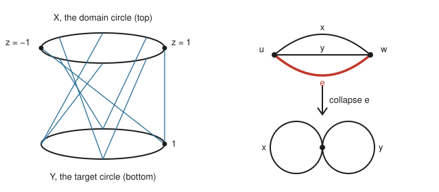

# Cofibrations: a homotopy on a piece always extends, so collapsing the piece is safe

[Syllabus](../../../SYLLABUS.md) → [Topology](../README.md) → [Homotopy](../README.md#s04) → Cofibrations

---

## General Overview

A park has two gates, $`u`$ and $`w`$, joined by three paths: north $`x`$, middle $`y`$ and south $`e`$. Between them lie two flower beds, one north of the middle path and one south of it. A dog on a walk that ends where it began can drag its lead round either bed and catch it there. The shape of the paths is the **theta graph**: 2 points, 3 edges, like the Greek letter θ.

On the map, shrink the south path to a point, so the two gates become one. What is left is one point with two loops, the **figure eight**. Nothing a lead can catch on was lost: both beds still catch it, and the count of independent loops stays 2. Shrink the north and middle paths together instead, and one bed vanishes; only 1 loop is left.

Two facts about the south path make the collapse safe. It can be squeezed to a point inside itself: it is **contractible**. And any slide (homotopy) of the south path can be continued over the whole network: the pair has the **homotopy extension property**. With both facts, collapsing the piece never changes the space up to homotopy.

The same tool turns any map into a shape. A dog runs twice round a lamp post and comes back, so its lead goes twice round the post. Picture the post's ring as the unit circle, its points as complex numbers $`z`$. Then the lead's path is $`z \mapsto z^2`$, which doubles every angle. Two spaces come from this map:

- the **mapping cylinder**: a second circle above the first, each point $`z`$ above joined by a segment to $`z^2`$ below. It slides down onto the lower circle, so it has that circle's loops;
- the **mapping cone**: the upper circle squashed to a point, which caps it with a disc. The disc is glued along a loop that goes round twice. The result is the **projective plane**, where a lead wound twice slides free and a lead wound once cannot.

**When a pair has the homotopy extension property, any slide of the piece continues over the whole space; so a contractible piece can be collapsed without changing the homotopy type, any map becomes an inclusion into its mapping cylinder, and the mapping cone of z ↦ z² is the projective plane.**

**What kind of fact this is:** three definitions (the homotopy extension property, the mapping cylinder, the mapping cone) and four theorems. Three are proved on this card in Why it works: the property equals a retraction, a mapping cylinder slides onto its target, and collapsing a contractible piece with the property is a homotopy equivalence. The fourth, that every CW pair has the property, is proved for one cell and sketched for a whole complex, with a source. The cofibre sequence is an outline. The code checks finite recipes and 153 grid points: it illustrates, and proves nothing alone.

### The picture: the cylinder of z ↦ z², and one collapse

<p align="center"></p>

Left: eight of the segments of the mapping cylinder. The upper points $`z = 1`$ and $`z = -1`$ both land on the lower point 1, because $`(-1)^2 = 1`$. Going once round the top drags the bottom twice round. Right: collapsing the south path $`e`$ of the theta graph merges $`u`$ and $`w`$, and the paths $`x`$ and $`y`$ become the two loops of the figure eight. Both drawings are schematic: only which points are joined matters.

---

## The formula

Reminders. A **homotopy** is a continuous film of maps, with time $`t`$ running through $`I = [0, 1]`$ ([Homotopy](01-homotopy-and-homotopy-equivalence.md)). A **retraction** of a space onto a subset is a continuous map onto that subset that leaves the subset's own points fixed. A **CW pair** $`(X, A)`$ is a CW complex $`X`$ and a subcomplex $`A`$: some of its cells that form a complex by themselves ([CW complexes](07-cw-complexes-and-gluing-cells.md)).

**The homotopy extension property (HEP).** Take a pair $`(X, A)`$: a space $`X`$ and a closed subset $`A`$. It has the HEP when, for every space $`Y`$, every map $`F_0 : X \to Y`$, together with any homotopy $`h`$ of its restriction to $`A`$, extends to a homotopy $`H : X \times I \to Y`$ that starts at $`F_0`$. The inclusion of $`A`$ in $`X`$ is then called a **cofibration**. The test is one retraction:

```math
(X, A) \text{ has the HEP} \iff \text{there is a retraction } r : X \times I \to X \times \{0\} \,\cup\, A \times I
```

**Read it aloud:** a pair has the homotopy extension property exactly when the solid cylinder $`X \times I`$ can be pushed onto its floor $`X \times \{0\}`$ together with its walls $`A \times I`$, keeping floor and walls still.

**The mapping cylinder and the mapping cone** of a map $`f : X \to Y`$ are built by gluing, as in [Subspace, product and quotient](../02-Topological%20Spaces/04-subspace-product-and-quotient-topologies.md):

```math
M_f = \big( (X \times I) \sqcup Y \big) \big/ \big( (x, 1) \sim f(x) \big), \qquad C_f = M_f \big/ \big( X \times \{0\} \big)
```

**Read it aloud:** the mapping cylinder is a cylinder on $`X`$ whose far end is glued to $`Y`$ along $`f`$; the mapping cone is the mapping cylinder with its near end squashed to one point. Here $`\sqcup`$ is the disjoint union, the two spaces side by side. In these formulas $`x`$ and $`y`$ stand for points of $`X`$ and $`Y`$, not for the theta graph's paths.

Squashing the near end turns the cylinder $`X \times I`$ into the **cone** $`CX`$, so $`C_f`$ is $`Y`$ with a cone on $`X`$ glued along $`f`$. The cone on a circle is a disc: send the point at height $`s`$ above $`z`$ to $`s\,z`$.

**The collapse theorem.** Write $`X/A`$ for $`X`$ with all of $`A`$ squashed to one point, and $`q`$ for the quotient map that does the squashing. Write $`\simeq`$ for "is homotopy equivalent to".

```math
(X, A) \text{ has the HEP and } A \simeq \text{point} \implies q : X \to X/A \text{ is a homotopy equivalence}
```

**Read it aloud:** if a pair has the extension property and the piece is contractible, then squashing the piece to a point changes nothing up to homotopy.

| Symbol | Plain meaning | In our example | Push it up and the answer… |
| --- | --- | --- | --- |
| $`X`$, $`Y`$, $`f`$, $`z`$ | spaces; a continuous map from $`X`$ to $`Y`$; a point of the unit circle, as a complex number | both circles $`S^1`$; $`f(z) = z^2`$; $`f(-1) = 1`$ | a higher power $`z^n`$ winds $`n`$ times |
| $`A`$, $`(X, A)`$ | a closed subset; the pair | the south path $`e`$ inside the theta graph | — |
| $`I`$, $`t`$, $`s`$ | the interval $`[0, 1]`$; film time; height along a cylinder | $`t = 1`$, the last frame | — |
| $`F_0`$, $`h`$, $`H`$ | the starting map on $`X`$; the given homotopy on $`A`$; its extension to $`X`$ | the lead lying still; its far end walking 1 m out; the whole lead following | — |
| $`r`$, $`c`$ | the retraction onto floor and walls; the height of the point it projects from | $`c = 2`$ | $`c = 1`$ tears the square apart |
| $`M_f`$, $`G`$, $`\sqcup`$ | the mapping cylinder; the slide of $`M_f`$ onto $`Y`$; disjoint union | 3 points, 5 edges, 2 squares; $`\chi = 0`$ | — |
| $`C_f`$, $`CX`$, $`\Sigma X`$ | the mapping cone; the cone on $`X`$; the suspension, $`X \times I`$ with each end squashed | $`C_f = \mathbb{RP}^2`$; $`CS^1`$ a disc; $`\Sigma S^1 = S^2`$ | — |
| $`X/A`$, $`q`$ | $`X`$ with $`A`$ squashed to a point; the squashing map | theta / south path = figure eight | — |
| $`f_t`$, $`g`$, $`\bar f_t`$ | in the proof: a film of $`X`$ extending a contraction of $`A`$; the inverse map; the film read on $`X/A`$ | — | — |
| $`D^n`$, $`S^{n-1}`$ | the $`n`$-disc; its rim, a sphere | $`D^1 = [-1, 1]`$, $`S^0 = \{-1, 1\}`$; $`S^1`$ the circle, $`S^2`$ the sphere | — |
| $`p_0`$, $`p_1`$; $`a`$, $`p`$, $`j`$, $`b`$, $`d`$, $`k`$, $`m`$, $`x`$, $`y`$, $`e`$; $`a^{-1}`$ | point and edge names in the cell recipes; the edge $`a`$ run backwards, written A in the code | $`p_0 = 1`$, $`p_1 = -1`$; $`a`$ the target circle; $`p`$, $`j`$ the domain's halves; $`b`$, $`d`$ the spokes; $`k`$, $`m`$ the cone's edges; $`x`$, $`y`$, $`e`$ the theta graph's paths | — |
| $`\chi`$, $`\pi_1`$, $`\mathbb{RP}^2`$ | Euler characteristic; the loop group ([The fundamental group](03-the-fundamental-group.md)); the projective plane | theta $`\chi = -1`$; $`\pi_1(\mathbb{RP}^2)`$ has 2 elements | — |

### When it holds

- **$`A`$ is closed and the pair is reasonable.** CW pairs always qualify. The pair $`[0, 1]`$ with $`A = \{0\} \cup \{1, 1/2, 1/3, \dots\}`$ fails: no retraction of the square onto floor and walls exists near the point where the walls pile up. This case is stated, not computed; it is Hatcher's example in chapter 0.
- **The piece is contractible.** Collapse the loop made of the north and middle paths, and the theta graph becomes a circle: loop rank 1, not 2, and $`\chi = 0`$, not $`-1`$.
- **The cone is glued along $`f`$, not replaced by its image.** Squashing $`f(X)`$ inside $`Y`$ gives $`Y / f(X)`$. For $`z^2`$ the image is the whole circle, so that is a point, with no torsion. The cone gives $`\mathbb{RP}^2`$, with torsion $`[2]`$.
- **The projection centre lies outside the cylinder.** Project from a point on the top face, $`c = 1`$, and two points $`1/500`$ apart land 2 apart: the retraction tears.

---

## Why it works

### Step 0: room to push

The HEP says a motion of the piece can always be continued over the whole space. The whole proof is one picture. Stand the space on a time axis to get the solid cylinder $`X \times I`$. The given data, the start map and the homotopy on $`A`$, is a map defined on the floor and the walls. If the solid can be pushed onto floor and walls, read the data there and the extension is done.

### Step 1: the property is a retraction

**From a retraction to extensions.** Floor and walls are closed sets of $`X \times I`$, and $`F_0`$ and $`h`$ agree where they meet, on $`A \times \{0\}`$. So $`F_0`$ on the floor and $`h`$ on the walls paste to one continuous map: a map that is continuous on each of two closed sets, and agrees on their overlap, is continuous on the union. Then $`H = (F_0 \cup h) \circ r`$ extends both.

**From extensions to a retraction.** Take $`Y`$ to be floor and walls themselves, with $`F_0`$ and $`h`$ the inclusions. The extension $`H`$ maps the solid into floor and walls and fixes them: that is a retraction.

### Step 2: every CW pair has the property

**One cell.** Take $`X = D^n`$ and $`A = S^{n-1}`$, its rim. Shine a light from the point $`(0, c)`$ with $`c = 2`$, above the middle of the top face, and push every point of $`D^n \times I`$ straight away from the light until it hits the floor or the walls. For the lead square, $`n = 1`$, this is

```math
r(x, t) = \begin{cases} \left( \dfrac{2x}{2 - t},\ 0 \right) & \text{if } 2\lvert x \rvert \le 2 - t \\[1ex] \left( \dfrac{x}{\lvert x \rvert},\ 2 - \dfrac{2 - t}{\lvert x \rvert} \right) & \text{otherwise} \end{cases}
```

**Read it aloud:** points near the middle drop to the floor, stretched out by at most a factor 2; points near the sides slide onto the nearer wall. The two formulas agree on the seam $`2\lvert x \rvert = 2 - t`$, where both give the floor point $`(x/\lvert x \rvert, 0)`$.

The code checks it on a grid of 17 × 9 = 153 exact fractions: every image lies on floor or walls, floor and walls stay fixed, $`r(r(p)) = r(p)`$, and the formulas agree on all 10 seam points.

**A whole complex.** Add the cells of $`X`$ not in $`A`$ one dimension at a time. For each new cell, the walls over its rim already lie over the lower skeleton, which earlier steps pushed onto floor and walls. So the one-cell push, followed by what came before, handles that cell. A finite complex needs finitely many steps. Hatcher, Proposition 0.16 in Sources, does the same with each dimension given its own slice of time, which also covers infinitely many cells.

### Step 3: the mapping cylinder slides onto its target

Slide every point of $`M_f`$ along its segment to the far end:

```math
G\big( (x, s), t \big) = \big( x,\ s + t(1 - s) \big), \qquad G(y, t) = y \text{ for } y \in Y
```

At $`t = 0`$ nothing moves; at $`t = 1`$ every point reaches height 1, which is glued to $`f(x)`$ in $`Y`$. A point already at $`s = 1`$ never moves, so the slide respects the gluing and is continuous on the quotient. So $`Y`$ is a **deformation retract** of $`M_f`$: a film shrinks $`M_f`$ onto $`Y`$ while $`Y`$ stays still. Hence $`M_f \simeq Y`$.

The domain $`X`$ sits inside $`M_f`$ as the near end, $`s = 0`$. Follow the slide from there and you get $`f`$. So every map is an inclusion followed by a homotopy equivalence. If $`f`$ is cellular, sending each cell of $`X`$ into the cells of $`Y`$ of the same or lower dimension, $`M_f`$ is a CW complex with $`X`$ as a subcomplex, and by Step 2 the inclusion is a cofibration.

For $`z \mapsto z^2`$, give the domain circle 2 points, $`p_0 = 1`$ and $`p_1 = -1`$, and 2 edges: $`p`$ along the top half and $`j`$ along the bottom. The target has 1 point and 1 edge $`a`$. Each half of the domain goes once round the target, so $`f`$ sends $`p`$ to $`a`$ and $`j`$ to $`a`$. The cylinder adds 2 spokes, $`b`$ from $`p_0`$ and $`d`$ from $`p_1`$, and 2 squares. The square over $`p`$ has rim $`p\,d\,a^{-1}\,b^{-1}`$: along $`p`$, up the spoke $`d`$, back along $`f(p) = a`$ backwards, down $`b`$. Here $`a^{-1}`$ is the edge $`a`$ run backwards. The code writes it as a capital, A, which has nothing to do with the subset $`A`$ of a pair.

| Space | Cells | $`\chi`$ | Loop group from the recipe |
| --- | --- | ---: | --- |
| target circle $`Y`$ | 1, 1, 0 | 0 | $`\langle\, a \mid \;\rangle \cong \mathbb{Z}`$ |
| cylinder $`M_f`$ | 3, 5, 2 | 0 | $`\langle\, a, p, j \mid p a^{-1}, j a^{-1} \,\rangle \cong \mathbb{Z}`$ |

The relations say $`p = a`$ and $`j = a`$, so the group is $`\mathbb{Z}`$, the target's. The domain's loop $`pj`$ slides down to $`aa`$: the degree 2 of the map, seen as a word.

### Step 4: collapsing a contractible piece

The shape of the proof: contract $`A`$ to a point, and use the HEP to drag all of $`X`$ along. The film never lets points of $`A`$ leave $`A`$, so it also runs on $`X/A`$. Its last frame sends $`A`$ to one point, so it passes through $`X/A`$ and gives the inverse of $`q`$.

<details>
<summary>Detailed proof: q is a homotopy equivalence</summary>

Let the film $`f_t : X \to X`$ extend a contraction of $`A`$, with $`f_0`$ the identity. The HEP gives it, applied with $`F_0`$ the identity map and $`h`$ the contraction. Then $`f_t(A) \subseteq A`$ for every $`t`$, and $`f_1(A)`$ is one point.

1. Since $`f_t`$ keeps $`A`$ inside $`A`$, the map $`q \circ f_t`$ sends all of $`A`$ to the point $`A`$ becomes. It is therefore constant on each block of the gluing, and there is a map $`\bar f_t`$ of $`X/A`$ with

$`\displaystyle q \circ f_t = \bar f_t \circ q .`$

It is continuous because a map out of a quotient is continuous when its composite with $`q`$ is. The same holds for the whole film at once: $`(X/A) \times I`$ is the quotient of $`X \times I`$, because $`I`$ is compact (Hatcher, Appendix, in Sources).

2. Since $`f_1`$ sends $`A`$ to one point, $`f_1`$ is constant on each block too, so $`f_1 = g \circ q`$ for a continuous $`g : X/A \to X`$.

3. One round trip: $`g \circ q = f_1`$, and the film $`f_t`$ joins $`f_1`$ to $`f_0 = \mathrm{id}_X`$. So $`g \circ q \simeq \mathrm{id}_X`$.

4. The other round trip: $`q \circ g \circ q = q \circ f_1 = \bar f_1 \circ q`$, and $`q`$ is onto, so $`q \circ g = \bar f_1`$. The film $`\bar f_t`$ joins $`\bar f_1`$ to $`\bar f_0 = \mathrm{id}_{X/A}`$. So $`q \circ g \simeq \mathrm{id}_{X/A}`$.

Both round trips are homotopic to the identity, so $`q`$ is a homotopy equivalence with inverse $`g`$. This is Hatcher's Proposition 0.17.

</details>

On the theta graph, the south path is one edge: a closed interval, contractible, and a subcomplex, so Step 2 gives the HEP. Collapsing it gives the figure eight. The code computes both loop groups from their recipes: free on 2 letters each, with $`\chi = 2 - 3 = -1`$ and $`\chi = 1 - 2 = -1`$.

[CW complexes](07-cw-complexes-and-gluing-cells.md) shrank a whole spanning tree to read off a graph's loop group. That step is this theorem, used once per tree edge.

### Step 5: the mapping cone, three recipes for one space

For $`z \mapsto z^2`$, the cone on the domain circle is a disc, glued to the target along $`z \mapsto z^2`$. That is exactly the recipe of [CW complexes](07-cw-complexes-and-gluing-cells.md) for the projective plane: one point, one edge $`a`$, one disc on the word $`aa`$. So $`C_f`$ is homeomorphic to $`\mathbb{RP}^2`$, not only homotopy equivalent. The code builds it three ways:

| Recipe | Cells | $`\chi`$ | Abelianised loop group |
| --- | --- | ---: | --- |
| $`M_f`$ plus a cone point, 2 edges $`k`$, $`m`$, 2 triangles | 4, 7, 4 | 1 | rank 0, torsion $`[2]`$ |
| $`M_f`$ with the domain circle squashed | 2, 3, 2 | 1 | rank 0, torsion $`[2]`$ |
| the projective plane: a disc on $`aa`$ | 1, 1, 1 | 1 | rank 0, torsion $`[2]`$ |

The abelianised group is the loop group with every pair of letters made to commute. Torsion $`[2]`$ means one generator whose double is trivial. Here the loop group itself is $`\langle\, a \mid aa \,\rangle`$, two elements: a lead wound twice slides free, and a lead wound once does not.

### Step 6: the cofibre sequence, in outline

The inclusion of $`Y`$ in $`C_f`$ is again a cofibration, so the construction can be repeated. The mapping cone of that inclusion is, up to homotopy, $`C_f`$ with $`Y`$ squashed: the cone on $`X`$ with its base squashed, the suspension $`\Sigma X`$. Repeating gives a chain of spaces:

```math
X \xrightarrow{\ f\ } Y \longrightarrow C_f \longrightarrow \Sigma X \longrightarrow \Sigma Y \longrightarrow \cdots
```

**Read it aloud:** the domain maps to the target, the target into the mapping cone, and the cone onto the suspension of the domain, then the pattern repeats one dimension up. The suspension $`\Sigma X`$ is $`X \times I`$ with each end squashed to its own point.

For $`z \mapsto z^2`$ the chain reads $`S^1 \to S^1 \to \mathbb{RP}^2 \to S^2 \to S^2`$, the last map the suspension of $`f`$, which wraps the sphere twice round itself.

For a CW pair $`(X, A)`$ and the inclusion of $`A`$ in $`X`$, the mapping cone is $`X \cup CA`$: $`X`$ with a cone on $`A`$ glued along $`A`$. That cone is a contractible subcomplex, so by Steps 2 and 4 squashing it changes nothing: $`X \cup CA \simeq (X \cup CA)/CA = X/A`$. So the sequence reads $`A \to X \to X/A \to \Sigma A \to \Sigma X \to \cdots`$, the cofibre sequence of the pair.

Homology turns each such chain into a long exact sequence of groups; the cards in Where this goes next build that. Apart from the step $`X \cup CA \simeq X/A`$, this section names the sequence and proves nothing about it.

---

## Worked numbers, by hand

| Step | Arithmetic | Value |
| --- | --- | --- |
| cylinder cells | 1 + 2 points, 1 + 2 + 2 edges, 2 squares | $`(3, 5, 2)`$ |
| cylinder $`\chi`$ | $`3 - 5 + 2`$ | 0, the circle's |
| cylinder relations | $`p a^{-1}`$, $`j a^{-1}`$ | $`p = a`$, $`j = a`$: group $`\mathbb{Z}`$ |
| domain loop in the cylinder | $`pj \mapsto aa`$ | net count of $`a`$: 2 |
| cone cells | add 1 point, 2 edges, 2 triangles | $`(4, 7, 4)`$, $`\chi = 1`$ |
| cone relations | add $`p m^{-1}`$, $`m j`$ | $`m = p = a`$, then $`a\,a = 1`$ |
| projective plane | 1 point, 1 edge, 1 disc on $`aa`$ | $`\chi = 1 - 1 + 1 = 1`$, torsion $`[2]`$ |
| theta graph | 2 points, 3 edges | $`\chi = -1`$, loop rank 2 |
| collapse the south path | 1 point, 2 edges | $`\chi = -1`$, loop rank 2 |
| the lead, $`t = 1`$ | $`r(3/4, 1) = (1, 2 - 4/3)`$, then the far end at $`1 + 2/3`$ | the mark at 3/4 goes to 5/3 |

**The mapping cylinder of $`z \mapsto z^2`$ has the target circle's invariants, $`\chi = 0`$ and loop group $`\mathbb{Z}`$; its mapping cone has loop group $`\mathbb{Z}/2`$, the projective plane; and the theta graph with one edge collapsed keeps $`\chi = -1`$ and 2 independent loops.**

In the park's terms: the gates can be merged on the map without losing either bed. In the cone, a lead wound twice round comes free, and a lead wound once stays caught.

The last row is the HEP at work on one lead 2 m long, marks $`-1`$ to 1 in metres. The owner's end stays still while the dog's end walks 1 m further out. The extension sends the marks $`-1, -1/2, 0, 1/2, 3/4, 1`$ to $`-1, -1, 0, 1, 5/3, 2`$ at $`t = 1`$. The HEP promises some continuous extension, not an even stretch, and this one bunches the owner's half.

### What breaks if you drop a piece

| Mistake | Comes out at | What went wrong |
| --- | --- | --- |
| Collapse the loop of north and middle paths | rank 1, $`\chi = 0`$ | the piece is a circle, not contractible |
| Squash $`f(X)`$ in $`Y`$ instead of gluing a cone | a point: rank 0, torsion $`[\,]`$ | the cone keeps how $`f`$ wraps; the image forgets it |
| Project from $`(0, 1)`$, on the top face | points $`1/500`$ apart land 2 apart | the push is not continuous there |
| Leave out the cylinder's 2 squares | rank 3, $`\chi = -2`$ | without the walls $`p`$ and $`j`$ never slide onto $`a`$ |

The code prints all four.

---

## Code, from first principles, and it actually runs

The code stores each space as a CW recipe: points, named edges with their ends, and 2-cell rim words. It takes three roads. Road 1 reads the loop group off the recipe by shrinking a spanning tree, and its abelianised form from a Smith normal form, a diagonal form of the whole-number matrix of letter counts. Road 2 counts the holes mod 2 by trying every subset of edges and of 2-cells, counts the pieces by merging the ends of each edge, and checks both against road 1 and against $`\chi`$. Road 3 builds the mapping cone by two recipes and compares both with the projective plane. A last part checks the radial retraction and the extended lead in exact fractions.

### Python

```python
# Cofibrations -- mapping cylinder and cone of z -> z^2, and an edge of the theta graph collapsed.
# A complex is a recipe: vertices, edges (name, tail, head) and 2-cells, each 2-cell the word read
# round its rim; a capital letter runs that edge backwards.  Road 1 reads the loop group off the
# recipe by shrinking a spanning tree; its abelianised form comes from a Smith normal form.
# Road 2 counts mod-2 holes by brute force over every subset of edges and of 2-cells.
# Road 3 builds one space by two recipes and compares.  Exact, except the winding check and the figure.
from fractions import Fraction as Fr
from math import atan2, cos, sin, pi

def find(boss, v):
    while boss[v] != v: v = boss[v]
    return v

def presentation(V, E, F):                    # road 1: shrink a spanning tree, keep the rest
    boss, gens = {v: v for v in V}, []
    for name, tail, head in E:
        t, h = find(boss, tail), find(boss, head)
        if t == h: gens.append(name)
        else: boss[t] = h
    return gens, [''.join(c for c in w if c.lower() in gens) for w in F]

def snf(M):                                   # diagonal of the Smith normal form, whole numbers
    M, d = [r[:] for r in M], []
    while any(any(r) for r in M):
        _, i, j = min((abs(x), i, j) for i, r in enumerate(M) for j, x in enumerate(r) if x)
        M[0], M[i] = M[i], M[0]
        for r in M: r[0], r[j] = r[j], r[0]
        p, done = M[0][0], True
        for i in range(1, len(M)):
            q = M[i][0] // p
            M[i] = [a - q * b for a, b in zip(M[i], M[0])]
            done = done and M[i][0] == 0
        for j in range(1, len(M[0])):
            q = M[0][j] // p
            for r in M: r[j] -= q * r[0]
            done = done and M[0][j] == 0
        if not done: continue
        bad = [r for r in M[1:] if any(x % p for x in r)]
        if bad: M[0] = [a + b for a, b in zip(M[0], bad[0])]; continue
        d.append(abs(p)); M = [r[1:] for r in M[1:]]
    return d

def abelianised(gens, rels):
    d = snf([[w.count(g) - w.count(g.upper()) for g in gens] for w in rels])
    return len(gens) - len(d), sorted(x for x in d if x > 1)

def betti2(V, E, F):                          # road 2: mod-2 hole counts, every subset tried
    ends = [(1 << V.index(t)) ^ (1 << V.index(h)) for _, t, h in E]
    rims = [sum(1 << k for k, e in enumerate(E) if sum(c.lower() == e[0] for c in w) % 2) for w in F]
    def xor(masks, S):
        x = 0
        for k, m in enumerate(masks):
            if S >> k & 1: x ^= m
        return x
    z1 = sum(xor(ends, S) == 0 for S in range(1 << len(E))).bit_length() - 1
    z2 = sum(xor(rims, S) == 0 for S in range(1 << len(F))).bit_length() - 1
    b1, boss = len(F) - z2, {v: v for v in V}
    for _, t, h in E: boss[find(boss, t)] = find(boss, h)    # pieces counted by union-find, not by V - E + z1
    return len({find(boss, v) for v in V}), z1 - b1, z2

def collapse(V, E, F, names):                 # squash the named edges and their end points
    boss = {v: v for v in V}
    for n, t, h in E:
        if n in names and find(boss, t) != find(boss, h): boss[find(boss, t)] = find(boss, h)
    return ([v for v in V if find(boss, v) == v], [(n, find(boss, t), find(boss, h)) for n, t, h in E if n not in names],
            [''.join(c for c in w if c.lower() not in names) for w in F])

def show(label, X):
    gens, rels = presentation(*X)
    rank, tors = abelianised(gens, rels)
    b = betti2(*X)
    chi = len(X[0]) - len(X[1]) + len(X[2])
    assert chi == b[0] - b[1] + b[2]                          # cells against mod-2 holes
    assert b[1] == rank + sum(t % 2 == 0 for t in tors)       # presentation against brute force
    rel = ', '.join(r or '1' for r in rels) or 'no relations'
    print(f"{label}: cells {len(X[0])}, {len(X[1])}, {len(X[2])}; chi {chi}; pi1 = <{', '.join(gens)} | {rel}>; "
          f"abelianised rank {rank}, torsion {tors}; mod-2 betti {b[0]}, {b[1]}, {b[2]}")
    return rank, tors, chi

Y = (['v'], [('a', 'v', 'v')], [])
MF = (['v', 'p0', 'p1'], [('b', 'p0', 'v'), ('d', 'p1', 'v'), ('a', 'v', 'v'), ('p', 'p0', 'p1'), ('j', 'p1', 'p0')],
      ['pdAB', 'jbAD'])                                     # square over p: p, up d, back along f(p) = a, down b
CF = (MF[0] + ['tip'], MF[1][:2] + [('k', 'tip', 'p0')] + MF[1][2:] + [('m', 'tip', 'p1')], MF[2] + ['kpM', 'mjK'])
RP2 = (['v'], [('a', 'v', 'v')], ['aa'])
TH = (['u', 'w'], [('x', 'u', 'w'), ('y', 'u', 'w'), ('e', 'u', 'w')], [])
y = show("target circle Y, 1 vertex + 1 edge", Y)
m = show("mapping cylinder M_f of z -> z^2", MF)
c1 = show("mapping cone C_f, M_f + cone point", CF)
c2 = show("mapping cone C_f, M_f with X squashed", collapse(*MF, 'pj'))
c3 = show("projective plane recipe, disc on aa", RP2)
t0 = show("theta graph, 2 vertices + 3 edges", TH)
t1 = show("theta graph with edge e collapsed", collapse(*TH, 'e'))
fmap = {'p': 'a', 'j': 'a'}                               # f sends each half of X once round Y
image = ''.join(fmap[e] for e in 'pj')
ang = [atan2(sin(4 * pi * k / 12), cos(4 * pi * k / 12)) for k in range(13)]
turn = sum((b - a + pi) % (2 * pi) - pi for a, b in zip(ang, ang[1:])) / (2 * pi)
print(f"domain loop pj slides down the cylinder to {image}: net count of a {image.count('a')}")
print(f"winding number of z -> z^2, angle sum over 12 samples: {round(turn)}")
assert m[:2] == y[:2] and m[2] == y[2] == 0               # M_f has the target's invariants
assert c1[:2] == c2[:2] == c3[:2] == (0, [2]) and c1[2] == c3[2] == 1   # three recipes, one space
assert t0[:2] == t1[:2] == (2, []) and round(turn) == image.count('a') == 2

def r(x, t, c):                               # project (x, t) from (0, c) onto floor or walls
    if c * abs(x) <= c - t: return (c * x / (c - t), Fr(0))
    return (Fr(1 if x > 0 else -1), c - (c - t) / abs(x))
grid = [(Fr(i, 8), Fr(j, 8)) for i in range(-8, 9) for j in range(9)]
on = lambda p: p[1] == 0 or abs(p[0]) == 1
img = [r(x, t, 2) for x, t in grid]
seam = [(x, t) for x, t in grid if 2 * abs(x) == 2 - t]
ok = (all(map(on, img)), all(q == p for p, q in zip(grid, img) if on(p)),
      all(r(*q, 2) == q for q in img), all((Fr(1 if x > 0 else -1), 2 - (2 - t) / abs(x)) == r(x, t, 2) for x, t in seam))
yes = lambda b: 'yes' if b else 'no'
print(f"radial retraction of [-1, 1] x [0, 1] from (0, 2), grid 17 x 9 = {len(grid)} points:")
print(f"  every image on floor or walls: {yes(ok[0])}; floor and walls fixed: {yes(ok[1])}; "
      f"r(r(p)) = r(p): {yes(ok[2])}; both formulas agree on the {len(seam)} seam points: {yes(ok[3])}")
gap = lambda c: abs(r(Fr(1, 1000), Fr(1), c)[0] - r(Fr(-1, 1000), Fr(1), c)[0]) + abs(r(Fr(1, 1000), Fr(1), c)[1] - r(Fr(-1, 1000), Fr(1), c)[1])
print(f"  (-1/1000, 1) and (1/1000, 1), 1/500 apart, land {gap(2)} apart")
f, h = (lambda x: x), (lambda e, t: e + t if e > 0 else e)    # lead along a line; dog's end walks 1 m out
H = lambda x, t: (lambda q: f(q[0]) if q[1] == 0 else h(q[0], q[1]))(r(x, t, 2))
marks = [Fr(-1), Fr(-1, 2), Fr(0), Fr(1, 2), Fr(3, 4), Fr(1)]
print(f"extended homotopy at t = 1: marks {', '.join(map(str, marks))} go to {', '.join(str(H(x, 1)) for x in marks)}")
assert all(ok) and gap(2) == Fr(1, 250) and all(H(x, 0) == x for x, _ in grid) and all(H(1, t) == 1 + t for _, t in grid)
m1 = show("mistake 1, theta with the loop x, y collapsed", collapse(*TH, 'xy'))
m2 = show("mistake 2, Y / f(X), the image squashed", collapse(*Y, 'a'))
print(f"mistake 3, project from (0, 1) on the top face: the same two points land {gap(1)} apart")
m4 = show("mistake 4, cylinder without its two squares", (MF[0], MF[1], []))
assert m1[0] == 1 and m1[2] == 0 and m2[:2] == (0, []) and gap(1) == 2 and m4[0] == 3
spokes = [(150 + 90 * cos(k * pi / 4), 70 + 22 * sin(k * pi / 4), 150 + 90 * cos(k * pi / 2), 210 + 22 * sin(k * pi / 2)) for k in range(8)]
print("figure, schematic; spokes " + ' '.join('({:.1f}, {:.1f})-({:.1f}, {:.1f})'.format(*s) for s in spokes))
print("ALL CHECKS PASS")
```

**Ran 2026-11-24 on macOS, Python 3.14.10, standard library only. All checks passed. Output, pasted from the run:**

```
target circle Y, 1 vertex + 1 edge: cells 1, 1, 0; chi 0; pi1 = <a | no relations>; abelianised rank 1, torsion []; mod-2 betti 1, 1, 0
mapping cylinder M_f of z -> z^2: cells 3, 5, 2; chi 0; pi1 = <a, p, j | pA, jA>; abelianised rank 1, torsion []; mod-2 betti 1, 1, 0
mapping cone C_f, M_f + cone point: cells 4, 7, 4; chi 1; pi1 = <a, p, j, m | pA, jA, pM, mj>; abelianised rank 0, torsion [2]; mod-2 betti 1, 1, 1
mapping cone C_f, M_f with X squashed: cells 2, 3, 2; chi 1; pi1 = <d, a | dA, AD>; abelianised rank 0, torsion [2]; mod-2 betti 1, 1, 1
projective plane recipe, disc on aa: cells 1, 1, 1; chi 1; pi1 = <a | aa>; abelianised rank 0, torsion [2]; mod-2 betti 1, 1, 1
theta graph, 2 vertices + 3 edges: cells 2, 3, 0; chi -1; pi1 = <y, e | no relations>; abelianised rank 2, torsion []; mod-2 betti 1, 2, 0
theta graph with edge e collapsed: cells 1, 2, 0; chi -1; pi1 = <x, y | no relations>; abelianised rank 2, torsion []; mod-2 betti 1, 2, 0
domain loop pj slides down the cylinder to aa: net count of a 2
winding number of z -> z^2, angle sum over 12 samples: 2
radial retraction of [-1, 1] x [0, 1] from (0, 2), grid 17 x 9 = 153 points:
  every image on floor or walls: yes; floor and walls fixed: yes; r(r(p)) = r(p): yes; both formulas agree on the 10 seam points: yes
  (-1/1000, 1) and (1/1000, 1), 1/500 apart, land 1/250 apart
extended homotopy at t = 1: marks -1, -1/2, 0, 1/2, 3/4, 1 go to -1, -1, 0, 1, 5/3, 2
mistake 1, theta with the loop x, y collapsed: cells 1, 1, 0; chi 0; pi1 = <e | no relations>; abelianised rank 1, torsion []; mod-2 betti 1, 1, 0
mistake 2, Y / f(X), the image squashed: cells 1, 0, 0; chi 1; pi1 = < | no relations>; abelianised rank 0, torsion []; mod-2 betti 1, 0, 0
mistake 3, project from (0, 1) on the top face: the same two points land 2 apart
mistake 4, cylinder without its two squares: cells 3, 5, 0; chi -2; pi1 = <a, p, j | no relations>; abelianised rank 3, torsion []; mod-2 betti 1, 3, 0
figure, schematic; spokes (240.0, 70.0)-(240.0, 210.0) (213.6, 85.6)-(150.0, 232.0) (150.0, 92.0)-(60.0, 210.0) (86.4, 85.6)-(150.0, 188.0) (60.0, 70.0)-(240.0, 210.0) (86.4, 54.4)-(150.0, 232.0) (150.0, 48.0)-(60.0, 210.0) (213.6, 54.4)-(150.0, 188.0)
ALL CHECKS PASS
```

### Rust

Same numbers, same labels, built with `rustc --edition 2021 -O`.

```rust
// Cofibrations -- the same check as the Python, in Rust.  No crates.
// A complex is a recipe: vertices, edges (name, tail, head) and 2-cells, each 2-cell the word read
// round its rim; a capital letter runs that edge backwards.  Road 1 reads the loop group off the
// recipe by shrinking a spanning tree; its abelianised form comes from a Smith normal form.
// Road 2 counts mod-2 holes by brute force over every subset of edges and of 2-cells.
// Road 3 builds one space by two recipes and compares.  Exact, except the winding check and the figure.
use std::f64::consts::PI;

struct Cx { v: Vec<&'static str>, e: Vec<(char, &'static str, &'static str)>, f: Vec<String> }
fn find<'a>(boss: &[(&'a str, &'a str)], mut v: &'a str) -> &'a str {
    loop { let b = boss.iter().find(|p| p.0 == v).unwrap().1; if b == v { return v } v = b }
}
fn set(boss: &mut Vec<(&'static str, &'static str)>, k: &'static str, to: &'static str) {
    for p in boss.iter_mut() { if p.0 == k { p.1 = to } }
}
fn presentation(x: &Cx) -> (Vec<char>, Vec<String>) {       // road 1: shrink a spanning tree
    let mut boss: Vec<(&str, &str)> = x.v.iter().map(|&v| (v, v)).collect();
    let mut gens = vec![];
    for &(name, tail, head) in &x.e {
        let (t, h) = (find(&boss, tail), find(&boss, head));
        if t == h { gens.push(name) } else { set(&mut boss, t, h) }
    }
    let rels = x.f.iter().map(|w| w.chars().filter(|c| gens.contains(&c.to_ascii_lowercase())).collect()).collect();
    (gens, rels)
}
fn snf(m0: Vec<Vec<i64>>) -> Vec<i64> {                      // diagonal of the Smith normal form
    let (mut m, mut d) = (m0, vec![]);
    while m.iter().any(|r| r.iter().any(|&x| x != 0)) {
        let mut best = (i64::MAX, 0, 0);
        for (i, r) in m.iter().enumerate() { for (j, &x) in r.iter().enumerate() { if x != 0 && (x.abs(), i, j) < best { best = (x.abs(), i, j) } } }
        let (_, i, j) = best;
        m.swap(0, i);
        for r in m.iter_mut() { r.swap(0, j) }
        let (p, mut done) = (m[0][0], true);
        for i in 1..m.len() {
            let q = m[i][0] / p;
            for k in 0..m[0].len() { m[i][k] -= q * m[0][k] }
            done = done && m[i][0] == 0;
        }
        for j in 1..m[0].len() {
            let q = m[0][j] / p;
            for r in m.iter_mut() { r[j] -= q * r[0] }
            done = done && m[0][j] == 0;
        }
        if !done { continue }
        if let Some(b) = m[1..].iter().find(|r| r.iter().any(|&x| x % p != 0)).cloned() {
            for k in 0..b.len() { m[0][k] += b[k] }
            continue;
        }
        d.push(p.abs());
        m = m[1..].iter().map(|r| r[1..].to_vec()).collect();
    }
    d
}
fn count(w: &str, c: char) -> i64 { w.chars().filter(|&x| x == c).count() as i64 }
fn abelianised(gens: &[char], rels: &[String]) -> (usize, Vec<i64>) {
    let d = snf(rels.iter().map(|w| gens.iter().map(|&g| count(w, g) - count(w, g.to_ascii_uppercase())).collect()).collect());
    let mut t: Vec<i64> = d.iter().cloned().filter(|&x| x > 1).collect();
    t.sort();
    (gens.len() - d.len(), t)
}
fn xor(masks: &[u64], s: u64) -> u64 { masks.iter().enumerate().filter(|(k, _)| s >> k & 1 == 1).fold(0, |a, (_, &m)| a ^ m) }
fn log2(n: usize) -> i64 { 63 - (n as u64).leading_zeros() as i64 }
fn betti2(x: &Cx) -> (i64, i64, i64) {                      // road 2: mod-2 hole counts, every subset
    let ix = |n: &str| x.v.iter().position(|&w| w == n).unwrap();
    let ends: Vec<u64> = x.e.iter().map(|&(_, t, h)| (1u64 << ix(t)) ^ (1u64 << ix(h))).collect();
    let rims: Vec<u64> = x.f.iter().map(|w| x.e.iter().enumerate()
        .filter(|(_, e)| w.chars().filter(|c| c.to_ascii_lowercase() == e.0).count() % 2 == 1).map(|(k, _)| 1u64 << k).sum()).collect();
    let z1 = log2((0..1u64 << x.e.len()).filter(|&s| xor(&ends, s) == 0).count());
    let z2 = log2((0..1u64 << x.f.len()).filter(|&s| xor(&rims, s) == 0).count());
    let mut boss: Vec<(&'static str, &'static str)> = x.v.iter().map(|&v| (v, v)).collect();   // pieces by union-find
    for &(_, t, h) in &x.e { let (a, b) = (find(&boss, t), find(&boss, h)); if a != b { set(&mut boss, a, b) } }
    (x.v.iter().filter(|&&v| find(&boss, v) == v).count() as i64, z1 - (x.f.len() as i64 - z2), z2)
}
fn collapse(x: &Cx, names: &str) -> Cx {                     // squash the named edges and their end points
    let mut boss: Vec<(&'static str, &'static str)> = x.v.iter().map(|&v| (v, v)).collect();
    for &(n, t, h) in &x.e {
        if names.contains(n) && find(&boss, t) != find(&boss, h) { let (a, b) = (find(&boss, t), find(&boss, h)); set(&mut boss, a, b) }
    }
    Cx { v: x.v.iter().cloned().filter(|&v| find(&boss, v) == v).collect(),
         e: x.e.iter().filter(|e| !names.contains(e.0)).map(|&(n, t, h)| (n, find(&boss, t), find(&boss, h))).collect(),
         f: x.f.iter().map(|w| w.chars().filter(|c| !names.contains(c.to_ascii_lowercase())).collect()).collect() }
}
fn show(label: &str, x: &Cx) -> (usize, Vec<i64>, i64) {
    let (gens, rels) = presentation(x);
    let (rank, tors) = abelianised(&gens, &rels);
    let b = betti2(x);
    let chi = x.v.len() as i64 - x.e.len() as i64 + x.f.len() as i64;
    assert!(chi == b.0 - b.1 + b.2);                                        // cells against mod-2 holes
    assert!(b.1 == rank as i64 + tors.iter().filter(|&&t| t % 2 == 0).count() as i64);   // two roads
    let mut rel = rels.iter().map(|r| if r.is_empty() { "1".to_string() } else { r.clone() }).collect::<Vec<_>>().join(", ");
    if rel.is_empty() { rel = "no relations".to_string() }
    let g = gens.iter().map(|c| c.to_string()).collect::<Vec<_>>().join(", ");
    println!("{}: cells {}, {}, {}; chi {}; pi1 = <{} | {}>; abelianised rank {}, torsion {:?}; mod-2 betti {}, {}, {}",
             label, x.v.len(), x.e.len(), x.f.len(), chi, g, rel, rank, tors, b.0, b.1, b.2);
    (rank, tors, chi)
}
#[derive(Clone, Copy, PartialEq, Debug)]
struct Q(i64, i64);                                          // an exact fraction, kept in lowest terms
fn gcd(a: i64, b: i64) -> i64 { if b == 0 { a.abs() } else { gcd(b, a % b) } }
fn q(n: i64, d: i64) -> Q { let g = gcd(n, d) * d.signum(); Q(n / g, d / g) }
fn add(a: Q, b: Q) -> Q { q(a.0 * b.1 + b.0 * a.1, a.1 * b.1) }
fn sub(a: Q, b: Q) -> Q { add(a, Q(-b.0, b.1)) }
fn mul(a: Q, b: Q) -> Q { q(a.0 * b.0, a.1 * b.1) }
fn div(a: Q, b: Q) -> Q { q(a.0 * b.1, a.1 * b.0) }
fn abs(a: Q) -> Q { Q(a.0.abs(), a.1) }                    // denominators stay positive
fn le(a: Q, b: Q) -> bool { a.0 * b.1 <= b.0 * a.1 }
impl std::fmt::Display for Q {
    fn fmt(&self, f: &mut std::fmt::Formatter) -> std::fmt::Result { if self.1 == 1 { write!(f, "{}", self.0) } else { write!(f, "{}/{}", self.0, self.1) } }
}
fn r(x: Q, t: Q, c: Q) -> (Q, Q) {                           // project (x, t) from (0, c) onto floor or walls
    if le(mul(c, abs(x)), sub(c, t)) { return (div(mul(c, x), sub(c, t)), q(0, 1)) }
    (q(x.0.signum(), 1), sub(c, div(sub(c, t), abs(x))))
}
fn main() {
    let s = |w: &str| w.to_string();
    let y = Cx { v: vec!["v"], e: vec![('a', "v", "v")], f: vec![] };
    let mf = Cx { v: vec!["v", "p0", "p1"], e: vec![('b', "p0", "v"), ('d', "p1", "v"), ('a', "v", "v"), ('p', "p0", "p1"), ('j', "p1", "p0")],
                  f: vec![s("pdAB"), s("jbAD")] };                // square over p: p, up d, back along f(p) = a, down b
    let cf = Cx { v: vec!["v", "p0", "p1", "tip"], e: vec![mf.e[0], mf.e[1], ('k', "tip", "p0"), mf.e[2], mf.e[3], mf.e[4], ('m', "tip", "p1")],
                  f: vec![s("pdAB"), s("jbAD"), s("kpM"), s("mjK")] };
    let rp2 = Cx { v: vec!["v"], e: vec![('a', "v", "v")], f: vec![s("aa")] };
    let th = Cx { v: vec!["u", "w"], e: vec![('x', "u", "w"), ('y', "u", "w"), ('e', "u", "w")], f: vec![] };
    let yy = show("target circle Y, 1 vertex + 1 edge", &y);
    let m = show("mapping cylinder M_f of z -> z^2", &mf);
    let c1 = show("mapping cone C_f, M_f + cone point", &cf);
    let c2 = show("mapping cone C_f, M_f with X squashed", &collapse(&mf, "pj"));
    let c3 = show("projective plane recipe, disc on aa", &rp2);
    let t0 = show("theta graph, 2 vertices + 3 edges", &th);
    let t1 = show("theta graph with edge e collapsed", &collapse(&th, "e"));
    let fmap = [('p', "a"), ('j', "a")];                       // f sends each half of X once round Y
    let image: String = "pj".chars().map(|e| fmap.iter().find(|m| m.0 == e).unwrap().1).collect();
    let ang: Vec<f64> = (0..13).map(|k| (4.0 * PI * k as f64 / 12.0).sin().atan2((4.0 * PI * k as f64 / 12.0).cos())).collect();
    let turn: f64 = ang.windows(2).map(|w| (w[1] - w[0] + PI).rem_euclid(2.0 * PI) - PI).sum::<f64>() / (2.0 * PI);
    println!("domain loop pj slides down the cylinder to {}: net count of a {}", image, count(&image, 'a'));
    println!("winding number of z -> z^2, angle sum over 12 samples: {}", turn.round() as i64);
    assert!(m.0 == yy.0 && m.1 == yy.1 && m.2 == yy.2 && m.2 == 0);
    assert!([&c1, &c2, &c3].iter().all(|c| c.0 == 0 && c.1 == vec![2]) && c1.2 == 1 && c3.2 == 1);
    assert!(t0.0 == 2 && t1.0 == 2 && t0.1.is_empty() && t1.1.is_empty() && turn.round() as i64 == count(&image, 'a') && count(&image, 'a') == 2);
    let two = q(2, 1);
    let grid: Vec<(Q, Q)> = (-8..9).flat_map(|i| (0..9).map(move |j| (q(i, 8), q(j, 8)))).collect();
    let on = |p: &(Q, Q)| p.1 == q(0, 1) || abs(p.0) == q(1, 1);
    let img: Vec<(Q, Q)> = grid.iter().map(|&(x, t)| r(x, t, two)).collect();
    let seam: Vec<(Q, Q)> = grid.iter().cloned().filter(|&(x, t)| mul(two, abs(x)) == sub(two, t)).collect();
    let ok = [img.iter().all(|p| on(p)), grid.iter().zip(&img).filter(|(p, _)| on(p)).all(|(p, i)| p == i),
              img.iter().all(|&p| r(p.0, p.1, two) == p),
              seam.iter().all(|&(x, t)| (q(x.0.signum(), 1), sub(two, div(sub(two, t), abs(x)))) == r(x, t, two))];
    let yes = |b: bool| if b { "yes" } else { "no" };
    println!("radial retraction of [-1, 1] x [0, 1] from (0, 2), grid 17 x 9 = {} points:", grid.len());
    println!("  every image on floor or walls: {}; floor and walls fixed: {}; r(r(p)) = r(p): {}; both formulas agree on the {} seam points: {}",
             yes(ok[0]), yes(ok[1]), yes(ok[2]), seam.len(), yes(ok[3]));
    let gap = |c: Q| { let (a, b) = (r(q(1, 1000), q(1, 1), c), r(q(-1, 1000), q(1, 1), c)); add(abs(sub(a.0, b.0)), abs(sub(a.1, b.1))) };
    println!("  (-1/1000, 1) and (1/1000, 1), 1/500 apart, land {} apart", gap(two));
    let hh = |x: Q, t: Q| { let p = r(x, t, two); if p.1 == q(0, 1) { p.0 } else if p.0.0 > 0 { add(p.0, p.1) } else { p.0 } };
    let marks = [q(-1, 1), q(-1, 2), q(0, 1), q(1, 2), q(3, 4), q(1, 1)];
    println!("extended homotopy at t = 1: marks {} go to {}", marks.iter().map(|m| m.to_string()).collect::<Vec<_>>().join(", "),
             marks.iter().map(|&m| hh(m, q(1, 1)).to_string()).collect::<Vec<_>>().join(", "));
    assert!(ok.iter().all(|&b| b) && gap(two) == q(1, 250) && grid.iter().all(|&(x, _)| hh(x, q(0, 1)) == x)
            && grid.iter().all(|&(_, t)| hh(q(1, 1), t) == add(q(1, 1), t)));
    let m1 = show("mistake 1, theta with the loop x, y collapsed", &collapse(&th, "xy"));
    let m2 = show("mistake 2, Y / f(X), the image squashed", &collapse(&y, "a"));
    println!("mistake 3, project from (0, 1) on the top face: the same two points land {} apart", gap(q(1, 1)));
    let m4 = show("mistake 4, cylinder without its two squares", &Cx { v: mf.v.clone(), e: mf.e.clone(), f: vec![] });
    assert!(m1.0 == 1 && m1.2 == 0 && m2.0 == 0 && m2.1.is_empty() && gap(q(1, 1)) == two && m4.0 == 3);
    let sp: Vec<String> = (0..8).map(|k| { let a = k as f64 * PI / 4.0;
        format!("({:.1}, {:.1})-({:.1}, {:.1})", 150.0 + 90.0 * a.cos(), 70.0 + 22.0 * a.sin(), 150.0 + 90.0 * (2.0 * a).cos(), 210.0 + 22.0 * (2.0 * a).sin()) }).collect();
    println!("figure, schematic; spokes {}", sp.join(" "));
    println!("ALL CHECKS PASS");
}
```

**Ran 2026-11-24 on macOS, rustc 1.98.1, no crates. All checks passed. Output, pasted from the run:**

```
target circle Y, 1 vertex + 1 edge: cells 1, 1, 0; chi 0; pi1 = <a | no relations>; abelianised rank 1, torsion []; mod-2 betti 1, 1, 0
mapping cylinder M_f of z -> z^2: cells 3, 5, 2; chi 0; pi1 = <a, p, j | pA, jA>; abelianised rank 1, torsion []; mod-2 betti 1, 1, 0
mapping cone C_f, M_f + cone point: cells 4, 7, 4; chi 1; pi1 = <a, p, j, m | pA, jA, pM, mj>; abelianised rank 0, torsion [2]; mod-2 betti 1, 1, 1
mapping cone C_f, M_f with X squashed: cells 2, 3, 2; chi 1; pi1 = <d, a | dA, AD>; abelianised rank 0, torsion [2]; mod-2 betti 1, 1, 1
projective plane recipe, disc on aa: cells 1, 1, 1; chi 1; pi1 = <a | aa>; abelianised rank 0, torsion [2]; mod-2 betti 1, 1, 1
theta graph, 2 vertices + 3 edges: cells 2, 3, 0; chi -1; pi1 = <y, e | no relations>; abelianised rank 2, torsion []; mod-2 betti 1, 2, 0
theta graph with edge e collapsed: cells 1, 2, 0; chi -1; pi1 = <x, y | no relations>; abelianised rank 2, torsion []; mod-2 betti 1, 2, 0
domain loop pj slides down the cylinder to aa: net count of a 2
winding number of z -> z^2, angle sum over 12 samples: 2
radial retraction of [-1, 1] x [0, 1] from (0, 2), grid 17 x 9 = 153 points:
  every image on floor or walls: yes; floor and walls fixed: yes; r(r(p)) = r(p): yes; both formulas agree on the 10 seam points: yes
  (-1/1000, 1) and (1/1000, 1), 1/500 apart, land 1/250 apart
extended homotopy at t = 1: marks -1, -1/2, 0, 1/2, 3/4, 1 go to -1, -1, 0, 1, 5/3, 2
mistake 1, theta with the loop x, y collapsed: cells 1, 1, 0; chi 0; pi1 = <e | no relations>; abelianised rank 1, torsion []; mod-2 betti 1, 1, 0
mistake 2, Y / f(X), the image squashed: cells 1, 0, 0; chi 1; pi1 = < | no relations>; abelianised rank 0, torsion []; mod-2 betti 1, 0, 0
mistake 3, project from (0, 1) on the top face: the same two points land 2 apart
mistake 4, cylinder without its two squares: cells 3, 5, 0; chi -2; pi1 = <a, p, j | no relations>; abelianised rank 3, torsion []; mod-2 betti 1, 3, 0
figure, schematic; spokes (240.0, 70.0)-(240.0, 210.0) (213.6, 85.6)-(150.0, 232.0) (150.0, 92.0)-(60.0, 210.0) (86.4, 85.6)-(150.0, 188.0) (60.0, 70.0)-(240.0, 210.0) (86.4, 54.4)-(150.0, 232.0) (150.0, 48.0)-(60.0, 210.0) (213.6, 54.4)-(150.0, 188.0)
ALL CHECKS PASS
```

### Lean

Lean proves the card's three theorems for every space, and checks its worked numbers by exact arithmetic.

- Take a closed subset $`A`$ of a space $`X`$. Then $`(X, A)`$ has the HEP exactly when the solid cylinder $`X \times I`$ retracts onto its floor and walls.
- Take any map $`f : X \to Y`$. Then $`Y`$ is a deformation retract of $`M_f`$, so $`M_f \simeq Y`$.
- Following the slide from the near end of $`M_f`$ gives back $`f`$.
- Suppose $`(X, A)`$ has the HEP, and $`A`$ is closed and contractible. Then the squashing map $`q : X \to X/A`$ is a homotopy equivalence.
- Both $`1^2`$ and $`(-1)^2`$ equal 1, so the upper points 1 and $`-1`$ land on the same lower point.
- The Euler characteristic $`\chi`$ is 0 for the circle and the cylinder, and 1 for each of the three cone recipes.
- The theta graph and the figure eight both have $`\chi = -1`$ and loop rank 2.
- Collapsing the loop of north and middle paths gives $`\chi = 0`$ and rank 1. Leaving out the cylinder's 2 squares gives $`\chi = -2`$ and rank 3.
- Take the push $`r`$ at $`t = 1`$. Then $`r(3/4, 1) = (1, 2/3)`$, so the mark at 3/4 goes to $`1 + 2/3 = 5/3`$.
- Lean also checks where $`r`$ lands the marks $`-1, -1/2, 0, 1/2`$ and 1 at that time.

The loop groups, the mod-2 hole counts, the 153-point grid and the winding number stay with the Python and Rust checks.

```lean
-- Cofibrations: if a pair has the homotopy extension property and the piece is contractible, squashing the piece to a point is a homotopy equivalence; the property is the same as a retraction of the solid cylinder onto floor and walls; and every mapping cylinder deformation retracts onto its target.
import Mathlib.Topology.Homotopy.Contractible
import Mathlib.Topology.Homotopy.Equiv
import Mathlib.Topology.Homotopy.Basic
import Mathlib.Topology.Constructions
import Mathlib.Topology.UnitInterval
import Mathlib.Analysis.Complex.Basic
import Mathlib.Topology.CompactOpen

open unitInterval ContinuousMap

universe u v

section Pairs

variable {X : Type u} [TopologicalSpace X]

/-- The homotopy extension property of a pair (X, A): for every space Y, every map
F₀ : X → Y and every homotopy h : A × I → Y that starts at F₀ on A, there is a homotopy
H : X × I → Y that starts at F₀ and agrees with h on A × I. -/
def HasHEP (A : Set X) : Prop :=
  ∀ (Y : Type u) [TopologicalSpace Y] (F₀ : C(X, Y)) (h : C(A × I, Y)),
    (∀ a : A, h (a, 0) = F₀ a) →
    ∃ H : C(X × I, Y), (∀ x, H (x, 0) = F₀ x) ∧ ∀ (a : A) (t : I), H (a, t) = h (a, t)

/-- Squashing A to one point: x and y are glued when they are equal or both lie in A.
The quotient by this relation is X/A, and `Quotient.mk` is the squashing map q. -/
def collapseSetoid (A : Set X) : Setoid X where
  r x y := x = y ∨ (x ∈ A ∧ y ∈ A)
  iseqv :=
    { refl := fun _ => Or.inl rfl
      symm := by
        rintro x y (rfl | ⟨hx, hy⟩)
        exacts [Or.inl rfl, Or.inr ⟨hy, hx⟩]
      trans := by
        rintro x y z (rfl | ⟨hx, hy⟩) (rfl | ⟨hy', hz⟩)
        exacts [Or.inl rfl, Or.inr ⟨hy', hz⟩, Or.inr ⟨hx, hy⟩, Or.inr ⟨hx, hz⟩] }

/-- The collapse theorem (Hatcher, Proposition 0.17): if the pair (X, A) has the homotopy
extension property, A is closed and A is contractible, then the squashing map
q : X → X/A is a homotopy equivalence. -/
theorem collapse_contractible_is_homotopy_equivalence (A : Set X) (hA : IsClosed A)
    (hHEP : HasHEP A) [ContractibleSpace A] :
    ∃ e : X ≃ₕ Quotient (collapseSetoid A), ⇑e = Quotient.mk (collapseSetoid A) := by
  obtain ⟨a₀, ⟨K⟩⟩ := id_nullhomotopic A
  obtain ⟨F, hF0, hFA⟩ := hHEP X (ContinuousMap.id X)
    ⟨fun p => (K (p.2, p.1) : X), by fun_prop⟩ (fun a => by simp)
  have hFmem : ∀ x t, x ∈ A → F (x, t) ∈ A := fun x t hx => by
    have := hFA ⟨x, hx⟩ t
    simp only at this
    rw [this]; exact (K (t, ⟨x, hx⟩)).2
  have hF1 : ∀ x, x ∈ A → F (x, 1) = a₀ := fun x hx => by
    have := hFA ⟨x, hx⟩ 1
    simp only at this
    rw [this]; simp
  let s := collapseSetoid A
  have hresp : ∀ t : I, ∀ x y : X, s x y → (Quotient.mk s (F (x, t))) = Quotient.mk s (F (y, t)) := by
    rintro t x y (rfl | ⟨hx, hy⟩)
    · rfl
    · exact Quotient.sound (Or.inr ⟨hFmem x t hx, hFmem y t hy⟩)
  let q : C(X, Quotient s) := ⟨Quotient.mk s, continuous_quotient_mk'⟩
  let g : C(Quotient s, X) := ⟨Quot.lift (fun x => F (x, 1)) (by
      rintro x y (rfl | ⟨hx, hy⟩)
      · rfl
      · rw [hF1 x hx, hF1 y hy]),
    continuous_quot_lift _ (F.continuous.comp (continuous_id.prodMk continuous_const))⟩
  let L : I × Quotient s → Quotient s := fun p => Quot.lift (fun x => Quotient.mk s (F (x, p.1)))
    (hresp p.1) p.2
  have hLc : Continuous L :=
    isQuotientMap_quotient_mk'.continuous_lift_prod_right
      (continuous_quotient_mk'.comp (F.continuous.comp continuous_swap))
  refine ⟨⟨q, g, ⟨?_⟩, ⟨?_⟩⟩, rfl⟩
  · refine Homotopy.symm
      { toFun := fun p => F (p.2, p.1)
        continuous_toFun := by fun_prop
        map_zero_left := ?_
        map_one_left := ?_ }
    · intro x; exact hF0 x
    · intro x; rfl
  · refine Homotopy.symm
      { toFun := L
        continuous_toFun := hLc
        map_zero_left := ?_
        map_one_left := ?_ }
    · intro z
      induction z using Quotient.inductionOn with
      | h x => show Quotient.mk s (F (x, 0)) = _; rw [hF0]; rfl
    · intro z
      induction z using Quotient.inductionOn with
      | h x => rfl


/-- The homotopy extension property is one retraction: for a closed subset A, the pair
(X, A) has the homotopy extension property exactly when there is a retraction of the solid
cylinder X × I onto its floor X × {0} together with its walls A × I, that is, a map into
floor and walls that keeps every point of floor and walls fixed. -/
theorem hasHEP_iff_exists_retraction (A : Set X) (hA : IsClosed A) :
    HasHEP A ↔ ∃ r : C(X × I, X × I),
      (∀ p, r p ∈ {q : X × I | q.2 = 0} ∪ A ×ˢ Set.univ) ∧
      ∀ p ∈ {q : X × I | q.2 = 0} ∪ A ×ˢ Set.univ, r p = p := by
  classical
  set Z : Set (X × I) := {q : X × I | q.2 = 0} ∪ A ×ˢ Set.univ with hZ
  constructor
  · intro hH
    obtain ⟨H, h0, h1⟩ := hH Z ⟨fun x => ⟨(x, 0), Or.inl rfl⟩, by fun_prop⟩
      ⟨fun p => ⟨((p.1 : X), p.2), Or.inr ⟨p.1.2, trivial⟩⟩, by fun_prop⟩ (fun a => rfl)
    refine ⟨⟨fun p => (H p).1, by fun_prop⟩, fun p => (H p).2, ?_⟩
    rintro ⟨x, t⟩ (ht | ⟨hx, -⟩)
    · simp only [Set.mem_ofPred_eq] at ht
      subst ht
      show ((H (x, 0)) : X × I) = (x, 0)
      rw [h0]
      rfl
    · show ((H (x, t)) : X × I) = (x, t)
      exact congrArg Subtype.val (h1 ⟨x, hx⟩ t)
  · rintro ⟨r, hr1, hr2⟩ Y _ F₀ h hh
    let G : X × I → Y := fun p => if hp : p.1 ∈ A then h (⟨p.1, hp⟩, p.2) else F₀ p.1
    have hG0 : ∀ x, G (x, 0) = F₀ x := by
      intro x
      simp only [G]
      split_ifs with hx
      · exact hh ⟨x, hx⟩
      · rfl
    have hGc : ContinuousOn G Z := by
      refine ContinuousOn.union_of_isClosed ?_ ?_
        (isClosed_eq continuous_snd continuous_const) (hA.prod isClosed_univ)
      · have : Set.EqOn G (fun p => F₀ p.1) {q : X × I | q.2 = 0} := by
          rintro ⟨x, t⟩ ht
          simp only [Set.mem_ofPred_eq] at ht
          subst ht
          exact hG0 x
        exact (F₀.continuous.comp continuous_fst).continuousOn.congr this
      · rw [continuousOn_iff_continuous_domRestrict]
        have : (A ×ˢ Set.univ).domRestrict G =
            fun p : ↥(A ×ˢ (Set.univ : Set I)) => h (⟨p.1.1, p.2.1⟩, p.1.2) := by
          funext p
          obtain ⟨⟨x, t⟩, hx, -⟩ := p
          simp [G, hx]
        rw [this]
        fun_prop
    have hHc : Continuous fun p => G (r p) := hGc.comp_continuous r.continuous hr1
    refine ⟨⟨fun p => G (r p), hHc⟩, ?_, ?_⟩
    · intro x
      show G (r (x, 0)) = F₀ x
      rw [hr2 _ (Or.inl rfl)]
      exact hG0 x
    · intro a t
      show G (r (a, t)) = h (a, t)
      rw [hr2 _ (Or.inr ⟨a.2, trivial⟩)]
      simp [G, a.2]


end Pairs

section Cylinder

variable {X : Type u} {Y : Type v} [TopologicalSpace X] [TopologicalSpace Y]

/-- The gluing of the mapping cylinder: the far end (x, 1) of the cylinder on X is glued
to f(x) in Y. -/
def cylGlue (f : C(X, Y)) : (X × I) ⊕ Y → (X × I) ⊕ Y → Prop :=
  fun p q => ∃ x, p = Sum.inl (x, 1) ∧ q = Sum.inr (f x)

/-- The mapping cylinder M_f = ((X × I) ⊔ Y) / ((x, 1) ∼ f(x)), with the quotient topology. -/
abbrev MappingCylinder (f : C(X, Y)) := Quot (cylGlue f)

/-- Y sitting inside the mapping cylinder as the far end. -/
def cylTarget (f : C(X, Y)) : C(Y, MappingCylinder f) :=
  ⟨fun y => Quot.mk _ (Sum.inr y), continuous_quot_mk.comp continuous_inr⟩

/-- X sitting inside the mapping cylinder as the near end, height 0. -/
def cylDomain (f : C(X, Y)) : C(X, MappingCylinder f) :=
  ⟨fun x => Quot.mk _ (Sum.inl (x, 0)),
    continuous_quot_mk.comp (continuous_inl.comp (continuous_id.prodMk continuous_const))⟩

/-- The mapping cylinder slides onto its target: there is a retraction r of M_f onto Y,
and Y is a deformation retract of M_f (the composite of r with the inclusion of Y is
homotopic to the identity by a film that keeps Y still), so M_f ≃ Y. Following the slide
from the near end gives back f, so every map is an inclusion followed by a homotopy
equivalence. -/
theorem mappingCylinder_deformation_retracts_onto_target (f : C(X, Y)) :
    ∃ r : C(MappingCylinder f, Y),
      r.comp (cylTarget f) = ContinuousMap.id Y ∧
      ((cylTarget f).comp r).HomotopicRel (ContinuousMap.id _) (Set.range (cylTarget f)) ∧
      r.comp (cylDomain f) = f := by
  let r0 : (X × I) ⊕ Y → Y := Sum.elim (fun p => f p.1) id
  have hr0 : ∀ p q, cylGlue f p q → r0 p = r0 q := by
    rintro _ _ ⟨x, rfl, rfl⟩; rfl
  let r : C(MappingCylinder f, Y) :=
    ⟨Quot.lift r0 hr0, continuous_quot_lift _
      (continuous_sum_dom.2 ⟨f.continuous.comp continuous_fst, continuous_id⟩)⟩
  -- the slide
  let g1 : I × (X × I) → MappingCylinder f :=
    fun p => Quot.mk _ (Sum.inl (p.2.1, σ (p.1 * σ p.2.2)))
  let g2 : I × Y → MappingCylinder f := fun p => Quot.mk _ (Sum.inr p.2)
  let H0 : I × ((X × I) ⊕ Y) → MappingCylinder f :=
    Sum.elim g1 g2 ∘ Homeomorph.prodSumDistrib
  have hmul : Continuous fun p : I × I => p.1 * p.2 :=
    Continuous.subtype_mk ((continuous_subtype_val.comp continuous_fst).mul
      (continuous_subtype_val.comp continuous_snd)) _
  have hH0c : Continuous H0 := by
    refine Continuous.comp (continuous_sum_dom.2 ⟨?_, ?_⟩) (Homeomorph.continuous _)
    · exact continuous_quot_mk.comp (continuous_inl.comp
        ((continuous_fst.comp continuous_snd).prodMk
          (continuous_symm.comp (hmul.comp (continuous_fst.prodMk
            (continuous_symm.comp (continuous_snd.comp continuous_snd)))))))
    · exact continuous_quot_mk.comp (continuous_inr.comp continuous_snd)
  have hH0 : ∀ s p q, cylGlue f p q → H0 (s, p) = H0 (s, q) := by
    rintro s _ _ ⟨x, rfl, rfl⟩
    show Quot.mk _ (Sum.inl (x, σ (s * σ 1))) = Quot.mk (cylGlue f) (Sum.inr (f x))
    rw [symm_one, mul_zero, symm_zero]
    exact Quot.sound ⟨x, rfl, rfl⟩
  let H : I × MappingCylinder f → MappingCylinder f :=
    fun p => Quot.lift (fun q => H0 (p.1, q)) (hH0 p.1) p.2
  have hHc : Continuous H :=
    (isQuotientMap_quot_mk).continuous_lift_prod_right hH0c
  refine ⟨r, rfl, ⟨?_⟩, rfl⟩
  refine
    { toFun := H
      continuous_toFun := hHc
      map_zero_left := ?_
      map_one_left := ?_
      prop' := ?_ }
  · intro z
    induction z using Quot.ind with
    | mk p =>
      rcases p with ⟨x, t⟩ | y
      · show Quot.mk _ (Sum.inl (x, σ (0 * σ t))) = Quot.mk (cylGlue f) (Sum.inr (f x))
        rw [zero_mul, symm_zero]
        exact Quot.sound ⟨x, rfl, rfl⟩
      · rfl
  · intro z
    induction z using Quot.ind with
    | mk p =>
      rcases p with ⟨x, t⟩ | y
      · show Quot.mk _ (Sum.inl (x, σ (1 * σ t))) = Quot.mk (cylGlue f) (Sum.inl (x, t))
        rw [one_mul, symm_symm]
      · rfl
  · rintro s _ ⟨y, rfl⟩
    rfl

end Cylinder

-- The card's worked numbers.
-- z ↦ z² sends the upper points 1 and -1 to the same lower point 1.
example : ((-1 : ℂ)) ^ 2 = 1 ∧ ((1 : ℂ)) ^ 2 = 1 := by norm_num
-- Euler characteristics: target circle (1, 1, 0); cylinder (3, 5, 2); cone by spokes (4, 7, 4);
-- cylinder with the domain squashed (2, 3, 2); the projective plane (1, 1, 1).
example : (1 : ℤ) - 1 + 0 = 0 ∧ (3 : ℤ) - 5 + 2 = 0 ∧ (4 : ℤ) - 7 + 4 = 1 ∧
    (2 : ℤ) - 3 + 2 = 1 ∧ (1 : ℤ) - 1 + 1 = 1 := by norm_num
-- Theta graph (2 points, 3 edges) and the figure eight after collapsing e (1 point, 2 edges):
-- χ = -1 both times, loop rank 1 - χ = 2 both times.
example : (2 : ℤ) - 3 = -1 ∧ (1 : ℤ) - 2 = -1 ∧ 1 - ((2 : ℤ) - 3) = 2 ∧ 1 - ((1 : ℤ) - 2) = 2 := by
  norm_num
-- What breaks: collapsing the loop x y leaves a circle, χ = 1 - 1 = 0, rank 1;
-- leaving out the cylinder's 2 squares gives χ = 3 - 5 = -2, rank 3.
example : (1 : ℤ) - 1 = 0 ∧ 1 - ((1 : ℤ) - 1) = 1 ∧ (3 : ℤ) - 5 = -2 ∧ 1 - ((3 : ℤ) - 5) = 3 := by
  norm_num

/-- The radial push of the lead square [-1, 1] × [0, 1] from the point (0, 2). -/
def leadPush (x t : ℚ) : ℚ × ℚ :=
  if 2 * |x| ≤ 2 - t then (2 * x / (2 - t), 0) else (x / |x|, 2 - (2 - t) / |x|)

-- r(3/4, 1) = (1, 2 - 4/3) = (1, 2/3).
example : leadPush (3 / 4) 1 = (1, 2 / 3) := by norm_num [leadPush, abs_of_pos]
-- At t = 1 the marks -1, -1/2, 0, 1/2, 3/4, 1 land on floor or wall at these points;
-- reading the data there (floor: the mark itself; right wall at height s: 1 + s; left wall: -1)
-- sends them to -1, -1, 0, 1, 5/3, 2.
example : leadPush (-1) 1 = (-1, 1) ∧ leadPush (-1 / 2) 1 = (-1, 0) ∧ leadPush 0 1 = (0, 0) ∧
    leadPush (1 / 2) 1 = (1, 0) ∧ leadPush 1 1 = (1, 1) := by
  norm_num [leadPush, abs_of_pos, abs_of_neg]
example : (1 : ℚ) + 2 / 3 = 5 / 3 ∧ (1 : ℚ) + 1 = 2 := by norm_num

#print axioms collapse_contractible_is_homotopy_equivalence
#print axioms hasHEP_iff_exists_retraction
#print axioms mappingCylinder_deformation_retracts_onto_target
```

**Checked 2026-11-24 on macOS, Lean 4.36.0-rc2, Mathlib v4.36.0-rc2. Every proof is complete and uses only Lean's standard axioms. Output, pasted from the run:**

```
'collapse_contractible_is_homotopy_equivalence' depends on axioms: [propext, Classical.choice, Quot.sound]
'hasHEP_iff_exists_retraction' depends on axioms: [propext, Classical.choice, Quot.sound]
'mappingCylinder_deformation_retracts_onto_target' depends on axioms: [propext, Classical.choice, Quot.sound]
```

> [!TIP]
> **Try changing**
> - Guess first: what does a disc glued on $`aaa`$, the cone of $`z \mapsto z^3`$, give? Change the projective plane's word `'aa'` to `'aaa'`. The line prints rank 0, torsion $`[3]`$, and mod-2 hole counts 1, 0, 0: counting mod 2 cannot see an odd torsion. The three-recipe assert then stops the run, as it should.
> - Guess first: does it matter which theta edge is collapsed? Collapse `'y'` instead of `'e'`. Still 1 point, 2 edges, rank 2: every single edge is contractible.
> - Guess first: what if the cone gets only one of its two triangles? Drop `'mjK'` from the cone. It prints cells 4, 7, 3, $`\chi = 0`$, rank 1: half a cap leaves the circle's loop alive. The three-recipe assert then stops the run.

---

## The usual mistake

> [!warning]
> **Collapsing a piece because it looks small.** Squashing is safe only when the piece is contractible and the pair has the HEP. The north and middle paths of the theta graph are two edges, as small as the south path, but together they form a loop. Collapsing them turns 2 independent loops into 1 and moves $`\chi`$ from $`-1`$ to 0.
>
> - **The cone taken as the image squashed.** For $`z \mapsto z^2`$ the image is the whole target circle; squashing it leaves a point, with no torsion. The cone remembers the double wrap: torsion $`[2]`$.
> - **The cylinder taken as the domain.** $`M_f`$ contains $`X`$, but it slides onto $`Y`$. Its loop group is the target's $`\mathbb{Z}`$, and the domain's loop $`pj`$ becomes $`aa`$, twice the generator.
> - **Equal invariants taken as proof.** The mapping cone and the point $`Y / f(X)`$ both have $`\chi = 1`$. Only the loop group tells them apart.

---

## Where you meet it in real life

- **Electrical circuits.** Kirchhoff's loop count shrinks a spanning tree of the wiring graph, a contractible piece, to one node. What is left is one loop per remaining wire: $`E - V + 1`$ independent loop currents, with $`E`$ wires and $`V`$ nodes. The theta graph gives $`3 - 2 + 1 = 2`$.
- **Liquid crystal displays.** In a nematic liquid crystal the molecules are rods with no head or tail, so the state at a point is a line through the origin: a point of $`\mathbb{RP}^2`$. Its loop group has 2 elements, so two line defects of the same kind can cancel each other, as Mermin's review in Sources explains.
- **Topology software.** The standard way a program computes the loop group of a triangulated space is this card's: squash a spanning tree of its edges to one point, then read one generator from each remaining edge and one relation from each triangle. The tree is a contractible subcomplex, so the collapse theorem says nothing is lost.

> **Say it back**
> A pair has the homotopy extension property when any slide of the piece continues over the whole space; that is the same as pushing the solid cylinder onto its floor and walls. Every CW pair has it, by pushing each cell away from a light above its top face. If the piece is also contractible, squashing it to a point is a homotopy equivalence: the theta graph with one edge collapsed is the figure eight. The mapping cylinder turns any map into an inclusion and slides onto its target. The mapping cone of $`z \mapsto z^2`$ is the projective plane, where a loop wound twice slides free.

---

## What this builds on

- [CW complexes](07-cw-complexes-and-gluing-cells.md): the cell recipes, the spanning-tree reading of the loop group, and the projective plane as a disc on $`aa`$.
- [Homotopy](01-homotopy-and-homotopy-equivalence.md): homotopies, homotopy equivalence and deformation retracts, the words every theorem here is stated in.
- [Contractible and simply connected](02-contractible-and-simply-connected.md): what it means for a piece to squeeze to a point, the hypothesis of the collapse theorem.
- [Subspace, product and quotient](../02-Topological%20Spaces/04-subspace-product-and-quotient-topologies.md): the quotient topology behind $`X/A`$, $`M_f`$ and $`C_f`$, and the test for maps out of a quotient.

## Where this goes next

- [Cellular homology](../05-Homology/05-cellular-homology.md): each skeleton with the one below squashed is a bunch of spheres, a collapse of exactly this kind, and the hole counts come from it.
- [Mayer-Vietoris and exact sequences](../05-Homology/06-mayer-vietoris-and-long-exact-sequences.md): long exact sequences, the algebra that a cofibre sequence turns into.
- [Singular homology](../05-Homology/09-singular-homology-and-excision.md): for a closed pair with the HEP, the holes of $`X`$ relative to $`A`$ equal the holes of $`X/A`$.
- [Mapping spaces](../07-Higher%20Homotopy%20and%20Mapping%20Spaces/01-mapping-spaces-and-the-compact-open-topology.md): the cylinder and the cone as the building blocks of homotopy theory's constructions.

This card shows that collapsing and coning keep the homotopy type under control. It leaves open how to compute what a cofibre sequence says about holes in every dimension, which the long exact sequence of homology answers.

---

## Sources

Verified 2026-11-24: every link below resolves to the publisher's page, except Hatcher's author page, which carries the full text; every DOI was checked against Crossref for title and first author.

- Hatcher, Allen. *Algebraic Topology*. Cambridge University Press, 2002. [Author's page, with the free edition](https://pi.math.cornell.edu/~hatcher/AT/ATpage.html). Chapter 0 defines the mapping cylinder and the homotopy extension property, proves CW pairs have it by the radial projection from $`(0, 2)`$ (Proposition 0.16) and proves the collapse theorem (Proposition 0.17); Example 0.13 identifies $`X/A`$ with the mapping cone of the inclusion.
- Bredon, Glen E. *Topology and Geometry*. Springer, Graduate Texts in Mathematics 139, 1993. [doi:10.1007/978-1-4757-6848-0](https://doi.org/10.1007/978-1-4757-6848-0). Chapter VII, Homotopy Theory: cofibrations and the homotopy extension property for general spaces.
- Mermin, N. David. "The topological theory of defects in ordered media." *Reviews of Modern Physics* 51, no. 3 (1979): 591–648. [doi:10.1103/RevModPhys.51.591](https://doi.org/10.1103/RevModPhys.51.591). Loop groups of order-parameter spaces, including the projective plane for nematic liquid crystals and its two-element loop group.
