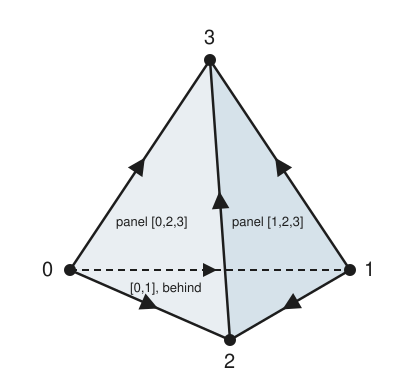
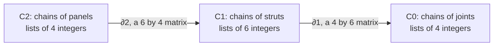

# Simplicial complexes and chains: triangles glued up, with a boundary that squares to zero

[Syllabus](../../../SYLLABUS.md) → [Topology](../README.md) → [Homology](../README.md#s05) → Simplicial complexes and chains

---

## General Overview

A geodesic dome is a frame of joints, straight struts and triangular panels. The 42-joint design on [Euler characteristic](../03-Surfaces%20and%20Manifolds/04-euler-characteristic-and-triangulations.md) has 120 struts and 80 panels. The smallest closed frame of the same kind is a tetrahedron: 4 joints, 6 struts, 4 triangular panels, and nothing inside. This hollow tetrahedron is the example on this card.

A builder wants two answers from the parts list alone, with no drawing. Does the shell close up with no gap? And if one panel is lifted out, which struts ring the hole? This card turns the parts list into integer vectors and one matrix per dimension, so a computer can answer both by multiplying.

The tool is the **boundary**: a rule that sends each panel to its three rim struts, and each strut to its two end joints, with plus and minus signs. Add the four panels with the right signs and the boundary is 0: the shell is closed. Lift panel [0,1,2] out and the boundary of the other three is exactly the hole's rim, the struts [0,1], [0,2] and [1,2].

The signs are chosen so that one fact always holds. Take the boundary of anything, then the boundary of that, and every term cancels. A rim has no ends.

**List the triangles, their edges and their vertices, write sums of them as integer vectors, and the signed boundary taken twice is always zero: the rim of a panel is a closed loop, and a closed loop has no ends.**

**What kind of fact this is:** three definitions (a simplicial complex, a chain, the boundary) and one theorem, that the boundary taken twice is zero, proved on this card in Why it works. The code checks it on every simplex of the tetrahedron and of the 80-panel dome: a finite check of those two complexes, while the proof covers every complex.

### The picture: the hollow tetrahedron, with its struts arrowed

<p align="center"></p>

Each strut points from its lower joint number to its higher one. That arrow is the strut's **orientation** (its chosen direction), and it is where the signs come from. The drawing is schematic: only which joints, struts and panels touch matters, not the lengths.

---

## The formula

A **k-simplex** is the simplest piece of dimension k, written by listing its k + 1 corner points, its **vertices**, in increasing order: $`[v_0, \dots, v_k]`$. A 0-simplex is a point, such as the joint [3]. A 1-simplex is a segment, such as the strut [0,1]. A 2-simplex is a triangle, such as the panel [0,1,2]. A 3-simplex is a solid tetrahedron, [0,1,2,3].

A **face** of a simplex is a simplex made from some of its vertices: [0,1] and [2] are faces of [0,1,2]. A **simplicial complex** $`K`$ is a finite list of simplices with one rule: every face of a listed simplex is also listed. The hollow tetrahedron lists the 4 vertices, the 6 edges and the 4 triangles of [0,1,2,3], but not [0,1,2,3] itself.

A **k-chain** is a sum of k-simplices with whole-number coefficients, such as $`2[0,1] - [1,2]`$. Fix an order for the k-simplices and a chain is just a list of integers, one per simplex. The chains of dimension k form $`C_k`$, which is $`\mathbb{Z}^{n_k}`$: the lists of $`n_k`$ integers, added slot by slot, where $`n_k`$ counts the k-simplices. Here $`n_0 = 4`$, $`n_1 = 6`$ and $`n_2 = 4`$.

The **boundary** $`\partial_k`$ (said "del k") takes a k-simplex to the signed sum of its faces one dimension down. A hat over a vertex, $`\widehat{v_i}`$, means that vertex is left out:

```math
\partial_k [v_0, v_1, \dots, v_k] = \sum_{i=0}^{k} (-1)^i \, [v_0, \dots, \widehat{v_i}, \dots, v_k]
```

**Read it aloud:** leave out each vertex in turn, and give the face a plus sign when the vertex left out sat in an even position (0, 2, …) and a minus sign when it sat in an odd one.

The sigma, $`\sum_{i=0}^{k}`$, means "add up the terms for i = 0, 1, up to k". The boundary of a chain is the same sum taken term by term, so on lists of integers it is a matrix. On the panel [0,1,2], leaving out 0, then 1, then 2 gives

```math
\partial_2 [0,1,2] = [1,2] - [0,2] + [0,1]
```

The theorem says that two boundaries in a row always give zero:

```math
\partial_{k-1} \, \partial_k = 0
```

**Read it aloud:** take the boundary, then the boundary of that, and every term cancels, for every chain in every simplicial complex.



The two arrows in a row send every list of 4 panel integers to 4 zeros.

| Symbol | Plain meaning | In our example | Push it up and the answer… |
| --- | --- | --- | --- |
| $`K`$ | a simplicial complex: simplices listed with all their faces | the hollow tetrahedron | — |
| $`k`$ | the dimension of a simplex | 0 joint, 1 strut, 2 panel | one more face in each boundary |
| $`[v_0, \dots, v_k]`$ | a k-simplex, vertices in increasing order | [0,1,2] | — |
| $`i`$, $`j`$ | positions of vertices left out, counted from 0 | 0, 1, 2 for a panel | the sign flips at each step |
| $`\sigma`$ | one simplex, named as a whole (sigma) | [0,1,2] | — |
| $`\widehat{v_i}`$ | "vertex $`v_i`$ left out" | $`[0, \widehat{1}, 2] = [0,2]`$ | — |
| $`n_k`$ | how many k-simplices $`K`$ has | 4, 6, 4 | one more slot in every k-chain |
| $`C_k`$ | the k-chains: lists of $`n_k`$ integers | $`C_1 = \mathbb{Z}^6`$ | — |
| $`\mathbb{Z}^{n}`$ | lists of n whole numbers, added slot by slot | $`\mathbb{Z}^4`$ for panels | — |
| $`\partial_k`$ | the boundary: an $`n_{k-1}`$ by $`n_k`$ matrix | $`\partial_2`$ is 6 by 4 | — |
| $`z`$ | the shell: all four panels, signed | $`-[0,1,2] + [0,1,3] - [0,2,3] + [1,2,3]`$ | its boundary stays 0 |
| $`\chi`$ | the Euler characteristic, $`n_0 - n_1 + n_2`$ | 4 − 6 + 4 = 2 | fixed by the shape |

### When it holds

- **Every face is listed.** The boundary of a triangle must land on listed edges. Leave the edge [0,1] off the list and 2 boundary terms, from [0,1,2] and [0,1,3], have no row to land in: $`\partial_2`$ cannot be written down.
- **A simplex is fixed by its vertices.** Two triangles may not share all three corners. The 2 × 2 grid glued into a tube on [Euler characteristic](../03-Surfaces%20and%20Manifolds/04-euler-characteristic-and-triangulations.md) breaks this, so a vertex list cannot tell its triangles apart. Such gluings need cells instead, on [Cellular homology](05-cellular-homology.md).
- **One vertex order, kept everywhere.** A simplex written out of order carries the sign of its sorting: each swap of two vertices flips the sign. The panel [0,2,1] has the face [2,1]. Rewrite that face as [1,2] without the flip and the boundary taken twice comes out at $`-2[1] + 2[2]`$, not 0.
- **The signs are kept.** Drop them and the panel's boundary taken twice is $`2[0] + 2[1] + 2[2]`$. Only when counting with remainders after division by 2, where 2 is 0, do the signs stop mattering; [Smith normal form](03-computing-homology-by-smith-normal-form.md) uses that.

---

## Why it works

### Step 0: two routes to every face, with opposite signs

Taking the boundary twice leaves out two vertices. Any two vertices can be left out in either order, so every face two dimensions down is reached by exactly two routes. The sign rule makes the two routes disagree, so they cancel.

### Step 1: a strut's boundary is its end minus its start

The rule gives $`\partial_1 [0,1] = [1] - [0]`$: the joint the arrow reaches, minus the joint it leaves. Chain struts nose to tail, $`[0,1] + [1,2]`$, and the middle joint cancels: the boundary is $`[2] - [0]`$, the path's two ends. A path that returns to its start has boundary 0.

### Step 2: a panel's boundary is its rim, walked once round

Walking a strut against its arrow is the strut with a minus sign, so $`-[0,2]`$ is the walk from 2 to 0. Then

```math
\partial_2 [0,1,2] = [1,2] - [0,2] + [0,1] = (\text{0 to 1}) + (\text{1 to 2}) + (\text{2 to 0})
```

That is the rim, walked round once. It returns to its start, so by Step 1 its boundary is zero:

```math
\partial_1 \partial_2 [0,1,2] = ([2] - [1]) - ([2] - [0]) + ([1] - [0]) = 0
```

Each joint appears twice, once with each sign: [0] as +1 and −1, [1] as −1 and +1, [2] as +1 and −1. The code tallies these routes (road 3).

### Step 3: the same cancellation in every dimension

Leave out the vertices at positions i and j, with i before j. There are two routes.

- Leave out position j first, sign $`(-1)^j`$. Position i has not moved, so leaving it out next gives $`(-1)^i`$.
- Leave out position i first, sign $`(-1)^i`$. Vertex $`v_j`$ has now moved down to position j − 1, so leaving it out gives $`(-1)^{j-1}`$.

The two products, $`(-1)^{i+j}`$ and $`(-1)^{i+j-1}`$, differ by one factor of −1. So each face two dimensions down appears exactly twice, with opposite signs, and the sum is zero.

<details>
<summary>Detailed proof: the boundary taken twice is zero</summary>

Write $`\sigma = [v_0, \dots, v_k]`$. Apply the boundary once:

$`\displaystyle \partial_k \sigma = \sum_{j=0}^{k} (-1)^j [v_0, \dots, \widehat{v_j}, \dots, v_k]`$

In the face that leaves out $`v_j`$, a vertex $`v_i`$ with $`i < j`$ still sits at position i, while a vertex $`v_i`$ with $`i > j`$ now sits at position $`i - 1`$. Apply the boundary again and split the terms by which vertex goes second:

$`\displaystyle \partial_{k-1} \partial_k \sigma = \sum_{i < j} (-1)^j (-1)^i \, [\dots \widehat{v_i} \dots \widehat{v_j} \dots] + \sum_{i > j} (-1)^j (-1)^{i-1} \, [\dots \widehat{v_j} \dots \widehat{v_i} \dots]`$

Rename the letters in the second sum, swapping i and j, so that both sums run over pairs with $`i < j`$ and leave out the same two vertices. The second sum's sign becomes $`(-1)^{i}(-1)^{j-1} = -(-1)^{i+j}`$, the negative of the first sum's sign. Term by term the two sums cancel, so $`\partial_{k-1}\partial_k \sigma = 0`$.

A chain is a sum of simplices with integer coefficients, and the boundary is applied term by term. So the boundary taken twice is zero on every chain. Nothing used the shape of the complex, only the sign rule, so the result holds in every simplicial complex and every dimension.

</details>

### Step 4: as matrices, the product is the zero matrix

Fix the orders: vertices [0] to [3]; edges [0,1], [0,2], [0,3], [1,2], [1,3], [2,3]; triangles [0,1,2], [0,1,3], [0,2,3], [1,2,3]. Column j of $`\partial_k`$ is the boundary of the j-th k-simplex, as a list of integers.

```math
\partial_1 = \begin{pmatrix} -1 & -1 & -1 & 0 & 0 & 0 \\ 1 & 0 & 0 & -1 & -1 & 0 \\ 0 & 1 & 0 & 1 & 0 & -1 \\ 0 & 0 & 1 & 0 & 1 & 1 \end{pmatrix}, \qquad \partial_2 = \begin{pmatrix} 1 & 1 & 0 & 0 \\ -1 & 0 & 1 & 0 \\ 0 & -1 & -1 & 0 \\ 1 & 0 & 0 & 1 \\ 0 & 1 & 0 & -1 \\ 0 & 0 & 1 & 1 \end{pmatrix}
```

The first matrix is the **incidence matrix** of [The adjacency matrix](../../04-Combinatorics%20and%20graphs/09-Graphs%20-%20Dots%20and%20Lines/07-adjacency-matrix-and-walk-counting.md), a 1 where a line touches a station, turned round so that edges are columns, with −1 at each edge's start and +1 at its end. The second matrix is the new part: one column per panel, one signed entry per rim strut.

Applying one boundary after another is multiplying the matrices ([Matrices](../../03-Algebra/04-Matrices/01-matrices-and-the-matrix-zoo.md)). Step 3 says the 4 by 4 product $`\partial_1 \partial_2`$ is all zeros, and the code finds all 16 entries 0. On the dome, the 42 by 80 product has all 3,360 entries 0.

### Step 5: what the zero buys

A chain whose boundary is 0 is called a **cycle**: it closes up with no loose ends. The theorem says every boundary is a cycle. The shell is one. The solid tetrahedron's boundary is

```math
z = \partial_3 [0,1,2,3] = [1,2,3] - [0,2,3] + [0,1,3] - [0,1,2]
```

and Step 3 gives $`\partial_2 z = 0`$: the four panels, signed this way, close up. As a list over the four panels, z is (−1, 1, −1, 1), and $`\partial_2`$ sends it to six zeros.

Lift panel [0,1,2] out. The other three panels are $`z + [0,1,2]`$, and their boundary is $`0 + \partial_2 [0,1,2] = [0,1] - [0,2] + [1,2]`$: the rim of the hole.

The hollow complex has no 3-simplex, so z is a cycle that is not the boundary of anything in it. That gap, a cycle with nothing to fill it, is a hole. Counting such gaps in each dimension is the job of [Homology groups](02-homology-groups.md); this card supplies the vectors, the matrices and the zero that make the count possible.

---

## Worked numbers, by hand

| Step | Arithmetic | Value |
| --- | --- | --- |
| the parts list | every face of [0,1,2,3], except [0,1,2,3] | 4 vertices, 6 edges, 4 triangles |
| Euler characteristic | 4 − 6 + 4 | 2 |
| boundary of panel [0,1,2] | leave out 0, 1, 2 with signs +, −, + | [1,2] − [0,2] + [0,1] |
| as a list over the edges | slots [0,1], [0,2], [0,3], [1,2], [1,3], [2,3] | (1, −1, 0, 1, 0, 0) |
| boundary of each strut | end minus start | ([2] − [1]) − ([2] − [0]) + ([1] − [0]) |
| collect each joint | [0]: +1 − 1; [1]: −1 + 1; [2]: +1 − 1 | **0** |
| all four panels at once | 4 by 6 matrix times 6 by 4 matrix | 16 entries, every one 0 |
| the shell | $`\partial_2`$ of (−1, 1, −1, 1) | six zeros: closed |
| panel [0,1,2] lifted out | $`\partial_2`$ of (0, 1, −1, 1) | (1, −1, 0, 1, 0, 0) = [0,1] − [0,2] + [1,2] |

**The boundary taken twice is 0:** the rim of every panel closes up, the signed shell is a cycle, and lifting a panel out leaves exactly that panel's rim as the boundary of what remains.

### What breaks if you drop a piece

| Mistake | Comes out at | What went wrong |
| --- | --- | --- |
| No signs: every face counted +1 | boundary twice of [0,1,2] = 2[0] + 2[1] + 2[2]; 12 entries of the product are 2 | each joint is reached twice, and the two routes add instead of cancelling |
| Face [2,1] of [0,2,1] rewritten as [1,2], no sign flip | boundary = −[0,1] + [0,2] + [1,2]; boundary twice = −2[1] + 2[2] | a swap of two vertices reverses the orientation, so the sign must flip |
| Edge [0,1] left off the list | 2 triangle boundary terms with no row | the list is not closed under faces, so it is not a simplicial complex |

The code prints all three.

---

## Code, from first principles, and it actually runs

The code builds the hollow tetrahedron from its one solid simplex by listing every face, then builds the two boundary matrices from the sign rule. It reaches the zero by three independent roads. Road 1 multiplies the matrices. Road 2 skips matrices: it takes the boundary of every one of the 24 vertex orders of the 4 triangles as a formal sum, with a sign from counting swaps, and checks each against the sorted triangle. Road 3 tallies the two routes from a panel to each joint. Then it builds the 42-joint dome by cutting each of the icosahedron's 20 triangles into 4, and multiplies its matrices too.

### Python

```python
# Simplicial complexes and chains -- the check behind the card.  Nothing is
# imported.  A simplex is a tuple of vertex numbers in increasing order, and a
# chain is a list of integers, one per simplex.  Road 1 multiplies boundary
# matrices.  Road 2 takes the boundary of every vertex order of each triangle,
# with a sign from counting swaps.  Road 3 tallies the two routes from a
# triangle to each corner.  Then the 42-joint dome, and three mistakes.

def closure(tops):                       # every face of every listed simplex
    out = set()
    for s in tops:
        for mask in range(1, 2 ** len(s)):
            out.add(tuple(v for i, v in enumerate(s) if mask >> i & 1))
    return out

def layer(cx, k):                        # the k-simplices, in sorted order
    return sorted(s for s in cx if len(s) == k + 1)

def bd(s, signed=True):                  # boundary of one simplex: (sign, face) terms
    return [((-1) ** i if signed else 1, s[:i] + s[i + 1:]) for i in range(len(s))]

def matrix(rows, cols, signed=True):     # column j holds the boundary of cols[j]
    m = [[0] * len(cols) for _ in rows]
    for j, s in enumerate(cols):
        for sg, f in bd(s, signed):
            m[rows.index(f)][j] += sg
    return m

def mul(a, b):
    return [[sum(a[i][t] * b[t][j] for t in range(len(b))) for j in range(len(b[0]))]
            for i in range(len(a))]

def apply(m, c):
    return [sum(m[i][j] * c[j] for j in range(len(c))) for i in range(len(m))]

def name(s):
    return "[" + ",".join(str(v) for v in s) + "]"

def fmt(d):                              # a formal sum {simplex: coefficient}
    t = [("+" if c > 0 else "-") + (str(abs(c)) if abs(c) != 1 else "") + name(s)
         for s, c in sorted(d.items()) if c]
    return " ".join(t) if t else "0"

def sort_sign(s):                        # bubble sort; every swap flips the sign
    s, sg = list(s), 1
    for i in range(len(s)):
        for j in range(len(s) - 1 - i):
            if s[j] > s[j + 1]:
                s[j], s[j + 1], sg = s[j + 1], s[j], -sg
    return sg, tuple(s)

def d_sum(chain, signed_sort=True):      # road 2: boundary of a formal sum, any order
    out = {}
    for s, c in chain.items():
        for i in range(len(s)):
            sg, f = sort_sign(s[:i] + s[i + 1:])
            out[f] = out.get(f, 0) + c * (-1) ** i * (sg if signed_sort else 1)
    return {f: c for f, c in out.items() if c}

def orders(s):                           # every ordering of a simplex's vertices
    return [s] if len(s) < 2 else [(v,) + r for v in s for r in orders(tuple(x for x in s if x != v))]

def zero(m):
    return all(x == 0 for row in m for x in row)

def yn(claim):
    return "yes" if claim else "no"

tet = closure([(0, 1, 2, 3)]) - {(0, 1, 2, 3)}           # the hollow tetrahedron
V, E, T = layer(tet, 0), layer(tet, 1), layer(tet, 2)
d1, d2 = matrix(V, E), matrix(E, T)
d1d2 = mul(d1, d2)
print("hollow tetrahedron: vertices", len(V), "edges", len(E), "triangles", len(T))
print("chi = %d - %d + %d = %d" % (len(V), len(E), len(T), len(V) - len(E) + len(T)))
print("edges:", " ".join(name(e) for e in E))
print("triangles:", " ".join(name(t) for t in T))
print("boundary of [0,1,2] =", " ".join(("+" if sg > 0 else "-") + name(f) for sg, f in bd((0, 1, 2))))
print("boundary of that =", fmt(d_sum(d_sum({(0, 1, 2): 1}))))
print("d1, rows = vertices, columns = edges:")
for r in d1: print("  ", r)
print("d2, rows = edges, columns = triangles:")
for r in d2: print("  ", r)
print("d1 times d2:", d1d2)
z = [-1, 1, -1, 1]                       # the shell, oriented as the solid's boundary
solid = matrix(T, [(0, 1, 2, 3)])
print("boundary of solid [0,1,2,3] =", fmt(d_sum({(0, 1, 2, 3): 1})), "->", [r[0] for r in solid])
print("boundary of the whole shell:", apply(d2, z))
hole = [0, 1, -1, 1]                     # panel [0,1,2] lifted out
print("panel [0,1,2] lifted out, boundary of the rest", hole, "is", apply(d2, hole), "=",
      fmt(dict(zip(E, apply(d2, hole)))))
road2 = [(p, d_sum({p: 1}), d_sum({t: 1})) for t in T for p in orders(t)]
same = sum(d == {f: c * sort_sign(p)[0] for f, c in d0.items()} and d_sum(d) == {}
           for p, d, d0 in road2)
print("road 2: vertex orders of the 4 triangles with boundary = sign x sorted one, and boundary twice 0:",
      same, "of", len(road2))
tally = {}
for sg, f in bd((0, 1, 2)):
    for sg2, g in bd(f):
        tally.setdefault(g, []).append(sg * sg2)
print("road 3: routes from [0,1,2] to each corner, with signs:",
      " ".join(name(g) + str(tally[g]) for g in sorted(tally)))
ico = [(0, 11, 5), (0, 5, 1), (0, 1, 7), (0, 7, 10), (0, 10, 11), (1, 5, 9), (5, 11, 4),
       (11, 10, 2), (10, 7, 6), (7, 1, 8), (3, 9, 4), (3, 4, 2), (3, 2, 6), (3, 6, 8),
       (3, 8, 9), (4, 9, 5), (2, 4, 11), (6, 2, 10), (8, 6, 7), (9, 8, 1)]
mid = {}
def m(a, b):                             # the new joint at the middle of strut a-b
    return mid.setdefault((min(a, b), max(a, b)), 12 + len(mid))
panels = []
for a, b, c in ico:
    x, y, w = m(a, b), m(b, c), m(c, a)
    panels += [tuple(sorted(f)) for f in [(a, x, w), (b, y, x), (c, w, y), (x, y, w)]]
dome = closure(panels)
DV, DE, DT = layer(dome, 0), layer(dome, 1), layer(dome, 2)
dd1, dd2 = matrix(DV, DE), matrix(DE, DT)
twice = all(sum(1 for x in row if x) == 2 for row in dd2)
dome_zero = zero(mul(dd1, dd2))
print("dome: joints", len(DV), "struts", len(DE), "panels", len(DT), "chi",
      len(DV) - len(DE) + len(DT), "| every strut in 2 panels:", yn(twice),
      "| d1 times d2 zero in all", len(DV) * len(DT), "entries:", yn(dome_zero))
u = mul(matrix(V, E, False), matrix(E, T, False))
print("mistake 1, no signs: boundary twice of [0,1,2] =",
      fmt({(v,): u[v][0] for v in range(4)}), "| entries equal to 2:", sum(x == 2 for r in u for x in r))
bad = d_sum({(0, 2, 1): 1}, signed_sort=False)
print("mistake 2, face [2,1] of [0,2,1] sorted with no sign flip: boundary =", fmt(bad),
      "| boundary twice =", fmt(d_sum(bad)))
cut = (0, 1)                             # the edge left off the list
lost = sum(1 for t in T for sg, f in bd(t) if f == cut)
print("mistake 3, edge", name(cut), "left off the list: triangle boundary terms with no row:", lost)
print("figure, joints 0 (70,270) 1 (350,270) 2 (230,340) 3 (210,60); arrows run low label to high")
assert zero(d1d2) and zero(mul(d2, solid))                 # road 1: the matrix products
assert d_sum(d_sum({(0, 1, 2): 1})) == {} and same == 24   # road 2: any vertex order
assert all(sorted(v) == [-1, 1] for v in tally.values())  # road 3: two routes, opposite signs
assert apply(d2, z) == [0] * 6 and z == [r[0] for r in solid]
assert apply(d2, hole) == [r[0] for r in d2]               # the rim is the lifted panel's
assert (len(DV), len(DE), len(DT)) == (42, 120, 80) and twice and dome_zero
assert u[0][0] == 2 and d_sum(bad) == {(1,): -2, (2,): 2} and lost == 2
print("ALL CHECKS PASS")
```

**Ran 2026-11-15 on macOS, Python 3.14.10, standard library only. All checks passed. Output, pasted from the run:**

```
hollow tetrahedron: vertices 4 edges 6 triangles 4
chi = 4 - 6 + 4 = 2
edges: [0,1] [0,2] [0,3] [1,2] [1,3] [2,3]
triangles: [0,1,2] [0,1,3] [0,2,3] [1,2,3]
boundary of [0,1,2] = +[1,2] -[0,2] +[0,1]
boundary of that = 0
d1, rows = vertices, columns = edges:
   [-1, -1, -1, 0, 0, 0]
   [1, 0, 0, -1, -1, 0]
   [0, 1, 0, 1, 0, -1]
   [0, 0, 1, 0, 1, 1]
d2, rows = edges, columns = triangles:
   [1, 1, 0, 0]
   [-1, 0, 1, 0]
   [0, -1, -1, 0]
   [1, 0, 0, 1]
   [0, 1, 0, -1]
   [0, 0, 1, 1]
d1 times d2: [[0, 0, 0, 0], [0, 0, 0, 0], [0, 0, 0, 0], [0, 0, 0, 0]]
boundary of solid [0,1,2,3] = -[0,1,2] +[0,1,3] -[0,2,3] +[1,2,3] -> [-1, 1, -1, 1]
boundary of the whole shell: [0, 0, 0, 0, 0, 0]
panel [0,1,2] lifted out, boundary of the rest [0, 1, -1, 1] is [1, -1, 0, 1, 0, 0] = +[0,1] -[0,2] +[1,2]
road 2: vertex orders of the 4 triangles with boundary = sign x sorted one, and boundary twice 0: 24 of 24
road 3: routes from [0,1,2] to each corner, with signs: [0][1, -1] [1][-1, 1] [2][1, -1]
dome: joints 42 struts 120 panels 80 chi 2 | every strut in 2 panels: yes | d1 times d2 zero in all 3360 entries: yes
mistake 1, no signs: boundary twice of [0,1,2] = +2[0] +2[1] +2[2] | entries equal to 2: 12
mistake 2, face [2,1] of [0,2,1] sorted with no sign flip: boundary = -[0,1] +[0,2] +[1,2] | boundary twice = -2[1] +2[2]
mistake 3, edge [0,1] left off the list: triangle boundary terms with no row: 2
figure, joints 0 (70,270) 1 (350,270) 2 (230,340) 3 (210,60); arrows run low label to high
ALL CHECKS PASS
```

### Rust

Same numbers, same labels, built with `rustc --edition 2021 -O`.

```rust
// Simplicial complexes and chains -- the same check as the Python, in Rust.
// No crates.  A simplex is a list of vertex numbers in increasing order, and a
// chain is a list of integers, one per simplex.  Road 1 multiplies boundary
// matrices.  Road 2 takes the boundary of every vertex order of each triangle,
// with a sign from counting swaps.  Road 3 tallies the two routes from a
// triangle to each corner.  Then the 42-joint dome, and three mistakes.
use std::collections::{BTreeMap, BTreeSet};

type S = Vec<usize>;
type Sum = BTreeMap<S, i64>;
type M = Vec<Vec<i64>>;

fn closure(tops: &[S]) -> BTreeSet<S> {             // every face of every listed simplex
    tops.iter().flat_map(|s| (1..(1usize << s.len()))
        .map(move |mask| (0..s.len()).filter(|i| mask >> i & 1 == 1).map(|i| s[i]).collect())).collect()
}

fn layer(cx: &BTreeSet<S>, k: usize) -> Vec<S> { cx.iter().filter(|s| s.len() == k + 1).cloned().collect() }

fn drop_at(s: &[usize], i: usize) -> S { let mut f = s.to_vec(); f.remove(i); f }

fn bd(s: &[usize], signed: bool) -> Vec<(i64, S)> {   // boundary of one simplex: (sign, face)
    (0..s.len()).map(|i| (if signed && i % 2 == 1 { -1 } else { 1 }, drop_at(s, i))).collect()
}

fn matrix(rows: &[S], cols: &[S], signed: bool) -> M { // column j holds the boundary of cols[j]
    let mut m = vec![vec![0i64; cols.len()]; rows.len()];
    for (j, s) in cols.iter().enumerate() {
        for (sg, f) in bd(s, signed) {
            m[rows.iter().position(|x| *x == f).unwrap()][j] += sg;
        }
    }
    m
}

fn mul(a: &M, b: &M) -> M {
    (0..a.len()).map(|i| (0..b[0].len()).map(|j| (0..b.len()).map(|t| a[i][t] * b[t][j]).sum()).collect()).collect() }

fn apply(m: &M, c: &[i64]) -> Vec<i64> { m.iter().map(|row| row.iter().zip(c).map(|(x, y)| x * y).sum()).collect() }

fn name(s: &[usize]) -> String { format!("[{}]", s.iter().map(|v| v.to_string()).collect::<Vec<_>>().join(",")) }

fn fmt(d: &Sum) -> String {                          // a formal sum {simplex: coefficient}
    let t: Vec<String> = d.iter().filter(|(_, c)| **c != 0).map(|(s, c)| {
        format!("{}{}{}", if *c > 0 { "+" } else { "-" },
                if c.abs() != 1 { c.abs().to_string() } else { String::new() }, name(s))
    }).collect();
    if t.is_empty() { "0".to_string() } else { t.join(" ") }
}

fn sort_sign(s: &[usize]) -> (i64, S) {              // bubble sort; every swap flips the sign
    let (mut s, mut sg) = (s.to_vec(), 1i64);
    for i in 0..s.len() {
        for j in 0..s.len().saturating_sub(1 + i) {
            if s[j] > s[j + 1] { s.swap(j, j + 1); sg = -sg; }
        }
    }
    (sg, s)
}

fn d_sum(chain: &Sum, signed_sort: bool) -> Sum {    // road 2: boundary of a formal sum, any order
    let mut out = Sum::new();
    for (s, c) in chain {
        for i in 0..s.len() {
            let (sg, f) = sort_sign(&drop_at(s, i));
            let pos = if i % 2 == 1 { -1 } else { 1 };
            *out.entry(f).or_insert(0) += c * pos * if signed_sort { sg } else { 1 };
        }
    }
    out.into_iter().filter(|(_, c)| *c != 0).collect()
}

fn one(s: &[usize]) -> Sum { [(s.to_vec(), 1)].into_iter().collect() }
fn orders(s: &[usize]) -> Vec<S> {                    // every ordering of a simplex's vertices
    if s.len() < 2 { return vec![s.to_vec()]; }
    s.iter().flat_map(|&v| orders(&s.iter().copied().filter(|&x| x != v).collect::<S>())
        .into_iter().map(move |r| [vec![v], r].concat())).collect()
}

fn zero(m: &M) -> bool { m.iter().all(|r| r.iter().all(|&x| x == 0)) }
fn yn(claim: bool) -> &'static str { if claim { "yes" } else { "no" } }
fn signs(t: &[(i64, S)]) -> String {
    t.iter().map(|(sg, f)| format!("{}{}", if *sg > 0 { "+" } else { "-" }, name(f))).collect::<Vec<_>>().join(" ")
}

fn main() {
    let mut tet = closure(&[vec![0, 1, 2, 3]]);            // the hollow tetrahedron
    tet.remove(&vec![0, 1, 2, 3]);
    let (v, e, t) = (layer(&tet, 0), layer(&tet, 1), layer(&tet, 2));
    let (d1, d2) = (matrix(&v, &e, true), matrix(&e, &t, true));
    let d1d2 = mul(&d1, &d2);
    println!("hollow tetrahedron: vertices {} edges {} triangles {}", v.len(), e.len(), t.len());
    println!("chi = {} - {} + {} = {}", v.len(), e.len(), t.len(), v.len() + t.len() - e.len());
    println!("edges: {}", e.iter().map(|x| name(x)).collect::<Vec<_>>().join(" "));
    println!("triangles: {}", t.iter().map(|x| name(x)).collect::<Vec<_>>().join(" "));
    println!("boundary of [0,1,2] = {}", signs(&bd(&[0, 1, 2], true)));
    println!("boundary of that = {}", fmt(&d_sum(&d_sum(&one(&[0, 1, 2]), true), true)));
    println!("d1, rows = vertices, columns = edges:");
    for r in &d1 { println!("   {:?}", r); }
    println!("d2, rows = edges, columns = triangles:");
    for r in &d2 { println!("   {:?}", r); }
    println!("d1 times d2: {:?}", d1d2);
    let z = vec![-1i64, 1, -1, 1];                         // the shell, oriented as the solid's boundary
    let solid = matrix(&t, &[vec![0, 1, 2, 3]], true);
    let solid_col: Vec<i64> = solid.iter().map(|r| r[0]).collect();
    println!("boundary of solid [0,1,2,3] = {} -> {:?}", fmt(&d_sum(&one(&[0, 1, 2, 3]), true)), solid_col);
    println!("boundary of the whole shell: {:?}", apply(&d2, &z));
    let hole = vec![0i64, 1, -1, 1];                        // panel [0,1,2] lifted out
    let rim = apply(&d2, &hole);
    println!("panel [0,1,2] lifted out, boundary of the rest {:?} is {:?} = {}", hole, rim,
             fmt(&e.iter().cloned().zip(rim.iter().copied()).collect()));
    let (mut same, mut n2) = (0, 0);
    for tri in &t {
        let d0 = d_sum(&one(tri), true);
        for p in orders(tri) {
            n2 += 1;
            let d = d_sum(&one(&p), true);
            let want: Sum = d0.iter().map(|(f, c)| (f.clone(), c * sort_sign(&p).0)).collect();
            if d == want && d_sum(&d, true).is_empty() { same += 1; }
        }
    }
    println!("road 2: vertex orders of the 4 triangles with boundary = sign x sorted one, and boundary twice 0: {} of {}", same, n2);
    let mut tally: BTreeMap<S, Vec<i64>> = BTreeMap::new();
    for (sg, f) in bd(&[0, 1, 2], true) {
        for (sg2, g) in bd(&f, true) { tally.entry(g).or_default().push(sg * sg2); }
    }
    println!("road 3: routes from [0,1,2] to each corner, with signs: {}",
             tally.iter().map(|(g, s)| format!("{}{:?}", name(g), s)).collect::<Vec<_>>().join(" "));
    let ico: [[usize; 3]; 20] = [[0, 11, 5], [0, 5, 1], [0, 1, 7], [0, 7, 10], [0, 10, 11], [1, 5, 9], [5, 11, 4],
        [11, 10, 2], [10, 7, 6], [7, 1, 8], [3, 9, 4], [3, 4, 2], [3, 2, 6], [3, 6, 8],
        [3, 8, 9], [4, 9, 5], [2, 4, 11], [6, 2, 10], [8, 6, 7], [9, 8, 1]];
    let mut mid: BTreeMap<(usize, usize), usize> = BTreeMap::new();
    let mut m = |a: usize, b: usize| -> usize {             // the new joint at the middle of strut a-b
        let n = 12 + mid.len();
        *mid.entry((a.min(b), a.max(b))).or_insert(n)
    };
    let mut panels: Vec<S> = Vec::new();
    for [a, b, c] in ico {
        let (x, y, w) = (m(a, b), m(b, c), m(c, a));
        for mut f in [vec![a, x, w], vec![b, y, x], vec![c, w, y], vec![x, y, w]] { f.sort(); panels.push(f); }
    }
    let dome = closure(&panels);
    let (dv, de, dt) = (layer(&dome, 0), layer(&dome, 1), layer(&dome, 2));
    let (dd1, dd2) = (matrix(&dv, &de, true), matrix(&de, &dt, true));
    let twice = dd2.iter().all(|r| r.iter().filter(|&&x| x != 0).count() == 2);
    let dome_zero = zero(&mul(&dd1, &dd2));
    println!("dome: joints {} struts {} panels {} chi {} | every strut in 2 panels: {} | d1 times d2 zero in all {} entries: {}",
             dv.len(), de.len(), dt.len(), dv.len() + dt.len() - de.len(), yn(twice), dv.len() * dt.len(), yn(dome_zero));
    let u = mul(&matrix(&v, &e, false), &matrix(&e, &t, false));
    let u_sum: Sum = (0..4).map(|k| (vec![k], u[k][0])).collect();
    println!("mistake 1, no signs: boundary twice of [0,1,2] = {} | entries equal to 2: {}",
             fmt(&u_sum), u.iter().flatten().filter(|&&x| x == 2).count());
    let bad = d_sum(&one(&[0, 2, 1]), false);
    println!("mistake 2, face [2,1] of [0,2,1] sorted with no sign flip: boundary = {} | boundary twice = {}",
             fmt(&bad), fmt(&d_sum(&bad, true)));
    let cut: S = vec![0, 1];                               // the edge left off the list
    let lost = t.iter().map(|tri| bd(tri, true).iter().filter(|(_, f)| *f == cut).count()).sum::<usize>();
    println!("mistake 3, edge {} left off the list: triangle boundary terms with no row: {}", name(&cut), lost);
    println!("figure, joints 0 (70,270) 1 (350,270) 2 (230,340) 3 (210,60); arrows run low label to high");
    assert!(zero(&d1d2) && zero(&mul(&d2, &solid)));                  // road 1: the matrix products
    assert!(d_sum(&d_sum(&one(&[0, 1, 2]), true), true).is_empty() && same == 24); // road 2
    assert!(tally.values().all(|s| { let mut s = s.clone(); s.sort(); s == vec![-1, 1] })); // road 3
    assert!(apply(&d2, &z) == vec![0; 6] && z == solid_col);
    assert!(rim == d2.iter().map(|r| r[0]).collect::<Vec<i64>>());    // the rim is the lifted panel's
    assert!((dv.len(), de.len(), dt.len()) == (42, 120, 80) && twice && dome_zero);
    assert!(u[0][0] == 2 && d_sum(&bad, true) == [(vec![1], -2), (vec![2], 2)].into_iter().collect() && lost == 2);
    println!("ALL CHECKS PASS");
}
```

**Ran 2026-11-15 on macOS, rustc 1.98.1, no crates. All checks passed. Output, pasted from the run:**

```
hollow tetrahedron: vertices 4 edges 6 triangles 4
chi = 4 - 6 + 4 = 2
edges: [0,1] [0,2] [0,3] [1,2] [1,3] [2,3]
triangles: [0,1,2] [0,1,3] [0,2,3] [1,2,3]
boundary of [0,1,2] = +[1,2] -[0,2] +[0,1]
boundary of that = 0
d1, rows = vertices, columns = edges:
   [-1, -1, -1, 0, 0, 0]
   [1, 0, 0, -1, -1, 0]
   [0, 1, 0, 1, 0, -1]
   [0, 0, 1, 0, 1, 1]
d2, rows = edges, columns = triangles:
   [1, 1, 0, 0]
   [-1, 0, 1, 0]
   [0, -1, -1, 0]
   [1, 0, 0, 1]
   [0, 1, 0, -1]
   [0, 0, 1, 1]
d1 times d2: [[0, 0, 0, 0], [0, 0, 0, 0], [0, 0, 0, 0], [0, 0, 0, 0]]
boundary of solid [0,1,2,3] = -[0,1,2] +[0,1,3] -[0,2,3] +[1,2,3] -> [-1, 1, -1, 1]
boundary of the whole shell: [0, 0, 0, 0, 0, 0]
panel [0,1,2] lifted out, boundary of the rest [0, 1, -1, 1] is [1, -1, 0, 1, 0, 0] = +[0,1] -[0,2] +[1,2]
road 2: vertex orders of the 4 triangles with boundary = sign x sorted one, and boundary twice 0: 24 of 24
road 3: routes from [0,1,2] to each corner, with signs: [0][1, -1] [1][-1, 1] [2][1, -1]
dome: joints 42 struts 120 panels 80 chi 2 | every strut in 2 panels: yes | d1 times d2 zero in all 3360 entries: yes
mistake 1, no signs: boundary twice of [0,1,2] = +2[0] +2[1] +2[2] | entries equal to 2: 12
mistake 2, face [2,1] of [0,2,1] sorted with no sign flip: boundary = -[0,1] +[0,2] +[1,2] | boundary twice = -2[1] +2[2]
mistake 3, edge [0,1] left off the list: triangle boundary terms with no row: 2
figure, joints 0 (70,270) 1 (350,270) 2 (230,340) 3 (210,60); arrows run low label to high
ALL CHECKS PASS
```

The two outputs match line for line.

### Lean

Lean proves that the boundary taken twice is zero, for every chain in every simplicial complex, and checks the tetrahedron's numbers.

- Take any simplicial complex, any k and any k-chain of it. Then its boundary taken twice is 0.
- Take a (k + 1)-chain of a simplicial complex. Then its boundary is a k-chain of the same complex, because every face is listed.
- Take the panel [0,1,2]. Then its boundary is $`[1,2] - [0,2] + [0,1]`$.
- Each column of the card's $`\partial_1`$ and $`\partial_2`$ is the boundary of that column's simplex, by the sign rule.
- Take the product $`\partial_1 \partial_2`$, a 4 by 4 matrix. Then all 16 of its entries are 0.
- Take the shell z, the list (−1, 1, −1, 1). Then $`\partial_2 z`$ is six zeros, so z is a cycle.
- Lift panel [0,1,2] out, leaving the list (0, 1, −1, 1). Then its boundary is (1, −1, 0, 1, 0, 0), the rim [0,1] − [0,2] + [1,2].
- Take the faces of [0,1,2,3] other than the solid itself. Then there are 4 vertices, 6 edges and 4 triangles, and $`\chi = 4 - 6 + 4 = 2`$.

The 24 vertex orders, the route tally, the 80-panel dome and the three mistakes are left to the Python and Rust checks.

```lean
-- Simplicial complexes and chains: in every simplicial complex, the signed boundary of the boundary of every chain is zero, and the boundary of a chain of the complex is again a chain of the complex.
import Mathlib.AlgebraicTopology.SimplicialComplex.Basic
import Mathlib.Data.Finset.Sort
import Mathlib.LinearAlgebra.Finsupp.LinearCombination
import Mathlib.LinearAlgebra.Matrix.Notation

open Finsupp

namespace SimplicialChains

variable {ι : Type*} [LinearOrder ι]

/-- The face of the simplex `s` that leaves out the vertex at position `i`,
with the vertices of `s` listed in increasing order. -/
def face (s : Finset ι) (i : Fin s.card) : Finset ι :=
  s.erase (s.orderEmbOfFin rfl i)

/-- The signed boundary of one simplex `[v_0, ..., v_k]`: the sum over `i` of
`(-1)^i [v_0, ..., v_i left out, ..., v_k]`. A single vertex (or the empty set) has
boundary `0`. -/
noncomputable def boundarySimplex (s : Finset ι) : Finset ι →₀ ℤ :=
  if s.card ≤ 1 then 0
  else ∑ i : Fin s.card, ((-1 : ℤ) ^ (i : ℕ)) • Finsupp.single (face s i) 1

/-- The boundary of a chain (a finite sum of simplices with integer coefficients),
taken term by term. -/
noncomputable def boundary : (Finset ι →₀ ℤ) →ₗ[ℤ] (Finset ι →₀ ℤ) :=
  Finsupp.linearCombination ℤ boundarySimplex

/-- `C_k(K)`: the k-chains of the simplicial complex `K`, the integer combinations of its
k-simplices (simplices with `k + 1` vertices). -/
def chains (K : PreAbstractSimplicialComplex ι) (k : ℕ) : Submodule ℤ (Finset ι →₀ ℤ) :=
  Finsupp.supported ℤ ℤ {s | s ∈ K ∧ s.card = k + 1}

/-- The sign of vertex `v` in `s`: `(-1)` to the number of vertices of `s` below `v`. -/
noncomputable def sgn (s : Finset ι) (v : ι) : ℤ := (-1 : ℤ) ^ (s.filter (· < v)).card

/-- The signed boundary written as a sum over the vertices left out. -/
noncomputable def bsum (s : Finset ι) : Finset ι →₀ ℤ :=
  ∑ v ∈ s, sgn s v • Finsupp.single (s.erase v) 1

theorem card_filter_lt_orderEmbOfFin (s : Finset ι) (i : Fin s.card) :
    (s.filter (· < s.orderEmbOfFin rfl i)).card = i := by
  have h : s.filter (· < s.orderEmbOfFin rfl i) =
      (Finset.Iio i).map (s.orderEmbOfFin rfl).toEmbedding := by
    ext x
    simp only [Finset.mem_filter, Finset.mem_map, Finset.mem_Iio,
      RelEmbedding.coe_toEmbedding]
    constructor
    · rintro ⟨hx, hlt⟩
      have : x ∈ Set.range (s.orderEmbOfFin rfl) := by
        rw [Finset.range_orderEmbOfFin]; exact hx
      obtain ⟨j, rfl⟩ := this
      exact ⟨j, (s.orderEmbOfFin rfl).lt_iff_lt.mp hlt, rfl⟩
    · rintro ⟨j, hj, rfl⟩
      exact ⟨Finset.orderEmbOfFin_mem _ _ _, (s.orderEmbOfFin rfl).lt_iff_lt.mpr hj⟩
  rw [h, Finset.card_map, Fin.card_Iio]

theorem boundarySimplex_eq (s : Finset ι) :
    boundarySimplex s = if s.card ≤ 1 then 0 else bsum s := by
  unfold boundarySimplex bsum
  split_ifs with h
  · rfl
  · have hm := s.map_orderEmbOfFin_univ rfl
    calc ∑ i : Fin s.card, ((-1 : ℤ) ^ (i : ℕ)) • Finsupp.single (face s i) (1 : ℤ)
        = ∑ i : Fin s.card, sgn s (s.orderEmbOfFin rfl i) •
            Finsupp.single (s.erase (s.orderEmbOfFin rfl i)) 1 := by
          refine Finset.sum_congr rfl fun i _ => ?_
          rw [sgn, card_filter_lt_orderEmbOfFin]; rfl
      _ = ∑ v ∈ Finset.univ.map (s.orderEmbOfFin rfl).toEmbedding,
            sgn s v • Finsupp.single (s.erase v) 1 := by
          rw [Finset.sum_map]; rfl
      _ = ∑ v ∈ s, sgn s v • Finsupp.single (s.erase v) 1 := by rw [hm]

theorem sgn_swap_of_lt (s : Finset ι) {v w : ι} (_hv : v ∈ s) (hw : w ∈ s) (hwv : w < v) :
    sgn s w * sgn (s.erase w) v = -(sgn s v * sgn (s.erase v) w) := by
  have h1 : (s.erase v).filter (· < w) = s.filter (· < w) := by
    rw [Finset.filter_erase]
    exact Finset.erase_eq_of_notMem (by simp [not_lt.mpr hwv.le])
  have h2 : ((s.erase w).filter (· < v)).card + 1 = (s.filter (· < v)).card := by
    rw [Finset.filter_erase, Finset.card_erase_add_one]
    simp [hw, hwv]
  unfold sgn
  rw [h1, ← h2, pow_succ]
  ring

theorem sgn_swap (s : Finset ι) {v w : ι} (hv : v ∈ s) (hw : w ∈ s) (hne : v ≠ w) :
    sgn s w * sgn (s.erase w) v = -(sgn s v * sgn (s.erase v) w) := by
  rcases lt_or_gt_of_ne hne with h | h
  · have := sgn_swap_of_lt s hw hv h
    rw [this]; ring
  · exact sgn_swap_of_lt s hv hw h

theorem sum_sgn_bsum (s : Finset ι) :
    ∑ v ∈ s, sgn s v • bsum (s.erase v) = 0 := by
  set F : ι → ι → Finset ι →₀ ℤ := fun v w =>
    (sgn s v * sgn (s.erase v) w) • Finsupp.single ((s.erase v).erase w) 1 with hF
  have hS : ∑ v ∈ s, sgn s v • bsum (s.erase v) = ∑ v ∈ s, ∑ w ∈ s.erase v, F v w := by
    refine Finset.sum_congr rfl fun v _ => ?_
    rw [bsum, Finset.smul_sum]
    refine Finset.sum_congr rfl fun w _ => ?_
    simp only [hF]
    rw [mul_smul]
  have hswap : ∑ v ∈ s, ∑ w ∈ s.erase v, F v w = ∑ v ∈ s, ∑ w ∈ s.erase v, F w v :=
    Finset.sum_comm' (fun x y => by
      simp only [Finset.mem_erase]; tauto)
  have hneg : ∑ v ∈ s, ∑ w ∈ s.erase v, F w v = -∑ v ∈ s, ∑ w ∈ s.erase v, F v w := by
    rw [← Finset.sum_neg_distrib]
    refine Finset.sum_congr rfl fun v hv => ?_
    rw [← Finset.sum_neg_distrib]
    refine Finset.sum_congr rfl fun w hw => ?_
    obtain ⟨hne, hw⟩ := Finset.mem_erase.mp hw
    simp only [hF]
    rw [sgn_swap s hv hw (Ne.symm hne), Finset.erase_right_comm, neg_smul]
  rw [hS]
  set S := ∑ v ∈ s, ∑ w ∈ s.erase v, F v w
  have h : S = -S := hswap.trans hneg
  ext t
  have := congrArg (fun f : Finset ι →₀ ℤ => f t) h
  simp only [Finsupp.coe_neg, Pi.neg_apply] at this
  simp only [Finsupp.coe_zero, Pi.zero_apply]
  omega

theorem boundary_single (s : Finset ι) (b : ℤ) :
    boundary (Finsupp.single s b) = b • boundarySimplex s := by
  simp [boundary, Finsupp.linearCombination_single]

theorem boundary_boundarySimplex (s : Finset ι) : boundary (boundarySimplex s) = 0 := by
  rw [boundarySimplex_eq s]
  split_ifs with h
  · exact map_zero _
  · rw [bsum, map_sum]
    simp only [map_zsmul, boundary_single, one_smul]
    by_cases h2 : s.card = 2
    · refine Finset.sum_eq_zero fun v hv => ?_
      rw [boundarySimplex_eq, ite_eq_left_of_eq_true _ _ (eq_true (by rw [Finset.card_erase_of_mem hv]; omega)), smul_zero]
    · rw [Finset.sum_congr rfl fun v hv => by
        rw [boundarySimplex_eq, ite_eq_right_of_eq_false _ _ (eq_false (by rw [Finset.card_erase_of_mem hv]; omega))]]
      exact sum_sgn_bsum s

theorem boundarySimplex_apply (s t : Finset ι) :
    boundarySimplex s t =
      if s.card ≤ 1 then 0 else ∑ v ∈ s, if s.erase v = t then sgn s v else 0 := by
  rw [boundarySimplex_eq]
  split_ifs
  · rfl
  · simp [bsum, Finsupp.single_apply]

#print axioms card_filter_lt_orderEmbOfFin
#print axioms boundarySimplex_eq
#print axioms sgn_swap_of_lt
#print axioms sgn_swap
#print axioms sum_sgn_bsum
#print axioms boundary_single
#print axioms boundary_boundarySimplex
#print axioms boundarySimplex_apply

/-- The boundary taken twice is zero: in every simplicial complex `K`, for every `k` and
every k-chain `c` of `K`, the boundary of the boundary of `c` is `0`. -/
theorem boundary_boundary_eq_zero (K : PreAbstractSimplicialComplex ι) (k : ℕ)
    (c : Finset ι →₀ ℤ) (hc : c ∈ chains K k) :
    boundary (boundary c) = 0 := by
  -- every chain works, so the hypothesis `hc` is not needed
  have _ := hc
  have h : boundary ∘ₗ boundary = (0 : (Finset ι →₀ ℤ) →ₗ[ℤ] (Finset ι →₀ ℤ)) :=
    Finsupp.lhom_ext fun s b => by
      rw [LinearMap.comp_apply, boundary_single, map_zsmul, boundary_boundarySimplex,
        smul_zero, LinearMap.zero_apply]
  exact LinearMap.congr_fun h c

/-- Because every face of a listed simplex is listed, the boundary of a (k+1)-chain of `K`
is a k-chain of `K`: the boundary is a map `C_{k+1}(K) → C_k(K)`. -/
theorem boundary_mem_chains (K : PreAbstractSimplicialComplex ι) (k : ℕ)
    (c : Finset ι →₀ ℤ) (hc : c ∈ chains K (k + 1)) :
    boundary c ∈ chains K k := by
  rw [boundary, Finsupp.linearCombination_apply]
  refine Submodule.finsuppSum_mem (S := chains K k) (f := c)
    (g := fun s a => a • boundarySimplex s) (h := fun s hs => ?_)
  apply Submodule.smul_mem
  have hsK : s ∈ K ∧ s.card = k + 1 + 1 :=
    (Finsupp.mem_supported ℤ c).mp hc (Finset.mem_coe.mpr (Finsupp.mem_support_iff.mpr hs))
  rw [boundarySimplex_eq, ite_eq_right_of_eq_false _ _ (eq_false (by omega)), bsum]
  refine Submodule.sum_mem _ fun v hv => ?_
  apply Submodule.smul_mem
  refine Finsupp.single_mem_supported ℤ _ ⟨?_, ?_⟩
  · refine K.isRelLowerSet_faces.mem_of_le hsK.1 (Finset.erase_subset v s) ?_
    rw [← Finset.card_pos, Finset.card_erase_of_mem hv]; omega
  · rw [Finset.card_erase_of_mem hv]; omega

/-! The hollow tetrahedron, with the card's orders: edges [0,1], [0,2], [0,3], [1,2], [1,3],
[2,3]; triangles [0,1,2], [0,1,3], [0,2,3], [1,2,3]. -/

/-- The card's first boundary matrix, rows = vertices, columns = edges. -/
def d1 : Matrix (Fin 4) (Fin 6) ℤ :=
  !![-1, -1, -1, 0, 0, 0;
      1, 0, 0, -1, -1, 0;
      0, 1, 0, 1, 0, -1;
      0, 0, 1, 0, 1, 1]

/-- The card's second boundary matrix, rows = edges, columns = triangles. -/
def d2 : Matrix (Fin 6) (Fin 4) ℤ :=
  !![1, 1, 0, 0;
     -1, 0, 1, 0;
      0, -1, -1, 0;
      1, 0, 0, 1;
      0, 1, 0, -1;
      0, 0, 1, 1]

def tetVertices : Fin 4 → Finset ℕ := ![{0}, {1}, {2}, {3}]
def tetEdges : Fin 6 → Finset ℕ := ![{0, 1}, {0, 2}, {0, 3}, {1, 2}, {1, 3}, {2, 3}]
def tetTriangles : Fin 4 → Finset ℕ := ![{0, 1, 2}, {0, 1, 3}, {0, 2, 3}, {1, 2, 3}]

-- The boundary of the panel [0,1,2] is [1,2] - [0,2] + [0,1].
example : boundarySimplex ({0, 1, 2} : Finset ℕ) =
    Finsupp.single {1, 2} 1 - Finsupp.single {0, 2} 1 + Finsupp.single {0, 1} 1 := by
  rw [boundarySimplex_eq, ite_eq_right_of_eq_false _ _ (eq_false (by decide)), bsum, Finset.sum_insert (by decide),
    Finset.sum_insert (by decide), Finset.sum_singleton]
  have e0 : ({0, 1, 2} : Finset ℕ).erase 0 = {1, 2} := by decide
  have e1 : ({0, 1, 2} : Finset ℕ).erase 1 = {0, 2} := by decide
  have e2 : ({0, 1, 2} : Finset ℕ).erase 2 = {0, 1} := by decide
  have s0 : sgn ({0, 1, 2} : Finset ℕ) 0 = 1 := by decide
  have s1 : sgn ({0, 1, 2} : Finset ℕ) 1 = -1 := by decide
  have s2 : sgn ({0, 1, 2} : Finset ℕ) 2 = 1 := by decide
  rw [e0, e1, e2, s0, s1, s2, one_smul, one_smul, neg_one_smul, sub_eq_add_neg, add_assoc]

-- The card's matrices are the boundary rule written out: column j holds the boundary of the
-- j-th simplex.
example : ∀ i j, d1 i j = boundarySimplex (tetEdges j) (tetVertices i) := by
  intro i j
  fin_cases i <;> fin_cases j <;> simp only [boundarySimplex_apply, sgn] <;> decide

example : ∀ i j, d2 i j = boundarySimplex (tetTriangles j) (tetEdges i) := by
  intro i j
  fin_cases i <;> fin_cases j <;> simp only [boundarySimplex_apply, sgn] <;> decide

-- The 4 by 4 product of the two boundary matrices: all 16 entries are 0.
example : d1 * d2 = 0 := by decide

-- The shell (-1, 1, -1, 1) has boundary six zeros: it is a cycle.
example : d2.mulVec ![-1, 1, -1, 1] = 0 := by decide

-- Panel [0,1,2] lifted out: the boundary of the rest is its rim [0,1] - [0,2] + [1,2].
example : d2.mulVec ![0, 1, -1, 1] = ![1, -1, 0, 1, 0, 0] := by decide

-- The parts list: 4 vertices, 6 edges, 4 triangles of [0,1,2,3], and 4 - 6 + 4 = 2.
example : ((Finset.range 4).powerset.filter (fun s => s.card = 1)).card = 4 ∧
    ((Finset.range 4).powerset.filter (fun s => s.card = 2)).card = 6 ∧
    ((Finset.range 4).powerset.filter (fun s => s.card = 3)).card = 4 ∧
    (4 : ℤ) - 6 + 4 = 2 := by decide

#print axioms boundary_boundary_eq_zero
#print axioms boundary_mem_chains

end SimplicialChains
```

**Checked 2026-11-15 on macOS, Lean 4.36.0-rc2, Mathlib v4.36.0-rc2. Every proof is complete and uses only Lean's standard axioms. Output, pasted from the run:**

```
'SimplicialChains.card_filter_lt_orderEmbOfFin' depends on axioms: [propext, Classical.choice, Quot.sound]
'SimplicialChains.boundarySimplex_eq' depends on axioms: [propext, Classical.choice, Quot.sound]
'SimplicialChains.sgn_swap_of_lt' depends on axioms: [propext, Classical.choice, Quot.sound]
'SimplicialChains.sgn_swap' depends on axioms: [propext, Classical.choice, Quot.sound]
'SimplicialChains.sum_sgn_bsum' depends on axioms: [propext, Classical.choice, Quot.sound]
'SimplicialChains.boundary_single' depends on axioms: [propext, Classical.choice, Quot.sound]
'SimplicialChains.boundary_boundarySimplex' depends on axioms: [propext, Classical.choice, Quot.sound]
'SimplicialChains.boundarySimplex_apply' depends on axioms: [propext, Classical.choice, Quot.sound]
'SimplicialChains.boundary_boundary_eq_zero' depends on axioms: [propext, Classical.choice, Quot.sound]
'SimplicialChains.boundary_mem_chains' depends on axioms: [propext, Classical.choice, Quot.sound]
```

> [!TIP]
> **Try changing**
> Guess first, then run the Python. The asserts are pinned to the card's numbers, so the first two changes stop the program and the third runs through.
> - **Drop the signs.** In `bd`, change `(-1) ** i` to `1`. Guess what `d1 times d2` prints. Answer: a 2 wherever a joint lies on a panel, 12 entries in all, and the first assert stops it.
> - **Lift a different panel.** Set `hole = [-1, 1, -1, 0]`, which removes [1,2,3]. Guess the rim. Answer: `[0, 0, 0, -1, 1, -1]`, which is −[1,2] + [1,3] − [2,3]: the rim of [1,2,3], walked the other way. The rim assert stops it, since it expects panel [0,1,2].
> - **Lose a different edge.** Set `cut = (2, 3)`. Guess how many boundary terms lose their row. Answer: 2 again, from [0,2,3] and [1,2,3], so the asserts still pass: each edge of a closed shell lies on two panels.

---

## The usual mistake

> [!warning]
> **Treating the signs as decoration.** The boundary of a panel is not "its three struts"; it is its three struts walked once round, in a direction. Without the signs, the boundary taken twice of [0,1,2] is 2[0] + 2[1] + 2[2], not 0, and nothing on the next card works.
>
> - **Sorting without flipping.** The panel [0,2,1] has the face [2,1]. Write it as [1,2] but keep the old sign, and the boundary taken twice is −2[1] + 2[2].
> - **A list missing a face.** Leave the edge [0,1] off and 2 boundary terms have nowhere to go. Always close the list under faces first, as the code's `closure` does.
> - **Reading the zero backwards.** Every boundary is a cycle, but not every cycle is a boundary. The shell z has boundary 0, six zeros, yet the hollow complex has no 3-simplex for it to be the boundary of. That gap is the hole.

---

## Where you meet it in real life

- **3D printing and mesh repair.** A printable mesh must be closed. Orient its triangles the same way round and add them up. If they meet at most two to an edge, the boundary is 0 exactly when the mesh is closed, and any edge left in the boundary lies on the rim of a hole, as with the lifted panel here.
- **Electrical circuits.** $`\partial_1`$ is the circuit's signed incidence matrix. Kirchhoff's current law says the list of branch currents has boundary 0 at every node, so a steady current is a 1-cycle, and the independent loops of current are the cycles of the next card.
- **Field simulation on meshes.** Methods that simulate electric and magnetic fields on a triangle or tetrahedron mesh use the transposes of $`\partial_1`$ and $`\partial_2`$ as a discrete gradient and curl. The zero product makes the curl of a gradient exactly zero on the mesh, as it is for real fields. That is a fact about the matrices, not about rounding: a field that comes from a potential, such as a static electric field, never picks up a false swirl from the mesh.
- **Topological data analysis.** Software that finds loops and voids in data builds a simplicial complex on the data points, writes its boundary matrices exactly like these, and reduces their columns. The topological data analysis shelf of this wing does that on real data.

> **Say it back**
> A simplicial complex is a list of points, segments, triangles and their higher relatives, closed under taking faces. A k-chain is a sum of k-simplices with integer coefficients, so it is just a list of integers. The boundary leaves out each vertex in turn, with alternating signs, and on lists it is a matrix. Taking it twice gives zero, because every face two steps down is reached by two routes with opposite signs. On the hollow tetrahedron the four signed panels have boundary 0, and lifting one out leaves its rim.

---

## What this builds on

- [Euler characteristic](../03-Surfaces%20and%20Manifolds/04-euler-characteristic-and-triangulations.md): triangulations, the 42-joint dome, and the count vertices minus edges plus faces, which here becomes $`n_0 - n_1 + n_2`$.
- [Vector spaces and subspaces](../../03-Algebra/03-Vectors/02-vector-spaces-and-subspaces.md): adding and scaling lists slot by slot, which is how chains combine.
- [Matrices](../../03-Algebra/04-Matrices/01-matrices-and-the-matrix-zoo.md): tables with a size, rows by columns, and the product that turns two boundaries in a row into one matrix.
- [The adjacency matrix](../../04-Combinatorics%20and%20graphs/09-Graphs%20-%20Dots%20and%20Lines/07-adjacency-matrix-and-walk-counting.md): the incidence matrix, which becomes $`\partial_1`$ once it is turned round and given signs.

## Where this goes next

- [Homology groups](02-homology-groups.md): cycles that are not boundaries, counted in each dimension; the hollow tetrahedron's shell becomes its one void.
- [Smith normal form](03-computing-homology-by-smith-normal-form.md): reducing these integer matrices to read off the counts, with and without the signs.
- [Cellular homology](05-cellular-homology.md): the same boundary idea for pieces glued more freely than a vertex list allows.

The question this card leaves open: the shell is a cycle that nothing in the hollow complex fills, so how many independent unfilled cycles does a complex have in each dimension?

---

## Sources

Verified 2026-11-15: every link below resolves to the publisher's page, except Hatcher's author page, which carries the full text, and every DOI was checked against Crossref.

- Hatcher, Allen. *Algebraic Topology*. Cambridge University Press, 2002. [Author's page, with the free edition](https://pi.math.cornell.edu/~hatcher/AT/ATpage.html). Section 2.1 defines simplicial chains and the boundary and proves that it squares to zero.
- Munkres, James R. *Elements of Algebraic Topology*. Addison-Wesley, 1984; CRC Press reissue, 2018. [doi:10.1201/9780429493911](https://doi.org/10.1201/9780429493911). Simplicial complexes, oriented simplices and the chain groups, in full detail.
- Armstrong, M. A. *Basic Topology*. Springer, 1983. [doi:10.1007/978-1-4757-1793-8](https://doi.org/10.1007/978-1-4757-1793-8). Chapter 8 builds simplicial homology from boundaries at this card's level.
- Edelsbrunner, Herbert, and John Harer. *Computational Topology: An Introduction*. American Mathematical Society, 2010. [doi:10.1090/mbk/069](https://doi.org/10.1090/mbk/069). Boundary matrices as computer data, and how they are reduced in practice.
