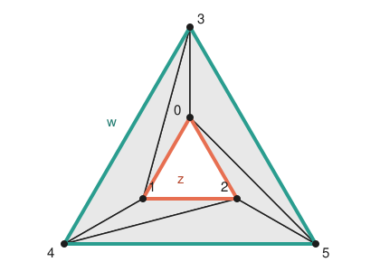

# Homology groups: cycles that are not boundaries, one hole count per dimension

[Syllabus](../../../SYLLABUS.md) → [Topology](../README.md) → [Homology](../README.md#s05) → Homology groups

---

## General Overview

Bend three wires into a triangle and solder the corners. The frame has one loop: a path of wire that runs around an empty middle. Now glue a sheet of card across it. The loop is still there, but it no longer surrounds anything. It is the rim of the sheet.

That is the whole idea of homology. A loop that is the rim of something filled in does not count as a hole. A loop that is the rim of nothing does.

The same test works on a geodesic dome. A common design has 42 joints, 120 struts and 80 triangular panels. With every panel in, no loop of struts surrounds an opening, and the panels together enclose one sealed space. Take one panel out and the sealed space is gone. Take three panels out, no two touching, and the frame has 2 independent loops that no panels fill, not 3: the rim of the third opening is forced by the other two.

Homology turns this into linear algebra: loops and rims become vectors, and the count is what is left of the loops once the rims are thrown away. There is one count per dimension: pieces, loops, sealed spaces.

**A cycle is a chain (a signed sum of edges, or of panels) with no loose ends, a boundary is the rim of something filled in, and the k-th homology group is the cycles with the boundaries thrown away; its number of independent directions, the Betti number, counts the k-dimensional holes.**

**What kind of fact this is:** definitions (cycle, boundary, homology group, Betti number) carrying three theorems proved on this card in Why it works: the rank formula for the Betti numbers, that the zeroth Betti number counts pieces, and that their alternating sum is the Euler characteristic. That the counts depend only on the space, not on how it was cut into triangles, is a theorem stated here, not proved: [Homotopy invariance](04-homotopy-invariance-of-homology.md) proves that any stretching that can be undone leaves the counts unchanged, and cites Hatcher, Theorem 2.27, for the link back to triangulations.

### The picture: an annulus cut into six panels

<p align="center"></p>

An **annulus** is a flat ring: a disc with a smaller disc cut out of its middle, like a washer. This one is cut into 6 triangular panels on 6 corners. The inner rim z runs 0 → 1 → 2 → 0 around the hole. The outer rim w runs 3 → 4 → 5 → 3 the same way round. The drawing is to scale, with corner positions printed by both checks.

---

## The formula

Some words first, from [Simplicial complexes and chains](01-simplicial-complexes-and-chains.md), each in one line.

- A **simplex** $`[v_0, \ldots, v_k]`$ is a corner (k = 0), an edge (k = 1) or a triangle (k = 2), listed by its corners in increasing order.
- A **k-chain** is a sum of k-simplices with whole-number coefficients, such as $`[0,1] + [1,2] - [0,2]`$. The k-chains form a group $`C_k`$ under addition.
- The **boundary** $`\partial_k`$ sends each k-simplex to its faces with alternating signs: $`\partial [0,1] = [1] - [0]`$ and $`\partial [0,1,2] = [1,2] - [0,2] + [0,1]`$.
- The boundary of a boundary is zero: $`\partial_{k-1} \partial_k = 0`$.

On this card, coefficients are rational numbers (fractions), written $`\mathbb{Q}`$. Then each $`C_k`$ is a space of vectors with one entry per k-simplex, and $`\partial_k`$ is a matrix of 0, 1 and −1. Whole-number coefficients can say more, and [Smith normal form](03-computing-homology-by-smith-normal-form.md) handles them.

This card adds four names. A **cycle** is a chain whose boundary is zero: it has no loose ends. A **boundary** is a chain that is the boundary of something one dimension up: the rim of a filled region.

```math
Z_k = \ker \partial_k, \qquad B_k = \mathrm{im}\, \partial_{k+1}, \qquad H_k = Z_k / B_k
```

**Read it aloud:** the k-cycles are the chains the boundary sends to zero; the k-boundaries are everything the next boundary map can reach; the k-th homology group is the cycles, with any two counted as the same when they differ by a boundary.

Here $`\ker`$ (kernel) means "everything sent to zero" and $`\mathrm{im}`$ (image) means "everything reached". The slash is a quotient, as in [Normal subgroups and quotient groups](../../03-Algebra/08-Groups/06-normal-subgroups-and-quotient-groups.md): there the multiples of 12 collapse to make a clock; here the boundaries collapse to zero.

The **Betti number** $`\beta_k`$ is the dimension of $`H_k`$: how many independent k-dimensional holes there are. Write $`n_k`$ for the number of k-simplices. Then

```math
\beta_k = \dim H_k = (n_k - \mathrm{rank}\, \partial_k) - \mathrm{rank}\, \partial_{k+1}
```

**Read it aloud:** the number of k-holes is the number of independent k-cycles, minus the number of independent k-boundaries.

On the annulus, for loops (k = 1): 12 edges, $`\partial_1`$ of rank 5 and $`\partial_2`$ of rank 6, so $`\beta_1 = (12 - 5) - 6 = 1`$. One hole.

| Symbol | Plain meaning | In our example | Push it up and the answer… |
| --- | --- | --- | --- |
| $`[v_0, \ldots, v_k]`$ | a simplex, listed by its corners in increasing order | the panel $`[0,1,3]`$ | — |
| $`n_k`$ | the number of k-simplices | 6 corners, 12 edges, 6 panels | an edge joining two pieces lowers $`\beta_0`$ by 1 |
| $`C_k`$ | the k-chains: sums of k-simplices with coefficients | vectors of 12 entries for edges | — |
| $`\partial_k`$ | the boundary: each k-simplex to its faces, signs alternating | a 12 × 6 matrix for $`\partial_2`$ | — |
| $`Z_k`$ | the k-cycles, $`\ker \partial_k`$: chains with zero boundary | 7 independent loops of edges | more cycles, more holes |
| $`B_k`$ | the k-boundaries, $`\mathrm{im}\, \partial_{k+1}`$: rims of (k+1)-chains | 6 independent panel rims | more boundaries, fewer holes |
| $`H_k`$ | the homology group: cycles with boundaries collapsed to zero | $`H_1`$ has one direction, the hole | — |
| $`\beta_k`$ | the Betti number: the dimension of $`H_k`$, over $`\mathbb{Q}`$ | $`\beta_0 = 1`$, $`\beta_1 = 1`$, $`\beta_2 = 0`$ | each panel taken out of the dome after the first adds 1 to $`\beta_1`$ |
| $`\mathrm{rank}\, \partial_k`$ | the number of independent columns of $`\partial_k`$ | 5 for $`\partial_1`$, 6 for $`\partial_2`$ | — |
| $`z`$, $`w`$ | the inner and outer rims, as 1-chains | $`[0,1] + [1,2] - [0,2]`$ and $`[3,4] + [4,5] - [3,5]`$ | — |
| $`\mathbb{Q}`$ | the rational numbers, used as coefficients | — | — |
| $`\chi`$ | the Euler characteristic: corners − edges + triangles | 6 − 12 + 6 = 0 | — |

### When it holds

- **The boundary signs alternate.** Drop the signs and the boundary of a boundary is no longer zero, so the boundaries are not inside the cycles and the quotient makes no sense. The hollow triangle then reads 0 pieces and 0 loops.
- **The complex is finite.** Every count is a rank of a finite matrix. Infinite complexes have homology too, but the counts can be infinite.
- **The coefficients are named.** Over $`\mathbb{Q}`$ the rank formula holds as written. Over the whole numbers, some spaces have a cycle that is not a boundary although twice it is, called torsion. Rational counts miss it, so the Klein bottle's loop count changes with the coefficients. That is [Smith normal form](03-computing-homology-by-smith-normal-form.md)'s job.
- **Every face of every simplex is in the complex.** A panel without its edges is not a simplicial complex, and $`\partial_2`$ has nowhere to send it.

---

## Why it works

### Step 0: a hole is a loop that nothing fills

A loop of edges around an empty middle has no loose ends. A loop that is the rim of filled panels also has no loose ends. Only the first one surrounds a hole.

So collect every loop, then throw away the rims. What survives is the holes. The count is done with vectors, because loops add: two loops that share an edge, run in opposite directions there, add up to one bigger loop.

### Step 1: every boundary is a cycle

The boundary of a boundary is zero ([Simplicial complexes and chains](01-simplicial-complexes-and-chains.md)). Take the filled triangle: its rim is

```math
\partial [0,1,2] = [1,2] - [0,2] + [0,1]
```

and the rim's own boundary is $`([2] - [1]) - ([2] - [0]) + ([1] - [0]) = 0`$. The check prints $`\partial [0,1,2]`$ as [1, −1, 1] on the edges 01, 02, 12.

In general, if $`b = \partial_{k+1} c`$ then $`\partial_k b = \partial_k \partial_{k+1} c = 0`$. So every boundary is a cycle: $`B_k`$ sits inside $`Z_k`$, and the quotient $`Z_k / B_k`$ makes sense.

### Step 2: two cycles are the same hole when they differ by a boundary

On the annulus, the inner rim z and the outer rim w are both cycles: the check prints a zero boundary for each. They look different, but they go around the same hole.

Homology says so exactly. Their difference is a boundary:

```math
w - z = \partial\big( -[0,1,3] + [0,2,5] - [0,3,5] - [1,2,4] + [1,3,4] + [2,4,5] \big)
```

Every panel enters with coefficient 1 or −1, chosen so that each spoke edge between two panels cancels. Only the two rims are left. The check found these coefficients by trying all 3⁶ = 729 ways to give each panel −1, 0 or 1: exactly one works.

So z and w lie in the same coset $`z + B_1`$, and in $`H_1`$ they are one element. The inner rim itself is not a boundary: none of the 729 panel chains has boundary z, and adding z to the columns of $`\partial_2`$ raises the rank from 6 to 7. A rank that rises means z is independent of every panel rim, so no rational combination of panels gives it either.

### Step 3: count by subtracting dimensions

Over $`\mathbb{Q}`$, $`Z_k`$ and $`B_k`$ are spaces of vectors, and the dimension of a quotient is the difference of dimensions.

- **Cycles.** $`Z_k`$ is what $`\partial_k`$ kills. By [Rank and nullity](../../03-Algebra/05-Solving%20Systems/05-rank-nullity.md), kept plus killed is the number of columns: $`\dim Z_k = n_k - \mathrm{rank}\, \partial_k`$. On the annulus, 12 − 5 = 7.
- **Boundaries.** $`B_k`$ is what $`\partial_{k+1}`$ reaches, so $`\dim B_k = \mathrm{rank}\, \partial_{k+1}`$. On the annulus, 6.
- **Holes.** $`\beta_k = \dim Z_k - \dim B_k`$: 7 − 6 = 1.

<details>
<summary>Detailed proof: the dimension of a quotient is the difference</summary>

Let $`B`$ sit inside $`Z`$, both finite-dimensional spaces of vectors over $`\mathbb{Q}`$. Pick a basis $`b_1, \ldots, b_m`$ of $`B`$ and extend it to a basis $`b_1, \ldots, b_m, c_1, \ldots, c_r`$ of $`Z`$, so $`\dim Z = m + r`$.

The cosets $`c_1 + B, \ldots, c_r + B`$ span $`Z / B`$: any $`x`$ in $`Z`$ is a combination of the basis, and the $`b`$ part vanishes in the quotient.

They are independent: if $`a_1 c_1 + \cdots + a_r c_r`$ lies in $`B`$, it equals some combination of the $`b_i`$. That is a relation among the basis of $`Z`$, so every $`a_j`$ is zero. Hence

$`\displaystyle \dim (Z/B) = r = \dim Z - \dim B.`$

With $`Z = Z_k`$ and $`B = B_k`$, and the two dimensions from rank and nullity, this is the formula.

</details>

### Step 4: the zeroth Betti number counts pieces

A 0-chain is a number on each corner, and every 0-chain is a cycle, since nothing sits below a corner. The boundary of an edge is "end minus start", so the boundaries are exactly what edges can move: a unit of weight slides along any edge. Two corners are the same in $`H_0`$ exactly when a path of edges joins them.

So $`\beta_0`$ is the number of pieces, the same pieces [Connected or not](../../04-Combinatorics%20and%20graphs/09-Graphs%20-%20Dots%20and%20Lines/04-connectivity-and-breadth-first-search.md) finds by breadth-first search. The check counts them a second way, by joining corners along edges (union-find), and the two agree on all 8 complexes.

<details>
<summary>Detailed proof: rank of the first boundary is corners minus pieces</summary>

Look at one piece, with $`p`$ corners. A 0-chain $`x`$ on it is reached by $`\partial_1`$ only if its coefficients add up to zero, because each $`[v] - [u]`$ adds up to zero.

Conversely, if they add to zero, fix a corner $`u`$ of the piece. Each other corner $`v`$ is joined to $`u`$ by a path of edges, and the chain of those edges, with signs, has boundary $`[v] - [u]`$. Then $`x = \sum_v x_v ([v] - [u])`$ because the coefficients sum to zero, so $`x`$ is a boundary.

So on one piece the boundaries have dimension $`p - 1`$. Summing over pieces, $`\mathrm{rank}\, \partial_1 = n_0 - (\text{pieces})`$, and since $`\partial_0 = 0`$,

$`\displaystyle \beta_0 = n_0 - \mathrm{rank}\, \partial_1 = \text{number of pieces}.`$

</details>

### Step 5: the alternating sum of Betti numbers is the Euler characteristic

The [Euler characteristic](../03-Surfaces%20and%20Manifolds/04-euler-characteristic-and-triangulations.md) is corners minus edges plus triangles. The same alternating sum of the Betti numbers gives the same number:

```math
\chi = n_0 - n_1 + n_2 = \beta_0 - \beta_1 + \beta_2
```

On the annulus, 6 − 12 + 6 = 0 and 1 − 1 + 0 = 0. On the dome with three panels out, 42 − 120 + 77 = −1 and 1 − 2 + 0 = −1.

<details>
<summary>Detailed proof: the ranks cancel in pairs</summary>

Write $`r_k = \mathrm{rank}\, \partial_k`$, with $`r_0 = 0`$ and $`r_3 = 0`$ for a complex of corners, edges and triangles. The rank formula gives $`\beta_k = n_k - r_k - r_{k+1}`$. So

$`\displaystyle \beta_0 - \beta_1 + \beta_2 = (n_0 - r_1) - (n_1 - r_1 - r_2) + (n_2 - r_2) = n_0 - n_1 + n_2.`$

Each $`r_k`$ appears once with a plus and once with a minus.

</details>

So the Euler characteristic is one sum of the Betti numbers, and many lists give the same sum.

### Step 6: what this card does not prove

The annulus here has 6 panels. A finer cut gives bigger matrices but the same Betti numbers. That the numbers survive any stretching that can be undone is proved on [Homotopy invariance](04-homotopy-invariance-of-homology.md). That they depend only on the space, not on the cutting, needs one more fact, which that card states with a source and does not prove: triangle-counting homology agrees with a version that needs no triangulation (Hatcher, Theorem 2.27). This card takes both on trust. Hatcher's Section 2.1 (in Sources) proves both.

---

## Worked numbers, by hand

The annulus, with its 6 corners, 12 edges and 6 panels:

| Step | Arithmetic | Value |
| --- | --- | --- |
| count the simplices | corners, edges, panels | 6, 12, 6 |
| rank of $`\partial_1`$ | one piece, so corners − 1 (Step 4) | 5 |
| cycles, $`\dim Z_1`$ | edges − rank of $`\partial_1`$ = 12 − 5 | 7 |
| rank of $`\partial_2`$ | no panel chain has zero boundary (below) | 6 |
| boundaries, $`\dim B_1`$ | rank of $`\partial_2`$ | 6 |
| loops, $`\beta_1`$ | 7 − 6 | **1** |
| pieces, $`\beta_0`$ | 6 − 5 | **1** |
| sealed spaces, $`\beta_2`$ | panels − rank of $`\partial_2`$ = 6 − 6 | **0** |
| cross-check | 6 − 12 + 6 against 1 − 1 + 0 | 0 = 0 |

Why the rank of $`\partial_2`$ is 6: suppose some panel chain has zero boundary. The rim edge [0,1] lies only in panel [0,1,3], so that panel's coefficient is 0. The spoke [1,3] then lies only in panel [1,3,4] among the rest, so its coefficient is 0 too. Going round the ring the same way, all six are 0. So the six columns are independent.

The answer means the annulus has one piece, one hole, and encloses no sealed space. The 7 independent loops of edges collapse to 1, because 6 of them are panel rims.

The other complexes the check runs:

| Complex | Corners, edges, panels | Cycles $`\dim Z_1`$ | Boundaries $`\dim B_1`$ | $`\beta_0, \beta_1, \beta_2`$ over $`\mathbb{Q}`$ |
| --- | --- | ---: | ---: | --- |
| hollow triangle | 3, 3, 0 | 1 | 0 | 1, 1, 0 |
| filled triangle | 3, 3, 1 | 1 | 1 | 1, 0, 0 |
| two hollow triangles | 6, 6, 0 | 2 | 0 | 2, 2, 0 |
| dome, all panels in | 42, 120, 80 | 79 | 79 | 1, 0, 1 |

The hollow and filled triangles have the same single cycle, but in the filled one it is a boundary. So the hollow triangle has one loop and the filled one has none.

### What breaks if you drop a piece

| Mistake | Comes out at | What went wrong |
| --- | --- | --- |
| Count cycles, forget to remove boundaries | annulus 7 loops, filled triangle 1 | panel rims are cycles too; $`B_1`$ must be divided out |
| One loop per panel taken out | dome with 3 out: 3 loops, truly $`\beta_1 = 2`$ | the three rims add up to the boundary of all the remaining panels, so one depends on the others |
| Drop the boundary signs | $`\partial_1 \partial_2`$ of panel [0,1,3] is [2, 2, 0, 2, 0, 0]; hollow triangle reads 0, 0, 0 | without signs a boundary's boundary is not zero, and even the pieces are lost |
| Read the holes from $`\chi`$ alone | annulus and two hollow triangles both 0 | Betti numbers 1, 1, 0 against 2, 2, 0; one sum hides the list |

The code prints all four.

---

## Taking panels off the dome

The dome is a sphere of 80 panels. Remove central panels one at a time, choosing panels that share no joint or strut. Every strut stays, so the counts of joints and struts do not move. Only the panels and their ranks change.

| Panels out | Panels | Rank of $`\partial_2`$ | $`\dim Z_1`$ | $`\beta_0, \beta_1, \beta_2`$ | $`\chi`$ |
| ---: | ---: | ---: | ---: | --- | ---: |
| 0 | 80 | 79 | 79 | 1, 0, 1 | 2 |
| 1 | 79 | 79 | 79 | 1, 0, 0 | 1 |
| 2 | 78 | 78 | 79 | 1, 1, 0 | 0 |
| 3 | 77 | 77 | 79 | 1, 2, 0 | −1 |

1. **All in.** The 80 panel rims, added with matching signs, cancel. That relation is a 2-cycle, the sealed space, so $`\beta_2 = 1`$. The rank, 79, fills all 79 cycles, so $`\beta_1 = 0`$.
2. **One out.** The relation breaks and the sealed space opens. The rank stays 79, so every loop is still a rim: a bent disc.
3. **Two out.** The rank falls to 78, one short of the 79 cycles. One loop survives: the frame is a tube.
4. **Three out.** Rank 77, so two loops survive. Up to signs, the third rim is the sum of the other two plus a boundary.

The first panel out costs a sealed space. Every later one adds a loop.

Loops that no panels fill, $`\beta_1`$, as panels come out:

```
0 out |                      0
1 out |                      0
2 out | ##########           1
3 out | #################### 2
```

---

## Code, from first principles, and it actually runs

Both programs build each complex from its triangles, write out the signed boundary matrices, and find each rank by exact whole-number elimination, dividing every new row by the greatest common divisor of its entries so nothing is rounded. Nothing imported knows any homology. Four independent roads check the answer:

- the pieces counted by union-find, which never touches a matrix;
- every rank redone with arithmetic mod 2 (1 + 1 = 0), which agrees here because none of these complexes has torsion;
- the alternating sum of Betti numbers against V − E + F;
- for the annulus, a search over all 729 panel chains: none has boundary z, exactly one has boundary w − z.

The 8 complexes are finite and computed exactly, so their Betti numbers are proved. Step 6's claim about other triangulations is not checked here.

### Python

```python
# Homology groups -- the check behind the card.  Standard library only.
# Betti numbers over the rationals are read from exact integer ranks of the
# boundary matrices, then checked against counts that share none of that
# arithmetic: components by union-find, ranks redone mod 2, V - E + F, and an
# exhaustive search over small chains.
from itertools import combinations, product

def gcd_all(vals):                          # Euclid's algorithm, run along a whole row
    g = 0
    for v in vals:
        while v:
            g, v = v, g % v
    return abs(g)

def closure(tris, edges=()):                # every face of every simplex, sorted
    K = {0: set(), 1: set(), 2: set()}
    for s in [tuple(sorted(t)) for t in list(tris) + list(edges)]:
        for k in range(len(s)):
            K[k].update(combinations(s, k + 1))
    return {k: sorted(K[k]) for k in K}

def boundary(K, k, signed=True):            # rows: (k-1)-simplices, columns: k-simplices
    row = {s: i for i, s in enumerate(K[k - 1])}
    M = [[0] * len(K[k]) for _ in K[k - 1]]
    for j, s in enumerate(K[k]):
        for i in range(len(s)):
            M[row[s[:i] + s[i + 1:]]][j] = (-1) ** i if signed else 1
    return M

def rank(M):                                # exact elimination, integer rows cut by their gcd
    A, r = [row[:] for row in M], 0
    for c in range(len(A[0]) if A else 0):
        p = next((i for i in range(r, len(A)) if A[i][c]), None)
        if p is None:
            continue
        A[r], A[p] = A[p], A[r]
        for i in range(r + 1, len(A)):
            if A[i][c]:
                new = [A[r][c] * y - A[i][c] * x for x, y in zip(A[r], A[i])]
                g = gcd_all(new)
                A[i] = [v // g for v in new] if g else new
        r += 1
    return r

def rank_mod2(M):                           # columns as sorted lists of odd rows
    cols, low, r = [sorted(i for i in range(len(M)) if M[i][j] % 2) for j in range(len(M[0]) if M else 0)], {}, 0
    for c in cols:
        while c and c[-1] in low:
            c = sorted(set(c) ^ set(low[c[-1]]))
        if c:
            low[c[-1]], r = c, r + 1
    return r

def components(K):                          # union-find on the edges
    parent = {v: v for (v,) in K[0]}
    def find(v):
        while parent[v] != v:
            v = parent[v]
        return v
    for a, b in K[1]:
        parent[find(a)] = find(b)
    return len({find(v) for (v,) in K[0]})

def betti(K, rk=rank, signed=True):
    n = [len(K[k]) for k in range(3)]
    r1, r2 = rk(boundary(K, 1, signed)), rk(boundary(K, 2, signed))
    return n, r1, r2, (n[0] - r1, n[1] - r1 - r2, n[2] - r2)

def apply(M, x):                            # the matrix M times the chain x
    return [sum(a * b for a, b in zip(row, x)) for row in M]

# the dome: an icosahedron, every face cut into 4 panels -> 42 joints, 120 struts, 80 panels
U, L = [1 + i for i in range(5)], [6 + i for i in range(5)]
ico = []
for i in range(5):
    j = (i + 1) % 5
    ico += [(0, U[i], U[j]), (U[i], U[j], L[i]), (U[j], L[i], L[j]), (11, L[i], L[j])]
mid = {e: 12 + n for n, e in enumerate(closure(ico)[1])}
dome, centres = [], []
for a, b, c in ico:
    ab, bc, ca = mid[tuple(sorted((a, b)))], mid[tuple(sorted((b, c)))], mid[tuple(sorted((c, a)))]
    dome += [(a, ab, ca), (b, ab, bc), (c, bc, ca), (ab, bc, ca)]
    centres.append(tuple(sorted((ab, bc, ca))))
out = [centres[0], centres[19], centres[9]]   # three central panels, no two touching

ring = [(i, (i + 1) % 3, 3 + i) for i in range(3)] + [((i + 1) % 3, 3 + i, 3 + (i + 1) % 3) for i in range(3)]
cases = [("hollow triangle", closure([], [(0, 1), (1, 2), (0, 2)])),
         ("filled triangle", closure([(0, 1, 2)])),
         ("annulus", closure(ring)),
         ("two hollow triangles", closure([], [(0, 1), (1, 2), (0, 2), (3, 4), (4, 5), (3, 5)]))]
cases += [(f"dome, {m} out", closure([t for t in dome if tuple(sorted(t)) not in out[:m]])) for m in range(4)]

print("figure, annulus to scale: 0 (210,130) 1 (158,220) 2 (262,220) 3 (210,30) 4 (71,270) 5 (349,270)")
print("complex: V E F | rank d1, rank d2 | dim Z1, dim B1 | b0 b1 b2 over Q | mod 2 | pieces | V-E+F")
table = {}
for name, K in cases:
    n, r1, r2, b = betti(K)
    b2 = betti(K, rank_mod2)[3]
    chi = n[0] - n[1] + n[2]
    table[name] = b
    print(f"{name}: {n[0]} {n[1]} {n[2]} | {r1}, {r2} | {n[1] - r1}, {r2} | {b[0]} {b[1]} {b[2]} | "
          f"{b2[0]} {b2[1]} {b2[2]} | {components(K)} | {chi}")
    assert b == b2 and b[0] == components(K) and chi == b[0] - b[1] + b[2]

A = cases[2][1]
d1, d2 = boundary(A, 1), boundary(A, 2)
z = [{(0, 1): 1, (1, 2): 1, (0, 2): -1}.get(e, 0) for e in A[1]]       # the inner rim
w = [{(3, 4): 1, (4, 5): 1, (3, 5): -1}.get(e, 0) for e in A[1]]       # the outer rim
diff = [p - q for p, q in zip(w, z)]
print("annulus edges:", " ".join(f"{a}{b}" for a, b in A[1]))
print("annulus panels:", " ".join(f"{a}{b}{c}" for a, b, c in A[2]))
print(f"inner rim z = 01 + 12 - 02, its boundary: {apply(d1, z)}")
print(f"outer rim w = 34 + 45 - 35, its boundary: {apply(d1, w)}")
rz = rank([row + [v] for row, v in zip(d2, z)])
rd = rank([row + [v] for row, v in zip(d2, diff)])
print(f"rank of d2 alone {rank(d2)}; with z added {rz}; with w - z added {rd}")
hits_z = [x for x in product((-1, 0, 1), repeat=6) if apply(d2, x) == z]
hits_d = [x for x in product((-1, 0, 1), repeat=6) if apply(d2, x) == diff]
print(f"search over 3^6 = 729 panel chains: {len(hits_z)} with boundary z, {len(hits_d)} with boundary w - z")
print(f"w - z is the boundary of panel coefficients {list(hits_d[0])}")
T = cases[1][1]
print(f"filled triangle: boundary of 012 = {apply(boundary(T, 2), [1])} on edges 01 02 12")

hollow2 = betti(cases[0][1], signed=False)[3]
dd = [apply(boundary(A, 1, False), col) for col in zip(*boundary(A, 2, False))]
print(f"mistake 1, cycles not divided by boundaries: annulus dim Z1 = {len(A[1]) - rank(d1)}, "
      f"filled triangle {len(T[1]) - rank(boundary(T, 1))}")
print(f"mistake 2, one loop per panel out: 3 out gives 3, true b1 = {table['dome, 3 out'][1]}")
print(f"mistake 3, signs dropped: d1 of d2 on panel 013 = {dd[0]}, not zero; "
      f"hollow triangle b read as {list(hollow2)}")
print(f"mistake 4, V-E+F alone: annulus 0 = two hollow triangles 0, "
      f"but b = {list(table['annulus'])} against {list(table['two hollow triangles'])}")

assert [table[f"dome, {m} out"] for m in range(4)] == [(1, 0, 1), (1, 0, 0), (1, 1, 0), (1, 2, 0)]
assert table["annulus"] == (1, 1, 0) and table["hollow triangle"] == (1, 1, 0) and table["filled triangle"] == (1, 0, 0)
assert not any(apply(d1, z)) and not any(apply(d1, w)) and rz == rank(d2) + 1 and rd == rank(d2)
assert hits_z == [] and len(hits_d) == 1                   # search agrees with the rank test
assert any(map(any, dd)) and hollow2 != table["hollow triangle"]
print("ALL CHECKS PASS")
```

**Ran 2026-11-15 on macOS, Python 3.14.10, standard library only. All checks passed. Output, pasted from the run:**

```
figure, annulus to scale: 0 (210,130) 1 (158,220) 2 (262,220) 3 (210,30) 4 (71,270) 5 (349,270)
complex: V E F | rank d1, rank d2 | dim Z1, dim B1 | b0 b1 b2 over Q | mod 2 | pieces | V-E+F
hollow triangle: 3 3 0 | 2, 0 | 1, 0 | 1 1 0 | 1 1 0 | 1 | 0
filled triangle: 3 3 1 | 2, 1 | 1, 1 | 1 0 0 | 1 0 0 | 1 | 1
annulus: 6 12 6 | 5, 6 | 7, 6 | 1 1 0 | 1 1 0 | 1 | 0
two hollow triangles: 6 6 0 | 4, 0 | 2, 0 | 2 2 0 | 2 2 0 | 2 | 0
dome, 0 out: 42 120 80 | 41, 79 | 79, 79 | 1 0 1 | 1 0 1 | 1 | 2
dome, 1 out: 42 120 79 | 41, 79 | 79, 79 | 1 0 0 | 1 0 0 | 1 | 1
dome, 2 out: 42 120 78 | 41, 78 | 79, 78 | 1 1 0 | 1 1 0 | 1 | 0
dome, 3 out: 42 120 77 | 41, 77 | 79, 77 | 1 2 0 | 1 2 0 | 1 | -1
annulus edges: 01 02 03 05 12 13 14 24 25 34 35 45
annulus panels: 013 025 035 124 134 245
inner rim z = 01 + 12 - 02, its boundary: [0, 0, 0, 0, 0, 0]
outer rim w = 34 + 45 - 35, its boundary: [0, 0, 0, 0, 0, 0]
rank of d2 alone 6; with z added 7; with w - z added 6
search over 3^6 = 729 panel chains: 0 with boundary z, 1 with boundary w - z
w - z is the boundary of panel coefficients [-1, 1, -1, -1, 1, 1]
filled triangle: boundary of 012 = [1, -1, 1] on edges 01 02 12
mistake 1, cycles not divided by boundaries: annulus dim Z1 = 7, filled triangle 1
mistake 2, one loop per panel out: 3 out gives 3, true b1 = 2
mistake 3, signs dropped: d1 of d2 on panel 013 = [2, 2, 0, 2, 0, 0], not zero; hollow triangle b read as [0, 0, 0]
mistake 4, V-E+F alone: annulus 0 = two hollow triangles 0, but b = [1, 1, 0] against [2, 2, 0]
ALL CHECKS PASS
```

### Rust

Same numbers, same labels, built with `rustc --edition 2021 -O`.

```rust
// Homology groups -- the same check as the Python, in Rust.  No crates.
// Betti numbers over the rationals are read from exact integer ranks of the
// boundary matrices, then checked against counts that share none of that
// arithmetic: components by union-find, ranks redone mod 2, V - E + F, and an
// exhaustive search over small chains.
use std::collections::{BTreeMap, BTreeSet};

type S = Vec<usize>;
type M = Vec<Vec<i128>>;
struct K { k: [Vec<S>; 3] }

fn gcd_all(vals: &[i128]) -> i128 {           // Euclid's algorithm, run along a whole row
    let mut g: i128 = 0;
    for &v0 in vals { let mut v = v0; while v != 0 { (g, v) = (v, g.rem_euclid(v)); } }
    g.abs()
}

fn closure(tris: &[S], edges: &[S]) -> K {      // every face of every simplex, sorted
    let mut k: [BTreeSet<S>; 3] = [BTreeSet::new(), BTreeSet::new(), BTreeSet::new()];
    for t in tris.iter().chain(edges.iter()) {
        let mut s = t.clone(); s.sort();
        for mask in 1u32..(1 << s.len()) {
            let f: S = (0..s.len()).filter(|i| mask >> i & 1 == 1).map(|i| s[i]).collect();
            k[f.len() - 1].insert(f);
        }
    }
    let [a, b, c] = k;
    K { k: [a.into_iter().collect(), b.into_iter().collect(), c.into_iter().collect()] }
}

fn boundary(c: &K, k: usize, signed: bool) -> M {  // rows: (k-1)-simplices, columns: k-simplices
    let row: BTreeMap<&S, usize> = c.k[k - 1].iter().enumerate().map(|(i, s)| (s, i)).collect();
    let mut m = vec![vec![0i128; c.k[k].len()]; c.k[k - 1].len()];
    for (j, s) in c.k[k].iter().enumerate() {
        for i in 0..s.len() {
            let mut f = s.clone(); f.remove(i);
            m[row[&f]][j] = if !signed || i % 2 == 0 { 1 } else { -1 };
        }
    }
    m
}

fn rank(m0: &M) -> usize {                     // exact elimination, integer rows cut by their gcd
    let (mut a, mut r) = (m0.clone(), 0);
    let cols = if a.is_empty() { 0 } else { a[0].len() };
    for c in 0..cols {
        let Some(p) = (r..a.len()).find(|&i| a[i][c] != 0) else { continue };
        a.swap(r, p);
        for i in (r + 1..a.len()).filter(|&i| a[i][c] != 0).collect::<Vec<_>>() {
            let (p, q) = (a[r][c], a[i][c]);
            let new: Vec<i128> = a[r].iter().zip(&a[i]).map(|(x, y)| p.checked_mul(*y).unwrap().checked_sub(q.checked_mul(*x).unwrap()).unwrap()).collect();
            let g = gcd_all(&new);
            a[i] = new.iter().map(|v| if g != 0 { v / g } else { *v }).collect();
        }
        r += 1;
    }
    r
}

fn rank_mod2(m: &M) -> usize {                  // columns as sorted lists of odd rows
    let cols = if m.is_empty() { 0 } else { m[0].len() };
    let mut low: BTreeMap<usize, BTreeSet<usize>> = BTreeMap::new();
    for j in 0..cols {
        let mut c: BTreeSet<usize> = (0..m.len()).filter(|&i| m[i][j].rem_euclid(2) == 1).collect();
        while let Some(p) = c.iter().next_back().and_then(|t| low.get(t)) { c = c.symmetric_difference(p).copied().collect(); }
        if let Some(&top) = c.iter().next_back() { low.insert(top, c); }
    }
    low.len()
}

fn components(c: &K) -> usize {                 // union-find on the edges
    let mut parent: BTreeMap<usize, usize> = c.k[0].iter().map(|s| (s[0], s[0])).collect();
    fn find(p: &BTreeMap<usize, usize>, mut v: usize) -> usize { while p[&v] != v { v = p[&v]; } v }
    for e in &c.k[1] { let (a, b) = (find(&parent, e[0]), find(&parent, e[1])); parent.insert(a, b); }
    c.k[0].iter().map(|s| find(&parent, s[0])).collect::<BTreeSet<_>>().len()
}

fn betti(c: &K, rk: fn(&M) -> usize, signed: bool) -> ([usize; 3], usize, usize, [i64; 3]) {
    let n = [c.k[0].len(), c.k[1].len(), c.k[2].len()];
    let (r1, r2) = (rk(&boundary(c, 1, signed)), rk(&boundary(c, 2, signed)));
    (n, r1, r2, [(n[0] - r1) as i64, (n[1] - r1 - r2) as i64, (n[2] - r2) as i64])
}

fn apply(m: &M, x: &[i128]) -> Vec<i128> {      // the matrix m times the chain x
    m.iter().map(|row| row.iter().zip(x).map(|(a, b)| a * b).sum()).collect()
}

fn main() {
    // the dome: an icosahedron, every face cut into 4 panels -> 42 joints, 120 struts, 80 panels
    let mut ico: Vec<S> = Vec::new();
    for i in 0..5 {
        let (ui, uj, li, lj) = (1 + i, 1 + (i + 1) % 5, 6 + i, 6 + (i + 1) % 5);
        ico.extend([vec![0, ui, uj], vec![ui, uj, li], vec![uj, li, lj], vec![11, li, lj]]);
    }
    let mid: BTreeMap<S, usize> = closure(&ico, &[]).k[1].iter().enumerate().map(|(n, e)| (e.clone(), 12 + n)).collect();
    let m = |a: usize, b: usize| mid[&vec![a.min(b), a.max(b)]];
    let (mut dome, mut centres): (Vec<S>, Vec<S>) = (Vec::new(), Vec::new());
    for t in &ico {
        let (ab, bc, ca) = (m(t[0], t[1]), m(t[1], t[2]), m(t[2], t[0]));
        dome.extend([vec![t[0], ab, ca], vec![t[1], ab, bc], vec![t[2], bc, ca], vec![ab, bc, ca]]);
        let mut cen = vec![ab, bc, ca]; cen.sort(); centres.push(cen);
    }
    let out = [centres[0].clone(), centres[19].clone(), centres[9].clone()]; // three central panels, no two touching

    let ring: Vec<S> = (0..3).flat_map(|i| [vec![i, (i + 1) % 3, 3 + i], vec![(i + 1) % 3, 3 + i, 3 + (i + 1) % 3]]).collect();
    let tri = |v: &[(usize, usize)]| -> Vec<S> { v.iter().map(|&(a, b)| vec![a, b]).collect() };
    let mut cases: Vec<(String, K)> = vec![
        ("hollow triangle".into(), closure(&[], &tri(&[(0, 1), (1, 2), (0, 2)]))),
        ("filled triangle".into(), closure(&[vec![0, 1, 2]], &[])),
        ("annulus".into(), closure(&ring, &[])),
        ("two hollow triangles".into(), closure(&[], &tri(&[(0, 1), (1, 2), (0, 2), (3, 4), (4, 5), (3, 5)]))),
    ];
    for mm in 0..4 {
        let kept: Vec<S> = dome.iter().filter(|t| { let mut s = (*t).clone(); s.sort(); !out[..mm].contains(&s) }).cloned().collect();
        cases.push((format!("dome, {} out", mm), closure(&kept, &[])));
    }

    println!("figure, annulus to scale: 0 (210,130) 1 (158,220) 2 (262,220) 3 (210,30) 4 (71,270) 5 (349,270)");
    println!("complex: V E F | rank d1, rank d2 | dim Z1, dim B1 | b0 b1 b2 over Q | mod 2 | pieces | V-E+F");
    let mut table: BTreeMap<String, [i64; 3]> = BTreeMap::new();
    for (name, c) in &cases {
        let (n, r1, r2, b) = betti(c, rank, true);
        let (b2, chi) = (betti(c, rank_mod2, true).3, n[0] as i64 - n[1] as i64 + n[2] as i64);
        table.insert(name.clone(), b);
        println!("{}: {} {} {} | {}, {} | {}, {} | {} {} {} | {} {} {} | {} | {}", name, n[0], n[1], n[2], r1, r2,
                 n[1] - r1, r2, b[0], b[1], b[2], b2[0], b2[1], b2[2], components(c), chi);
        assert!(b == b2 && b[0] == components(c) as i64 && chi == b[0] - b[1] + b[2]);
    }

    let (a, t) = (&cases[2].1, &cases[1].1);
    let (d1, d2) = (boundary(a, 1, true), boundary(a, 2, true));
    let pick = |terms: &[(usize, usize, i128)]| -> Vec<i128> { a.k[1].iter().map(|e| terms.iter().find(|t| t.0 == e[0] && t.1 == e[1]).map_or(0, |t| t.2)).collect() };
    let z = pick(&[(0, 1, 1), (1, 2, 1), (0, 2, -1)]);       // the inner rim
    let w = pick(&[(3, 4, 1), (4, 5, 1), (3, 5, -1)]);       // the outer rim
    let diff: Vec<i128> = w.iter().zip(&z).map(|(p, q)| p - q).collect();
    let label = |s: &S| s.iter().map(|v| v.to_string()).collect::<String>();
    println!("annulus edges: {}", a.k[1].iter().map(label).collect::<Vec<_>>().join(" "));
    println!("annulus panels: {}", a.k[2].iter().map(label).collect::<Vec<_>>().join(" "));
    println!("inner rim z = 01 + 12 - 02, its boundary: {:?}", apply(&d1, &z));
    println!("outer rim w = 34 + 45 - 35, its boundary: {:?}", apply(&d1, &w));
    let aug = |v: &[i128]| -> M { d2.iter().zip(v).map(|(row, x)| { let mut r = row.clone(); r.push(*x); r }).collect() };
    let (rz, rd, r2) = (rank(&aug(&z)), rank(&aug(&diff)), rank(&d2));
    println!("rank of d2 alone {}; with z added {}; with w - z added {}", r2, rz, rd);
    let (mut hits_z, mut hits_d): (Vec<Vec<i128>>, Vec<Vec<i128>>) = (Vec::new(), Vec::new());
    for code in 0..729 {
        let x: Vec<i128> = (0..6).rev().map(|p| (code / 3i128.pow(p)) % 3 - 1).collect();
        let y = apply(&d2, &x);
        if y == z { hits_z.push(x.clone()); } else if y == diff { hits_d.push(x); }
    }
    println!("search over 3^6 = 729 panel chains: {} with boundary z, {} with boundary w - z", hits_z.len(), hits_d.len());
    println!("w - z is the boundary of panel coefficients {:?}", hits_d[0]);
    println!("filled triangle: boundary of 012 = {:?} on edges 01 02 12", apply(&boundary(t, 2, true), &[1]));

    let hollow2 = betti(&cases[0].1, rank, false).3;
    let (u1, u2) = (boundary(a, 1, false), boundary(a, 2, false));
    let dd: Vec<Vec<i128>> = (0..u2[0].len()).map(|j| apply(&u1, &u2.iter().map(|r| r[j]).collect::<Vec<_>>())).collect();
    println!("mistake 1, cycles not divided by boundaries: annulus dim Z1 = {}, filled triangle {}",
             a.k[1].len() - rank(&d1), t.k[1].len() - rank(&boundary(t, 1, true)));
    println!("mistake 2, one loop per panel out: 3 out gives 3, true b1 = {}", table["dome, 3 out"][1]);
    println!("mistake 3, signs dropped: d1 of d2 on panel 013 = {:?}, not zero; hollow triangle b read as {:?}", dd[0], hollow2);
    println!("mistake 4, V-E+F alone: annulus 0 = two hollow triangles 0, but b = {:?} against {:?}",
             table["annulus"], table["two hollow triangles"]);

    assert!((0..4).map(|mm| table[&format!("dome, {} out", mm)]).collect::<Vec<_>>() == vec![[1, 0, 1], [1, 0, 0], [1, 1, 0], [1, 2, 0]]);
    assert!(table["annulus"] == [1, 1, 0] && table["hollow triangle"] == [1, 1, 0] && table["filled triangle"] == [1, 0, 0]);
    assert!(apply(&d1, &z).iter().all(|&v| v == 0) && apply(&d1, &w).iter().all(|&v| v == 0) && rz == r2 + 1 && rd == r2);
    assert!(hits_z.is_empty() && hits_d.len() == 1);                // search agrees with the rank test
    assert!(dd.iter().any(|c| c.iter().any(|&v| v != 0)) && hollow2 != table["hollow triangle"]);
    println!("ALL CHECKS PASS");
}
```

**Ran 2026-11-15 on macOS, rustc 1.98.1, no crates. All checks passed. Output, pasted from the run:**

```
figure, annulus to scale: 0 (210,130) 1 (158,220) 2 (262,220) 3 (210,30) 4 (71,270) 5 (349,270)
complex: V E F | rank d1, rank d2 | dim Z1, dim B1 | b0 b1 b2 over Q | mod 2 | pieces | V-E+F
hollow triangle: 3 3 0 | 2, 0 | 1, 0 | 1 1 0 | 1 1 0 | 1 | 0
filled triangle: 3 3 1 | 2, 1 | 1, 1 | 1 0 0 | 1 0 0 | 1 | 1
annulus: 6 12 6 | 5, 6 | 7, 6 | 1 1 0 | 1 1 0 | 1 | 0
two hollow triangles: 6 6 0 | 4, 0 | 2, 0 | 2 2 0 | 2 2 0 | 2 | 0
dome, 0 out: 42 120 80 | 41, 79 | 79, 79 | 1 0 1 | 1 0 1 | 1 | 2
dome, 1 out: 42 120 79 | 41, 79 | 79, 79 | 1 0 0 | 1 0 0 | 1 | 1
dome, 2 out: 42 120 78 | 41, 78 | 79, 78 | 1 1 0 | 1 1 0 | 1 | 0
dome, 3 out: 42 120 77 | 41, 77 | 79, 77 | 1 2 0 | 1 2 0 | 1 | -1
annulus edges: 01 02 03 05 12 13 14 24 25 34 35 45
annulus panels: 013 025 035 124 134 245
inner rim z = 01 + 12 - 02, its boundary: [0, 0, 0, 0, 0, 0]
outer rim w = 34 + 45 - 35, its boundary: [0, 0, 0, 0, 0, 0]
rank of d2 alone 6; with z added 7; with w - z added 6
search over 3^6 = 729 panel chains: 0 with boundary z, 1 with boundary w - z
w - z is the boundary of panel coefficients [-1, 1, -1, -1, 1, 1]
filled triangle: boundary of 012 = [1, -1, 1] on edges 01 02 12
mistake 1, cycles not divided by boundaries: annulus dim Z1 = 7, filled triangle 1
mistake 2, one loop per panel out: 3 out gives 3, true b1 = 2
mistake 3, signs dropped: d1 of d2 on panel 013 = [2, 2, 0, 2, 0, 0], not zero; hollow triangle b read as [0, 0, 0]
mistake 4, V-E+F alone: annulus 0 = two hollow triangles 0, but b = [1, 1, 0] against [2, 2, 0]
ALL CHECKS PASS
```

The two outputs match line for line.

### Lean

Lean proves Steps 1, 3, 4 and 5 for every finite complex over $`\mathbb{Q}`$, and checks the annulus's counts and rims.

- Every boundary is a cycle: with the signs alternating, the boundary of a boundary is zero.
- Take a finite complex holding every face of its simplices. Then $`\beta_k = (n_k - \mathrm{rank}\, \partial_k) - \mathrm{rank}\, \partial_{k+1}`$ for every k.
- Take the same complex. Then $`\beta_0`$ is its number of pieces: corners joined by paths of edges.
- Take such a complex of corners, edges and triangles only. Then $`n_0 - n_1 + n_2 = \beta_0 - \beta_1 + \beta_2`$.
- The filled triangle's boundary is [1, −1, 1] on the edges 01, 02, 12.
- The annulus has 6 corners, 12 edges and 6 panels, and both rims z and w are cycles.
- Their difference w − z is the boundary of the six-panel chain in Step 2.

The ranks, the dome's counts, the 729-chain search and the table of mistakes are left to the Python and Rust checks.

```lean
-- Homology groups: for a finite simplicial complex with rational coefficients, the k-th Betti number is (simplices - rank of the k-th boundary) - rank of the next boundary, the zeroth counts pieces, and the alternating sum is the Euler characteristic.
import Mathlib.LinearAlgebra.Matrix.Rank
import Mathlib.LinearAlgebra.Matrix.ToLin
import Mathlib.LinearAlgebra.Quotient.Basic
import Mathlib.LinearAlgebra.Dimension.Finrank
import Mathlib.Combinatorics.SimpleGraph.Connectivity.Connected
import Mathlib.Tactic.NormNum

namespace HomologyGroups

open Finset

variable {V : Type*} [LinearOrder V]

/-- The k-simplices of a family of simplices: those with k + 1 corners. -/
def simplices (K : Finset (Finset V)) (k : ℕ) : Finset (Finset V) :=
  K.filter (fun s => s.card = k + 1)

/-- A finite simplicial complex: every face of every simplex is in the complex. -/
def IsComplex (K : Finset (Finset V)) : Prop :=
  ∀ s ∈ K, ∀ t ⊆ s, t.Nonempty → t ∈ K

/-- The signed coefficient of the face `t` in the boundary of the simplex `s`, corners listed in
increasing order: dropping the corner `v` gets sign `(-1)^i`, where `i` is the number of corners
of `s` below `v`. -/
def bdCoeff (s t : Finset V) : ℤ :=
  ∑ v ∈ s, if s.erase v = t then (-1) ^ (s.filter (· < v)).card else 0

/-- The k-chains with rational coefficients: one entry per k-simplex. -/
abbrev Chains (K : Finset (Finset V)) (k : ℕ) := (simplices K k) → ℚ

/-- The boundary matrix of `∂_{k+1}`: rows are the k-simplices, columns the (k+1)-simplices. -/
def bdMatrix (K : Finset (Finset V)) (k : ℕ) :
    Matrix (simplices K k) (simplices K (k + 1)) ℚ :=
  fun t s => (bdCoeff s.1 t.1 : ℚ)

/-- The boundary map `∂_{k+1} : C_{k+1} → C_k`. -/
def bd (K : Finset (Finset V)) (k : ℕ) : Chains K (k + 1) →ₗ[ℚ] Chains K k :=
  (bdMatrix K k).mulVecLin

/-- The k-cycles `Z_k = ker ∂_k`; every 0-chain is a cycle, since `∂_0 = 0`. -/
def cycles (K : Finset (Finset V)) : (k : ℕ) → Submodule ℚ (Chains K k)
  | 0 => ⊤
  | k + 1 => LinearMap.ker (bd K k)

/-- The k-boundaries `B_k = im ∂_{k+1}`. -/
def boundaries (K : Finset (Finset V)) (k : ℕ) : Submodule ℚ (Chains K k) :=
  LinearMap.range (bd K k)

/-- The k-th homology group `H_k = Z_k / B_k` over the rationals. -/
abbrev Homology (K : Finset (Finset V)) (k : ℕ) :=
  ↥(cycles K k) ⧸ (boundaries K k).comap (cycles K k).subtype

/-- The k-th Betti number over the rationals: the dimension of `H_k`. -/
noncomputable def betti (K : Finset (Finset V)) (k : ℕ) : ℕ :=
  Module.finrank ℚ (Homology K k)

/-- The rank of `∂_k`, with `∂_0 = 0`. -/
noncomputable def bdRank (K : Finset (Finset V)) : ℕ → ℕ
  | 0 => 0
  | k + 1 => (bdMatrix K k).rank

/-- The corners and edges of the complex as a graph: two corners are joined when they span an edge. -/
def skeleton (K : Finset (Finset V)) : SimpleGraph {v : V // ({v} : Finset V) ∈ K} :=
  SimpleGraph.fromRel (fun u v => ({u.1, v.1} : Finset V) ∈ K)

/-- Removing two corners in either order gives opposite signs. -/
theorem sign_swap (u : Finset V) {v w : V} (hw : w ∈ u) (hwv : w < v) :
    (-1 : ℤ) ^ (u.filter (· < v)).card * (-1) ^ ((u.erase v).filter (· < w)).card
      = -((-1 : ℤ) ^ (u.filter (· < w)).card * (-1) ^ ((u.erase w).filter (· < v)).card) := by
  have h1 : (u.erase v).filter (· < w) = u.filter (· < w) := by
    rw [Finset.filter_erase]
    apply Finset.erase_eq_of_notMem
    simp only [Finset.mem_filter, not_and, not_lt]
    exact fun _ => hwv.le
  have hmem : w ∈ u.filter (· < v) := Finset.mem_filter.2 ⟨hw, hwv⟩
  have h2 : ((u.erase w).filter (· < v)).card = (u.filter (· < v)).card - 1 := by
    rw [Finset.filter_erase, Finset.card_erase_of_mem hmem]
  have hpos : 0 < (u.filter (· < v)).card := Finset.card_pos.2 ⟨w, hmem⟩
  rw [h1, h2]
  obtain ⟨n, hn⟩ : ∃ n, (u.filter (· < v)).card = n + 1 := ⟨_, (Nat.succ_pred_eq_of_pos hpos).symm⟩
  rw [hn, Nat.add_sub_cancel, pow_succ]
  ring

/-- Expanding the boundary of `u` against a family `F` holding all its facets. -/
theorem sum_bdCoeff_mul {R : Type*} [CommRing R] (u : Finset V) (F : Finset (Finset V))
    (hF : ∀ v ∈ u, u.erase v ∈ F) (f : Finset V → R) :
    ∑ s ∈ F, (bdCoeff u s : R) * f s
      = ∑ v ∈ u, (-1 : R) ^ (u.filter (· < v)).card * f (u.erase v) := by
  simp only [bdCoeff, Int.cast_sum, Finset.sum_mul]
  rw [Finset.sum_comm]
  refine Finset.sum_congr rfl fun v hv => ?_
  simp only [apply_ite (fun x : ℤ => (x : R)), Int.cast_pow, Int.cast_neg, Int.cast_one,
    Int.cast_zero, ite_mul, zero_mul]
  rw [Finset.sum_ite_eq]; simp [hF v hv]

/-- The boundary of a boundary is zero, one face at a time. -/
theorem sum_sign_bdCoeff_erase (u t : Finset V) :
    ∑ v ∈ u, (-1 : ℤ) ^ (u.filter (· < v)).card * bdCoeff (u.erase v) t = 0 := by
  set g : V → V → ℤ := fun v w => if w = v then 0 else
    (-1 : ℤ) ^ (u.filter (· < v)).card *
      (if (u.erase v).erase w = t then (-1) ^ ((u.erase v).filter (· < w)).card else 0) with hg
  have hrow : ∀ v ∈ u, (-1 : ℤ) ^ (u.filter (· < v)).card * bdCoeff (u.erase v) t
      = ∑ w ∈ u, g v w := by
    intro v hv
    rw [bdCoeff, Finset.mul_sum, ← Finset.sum_erase u (f := g v) (a := v) (by simp [hg])]
    refine Finset.sum_congr rfl fun w hw => ?_
    simp [hg, (Finset.mem_erase.1 hw).1]
  have hanti : ∀ v ∈ u, ∀ w ∈ u, g w v = -g v w := by
    intro v hv w hw
    by_cases hvw : w = v
    · subst hvw; simp [hg]
    have hvw' : v ≠ w := Ne.symm hvw
    simp only [hg, hvw, hvw', ↓reduceIte, Finset.erase_right_comm (s := u) (a := w) (b := v)]
    by_cases ht : (u.erase v).erase w = t
    · simp only [ht, ↓reduceIte]
      rcases lt_or_gt_of_ne hvw with h | h
      · rw [sign_swap u hw h]; ring
      · rw [sign_swap u hv h]
    · simp [ht]
  have hS : ∑ v ∈ u, (-1 : ℤ) ^ (u.filter (· < v)).card * bdCoeff (u.erase v) t
      = ∑ v ∈ u, ∑ w ∈ u, g v w := Finset.sum_congr rfl hrow
  have hneg : ∑ v ∈ u, ∑ w ∈ u, g v w = -∑ v ∈ u, ∑ w ∈ u, g v w := by
    conv_lhs => rw [Finset.sum_comm]
    rw [← Finset.sum_neg_distrib]
    refine Finset.sum_congr rfl fun v hv => ?_
    rw [← Finset.sum_neg_distrib]
    exact Finset.sum_congr rfl fun w hw => hanti v hv w hw
  rw [hS]
  linarith

/-- `∂_{k+1} ∘ ∂_{k+2} = 0` as matrices. -/
theorem bdMatrix_mul_bdMatrix (K : Finset (Finset V)) (hK : IsComplex K) (k : ℕ) :
    bdMatrix K k * bdMatrix K (k + 1) = 0 := by
  ext t u
  simp only [Matrix.mul_apply, bdMatrix, Matrix.zero_apply]
  have hu := Finset.mem_filter.1 u.2
  have hF : ∀ v ∈ u.1, u.1.erase v ∈ simplices K (k + 1) := by
    intro v hv
    have hc : (u.1.erase v).card = k + 1 + 1 := by
      rw [Finset.card_erase_of_mem hv, hu.2]; omega
    refine Finset.mem_filter.2 ⟨hK _ hu.1 _ (Finset.erase_subset _ _) ?_, hc⟩
    exact Finset.card_pos.1 (by omega)
  have := sum_bdCoeff_mul (R := ℚ) u.1 (simplices K (k + 1)) hF (fun s => (bdCoeff s t.1 : ℚ))
  rw [Finset.sum_coe_sort (simplices K (k + 1))
    (fun s => (bdCoeff s t.1 : ℚ) * (bdCoeff u.1 s : ℚ))]
  simp_rw [mul_comm (bdCoeff _ t.1 : ℚ)]
  rw [this]
  exact_mod_cast sum_sign_bdCoeff_erase u.1 t.1

/-- Every boundary is a cycle. -/
theorem boundaries_le_cycles (K : Finset (Finset V)) (hK : IsComplex K) (k : ℕ) :
    boundaries K k ≤ cycles K k := by
  cases k with
  | zero => exact le_top
  | succ k =>
    show LinearMap.range (bd K (k + 1)) ≤ LinearMap.ker (bd K k)
    rw [LinearMap.range_le_ker_iff, bd, bd, ← Matrix.mulVecLin_mul,
      bdMatrix_mul_bdMatrix K hK k]
    ext; simp

/-- The rank count in natural numbers: `β_k + rank ∂_{k+1} + rank ∂_k = n_k`. -/
theorem betti_add_bdRank_add_bdRank (K : Finset (Finset V)) (hK : IsComplex K) (k : ℕ) :
    betti K k + bdRank K (k + 1) + bdRank K k = (simplices K k).card := by
  have h1 : betti K k + Module.finrank ℚ (boundaries K k) = Module.finrank ℚ (cycles K k) := by
    unfold betti
    rw [← Submodule.finrank_quotient_add_finrank
      ((boundaries K k).comap (cycles K k).subtype)]
    congr 1
    exact (Submodule.comapSubtypeEquivOfLe (boundaries_le_cycles K hK k)).finrank_eq.symm
  have h2 : Module.finrank ℚ (boundaries K k) = bdRank K (k + 1) := rfl
  have h3 : Module.finrank ℚ (cycles K k) + bdRank K k = (simplices K k).card := by
    cases k with
    | zero =>
      show Module.finrank ℚ (⊤ : Submodule ℚ (Chains K 0)) + 0 = _
      rw [finrank_top, Module.finrank_fintype_fun_eq_card, Fintype.card_coe, add_zero]
    | succ k =>
      show Module.finrank ℚ (LinearMap.ker (bd K k)) + Module.finrank ℚ (LinearMap.range (bd K k)) = _
      rw [add_comm, LinearMap.finrank_range_add_finrank_ker, Module.finrank_fintype_fun_eq_card,
        Fintype.card_coe]
  omega

/-- The boundary of an edge `{a, b}` with `a < b`, applied through the transpose, is `f b - f a`. -/
theorem transpose_mulVec_edge (K : Finset (Finset V)) (f : Chains K 0)
    (e : simplices K 1) (a b : V) (hab : a < b) (he : e.1 = {a, b})
    (ha : ({a} : Finset V) ∈ simplices K 0) (hb : ({b} : Finset V) ∈ simplices K 0) :
    ((Matrix.transpose (bdMatrix K 0)).mulVecLin f) e = f ⟨{b}, hb⟩ - f ⟨{a}, ha⟩ := by
  set ext : Finset V → ℚ := fun s => if h : s ∈ simplices K 0 then f ⟨s, h⟩ else 0 with hext
  have hsum : ((Matrix.transpose (bdMatrix K 0)).mulVecLin f) e
      = ∑ s ∈ simplices K 0, (bdCoeff e.1 s : ℚ) * ext s := by
    simp only [Matrix.mulVecLin_apply, Matrix.mulVec, dotProduct, Matrix.transpose_apply,
      bdMatrix]
    rw [← Finset.sum_coe_sort (simplices K 0)]
    refine Finset.sum_congr rfl fun t _ => ?_
    simp [hext, t.2]
  have hne : a ≠ b := hab.ne
  have hF : ∀ v ∈ e.1, e.1.erase v ∈ simplices K 0 := by
    intro v hv
    rw [he] at hv ⊢
    rcases Finset.mem_insert.1 hv with rfl | hv
    · rw [Finset.erase_insert (by simpa using hne)]; exact hb
    · rw [Finset.mem_singleton.1 hv, Finset.pair_comm, Finset.erase_insert (by simpa using hne.symm)]
      exact ha
  rw [hsum, sum_bdCoeff_mul e.1 _ hF ext, he, Finset.sum_pair hne,
    Finset.erase_insert (by simpa using hne), Finset.pair_comm,
    Finset.erase_insert (by simpa using hne.symm), Finset.pair_comm]
  have hfa : Finset.filter (· < a) ({a, b} : Finset V) = ∅ := by
    ext x; simp only [Finset.mem_filter, Finset.mem_insert, Finset.mem_singleton,
      Finset.notMem_empty, iff_false, not_and]
    rintro (rfl | rfl) <;> simp [hab.le]
  have hfb : Finset.filter (· < b) ({a, b} : Finset V) = {a} := by
    ext x; simp only [Finset.mem_filter, Finset.mem_insert, Finset.mem_singleton]
    constructor
    · rintro ⟨rfl | rfl, h⟩
      · rfl
      · exact absurd h (lt_irrefl _)
    · rintro rfl; exact ⟨Or.inl rfl, hab⟩
  rw [hfa, hfb]
  simp [hext, ha, hb]
  ring

/-- The rank formula: for a finite simplicial complex with alternating boundary signs and
rational coefficients, the number of independent k-dimensional holes is the number of
independent k-cycles minus the number of independent k-boundaries,
`β_k = (n_k - rank ∂_k) - rank ∂_{k+1}`. -/
theorem betti_eq_card_sub_rank_sub_rank (K : Finset (Finset V)) (hK : IsComplex K) (k : ℕ) :
    betti K k = ((simplices K k).card - bdRank K k) - bdRank K (k + 1) := by
  have := betti_add_bdRank_add_bdRank K hK k
  omega

/-- The zeroth Betti number counts pieces: `β_0` is the number of connected components of the
graph of corners and edges. -/
theorem betti_zero_eq_pieces (K : Finset (Finset V)) (hK : IsComplex K) :
    betti K 0 = Nat.card (skeleton K).ConnectedComponent := by
  classical
  set G := skeleton K
  let W := {v : V // ({v} : Finset V) ∈ K}
  have hmem : ∀ v : W, ({v.1} : Finset V) ∈ simplices K 0 :=
    fun v => Finset.mem_filter.2 ⟨v.2, Finset.card_singleton _⟩
  let σ : W → simplices K 0 := fun v => ⟨{v.1}, hmem v⟩
  have hex : ∀ t : simplices K 0, ∃ a, t.1 = {a} :=
    fun t => Finset.card_eq_one.1 (Finset.mem_filter.1 t.2).2
  let vert : simplices K 0 → W := fun t => ⟨(hex t).choose, by
    rw [← (hex t).choose_spec]; exact (Finset.mem_filter.1 t.2).1⟩
  have hσvert : ∀ t, σ (vert t) = t := fun t => Subtype.ext (hex t).choose_spec.symm
  have hσinj : Function.Injective σ := by
    intro v w h
    exact Subtype.ext (Finset.singleton_inj.1 (congrArg Subtype.val h))
  have hvertσ : ∀ v, vert (σ v) = v := fun v => hσinj (hσvert _)
  have hsurj : Function.Surjective (fun t => G.connectedComponentMk (vert t)) := by
    intro c
    refine c.ind fun v => ⟨σ v, ?_⟩
    simp only [hvertσ]
  let Φ := LinearMap.funLeft ℚ ℚ (fun t => G.connectedComponentMk (vert t))
  have hΦinj : Function.Injective Φ := LinearMap.funLeft_injective_of_surjective _ _ _ hsurj
  set A := (Matrix.transpose (bdMatrix K 0))
  have hrange : LinearMap.range Φ = LinearMap.ker A.mulVecLin := by
    apply le_antisymm
    · rintro f ⟨g, rfl⟩
      rw [LinearMap.mem_ker]
      funext e
      obtain ⟨x, y, hxy, hexy⟩ := Finset.card_eq_two.1 (Finset.mem_filter.1 e.2).2
      have heK := (Finset.mem_filter.1 e.2).1
      wlog hlt : x < y generalizing x y
      · exact this y x hxy.symm (by rw [hexy, Finset.pair_comm])
          (lt_of_le_of_ne (not_lt.1 hlt) hxy.symm)
      rw [hexy] at heK
      have hxK : ({x} : Finset V) ∈ K := hK _ heK _ (by simp) (by simp)
      have hyK : ({y} : Finset V) ∈ K := hK _ heK _ (by simp) (by simp)
      have hx := transpose_mulVec_edge K (Φ g) e x y hlt hexy (hmem ⟨x, hxK⟩) (hmem ⟨y, hyK⟩)
      rw [hx]
      have hadj : G.Adj ⟨x, hxK⟩ ⟨y, hyK⟩ := by
        change (SimpleGraph.fromRel _).Adj _ _
        rw [SimpleGraph.fromRel_adj]
        exact ⟨fun h => hxy (congrArg Subtype.val h), Or.inl heK⟩
      have hσ : ∀ v : W, Φ g (σ v) = g (G.connectedComponentMk v) := by
        intro v; simp [Φ, LinearMap.funLeft_apply, hvertσ]
      have h1 := hσ ⟨x, hxK⟩
      have h2 := hσ ⟨y, hyK⟩
      simp only [σ] at h1 h2
      rw [h1, h2, SimpleGraph.ConnectedComponent.eq.2 hadj.reachable]
      simp
    · intro f hf
      rw [LinearMap.mem_ker] at hf
      have hadj : ∀ v w : W, G.Adj v w → f (σ v) = f (σ w) := by
        intro v w h
        change (SimpleGraph.fromRel _).Adj _ _ at h
        rw [SimpleGraph.fromRel_adj] at h
        obtain ⟨hne, hvwK⟩ := h
        have hne' : v.1 ≠ w.1 := fun h => hne (Subtype.ext h)
        have hK' : ({v.1, w.1} : Finset V) ∈ K := by
          rcases hvwK with h | h
          · exact h
          · rw [Finset.pair_comm]; exact h
        have he : ({v.1, w.1} : Finset V) ∈ simplices K 1 :=
          Finset.mem_filter.2 ⟨hK', Finset.card_pair hne'⟩
        rcases lt_or_gt_of_ne hne' with hlt | hlt
        · have := transpose_mulVec_edge K f ⟨_, he⟩ v.1 w.1 hlt rfl (hmem v) (hmem w)
          rw [hf] at this
          exact (sub_eq_zero.1 this.symm).symm
        · have := transpose_mulVec_edge K f ⟨_, he⟩ w.1 v.1 hlt (Finset.pair_comm _ _)
            (hmem w) (hmem v)
          rw [hf] at this
          exact sub_eq_zero.1 this.symm
      have hwalk : ∀ v w : W, ∀ p : G.Walk v w, f (σ v) = f (σ w) := by
        intro v w p
        induction p with
        | nil => rfl
        | cons h _ ih => exact (hadj _ _ h).trans ih
      refine ⟨SimpleGraph.ConnectedComponent.lift (fun v => f (σ v))
        (fun v w p _ => hwalk v w p), ?_⟩
      funext t
      simp [Φ, LinearMap.funLeft_apply, hσvert]
  have hfin : Finite W := Finite.of_injective (fun v : W => (⟨{v.1}, v.2⟩ : K))
    (fun v w h => Subtype.ext (Finset.singleton_inj.1 (congrArg Subtype.val h)))
  have : Fintype G.ConnectedComponent := Fintype.ofFinite _
  have hker : Module.finrank ℚ (LinearMap.ker A.mulVecLin) = Nat.card G.ConnectedComponent := by
    rw [← hrange, LinearMap.finrank_range_of_inj hΦinj, Module.finrank_fintype_fun_eq_card,
      Nat.card_eq_fintype_card]
  have hrn := LinearMap.finrank_range_add_finrank_ker A.mulVecLin
  rw [Module.finrank_fintype_fun_eq_card, Fintype.card_coe, hker] at hrn
  have hrank : A.rank = bdRank K 1 := Matrix.rank_transpose _
  have hrA : Module.finrank ℚ (LinearMap.range A.mulVecLin) = A.rank := rfl
  have key : betti K 0 + bdRank K 1 + bdRank K 0 = _ := betti_add_bdRank_add_bdRank K hK 0
  have hr0 : bdRank K 0 = 0 := rfl
  omega

/-- For a complex of corners, edges and triangles, the alternating sum of the Betti numbers is
the Euler characteristic: `n_0 - n_1 + n_2 = β_0 - β_1 + β_2`. -/
theorem euler_characteristic_eq_alternating_betti_sum (K : Finset (Finset V)) (hK : IsComplex K)
    (hdim : ∀ s ∈ K, s.card ≤ 3) :
    ((simplices K 0).card : ℤ) - (simplices K 1).card + (simplices K 2).card
      = (betti K 0 : ℤ) - betti K 1 + betti K 2 := by
  have h0 : betti K 0 + bdRank K 1 + bdRank K 0 = _ := betti_add_bdRank_add_bdRank K hK 0
  have h1 : betti K 1 + bdRank K 2 + bdRank K 1 = _ := betti_add_bdRank_add_bdRank K hK 1
  have h2 : betti K 2 + bdRank K 3 + bdRank K 2 = _ := betti_add_bdRank_add_bdRank K hK 2
  have hr0 : bdRank K 0 = 0 := rfl
  have hr3 : bdRank K 3 = 0 := by
    have hempty : simplices K 3 = ∅ := by
      apply Finset.filter_eq_empty_iff.2
      intro s hs
      have := hdim s hs
      omega
    have := Matrix.rank_le_card_width (bdMatrix K 2)
    show (bdMatrix K 2).rank = 0
    simp only [Fintype.card_coe, hempty, Finset.card_empty] at this
    omega
  omega

/-! ### The card's worked examples -/

/-- Every nonempty face of the given simplices. -/
def closure (T : Finset (Finset V)) : Finset (Finset V) :=
  T.biUnion (fun s => s.powerset.filter (·.Nonempty))

/-- The annulus: six panels on six corners, inner triangle 0, 1, 2 and outer triangle 3, 4, 5. -/
def annulus : Finset (Finset (Fin 6)) :=
  closure {{0, 1, 3}, {1, 2, 4}, {0, 2, 5}, {1, 3, 4}, {2, 4, 5}, {0, 3, 5}}

/-- The inner rim `z = [0,1] + [1,2] - [0,2]`. -/
def rimZ (e : Finset (Fin 6)) : ℤ :=
  if e = {0, 1} then 1 else if e = {1, 2} then 1 else if e = {0, 2} then -1 else 0

/-- The outer rim `w = [3,4] + [4,5] - [3,5]`. -/
def rimW (e : Finset (Fin 6)) : ℤ :=
  if e = {3, 4} then 1 else if e = {4, 5} then 1 else if e = {3, 5} then -1 else 0

-- the annulus has 6 corners, 12 edges and 6 panels
example : (simplices annulus 0).card = 6 ∧ (simplices annulus 1).card = 12 ∧
    (simplices annulus 2).card = 6 := by decide

-- the boundary of the filled triangle: ∂[0,1,2] = [1,2] - [0,2] + [0,1], printed [1, -1, 1] on 01, 02, 12
example : bdCoeff ({0, 1, 2} : Finset (Fin 3)) {0, 1} = 1 ∧
    bdCoeff ({0, 1, 2} : Finset (Fin 3)) {0, 2} = -1 ∧
    bdCoeff ({0, 1, 2} : Finset (Fin 3)) {1, 2} = 1 := by decide

-- both rims are cycles: their boundaries are zero on every corner
example : ∀ c ∈ simplices annulus 0,
    (∑ e ∈ simplices annulus 1, rimZ e * bdCoeff e c) = 0 ∧
    (∑ e ∈ simplices annulus 1, rimW e * bdCoeff e c) = 0 := by decide

-- w - z = ∂(-[0,1,3] + [0,2,5] - [0,3,5] - [1,2,4] + [1,3,4] + [2,4,5])
example : ∀ e ∈ simplices annulus 1,
    -bdCoeff {0, 1, 3} e + bdCoeff {0, 2, 5} e - bdCoeff {0, 3, 5} e - bdCoeff {1, 2, 4} e
      + bdCoeff {1, 3, 4} e + bdCoeff {2, 4, 5} e = rimW e - rimZ e := by decide

-- the annulus by the rank formula: β_1 = (12 - 5) - 6 = 1, β_0 = 6 - 5 = 1, β_2 = 6 - 6 = 0
example : (12 - 5) - 6 = 1 ∧ 6 - 5 = 1 ∧ 6 - 6 = 0 := by norm_num

-- Euler characteristic two ways: annulus 6 - 12 + 6 = 1 - 1 + 0; dome with three panels out
-- 42 - 120 + 77 = 1 - 2 + 0; the whole dome 42 - 120 + 80 = 1 - 0 + 1
example : (6 : ℤ) - 12 + 6 = 1 - 1 + 0 ∧ (42 : ℤ) - 120 + 77 = 1 - 2 + 0 ∧
    (42 : ℤ) - 120 + 80 = 1 - 0 + 1 := by norm_num

-- the dome table: dim Z_1 = 120 - 41 = 79, and β_1 = 79 - rank ∂_2 for 80, 79, 78, 77 panels
example : 120 - 41 = 79 ∧ 79 - 79 = 0 ∧ 79 - 78 = 1 ∧ 79 - 77 = 2 ∧
    80 - 79 = 1 ∧ 79 - 79 = 0 := by norm_num

#print axioms sign_swap
#print axioms sum_bdCoeff_mul
#print axioms sum_sign_bdCoeff_erase
#print axioms bdMatrix_mul_bdMatrix
#print axioms boundaries_le_cycles
#print axioms betti_add_bdRank_add_bdRank
#print axioms transpose_mulVec_edge
#print axioms betti_eq_card_sub_rank_sub_rank
#print axioms betti_zero_eq_pieces
#print axioms euler_characteristic_eq_alternating_betti_sum

end HomologyGroups
```

**Checked 2026-11-15 on macOS, Lean 4.36.0-rc2, Mathlib v4.36.0-rc2. Every proof is complete and uses only Lean's standard axioms. Output, pasted from the run:**

```
'HomologyGroups.sign_swap' depends on axioms: [propext, Classical.choice, Quot.sound]
'HomologyGroups.sum_bdCoeff_mul' depends on axioms: [propext, Classical.choice, Quot.sound]
'HomologyGroups.sum_sign_bdCoeff_erase' depends on axioms: [propext, Classical.choice, Quot.sound]
'HomologyGroups.bdMatrix_mul_bdMatrix' depends on axioms: [propext, Classical.choice, Quot.sound]
'HomologyGroups.boundaries_le_cycles' depends on axioms: [propext, Classical.choice, Quot.sound]
'HomologyGroups.betti_add_bdRank_add_bdRank' depends on axioms: [propext, Classical.choice, Quot.sound]
'HomologyGroups.transpose_mulVec_edge' depends on axioms: [propext, Classical.choice, Quot.sound]
'HomologyGroups.betti_eq_card_sub_rank_sub_rank' depends on axioms: [propext, Classical.choice, Quot.sound]
'HomologyGroups.betti_zero_eq_pieces' depends on axioms: [propext, Classical.choice, Quot.sound]
'HomologyGroups.euler_characteristic_eq_alternating_betti_sum' depends on axioms: [propext, Classical.choice, Quot.sound]
```

> [!TIP]
> **Try changing**
> - **Guess first: fill the hole.** Put `(0, 1, 2)` at the front of `ring`. The annulus line reads 6 12 7 and Betti numbers 1 0 0: the inner rim is now a boundary. The run then stops with an error, not an assert, at the 729-chain search, which assumes six panels.
> - **Guess first: bridge the two triangles.** Add the edge `(2, 3)` to the two hollow triangles. Their row reads 6 7 0 with Betti numbers 1 2 0 and V − E + F = −1: one piece fewer, and no new loop, because the new edge closes none. No assert pins that row, so the run still passes.
> - **Guess first: a rim with a wrong sign.** Change the inner rim's `(0, 2): -1` to `(0, 2): 1`. Its boundary prints [−2, 0, 2, 0, 0, 0]: not a cycle. No panel chain has boundary w − z any more, so the search comes back empty and the run stops with an error there, not at an assert.
> - **Guess first: drop the signs everywhere.** Change `signed=True` in `betti` to `signed=False`. The hollow triangle reads 0 pieces, the union-find count still says 1, and the first assert stops the run.

---

## The usual mistake

> [!warning]
> **Counting loops instead of holes.** Every loop of edges is a cycle, but a loop that is the rim of panels is no hole. The annulus has 7 independent loops of edges and only 1 hole; the filled triangle has 1 loop and no hole. The holes are the cycles with the boundaries divided out, never the cycles alone.
>
> - **One hole per opening.** The dome with 3 panels out has $`\beta_1 = 2`$, not 3: all the rims together bound the rest of the dome.
> - **Forgetting the top dimension.** The whole dome has $`\beta_1 = 0`$ but $`\beta_2 = 1`$: a sealed space is a hole too.
> - **Trusting $`\chi`$ to find holes.** The annulus and two separate hollow triangles both have $`\chi = 0`$, with Betti numbers 1, 1, 0 and 2, 2, 0.
> - **Losing the signs.** With every sign +1 the hollow triangle reads 0 pieces and 0 loops.

---

## Where you meet it in real life

- **Electric circuits.** A circuit is corners and edges with no panels, so $`\beta_1`$ = edges − corners + pieces. That is the number of independent loop currents Kirchhoff's laws need. The hollow triangle: 3 − 3 + 1 = 1 loop current.
- **Sensor networks.** Sensors in range of each other are joined by edges, and three that all overlap make a filled triangle. A coverage gap is a loop that is not a boundary, found with no sensor knowing its position (de Silva and Ghrist, in Sources).
- **Data analysis.** Persistent homology builds complexes from data points at a growing scale and tracks when each Betti number's holes appear and close ([Filtration and persistent homology](../06-Topological%20Data%20Analysis/01-filtrations-and-persistent-homology.md)).
- **3D scans.** In a scan of a porous material, $`\beta_0`$ counts separate grains, $`\beta_1`$ tunnels and $`\beta_2`$ sealed pores.

> **Say it back**
> A cycle is a chain whose boundary is zero, and a boundary is the rim of something one dimension up. Every boundary is a cycle, because the boundary of a boundary is zero. The homology group is the cycles with the boundaries collapsed, and its dimension over the rationals is the Betti number: independent cycles minus independent boundaries, read off two matrix ranks. The annulus has 7 independent loops of edges, 6 of them panel rims, so one hole. The zeroth count is the pieces, and the alternating sum of the counts is the Euler characteristic.

---

## What this builds on

- [Simplicial complexes and chains](01-simplicial-complexes-and-chains.md): the simplices, the chains $`C_k`$, the boundary $`\partial_k`$ with its signs, and the fact that a boundary's boundary is zero.
- [Rank and nullity](../../03-Algebra/05-Solving%20Systems/05-rank-nullity.md): kept plus killed is the number of columns, which turns cycle counting into a rank.
- [Normal subgroups and quotient groups](../../03-Algebra/08-Groups/06-normal-subgroups-and-quotient-groups.md): collapsing a subgroup to zero, here the boundaries inside the cycles.
- [Connected or not](../../04-Combinatorics%20and%20graphs/09-Graphs%20-%20Dots%20and%20Lines/04-connectivity-and-breadth-first-search.md): the pieces of a graph, which $`\beta_0`$ counts exactly.

## Where this goes next

- [Smith normal form](03-computing-homology-by-smith-normal-form.md): homology over the whole numbers, where torsion appears that rational ranks miss.
- [Homotopy invariance](04-homotopy-invariance-of-homology.md): why the Betti numbers belong to the space, not to the triangulation: stretching that can be undone is proved never to change them, and the link to homology without triangles is cited.
- [Filtration and persistent homology](../06-Topological%20Data%20Analysis/01-filtrations-and-persistent-homology.md): Betti numbers tracked as a complex grows, so each hole gets a birth and a death.
- De Rham cohomology (planned): the same hole counts read from calculus on smooth spaces.
- Sard's theorem and degree (planned): how many times one sphere covers another, counted through top-dimensional homology.

The ranks here come from one triangulation; this card leaves open why every other triangulation of the same space gives the same counts.

---

## Sources

Verified 2026-11-15: every link below resolves to the publisher's page, except Hatcher's author page, which carries the full text, and every DOI was checked against Crossref.

- Hatcher, Allen. *Algebraic Topology*. Cambridge University Press, 2002. [Author's page, with the free edition](https://pi.math.cornell.edu/~hatcher/AT/ATpage.html). Section 2.1 defines simplicial homology, computes it on small complexes and shows it agrees with the version that needs no triangulation.
- Munkres, James R. *Elements of Algebraic Topology*. CRC Press, 2018 reissue of the 1984 edition. [doi:10.1201/9780429493911](https://doi.org/10.1201/9780429493911). Cycles, boundaries and Betti numbers by hand, the zeroth group as pieces, and the Euler–Poincaré formula.
- Edelsbrunner, Herbert, and John L. Harer. *Computational Topology: An Introduction*. American Mathematical Society, 2010. [doi:10.1090/mbk/069](https://doi.org/10.1090/mbk/069). Betti numbers as ranks of boundary matrices, the algorithm the checks use.
- de Silva, Vin, and Robert Ghrist. "Coverage in sensor networks via persistent homology." *Algebraic & Geometric Topology* 7 (2007): 339–358. [doi:10.2140/agt.2007.7.339](https://doi.org/10.2140/agt.2007.7.339). Coverage gaps found as first homology, the sensor application.
