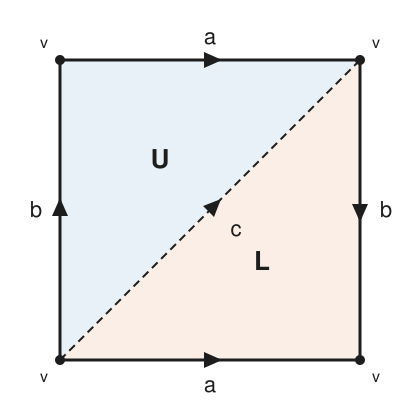
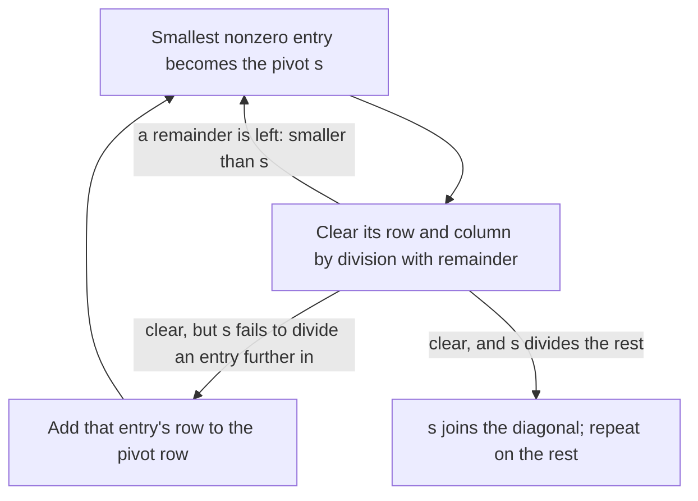

# Smith normal form: the matrix routine that turns boundary matrices into hole counts

[Syllabus](../../../SYLLABUS.md) → [Topology](../README.md) → [Homology](../README.md#s05) → Smith normal form

---

## General Overview

Take a square of cloth. Sew the top edge to the bottom edge, arrows matching, and you have a sleeve. Now sew the sleeve's two ends together, but with a flip, so the left edge's arrow runs against the right edge's. The result is the **Klein bottle**: a closed surface with only one side ([Orientability](../03-Surfaces%20and%20Manifolds/03-orientability-mobius-strip-and-klein-bottle.md)).

Cut the square along one diagonal. After gluing, the cloth is 1 corner point, 3 edges and 2 triangles. Homology asks which loops of edges are not the rim of any patch of the surface ([Homology groups](02-homology-groups.md)). Here something odd happens. The side edge b is not the rim of anything. But b traced twice is: the rims of the two triangles differ by exactly 2b.

A loop that becomes a rim when traced some number of times is **torsion** (a twist of finite order). Elimination with fractions cannot see it, because it halves the 2 away. This card's routine keeps to whole numbers. It writes the rims as an integer matrix and reduces it, with moves that whole numbers can undo, to a diagonal. For the Klein bottle the diagonal reads 1 and 2: an ordinary rim, and the twist.

**Reduce each boundary matrix with whole-number row and column moves until only a diagonal is left; each entry 1 is a rim that closes a loop, each entry above 1 is a twist of that order, and the pieces left once both neighbouring ranks are taken away are the holes that never close.**

**What kind of fact this is:** a method backed by theorems proved on this card in Why it works: the routine always stops, its diagonal is unique, and the diagonal gives the homology group. The general structure theorem for such groups is stated, not proved, and the universal coefficient theorem is used only as a counting rule.

### The picture: the Klein bottle, cut flat

<p align="center"></p>

The two a edges are sewn with arrows matching, and the two b edges with arrows opposed: that flip is what makes the surface one-sided. All four corners become the single point v. The drawing is schematic. No real Klein bottle fits in ordinary space without passing through itself, and that self-crossing belongs to models, not to the surface.

---

## The formula

A **chain** is a sum of pieces with whole-number coefficients ([Simplicial complexes and chains](01-simplicial-complexes-and-chains.md)). The k-dimensional chains form $`C_k = \mathbb{Z}^{n_k}`$: lists of $`n_k`$ integers, one per k-dimensional piece. The **boundary matrix** $`\partial_k`$ has one column per k-piece, listing that piece's signed rim in the (k − 1)-pieces.

The routine finds whole-number matrices $`S`$ and $`T`$, each with a whole-number inverse, that turn a boundary matrix into a diagonal. The twists in dimension k come from the next matrix up, $`\partial_{k+1}`$, so that is the one shown:

```math
S \, \partial_{k+1} \, T = D = \mathrm{diag}(d_1, d_2, \dots, d_r, 0, \dots, 0), \qquad d_1 \mid d_2 \mid \dots \mid d_r
```

**Read it aloud:** after row moves and column moves that whole numbers can undo, the boundary matrix becomes a diagonal of positive whole numbers, each dividing the next, then zeros.

That diagonal is the **Smith normal form**. Its count of nonzero entries, $`r = r_{k+1}`$, is the matrix's rank; reducing $`\partial_k`$ the same way gives its rank $`r_k`$. The homology group in dimension k then reads straight off:

```math
H_k \cong \mathbb{Z}^{\beta_k} \oplus \mathbb{Z}/d_1 \oplus \dots \oplus \mathbb{Z}/d_r, \qquad \beta_k = n_k - r_k - r_{k+1}
```

**Read it aloud:** the k-th homology group is one whole-number counter per free hole, plus one wrap-around counter for each diagonal entry of the next boundary matrix up.

Here $`\mathbb{Z}/d`$ is ℤ mod d, the counter that wraps at d, and $`\mathbb{Z}/1`$ is the zero group, so diagonal 1s add nothing. For the Klein bottle in dimension 1: $`n_1 = 3`$ edges, $`r_1 = 0`$, and $`\partial_2`$ reduces to 1 and 2, so $`r_2 = 2`$. Then $`\beta_1 = 3 - 0 - 2 = 1`$ and $`H_1 \cong \mathbb{Z} \oplus \mathbb{Z}/2`$.

Counting with ℤ mod p instead of whole numbers, for a prime p, turns this into a third formula. Write $`t_k(p)`$ for the number of torsion factors $`\mathbb{Z}/d`$ of $`H_k`$ with d divisible by p:

```math
\dim H_k(X; \mathbb{Z}/p) = \beta_k + t_k(p) + t_{k-1}(p)
```

**Read it aloud:** counted mod p, the holes in dimension k are the free holes, plus one for each twist in dimension k that p divides, plus one for each such twist a dimension lower.

For the Klein bottle and p = 2, dimension 2 reads 0 + 0 + 1 = 1: the twist in $`H_1`$ shows up again one dimension higher.

| Symbol | Plain meaning | In our example | Push it up and the answer… |
| --- | --- | --- | --- |
| $`k`$, $`C_k`$, $`n_k`$ | a dimension; its chains; how many k-dimensional pieces | 1 corner, 3 edges, 2 triangles | more room for free holes |
| $`\partial_k`$, $`A`$ | boundary matrix: each k-piece's signed rim; A in the proofs | $`\partial_2`$ is `[[1, 1], [1, -1], [-1, -1]]`, rows a, b, c | — |
| $`S`$, $`T`$, $`D`$ | the row moves and the column moves, as matrices with whole-number inverses; the diagonal they reach | three row moves, one column move; diag(1, 2) | — |
| $`d_i`$, $`\mid`$, $`s`$ | the i-th diagonal entry; "divides"; the pivot, the entry being worked on | 1 and 2, and 1 divides 2; first pivot 1 | an entry above 1 is a twist |
| $`r_k`$ | rank: nonzero diagonal entries of $`\partial_k`$ | $`r_1 = 0`$, $`r_2 = 2`$ | fewer free holes |
| $`g_k`$ | gcd of all k-by-k minors | $`g_1 = 1`$, $`g_2 = 2`$ | — |
| $`\beta_k`$ | Betti number: free holes in dimension k, counted over ℚ | 1, 1, 0 | — |
| $`H_k`$, $`X`$ | homology group: loops that are not rims, counted with whole numbers; X is the space | $`H_1 \cong \mathbb{Z} \oplus \mathbb{Z}/2`$; X is the Klein bottle | — |
| $`Z_k`$, $`B_k`$, $`W`$ | cycles (chains with zero boundary); rims; the chains with nonzero boundary | $`Z_1`$ is all of $`C_1`$; $`B_1`$ is spanned by a + b − c and a − b − c | — |
| $`\mathbb{Z}^m`$, $`\mathbb{Z}/d`$, $`\oplus`$, $`\cong`$ | m free counters; one counter that wraps at d; side by side; "is the same group as" | $`\mathbb{Z} \oplus \mathbb{Z}/2`$ | — |
| $`p`$, $`\dim`$ | a prime used to count mod p; the number of independent counters mod p | p = 2 and p = 3 | — |
| $`t_k(p)`$ | torsion factors of $`H_k`$ whose order p divides | $`t_1(2) = 1`$, $`t_1(3) = 0`$ | more holes counted mod p |

### When it holds

- **Whole-number coefficients, not fractions.** With fractions, any diagonal entry can be scaled to 1, so every twist vanishes: the Klein bottle reads only "rank 1" in dimension 1.
- **Signed boundaries.** The signs make the boundary of a boundary zero. Drop them and the Klein bottle's matrix becomes all 1s and reads as the torus: $`H_1`$ rank 2, $`H_2`$ rank 1.
- **Only moves that whole numbers undo.** Swap two rows, flip one sign, or add a whole multiple of one row to another; the same for columns. Halving a row is not allowed: an odd entry would become a fraction.
- **A finite complex.** Finitely many pieces give finite matrices. A space that needs infinitely many pieces has no matrix to reduce.
- **Both ranks.** $`\beta_k`$ needs $`r_k`$ as well as $`r_{k+1}`$. On a finer cutting of the Klein bottle, forgetting $`r_1`$ counts 9 loops instead of 1.

---

## Why it works

### Step 0: change coordinates until the matrix is a diagonal

A homology group is a quotient: loops with no ends, with the rims treated as zero ([Homology groups](02-homology-groups.md)). A quotient does not care how its pieces are named. So rename them. Pick new whole-number coordinates on the edges and on the triangles until each triangle's rim is a single edge times a number. Then the quotient splits into one simple counter per coordinate: times 1 is nothing left, times 2 is a twist, and no rim at all is a free hole.

The routine below finds those coordinates. It is [Gaussian elimination](../../03-Algebra/05-Solving%20Systems/02-gaussian-elimination.md) with two changes: it never divides, and it works on columns as well as rows.

### Step 1: the moves that whole numbers can undo

Gaussian elimination may scale a row by any nonzero number. Over the integers only two scalings can be undone: by 1 and by −1. The legal moves are therefore:

1. **Swap** two rows, or two columns.
2. **Flip the sign** of one row, or one column.
3. **Add a whole multiple** of one row to another row, or of one column to another column.

Each move is undone by a move of the same kind. A row move renames the edges, the rows; a column move renames the triangles, the columns. On the Klein bottle, "column L minus column U" replaces the triangle L by the chain L − U.

Without division, a pivot cannot be scaled to 1. Instead the routine runs Euclid's algorithm: subtracting whole multiples of one entry from another leaves remainders that shrink to the [Greatest common divisor](../../02-Number%20theory/02-Greatest%20Common%20Divisor%20and%20Euclid%27s%20Algorithm/01-gcd.md). By [Bezout's identity](../../02-Number%20theory/02-Greatest%20Common%20Divisor%20and%20Euclid%27s%20Algorithm/04-bezouts-identity.md) the gcd is a whole-number mix of the entries, so the moves can bring it into the pivot position. A row holding 4 and 6 reduces to 2.

### Step 2: the routine, and why it stops

1. Find the smallest nonzero entry, by size, in the part not yet finished. Swap it to the top-left corner. Flip its sign if needed. This is the **pivot** s.
2. Divide every other entry in the pivot's column by s, and subtract that many copies of the pivot row. Do the same along the pivot's row with column moves.
3. If a remainder is left, it is smaller than s. Go back to step 1.
4. If the row and column are clear but s fails to divide some entry further in, add that entry's row to the pivot row and go back to step 1.
5. Otherwise s is the next diagonal entry. Set its row and column aside and repeat on the rest.



A remainder left in step 3 is smaller than s at once, and the row added in step 4 forces such a remainder on the next round. Positive whole numbers cannot shrink forever, so the routine stops.

<details>
<summary>Detailed proof: the routine stops, and each diagonal entry divides the next</summary>

Let s be the pivot, a positive whole number. Dividing an entry e by s leaves a remainder of size less than s. If any remainder is nonzero, the next pivot is at most that remainder, so smaller than s.

If the row and column clear but some entry e further in is not a multiple of s, step 4 adds e's row to the pivot row and goes back to step 1. The pivot row now holds e. Step 1 picks either a smaller entry or s again, since s comes first among the smallest entries; in the second case the division in step 2 leaves a nonzero remainder of size less than s. So the pivot shrinks again.

Each pivot position therefore sees at most 2s restarts, where s is its first value, and there are at most as many positions as rows. The routine stops.

When s is accepted it divides every entry left in the rest. Every later move adds whole multiples of those entries, so every later entry, and every later pivot, is still a multiple of s. That is the chain $`d_1 \mid d_2 \mid \dots`$.

</details>

### Step 3: a diagonal is read one coordinate at a time

The columns of a boundary matrix are the rims. The quotient wanted is all integer lists modulo whole-number mixes of those columns. For the diagonal matrix D that quotient is plain. The i-th coordinate is taken modulo $`d_i`$, and coordinates with no diagonal entry are free. With n rows, so integer lists of length n, the quotient by the columns of D is $`\mathbb{Z}/d_1 \oplus \dots \oplus \mathbb{Z}/d_r \oplus \mathbb{Z}^{n-r}`$.

The moves do not change the quotient, only its coordinates. That is the key theorem of the card.

<details>
<summary>Detailed proof: the quotient by the columns of A is the quotient by the columns of D</summary>

Write A for the boundary matrix and suppose $`SAT = D`$, with S and T having whole-number inverses. Then A equals $`S^{-1} D T^{-1}`$.

A column move multiplies on the right by a matrix with a whole-number inverse. For any whole-number matrix M, the whole-number mixes of the columns of $`MT`$ are exactly those of the columns of M, since each set can be written in the other. So A and $`S^{-1}D`$ have the same column mixes.

The matrix $`S^{-1}`$ is a one-to-one map from integer lists onto integer lists, with inverse S. It carries the column mixes of D onto the column mixes of $`S^{-1}D`$. So it carries one quotient onto the other, and adding is preserved:

$`\displaystyle \mathbb{Z}^n / (\text{mixes of columns of } A) \;\cong\; \mathbb{Z}^n / (\text{mixes of columns of } D) \;=\; \mathbb{Z}/d_1 \oplus \dots \oplus \mathbb{Z}/d_r \oplus \mathbb{Z}^{n-r}`$

</details>

The general version of this reading is the **structure theorem for finitely generated abelian groups**: every group whose addition does not depend on order (a + b = b + a), in which finitely many members build all the others by adding and subtracting, is $`\mathbb{Z}^{m} \oplus \mathbb{Z}/d_1 \oplus \dots \oplus \mathbb{Z}/d_r`$ with each $`d_i > 1`$ dividing the next, in exactly one way. This card proves only the case above. The full theorem belongs to Modules (planned), in the algebraic-geometry wing.

### Step 4: from one quotient to the homology group

The quotient in Step 3 is all k-chains modulo rims. Homology wants only the **cycles**: the k-chains with zero boundary. Reducing $`\partial_k`$ finds them. In its new coordinates, the last $`n_k - r_k`$ chains go to zero. Those are the cycles, and the first $`r_k`$ chains are free and have nonzero boundaries.

The rims sit inside the cycles, because a boundary of a boundary is zero. So the quotient of all chains is $`H_k`$ plus $`r_k`$ extra free counters. Taking those away gives $`\beta_k = n_k - r_k - r_{k+1}`$, with the twists of $`\partial_{k+1}`$ untouched.

<details>
<summary>Detailed proof: the Betti number and the torsion of H_k</summary>

Reduce $`\partial_k`$. In the new coordinates on $`C_k`$, the boundary sends the first $`r_k`$ basis chains to nonzero multiples of independent lists and the rest to zero. So the cycles $`Z_k`$ are the whole-number mixes of the last $`n_k - r_k`$ basis chains, and $`C_k = Z_k \oplus W`$ with W free of rank $`r_k`$.

Since $`\partial_k \partial_{k+1} = 0`$, every rim lies in $`Z_k`$. Write $`B_k`$ for the rims. Then

$`\displaystyle C_k / B_k \;\cong\; (Z_k / B_k) \oplus W \;=\; H_k \oplus \mathbb{Z}^{r_k}`$

By Step 3, applied to $`\partial_{k+1}`$, the left side is $`\mathbb{Z}^{n_k - r_{k+1}} \oplus \mathbb{Z}/d_1 \oplus \dots`$. The members of finite order on each side are the same, because W adds none. So the torsion of $`H_k`$ is the list of $`d_i > 1`$. Counting free counters, which is the dimension once fractions are allowed, gives $`\beta_k + r_k = n_k - r_{k+1}`$.

</details>

### Step 5: the diagonal does not depend on the route

Different pivot choices give the same diagonal. The reason is a second road to it. Let $`g_k`$ be the gcd of all k-by-k **minors** (determinants of k rows and k columns picked from the matrix). Then $`d_1 d_2 \cdots d_k = g_k`$.

On the Klein bottle, the entries are 1, 1, 1, −1, −1, −1, so $`g_1 = 1`$. The three 2-by-2 minors are −2, 0 and −2, so $`g_2 = 2`$. Hence $`d_1 = 1`$ and $`d_2 = 2 / 1 = 2`$, with no reduction at all.

<details>
<summary>Detailed proof: the gcd of the minors does not change under the moves</summary>

A swap or a sign flip changes each minor at most by its sign. Adding a multiple of row j to row i changes a minor that uses row i but not row j into itself plus a multiple of another minor of the old matrix. Every other minor is unchanged, and columns behave the same way. So every new minor is a whole-number mix of old minors, and the gcd of the new ones is a multiple of the gcd of the old ones.

Each move has an undo of the same kind, so the old gcd is also a multiple of the new one. The two are equal. For a diagonal matrix the nonzero k-by-k minors are products of k diagonal entries, and since each entry divides the next, their gcd is $`d_1 \cdots d_k`$.

</details>

### Step 6: counting mod p, where torsion shows twice

Counting mod 2, the Klein bottle's diagonal 2 becomes 0. The rank of $`\partial_2`$ drops from 2 to 1, so one more loop is not a rim, and one more chain of triangles has zero boundary: U + L has rim 2a − 2c, which is 0 mod 2. So mod 2 the Betti numbers are 1, 2, 1, against 1, 1, 0 over ℚ. Mod 3, the 2 is a unit (it has an inverse, 2 × 2 = 4 = 1 mod 3), so nothing changes.

That is the counting rule in The formula. The full theorem, the **universal coefficient theorem**, builds a group called Tor to say which twists collapse mod p. This card uses only the count, as stated in Hatcher, section 3.A; [Universal coefficients and Kunneth](11-universal-coefficients-and-kunneth.md) builds Tor for finitely generated groups and proves the theorem for finite complexes, and [Tor](../../22-Algebraic%20geometry/07-Exact%20Sequences%2C%20Ext%20and%20Tor/04-free-resolutions-and-tor.md) builds it in general.

The 2-triangle model is a cell structure, not a simplicial complex: one corner serves as every vertex. [Cellular homology](05-cellular-homology.md) shows why such models give the right answer. The code checks it directly against an honest triangulation of the same Klein bottle: 9 corners, 27 edges and 18 triangles, the cutting used on [Euler characteristic](../03-Surfaces%20and%20Manifolds/04-euler-characteristic-and-triangulations.md). Its 27-by-18 boundary matrix reduces to seventeen 1s and one 2: the same group.

---

## Worked numbers, by hand

| Step | Arithmetic | Value |
| --- | --- | --- |
| rim of U | walk round U: +b, +a, −c | a + b − c |
| rim of L | walk round L: +a, −b, −c | a − b − c |
| $`\partial_2`$ | columns U, L; rows a, b, c | `[[1, 1], [1, -1], [-1, -1]]` |
| $`\partial_1`$ | every edge starts and ends at v: v − v | all 0, so $`r_1 = 0`$ |
| pivot | smallest nonzero entry, top left | 1 |
| clear column U | row b − row a; row c + row a | `[[1, 1], [0, -2], [0, 0]]` |
| clear row a | column L − column U | `[[1, 0], [0, -2], [0, 0]]` |
| fix the sign | row b × (−1) | `[[1, 0], [0, 2], [0, 0]]` |
| check by minors | $`g_1 = 1`$; $`g_2 = \gcd(-2, 0, -2) = 2`$ | $`d_1 = 1`$, $`d_2 = 2`$ |
| the twist itself | rim of U − L: (a + b − c) − (a − b − c) | 2b |
| $`H_0`$ | 1 corner, $`r_1 = 0`$ | $`\mathbb{Z}`$ |
| $`H_1`$ | 3 − 0 − 2 = 1 free hole; one diagonal 2 | **$`\mathbb{Z} \oplus \mathbb{Z}/2`$** |
| $`H_2`$ | 2 − 2 = 0 | 0 |

The Klein bottle has one loop, a, that never closes up however often it is traced, and one loop, b, that closes up after two rounds: 2b is the rim of U − L.

$`H_2 = 0`$ says no whole-number mix of the triangles, other than zero, has zero rim. The torus has one, U − L, which covers it like a skin; the one-sided Klein bottle has none.

### What breaks if you drop a piece

| Mistake | Comes out at | What went wrong |
| --- | --- | --- |
| Signs dropped from the rims | Smith [1]: $`H_1`$ rank 2, $`H_2`$ rank 1, the torus | Unsigned rims add U and L instead of telling them apart |
| Ranks over ℚ only | $`H_1`$ rank 1, torsion seen: none | Fractions halve the 2 into a 1 |
| Mod 2 count read as free loops | 2 loops, the torus's count | The twist is counted in $`H_1`$ and again in $`H_2`$ |
| Rank of $`\partial_1`$ forgotten, 9-corner model | 27 − 18 = 9 loops | Edge sums with ends are not loops |

The code prints all four.

---

## Code, from first principles, and it actually runs

Nothing is imported. The script writes the Smith routine on plain integers and reaches the Klein bottle's homology by five roads:

1. the 2-triangle model, reduced as by hand;
2. the 27-by-18 matrix of the 9-corner triangulation, built from a glued grid and checked to have every edge on two triangles;
3. the diagonal again, from gcds of minors;
4. ranks over ℚ, by fraction-free elimination;
5. ranks mod 2 and mod 3, by elimination, matched against the counting rule.

The torus runs alongside as the contrast with no twist. These are exact computations on two finite complexes, so for those two complexes they are proofs, not samples.

### Python

```python
# Smith normal form -- the check behind the card.  Nothing is imported.  The
# Klein bottle's boundary matrices are reduced over the integers with row and
# column moves that can be undone, and the diagonal is read as hole counts plus
# torsion.  Roads: a 3-edge cell model by hand and a 9-corner triangulation;
# gcds of minors; ranks over Q, Z mod 2 and Z mod 3 by separate elimination.
CELL = [[1, 1], [1, -1], [-1, -1]]           # rows a, b, c; columns U, L
def gcd(a, b):
    while b: a, b = b, a % b
    return abs(a)
def smith(m):                                # the diagonal d_1 | d_2 | ... (nonzero part)
    a, diag, t = [row[:] for row in m], [], 0
    while True:
        spots = [(abs(a[i][j]), i, j) for i in range(t, len(a)) for j in range(t, len(a[0])) if a[i][j]]
        if not spots:
            return diag
        _, i, j = min(spots)                 # smallest nonzero entry becomes the pivot
        a[t], a[i] = a[i], a[t]
        for row in a:
            row[t], row[j] = row[j], row[t]
        if a[t][t] < 0:
            a[t] = [-x for x in a[t]]
        p = a[t][t]
        for i in range(t + 1, len(a)):       # row moves: divide with remainder
            q = a[i][t] // p
            a[i] = [x - q * y for x, y in zip(a[i], a[t])]
        for j in range(t + 1, len(a[0])):    # column moves: the same along the row
            q = a[t][j] // p
            for row in a:
                row[j] -= q * row[t]
        if any(a[i][t] for i in range(t + 1, len(a))) or any(a[t][t + 1:]):
            continue                         # a remainder is left: smaller than p, go again
        bad = [i for i in range(t + 1, len(a)) if any(x % p for x in a[i][t + 1:])]
        if bad:                              # p must divide the rest: add that row, go again
            a[t] = [x + y for x, y in zip(a[t], a[bad[0]])]
            continue
        diag.append(p)
        t += 1
def homology(d1, d2, n0, n1, n2):            # (rank, torsion) for H0, H1, H2
    s1, s2 = smith(d1), smith(d2)
    return [(n0 - len(s1), [d for d in s1 if d > 1]),
            (n1 - len(s1) - len(s2), [d for d in s2 if d > 1]), (n2 - len(s2), [])]
def show(h):
    return "; ".join(f"H{k}: rank {r}, torsion {t}" for k, (r, t) in enumerate(h))
def rank_q(m):                               # fraction-free elimination: exact rank over Q
    a, r, prev = [row[:] for row in m], 0, 1
    for c in range(len(a[0])):
        piv = next((i for i in range(r, len(a)) if a[i][c]), None)
        if piv is None: continue
        a[r], a[piv] = a[piv], a[r]
        for i in range(r + 1, len(a)):
            for j in range(c + 1, len(a[0])):
                num = a[i][j] * a[r][c] - a[i][c] * a[r][j]
                assert num % prev == 0
                a[i][j] = num // prev
            a[i][c] = 0
        prev, r = a[r][c], r + 1
    return r
def rank_p(m, p):                            # rank over Z mod p, p prime
    a, r = [[x % p for x in row] for row in m], 0
    for c in range(len(a[0])):
        piv = next((i for i in range(r, len(a)) if a[i][c]), None)
        if piv is None: continue
        a[r], a[piv] = a[piv], a[r]
        inv = pow(a[r][c], p - 2, p)
        for i in range(len(a)):
            if i != r and a[i][c]:
                f = a[i][c] * inv % p
                a[i] = [(x - f * y) % p for x, y in zip(a[i], a[r])]
        r += 1
    return r
def betti_field(d1, d2, n0, n1, n2, rank):  # Betti numbers over a field, from two ranks
    r1, r2 = rank(d1), rank(d2)
    return [n0 - r1, n1 - r1 - r2, n2 - r2]
def grid(flip):                              # 3 x 3 squares, each cut by one diagonal
    def v(i, j):
        j %= 3
        if i == 3:
            i, j = 0, (3 - j) % 3 if flip else j
        return 3 * i + j
    tris = sorted({tuple(sorted((v(i, j), v(i + 1, j), v(i + 1, j + 1)))) for i in range(3) for j in range(3)} |
                  {tuple(sorted((v(i, j), v(i, j + 1), v(i + 1, j + 1)))) for i in range(3) for j in range(3)})
    assert len(tris) == 18                   # no two triangles share their corners
    edges = sorted({e for x, y, z in tris for e in ((x, y), (x, z), (y, z))})
    d1 = [[(k == y) - (k == x) for x, y in edges] for k in range(9)]
    d2 = [[(e == (y, z)) - (e == (x, z)) + (e == (x, y)) for x, y, z in tris] for e in edges]
    return tris, edges, d1, d2
def minors2(m):                              # every 2 x 2 minor of a 3 x 2 matrix
    return [m[i][0] * m[j][1] - m[i][1] * m[j][0] for i in range(3) for j in range(i + 1, 3)]
print("figure, corners P0 (60,360) P1 (360,360) P2 (360,60) P3 (60,60); diagonal c (60,360) to (360,60)")
print(f"cell Klein bottle: 1 corner, 3 edges a b c, 2 triangles U L; d2 = {CELL}")
s1 = [CELL[0], [x - y for x, y in zip(CELL[1], CELL[0])], [x + y for x, y in zip(CELL[2], CELL[0])]]
s2 = [[r[0], r[1] - r[0]] for r in s1]
s3 = [s2[0], [-x for x in s2[1]], s2[2]]
print(f"step 1, clear column U: row b - row a, row c + row a -> {s1}")
print(f"step 2, clear row a: column L - column U -> {s2}")
print(f"step 3, row b times -1 -> {s3}")
mins, g1, g2 = minors2(CELL), 0, 0
for x in sum(CELL, []): g1 = gcd(g1, x)
for x in mins: g2 = gcd(g2, x)
print(f"Smith diagonal, cell Klein: {smith(CELL)}; of [[2, 0], [0, 3]]: {smith([[2, 0], [0, 3]])}; of [[4, 6]]: {smith([[4, 6]])}")
print(f"gcd road: entries {g1}, 2x2 minors {mins} -> {g2}, so d_2 = {g2 // g1}")
print(f"boundary of U - L, in a b c: {[r[0] - r[1] for r in CELL]}; of U + L: {[r[0] + r[1] for r in CELL]}")
cell_h = homology([[0, 0, 0]], CELL, 1, 3, 2)
print(f"cell Klein: {show(cell_h)}")
results = {}
for name, flip in (("Klein", True), ("torus", False)):
    tris, edges, d1, d2 = grid(flip)
    on_two = all(sum(1 for t in tris if set(e) <= set(t)) == 2 for e in edges)
    zero = all(sum(d1[k][e] * d2[e][t] for e in range(27)) == 0 for k in range(9) for t in range(18))
    sd1, sd2, h = smith(d1), smith(d2), homology(d1, d2, 9, len(edges), len(tris))
    results[name] = (d1, d2, h)
    print(f"grid {name}: {9} corners, {len(edges)} edges, {len(tris)} triangles; "
          f"each edge on 2 triangles: {'yes' if on_two else 'no'}; d1 d2 = 0: {'yes' if zero else 'no'}")
    print(f"grid {name}: Smith d1 has {sd1.count(1)} ones, others {[d for d in sd1 if d > 1]}; "
          f"Smith d2 has {sd2.count(1)} ones, others {[d for d in sd2 if d > 1]}")
    print(f"grid {name}: {show(h)}")
d1, d2, kh = results["Klein"]
bq = betti_field(d1, d2, 9, 27, 18, rank_q)
print(f"Euler characteristic: 9 - 27 + 18 = {9 - 27 + 18}; Betti over Q {bq[0]} - {bq[1]} + {bq[2]} = {bq[0] - bq[1] + bq[2]}")
print(f"Klein over Q, fraction-free elimination: {bq}")
rule = {}
for p in (2, 3):
    direct = betti_field(d1, d2, 9, 27, 18, lambda m: rank_p(m, p))
    t = [sum(1 for d in tor if d % p == 0) for _, tor in kh]
    rule[p] = [kh[k][0] + t[k] + (t[k - 1] if k else 0) for k in range(3)]
    print(f"Klein over Z mod {p}: elimination {direct}, counting rule from Smith {rule[p]}")
    assert direct == rule[p]
tq, t2 = (betti_field(*results["torus"][:2], 9, 27, 18, r) for r in (rank_q, lambda m: rank_p(m, 2)))
print(f"torus over Q {tq}, over Z mod 2 {t2}")
unsigned = [[abs(x) for x in row] for row in CELL]
print(f"mistake 1, signs dropped: d2 = {unsigned}, Smith {smith(unsigned)} -> {show(homology([[0, 0, 0]], unsigned, 1, 3, 2))}")
print(f"mistake 2, ranks over Q only: H1 rank {bq[1]}, torsion seen: none")
print(f"mistake 3, mod 2 count read as free loops: {rule[2][1]} loops, the torus's count")
print(f"mistake 4, rank of d1 forgotten: 27 - {rank_q(d2)} = {27 - rank_q(d2)} loops")
assert smith(CELL) == [1, 2] and g2 // g1 == 2 and s3 == [[1, 0], [0, 2], [0, 0]]   # reduction meets minors
assert smith([[2, 0], [0, 3]]) == [1, 2 * 3] and smith([[4, 6]]) == [gcd(4, 6)]   # 2 | 3 forced; Euclid
assert cell_h == kh == [(1, []), (1, [2]), (0, [])]         # cell model meets triangulation
assert bq == [kh[0][0], kh[1][0], kh[2][0]] == [1, 1, 0]    # Q ranks meet Smith ranks
assert results["torus"][2] == [(1, []), (2, []), (1, [])] and tq == t2 == [1, 2, 1]
print("ALL CHECKS PASS")
```

**Ran 2026-11-15 on macOS, Python 3.14.10, standard library only. All checks passed. Output, pasted from the run:**

```
figure, corners P0 (60,360) P1 (360,360) P2 (360,60) P3 (60,60); diagonal c (60,360) to (360,60)
cell Klein bottle: 1 corner, 3 edges a b c, 2 triangles U L; d2 = [[1, 1], [1, -1], [-1, -1]]
step 1, clear column U: row b - row a, row c + row a -> [[1, 1], [0, -2], [0, 0]]
step 2, clear row a: column L - column U -> [[1, 0], [0, -2], [0, 0]]
step 3, row b times -1 -> [[1, 0], [0, 2], [0, 0]]
Smith diagonal, cell Klein: [1, 2]; of [[2, 0], [0, 3]]: [1, 6]; of [[4, 6]]: [2]
gcd road: entries 1, 2x2 minors [-2, 0, -2] -> 2, so d_2 = 2
boundary of U - L, in a b c: [0, 2, 0]; of U + L: [2, 0, -2]
cell Klein: H0: rank 1, torsion []; H1: rank 1, torsion [2]; H2: rank 0, torsion []
grid Klein: 9 corners, 27 edges, 18 triangles; each edge on 2 triangles: yes; d1 d2 = 0: yes
grid Klein: Smith d1 has 8 ones, others []; Smith d2 has 17 ones, others [2]
grid Klein: H0: rank 1, torsion []; H1: rank 1, torsion [2]; H2: rank 0, torsion []
grid torus: 9 corners, 27 edges, 18 triangles; each edge on 2 triangles: yes; d1 d2 = 0: yes
grid torus: Smith d1 has 8 ones, others []; Smith d2 has 17 ones, others []
grid torus: H0: rank 1, torsion []; H1: rank 2, torsion []; H2: rank 1, torsion []
Euler characteristic: 9 - 27 + 18 = 0; Betti over Q 1 - 1 + 0 = 0
Klein over Q, fraction-free elimination: [1, 1, 0]
Klein over Z mod 2: elimination [1, 2, 1], counting rule from Smith [1, 2, 1]
Klein over Z mod 3: elimination [1, 1, 0], counting rule from Smith [1, 1, 0]
torus over Q [1, 2, 1], over Z mod 2 [1, 2, 1]
mistake 1, signs dropped: d2 = [[1, 1], [1, 1], [1, 1]], Smith [1] -> H0: rank 1, torsion []; H1: rank 2, torsion []; H2: rank 1, torsion []
mistake 2, ranks over Q only: H1 rank 1, torsion seen: none
mistake 3, mod 2 count read as free loops: 2 loops, the torus's count
mistake 4, rank of d1 forgotten: 27 - 18 = 9 loops
ALL CHECKS PASS
```

### Rust

Same numbers, same labels, built with `rustc --edition 2021 -O`. Entries are checked for overflow in the Smith routine, and the fraction-free elimination runs in 128-bit integers.

```rust
// Smith normal form -- the same check as the Python, in Rust.  No crates.  The
// Klein bottle's boundary matrices are reduced over the integers with row and
// column moves that can be undone, and the diagonal is read as hole counts plus
// torsion.  Roads: a 3-edge cell model by hand and a 9-corner triangulation;
// gcds of minors; ranks over Q, Z mod 2 and Z mod 3 by separate elimination.
type M = Vec<Vec<i64>>;
type H = Vec<(usize, Vec<i64>)>;

fn gcd(mut a: i64, mut b: i64) -> i64 {
    while b != 0 { (a, b) = (b, a % b) }
    a.abs()
}
fn smith(m: &M) -> Vec<i64> {                      // the diagonal d_1 | d_2 | ... (nonzero part)
    let (mut a, mut diag, mut t) = (m.clone(), Vec::new(), 0);
    let (nr, nc) = (a.len(), a[0].len());
    loop {
        let mut best: Option<(i64, usize, usize)> = None;
        for i in t..nr { for j in t..nc {
            if a[i][j] != 0 && best.map_or(true, |b| (a[i][j].abs(), i, j) < b) { best = Some((a[i][j].abs(), i, j)) }
        } }
        let Some((_, i, j)) = best else { return diag };   // smallest nonzero entry becomes the pivot
        a.swap(t, i);
        for row in a.iter_mut() { row.swap(t, j) }
        if a[t][t] < 0 { a[t] = a[t].iter().map(|x| x.checked_neg().unwrap()).collect() }
        let p = a[t][t];
        for i in t + 1..nr {                       // row moves: divide with remainder
            let q = a[i][t].div_euclid(p);
            for j in 0..nc { a[i][j] = a[i][j].checked_sub(q.checked_mul(a[t][j]).unwrap()).unwrap() }
        }
        for j in t + 1..nc {                       // column moves: the same along the row
            let q = a[t][j].div_euclid(p);
            for i in 0..nr { a[i][j] = a[i][j].checked_sub(q.checked_mul(a[i][t]).unwrap()).unwrap() }
        }
        if (t + 1..nr).any(|i| a[i][t] != 0) || (t + 1..nc).any(|j| a[t][j] != 0) { continue }
        if let Some(b) = (t + 1..nr).find(|&i| (t + 1..nc).any(|j| a[i][j] % p != 0)) {
            for j in 0..nc { a[t][j] = a[t][j].checked_add(a[b][j]).unwrap() }  // p must divide the rest: add that row, go again
            continue;
        }
        diag.push(p);
        t += 1;
    }
}
fn homology(d1: &M, d2: &M, n: [usize; 3]) -> H {  // (rank, torsion) for H0, H1, H2
    let (s1, s2) = (smith(d1), smith(d2));
    let tor = |s: &Vec<i64>| s.iter().copied().filter(|&d| d > 1).collect::<Vec<i64>>();
    vec![(n[0] - s1.len(), tor(&s1)), (n[1] - s1.len() - s2.len(), tor(&s2)), (n[2] - s2.len(), vec![])]
}
fn show(h: &H) -> String {
    h.iter().enumerate().map(|(k, (r, t))| format!("H{}: rank {}, torsion {:?}", k, r, t)).collect::<Vec<_>>().join("; ")
}
fn rank_q(m: &M) -> usize {                        // fraction-free elimination: exact rank over Q
    let (mut a, mut r, mut prev) = (m.iter().map(|row| row.iter().map(|&x| x as i128).collect::<Vec<i128>>()).collect::<Vec<_>>(), 0, 1i128);
    for c in 0..a[0].len() {
        let Some(piv) = (r..a.len()).find(|&i| a[i][c] != 0) else { continue };
        a.swap(r, piv);
        for i in r + 1..a.len() {
            for j in c + 1..a[0].len() {
                let num = a[i][j] * a[r][c] - a[i][c] * a[r][j];
                assert!(num % prev == 0);
                a[i][j] = num / prev;
            }
            a[i][c] = 0;
        }
        (prev, r) = (a[r][c], r + 1);
    }
    r
}
fn rank_p(m: &M, p: i64) -> usize {                // rank over Z mod p, p prime
    let (mut a, mut r) = (m.iter().map(|row| row.iter().map(|x| x.rem_euclid(p)).collect::<Vec<i64>>()).collect::<Vec<_>>(), 0);
    for c in 0..a[0].len() {
        let Some(piv) = (r..a.len()).find(|&i| a[i][c] != 0) else { continue };
        a.swap(r, piv);
        let mut inv = 1;
        for _ in 0..p - 2 { inv = inv * a[r][c] % p }
        for i in 0..a.len() {
            if i != r && a[i][c] != 0 {
                let f = a[i][c] * inv % p;
                for j in 0..a[0].len() { a[i][j] = (a[i][j] - f * a[r][j]).rem_euclid(p) }
            }
        }
        r += 1;
    }
    r
}
fn betti_field(d1: &M, d2: &M, rank: &dyn Fn(&M) -> usize) -> Vec<usize> {
    let (r1, r2) = (rank(d1), rank(d2));           // Betti numbers over a field, from two ranks
    vec![9 - r1, 27 - r1 - r2, 18 - r2]
}
fn grid(flip: bool) -> (Vec<[usize; 3]>, Vec<[usize; 2]>, M, M) {  // 3 x 3 squares, each cut by one diagonal
    let v = |i: usize, j: usize| { let j = j % 3; if i == 3 { if flip { (3 - j) % 3 } else { j } } else { 3 * i + j } };
    let mut tris: Vec<[usize; 3]> = Vec::new();
    for i in 0..3 { for j in 0..3 {
        for mut t in [[v(i, j), v(i + 1, j), v(i + 1, j + 1)], [v(i, j), v(i, j + 1), v(i + 1, j + 1)]] {
            t.sort();
            if !tris.contains(&t) { tris.push(t) }
        }
    } }
    tris.sort();
    assert!(tris.len() == 18);                     // no two triangles share their corners
    let mut edges: Vec<[usize; 2]> = Vec::new();
    for &[x, y, z] in &tris { for e in [[x, y], [x, z], [y, z]] { if !edges.contains(&e) { edges.push(e) } } }
    edges.sort();
    let d1 = (0..9).map(|k| edges.iter().map(|&[x, y]| (k == y) as i64 - (k == x) as i64).collect()).collect();
    let d2 = edges.iter().map(|&e| tris.iter().map(|&[x, y, z]|
        (e == [y, z]) as i64 - (e == [x, z]) as i64 + (e == [x, y]) as i64).collect()).collect();
    (tris, edges, d1, d2)
}
fn yn(b: bool) -> &'static str { if b { "yes" } else { "no" } }
fn main() {
    let (cell, none): (M, M) = (vec![vec![1, 1], vec![1, -1], vec![-1, -1]], vec![vec![0, 0, 0]]);  // rows a, b, c; columns U, L
    println!("figure, corners P0 (60,360) P1 (360,360) P2 (360,60) P3 (60,60); diagonal c (60,360) to (360,60)");
    println!("cell Klein bottle: 1 corner, 3 edges a b c, 2 triangles U L; d2 = {:?}", cell);
    let s1: M = vec![cell[0].clone(), (0..2).map(|j| cell[1][j] - cell[0][j]).collect(), (0..2).map(|j| cell[2][j] + cell[0][j]).collect()];
    let s2: M = s1.iter().map(|r| vec![r[0], r[1] - r[0]]).collect();
    let s3: M = vec![s2[0].clone(), s2[1].iter().map(|x| -x).collect(), s2[2].clone()];
    println!("step 1, clear column U: row b - row a, row c + row a -> {:?}", s1);
    println!("step 2, clear row a: column L - column U -> {:?}", s2);
    println!("step 3, row b times -1 -> {:?}", s3);
    let mins: Vec<i64> = (0..3).flat_map(|i| (i + 1..3).map(move |j| (i, j)))
        .map(|(i, j)| cell[i][0] * cell[j][1] - cell[i][1] * cell[j][0]).collect();
    let (g1, g2) = (cell.iter().flatten().fold(0, |g, &x| gcd(g, x)), mins.iter().fold(0, |g, &x| gcd(g, x)));
    println!("Smith diagonal, cell Klein: {:?}; of [[2, 0], [0, 3]]: {:?}; of [[4, 6]]: {:?}", smith(&cell), smith(&vec![vec![2, 0], vec![0, 3]]), smith(&vec![vec![4, 6]]));
    println!("gcd road: entries {}, 2x2 minors {:?} -> {}, so d_2 = {}", g1, mins, g2, g2 / g1);
    println!("boundary of U - L, in a b c: {:?}; of U + L: {:?}", cell.iter().map(|r| r[0] - r[1]).collect::<Vec<i64>>(), cell.iter().map(|r| r[0] + r[1]).collect::<Vec<i64>>());
    let cell_h = homology(&none, &cell, [1, 3, 2]);
    println!("cell Klein: {}", show(&cell_h));
    let mut results: Vec<(M, M, H)> = Vec::new();
    for (name, flip) in [("Klein", true), ("torus", false)] {
        let (tris, edges, d1, d2) = grid(flip);
        let on_two = edges.iter().all(|e| tris.iter().filter(|t| t.contains(&e[0]) && t.contains(&e[1])).count() == 2);
        let zero = (0..9).all(|k| (0..18).all(|t| (0..27).map(|e| d1[k][e] * d2[e][t]).sum::<i64>() == 0));
        let (sd1, sd2, h) = (smith(&d1), smith(&d2), homology(&d1, &d2, [9, edges.len(), tris.len()]));
        let ones = |s: &Vec<i64>| s.iter().filter(|&&d| d == 1).count();
        let big = |s: &Vec<i64>| s.iter().copied().filter(|&d| d > 1).collect::<Vec<i64>>();
        println!("grid {}: {} corners, {} edges, {} triangles; each edge on 2 triangles: {}; d1 d2 = 0: {}",
                 name, 9, edges.len(), tris.len(), yn(on_two), yn(zero));
        println!("grid {}: Smith d1 has {} ones, others {:?}; Smith d2 has {} ones, others {:?}",
                 name, ones(&sd1), big(&sd1), ones(&sd2), big(&sd2));
        println!("grid {}: {}", name, show(&h));
        results.push((d1, d2, h));
    }
    let (d1, d2, kh) = &results[0];
    let bq = betti_field(d1, d2, &rank_q);
    println!("Euler characteristic: 9 - 27 + 18 = {}; Betti over Q {} - {} + {} = {}",
             9 - 27 + 18, bq[0], bq[1], bq[2], bq[0] as i64 - bq[1] as i64 + bq[2] as i64);
    println!("Klein over Q, fraction-free elimination: {:?}", bq);
    let mut rule2 = Vec::new();
    for p in [2i64, 3] {
        let direct = betti_field(d1, d2, &|m: &M| rank_p(m, p));
        let t: Vec<usize> = kh.iter().map(|(_, tor)| tor.iter().filter(|&&d| d % p == 0).count()).collect();
        let rule: Vec<usize> = (0..3).map(|k| kh[k].0 + t[k] + if k > 0 { t[k - 1] } else { 0 }).collect();
        println!("Klein over Z mod {}: elimination {:?}, counting rule from Smith {:?}", p, direct, rule);
        assert!(direct == rule);
        if p == 2 { rule2 = rule }
    }
    let (tq, t2) = (betti_field(&results[1].0, &results[1].1, &rank_q), betti_field(&results[1].0, &results[1].1, &|m: &M| rank_p(m, 2)));
    println!("torus over Q {:?}, over Z mod 2 {:?}", tq, t2);
    let unsigned: M = cell.iter().map(|r| r.iter().map(|x| x.abs()).collect()).collect();
    println!("mistake 1, signs dropped: d2 = {:?}, Smith {:?} -> {}", unsigned, smith(&unsigned), show(&homology(&none, &unsigned, [1, 3, 2])));
    println!("mistake 2, ranks over Q only: H1 rank {}, torsion seen: none", bq[1]);
    println!("mistake 3, mod 2 count read as free loops: {} loops, the torus's count", rule2[1]);
    println!("mistake 4, rank of d1 forgotten: 27 - {} = {} loops", rank_q(d2), 27 - rank_q(d2));
    assert!(smith(&cell) == vec![1, 2] && g2 / g1 == 2 && s3 == vec![vec![1, 0], vec![0, 2], vec![0, 0]]);
    assert!(smith(&vec![vec![2, 0], vec![0, 3]]) == vec![1, 2 * 3] && smith(&vec![vec![4, 6]]) == vec![gcd(4, 6)]);
    let want: H = vec![(1, vec![]), (1, vec![2]), (0, vec![])];
    assert!(cell_h == want && *kh == want);                  // cell model meets triangulation
    assert!(*bq == [kh[0].0, kh[1].0, kh[2].0] && bq == vec![1, 1, 0]);  // Q ranks meet Smith ranks
    assert!(results[1].2 == vec![(1, vec![]), (2, vec![]), (1, vec![])] && tq == t2 && tq == vec![1, 2, 1]);
    println!("ALL CHECKS PASS");
}
```

**Ran 2026-11-15 on macOS, rustc 1.98.1, no crates. All checks passed. Output, pasted from the run:**

```
figure, corners P0 (60,360) P1 (360,360) P2 (360,60) P3 (60,60); diagonal c (60,360) to (360,60)
cell Klein bottle: 1 corner, 3 edges a b c, 2 triangles U L; d2 = [[1, 1], [1, -1], [-1, -1]]
step 1, clear column U: row b - row a, row c + row a -> [[1, 1], [0, -2], [0, 0]]
step 2, clear row a: column L - column U -> [[1, 0], [0, -2], [0, 0]]
step 3, row b times -1 -> [[1, 0], [0, 2], [0, 0]]
Smith diagonal, cell Klein: [1, 2]; of [[2, 0], [0, 3]]: [1, 6]; of [[4, 6]]: [2]
gcd road: entries 1, 2x2 minors [-2, 0, -2] -> 2, so d_2 = 2
boundary of U - L, in a b c: [0, 2, 0]; of U + L: [2, 0, -2]
cell Klein: H0: rank 1, torsion []; H1: rank 1, torsion [2]; H2: rank 0, torsion []
grid Klein: 9 corners, 27 edges, 18 triangles; each edge on 2 triangles: yes; d1 d2 = 0: yes
grid Klein: Smith d1 has 8 ones, others []; Smith d2 has 17 ones, others [2]
grid Klein: H0: rank 1, torsion []; H1: rank 1, torsion [2]; H2: rank 0, torsion []
grid torus: 9 corners, 27 edges, 18 triangles; each edge on 2 triangles: yes; d1 d2 = 0: yes
grid torus: Smith d1 has 8 ones, others []; Smith d2 has 17 ones, others []
grid torus: H0: rank 1, torsion []; H1: rank 2, torsion []; H2: rank 1, torsion []
Euler characteristic: 9 - 27 + 18 = 0; Betti over Q 1 - 1 + 0 = 0
Klein over Q, fraction-free elimination: [1, 1, 0]
Klein over Z mod 2: elimination [1, 2, 1], counting rule from Smith [1, 2, 1]
Klein over Z mod 3: elimination [1, 1, 0], counting rule from Smith [1, 1, 0]
torus over Q [1, 2, 1], over Z mod 2 [1, 2, 1]
mistake 1, signs dropped: d2 = [[1, 1], [1, 1], [1, 1]], Smith [1] -> H0: rank 1, torsion []; H1: rank 2, torsion []; H2: rank 1, torsion []
mistake 2, ranks over Q only: H1 rank 1, torsion seen: none
mistake 3, mod 2 count read as free loops: 2 loops, the torus's count
mistake 4, rank of d1 forgotten: 27 - 18 = 9 loops
ALL CHECKS PASS
```

The two outputs match line for line.

### Lean

Lean proves, for every integer matrix, that its Smith diagonal exists, is unique and gives the homology group.

- Every integer matrix reduces, by moves that whole numbers undo, to a positive diagonal, each entry dividing the next, then zeros.
- Two reductions of the same matrix reach the same diagonal: the same count of nonzero entries, and the same entries.
- Suppose $`\partial_k \partial_{k+1} = 0`$, and $`\partial_{k+1}`$ has Smith diagonal $`d_1, \dots, d_r`$, then zeros. Then $`H_k`$ has $`n_k - r_k - r_{k+1}`$ free counters and one wrap-around counter $`\mathbb{Z}/d_i`$ per entry.
- The Klein bottle's $`\partial_2`$ reduces to diag(1, 2) by the card's three row moves and one column move.
- Its 2-by-2 minors are −2, 0 and −2, with gcd 2, and the rim of U − L is 2b.
- The Smith diagonal of `[[2, 0], [0, 3]]` is [1, 6], and of `[[4, 6]]` is [2].
- With signs dropped, the Klein bottle's $`\partial_2`$ has Smith diagonal [1].

Step 2's own routine, the 9-corner triangulation and the counting rule mod p are left to the Python and Rust checks.

```lean
-- Smith normal form: every integer matrix reduces by moves with whole-number inverses to a unique diagonal d₁ ∣ d₂ ∣ ⋯, and the homology group read off it is ℤ^(n_k − r_k − r_(k+1)) plus one ℤ mod dᵢ for each diagonal entry.
import Mathlib.LinearAlgebra.Matrix.Rank
import Mathlib.LinearAlgebra.Matrix.Determinant.Basic
import Mathlib.LinearAlgebra.Quotient.Defs
import Mathlib.Data.ZMod.Defs
import Mathlib.Data.Int.GCD
import Mathlib.Tactic.NormNum
import Mathlib.LinearAlgebra.Matrix.NonsingularInverse
import Mathlib.LinearAlgebra.Matrix.Transvection
import Mathlib.LinearAlgebra.Matrix.Permutation
import Mathlib.LinearAlgebra.FreeModule.PID
import Mathlib.LinearAlgebra.FiniteDimensional.Lemmas
import Mathlib.LinearAlgebra.Dimension.Localization
import Mathlib.RingTheory.Int.Basic
import Mathlib.Data.ZMod.Basic

section SNFHelpers

open Matrix

/-- Zero out the first `r` coordinates. -/
def zr {n : ℕ} (r : ℕ) (y : Fin n → ℤ) : Fin n → ℤ := fun i => if (i : ℕ) < r then 0 else y i

/-- Put a vector of length `r` into the first `r` coordinates. -/
def emb {n r : ℕ} (t : Fin r → ℤ) : Fin n → ℤ :=
  fun i => if h : (i : ℕ) < r then t ⟨i, h⟩ else 0

lemma snf_mulVec {n₁ n₂ r : ℕ} {D : Matrix (Fin n₁) (Fin n₂) ℤ} {d : ℕ → ℤ} (hr₂ : r ≤ n₂)
    (hD : ∀ i j, D i j = if (i : ℕ) = (j : ℕ) ∧ (i : ℕ) < r then d i else 0)
    (w : Fin n₂ → ℤ) (i : Fin n₁) :
    (D *ᵥ w) i = if h : (i : ℕ) < r then d i * w ⟨i, by omega⟩ else 0 := by
  simp only [mulVec, dotProduct, hD]
  split_ifs with h
  · rw [Finset.sum_eq_single ⟨i, by omega⟩]
    · simp [h]
    · intro b _ hb
      rw [if_neg]; · simp
      rintro ⟨h1, _⟩; exact hb (Fin.ext h1.symm)
    · simp
  · exact Finset.sum_eq_zero fun j _ => by rw [if_neg (by omega)]; simp

lemma col_zero {n₀ n₁ n₂ r : ℕ} {M : Matrix (Fin n₀) (Fin n₁) ℤ} {D : Matrix (Fin n₁) (Fin n₂) ℤ}
    {d : ℕ → ℤ} (hr₂ : r ≤ n₂) (hpos : ∀ i < r, 0 < d i)
    (hD : ∀ i j, D i j = if (i : ℕ) = (j : ℕ) ∧ (i : ℕ) < r then d i else 0) (hMD : M * D = 0)
    (k : Fin n₀) (l : Fin n₁) (hl : (l : ℕ) < r) : M k l = 0 := by
  have h := congrFun (congrFun hMD k) ⟨l, by omega⟩
  rw [Matrix.mul_apply, Finset.sum_eq_single l] at h
  · rw [hD, if_pos ⟨rfl, hl⟩] at h
    simpa [(hpos l hl).ne'] using h
  · intro b _ hb
    rw [hD, if_neg]; · simp
    rintro ⟨h1, _⟩; exact hb (Fin.ext h1)
  · simp

lemma mulVec_zr {n₀ n₁ r : ℕ} {M : Matrix (Fin n₀) (Fin n₁) ℤ}
    (hcol : ∀ k (l : Fin n₁), (l : ℕ) < r → M k l = 0) (y : Fin n₁ → ℤ) :
    M *ᵥ zr r y = M *ᵥ y := by
  ext k
  simp only [mulVec, dotProduct, zr]
  refine Finset.sum_congr rfl fun l _ => ?_
  split_ifs with h
  · simp [hcol k l h]
  · rfl

lemma mulVec_emb {n₀ n₁ r : ℕ} {M : Matrix (Fin n₀) (Fin n₁) ℤ}
    (hcol : ∀ k (l : Fin n₁), (l : ℕ) < r → M k l = 0) (t : Fin r → ℤ) :
    M *ᵥ (emb t : Fin n₁ → ℤ) = 0 := by
  rw [← mulVec_zr hcol]
  have : zr r (emb t : Fin n₁ → ℤ) = 0 := by
    ext i; simp only [zr, emb]; split_ifs <;> rfl
  rw [this, mulVec_zero]

/-- The cycles with their first `r` new coordinates zero. -/
def Fsub {n₀ n₁ : ℕ} (M : Matrix (Fin n₀) (Fin n₁) ℤ) (r : ℕ) : Submodule ℤ (Fin n₁ → ℤ) where
  carrier := {y | M *ᵥ y = 0 ∧ ∀ i : Fin n₁, (i : ℕ) < r → y i = 0}
  add_mem' := by
    rintro a b ⟨ha1, ha2⟩ ⟨hb1, hb2⟩
    exact ⟨by rw [mulVec_add, ha1, hb1, add_zero], fun i hi => by simp [ha2 i hi, hb2 i hi]⟩
  zero_mem' := ⟨by simp, fun _ _ => rfl⟩
  smul_mem' := by
    rintro c a ⟨ha1, ha2⟩
    exact ⟨by rw [mulVec_smul, ha1, smul_zero], fun i hi => by simp [ha2 i hi]⟩

/-- The cycles split as the part beyond the first `r` new coordinates and those coordinates. -/
noncomputable def cycleEquiv {n₀ n₁ r : ℕ} (A : Matrix (Fin n₀) (Fin n₁) ℤ)
    (S : Matrix (Fin n₁) (Fin n₁) ℤ) (hS : IsUnit S.det) (hr : r ≤ n₁)
    (hcol : ∀ k (l : Fin n₁), (l : ℕ) < r → (A * S⁻¹) k l = 0) :
    LinearMap.ker A.mulVecLin ≃ₗ[ℤ] Fsub (A * S⁻¹) r × (Fin r → ℤ) where
  toFun x := (⟨zr r (S *ᵥ (x : Fin n₁ → ℤ)), by
      refine ⟨?_, fun i hi => by simp [zr, hi]⟩
      rw [mulVec_zr hcol, mulVec_mulVec, Matrix.mul_assoc, nonsing_inv_mul _ hS, Matrix.mul_one]
      have := LinearMap.mem_ker.mp x.2
      rwa [mulVecLin_apply] at this⟩, fun i => (S *ᵥ (x : Fin n₁ → ℤ)) (Fin.castLE hr i))
  invFun p := ⟨S⁻¹ *ᵥ ((p.1 : Fin n₁ → ℤ) + emb p.2), by
      rw [LinearMap.mem_ker, mulVecLin_apply, mulVec_mulVec, mulVec_add, mulVec_emb hcol,
        p.1.2.1, add_zero]⟩
  map_add' x y := by
    ext i
    · simp [zr, mulVec_add]; split_ifs <;> simp
    · simp [mulVec_add]
  map_smul' c x := by
    ext i
    · simp [zr, mulVec_smul, -zsmul_eq_mul]
    · simp [mulVec_smul, -zsmul_eq_mul]
  left_inv x := by
    apply Subtype.ext
    simp only
    have : zr r (S *ᵥ (x : Fin n₁ → ℤ)) + emb (fun i => (S *ᵥ (x : Fin n₁ → ℤ)) (Fin.castLE hr i))
        = S *ᵥ (x : Fin n₁ → ℤ) := by
      ext i; simp only [zr, emb, Pi.add_apply]; split_ifs with h <;> simp
    rw [this, mulVec_mulVec, nonsing_inv_mul _ hS, one_mulVec]
  right_inv p := by
    obtain ⟨⟨y, hy1, hy2⟩, t⟩ := p
    have hSS : S *ᵥ (S⁻¹ *ᵥ (y + emb t)) = y + emb t := by
      rw [mulVec_mulVec, mul_nonsing_inv _ hS, one_mulVec]
    ext i
    · simp only [hSS]
      simp only [zr, emb, Pi.add_apply]
      split_ifs with h1 <;> simp_all
    · simp only [hSS]
      simp [emb, hy2 _ (show ((Fin.castLE hr i : Fin n₁) : ℕ) < r by simp)]


/-- A matrix with first entry `a`, rest of the first row `r`, rest of the first column `c`,
and lower-right block `M`. -/
def blk4 {m n : ℕ} (a : ℤ) (r : Fin n → ℤ) (c : Fin m → ℤ) (M : Matrix (Fin m) (Fin n) ℤ) :
    Matrix (Fin (m + 1)) (Fin (n + 1)) ℤ :=
  Matrix.of fun i j => Fin.cases (motive := fun _ => ℤ) (Fin.cases (motive := fun _ => ℤ) a r j)
    (fun i' => Fin.cases (motive := fun _ => ℤ) (c i') (M i') j) i

section blk
variable {m n : ℕ} (a : ℤ) (r : Fin n → ℤ) (c : Fin m → ℤ) (M : Matrix (Fin m) (Fin n) ℤ)

@[simp] lemma blk4_zero_zero : blk4 a r c M 0 0 = a := by simp [blk4]
@[simp] lemma blk4_zero_succ (j : Fin n) : blk4 a r c M 0 j.succ = r j := by simp [blk4]
@[simp] lemma blk4_succ_zero (i : Fin m) : blk4 a r c M i.succ 0 = c i := by simp [blk4]
@[simp] lemma blk4_succ_succ (i : Fin m) (j : Fin n) : blk4 a r c M i.succ j.succ = M i j := by
  simp [blk4]

lemma blk4_eta (X : Matrix (Fin (m + 1)) (Fin (n + 1)) ℤ) :
    X = blk4 (X 0 0) (fun j => X 0 j.succ) (fun i => X i.succ 0) (X.submatrix Fin.succ Fin.succ) := by
  ext i j
  refine Fin.cases ?_ (fun i => ?_) i <;> refine Fin.cases ?_ (fun j => ?_) j <;> simp

end blk

lemma det_blk4_row0 {m : ℕ} (a : ℤ) (c : Fin m → ℤ) (M : Matrix (Fin m) (Fin m) ℤ) :
    (blk4 a 0 c M).det = a * M.det := by
  rw [det_succ_row_zero, Fin.sum_univ_succ]
  have : (blk4 a 0 c M).submatrix Fin.succ Fin.succ = M := by
    ext i j; simp
  simp [this]

lemma blk4_mul_blk4 {m n p : ℕ} (a b : ℤ) (X : Matrix (Fin m) (Fin n) ℤ)
    (Y : Matrix (Fin n) (Fin p) ℤ) :
    blk4 a 0 0 X * blk4 b 0 0 Y = blk4 (a * b) 0 0 (X * Y) := by
  ext i j
  refine Fin.cases ?_ (fun i => ?_) i <;> refine Fin.cases ?_ (fun j => ?_) j <;>
    simp [Matrix.mul_apply, Fin.sum_univ_succ]

/-- `B` is reached from `A` by row and column moves that whole numbers undo. -/
def SEquiv {m n : ℕ} (A B : Matrix (Fin m) (Fin n) ℤ) : Prop :=
  ∃ (S : Matrix (Fin m) (Fin m) ℤ) (T : Matrix (Fin n) (Fin n) ℤ),
    IsUnit S.det ∧ IsUnit T.det ∧ B = S * A * T

lemma sequiv_refl {m n : ℕ} (A : Matrix (Fin m) (Fin n) ℤ) : SEquiv A A :=
  ⟨1, 1, by simp, by simp, by simp⟩

lemma sequiv_left {m n : ℕ} {A B : Matrix (Fin m) (Fin n) ℤ} (h : SEquiv A B)
    (S : Matrix (Fin m) (Fin m) ℤ) (hS : IsUnit S.det) : SEquiv A (S * B) := by
  obtain ⟨S₀, T₀, h1, h2, rfl⟩ := h
  exact ⟨S * S₀, T₀, by rw [det_mul]; exact hS.mul h1, h2, by simp [Matrix.mul_assoc]⟩

lemma sequiv_right {m n : ℕ} {A B : Matrix (Fin m) (Fin n) ℤ} (h : SEquiv A B)
    (T : Matrix (Fin n) (Fin n) ℤ) (hT : IsUnit T.det) : SEquiv A (B * T) := by
  obtain ⟨S₀, T₀, h1, h2, rfl⟩ := h
  exact ⟨S₀, T₀ * T, h1, by rw [det_mul]; exact h2.mul hT, by simp [Matrix.mul_assoc]⟩

lemma isUnit_det_transvection {k : ℕ} {i j : Fin k} (h : i ≠ j) (c : ℤ) :
    IsUnit (transvection i j c).det := by
  simp [h]

/-- The conclusion of `exists_smith_normal_form`. -/
def HasSNF {m n : ℕ} (A : Matrix (Fin m) (Fin n) ℤ) : Prop :=
  ∃ (S : Matrix (Fin m) (Fin m) ℤ) (T : Matrix (Fin n) (Fin n) ℤ) (r : ℕ) (d : ℕ → ℤ),
      IsUnit S.det ∧ IsUnit T.det ∧ r ≤ m ∧ r ≤ n ∧ (∀ i < r, 0 < d i) ∧
      (∀ i, i + 1 < r → d i ∣ d (i + 1)) ∧
      ∀ i j, (S * A * T) i j = if (i : ℕ) = (j : ℕ) ∧ (i : ℕ) < r then d i else 0

lemma hasSNF_zero {m n : ℕ} : HasSNF (0 : Matrix (Fin m) (Fin n) ℤ) :=
  ⟨1, 1, 0, 0, by simp, by simp, by omega, by omega, by simp, by simp, by simp⟩

lemma hasSNF_of_sequiv {m n : ℕ} {A B : Matrix (Fin m) (Fin n) ℤ} (h : SEquiv A B)
    (hB : HasSNF B) : HasSNF A := by
  obtain ⟨S₀, T₀, h1, h2, rfl⟩ := h
  obtain ⟨S, T, r, d, hS, hT, hrm, hrn, hpos, hdiv, hD⟩ := hB
  refine ⟨S * S₀, T₀ * T, r, d, by rw [det_mul]; exact hS.mul h1,
    by rw [det_mul]; exact h2.mul hT, hrm, hrn, hpos, hdiv, fun i j => ?_⟩
  rw [← hD]; simp [Matrix.mul_assoc]

lemma dvd_mul_entries {m n : ℕ} {c : ℤ} {M : Matrix (Fin m) (Fin n) ℤ} (h : ∀ i j, c ∣ M i j)
    (S : Matrix (Fin m) (Fin m) ℤ) (T : Matrix (Fin n) (Fin n) ℤ) (i : Fin m) (j : Fin n) :
    c ∣ (S * M * T) i j := by
  simp only [Matrix.mul_apply]
  exact Finset.dvd_sum fun k _ => Dvd.dvd.mul_right
    (Finset.dvd_sum fun l _ => Dvd.dvd.mul_left (h l k) _) _

lemma hasSNF_blk {m n : ℕ} (c : ℤ) (hc : c ≠ 0) (M : Matrix (Fin m) (Fin n) ℤ)
    (hM : HasSNF M) (hdvd : ∀ i j, c ∣ M i j) : HasSNF (blk4 c 0 0 M) := by
  obtain ⟨S', T', r', d', hS', hT', hrm, hrn, hpos', hdiv', hD'⟩ := hM
  set ε : ℤ := if 0 < c then 1 else -1 with hε_def
  have hεc : 0 < ε * c := by rw [hε_def]; split_ifs <;> omega
  have hε : IsUnit ε := by
    rw [hε_def]; split_ifs
    · exact isUnit_one
    · exact isUnit_one.neg
  refine ⟨blk4 ε 0 0 S', blk4 1 0 0 T', r' + 1, fun i => if i = 0 then ε * c else d' (i - 1),
    ?_, ?_, by omega, by omega, ?_, ?_, ?_⟩
  · rw [det_blk4_row0]; exact hε.mul hS'
  · rw [det_blk4_row0, one_mul]; exact hT'
  · intro i hi
    dsimp only
    split_ifs
    · exact hεc
    · exact hpos' _ (by omega)
  · intro i hi
    rcases i with _ | i
    · simp only [if_true, show (0 + 1 = 0) = False by simp, if_false, Nat.add_sub_cancel]
      have h0 : d' 0 = (S' * M * T') ⟨0, by omega⟩ ⟨0, by omega⟩ := by
        rw [hD']; simp; omega
      rw [h0]
      exact (hε.mul_left_dvd).mpr (dvd_mul_entries hdvd S' T' _ _)
    · simp only [Nat.add_eq_zero_iff, one_ne_zero, and_false, if_false]
      simpa using hdiv' i (by omega)
  · intro i j
    rw [blk4_mul_blk4, blk4_mul_blk4, mul_one]
    refine Fin.cases ?_ (fun i => ?_) i <;> refine Fin.cases ?_ (fun j => ?_) j <;>
      simp [hD']

lemma exists_blk {m n : ℕ} (A : Matrix (Fin (m + 1)) (Fin (n + 1)) ℤ) (hA : A ≠ 0) :
    ∃ (c : ℤ) (M : Matrix (Fin m) (Fin n) ℤ), c ≠ 0 ∧ (∀ i j, c ∣ M i j) ∧
      SEquiv A (blk4 c 0 0 M) := by
  classical
  have hex : ∃ k, ∃ B, SEquiv A B ∧ ∃ i j, B i j ≠ 0 ∧ (B i j).natAbs = k := by
    obtain ⟨i, j, hij⟩ : ∃ i j, A i j ≠ 0 := by
      by_contra h
      push Not at h
      exact hA (Matrix.ext fun i j => by simp [h])
    exact ⟨_, A, sequiv_refl A, i, j, hij, rfl⟩
  obtain ⟨B, hB, i₀, j₀, hB0, hBk⟩ := Nat.find_spec hex
  have hmin : ∀ C, SEquiv A C → ∀ i j, C i j ≠ 0 → Nat.find hex ≤ (C i j).natAbs :=
    fun C hC i j h => Nat.find_min' hex ⟨C, hC, i, j, h, rfl⟩
  have hδ : 0 < Nat.find hex := by rw [← hBk]; exact Int.natAbs_pos.mpr hB0
  have key : ∀ C, SEquiv A C → (C 0 0).natAbs = Nat.find hex →
      (∀ j, C 0 0 ∣ C 0 j) ∧ (∀ i, C 0 0 ∣ C i 0) := by
    intro C hC hC0
    have hc : C 0 0 ≠ 0 := by
      intro h; rw [h] at hC0; simp at hC0; omega
    constructor
    · intro j
      by_contra hnd
      have hj : j ≠ 0 := by rintro rfl; exact hnd dvd_rfl
      have hρ : C 0 j % C 0 0 ≠ 0 := fun h => hnd (Int.dvd_of_emod_eq_zero h)
      have hC' := sequiv_right hC (transvection 0 j (-(C 0 j / C 0 0)))
        (isUnit_det_transvection (Ne.symm hj) _)
      have hval : (C * transvection 0 j (-(C 0 j / C 0 0))) 0 j = C 0 j % C 0 0 := by
        rw [mul_transvection_apply_same, Int.emod_def]; ring
      have h1 := hmin _ hC' 0 j (by rw [hval]; exact hρ)
      rw [hval] at h1
      have h2 := Int.emod_lt (C 0 j) hc
      have h3 := Int.emod_nonneg (C 0 j) hc
      omega
    · intro i
      by_contra hnd
      have hi : i ≠ 0 := by rintro rfl; exact hnd dvd_rfl
      have hρ : C i 0 % C 0 0 ≠ 0 := fun h => hnd (Int.dvd_of_emod_eq_zero h)
      have hC' := sequiv_left hC (transvection i 0 (-(C i 0 / C 0 0)))
        (isUnit_det_transvection hi _)
      have hval : (transvection i 0 (-(C i 0 / C 0 0)) * C) i 0 = C i 0 % C 0 0 := by
        rw [transvection_mul_apply_same, Int.emod_def]; ring
      have h1 := hmin _ hC' i 0 (by rw [hval]; exact hρ)
      rw [hval] at h1
      have h2 := Int.emod_lt (C i 0) hc
      have h3 := Int.emod_nonneg (C i 0) hc
      omega
  -- move the smallest entry to the corner
  set σ : Equiv.Perm (Fin (m + 1)) := Equiv.swap 0 i₀
  set τ : Equiv.Perm (Fin (n + 1)) := Equiv.swap 0 j₀
  set B1 := σ.permMatrix ℤ * B * τ.permMatrix ℤ with hB1_def
  have hB1 : SEquiv A B1 :=
    sequiv_right (sequiv_left hB _ (by rw [det_permutation]; exact Units.isUnit _)) _
      (by rw [det_permutation]; exact Units.isUnit _)
  have hB100 : B1 0 0 = B i₀ j₀ := by
    rw [hB1_def, Equiv.Perm.permMatrix, Equiv.Perm.permMatrix, PEquiv.toMatrix_toPEquiv_mul,
      PEquiv.mul_toMatrix_toPEquiv]
    simp [σ, τ]
  set c := B1 0 0 with hc_def
  have hc : c ≠ 0 := by rw [hB100]; exact hB0
  have hcδ : c.natAbs = Nat.find hex := by rw [hB100, hBk]
  obtain ⟨hrow, hcol⟩ := key B1 hB1 hcδ
  -- clear the first row and column
  set L : Matrix (Fin (m + 1)) (Fin (m + 1)) ℤ := blk4 1 0 (fun i => -(B1 i.succ 0 / c)) 1
  set R : Matrix (Fin (n + 1)) (Fin (n + 1)) ℤ :=
    (blk4 1 0 (fun j => -(B1 0 j.succ / c)) 1)ᵀ
  have hL : IsUnit L.det := by rw [det_blk4_row0]; simp
  have hR : IsUnit R.det := by rw [det_transpose, det_blk4_row0]; simp
  set C := L * B1 * R with hC_def
  have hC : SEquiv A C := sequiv_right (sequiv_left hB1 L hL) R hR
  have hLB : ∀ j, (L * B1) 0 j = B1 0 j := by
    intro j; simp [L, Matrix.mul_apply, Fin.sum_univ_succ]
  have hLB' : ∀ i : Fin m, (L * B1) i.succ 0 = 0 := by
    intro i
    simp [L, Matrix.mul_apply, Fin.sum_univ_succ, Matrix.one_apply]
    rw [Int.ediv_mul_cancel (hcol _)]; ring
  have hC0 : ∀ i, C i 0 = (L * B1) i 0 := by
    intro i; simp [C, R, Matrix.mul_apply, Fin.sum_univ_succ]
  have hC00 : C 0 0 = c := by rw [hC0, hLB]
  have hCi0 : ∀ i : Fin m, C i.succ 0 = 0 := by intro i; rw [hC0, hLB']
  have hC0j : ∀ j : Fin n, C 0 j.succ = 0 := by
    intro j
    simp [C, R, Matrix.mul_apply, Fin.sum_univ_succ, Matrix.one_apply, hLB]
    rw [Int.mul_ediv_cancel' (hrow _)]; ring
  have hCblk : C = blk4 c 0 0 (C.submatrix Fin.succ Fin.succ) := by
    conv_lhs => rw [blk4_eta C]
    rw [hC00]
    congr 1
    · funext j; exact hC0j j
    · funext i; exact hCi0 i
  refine ⟨c, C.submatrix Fin.succ Fin.succ, hc, fun i j => ?_, hCblk ▸ hC⟩
  have hC2 := sequiv_left hC (transvection 0 i.succ (1 : ℤ))
    (isUnit_det_transvection (Fin.succ_ne_zero i).symm _)
  have h00 : (transvection 0 i.succ (1 : ℤ) * C) 0 0 = c := by
    rw [transvection_mul_apply_same, hC00, hCi0]; ring
  have h0j : (transvection 0 i.succ (1 : ℤ) * C) 0 j.succ = C i.succ j.succ := by
    rw [transvection_mul_apply_same, hC0j]; ring
  have := (key _ hC2 (by rw [h00, hcδ])).1 j.succ
  rw [h00, h0j] at this
  simpa using this

lemma hasSNF_all : ∀ (m n : ℕ) (A : Matrix (Fin m) (Fin n) ℤ), HasSNF A := by
  intro m
  induction m with
  | zero =>
    intro n A
    have : A = 0 := by ext i; exact i.elim0
    rw [this]; exact hasSNF_zero
  | succ m ih =>
    intro n A
    cases n with
    | zero =>
      have : A = 0 := by ext i j; exact j.elim0
      rw [this]; exact hasSNF_zero
    | succ n =>
      by_cases hA : A = 0
      · rw [hA]; exact hasSNF_zero
      · obtain ⟨c, M, hc, hdvd, hAB⟩ := exists_blk A hA
        exact hasSNF_of_sequiv hAB (hasSNF_blk c hc M (ih n M) hdvd)


/-- The ideal generated by all k-by-k minors (rows and columns chosen by any maps). -/
def minorIdeal {m n : ℕ} (k : ℕ) (A : Matrix (Fin m) (Fin n) ℤ) : Ideal ℤ :=
  Ideal.span {x | ∃ (f : Fin k → Fin m) (g : Fin k → Fin n), x = (A.submatrix f g).det}

lemma det_mul_rect {k m : ℕ} (P : Matrix (Fin k) (Fin m) ℤ) (Q : Matrix (Fin m) (Fin k) ℤ) :
    (P * Q).det = ∑ p : Fin k → Fin m, (∏ i, P i (p i)) * (Q.submatrix p id).det := by
  have h : (P * Q) = fun i => ∑ j, P i j • Q j := by
    ext i l; simp [Matrix.mul_apply, Finset.sum_apply]
  change Matrix.detRowAlternating.toMultilinearMap (P * Q) = _
  rw [h, MultilinearMap.map_sum]
  refine Finset.sum_congr rfl fun p _ => ?_
  rw [MultilinearMap.map_smul_univ, smul_eq_mul]
  rfl

lemma minorIdeal_mul_left {m n k l : ℕ} (S : Matrix (Fin l) (Fin m) ℤ)
    (A : Matrix (Fin m) (Fin n) ℤ) : minorIdeal k (S * A) ≤ minorIdeal k A := by
  rw [minorIdeal, Ideal.span_le]
  rintro x ⟨f, g, rfl⟩
  have : (S * A).submatrix f g = S.submatrix f id * A.submatrix id g := by
    ext; simp [Matrix.mul_apply]
  rw [this, det_mul_rect]
  exact Submodule.sum_mem _ fun p _ => Ideal.mul_mem_left _ _ (Ideal.subset_span ⟨p, g, rfl⟩)

lemma minorIdeal_mul_right {m n k l : ℕ} (A : Matrix (Fin m) (Fin n) ℤ)
    (T : Matrix (Fin n) (Fin l) ℤ) : minorIdeal k (A * T) ≤ minorIdeal k A := by
  rw [minorIdeal, Ideal.span_le]
  rintro x ⟨f, g, rfl⟩
  have : ((A * T).submatrix f g).det = ((Tᵀ.submatrix g id) * (Aᵀ.submatrix id f)).det := by
    rw [← det_transpose]; congr 1; ext; simp [Matrix.mul_apply, mul_comm]
  rw [this, det_mul_rect]
  refine Submodule.sum_mem _ fun p _ => Ideal.mul_mem_left _ _ (Ideal.subset_span ⟨f, p, ?_⟩)
  rw [← det_transpose]; rfl

lemma minorIdeal_eq {m n k : ℕ} (A : Matrix (Fin m) (Fin n) ℤ) (S : Matrix (Fin m) (Fin m) ℤ)
    (T : Matrix (Fin n) (Fin n) ℤ) (hS : IsUnit S.det) (hT : IsUnit T.det) :
    minorIdeal k (S * A * T) = minorIdeal k A := by
  apply le_antisymm
  · exact (minorIdeal_mul_right _ _).trans (minorIdeal_mul_left _ _)
  · have : A = S⁻¹ * (S * A * T) * T⁻¹ := by
      rw [← Matrix.mul_assoc, ← Matrix.mul_assoc, Matrix.nonsing_inv_mul _ hS, Matrix.one_mul,
        Matrix.mul_assoc, Matrix.mul_nonsing_inv _ hT, Matrix.mul_one]
    conv_lhs => rw [this]
    exact (minorIdeal_mul_right _ _).trans (minorIdeal_mul_left _ _)

lemma chain_dvd {r : ℕ} {d : ℕ → ℤ} (hdiv : ∀ i, i + 1 < r → d i ∣ d (i + 1)) :
    ∀ a b, a ≤ b → b < r → d a ∣ d b := by
  intro a b hab hb
  induction b with
  | zero => obtain rfl : a = 0 := by omega
            exact dvd_rfl
  | succ b ih =>
    rcases Nat.eq_or_lt_of_le hab with rfl | h
    · exact dvd_rfl
    · exact (ih (by omega) (by omega)).trans (hdiv b hb)

lemma prod_range_dvd_prod_finset {r : ℕ} {d : ℕ → ℤ} (hdiv : ∀ i, i + 1 < r → d i ∣ d (i + 1)) :
    ∀ (k : ℕ) (s : Finset ℕ), s.card = k → (∀ j ∈ s, j < r) →
      ∏ i ∈ Finset.range k, d i ∣ ∏ j ∈ s, d j := by
  intro k
  induction k with
  | zero => intro s _ _; simp
  | succ k ih =>
    intro s hs hr
    have hne : s.Nonempty := Finset.card_pos.mp (by omega)
    have hM : s.max' hne ∈ s := Finset.max'_mem s hne
    have hkM : k ≤ s.max' hne := by
      have hsub : s ⊆ Finset.range (s.max' hne + 1) := fun x hx =>
        Finset.mem_range.mpr (Nat.lt_succ_of_le (Finset.le_max' s x hx))
      have := Finset.card_le_card hsub
      simp at this; omega
    rw [Finset.prod_range_succ, ← Finset.mul_prod_erase s _ hM, mul_comm]
    exact mul_dvd_mul (chain_dvd hdiv _ _ hkM (hr _ hM))
      (ih _ (by rw [Finset.card_erase_of_mem hM]; omega)
        (fun j hj => hr j (Finset.mem_of_mem_erase hj)))

lemma minor_dvd_of_snf {m n r k : ℕ} {D : Matrix (Fin m) (Fin n) ℤ} {d : ℕ → ℤ}
    (hdiv : ∀ i, i + 1 < r → d i ∣ d (i + 1))
    (hD : ∀ i j, D i j = if (i : ℕ) = (j : ℕ) ∧ (i : ℕ) < r then d i else 0)
    (f : Fin k → Fin m) (g : Fin k → Fin n) :
    (if k ≤ r then ∏ i ∈ Finset.range k, d i else 0) ∣ (D.submatrix f g).det := by
  by_cases hg : Function.Injective g
  · rw [Matrix.det_apply]
    apply Finset.dvd_sum
    intro σ _
    by_cases h0 : ∃ i, D (f (σ i)) (g i) = 0
    · obtain ⟨i, hi⟩ := h0
      rw [Finset.prod_eq_zero (Finset.mem_univ i) (by simpa using hi)]
      simp
    · push Not at h0
      have hg' : ∀ i, ((g i : ℕ) < r) ∧ D (f (σ i)) (g i) = d (g i) := by
        intro i
        have := h0 i
        rw [hD] at this ⊢
        split_ifs at this ⊢ with h
        · exact ⟨h.1 ▸ h.2, by rw [h.1]⟩
        · exact absurd rfl this
      have hkr : k ≤ r := by
        have := Fintype.card_le_of_injective (fun i => (⟨g i, (hg' i).1⟩ : Fin r))
          (by intro a b h; apply hg; simp only [Fin.mk.injEq] at h; exact Fin.ext h)
        simpa using this
      rw [if_pos hkr, Units.smul_def]
      apply Dvd.dvd.mul_left
      have himg : (Finset.univ.image (fun i => (g i : ℕ))).card = k := by
        rw [Finset.card_image_of_injective _ (fun a b h => hg (Fin.ext h))]; simp
      calc ∏ i ∈ Finset.range k, d i
          ∣ ∏ j ∈ Finset.univ.image (fun i => (g i : ℕ)), d j :=
            prod_range_dvd_prod_finset hdiv k _ himg (by
              intro j hj; simp only [Finset.mem_image] at hj
              obtain ⟨i, _, rfl⟩ := hj; exact (hg' i).1)
        _ = ∏ i, d (g i) := Finset.prod_image (fun a _ b _ h => hg (Fin.ext h))
        _ = ∏ i, (D.submatrix f g) (σ i) i := by
            refine Finset.prod_congr rfl fun i _ => ?_
            simp [(hg' i).2]
  · obtain ⟨a, b, hab, hne⟩ : ∃ a b, g a = g b ∧ a ≠ b := by
      simpa [Function.Injective] using hg
    rw [Matrix.det_zero_of_column_eq hne (by intro i; simp [hab])]
    exact dvd_zero _

lemma minorIdeal_snf {m n r : ℕ} {D : Matrix (Fin m) (Fin n) ℤ} {d : ℕ → ℤ}
    (hrm : r ≤ m) (hrn : r ≤ n) (hdiv : ∀ i, i + 1 < r → d i ∣ d (i + 1))
    (hD : ∀ i j, D i j = if (i : ℕ) = (j : ℕ) ∧ (i : ℕ) < r then d i else 0) (k : ℕ) :
    minorIdeal k D = Ideal.span {if k ≤ r then ∏ i ∈ Finset.range k, d i else 0} := by
  apply le_antisymm
  · rw [minorIdeal, Ideal.span_le]
    rintro x ⟨f, g, rfl⟩
    exact Ideal.mem_span_singleton.mpr (minor_dvd_of_snf hdiv hD f g)
  · rw [Ideal.span_le, Set.singleton_subset_iff]
    split_ifs with hk
    · apply Ideal.subset_span
      refine ⟨Fin.castLE (hk.trans hrm), Fin.castLE (hk.trans hrn), ?_⟩
      have : D.submatrix (Fin.castLE (hk.trans hrm)) (Fin.castLE (hk.trans hrn)) =
          Matrix.diagonal (fun i : Fin k => d i) := by
        ext i j
        rw [Matrix.submatrix_apply, hD, Matrix.diagonal_apply]
        simp only [Fin.val_castLE, Fin.ext_iff]
        split_ifs with h1 h2 h2 <;> first | rfl | omega
      rw [this, det_diagonal, Fin.prod_univ_eq_prod_range (fun i => d i) k]
    · exact zero_mem _


/-- The homology statement, proved with `Matrix` notation open. -/
lemma homology_aux {n₀ n₁ n₂ r : ℕ}
    (A : Matrix (Fin n₀) (Fin n₁) ℤ) (B : Matrix (Fin n₁) (Fin n₂) ℤ) (hAB : A * B = 0)
    (S : Matrix (Fin n₁) (Fin n₁) ℤ) (T : Matrix (Fin n₂) (Fin n₂) ℤ)
    (hS : IsUnit S.det) (hT : IsUnit T.det) (d : ℕ → ℤ)
    (hr₁ : r ≤ n₁) (hr₂ : r ≤ n₂) (hpos : ∀ i < r, 0 < d i)
    (hdiv : ∀ i, i + 1 < r → d i ∣ d (i + 1))
    (hD : ∀ i j, (S * B * T) i j = if (i : ℕ) = (j : ℕ) ∧ (i : ℕ) < r then d i else 0) :
    Nonempty ((LinearMap.ker A.mulVecLin ⧸
        (LinearMap.range B.mulVecLin).comap (LinearMap.ker A.mulVecLin).subtype) ≃+
      ((Fin (n₁ - A.rank - r) → ℤ) × ((i : Fin r) → ZMod (d i).natAbs))) := by
  have hMD : A * S⁻¹ * (S * B * T) = 0 := by
    rw [show A * S⁻¹ * (S * B * T) = A * (S⁻¹ * S) * B * T by simp only [Matrix.mul_assoc],
      nonsing_inv_mul _ hS, Matrix.mul_one, hAB, Matrix.zero_mul]
  have hcol := col_zero hr₂ hpos hD hMD
  set E := cycleEquiv A S hS hr₁ hcol
  -- the rank of the free part
  have hrk : Module.finrank ℤ (Fsub (A * S⁻¹) r) = n₁ - A.rank - r := by
    have h1 := E.finrank_eq
    rw [Module.finrank_prod, Module.finrank_fin_fun] at h1
    have h3 := LinearMap.finrank_range_add_finrank_ker A.mulVecLin
    rw [Module.finrank_fin_fun] at h3
    rw [Matrix.rank]
    omega
  set eF := (Module.finBasisOfFinrankEq ℤ _ hrk).equivFun
  let modmap : (Fin r → ℤ) →ₗ[ℤ] ((i : Fin r) → ZMod (d i).natAbs) :=
    { toFun := fun t i => (t i : ZMod (d i).natAbs)
      map_add' := fun a b => by funext i; simp
      map_smul' := fun c a => by funext i; simp }
  set Ψ := (LinearMap.prodMap eF.toLinearMap modmap) ∘ₗ E.toLinearMap
  have hsurj : Function.Surjective Ψ := by
    intro ⟨z, u⟩
    have hu := fun i => ZMod.intCast_surjective (u i)
    choose t ht using hu
    obtain ⟨x, hx⟩ := E.surjective (eF.symm z, t)
    refine ⟨x, ?_⟩
    simp only [Ψ, LinearMap.coe_comp, Function.comp_apply, LinearEquiv.coe_coe, hx,
      LinearMap.prodMap_apply, LinearEquiv.apply_symm_apply]
    congr 1
    funext i; exact ht i
  have hker : LinearMap.ker Ψ =
      (LinearMap.range B.mulVecLin).comap (LinearMap.ker A.mulVecLin).subtype := by
    ext x
    simp only [LinearMap.mem_ker, Submodule.mem_comap, Submodule.coe_subtype, LinearMap.mem_range,
      mulVecLin_apply]
    simp only [Ψ, LinearMap.coe_comp, Function.comp_apply, LinearEquiv.coe_coe,
      LinearMap.prodMap_apply, Prod.mk_eq_zero, LinearEquiv.map_eq_zero_iff]
    have hE1 : ((E x).1 : Fin n₁ → ℤ) = zr r (S *ᵥ (x : Fin n₁ → ℤ)) := rfl
    have hE2 : (E x).2 = fun i => (S *ᵥ (x : Fin n₁ → ℤ)) (Fin.castLE hr₁ i) := rfl
    have hmod : ∀ t : Fin r → ℤ, modmap t = 0 ↔ ∀ i : Fin r, d i ∣ t i := by
      intro t
      simp only [modmap, LinearMap.coe_mk, AddHom.coe_mk, funext_iff, Pi.zero_apply]
      exact forall_congr' fun i => by rw [ZMod.intCast_zmod_eq_zero_iff_dvd, Int.natAbs_dvd]
    rw [hmod, hE2]
    constructor
    · rintro ⟨h1, h2⟩
      have hz : zr r (S *ᵥ (x : Fin n₁ → ℤ)) = 0 := by rw [← hE1, h1]; rfl
      let w : Fin n₂ → ℤ := fun j =>
        if h : (j : ℕ) < r then (S *ᵥ (x : Fin n₁ → ℤ)) ⟨j, by omega⟩ / d j else 0
      have hw : (S * B * T) *ᵥ w = S *ᵥ (x : Fin n₁ → ℤ) := by
        ext i
        rw [snf_mulVec hr₂ hD]
        split_ifs with h
        · simp only [w, dif_pos h]
          exact Int.mul_ediv_cancel' (h2 ⟨i, h⟩)
        · have := congrFun hz i
          simp only [zr, if_neg h, Pi.zero_apply] at this
          exact this.symm
      refine ⟨T *ᵥ w, ?_⟩
      calc B *ᵥ (T *ᵥ w) = S⁻¹ *ᵥ ((S * B * T) *ᵥ w) := by
            rw [mulVec_mulVec, mulVec_mulVec, ← Matrix.mul_assoc, ← Matrix.mul_assoc,
              nonsing_inv_mul _ hS, Matrix.one_mul]
        _ = x := by rw [hw, mulVec_mulVec, nonsing_inv_mul _ hS, one_mulVec]
    · rintro ⟨v, hv⟩
      have hSx : S *ᵥ (x : Fin n₁ → ℤ) = (S * B * T) *ᵥ (T⁻¹ *ᵥ v) := by
        rw [← hv, mulVec_mulVec, mulVec_mulVec, Matrix.mul_assoc (S * B), mul_nonsing_inv _ hT,
          Matrix.mul_one]
      constructor
      · apply Subtype.ext
        rw [hE1]
        ext i
        simp only [zr, Pi.zero_apply, ZeroMemClass.coe_zero]
        split_ifs with h
        · rfl
        · rw [hSx, snf_mulVec hr₂ hD, dif_neg h]
      · intro i
        simp only [hSx]
        rw [snf_mulVec hr₂ hD, dif_pos (by simp)]
        exact dvd_mul_right _ _
  exact ⟨((Submodule.quotEquivOfEq _ _ hker.symm).trans
    (Ψ.quotKerEquivOfSurjective hsurj)).toAddEquiv⟩

#print axioms snf_mulVec
#print axioms col_zero
#print axioms mulVec_zr
#print axioms mulVec_emb
#print axioms blk4_zero_zero
#print axioms blk4_zero_succ
#print axioms blk4_succ_zero
#print axioms blk4_succ_succ
#print axioms blk4_eta
#print axioms det_blk4_row0
#print axioms blk4_mul_blk4
#print axioms sequiv_refl
#print axioms sequiv_left
#print axioms sequiv_right
#print axioms isUnit_det_transvection
#print axioms hasSNF_zero
#print axioms hasSNF_of_sequiv
#print axioms dvd_mul_entries
#print axioms hasSNF_blk
#print axioms exists_blk
#print axioms hasSNF_all
#print axioms det_mul_rect
#print axioms minorIdeal_mul_left
#print axioms minorIdeal_mul_right
#print axioms minorIdeal_eq
#print axioms chain_dvd
#print axioms prod_range_dvd_prod_finset
#print axioms minor_dvd_of_snf
#print axioms minorIdeal_snf
#print axioms homology_aux

end SNFHelpers

/-- The homology group read off the Smith diagonal. Let `A = ∂_k` and `B = ∂_(k+1)` be integer
boundary matrices with signed rims, so that `∂_k ∂_(k+1) = 0`. Suppose row and column moves that
whole numbers undo (`S`, `T` with determinant ±1) turn `B` into its Smith normal form: the
positive diagonal `d₀ ∣ d₁ ∣ ⋯ ∣ d_(r-1)` followed by zeros. Then the k-th homology group, the
cycles (kernel of `A`) modulo the rims (image of `B`), is one free whole-number counter for each
of the `n_k − r_k − r_(k+1)` holes, plus one counter `ℤ mod dᵢ` for each diagonal entry. -/
theorem homology_eq_free_part_plus_smith_torsion {n₀ n₁ n₂ r : ℕ}
    (A : Matrix (Fin n₀) (Fin n₁) ℤ) (B : Matrix (Fin n₁) (Fin n₂) ℤ) (hAB : A * B = 0)
    (S : Matrix (Fin n₁) (Fin n₁) ℤ) (T : Matrix (Fin n₂) (Fin n₂) ℤ)
    (hS : IsUnit S.det) (hT : IsUnit T.det) (d : ℕ → ℤ)
    (hr₁ : r ≤ n₁) (hr₂ : r ≤ n₂) (hpos : ∀ i < r, 0 < d i)
    (hdiv : ∀ i, i + 1 < r → d i ∣ d (i + 1))
    (hD : ∀ i j, (S * B * T) i j = if (i : ℕ) = (j : ℕ) ∧ (i : ℕ) < r then d i else 0) :
    Nonempty ((LinearMap.ker A.mulVecLin ⧸
        (LinearMap.range B.mulVecLin).comap (LinearMap.ker A.mulVecLin).subtype) ≃+
      ((Fin (n₁ - A.rank - r) → ℤ) × ((i : Fin r) → ZMod (d i).natAbs))) := by
  exact homology_aux A B hAB S T hS hT d hr₁ hr₂ hpos hdiv hD

/-- The routine always stops: every integer matrix can be brought, by row and column moves that
whole numbers undo, to a diagonal of positive whole numbers, each dividing the next, then zeros. -/
theorem exists_smith_normal_form {m n : ℕ} (A : Matrix (Fin m) (Fin n) ℤ) :
    ∃ (S : Matrix (Fin m) (Fin m) ℤ) (T : Matrix (Fin n) (Fin n) ℤ) (r : ℕ) (d : ℕ → ℤ),
      IsUnit S.det ∧ IsUnit T.det ∧ r ≤ m ∧ r ≤ n ∧ (∀ i < r, 0 < d i) ∧
      (∀ i, i + 1 < r → d i ∣ d (i + 1)) ∧
      ∀ i j, (S * A * T) i j = if (i : ℕ) = (j : ℕ) ∧ (i : ℕ) < r then d i else 0 := by
  exact hasSNF_all m n A

/-- The diagonal does not depend on the route: two Smith normal forms of the same integer matrix
have the same number of nonzero entries and the same entries. -/
theorem smith_normal_form_unique {m n : ℕ} (A : Matrix (Fin m) (Fin n) ℤ)
    (S S' : Matrix (Fin m) (Fin m) ℤ) (T T' : Matrix (Fin n) (Fin n) ℤ) (r r' : ℕ)
    (d d' : ℕ → ℤ) (hS : IsUnit S.det) (hT : IsUnit T.det)
    (hS' : IsUnit S'.det) (hT' : IsUnit T'.det)
    (hr : r ≤ m ∧ r ≤ n) (hr' : r' ≤ m ∧ r' ≤ n)
    (hpos : ∀ i < r, 0 < d i) (hpos' : ∀ i < r', 0 < d' i)
    (hdiv : ∀ i, i + 1 < r → d i ∣ d (i + 1)) (hdiv' : ∀ i, i + 1 < r' → d' i ∣ d' (i + 1))
    (hD : ∀ i j, (S * A * T) i j = if (i : ℕ) = (j : ℕ) ∧ (i : ℕ) < r then d i else 0)
    (hD' : ∀ i j, (S' * A * T') i j = if (i : ℕ) = (j : ℕ) ∧ (i : ℕ) < r' then d' i else 0) :
    r = r' ∧ ∀ i < r, d i = d' i := by
  have hJ : ∀ k, Ideal.span {if k ≤ r then ∏ i ∈ Finset.range k, d i else 0} =
      Ideal.span {if k ≤ r' then ∏ i ∈ Finset.range k, d' i else 0} := fun k => by
    rw [← minorIdeal_snf hr.1 hr.2 hdiv hD, ← minorIdeal_snf hr'.1 hr'.2 hdiv' hD',
      minorIdeal_eq A S T hS hT, minorIdeal_eq A S' T' hS' hT']
  have hP : ∀ k ≤ r, 0 < ∏ i ∈ Finset.range k, d i := fun k hk =>
    Finset.prod_pos (fun i hi => hpos i (by simp at hi; omega))
  have hP' : ∀ k ≤ r', 0 < ∏ i ∈ Finset.range k, d' i := fun k hk =>
    Finset.prod_pos (fun i hi => hpos' i (by simp at hi; omega))
  have hrr : r = r' := by
    by_contra hne
    rcases Nat.lt_or_gt_of_ne hne with h | h
    · have h1 := hJ (r + 1)
      rw [if_neg (by omega), if_pos (by omega)] at h1
      have h2 := Ideal.span_singleton_eq_bot.mp (h1.symm.trans (Ideal.span_singleton_eq_bot.mpr rfl))
      exact (hP' (r + 1) (by omega)).ne' h2
    · have h1 := hJ (r' + 1)
      rw [if_pos (by omega), if_neg (by omega)] at h1
      have h2 := Ideal.span_singleton_eq_bot.mp (h1.trans (Ideal.span_singleton_eq_bot.mpr rfl))
      exact (hP (r' + 1) (by omega)).ne' h2
  subst hrr
  have hPeq : ∀ k ≤ r, ∏ i ∈ Finset.range k, d i = ∏ i ∈ Finset.range k, d' i := by
    intro k hk
    have h1 := hJ k
    rw [if_pos hk, if_pos hk, Ideal.span_singleton_eq_span_singleton] at h1
    exact Int.eq_of_associated_of_nonneg h1 (hP k hk).le (hP' k hk).le
  refine ⟨rfl, fun i hi => ?_⟩
  have h1 := hPeq (i + 1) (by omega)
  rw [Finset.prod_range_succ, Finset.prod_range_succ, hPeq i (by omega)] at h1
  exact mul_left_cancel₀ (hP' i (by omega)).ne' h1

/-! Worked numbers from the card: the Klein bottle cut into 1 corner, edges a b c, triangles U L. -/

/-- The cell Klein bottle's `∂₂`, rows a, b, c and columns U, L. -/
def kleinD2 : Matrix (Fin 3) (Fin 2) ℤ := !![1, 1; 1, -1; -1, -1]

-- The row moves (row b − row a, row c + row a, row b × −1) and the column move
-- (column L − column U) reduce `∂₂` to diag(1, 2); both move matrices have determinant ±1.
example : !![(1 : ℤ), 0, 0; 1, -1, 0; 1, 0, 1] * kleinD2 * !![(1 : ℤ), -1; 0, 1] =
    !![1, 0; 0, 2; 0, 0] := by decide
example : (!![(1 : ℤ), 0, 0; 1, -1, 0; 1, 0, 1]).det = -1 := by decide
example : (!![(1 : ℤ), -1; 0, 1]).det = 1 := by decide
-- The intermediate steps of the hand reduction.
example : !![(1 : ℤ), 0, 0; -1, 1, 0; 1, 0, 1] * kleinD2 = !![1, 1; 0, -2; 0, 0] := by decide
example : !![(1 : ℤ), 1; 0, -2; 0, 0] * !![(1 : ℤ), -1; 0, 1] = !![1, 0; 0, -2; 0, 0] := by decide
-- The twist itself: the rim of U − L is 2b.
example : kleinD2.mulVec ![1, -1] = ![0, 2, 0] := by decide
-- Check by minors: the 2-by-2 minors are −2, 0, −2, with gcd 2.
example : (kleinD2.submatrix ![0, 1] id).det = -2 := by decide
example : (kleinD2.submatrix ![0, 2] id).det = 0 := by decide
example : (kleinD2.submatrix ![1, 2] id).det = -2 := by decide
example : Int.gcd (Int.gcd (-2) 0) (-2) = 2 := by decide
-- β₁ = n₁ − r₁ − r₂ = 3 − 0 − 2 = 1.
example : (3 : ℕ) - 0 - 2 = 1 := by norm_num
-- Smith of [[2, 0], [0, 3]] is diag(1, 6), and of [[4, 6]] is [2].
example : !![(1 : ℤ), 1; 3, 2] * !![(2 : ℤ), 0; 0, 3] * !![(-1 : ℤ), 3; 1, -2] =
    !![1, 0; 0, 6] := by decide
example : (!![(1 : ℤ), 1; 3, 2]).det = -1 ∧ (!![(-1 : ℤ), 3; 1, -2]).det = -1 := by decide
example : !![(4 : ℤ), 6] * !![(-1 : ℤ), -3; 1, 2] = !![2, 0] := by decide
example : (!![(-1 : ℤ), -3; 1, 2]).det = 1 := by decide
-- What breaks: with signs dropped, ∂₂ is all 1s and its Smith diagonal is just [1].
example : !![(1 : ℤ), 0, 0; -1, 1, 0; -1, 0, 1] * !![(1 : ℤ), 1; 1, 1; 1, 1] *
    !![(1 : ℤ), -1; 0, 1] = !![1, 0; 0, 0; 0, 0] := by decide
-- Counting mod 2 (universal coefficient count): (β₀, β₁, β₂) = (1, 1, 0), t₁(2) = 1, so
-- mod-2 Betti numbers 1 + 0, 1 + 1 + 0, 0 + 0 + 1 = (1, 2, 1).
example : (1 + 0, 1 + 1 + 0, 0 + 0 + 1) = ((1 : ℕ), (2 : ℕ), (1 : ℕ)) := by norm_num

#print axioms homology_eq_free_part_plus_smith_torsion
#print axioms exists_smith_normal_form
#print axioms smith_normal_form_unique
```

**Checked 2026-11-15 on macOS, Lean 4.36.0-rc2, Mathlib v4.36.0-rc2. Every proof is complete and uses only Lean's standard axioms. Output, pasted from the run:**

```
'snf_mulVec' depends on axioms: [propext, Classical.choice, Quot.sound]
'col_zero' depends on axioms: [propext, Classical.choice, Quot.sound]
'mulVec_zr' depends on axioms: [propext, Classical.choice, Quot.sound]
'mulVec_emb' depends on axioms: [propext, Classical.choice, Quot.sound]
'blk4_zero_zero' depends on axioms: [propext, Quot.sound]
'blk4_zero_succ' depends on axioms: [propext, Quot.sound]
'blk4_succ_zero' depends on axioms: [propext, Quot.sound]
'blk4_succ_succ' depends on axioms: [propext, Quot.sound]
'blk4_eta' depends on axioms: [propext, Quot.sound]
'det_blk4_row0' depends on axioms: [propext, Classical.choice, Quot.sound]
'blk4_mul_blk4' depends on axioms: [propext, Classical.choice, Quot.sound]
'sequiv_refl' depends on axioms: [propext, Classical.choice, Quot.sound]
'sequiv_left' depends on axioms: [propext, Classical.choice, Quot.sound]
'sequiv_right' depends on axioms: [propext, Classical.choice, Quot.sound]
'isUnit_det_transvection' depends on axioms: [propext, Classical.choice, Quot.sound]
'hasSNF_zero' depends on axioms: [propext, Classical.choice, Quot.sound]
'hasSNF_of_sequiv' depends on axioms: [propext, Classical.choice, Quot.sound]
'dvd_mul_entries' depends on axioms: [propext, Classical.choice, Quot.sound]
'hasSNF_blk' depends on axioms: [propext, Classical.choice, Quot.sound]
'exists_blk' depends on axioms: [propext, Classical.choice, Quot.sound]
'hasSNF_all' depends on axioms: [propext, Classical.choice, Quot.sound]
'det_mul_rect' depends on axioms: [propext, Classical.choice, Quot.sound]
'minorIdeal_mul_left' depends on axioms: [propext, Classical.choice, Quot.sound]
'minorIdeal_mul_right' depends on axioms: [propext, Classical.choice, Quot.sound]
'minorIdeal_eq' depends on axioms: [propext, Classical.choice, Quot.sound]
'chain_dvd' depends on axioms: [propext, Quot.sound]
'prod_range_dvd_prod_finset' depends on axioms: [propext, Classical.choice, Quot.sound]
'minor_dvd_of_snf' depends on axioms: [propext, Classical.choice, Quot.sound]
'minorIdeal_snf' depends on axioms: [propext, Classical.choice, Quot.sound]
'homology_aux' depends on axioms: [propext, Classical.choice, Quot.sound]
'homology_eq_free_part_plus_smith_torsion' depends on axioms: [propext, Classical.choice, Quot.sound]
'exists_smith_normal_form' depends on axioms: [propext, Classical.choice, Quot.sound]
'smith_normal_form_unique' depends on axioms: [propext, Classical.choice, Quot.sound]
```

> [!TIP]
> **Try changing**
> Guess first, then run the Python. The asserts are pinned to the Klein bottle, so expect some edits to stop the program.
> - **Glue the sides without the flip.** Set `CELL = [[1, 1], [1, 1], [-1, -1]]`, the torus's two triangles. Guess the diagonal first. It is [1]: $`H_1`$ rank 2 and $`H_2`$ rank 1, with no twist, and the final asserts stop the run.
> - **Count mod 5.** Change `for p in (2, 3)` to `for p in (2, 5)`. Guess whether 5 sees the twist. It does not: both roads print [1, 1, 0], because 5 does not divide 2, and every assert passes.
> - **Two twists at once.** The output reduces `[[2, 0], [0, 3]]` to [1, 6], not [2, 3], because each entry must divide the next: ℤ/2 ⊕ ℤ/3 is the same group as ℤ/6. Now guess what `[[2, 0], [0, 4]]` gives, then add `print(smith([[2, 0], [0, 4]]))`. It prints [2, 4]: 2 already divides 4, so nothing merges.
> - **Euclid inside the routine.** The output reduces `[[4, 6]]` to [2], the gcd. Guess what `[[6, 10, 15]]` gives, then add `print(smith([[6, 10, 15]]))`. It prints [1]: each pair shares a factor, but no number above 1 divides all three.

---

## The usual mistake

> [!warning]
> **Computing ranks and calling the result the homology.** Ranks, whether over ℚ or from a floating-point routine, give only the free holes. On the Klein bottle they give $`H_1`$ rank 1 and nothing else, and the ℤ/2 twist is gone. Only whole-number reduction to the Smith diagonal sees it.
>
> - **Dropping the signs.** The unsigned matrix `[[1, 1], [1, 1], [1, 1]]` reduces to [1] and reports the torus: $`H_1`$ rank 2, $`H_2`$ rank 1.
> - **Reading mod 2 counts as free holes.** Mod 2 the Klein bottle shows 2 loops, the torus's count. One is free; the other is the twist, which also adds a phantom class in dimension 2.
> - **Forgetting the lower rank.** On the 9-corner model, edges minus the rank of $`\partial_2`$ gives 27 − 18 = 9 loops. Taking away the rank 8 of $`\partial_1`$ as well gives the true 1.
> - **Reading torsion off the wrong matrix.** The twists of $`H_k`$ come from $`\partial_{k+1}`$. On the 9-corner model $`\partial_1`$ reduces to eight 1s and $`\partial_2`$ to seventeen 1s and a 2, so the 2 belongs to $`H_1`$, not $`H_0`$.

---

## Where you meet it in real life

- **Checking a closed 3D mesh.** A connected closed surface mesh whose whole-number $`H_2`$ is 0, as for the Klein bottle, is one-sided, so it cannot be the skin of a solid part to print or simulate.
- **Topological data analysis.** Software that finds loops and voids in data reduces boundary matrices, often mod 2 for speed. Step 6 is the warning: a mod 2 answer can show holes that are really twists. See [The persistence algorithm](../06-Topological%20Data%20Analysis/03-the-persistence-algorithm.md).
- **Whole-number equations.** Smith built the form in 1861 to solve systems of linear equations whose unknowns must be whole numbers. A solution exists exactly when each reduced equation's right side is a multiple of its diagonal entry, and is 0 where the diagonal has none.
- **Networks and lattices.** The Smith form of a network's reduced Laplacian (each node's number of links on the diagonal, −1 for each link, with one node's row and column struck out) describes its sandpile group, and number theorists use the same routine for class groups and the groups of points on curves.

> **Say it back**
> A homology group is loops modulo rims, and renaming the pieces does not change it. Whole-number row and column moves, with Euclid's remainders in place of division, reduce each boundary matrix to a diagonal in which each entry divides the next. Each 1 is a rim that closes a loop, each larger entry is a twist of that order, and the free holes are the pieces left after both neighbouring ranks are taken away. The Klein bottle's 3-by-2 matrix reduces to 1 and 2, so its first homology is ℤ ⊕ ℤ/2, and the 2-triangle model and the 9-corner triangulation agree. Ranks over ℚ miss the twist, and counts mod 2 see it twice.

---

## What this builds on

- [Homology groups](02-homology-groups.md): cycles, boundaries and the quotient $`H_k`$ that this card computes.
- [Gaussian elimination](../../03-Algebra/05-Solving%20Systems/02-gaussian-elimination.md): the row moves and the staircase, which this card restricts to whole numbers and extends to columns.
- [Greatest common divisor](../../02-Number%20theory/02-Greatest%20Common%20Divisor%20and%20Euclid%27s%20Algorithm/01-gcd.md): the number the pivot shrinks to, and the minors' gcd that fixes the diagonal.
- [Bezout's identity](../../02-Number%20theory/02-Greatest%20Common%20Divisor%20and%20Euclid%27s%20Algorithm/04-bezouts-identity.md): the gcd as a whole-number mix, which is why row and column moves can place it in the pivot.

## Where this goes next

- [Homotopy invariance](04-homotopy-invariance-of-homology.md): why every cutting of the Klein bottle, and every space that deforms onto it, gives these same groups.
- [The persistence algorithm](../06-Topological%20Data%20Analysis/03-the-persistence-algorithm.md): boundary-matrix reduction run mod 2 on a growing complex, column by column.
- [Smith normal form](../../22-Algebraic%20geometry/06-Schemes%20and%20Modern%20Language/06-smith-normal-form-and-canonical-forms.md): the same diagonal over polynomial rings, in the algebraic-geometry wing.
- [Modules](../../22-Algebraic%20geometry/06-Schemes%20and%20Modern%20Language/05-modules-and-the-structure-theorem.md): the structure theorem in full, for modules over a principal ideal domain.
- [Eilenberg-Steenrod axioms](10-eilenberg-steenrod-axioms.md): five rules that force every homology theory to agree on cell complexes.
- [Tor](../../22-Algebraic%20geometry/07-Exact%20Sequences%2C%20Ext%20and%20Tor/04-free-resolutions-and-tor.md): resolve one module by free ones, tensor, and measure the exactness that was lost.

The 2-triangle model and the 9-corner triangulation gave the same groups here, but this card computed only two cuttings; why every cutting must agree is the question it leaves open.

---

## Sources

Verified 2026-11-15: every link below resolves to the publisher's page, except Hatcher's, which goes to the author's page carrying the full text, and every DOI was checked against Crossref.

- Smith, Henry John Stephen. "On Systems of Linear Indeterminate Equations and Congruences." *Philosophical Transactions of the Royal Society of London* 151 (1861): 293–326. [doi:10.1098/rstl.1861.0016](https://doi.org/10.1098/rstl.1861.0016). The original diagonal form, built to solve whole-number equations.
- Kannan, Ravindran, and Achim Bachem. "Polynomial Algorithms for Computing the Smith and Hermite Normal Forms of an Integer Matrix." *SIAM Journal on Computing* 8, no. 4 (1979): 499–507. [doi:10.1137/0208040](https://doi.org/10.1137/0208040). The first method proved to run in polynomial time: the plain routine's entries can grow fast on large matrices, and this keeps them small.
- Hatcher, Allen. *Algebraic Topology*. Cambridge University Press, 2002. [Author's page, with the full text](https://pi.math.cornell.edu/~hatcher/AT/ATpage.html). Chapter 2 computes the homology of the Klein bottle and other surfaces from cut squares; section 3.A states the universal coefficient theorem and the Tor group behind the counting rule.
- Kaczynski, Tomasz, Konstantin Mischaikow, and Marian Mrozek. *Computational Homology*. Springer, 2004. [doi:10.1007/b97315](https://doi.org/10.1007/b97315). Homology computed by integer Smith reduction of boundary matrices, with the algorithms and their proofs.
