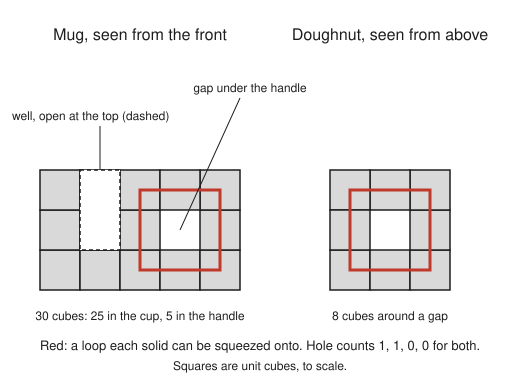

# Homotopy invariance: spaces you can deform into each other have identical hole counts

[Syllabus](../../../SYLLABUS.md) → [Topology](../README.md) → [Homology](../README.md#s05) → Homotopy invariance

---

## General Overview

Build a coffee mug from 30 unit cubes: a 3 × 3 × 3 cup with a well two cubes deep, open at the top, and a handle of 5 cubes. Build a doughnut from 8 cubes in a square ring. Topologists say the two are the same shape. This card proves that they have the same hole counts, and the proof never needs the mug's holes counted directly.

The direct route is long. Cut every cube into 6 tetrahedra and the mug has 80 corners, 340 edges, 440 triangles and 180 tetrahedra. Its hole counts need three boundary matrices reduced, the largest 340 rows by 440 columns ([Smith normal form](03-computing-homology-by-smith-normal-form.md)).

The short route squeezes. Push the cup's clay into the handle and thin the handle down, and the mug becomes a single closed loop of wire. Squeezing never tears and never glues, so it cannot create or destroy a hole. A loop is one piece with one hole through it. Hole counts are listed by dimension: pieces, loops, sealed pockets, then sealed 3-dimensional cavities, which no solid in ordinary space has. So the mug's hole counts are 1, 1, 0, 0, and the doughnut, which squeezes onto a loop too, has the same.

The same squeeze settles a solid ball at once. Pull every point of the ball straight towards its centre and the ball becomes a point. A point is one piece with no holes, so the ball's counts are 1, 0, 0, 0, with no matrix in sight.

**If one space can be squeezed into another and back, by continuous maps whose round trips slide back to doing nothing, the two have identical homology in every dimension; so a solid ball has the homology of a point, and a space has the homology of any part it can be shrunk onto.**

**What kind of fact this is:** a theorem. Its engine, the prism identity, is proved on this card in Why it works, and the finite version used by the code (collapsing a free face) is proved completely. The bridge from triangle-counting homology to homology that needs no triangulation is stated with a source, not proved.

### The picture: two solids and the loop each squeezes onto

<p align="center"></p>

Each square is one unit cube, drawn to scale. The mug is seen from the front, so its well, which sits in the middle layer of cubes, is drawn dashed. The red loops are drawn by hand to show where each solid can be squeezed; the code finds its own loops, of 8 and 6 corners.

---

## The formula

Words and marks first, each in one line.

- **Homology** $`H_k(X)`$ is the group of k-dimensional cycles in a space $`X`$ that are not boundaries ([Homology groups](02-homology-groups.md)). Its **Betti number** $`\beta_k`$ counts its independent holes, leaving out torsion: pieces for k = 0, loops for k = 1, sealed pockets for k = 2.
- A **homotopy** is a continuous film from one map to another ([Homotopy](../04-Homotopy/01-homotopy-and-homotopy-equivalence.md)). That card writes it $`H(x, t)`$; here the letter H belongs to homology, so the film is $`F(x, t)`$, with time $`t`$ running through $`I = [0, 1]`$.
- $`f \simeq g`$ says the maps f and g are joined by such a film. $`X \simeq Y`$ says the spaces are **homotopy equivalent**: there are maps $`f : X \to Y`$ and $`g : Y \to X`$ whose round trips, $`g \circ f`$ and $`f \circ g`$, are each joined by a film to the identity map, the map that leaves every point where it is.
- A continuous map $`f`$ pushes each simplex forward to a chain, written $`f_\#`$, and so sends cycles to cycles and boundaries to boundaries. The map it causes on homology is $`f_*`$. This works for singular chains, built from all continuous maps of simplices into the space (Step 7), not for the fixed triangles of one cutting; Steps 1 to 3 are about singular chains.

The theorem has two layers. Homotopic maps do the same thing to holes:

```math
f \simeq g \quad\Longrightarrow\quad f_* = g_*
```

**Read it aloud:** if one map slides continuously into another, the two send every hole to the same hole.

Then homotopy equivalent spaces have the same holes:

```math
X \simeq Y \quad\Longrightarrow\quad H_k(X) \cong H_k(Y) \ \text{ and } \ \beta_k(X) = \beta_k(Y) \ \text{ for every } k
```

**Read it aloud:** if two spaces squeeze into each other and back, their homology groups match in every dimension, and so do their hole counts.

The engine is one identity between chains. The **prism operator** $`P`$ takes a simplex to the solid prism its film sweeps out, cut into simplices. With $`\partial`$ the boundary:

```math
\partial P + P \partial = g_\# - f_\#
```

**Read it aloud:** the rim of the swept prism, plus the prism swept by the simplex's own rim, is the end copy minus the start copy.

Two uses do the card's job. A solid ball is homotopy equivalent to a point, so its counts are 1, 0, 0, 0. And if $`A`$ is a **deformation retract** of $`X`$ (a film shrinks $`X`$ onto $`A`$ while $`A`$ stays still), then $`H_k(A) \cong H_k(X)`$: the mug and a loop through its handle both read 1, 1, 0, 0.

| Symbol | Plain meaning | In our example | Push it up and the answer… |
| --- | --- | --- | --- |
| $`X`$, $`Y`$, $`A`$, $`r`$ | two spaces; a part $`A`$ that $`X`$ shrinks onto; the map $`r`$ sending each point to where the film leaves it | the mug, the doughnut; a loop of 8 corners in the mug | — |
| $`F(x, t)`$, $`t`$, $`I`$, $`c`$ | a homotopy at point $`x`$ and time $`t`$ in $`I = [0, 1]`$; $`c`$ a centre point | $`F(x, t) = (1 - t)\,x + t\,c`$ squeezes the block | — |
| $`\simeq`$ | homotopic maps, or homotopy equivalent spaces | mug $`\simeq`$ doughnut $`\simeq`$ loop | — |
| $`f`$, $`g`$, $`g \circ f`$, $`\mathrm{id}`$ | continuous maps; f then g; the identity map, leaving every point where it is | the start and end frames of a film | — |
| $`H_k`$, $`k`$ | homology in dimension $`k`$ | $`k`$ = 0, 1, 2, 3 for a solid | — |
| $`\beta_k`$ | Betti number: free counters in $`H_k`$, over the integers | mug: 1, 1, 0, 0 | a new handle adds 1 to $`\beta_1`$ |
| $`f_\#`$, $`f_*`$ | the map on chains; the map it causes on homology | the squeeze, sending each loop to a loop | — |
| $`\partial`$ | boundary: the signed sum of a simplex's faces | $`\partial[a, b] = [b] - [a]`$ | — |
| $`P`$ | prism operator: the chain swept by a film | an edge sweeps 2 triangles | — |
| $`\sigma`$, $`\tau`$, $`z`$ | a simplex; a free face of it, used by no other simplex; a cycle | a tetrahedron and its outer triangle | — |
| $`v_i`$, $`a`$, $`b`$, $`j`$ | vertices; $`j`$ a position in a vertex list | the corners of one tetrahedron | — |
| $`\chi`$ | Euler characteristic: simplices counted with signs $`+, -, +, -`$ | mug: 80 − 340 + 440 − 180 = 0 | — |

All counts here are over the integers. No space here has torsion (a cycle that is a boundary only when repeated), so the counts are the same over the rationals and over ℤ mod 2.

### When it holds

- **The change is a deformation, not a tear.** One side cube out of the doughnut cuts the loop: 1, 1, 0, 0 becomes 1, 0, 0, 0.
- **Maps go both ways, and both round trips slide back to the identity.** The doughnut maps continuously onto a point, but no map back undoes it: the point reads 1, 0, 0, 0.
- **A collapse removes a face that only one simplex uses.** The closed dome has no such face; deleting a panel anyway drops $`\beta_2`$ from 1 to 0.
- **Nothing is added.** A lid on the mug's well seals a pocket: 1, 1, 1, 0. The open well never counted, because it opens to the outside.

---

## Why it works

### Step 0: a cycle drags its own proof behind it

Run the squeeze as a film. A loop in the mug moves with the clay and sweeps out a tube. The tube's rim is the end loop minus the start loop. So that difference is a boundary, and boundaries do not count as holes: the two loops are the same hole. The steps below turn "sweeps out a tube" into algebra.

### Step 1: the prism operator

A k-simplex $`\sigma = [v_0, \dots, v_k]`$ moved through time $`I`$ sweeps a prism $`\sigma \times I`$. Name its bottom corners $`(v_i, 0)`$ and its top corners $`(v_i, 1)`$. The prism cuts into $`k + 1`$ simplices: the i-th climbs from the bottom to the top at corner $`v_i`$. With signs alternating:

```math
P\sigma = \sum_{i=0}^{k} (-1)^i \,\big[(v_0, 0), \dots, (v_i, 0), (v_i, 1), \dots, (v_k, 1)\big]
```

**Read it aloud:** the prism over a simplex is the alternating sum of the k + 1 simplices that step up from the bottom copy to the top copy at one corner each.

For an edge $`[a, b]`$ this is a square cut by its diagonal into 2 triangles: $`[(a,0),(a,1),(b,1)] - [(a,0),(b,0),(b,1)]`$. The film $`F`$ then carries the prism into the space: the image is the chain the simplex sweeps.

<details>
<summary>Detailed proof: the prism identity</summary>

Write $`\sigma`$ for $`[v_0, \dots, v_k]`$, $`\sigma \times 0`$ for its bottom copy and $`\sigma \times 1`$ for its top copy. The claim is

$`\displaystyle \partial P\sigma + P\partial\sigma = \sigma \times 1 - \sigma \times 0.`$

Take the boundary of each prism piece $`[(v_0, 0), \dots, (v_i, 0), (v_i, 1), \dots, (v_k, 1)]`$ by dropping one corner at a time, with the sign $`(-1)^j`$ of its position $`j`$. Three kinds of faces appear.

- **Dropping $`(v_i, 1)`$ from piece $`i`$ and $`(v_{i+1}, 0)`$ from piece $`i + 1`$.** Both leave $`[(v_0, 0), \dots, (v_i, 0), (v_{i+1}, 1), \dots, (v_k, 1)]`$, with signs −1 and +1, so they cancel. These are the inside walls where neighbouring pieces meet.
- **The two ends.** Dropping $`(v_0, 0)`$ from piece 0 leaves the top copy with sign +. Dropping $`(v_k, 1)`$ from piece $`k`$ leaves the bottom copy with sign $`(-1)^k (-1)^{k+1} = -1`$.
- **Every other face** drops some $`v_j`$ with $`j \ne i`$. It is a prism piece over the face of $`\sigma`$ without $`v_j`$: these faces add up to exactly $`-P\partial\sigma`$, the prism over the rim, with each sign the product of the two position signs.

So $`\partial P\sigma = \sigma \times 1 - \sigma \times 0 - P\partial\sigma`$, which is the claim. The code checks it as a chain identity on every one of the 320 simplices of the doughnut, coefficient by coefficient. Pushing everything forward by the film $`F`$ gives $`\partial P + P \partial = g_\# - f_\#`$ in the space, because pushing forward commutes with taking boundaries.

</details>

### Step 2: homotopic maps act the same on holes

Let $`z`$ be a cycle: $`\partial z = 0`$. Apply the identity to it:

```math
g_\# z - f_\# z = \partial P z + P \partial z = \partial (P z)
```

**Read it aloud:** the end image of a cycle minus its start image is the boundary of the tube it swept.

So $`g_\# z`$ and $`f_\# z`$ differ by a boundary and stand for the same class in homology: $`f_* = g_*`$. This is Step 0, in symbols.

### Step 3: equivalent spaces have matching homology

Pushing chains forward one map after another is the same as pushing by the combined map, so $`(g \circ f)_* = g_* \circ f_*`$, and the identity map causes the identity on homology. If $`g \circ f \simeq \mathrm{id}_X`$, Step 2 gives $`g_* \circ f_* = \mathrm{id}`$. If also $`f \circ g \simeq \mathrm{id}_Y`$, then $`f_* \circ g_* = \mathrm{id}`$. A map with an inverse on both sides is an isomorphism, so $`H_k(X) \cong H_k(Y)`$ for every k, and the Betti numbers match.

### Step 4: a solid ball has the homology of a point

The 3 × 3 × 3 block is **convex**: the straight segment between any two of its points stays inside it. So $`F(x, t) = (1 - t)\,x + t\,c`$, with $`c`$ the centre, never leaves the block. At $`t = 0`$ it is the identity; at $`t = 1`$ it sends everything to $`c`$. The point $`c`$ is a deformation retract of the block, so the block $`\simeq`$ a point.

A point is one piece and nothing else. So the block, with its 64 corners, 279 edges, 378 triangles and 162 tetrahedra, has $`\beta = (1, 0, 0, 0)`$. Every solid ball in every dimension, and every convex set, gets the same answer from the same film.

### Step 5: a deformation retract keeps every hole

If $`A`$ is a deformation retract of $`X`$, take $`f = r : X \to A`$ and $`g`$ the inclusion of $`A`$ in $`X`$. Then $`r \circ g`$ is the identity on $`A`$ exactly, and $`g \circ r`$ is the last frame of the film, joined by the film to the identity on $`X`$. By Step 3, $`H_k(A) \cong H_k(X)`$.

- **Doughnut.** The ring of cubes shrinks onto its middle loop: $`\beta = (1, 1, 0, 0)`$.
- **Mug.** The cup squeezes onto a short path joining the handle's two ends, and the handle thins to a wire; path and wire make one loop: $`\beta = (1, 1, 0, 0)`$.
- **Dome with 3 panels out.** The dome of [Euler characteristic](../03-Surfaces%20and%20Manifolds/04-euler-characteristic-and-triangulations.md) has 42 joints, 120 struts and 80 panels. With 3 panels out, it shrinks back from the gaps onto a frame of struts with 2 independent loops: $`\beta = (1, 2, 0)`$.

### Step 6: the finite version, proved in full

On a complex of simplices the squeeze can be done one step at a time. A face $`\tau`$ is **free** when exactly one simplex $`\sigma`$ of the complex has it as a face. An **elementary collapse** removes $`\tau`$ and $`\sigma`$ together. Geometrically, it pushes $`\sigma`$ in through the open face $`\tau`$: a deformation retraction. Algebraically, it is one Smith step with a pivot of 1.

<details>
<summary>Detailed proof: a collapse keeps the homology, torsion included</summary>

Say $`\sigma`$ has dimension $`k`$ and $`\tau`$ dimension $`k - 1`$. In the chain group $`C_{k-1}`$, replace the basis element $`\tau`$ by the chain $`\partial\sigma`$. This is allowed with whole numbers, because $`\tau`$ appears in $`\partial\sigma`$ with coefficient +1 or −1.

In the new basis the chains split in two.

- The small part is $`\sigma`$ in dimension $`k`$ and $`\partial\sigma`$ in dimension $`k - 1`$. The boundary sends $`\sigma`$ to $`\partial\sigma`$, one to one, and sends $`\partial\sigma`$ to 0, since a boundary's boundary is zero. This part has no homology.
- The rest is exactly the chains of the collapsed complex. No other $`k`$-simplex has $`\tau`$ as a face, because $`\tau`$ is free, so their boundaries never use $`\tau`$. No $`(k+1)`$-simplex has $`\sigma`$ as a face, since such a simplex would give $`\tau`$ a second user.

The homology of the whole is the homology of the rest, groups and torsion alike.

</details>

The code collapses each space until no free face is left. For the block, the mug, the doughnut and the open domes the core is a single vertex or a graph, whose counts are read by hand: pieces, then loops = edges − corners + pieces. Smith form on the full complexes agrees every time, as this step says it must. The closed dome stalls at a closed shell. The lidded mug stalls at a closed shell round its pocket, 20 corners, 54 edges and 36 triangles, plus a path of 6 bare edges through the handle with both ends on the shell. Smith form on both cores still matches.

### Step 7: from collapses to every continuous squeeze

Collapses only reach squeezes that run simplex by simplex. Steps 1 to 3 cover every continuous squeeze in **singular homology** ([Singular homology](09-singular-homology-and-excision.md)): the version built from all continuous maps of simplices into the space, which needs no triangulation. The prism argument works there word for word (Hatcher, Theorem 2.10).

One fact, stated here and not proved, links the two versions: **simplicial and singular homology agree** on any space cut into simplices (Hatcher, Theorem 2.27). [Eilenberg-Steenrod axioms](10-eilenberg-steenrod-axioms.md) gives the general reason: theories that obey the same five rules agree on cell complexes. That gives the claim promised on [Homology groups](02-homology-groups.md): two cuttings of one space give the same counts, because both equal the space's singular counts.

---

## Worked numbers, by hand

| Step | Arithmetic | Value |
| --- | --- | --- |
| solid block: 27 cubes, 6 tetrahedra each | 64 − 279 + 378 − 162 | $`\chi = 1`$ |
| squeeze it to its centre | convex, so straight lines stay inside | **1, 0, 0, 0** |
| mug: 25 cubes of cup, 5 of handle | 80 − 340 + 440 − 180 | $`\chi = 0`$ |
| collapse the mug | a loop of 8 corners and 8 edges: 8 − 8 + 1 | $`\beta_1 = 1`$ |
| doughnut: 8 cubes in a ring | 32 − 112 + 128 − 48 | $`\chi = 0`$ |
| collapse the doughnut | a loop of 6 corners and 6 edges: 6 − 6 + 1 | $`\beta_1 = 1`$ |
| mug and doughnut | both one piece, one loop, no pockets | **1, 1, 0, 0** |
| dome, 3 panels out | 42 − 120 + 77 | $`\chi = -1`$ |
| collapse the dome | 7 joints, 8 struts: 8 − 7 + 1 | **1, 2, 0** |
| cross-check each $`\chi`$ | 1 − 0 + 0 − 0, 1 − 1 + 0 − 0, 1 − 2 + 0 | 1, 0, −1 |

The mug and the doughnut, at 340 and 112 edges, read the same as a loop of wire: one piece with one hole through it, and nothing sealed inside.

### What breaks if you drop a piece

| Mistake | Comes out at | What went wrong |
| --- | --- | --- |
| Take one side cube out of the doughnut | 1, 0, 0, 0 instead of 1, 1, 0, 0 | Removing a cube cuts the ring: a tear, not a squeeze |
| Delete a panel from the closed dome and call it a collapse | $`\beta_2`$: 1 becomes 0 | No panel of a closed dome has a free edge; the hole lets the air out |
| Put a lid on the mug's well | 1, 1, 1, 0 instead of 1, 1, 0, 0 | A lid is new material: it seals a pocket, and collapsing stalls at a closed shell round it (20 corners, 54 edges, 36 triangles) plus 6 bare edges through the handle |

The code prints all three.

---

## Code, from first principles, and it actually runs

The scripts build every space from scratch: cubes cut into 6 tetrahedra along the main diagonal, and the dome as an icosahedron with each triangle cut into 4. They take four independent roads.

1. Smith form on the full boundary matrices.
2. Collapse free faces until none is left, then count the core by hand, and by its own Smith form.
3. The signed simplex count against the alternating sum of Betti numbers.
4. The prism identity of Step 1 on the prism over each of the doughnut's 320 simplices. The identity depends only on a simplex's dimension, so this checks every dimension from 0 to 3, exactly; it tests no squeeze of the doughnut itself, and the proof for every dimension is the fold in Step 1.

### Python

```python
# Homotopy invariance of homology -- the check behind the card.  Standard
# library only.  Solids are stacks of unit cubes, each cut into 6 tetrahedra
# along its main diagonal; the dome is an icosahedron with each face cut in 4.
# Road 1: hole counts from the full boundary matrices, by integer Smith form.
# Road 2: collapse the space onto a small core (a deformation), count by hand.
# Road 3: Euler characteristic, simplex counts against the alternating Betti sum.
# Road 4: the prism identity behind the proof, on every simplex of the doughnut.
from itertools import combinations, permutations

def closure(tops):                     # every face of every listed simplex
    return {f for s in tops for k in range(1, len(s) + 1) for f in combinations(s, k)}

def cubes(cells):                      # vertex (x, y, z) is numbered 100x + 10y + z
    return closure([(v, v + p[0], v + p[0] + p[1], v + 111) for x, y, z in cells
                    for v in [100 * x + 10 * y + z] for p in permutations((100, 10, 1))])

def facets(s):                         # (sign, face): drop vertex i, sign (-1)^i
    return [((-1) ** i, s[:i] + s[i + 1:]) for i in range(len(s))] if len(s) > 1 else []

def diagonal(a):                       # integer row and column moves to a diagonal
    piv = []
    while any(a):
        i, j = min(((i, j) for i, r in enumerate(a) for j in r), key=lambda e: abs(a[e[0]][e[1]]))
        p = a[i][j]
        for k, r in enumerate(a):      # clear column j by row moves
            if k != i and j in r:
                q = r[j] // p
                for c, v in a[i].items():
                    r[c] = r.get(c, 0) - q * v
                    if r[c] == 0: del r[c]
        if any(j in r for k, r in enumerate(a) if k != i): continue
        # column j is now clear: column moves leave remainders in row i
        rem = {c: v % p for c, v in a[i].items() if v % p}
        if rem: a[i] = {**rem, j: p}
        else: piv.append(abs(p)); a.pop(i)
    return piv

def homology(cx):                      # Betti numbers and torsion, over the integers
    top = max(len(s) for s in cx)
    by = [sorted(s for s in cx if len(s) == k + 1) for k in range(top)]
    idx = [{s: n for n, s in enumerate(b)} for b in by]
    rank, tors = [0] * (top + 1), []
    for k in range(1, top):            # boundary matrix from dimension k to k - 1
        rows = [{} for _ in by[k - 1]]
        for c, s in enumerate(by[k]):
            for sg, f in facets(s): rows[idx[k - 1][f]][c] = sg
        d = diagonal(rows)
        rank[k] = len(d); tors += [x for x in d if x > 1]
    return [len(b) for b in by], [len(by[k]) - rank[k] - rank[k + 1] for k in range(top)], tors

def collapse(cx):                      # remove a free face with its one coface, repeat
    cx, up = set(cx), {s: set() for s in cx}
    for s in cx:
        for _, f in facets(s): up[f].add(s)
    while free := [t for t in sorted(cx, key=lambda s: (len(s), s)) if len(up[t]) == 1][:1]:
        t = free[0]; s = up[t].pop()
        for x in (s, t):
            cx.discard(x)
            for _, f in facets(x): up[f].discard(x)
    return cx

def graph_betti(core):                 # a graph's counts by hand: pieces, E - V + pieces
    boss = {s[0]: s[0] for s in core if len(s) == 1}
    def find(v):
        return v if boss[v] == v else find(boss[v])
    for s in core:
        if len(s) == 2: boss[find(s[0])] = find(s[1])
    pieces = len({find(v) for v in boss})
    return [pieces, sum(len(s) == 2 for s in core) - len(boss) + pieces]

def chain_d(ch):                       # boundary of a chain {simplex: coefficient}
    out = {}
    for s, c in ch.items():
        for sg, f in facets(s): out[f] = out.get(f, 0) + sg * c
    return out

def prism_ok(cx):                      # d P + P d = top copy - bottom copy, every simplex
    P = lambda ch: {tuple((v, 0) for v in s[:i + 1]) + tuple((v, 1) for v in s[i:]): c * (-1) ** i
                    for s, c in ch.items() for i in range(len(s))}
    def plus(x, y):
        return {q: x.get(q, 0) + y.get(q, 0) for q in set(x) | set(y) if x.get(q, 0) + y.get(q, 0)}
    return all(plus(chain_d(P({s: 1})), P(chain_d({s: 1})))
               == {tuple((v, 1) for v in s): 1, tuple((v, 0) for v in s): -1} for s in cx)

def dome(out):                         # 42 joints, 120 struts, 80 panels; centres in out
    u, l, ico = (lambda i: 1 + i % 5), (lambda i: 6 + i % 5), []
    for i in range(5):
        ico += [(0, u(i), u(i + 1)), (u(i), u(i + 1), l(i)),
                (u(i + 1), l(i), l(i + 1)), (11, l(i), l(i + 1))]
    mid, kept, struts = {}, [], []
    m = lambda a, b: mid.setdefault((min(a, b), max(a, b)), 12 + len(mid))
    for n, (a, b, c) in enumerate(ico):
        ab, ac, bc = m(a, b), m(a, c), m(b, c)
        for t in [(a, ab, ac), (b, ab, bc), (c, ac, bc), (ab, ac, bc)]:
            t = tuple(sorted(t)); struts += combinations(t, 2)
            if not (n in out and t[0] >= 12): kept.append(t)
    return closure(kept + struts)

block = [(x, y, z) for x in range(3) for y in range(3) for z in range(3)]
cup = [c for c in block if c not in [(1, 1, 1), (1, 1, 2)]]       # a well 2 deep, open on top
handle = [(3, 1, 0), (4, 1, 0), (4, 1, 1), (4, 1, 2), (3, 1, 2)]  # gap at (3, 1, 1)
ring = [(x, y, 0) for x in range(3) for y in range(3) if (x, y) != (1, 1)]
lid = [(x, y, 3) for x in range(3) for y in range(3)]
spaces = [("solid block", cubes(block)), ("mug", cubes(cup + handle)),
          ("doughnut", cubes(ring)), ("dome, 3 panels out", dome({0, 14, 19})),
          ("doughnut cut", cubes([c for c in ring if c != (1, 0, 0)])),
          ("closed dome", dome(set())), ("dome, 1 panel out", dome({0})),
          ("mug with a lid", cubes(cup + handle + lid))]
print(f"cubes: block {len(block)}, mug {len(cup + handle)} (cup {len(cup)}, handle {len(handle)}), "
      f"doughnut {len(ring)}, lid {len(lid)}; each cut into {len(list(permutations('xyz')))} tetrahedra")
print("figure, cup x 0-3 z 0-3, well x 1-2 z 1-3, handle x 3-5 z 0-3, gap x 3-4 z 1-2; "
      "ring x 0-3 y 0-3, gap x 1-2 y 1-2")
res = {}
for name, cx in spaces:
    n, b, t = homology(cx)
    core = collapse(cx)
    cn = [sum(len(s) == k + 1 for s in core) for k in range(max(len(s) for s in core))]
    chi, alt = (sum((-1) ** k * x for k, x in enumerate(v)) for v in (n, b))
    res[name] = b
    print(f"{name}: simplices {n}, chi {chi}")
    print(f"  Smith: Betti {b}, alternating sum {alt}, torsion {t if t else 'none'}")
    if len(cn) <= 2:
        print(f"  collapsed core: V {cn[0]}, E {sum(cn[1:])}; pieces and loops by hand {graph_betti(core)}")
        assert graph_betti(core) == b[:2] and not any(b[2:])      # road 2 against road 1
    else:                              # split the core: triangles with their faces, then bare edges
        shell = closure([s for s in core if len(s) == 3])
        print(f"  collapse stalls at {cn}, no free face: a closed shell "
              f"{[sum(len(s) == k + 1 for s in shell) for k in range(3)]} and {sum(len(s) == 2 for s in core - shell)} bare edges")
    bc = homology(core)[1]                                        # the core's own Smith form
    assert bc + [0] * (len(b) - len(bc)) == b and chi == alt and not t   # roads 2, 3 against 1
ok = prism_ok(cubes(ring))
print(f"prism identity on all {len(cubes(ring))} doughnut simplices: {'holds' if ok else 'fails'}")
assert ok                                                         # road 4
assert res["solid block"] == [1, 0, 0, 0] and res["dome, 3 panels out"] == [1, 2, 0]
assert res["mug"] == res["doughnut"] == [1, 1, 0, 0] and res["doughnut cut"] == [1, 0, 0, 0]
assert res["closed dome"] == [1, 0, 1] and res["dome, 1 panel out"] == [1, 0, 0]
assert res["mug with a lid"] == [1, 1, 1, 0]
print("ALL CHECKS PASS")
```

**Ran 2026-11-15 on macOS, Python 3.14.10, standard library only. All checks passed. Output, pasted from the run:**

```
cubes: block 27, mug 30 (cup 25, handle 5), doughnut 8, lid 9; each cut into 6 tetrahedra
figure, cup x 0-3 z 0-3, well x 1-2 z 1-3, handle x 3-5 z 0-3, gap x 3-4 z 1-2; ring x 0-3 y 0-3, gap x 1-2 y 1-2
solid block: simplices [64, 279, 378, 162], chi 1
  Smith: Betti [1, 0, 0, 0], alternating sum 1, torsion none
  collapsed core: V 1, E 0; pieces and loops by hand [1, 0]
mug: simplices [80, 340, 440, 180], chi 0
  Smith: Betti [1, 1, 0, 0], alternating sum 0, torsion none
  collapsed core: V 8, E 8; pieces and loops by hand [1, 1]
doughnut: simplices [32, 112, 128, 48], chi 0
  Smith: Betti [1, 1, 0, 0], alternating sum 0, torsion none
  collapsed core: V 6, E 6; pieces and loops by hand [1, 1]
dome, 3 panels out: simplices [42, 120, 77], chi -1
  Smith: Betti [1, 2, 0], alternating sum -1, torsion none
  collapsed core: V 7, E 8; pieces and loops by hand [1, 2]
doughnut cut: simplices [32, 103, 114, 42], chi 1
  Smith: Betti [1, 0, 0, 0], alternating sum 1, torsion none
  collapsed core: V 1, E 0; pieces and loops by hand [1, 0]
closed dome: simplices [42, 120, 80], chi 2
  Smith: Betti [1, 0, 1], alternating sum 2, torsion none
  collapse stalls at [42, 120, 80], no free face: a closed shell [42, 120, 80] and 0 bare edges
dome, 1 panel out: simplices [42, 120, 79], chi 1
  Smith: Betti [1, 0, 0], alternating sum 1, torsion none
  collapsed core: V 1, E 0; pieces and loops by hand [1, 0]
mug with a lid: simplices [96, 423, 562, 234], chi 1
  Smith: Betti [1, 1, 1, 0], alternating sum 1, torsion none
  collapse stalls at [25, 60, 36], no free face: a closed shell [20, 54, 36] and 6 bare edges
prism identity on all 320 doughnut simplices: holds
ALL CHECKS PASS
```

### Rust

Same numbers, same labels, built with `rustc --edition 2021 -O`.

```rust
// Homotopy invariance of homology -- the same check as the Python, in Rust.
// No crates.  Solids are stacks of unit cubes, each cut into 6 tetrahedra
// along its main diagonal; the dome is an icosahedron with each face cut in 4.
// Road 1: hole counts from the full boundary matrices, by integer Smith form.
// Road 2: collapse the space onto a small core (a deformation), count by hand.
// Road 3: Euler characteristic, simplex counts against the alternating Betti sum.
// Road 4: the prism identity behind the proof, on every simplex of the doughnut.
use std::collections::{BTreeMap, BTreeSet};
type S = Vec<i64>;                                 // a simplex: its vertices in increasing order
type Cx = BTreeSet<S>;                             // a complex: a set of simplices
type Chain = BTreeMap<S, i64>; type Row = BTreeMap<usize, i64>;   // a chain; a sparse matrix row

fn closure(tops: &[S]) -> Cx {                     // every face of every listed simplex
    tops.iter().flat_map(|s| (1..1u32 << s.len())
        .map(move |m| (0..s.len()).filter(|i| m >> i & 1 == 1).map(|i| s[i]).collect())).collect()
}

fn cubes(cells: &[(i64, i64, i64)]) -> Cx {        // vertex (x, y, z) is 100x + 10y + z
    let perms = [[100, 10, 1], [100, 1, 10], [10, 100, 1], [10, 1, 100], [1, 100, 10], [1, 10, 100]];
    closure(&cells.iter().map(|&(x, y, z)| 100 * x + 10 * y + z)
        .flat_map(|v| perms.map(|p| vec![v, v + p[0], v + p[0] + p[1], v + 111])).collect::<Vec<_>>())
}

fn facets(s: &S) -> Vec<(i64, S)> {                // (sign, face): drop vertex i, sign (-1)^i
    (0..if s.len() < 2 { 0 } else { s.len() }).map(|i| { let mut f = s.clone(); f.remove(i); (1 - 2 * (i as i64 % 2), f) }).collect()
}

fn diagonal(mut a: Vec<Row>) -> Vec<i64> {         // integer row and column moves to a diagonal
    let mut piv = vec![];
    while a.iter().any(|r| !r.is_empty()) {
        let (mut i, mut j, mut best) = (0, 0, i64::MAX);
        for (k, r) in a.iter().enumerate() { for (&c, &v) in r { if v.abs() < best { (best, i, j) = (v.abs(), k, c) } } }
        let (p, row_i) = (a[i][&j], a[i].clone());
        for k in 0..a.len() {                      // clear column j by row moves
            if k == i || !a[k].contains_key(&j) { continue }
            let q = a[k][&j].div_euclid(p);
            for (c, v) in &row_i {
                let w = a[k].get(c).copied().unwrap_or(0).checked_sub(q.checked_mul(*v).unwrap()).unwrap();
                if w == 0 { a[k].remove(c); } else { a[k].insert(*c, w); }
            }
        }
        if a.iter().enumerate().any(|(k, r)| k != i && r.contains_key(&j)) { continue }
        // column j is now clear: column moves leave remainders in row i
        let mut rem: Row = row_i.iter().map(|(&c, &v)| (c, v.rem_euclid(p))).filter(|&(_, v)| v != 0).collect();
        if rem.is_empty() { piv.push(p.abs()); a.remove(i); } else { rem.insert(j, p); a[i] = rem; }
    }
    piv
}

fn homology(cx: &Cx) -> (Vec<i64>, Vec<i64>, Vec<i64>) {  // Betti numbers, counts, torsion
    let top = cx.iter().map(|s| s.len()).max().unwrap();
    let by: Vec<Vec<S>> = (0..top).map(|k| cx.iter().filter(|s| s.len() == k + 1).cloned().collect()).collect();
    let idx: Vec<BTreeMap<S, usize>> = by.iter().map(|b| b.iter().cloned().zip(0..).collect()).collect();
    let (mut rank, mut tors) = (vec![0i64; top + 1], vec![]);
    for k in 1..top {                              // boundary matrix from dimension k to k - 1
        let mut rows = vec![Row::new(); by[k - 1].len()];
        for (c, s) in by[k].iter().enumerate() { for (sg, f) in facets(s) { rows[idx[k - 1][&f]].insert(c, sg); } }
        let d = diagonal(rows);
        rank[k] = d.len() as i64; tors.extend(d.into_iter().filter(|&x| x > 1));
    }
    let n: Vec<i64> = by.iter().map(|b| b.len() as i64).collect();
    ((0..top).map(|k| n[k] - rank[k] - rank[k + 1]).collect(), n, tors)
}

fn collapse(cx: &Cx) -> Cx {                       // remove a free face with its one coface, repeat
    let (mut cx, mut up): (Cx, BTreeMap<S, Cx>) = (cx.clone(), cx.iter().map(|s| (s.clone(), Cx::new())).collect());
    for s in &cx { for (_, f) in facets(s) { up.get_mut(&f).unwrap().insert(s.clone()); } }
    loop {
        let Some(t) = cx.iter().filter(|t| up[*t].len() == 1).min_by_key(|t| (t.len(), (*t).clone())).cloned() else { return cx };
        let s = up[&t].iter().next().unwrap().clone();
        for x in [s, t] {
            cx.remove(&x);
            for (_, f) in facets(&x) { up.get_mut(&f).unwrap().remove(&x); }
        }
    }
}

fn graph_betti(core: &Cx) -> Vec<i64> {            // a graph's counts by hand: pieces, E - V + pieces
    fn find(b: &BTreeMap<i64, i64>, v: i64) -> i64 { if b[&v] == v { v } else { find(b, b[&v]) } }
    let mut boss: BTreeMap<i64, i64> = core.iter().filter(|s| s.len() == 1).map(|s| (s[0], s[0])).collect();
    let edges: Vec<&S> = core.iter().filter(|s| s.len() == 2).collect();   // join each edge's two ends
    for s in &edges { let (r, t) = (find(&boss, s[0]), find(&boss, s[1])); boss.insert(r, t); }
    let pieces = boss.keys().map(|&v| find(&boss, v)).collect::<BTreeSet<_>>().len() as i64;
    vec![pieces, edges.len() as i64 - boss.len() as i64 + pieces]
}

fn chain_d(ch: &Chain) -> Chain {                  // boundary of a chain {simplex: coefficient}
    let mut out = Chain::new();
    for (s, c) in ch { for (sg, f) in facets(s) { *out.entry(f).or_insert(0) += sg * c; } }
    out.retain(|_, c| *c != 0); out
}

fn prism(ch: &Chain) -> Chain {                    // vertex (v, t) of the cylinder is 2v + t
    let mut out = Chain::new();
    for (s, c) in ch { for i in 0..s.len() {
        let q: S = s[..=i].iter().map(|v| 2 * v).chain(s[i..].iter().map(|v| 2 * v + 1)).collect();
        *out.entry(q).or_insert(0) += c * (1 - 2 * (i as i64 % 2));
    } }
    out
}

fn prism_ok(cx: &Cx) -> bool {                     // d P + P d = top copy - bottom copy, every simplex
    cx.iter().all(|s| {
        let one: Chain = [(s.clone(), 1)].into_iter().collect();
        let mut lhs = chain_d(&prism(&one));
        for (q, c) in prism(&chain_d(&one)) { *lhs.entry(q).or_insert(0) += c; }
        lhs.retain(|_, c| *c != 0);
        lhs == [(s.iter().map(|v| 2 * v + 1).collect(), 1), (s.iter().map(|v| 2 * v).collect(), -1)].into()
    })
}

fn dome(out: &[usize]) -> Cx {                     // 42 joints, 120 struts, 80 panels; centres in out
    let (u, l, mut ico) = (|i: i64| 1 + i % 5, |i: i64| 6 + i % 5, vec![]);
    for i in 0..5 { ico.extend([[0, u(i), u(i + 1)], [u(i), u(i + 1), l(i)], [u(i + 1), l(i), l(i + 1)], [11, l(i), l(i + 1)]]) }
    let (mut mid, mut tops) = (BTreeMap::new(), vec![]);
    let mut m = |a: i64, b: i64| { let n = 12 + mid.len() as i64; *mid.entry((a.min(b), a.max(b))).or_insert(n) };
    for (n, [a, b, c]) in ico.into_iter().enumerate() {
        let (ab, ac, bc) = (m(a, b), m(a, c), m(b, c));
        for t in [[a, ab, ac], [b, ab, bc], [c, ac, bc], [ab, ac, bc]] {
            let mut t = t.to_vec(); t.sort();
            for (x, y) in [(0, 1), (0, 2), (1, 2)] { tops.push(vec![t[x], t[y]]) }
            if !(out.contains(&n) && t[0] >= 12) { tops.push(t) }
        }
    }
    closure(&tops)
}

fn main() {
    let block: Vec<(i64, i64, i64)> = (0..27).map(|n| (n / 9, n / 3 % 3, n % 3)).collect();
    let cup: Vec<_> = block.iter().copied().filter(|c| *c != (1, 1, 1) && *c != (1, 1, 2)).collect();
    let handle = vec![(3, 1, 0), (4, 1, 0), (4, 1, 1), (4, 1, 2), (3, 1, 2)];   // gap at (3, 1, 1)
    let mug = [cup.clone(), handle.clone()].concat();
    let ring: Vec<_> = (0..9).map(|n| (n / 3, n % 3, 0)).filter(|c| *c != (1, 1, 0)).collect();
    let (lid, cut): (Vec<_>, Vec<_>) = ((0..9).map(|n| (n / 3, n % 3, 3)).collect(), ring.iter().copied().filter(|c| *c != (1, 0, 0)).collect());
    let spaces: Vec<(&str, Cx)> = vec![("solid block", cubes(&block)), ("mug", cubes(&mug)),
        ("doughnut", cubes(&ring)), ("dome, 3 panels out", dome(&[0, 14, 19])),
        ("doughnut cut", cubes(&cut)), ("closed dome", dome(&[])), ("dome, 1 panel out", dome(&[0])),
        ("mug with a lid", cubes(&[mug.clone(), lid.clone()].concat()))];
    println!("cubes: block {}, mug {} (cup {}, handle {}), doughnut {}, lid {}; each cut into {} tetrahedra",
             block.len(), mug.len(), cup.len(), handle.len(), ring.len(), lid.len(), cubes(&block[..1]).iter().filter(|s| s.len() == 4).count());
    println!("figure, cup x 0-3 z 0-3, well x 1-2 z 1-3, handle x 3-5 z 0-3, gap x 3-4 z 1-2; ring x 0-3 y 0-3, gap x 1-2 y 1-2");
    let mut res: BTreeMap<&str, Vec<i64>> = BTreeMap::new();
    let alt = |v: &[i64]| v.iter().enumerate().map(|(k, x)| x * (1 - 2 * (k as i64 % 2))).sum::<i64>();
    for (name, cx) in &spaces {
        let (b, n, t) = homology(cx);
        let core = collapse(cx); let top = core.iter().map(|s| s.len()).max().unwrap();
        let cn: Vec<i64> = (0..top).map(|k| core.iter().filter(|s| s.len() == k + 1).count() as i64).collect();
        let (chi, al, tt) = (alt(&n), alt(&b), if t.is_empty() { "none".to_string() } else { format!("{:?}", t) });
        println!("{}: simplices {:?}, chi {}\n  Smith: Betti {:?}, alternating sum {}, torsion {}", name, n, chi, b, al, tt);
        if cn.len() <= 2 {
            let (gb, e) = (graph_betti(&core), cn[1..].iter().sum::<i64>());
            println!("  collapsed core: V {}, E {}; pieces and loops by hand {:?}", cn[0], e, gb);
            assert!(gb[..] == b[..2] && b[2..].iter().all(|&x| x == 0));   // road 2 against road 1
        } else {                                   // split the core: triangles with their faces, then bare edges
            let shell = closure(&core.iter().filter(|s| s.len() == 3).cloned().collect::<Vec<_>>());
            let sn: Vec<usize> = (1..4).map(|k| shell.iter().filter(|s| s.len() == k).count()).collect();
            println!("  collapse stalls at {:?}, no free face: a closed shell {:?} and {} bare edges", cn, sn,
                     core.difference(&shell).filter(|s| s.len() == 2).count());
        }
        let mut bc = homology(&core).0; bc.resize(b.len(), 0);            // the core's own Smith form
        assert!(bc == b && chi == al && t.is_empty());                     // roads 2, 3 against road 1
        res.insert(name, b);
    }
    let ok = prism_ok(&cubes(&ring));                                      // road 4, asserted below
    println!("prism identity on all {} doughnut simplices: {}", cubes(&ring).len(), if ok { "holds" } else { "fails" });
    assert!(ok && res["solid block"] == [1, 0, 0, 0] && res["dome, 3 panels out"] == [1, 2, 0]);
    assert!(res["mug"] == res["doughnut"] && res["doughnut"] == [1, 1, 0, 0] && res["doughnut cut"] == [1, 0, 0, 0]);
    assert!(res["closed dome"] == [1, 0, 1] && res["dome, 1 panel out"] == [1, 0, 0] && res["mug with a lid"] == [1, 1, 1, 0]);
    println!("ALL CHECKS PASS");
}
```

**Ran 2026-11-15 on macOS, rustc 1.98.1, no crates. All checks passed. Output, pasted from the run:**

```
cubes: block 27, mug 30 (cup 25, handle 5), doughnut 8, lid 9; each cut into 6 tetrahedra
figure, cup x 0-3 z 0-3, well x 1-2 z 1-3, handle x 3-5 z 0-3, gap x 3-4 z 1-2; ring x 0-3 y 0-3, gap x 1-2 y 1-2
solid block: simplices [64, 279, 378, 162], chi 1
  Smith: Betti [1, 0, 0, 0], alternating sum 1, torsion none
  collapsed core: V 1, E 0; pieces and loops by hand [1, 0]
mug: simplices [80, 340, 440, 180], chi 0
  Smith: Betti [1, 1, 0, 0], alternating sum 0, torsion none
  collapsed core: V 8, E 8; pieces and loops by hand [1, 1]
doughnut: simplices [32, 112, 128, 48], chi 0
  Smith: Betti [1, 1, 0, 0], alternating sum 0, torsion none
  collapsed core: V 6, E 6; pieces and loops by hand [1, 1]
dome, 3 panels out: simplices [42, 120, 77], chi -1
  Smith: Betti [1, 2, 0], alternating sum -1, torsion none
  collapsed core: V 7, E 8; pieces and loops by hand [1, 2]
doughnut cut: simplices [32, 103, 114, 42], chi 1
  Smith: Betti [1, 0, 0, 0], alternating sum 1, torsion none
  collapsed core: V 1, E 0; pieces and loops by hand [1, 0]
closed dome: simplices [42, 120, 80], chi 2
  Smith: Betti [1, 0, 1], alternating sum 2, torsion none
  collapse stalls at [42, 120, 80], no free face: a closed shell [42, 120, 80] and 0 bare edges
dome, 1 panel out: simplices [42, 120, 79], chi 1
  Smith: Betti [1, 0, 0], alternating sum 1, torsion none
  collapsed core: V 1, E 0; pieces and loops by hand [1, 0]
mug with a lid: simplices [96, 423, 562, 234], chi 1
  Smith: Betti [1, 1, 1, 0], alternating sum 1, torsion none
  collapse stalls at [25, 60, 36], no free face: a closed shell [20, 54, 36] and 6 bare edges
prism identity on all 320 doughnut simplices: holds
ALL CHECKS PASS
```

The two outputs match line for line.

### Lean

Lean proves Steps 2, 3 and 4 for singular homology over the integers, for every space and every dimension k.

- Suppose $`f \simeq g`$. Then $`f_* = g_*`$ in every dimension k.
- Suppose $`X \simeq Y`$. Then $`H_k(X) \cong H_k(Y)`$ and $`\beta_k(X) = \beta_k(Y)`$ for every k.
- Take a solid ball of any radius, in any dimension. Then it has the homology of a point in every dimension k.
- The worked numbers hold: each $`\chi`$ sum, each loop count and each cross-check.

The collapses, Smith form, the prism identity on the doughnut and the spaces' own hole counts are left to the Python and Rust checks.

```lean
-- Homotopy invariance: homotopy equivalent spaces have isomorphic integer singular homology and equal Betti numbers in every dimension.
import Mathlib.AlgebraicTopology.SingularHomology.HomotopyInvariance
import Mathlib.Algebra.Category.ModuleCat.Colimits
import Mathlib.Algebra.Category.ModuleCat.Abelian
import Mathlib.Topology.Homotopy.Equiv
import Mathlib.Analysis.InnerProductSpace.PiL2
import Mathlib.Analysis.Convex.Contractible

open CategoryTheory AlgebraicTopology

namespace HomotopyInvarianceOfHomology

/-- `H k X` is the `k`-th singular homology group of the space `X`, with integer coefficients. -/
noncomputable abbrev H (k : ℕ) (X : Type) [TopologicalSpace X] : ModuleCat ℤ :=
  ((singularHomologyFunctor (ModuleCat ℤ) k).obj (ModuleCat.of ℤ ℤ)).obj (TopCat.of X)

/-- `Hmap k f` is the map `f_*` that a continuous map `f` causes on `k`-th homology. -/
noncomputable abbrev Hmap (k : ℕ) {X Y : Type} [TopologicalSpace X] [TopologicalSpace Y]
    (f : C(X, Y)) : H k X ⟶ H k Y :=
  ((singularHomologyFunctor (ModuleCat ℤ) k).obj (ModuleCat.of ℤ ℤ)).map (TopCat.ofHom f)

/-- Helper: homotopic maps induce equal maps on singular homology (from Mathlib's
`TopCat.Homotopy.congr_homologyMap_singularChainComplexFunctor`). -/
theorem hmap_eq_of_homotopic_aux {X Y : Type} [TopologicalSpace X] [TopologicalSpace Y]
    {f g : C(X, Y)} (h : f.Homotopic g) (k : ℕ) :
    Hmap k f = Hmap k g := by
  obtain ⟨F⟩ := h
  exact TopCat.Homotopy.congr_homologyMap_singularChainComplexFunctor
    (f := TopCat.ofHom f) (g := TopCat.ofHom g) F (ModuleCat.of ℤ ℤ) k

#print axioms hmap_eq_of_homotopic_aux

/-- Homotopy invariance: if two spaces are homotopy equivalent (maps both ways whose round
trips are each homotopic to the identity), then their homology groups are isomorphic in every
dimension `k`, and so their Betti numbers (ranks over the integers) are equal. -/
theorem homology_iso_of_homotopy_equivalent {X Y : Type} [TopologicalSpace X]
    [TopologicalSpace Y] (e : ContinuousMap.HomotopyEquiv X Y) (k : ℕ) :
    Nonempty (H k X ≅ H k Y) ∧ Module.finrank ℤ (H k X) = Module.finrank ℤ (H k Y) := by
  let i : H k X ≅ H k Y :=
    { hom := Hmap k e.toFun
      inv := Hmap k e.invFun
      hom_inv_id := by
        rw [← Functor.map_comp, ← TopCat.ofHom_comp]
        exact (hmap_eq_of_homotopic_aux e.left_inv k).trans (CategoryTheory.Functor.map_id _ _)
      inv_hom_id := by
        rw [← Functor.map_comp, ← TopCat.ofHom_comp]
        exact (hmap_eq_of_homotopic_aux e.right_inv k).trans (CategoryTheory.Functor.map_id _ _) }
  exact ⟨⟨i⟩, i.toLinearEquiv.finrank_eq⟩

/-- Homotopic maps act the same on holes: if `f` and `g` are joined by a homotopy, then
`f_* = g_*` on homology in every dimension `k`. -/
theorem homologyMap_eq_of_homotopic {X Y : Type} [TopologicalSpace X] [TopologicalSpace Y]
    {f g : C(X, Y)} (h : f.Homotopic g) (k : ℕ) :
    Hmap k f = Hmap k g := by
  exact hmap_eq_of_homotopic_aux h k

/-- A solid ball has the homology of a point: the closed ball of any radius `r ≥ 0` in
`m`-dimensional Euclidean space has, in every dimension `k`, homology isomorphic to that of a
one-point space. -/
theorem homology_closedBall_iso_point (m : ℕ) {r : ℝ} (hr : 0 ≤ r) (k : ℕ) :
    Nonempty (H k (Metric.closedBall (0 : EuclideanSpace ℝ (Fin m)) r) ≅ H k PUnit) := by
  have hne : (Metric.closedBall (0 : EuclideanSpace ℝ (Fin m)) r).Nonempty :=
    ⟨0, Metric.mem_closedBall_self hr⟩
  have := (convex_closedBall (0 : EuclideanSpace ℝ (Fin m)) r).contractibleSpace hne
  obtain ⟨e⟩ := ContractibleSpace.hequiv_unit (Metric.closedBall (0 : EuclideanSpace ℝ (Fin m)) r)
  exact (homology_iso_of_homotopy_equivalent e k).1

/- The card's worked numbers. -/
-- Euler characteristic of the solid 3 × 3 × 3 block: 64 − 279 + 378 − 162 = 1.
example : (64 : ℤ) - 279 + 378 - 162 = 1 := by norm_num
-- Euler characteristic of the mug: 80 − 340 + 440 − 180 = 0.
example : (80 : ℤ) - 340 + 440 - 180 = 0 := by norm_num
-- Euler characteristic of the doughnut: 32 − 112 + 128 − 48 = 0.
example : (32 : ℤ) - 112 + 128 - 48 = 0 := by norm_num
-- Euler characteristic of the dome with 3 panels out: 42 − 120 + 77 = −1.
example : (42 : ℤ) - 120 + 77 = -1 := by norm_num
-- Loops of the collapsed cores, edges − corners + pieces: mug 8 − 8 + 1, doughnut 6 − 6 + 1,
-- dome 8 − 7 + 1.
example : (8 : ℤ) - 8 + 1 = 1 ∧ (6 : ℤ) - 6 + 1 = 1 ∧ (8 : ℤ) - 7 + 1 = 2 := by norm_num
-- Alternating Betti sums match: 1 − 0 + 0 − 0 = 1, 1 − 1 + 0 − 0 = 0, 1 − 2 + 0 = −1.
example : (1 : ℤ) - 0 + 0 - 0 = 1 ∧ (1 : ℤ) - 1 + 0 - 0 = 0 ∧ (1 : ℤ) - 2 + 0 = -1 := by norm_num

#print axioms homology_iso_of_homotopy_equivalent
#print axioms homologyMap_eq_of_homotopic
#print axioms homology_closedBall_iso_point

end HomotopyInvarianceOfHomology
```

**Checked 2026-11-15 on macOS, Lean 4.36.0-rc2, Mathlib v4.36.0-rc2. Every proof is complete and uses only Lean's standard axioms. Output, pasted from the run:**

```
'HomotopyInvarianceOfHomology.hmap_eq_of_homotopic_aux' depends on axioms: [propext, Classical.choice, Quot.sound]
'HomotopyInvarianceOfHomology.homology_iso_of_homotopy_equivalent' depends on axioms: [propext, Classical.choice, Quot.sound]
'HomotopyInvarianceOfHomology.homologyMap_eq_of_homotopic' depends on axioms: [propext, Classical.choice, Quot.sound]
'HomotopyInvarianceOfHomology.homology_closedBall_iso_point' depends on axioms: [propext, Classical.choice, Quot.sound]
```

> [!TIP]
> **Try changing**
> Guess first, then run the Python. The asserts are pinned to the card's spaces, so each change stops the program at an assert.
> - **Fill the handle's gap.** Add `(3, 1, 1)` to `handle`. The mug becomes a lump: 1, 0, 0, 0, and it no longer matches the doughnut.
> - **Open more of the dome.** Change `dome({0, 14, 19})` to `dome({0, 5, 10, 14, 19})`. Five panels out leaves 4 independent loops: 1, 4, 0.
> - **Add a second handle.** Add the 5 cubes `(-1, 1, 0), (-2, 1, 0), (-2, 1, 1), (-2, 1, 2), (-1, 1, 2)` to `handle`, a mirror handle on the far side. Two handles read 1, 2, 0, 0.
> - **Forget the signs.** In `facets`, change `(-1) ** i` to `1`. The boundary of a boundary is no longer zero: the block's Betti numbers come out negative, a long run of fake 2s appears as torsion, and the first assert stops it.

---

## The usual mistake

> [!warning]
> **Equal hole counts do not prove that two spaces squeeze into each other.** The theorem runs one way: a squeeze keeps the counts, but matching counts can hide a difference. The Poincaré homology sphere has every hole count of the ordinary three-dimensional sphere, yet it has loops that cannot be shrunk, so no squeeze joins the two. To prove two spaces the same, give the maps; to prove them different, give an invariant that differs.
>
> - **A tear is not a squeeze.** One side cube out of the doughnut leaves 1, 0, 0, 0, not 1, 1, 0, 0.
> - **A hole count is not a size.** The mug's core loop has 8 corners and the doughnut's has 6, yet each is one loop: $`\beta_1 = 1`$ for both.
> - **Dimension is not a hole count.** The block is three-dimensional and a point has dimension 0, yet both read 1, 0, 0, 0. Homotopy invariance ignores thickness.
> - **A stalled collapse is not a proof of a hole.** The lidded mug stalls at a shell around a real pocket. But some complexes, such as the dunce hat (a triangle with its three sides glued together, two the same way round and one reversed), have no free face at all and still have the counts of a point.

---

## Where you meet it in real life

- **Scans of porous rock.** A CT scan of a rock core is a huge block of voxels (tiny cubes). Software shrinks it by collapse-like steps to a small skeleton before counting the pores' loops and pockets; Robins, Wood and Sheppard, in Sources, build such a method for 3D images. The count is right because collapsing is a squeeze.
- **Computational homology software.** Programs that compute homology of large cubical data shrink the complex by collapses and other reductions first, and only then run Smith form on what is left ([Smith normal form](03-computing-homology-by-smith-normal-form.md)). Kaczynski, Mischaikow and Mrozek's book, in Sources, builds this from the start.
- **Data analysis.** Persistent homology, on shelf 06 of this wing, builds shapes from data points. By the nerve theorem, the Čech complex is homotopy equivalent to the union of balls round the points ([Vietoris-Rips, Cech and alpha complexes](../06-Topological%20Data%20Analysis/02-vietoris-rips-and-cech-complexes.md)). So by this card the two have the same hole counts, and the finite complex can be counted instead of the balls.

> **Say it back**
> A squeeze that can be undone up to a slide cannot create or destroy a hole, so homotopy equivalent spaces have the same homology in every dimension. The reason is the prism: a cycle sweeps a tube as it moves, and the tube's rim shows that the end cycle and the start cycle differ by a boundary. A solid ball squeezes to a point, so its counts are 1, 0, 0, 0 without computing anything. A space shrunk onto a part has that part's counts: the 30-cube mug and the 8-cube doughnut both shrink onto a loop and read 1, 1, 0, 0. Tearing, deleting and gluing change the counts; squeezing never does.

---

## What this builds on

- [Homotopy](../04-Homotopy/01-homotopy-and-homotopy-equivalence.md): homotopy, homotopy equivalence and deformation retracts, with the straight-line squeeze of a disc to its centre.
- [Smith normal form](03-computing-homology-by-smith-normal-form.md): the whole-number reduction that computes the full counts on road 1, and whose pivot-1 step is a collapse.
- [Homology groups](02-homology-groups.md): cycles modulo boundaries, and $`\beta_k`$ as the number of k-simplices minus the ranks of the two boundary matrices beside them.
- [Simplicial complexes and chains](01-simplicial-complexes-and-chains.md): simplices, signed boundaries, and the fact that a boundary's boundary is zero.
- [Euler characteristic](../03-Surfaces%20and%20Manifolds/04-euler-characteristic-and-triangulations.md): the 42-joint dome, and the signed count that road 3 checks.

## Where this goes next

- [Cellular homology](05-cellular-homology.md): counts read off a handful of cells, trusted because of invariance.
- [Mayer-Vietoris and exact sequences](06-mayer-vietoris-and-long-exact-sequences.md): the counts of a whole from two overlapping pieces, each first squeezed to something simple.
- [Homology of spheres, and degree](07-homology-of-spheres-and-degree.md): every sphere's counts, and maps between spheres told apart by what they do to holes.
- [Cohomology and the cup product in outline](08-cohomology-and-cup-product-in-outline.md): a finer invariant, also unchanged by squeezing.
- [Singular homology](09-singular-homology-and-excision.md): hole counts for any space, with no triangulation, and excision proved.

Equal counts leave the question this card cannot answer: when two spaces share every hole count, what finer invariant tells whether they really squeeze into each other?

---

## Sources

Verified 2026-11-15: every link below resolves to the publisher's page, except Hatcher's author page, which carries the full text, and every DOI was checked against Crossref.

- Hatcher, Allen. *Algebraic Topology*. Cambridge University Press, 2002. [Author's page, with the free edition](https://pi.math.cornell.edu/~hatcher/AT/ATpage.html). Theorem 2.10 and Corollary 2.11 prove homotopy invariance by the prism operator; Theorem 2.27 shows simplicial and singular homology agree.
- Whitehead, J. H. C. "Simplicial spaces, nuclei and m-groups." *Proceedings of the London Mathematical Society* s2-45 (1939). [doi:10.1112/plms/s2-45.1.243](https://doi.org/10.1112/plms/s2-45.1.243). Introduces elementary collapses, the finite squeeze of Step 6.
- Kaczynski, Tomasz, Konstantin Mischaikow, and Marian Mrozek. *Computational Homology*. Springer, 2004. [doi:10.1007/b97315](https://doi.org/10.1007/b97315). Homology of cubical data, computed by reductions and Smith form.
- Robins, V., P. J. Wood, and A. P. Sheppard. "Theory and algorithms for constructing discrete Morse complexes from grayscale digital images." *IEEE Transactions on Pattern Analysis and Machine Intelligence* 33, no. 8 (2011). [doi:10.1109/TPAMI.2011.95](https://doi.org/10.1109/TPAMI.2011.95). Pairs cells of a 3D image as collapses do, shrinking it before its homology is computed.
