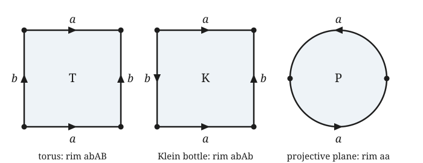

# Cellular homology: hole counts read straight off the gluing recipe, quick by hand

[Syllabus](../../../SYLLABUS.md) → [Topology](../README.md) → [Homology](../README.md#s05) → Cellular homology

---

## General Overview

Picture an old arcade game. A ship that flies off the right edge of the screen comes back on the left. A ship that flies off the top comes back at the bottom. The screen is one square with its opposite edges glued: a torus, the surface of an inner tube.

The ship has two kinds of loop it cannot shrink away. It can fly right until it comes home, or fly up until it comes home. Any other closed flight path is built from those two. So the screen has **two independent loops**.

Homology counts such loops, and the holes of every other dimension, with linear algebra ([Homology groups](02-homology-groups.md)). The usual route cuts the surface into triangles first. A 3 × 3 grid of triangles on the torus uses 9 corners, 27 edges and 18 triangles, and two boundary matrices with 729 entries between them.

Cellular homology skips the triangles. It reads the answer straight off the gluing recipe: one point, two edges, one square, and the word the square's rim spells as it is glued. Its two boundary matrices have 4 entries between them, all zero. The answer is the same: two independent loops.

**Cellular homology gives each cell of a gluing recipe one generator, sets each boundary number to the signed count of times a cell's rim runs along a cell one dimension down, and gets the same homology as any triangulation, with far less arithmetic.**

**What kind of fact this is:** a theorem. Two parts are proved on this card: the letter count is the number of times a rim wraps round an edge, and the boundary it gives is zero when applied twice. That this count is the right boundary, so the groups agree with triangle homology, is stated with its key steps and a named source, since its full proof needs the exact sequences of a later card. The code checks the agreement on three surfaces, which illustrates it and does not prove it.

### The picture: three recipes, one square or disc each

<p align="center"></p>

Schematic, not to scale. Edges with the same letter are glued so their arrows match. Left: the torus, with both pairs of arrows parallel. Middle: the Klein bottle, with one pair of arrows opposed. Right: the projective plane, a disc whose rim runs twice round one edge $`a`$. In each recipe all the corners become one point.

---

## The formula

Notation first, in words. A **CW complex** $`X`$ is a space built by gluing cells in order of dimension: points, then edges, then discs, each rim glued onto what is already there ([CW complexes](../04-Homotopy/07-cw-complexes-and-gluing-cells.md)). An **n-cell** $`e`$ is one of the n-dimensional pieces, and $`c_n`$ is how many there are.

An edge word lists the edges a rim runs along, in order. A capital letter runs the edge backwards: $`A`$ is $`a^{-1}`$. The torus rim is $`abAB`$, which is $`a\,b\,a^{-1}b^{-1}`$.

The **cellular chains** $`C_n(X)`$ are whole-number combinations of the n-cells, such as $`3a - b`$. So $`C_n(X)`$ is $`\mathbb{Z}^{c_n}`$, one coordinate per cell. The **cellular boundary** $`d_n`$ sends each n-cell to a combination of (n−1)-cells:

```math
d_n(e) = \sum_{f} [e:f]\, f, \qquad [e:a] = (\text{times } a \text{ appears in the rim of } e) - (\text{times } A \text{ appears})
```

**Read it aloud:** the boundary of a cell is the sum of the cells one dimension down, each counted by how many times, net of direction, the rim runs along it.

For an edge, the boundary is its end point minus its start point. The **homology** is then computed exactly as for triangles: cycles over boundaries.

```math
H_n(X) = \frac{Z_n}{B_n} = \frac{\ker d_n}{\mathrm{im}\, d_{n+1}}
```

**Read it aloud:** the n-dimensional holes are the chains with no boundary, counted up to chains that are themselves boundaries.

For the arcade torus, every boundary number is zero, so nothing is a boundary and every chain is a cycle:

```math
0 \longrightarrow \mathbb{Z} \xrightarrow{\;d_2 = 0\;} \mathbb{Z}^2 \xrightarrow{\;d_1 = 0\;} \mathbb{Z} \longrightarrow 0
```

Read from left: one square, two edges, one point. So $`H_2 = \mathbb{Z}`$, $`H_1 = \mathbb{Z}^2`$ and $`H_0 = \mathbb{Z}`$.

| Symbol | Plain meaning | In our example | Push it up and the answer… |
| --- | --- | --- | --- |
| $`X`$ | the space, as a gluing recipe | the screen, glued into a torus | — |
| $`e`$, $`f`$; $`v`$, $`T`$, $`K`$, $`P`$ | cells: $`e`$ one dimension above $`f`$; the named cells: the point, then the torus, Klein bottle and projective plane 2-cells | the square $`T`$; the edges $`a`$, $`b`$; the point $`v`$ | — |
| $`a`$, $`b`$; $`A`$, $`B`$ | the edges; the same edges run backwards | fly right; fly up | — |
| $`c_n`$ | the number of n-cells | 1, 2, 1 | more cells, bigger matrices, same homology |
| $`C_n(X)`$ | whole-number combinations of n-cells | $`\mathbb{Z}^2`$ in dimension 1 | — |
| $`d_n`$ | the cellular boundary, a matrix | $`d_1 = d_2 = 0`$ | nonzero entries kill holes |
| $`[e:f]`$ | incidence number: net times the rim of $`e`$ runs along $`f`$ | $`[T:a] = 1 - 1 = 0`$ | a ±1 cancels a hole; a 2 leaves torsion |
| $`Z_n`$, $`B_n`$ | cycles (no boundary); boundaries (rims of something) | $`Z_1 = \mathbb{Z}^2`$, $`B_1 = 0`$ | — |
| $`H_n(X)`$ | homology: cycles counted up to boundaries | $`H_1 = \mathbb{Z}^2`$ | — |
| $`\beta_n`$ | Betti number: the rank of $`H_n`$, coefficients named: $`\mathbb{Z}`$ whole numbers, $`\mathbb{Q}`$ fractions, $`\mathbb{Z}/2`$ integers mod 2 | $`\beta_1 = 2`$ over $`\mathbb{Q}`$ | one more independent hole |
| $`\mathbb{Z}/2`$ | the integers mod 2; inside $`H_1`$ it is torsion: a cycle that is no boundary, though twice it is | none on the torus; one on the Klein bottle | — |
| $`\chi`$ | Euler characteristic: cells counted with signs + − + | 1 − 2 + 1 = 0 | — |

### When it holds

- **Each rim lands in the cells below it.** That is what makes $`X`$ a CW complex. A rim glued across the inside of another disc has no letter count, and the rule says nothing.
- **Signs follow the arrows.** Each cell gets a direction, and a capital letter counts −1. Drop the signs and the torus square gets boundary $`2a + 2b`$, which wrongly kills the torus's $`H_2`$.
- **The letter count is for discs glued along edge words.** A higher cell's incidence number is a degree, the net number of times one sphere wraps round another ([Homology of spheres, and degree](07-homology-of-spheres-and-degree.md)). The cube of the 3-torus below is the easy case: its faces come in pairs with opposite signs.
- **The coefficients are named.** Over the whole numbers, the rationals and the integers mod 2 the Klein bottle gives three different answers. A Betti number without its coefficients is not an answer.

---

## Why it works

### Step 0: the answer does not care how finely the space is cut

Homology belongs to the space, not to the triangles drawn on it: spaces that deform into each other have the same homology ([Homotopy invariance](04-homotopy-invariance-of-homology.md)). The torus cut into 18 triangles and the torus cut into a finer grid give the same groups.

So cut as coarsely as possible. Use one cell for each piece that adds a new dimension, and keep only the bookkeeping that matters: which lower cells each rim runs along, and in which direction.

### Step 1: each n-cell gives one generator

Take all the cells up to dimension n − 1, the (n−1)-skeleton, and crush them to a single point. Each n-cell's rim now sits on that point, so each n-cell closes up into its own n-sphere.

An n-sphere has exactly one hole, in dimension n ([Homology of spheres, and degree](07-homology-of-spheres-and-degree.md)). So each n-cell contributes one copy of $`\mathbb{Z}`$, and $`C_n(X) = \mathbb{Z}^{c_n}`$. For the torus that is 1, 2 and 1 copies.

### Step 2: the boundary number is how often the rim wraps

Now crush every edge except $`a`$. The edge $`a`$ becomes a circle, and the square's rim becomes a loop on that circle. Its net number of turns is the incidence number $`[T:a]`$.

Each letter $`a`$ in the rim is one turn forwards; each $`A`$ is one turn back. The torus rim $`abAB`$ has one of each, so $`[T:a] = 1 - 1 = 0`$, and likewise $`[T:b] = 0`$. The Klein bottle rim $`abAb`$ has $`b`$ twice and $`B`$ never, so $`[K:b] = 2`$.

### Step 3: the boundary of a boundary is zero

Homology needs $`d_{n-1} d_n = 0`$, or the cycles would not contain the boundaries. For a disc glued along an edge word this is a short proof: the rim is a closed walk, so the steps' ends and starts cancel.

<details>
<summary>Detailed proof: d₁ d₂ = 0 for a disc glued along an edge word</summary>

Write the rim as steps $`s_1, s_2, \dots, s_m`$, each an edge run forwards or backwards. Step $`s_i`$ starts at a point $`p_{i-1}`$ and ends at $`p_i`$. The rim is closed, so $`p_m = p_0`$.

By the letter rule, $`d_2(e)`$ is the sum of the edges with signs, one term per step. Applying $`d_1`$ to an edge gives its end minus its start, and a backward step swaps them. So step $`s_i`$ contributes $`p_i - p_{i-1}`$ whichever way it runs.

$`\displaystyle d_1 d_2(e) = \sum_{i=1}^{m} (p_i - p_{i-1}) = p_m - p_0 = 0.`$

The sum telescopes: each middle point is added once and taken away once. The code checks $`d_1 d_2 = 0`$ on all three surfaces, cellular and triangulated.

</details>

### Step 4: the cellular groups are the true homology groups

**The theorem.** For a CW complex, the homology of the cellular chains equals the homology of any triangulation of the same space (and its singular homology, the version defined for every space).

Its proof has three key steps, given in full in Hatcher, *Algebraic Topology*, section 2.2:

1. Crushing the (n−1)-cells shows that the pair "cells up to n, cells up to n − 1" has homology only in dimension n, free on the n-cells (Step 1).
2. A long exact sequence, the tool of the card [Mayer-Vietoris and exact sequences](06-mayer-vietoris-and-long-exact-sequences.md), links these pairs one dimension to the next. Chasing it shows the holes of $`X`$ are cycles of $`d`$ modulo boundaries of $`d`$.
3. The connecting map in that sequence is the degree count of Step 2.

This card does not prove steps 2 and 3. The code checks the theorem's conclusion on the torus, the Klein bottle and the projective plane: on all three the 4-entry cellular matrices and the full triangle matrices give identical groups.

### Step 5: the Euler characteristic two ways

The alternating cell count equals the alternating Betti sum, over any field of coefficients, such as $`\mathbb{Q}`$ or $`\mathbb{Z}/2`$:

```math
\chi = c_0 - c_1 + c_2 = \beta_0 - \beta_1 + \beta_2
```

So $`\chi`$ can be read off the recipe without any matrix: torus 1 − 2 + 1 = 0, projective plane 1 − 1 + 1 = 1.

With Step 4, this also shows that $`\chi`$ belongs to the space, not to the cells chosen: the Betti numbers do not change with the recipe, so neither does their alternating sum. That is the fact the [CW complexes](../04-Homotopy/07-cw-complexes-and-gluing-cells.md) card leaves to this one.

<details>
<summary>Detailed proof: cells and Betti numbers give the same χ</summary>

Over a field, write $`r_n`$ for the rank of $`d_n`$. Rank–nullity on $`d_n`$ says the cycles have dimension $`c_n - r_n`$. The boundaries have dimension $`r_{n+1}`$. So:

$`\displaystyle \beta_n = c_n - r_n - r_{n+1}.`$

Take the alternating sum over n. Each $`r_n`$ appears twice, once from $`\beta_n`$ and once from $`\beta_{n-1}`$, with opposite signs, so every rank cancels and only the cell counts are left. The code checks this over $`\mathbb{Q}`$ and over $`\mathbb{Z}/2`$ for all three surfaces.

</details>

---

## Worked numbers, by hand

All three recipes have one point $`v`$, so every edge starts and ends at $`v`$ and $`d_1 = 0`$ throughout.

| Step | Arithmetic | Value |
| --- | --- | --- |
| torus cells | point $`v`$; edges $`a`$, $`b`$; square $`T`$ | 1, 2, 1 |
| $`d_1(a)`$, $`d_1(b)`$ | end minus start: $`v - v`$ | 0, 0 |
| $`[T:a]`$, $`[T:b]`$ | rim $`abAB`$: 1 − 1 each | 0, 0 |
| torus $`H_0`$ | $`\mathbb{Z}`$ over nothing | $`\mathbb{Z}`$ |
| torus $`H_1`$ | $`\mathbb{Z}^2`$ (both edges are cycles) over $`d_2`$'s image, 0 | **$`\mathbb{Z}^2`$: two independent loops** |
| torus $`H_2`$ | $`T`$ has boundary 0, nothing above it | $`\mathbb{Z}`$ |
| Klein bottle, $`[K:a]`$, $`[K:b]`$ | rim $`abAb`$: $`a`$ 1 − 1; $`b`$ 2 − 0 | 0, 2 |
| Klein bottle $`H_1`$ | $`\mathbb{Z}^2`$ over the multiples of $`2b`$ | $`\mathbb{Z} \oplus \mathbb{Z}/2`$ |
| Klein bottle $`H_2`$ | $`d_2(K) = 2b`$, so no nonzero multiple of $`K`$ has boundary 0 | 0 |
| projective plane, $`[P:a]`$ | rim $`aa`$: 2 − 0 | 2 |
| projective plane $`H_1`$, $`H_2`$ | $`\mathbb{Z}`$ over the even numbers; $`P \mapsto 2a`$ | $`\mathbb{Z}/2`$, 0 |

The torus screen has **two independent loops**, fly right and fly up, and one closed surface, the square itself.

On the Klein bottle the loop $`b`$ is not a boundary, but twice round it is: $`2b`$ is the rim of $`K`$. That half-surviving loop is the torsion $`\mathbb{Z}/2`$. The same happens to $`a`$ on the projective plane.

The Betti numbers depend on the coefficients, because a 2 in a matrix is a unit over $`\mathbb{Q}`$ and a zero over $`\mathbb{Z}/2`$:

| Space | Over the whole numbers | $`\beta_0, \beta_1, \beta_2`$ over $`\mathbb{Q}`$ | over $`\mathbb{Z}/2`$ | $`\chi`$ |
| --- | --- | --- | --- | --- |
| torus | $`\mathbb{Z}`$, $`\mathbb{Z}^2`$, $`\mathbb{Z}`$ | 1, 2, 1 | 1, 2, 1 | 0 |
| Klein bottle | $`\mathbb{Z}`$, $`\mathbb{Z} \oplus \mathbb{Z}/2`$, 0 | 1, 1, 0 | 1, 2, 1 | 0 |
| projective plane | $`\mathbb{Z}`$, $`\mathbb{Z}/2`$, 0 | 1, 0, 0 | 1, 1, 1 | 1 |

Reading the torsion off a bigger matrix is the job of [Smith normal form](03-computing-homology-by-smith-normal-form.md). Here each $`d_2`$ is one column, so the torsion is the greatest common divisor of the column's entries, when that is above 1: 2 for the Klein bottle's (0, 2).

### What breaks if you drop a piece

| Mistake | Comes out at | What went wrong |
| --- | --- | --- |
| Torus letters counted without signs | $`d_2 = 2a + 2b`$; $`H_1 = \mathbb{Z} \oplus \mathbb{Z}/2`$, $`H_2 = 0`$ | The boundary must cancel $`a`$ against $`A`$; the torus has a $`\mathbb{Z}`$ in $`H_2`$ |
| Klein bottle by rank alone | $`H_1`$ rank 1 | Rank over $`\mathbb{Q}`$ cannot see the torsion $`\mathbb{Z}/2`$ |
| Klein bottle cells read as Betti numbers | 1, 2, 1 | Over $`\mathbb{Q}`$ the holes are 1, 1, 0; the 2 in $`d_2`$ kills one loop and the surface |
| Torus with the square left out | $`H_2 = 0`$, $`\chi = -1`$ | That is the figure eight: two loops, no surface |

The code prints all four.

---

## Code, from first principles, and it actually runs

Nothing is imported that knows any homology. The code takes three independent roads to each surface's groups.

1. **Cellular.** It reads the boundary matrices straight off the recipe, by the signed letter count.
2. **Simplicial.** It triangulates the same surface (a 3 × 3 grid for the torus and the Klein bottle, the standard 6-point triangulation for the projective plane) and builds the full signed boundary matrices.
3. **Euler characteristic.** It counts cells with signs and compares with the alternating Betti sums over $`\mathbb{Q}`$ and over $`\mathbb{Z}/2`$.

Both matrix roads are reduced by an integer Smith form written out in the code. The mod 2 ranks use a separate elimination on sorted lists of rows. The run also does the 3-torus from one cube and prints the four mistakes.

### Python

```python
# Cellular homology -- the check behind the card.  Standard library only.
# Road 1 reads the boundary matrices straight off each gluing recipe: a letter
# is a cell, a capital runs it backwards, and a cell's boundary number is the
# signed count of its letters.  Road 2 cuts the same surface into triangles and
# builds the full simplicial boundary matrices.  Both are reduced by an integer
# Smith form written out here; Betti numbers are redone mod 2 and checked
# against the Euler characteristic, counted from cells.
from itertools import combinations

def smith(M):                              # nonzero diagonal of the Smith form
    A, out = [r[:] for r in M if any(r)], []
    while A and any(any(r) for r in A):
        while True:
            i, j = min(((i, j) for i, r in enumerate(A) for j, x in enumerate(r) if x),
                       key=lambda t: abs(A[t[0]][t[1]]))
            A[0], A[i] = A[i], A[0]
            for r in A:
                r[0], r[j] = r[j], r[0]
            p, done = A[0][0], True
            for r in A[1:]:                # clear the column under the pivot
                q = r[0] // p
                r[:] = [x - q * y for x, y in zip(r, A[0])]
                done = done and r[0] == 0
            for k in range(1, len(A[0])):  # clear the row beside the pivot
                q = A[0][k] // p
                for r in A:
                    r[k] -= q * r[0]
                done = done and A[0][k] == 0
            bad = [r for r in A[1:] if any(x % p for x in r[1:])]
            if done and bad:               # pivot must divide the rest
                A[0] = [x + y for x, y in zip(A[0], bad[0])]
                done = False
            if done:
                break
        out.append(abs(A[0][0]))
        A = [r[1:] for r in A[1:] if any(r[1:])]
    return out

def rank2(M):                              # rank mod 2, columns as sorted lists of odd rows
    low, r = {}, 0
    for c in [sorted(i for i in range(len(M)) if M[i][j] % 2) for j in range(len(M[0]) if M else 0)]:
        while c and c[-1] in low:
            c = sorted(set(c) ^ set(low[c[-1]]))
        if c:
            low[c[-1]], r = c, r + 1
    return r

def homology(cells, D):                    # D[n] has rows (n-1)-cells, columns n-cells
    top, sm = len(cells) - 1, {n: smith(D[n]) for n in D}
    rk = lambda n: len(sm[n]) if n in sm else 0
    r2 = lambda n: rank2(D[n]) if n in D else 0
    H = [(cells[n] - rk(n) - rk(n + 1), [t for t in sm.get(n + 1, []) if t > 1]) for n in range(top + 1)]
    return H, [cells[n] - r2(n) - r2(n + 1) for n in range(top + 1)]

def cellular(V, E, rims, signed=True):     # rims[n]: n-cell name -> rim word, n >= 2
    D = {1: [[(v == E[e][1]) - (v == E[e][0]) for e in E] for v in V]}
    for n, cells in sorted(rims.items()):
        below = list(E) if n == 2 else list(rims[n - 1])
        D[n] = [[w.count(f) + (-1 if signed else 1) * w.count(f.upper()) for w in cells.values()]
                for f in below]
    return [len(V), len(E)] + [len(rims[n]) for n in sorted(rims)], D

def simplicial(tris):                      # closure of the triangles, signed (-1)^i
    K = [sorted({f for t in tris for f in combinations(sorted(t), k)}) for k in (1, 2, 3)]
    D = {}
    for k in (1, 2):
        row = {s: i for i, s in enumerate(K[k - 1])}
        D[k] = [[0] * len(K[k]) for _ in K[k - 1]]
        for j, s in enumerate(K[k]):
            for i in range(k + 1):
                D[k][row[s[:i] + s[i + 1:]]][j] = (-1) ** i
    assert all(sum(set(e) <= set(t) for t in K[2]) == 2 for e in K[1])  # a closed surface
    assert all(sum(a * b for a, b in zip(r, col)) == 0 for r in D[1] for col in zip(*D[2]))
    return [len(x) for x in K], D

def grid(n, flip):                         # n x n grid, right edge glued to left (flipped or not)
    def v(i, j):
        if i == n:
            i, j = 0, (-j if flip else j)
        return (i % n) * n + j % n
    return [t for i in range(n) for j in range(n) for t in
            ((v(i, j), v(i + 1, j), v(i + 1, j + 1)), (v(i, j), v(i, j + 1), v(i + 1, j + 1)))]

rp2_tris = [(0, 1, 2), (0, 2, 3), (0, 3, 4), (0, 4, 5), (0, 5, 1),
            (1, 2, 4), (2, 3, 5), (3, 4, 1), (4, 5, 2), (5, 1, 3)]
v1, ab = ["v"], {"a": ("v", "v"), "b": ("v", "v")}
xyz = {"x": ("v", "v"), "y": ("v", "v"), "z": ("v", "v")}
recipes = [("torus, 1 square, rim abAB", v1, ab, {2: {"T": "abAB"}}, grid(3, False)),
           ("klein bottle, 1 square, rim abAb", v1, ab, {2: {"K": "abAb"}}, grid(3, True)),
           ("projective plane, 1 disc, rim aa", v1, {"a": ("v", "v")}, {2: {"P": "aa"}}, rp2_tris)]
fmt = lambda H: "; ".join(f"H{n}: rank {r}, torsion {t}" for n, (r, t) in enumerate(H))
chi = lambda c: sum((-1) ** n * x for n, x in enumerate(c))
results = []
print("road 1, cellular: cells per dimension and boundary matrices")
for label, V, E, rims, tris in recipes:
    c, D = cellular(V, E, rims)
    dd = [[sum(D[1][i][k] * D[2][k][j] for k in range(len(E))) for j in range(c[2])] for i in range(c[0])]
    print(f"{label}: cells {c}; d1 = {D[1]}; d2 = {D[2]}; d1 d2 = {dd}")
    results.append((label.split(",")[0], c, D, homology(c, D), simplicial(tris)))
print("homology over the integers, cellular (road 1) and simplicial (road 2):")
for name, c, D, (H, B2), (s, SD) in results:
    sH, sB2 = homology(s, SD)
    qb = [r for r, _ in H]
    print(f"{name}: {fmt(H)}")
    print(f"  triangles: {s[0]} vertices, {s[1]} edges, {s[2]} triangles; "
          f"same groups: {'yes' if sH == H else 'no'}")
    print(f"  matrix entries: cellular {c[0] * c[1] + c[1] * c[2]}, simplicial {s[0] * s[1] + s[1] * s[2]}")
    print(f"  Betti over Q {qb}, over Z mod 2 {B2}; chi from cells {chi(c)}, from triangles "
          f"{chi(s)}, from Betti over Q {chi(qb)}, over Z mod 2 {chi(B2)}")
    assert sH == H and sB2 == B2 and chi(c) == chi(s) == chi(qb) == chi(B2)
c3, D3 = cellular(v1, xyz, {2: {"p": "xyXY", "q": "xzXZ", "r": "yzYZ"}, 3: {"C": "pPqQrR"}})
H3, _ = homology(c3, D3)
print(f"3-torus, 1 cube, opposite faces glued: cells {c3}; d3 = {D3[3]}; Betti over Q {[r for r, _ in H3]}")
cu, Du = cellular(v1, ab, {2: {"T": "abAB"}}, signed=False)
Hu, _ = homology(cu, Du)
Hk = results[1][3][0]
c8, D8 = cellular(v1, ab, {})
H8, _ = homology(c8, D8)
print(f"mistake 1, torus with signs dropped: d2 = {Du[2]}; {fmt(Hu)}")
print(f"mistake 2, klein bottle by rank alone: H1 rank {Hk[1][0]}, the torsion {Hk[1][1]} unseen")
print(f"mistake 3, klein bottle cells {results[1][1]} read as Betti numbers; over Q they are {[r for r, _ in Hk]}")
print(f"mistake 4, torus with the square left out: {fmt(H8)}; chi {chi(c8)}")
print("figure, schematic: torus square (40, 50) side 160; klein square (260, 50) side 160; "
      "disc centre (560, 130) radius 80")
T, K, P = (r[3][0] for r in results)
assert T == [(1, []), (2, []), (1, [])] and K == [(1, []), (1, [2]), (0, [])] and P == [(1, []), (0, [2]), (0, [])]
assert [b for b in (r[3][1] for r in results)] == [[1, 2, 1], [1, 2, 1], [1, 1, 1]]
assert [r for r, _ in H3] == [1, 3, 3, 1] and Hu == [(1, []), (1, [2]), (0, [])] and H8 == [(1, []), (2, [])]
assert smith([[2, 4], [6, 8]]) == [2, 4] and smith([[0, 2], [3, 0]]) == [1, 6]
print("ALL CHECKS PASS")
```

**Ran 2026-11-15 on macOS, Python 3.14.10, standard library only. All checks passed. Output, pasted from the run:**

```
road 1, cellular: cells per dimension and boundary matrices
torus, 1 square, rim abAB: cells [1, 2, 1]; d1 = [[0, 0]]; d2 = [[0], [0]]; d1 d2 = [[0]]
klein bottle, 1 square, rim abAb: cells [1, 2, 1]; d1 = [[0, 0]]; d2 = [[0], [2]]; d1 d2 = [[0]]
projective plane, 1 disc, rim aa: cells [1, 1, 1]; d1 = [[0]]; d2 = [[2]]; d1 d2 = [[0]]
homology over the integers, cellular (road 1) and simplicial (road 2):
torus: H0: rank 1, torsion []; H1: rank 2, torsion []; H2: rank 1, torsion []
  triangles: 9 vertices, 27 edges, 18 triangles; same groups: yes
  matrix entries: cellular 4, simplicial 729
  Betti over Q [1, 2, 1], over Z mod 2 [1, 2, 1]; chi from cells 0, from triangles 0, from Betti over Q 0, over Z mod 2 0
klein bottle: H0: rank 1, torsion []; H1: rank 1, torsion [2]; H2: rank 0, torsion []
  triangles: 9 vertices, 27 edges, 18 triangles; same groups: yes
  matrix entries: cellular 4, simplicial 729
  Betti over Q [1, 1, 0], over Z mod 2 [1, 2, 1]; chi from cells 0, from triangles 0, from Betti over Q 0, over Z mod 2 0
projective plane: H0: rank 1, torsion []; H1: rank 0, torsion [2]; H2: rank 0, torsion []
  triangles: 6 vertices, 15 edges, 10 triangles; same groups: yes
  matrix entries: cellular 2, simplicial 240
  Betti over Q [1, 0, 0], over Z mod 2 [1, 1, 1]; chi from cells 1, from triangles 1, from Betti over Q 1, over Z mod 2 1
3-torus, 1 cube, opposite faces glued: cells [1, 3, 3, 1]; d3 = [[0], [0], [0]]; Betti over Q [1, 3, 3, 1]
mistake 1, torus with signs dropped: d2 = [[2], [2]]; H0: rank 1, torsion []; H1: rank 1, torsion [2]; H2: rank 0, torsion []
mistake 2, klein bottle by rank alone: H1 rank 1, the torsion [2] unseen
mistake 3, klein bottle cells [1, 2, 1] read as Betti numbers; over Q they are [1, 1, 0]
mistake 4, torus with the square left out: H0: rank 1, torsion []; H1: rank 2, torsion []; chi -1
figure, schematic: torus square (40, 50) side 160; klein square (260, 50) side 160; disc centre (560, 130) radius 80
ALL CHECKS PASS
```

### Rust

Same numbers, same labels, built with `rustc --edition 2021 -O`.

```rust
// Cellular homology -- the same check as the Python, in Rust.  No crates.
// Road 1 reads the boundary matrices straight off each gluing recipe: a letter
// is a cell, a capital runs it backwards, and a cell's boundary number is the
// signed count of its letters.  Road 2 cuts the same surface into triangles and
// builds the full simplicial boundary matrices.  Both are reduced by an integer
// Smith form written out here; Betti numbers are redone mod 2 and checked
// against the Euler characteristic, counted from cells.
use std::collections::{BTreeMap, BTreeSet};
type Mat = Vec<Vec<i64>>;
type Hom = Vec<(i64, Vec<i64>)>;

fn smith(m: &Mat) -> Vec<i64> {                // nonzero diagonal of the Smith form
    let (mut a, mut out): (Mat, Vec<i64>) = (m.iter().filter(|r| r.iter().any(|&x| x != 0)).cloned().collect(), vec![]);
    while a.iter().any(|r| r.iter().any(|&x| x != 0)) {
        loop {
            let (mut bi, mut bj, mut best) = (0, 0, i64::MAX);
            for (i, r) in a.iter().enumerate() {
                for (j, &x) in r.iter().enumerate() {
                    if x != 0 && x.abs() < best { (bi, bj, best) = (i, j, x.abs()) }
                }
            }
            a.swap(0, bi);
            for r in a.iter_mut() { r.swap(0, bj) }
            let (p, mut done, top) = (a[0][0], true, a[0].clone());
            for r in a.iter_mut().skip(1) {    // clear the column under the pivot
                let q = r[0].div_euclid(p);
                for (x, y) in r.iter_mut().zip(&top) { *x -= q * y }
                done = done && r[0] == 0;
            }
            for k in 1..a[0].len() {           // clear the row beside the pivot
                let q = a[0][k].div_euclid(p);
                for r in a.iter_mut() { r[k] -= q * r[0] }
                done = done && a[0][k] == 0;
            }
            let bad: Vec<Vec<i64>> = a.iter().skip(1).filter(|r| r.iter().skip(1).any(|x| x % p != 0)).cloned().collect();
            if done && !bad.is_empty() {       // pivot must divide the rest
                for (x, y) in a[0].iter_mut().zip(&bad[0]) { *x += y }
                done = false;
            }
            if done { break }
        }
        out.push(a[0][0].abs());
        a = a.iter().skip(1).map(|r| r[1..].to_vec()).filter(|r| r.iter().any(|&x| x != 0)).collect();
    }
    out
}

fn rank2(m: &Mat) -> i64 {                     // rank mod 2, columns as sorted lists of odd rows
    let (mut low, mut r): (BTreeMap<usize, BTreeSet<usize>>, i64) = (BTreeMap::new(), 0);
    for j in 0..m.first().map_or(0, |x| x.len()) {
        let mut c: BTreeSet<usize> = (0..m.len()).filter(|&i| m[i][j] % 2 != 0).collect();
        while let Some(&l) = c.iter().next_back() {
            match low.get(&l) { Some(o) => c = c.symmetric_difference(o).copied().collect(), None => break }
        }
        if let Some(&l) = c.iter().next_back() { low.insert(l, c); r += 1 }
    }
    r
}

fn homology(cells: &[i64], d: &BTreeMap<usize, Mat>) -> (Hom, Vec<i64>) {
    let sm: BTreeMap<usize, Vec<i64>> = d.iter().map(|(&n, m)| (n, smith(m))).collect();
    let rk = |n: usize| sm.get(&n).map_or(0, |v| v.len() as i64);
    let r2 = |n: usize| d.get(&n).map_or(0, rank2);
    let h = (0..cells.len()).map(|n| (cells[n] - rk(n) - rk(n + 1),
        sm.get(&(n + 1)).map_or(vec![], |v| v.iter().copied().filter(|&t| t > 1).collect()))).collect();
    (h, (0..cells.len()).map(|n| cells[n] - r2(n) - r2(n + 1)).collect())
}

fn count(w: &str, c: char) -> i64 { w.chars().filter(|&x| x == c).count() as i64 }

fn cellular(nv: usize, e: &[(char, usize, usize)], rims: &[Vec<(char, &str)>], signed: bool) -> (Vec<i64>, BTreeMap<usize, Mat>) {
    let mut d = BTreeMap::new();          // rims[0]: 2-cells, rims[1]: 3-cells, each a name and rim word
    d.insert(1, (0..nv).map(|v| e.iter().map(|&(_, t, h)| (v == h) as i64 - (v == t) as i64).collect()).collect());
    for (k, cells) in rims.iter().enumerate() {
        let below: Vec<char> = if k == 0 { e.iter().map(|x| x.0).collect() } else { rims[k - 1].iter().map(|x| x.0).collect() };
        let s = if signed { -1 } else { 1 };
        d.insert(k + 2, below.iter().map(|&f| cells.iter().map(|&(_, w)|
            count(w, f) + s * count(w, f.to_ascii_uppercase())).collect()).collect());
    }
    (vec![nv as i64, e.len() as i64].into_iter().chain(rims.iter().map(|r| r.len() as i64)).collect(), d)
}

fn simplicial(tris: &[[usize; 3]]) -> (Vec<i64>, BTreeMap<usize, Mat>) {
    let mut k: Vec<BTreeSet<Vec<usize>>> = vec![BTreeSet::new(); 3];   // closure, signed (-1)^i
    for t in tris {
        let mut s = t.to_vec(); s.sort();
        for (a, i) in s.iter().enumerate() { k[0].insert(vec![*i]); for b in &s[a + 1..] { k[1].insert(vec![*i, *b]); } }
        k[2].insert(s);
    }
    let k: Vec<Vec<Vec<usize>>> = k.into_iter().map(|x| x.into_iter().collect()).collect();
    let mut d = BTreeMap::new();
    for n in 1..3 {
        let mut m = vec![vec![0i64; k[n].len()]; k[n - 1].len()];
        for (j, s) in k[n].iter().enumerate() {
            for i in 0..=n {
                let mut f = s.clone(); f.remove(i);
                m[k[n - 1].iter().position(|x| *x == f).unwrap()][j] = if i % 2 == 0 { 1 } else { -1 };
            }
        }
        d.insert(n, m);
    }
    assert!(k[1].iter().all(|e| k[2].iter().filter(|t| e.iter().all(|v| t.contains(v))).count() == 2));
    assert!(d[&1].iter().all(|r| (0..k[2].len()).all(|j| r.iter().zip(&d[&2]).map(|(a, row)| a * row[j]).sum::<i64>() == 0)));
    (k.iter().map(|x| x.len() as i64).collect(), d)
}

fn grid(n: i64, flip: bool) -> Vec<[usize; 3]> {   // n x n grid, right edge glued to left
    let v = |i: i64, j: i64| -> usize {
        let (i, j) = if i == n { (0, if flip { -j } else { j }) } else { (i, j) };
        (i.rem_euclid(n) * n + j.rem_euclid(n)) as usize
    };
    let mut out = vec![];
    for i in 0..n { for j in 0..n { out.extend([[v(i, j), v(i + 1, j), v(i + 1, j + 1)], [v(i, j), v(i, j + 1), v(i + 1, j + 1)]]) } }
    out
}

fn fmt(h: &Hom) -> String {
    h.iter().enumerate().map(|(n, (r, t))| format!("H{}: rank {}, torsion {:?}", n, r, t)).collect::<Vec<_>>().join("; ")
}
fn chi(c: &[i64]) -> i64 { c.iter().enumerate().map(|(n, x)| if n % 2 == 0 { *x } else { -x }).sum() }

fn main() {
    let rp2 = vec![[0, 1, 2], [0, 2, 3], [0, 3, 4], [0, 4, 5], [0, 5, 1], [1, 2, 4], [2, 3, 5], [3, 4, 1], [4, 5, 2], [5, 1, 3]];
    let ab = [('a', 0, 0), ('b', 0, 0)];
    let recipes: Vec<(&str, Vec<(char, usize, usize)>, Vec<Vec<(char, &str)>>, Vec<[usize; 3]>)> = vec![
        ("torus, 1 square, rim abAB", ab.to_vec(), vec![vec![('T', "abAB")]], grid(3, false)),
        ("klein bottle, 1 square, rim abAb", ab.to_vec(), vec![vec![('K', "abAb")]], grid(3, true)),
        ("projective plane, 1 disc, rim aa", vec![('a', 0, 0)], vec![vec![('P', "aa")]], rp2)];
    let mut results = vec![];
    println!("road 1, cellular: cells per dimension and boundary matrices");
    for (label, e, rims, tris) in &recipes {
        let (c, d) = cellular(1, e, rims, true);
        let dd: Mat = (0..c[0] as usize).map(|i| (0..c[2] as usize).map(|j|
            (0..e.len()).map(|k| d[&1][i][k] * d[&2][k][j]).sum()).collect()).collect();
        println!("{}: cells {:?}; d1 = {:?}; d2 = {:?}; d1 d2 = {:?}", label, c, d[&1], d[&2], dd);
        results.push((label.split(',').next().unwrap(), c.clone(), homology(&c, &d), simplicial(tris)));
    }
    println!("homology over the integers, cellular (road 1) and simplicial (road 2):");
    for (name, c, (h, b2), (s, sd)) in &results {
        let (sh, sb2) = homology(s, sd);
        let qb: Vec<i64> = h.iter().map(|x| x.0).collect();
        println!("{}: {}", name, fmt(h));
        println!("  triangles: {} vertices, {} edges, {} triangles; same groups: {}", s[0], s[1], s[2], if sh == *h { "yes" } else { "no" });
        println!("  matrix entries: cellular {}, simplicial {}", c[0] * c[1] + c[1] * c[2], s[0] * s[1] + s[1] * s[2]);
        println!("  Betti over Q {:?}, over Z mod 2 {:?}; chi from cells {}, from triangles {}, from Betti over Q {}, over Z mod 2 {}",
                 qb, b2, chi(c), chi(s), chi(&qb), chi(b2));
        assert!(sh == *h && sb2 == *b2 && chi(c) == chi(s) && chi(s) == chi(&qb) && chi(&qb) == chi(b2));
    }
    let xyz = [('x', 0, 0), ('y', 0, 0), ('z', 0, 0)];
    let (c3, d3) = cellular(1, &xyz, &[vec![('p', "xyXY"), ('q', "xzXZ"), ('r', "yzYZ")], vec![('C', "pPqQrR")]], true);
    let h3: Vec<i64> = homology(&c3, &d3).0.iter().map(|x| x.0).collect();
    println!("3-torus, 1 cube, opposite faces glued: cells {:?}; d3 = {:?}; Betti over Q {:?}", c3, d3[&3], h3);
    let (cu, du) = cellular(1, &ab, &[vec![('T', "abAB")]], false);
    let (c8, d8) = cellular(1, &ab, &[], true);
    let (hu, hk, h8) = (homology(&cu, &du).0, &results[1].2 .0, homology(&c8, &d8).0);
    println!("mistake 1, torus with signs dropped: d2 = {:?}; {}", du[&2], fmt(&hu));
    println!("mistake 2, klein bottle by rank alone: H1 rank {}, the torsion {:?} unseen", hk[1].0, hk[1].1);
    println!("mistake 3, klein bottle cells {:?} read as Betti numbers; over Q they are {:?}", results[1].1, hk.iter().map(|x| x.0).collect::<Vec<_>>());
    println!("mistake 4, torus with the square left out: {}; chi {}", fmt(&h8), chi(&c8));
    println!("figure, schematic: torus square (40, 50) side 160; klein square (260, 50) side 160; disc centre (560, 130) radius 80");
    let hs: Vec<&Hom> = results.iter().map(|r| &r.2 .0).collect();
    assert!(*hs[0] == vec![(1, vec![]), (2, vec![]), (1, vec![])] && *hs[1] == vec![(1, vec![]), (1, vec![2]), (0, vec![])]
        && *hs[2] == vec![(1, vec![]), (0, vec![2]), (0, vec![])]);
    assert!(results.iter().map(|r| r.2 .1.clone()).collect::<Vec<_>>() == vec![vec![1, 2, 1], vec![1, 2, 1], vec![1, 1, 1]]);
    assert!(h3 == vec![1, 3, 3, 1] && hu == vec![(1, vec![]), (1, vec![2]), (0, vec![])] && h8 == vec![(1, vec![]), (2, vec![])]);
    assert!(smith(&vec![vec![2, 4], vec![6, 8]]) == vec![2, 4] && smith(&vec![vec![0, 2], vec![3, 0]]) == vec![1, 6]);
    println!("ALL CHECKS PASS");
}
```

**Ran 2026-11-15 on macOS, rustc 1.98.1, no crates. All checks passed. Output, pasted from the run:**

```
road 1, cellular: cells per dimension and boundary matrices
torus, 1 square, rim abAB: cells [1, 2, 1]; d1 = [[0, 0]]; d2 = [[0], [0]]; d1 d2 = [[0]]
klein bottle, 1 square, rim abAb: cells [1, 2, 1]; d1 = [[0, 0]]; d2 = [[0], [2]]; d1 d2 = [[0]]
projective plane, 1 disc, rim aa: cells [1, 1, 1]; d1 = [[0]]; d2 = [[2]]; d1 d2 = [[0]]
homology over the integers, cellular (road 1) and simplicial (road 2):
torus: H0: rank 1, torsion []; H1: rank 2, torsion []; H2: rank 1, torsion []
  triangles: 9 vertices, 27 edges, 18 triangles; same groups: yes
  matrix entries: cellular 4, simplicial 729
  Betti over Q [1, 2, 1], over Z mod 2 [1, 2, 1]; chi from cells 0, from triangles 0, from Betti over Q 0, over Z mod 2 0
klein bottle: H0: rank 1, torsion []; H1: rank 1, torsion [2]; H2: rank 0, torsion []
  triangles: 9 vertices, 27 edges, 18 triangles; same groups: yes
  matrix entries: cellular 4, simplicial 729
  Betti over Q [1, 1, 0], over Z mod 2 [1, 2, 1]; chi from cells 0, from triangles 0, from Betti over Q 0, over Z mod 2 0
projective plane: H0: rank 1, torsion []; H1: rank 0, torsion [2]; H2: rank 0, torsion []
  triangles: 6 vertices, 15 edges, 10 triangles; same groups: yes
  matrix entries: cellular 2, simplicial 240
  Betti over Q [1, 0, 0], over Z mod 2 [1, 1, 1]; chi from cells 1, from triangles 1, from Betti over Q 1, over Z mod 2 1
3-torus, 1 cube, opposite faces glued: cells [1, 3, 3, 1]; d3 = [[0], [0], [0]]; Betti over Q [1, 3, 3, 1]
mistake 1, torus with signs dropped: d2 = [[2], [2]]; H0: rank 1, torsion []; H1: rank 1, torsion [2]; H2: rank 0, torsion []
mistake 2, klein bottle by rank alone: H1 rank 1, the torsion [2] unseen
mistake 3, klein bottle cells [1, 2, 1] read as Betti numbers; over Q they are [1, 1, 0]
mistake 4, torus with the square left out: H0: rank 1, torsion []; H1: rank 2, torsion []; chi -1
figure, schematic: torus square (40, 50) side 160; klein square (260, 50) side 160; disc centre (560, 130) radius 80
ALL CHECKS PASS
```

The two outputs match line for line.

### Lean

Lean proves the boundary of a boundary is zero, $`\chi`$ two ways up to dimension 2, and the Klein bottle's groups.

- Suppose each 2-cell's rim is a closed walk along the edges, with each capital letter counted −1. Then $`d_1 d_2 = 0`$.
- Take any field of coefficients and cells up to dimension 2, with $`d_1 d_2 = 0`$. Then $`c_0 - c_1 + c_2 = \beta_0 - \beta_1 + \beta_2`$.
- Take the Klein bottle recipe, one point, two edges and one square with rim $`abAb`$. Then $`H_1 = \mathbb{Z} \oplus \mathbb{Z}/2`$ and $`H_2 = 0`$.
- The worked numbers check too: all three rims are closed, $`d_1 = 0`$, and every incidence number in the table is right.

The torus and projective plane groups, the triangle road, the Smith form and the 3-torus are left to the Python and Rust checks.

```lean
-- Cellular homology: the signed letter count of closed rims gives boundary matrices with d₁ d₂ = 0, cells and Betti numbers over a field give the same Euler characteristic, and the Klein bottle's recipe abAb gives H₁ = ℤ ⊕ ℤ/2 and H₂ = 0.
import Mathlib.LinearAlgebra.Matrix.ToLin
import Mathlib.LinearAlgebra.Quotient.Basic
import Mathlib.LinearAlgebra.Dimension.Finrank
import Mathlib.LinearAlgebra.FiniteDimensional.Defs
import Mathlib.Data.ZMod.Defs
import Mathlib.Data.List.Count
import Mathlib.Tactic.NormNum
import Mathlib.Data.List.Rotate
import Mathlib.LinearAlgebra.Isomorphisms
import Mathlib.LinearAlgebra.FiniteDimensional.Lemmas
import Mathlib.Data.ZMod.Basic

namespace CellularHomology

variable {V E ι : Type*}

/-- One step of a rim: an edge and its direction, `true` for a small letter (run forwards)
and `false` for a capital letter (run backwards). -/
abbrev Step (E : Type*) := E × Bool

/-- The point where a step starts: the edge's start if run forwards, its end if run backwards. -/
def stepStart (src tgt : E → V) (s : Step E) : V := if s.2 then src s.1 else tgt s.1

/-- The point where a step ends: the edge's end if run forwards, its start if run backwards. -/
def stepEnd (src tgt : E → V) (s : Step E) : V := if s.2 then tgt s.1 else src s.1

/-- A rim lands in the cells below it: its edge word is a closed walk, each step starting
where the one before it ended, and the last step ending where the first one started. -/
def IsClosedRim (src tgt : E → V) (w : List (Step E)) : Prop :=
  ∀ i (hi : i < w.length),
    stepEnd src tgt w[i] =
      stepStart src tgt (w[(i + 1) % w.length]'(Nat.mod_lt _ (Nat.zero_lt_of_lt hi)))

/-- The incidence number `[e : f]` read off the rim word `w` of a 2-cell `e`: the number of
times the letter `f` appears minus the number of times its capital appears. -/
def incidence [DecidableEq E] (w : List (Step E)) (f : E) : ℤ :=
  (w.count (f, true) : ℤ) - (w.count (f, false) : ℤ)

/-- The cellular boundary `d₁`: an edge's boundary is its end point minus its start point.
Rows are the points, columns the edges. -/
def d1 [DecidableEq V] (src tgt : E → V) : Matrix V E ℤ :=
  fun v e => (if tgt e = v then 1 else 0) - (if src e = v then 1 else 0)

/-- The cellular boundary `d₂`: the entry in row `f`, column `c` is the incidence number of
the 2-cell `c` along the edge `f`, by the signed letter count. -/
def d2 [DecidableEq E] (rim : ι → List (Step E)) : Matrix E ι ℤ :=
  fun f c => incidence (rim c) f

theorem sum_mul_incidence [DecidableEq E] [Fintype E] (f : E → ℤ) (w : List (Step E)) :
    ∑ e, f e * incidence w e = (w.map fun s => if s.2 then f s.1 else -f s.1).sum := by
  induction w with
  | nil => simp [incidence]
  | cons s w ih =>
    obtain ⟨a, b⟩ := s
    have h : ∀ e, incidence ((a, b) :: w) e = incidence w e +
        (if b then (if a = e then 1 else 0) else -(if a = e then 1 else 0)) := by
      intro e
      cases b <;> by_cases hae : a = e <;> simp [incidence, hae] <;> ring
    simp only [h, mul_add, Finset.sum_add_distrib, ih, List.map_cons, List.sum_cons]
    cases b <;> simp [Finset.sum_ite_eq] <;> ring

theorem closedRim_map [DecidableEq V] (src tgt : E → V) (w : List (Step E))
    (hw : IsClosedRim src tgt w) :
    w.map (stepEnd src tgt) = (w.rotate 1).map (stepStart src tgt) := by
  apply List.ext_getElem (by simp)
  intro i h1 h2
  simp only [List.getElem_map, List.getElem_rotate]
  exact hw i (by simpa using h1)

/-- The boundary of a boundary is zero: for discs glued along edge words, with each rim a
closed walk on the edges below it and each capital letter counted −1, the cellular boundary
matrices satisfy `d₁ d₂ = 0`. -/
theorem cellular_d1_mul_d2_eq_zero [DecidableEq V] [DecidableEq E] [Fintype E]
    (src tgt : E → V) (rim : ι → List (Step E)) (hrim : ∀ c, IsClosedRim src tgt (rim c)) :
    d1 src tgt * d2 rim = 0 := by
  ext v c
  rw [Matrix.mul_apply]
  simp only [d1, d2]
  rw [sum_mul_incidence]
  set g : V → ℤ := fun u => if u = v then 1 else 0 with hg
  have hpt : ∀ s : Step E,
      (if s.2 then ((if tgt s.1 = v then (1 : ℤ) else 0) - (if src s.1 = v then 1 else 0))
        else -((if tgt s.1 = v then (1 : ℤ) else 0) - (if src s.1 = v then 1 else 0))) =
      g (stepEnd src tgt s) - g (stepStart src tgt s) := by
    rintro ⟨e, b⟩
    cases b <;> simp [stepEnd, stepStart, hg]
  simp only [hpt]
  have hsub : ∀ l : List (Step E),
      (l.map fun s => g (stepEnd src tgt s) - g (stepStart src tgt s)).sum =
        (l.map fun s => g (stepEnd src tgt s)).sum - (l.map fun s => g (stepStart src tgt s)).sum := by
    intro l
    induction l with
    | nil => simp
    | cons a l ih => simp only [List.map_cons, List.sum_cons, ih]; ring
  rw [hsub, Matrix.zero_apply, sub_eq_zero]
  have h1 : ((rim c).map fun s => g (stepEnd src tgt s)) =
      ((rim c).map (stepEnd src tgt)).map g := by simp [List.map_map, Function.comp_def]
  have h2 : ((rim c).map fun s => g (stepStart src tgt s)) =
      ((rim c).map (stepStart src tgt)).map g := by simp [List.map_map, Function.comp_def]
  rw [h1, h2, closedRim_map src tgt _ (hrim c)]
  have hp : List.Perm (((rim c).rotate 1).map (stepStart src tgt)) ((rim c).map (stepStart src tgt)) :=
    ((rim c).rotate_perm 1).map _
  exact (hp.map g).sum_eq

/-- The Euler characteristic two ways: over any field `K`, for chains
`C₂ → C₁ → C₀` of finite dimensions `c₂, c₁, c₀` with `d₁ d₂ = 0`, the alternating cell
count `c₀ − c₁ + c₂` equals the alternating Betti sum `β₀ − β₁ + β₂`, where
`β₀ = dim (C₀ / im d₁)`, `β₁ = dim (ker d₁ / im d₂)` and `β₂ = dim (ker d₂)`. -/
theorem euler_characteristic_cells_eq_betti {K C₀ C₁ C₂ : Type*} [Field K]
    [AddCommGroup C₀] [Module K C₀] [FiniteDimensional K C₀]
    [AddCommGroup C₁] [Module K C₁] [FiniteDimensional K C₁]
    [AddCommGroup C₂] [Module K C₂] [FiniteDimensional K C₂]
    (d₁ : C₁ →ₗ[K] C₀) (d₂ : C₂ →ₗ[K] C₁) (h : d₁ ∘ₗ d₂ = 0) :
    (Module.finrank K C₀ : ℤ) - Module.finrank K C₁ + Module.finrank K C₂ =
      (Module.finrank K (C₀ ⧸ LinearMap.range d₁) : ℤ)
        - Module.finrank K (LinearMap.ker d₁ ⧸
            (LinearMap.range d₂).comap (LinearMap.ker d₁).subtype)
        + Module.finrank K (LinearMap.ker d₂) := by
  have hle : LinearMap.range d₂ ≤ LinearMap.ker d₁ := by
    rintro _ ⟨x, rfl⟩
    simpa using LinearMap.congr_fun h x
  have a1 := Submodule.finrank_quotient_add_finrank (LinearMap.range d₁)
  have a2 := Submodule.finrank_quotient_add_finrank
    ((LinearMap.range d₂).comap (LinearMap.ker d₁).subtype)
  have a3 := (Submodule.comapSubtypeEquivOfLe hle).finrank_eq
  have a4 := LinearMap.finrank_range_add_finrank_ker d₁
  have a5 := LinearMap.finrank_range_add_finrank_ker d₂
  omega

/-- The torus rim `abAB`, with `a = 0` and `b = 1`. -/
def torusRim : List (Step (Fin 2)) := [(0, true), (1, true), (0, false), (1, false)]

/-- The Klein bottle rim `abAb`, with `a = 0` and `b = 1`. -/
def kleinRim : List (Step (Fin 2)) := [(0, true), (1, true), (0, false), (1, true)]

/-- The projective plane rim `aa`, with `a = 0`. -/
def rp2Rim : List (Step (Fin 1)) := [(0, true), (0, true)]

/-- The Klein bottle from one point, two edges `a`, `b` and one square with rim `abAb`:
its cellular `H₁`, the cycles (kernel of `d₁`) modulo the boundaries (image of `d₂`), is
`ℤ ⊕ ℤ/2`, and its `H₂`, the kernel of `d₂`, is zero. -/
theorem klein_bottle_cellular_homology :
    Nonempty ((LinearMap.ker (d1 (fun _ : Fin 2 => ()) (fun _ => ())).mulVecLin ⧸
        (LinearMap.range (d2 (fun _ : Unit => kleinRim)).mulVecLin).comap
          (LinearMap.ker (d1 (fun _ : Fin 2 => ()) (fun _ => ())).mulVecLin).subtype) ≃+
      (ℤ × ZMod 2)) ∧
    LinearMap.ker (d2 (fun _ : Unit => kleinRim)).mulVecLin = ⊥ := by
  have hd2 : ∀ y : Unit → ℤ, (d2 (fun _ : Unit => kleinRim)).mulVec y = ![0, 2 * y ()] := by
    intro y
    have i0 : incidence kleinRim 0 = 0 := by decide
    have i1 : incidence kleinRim 1 = 2 := by decide
    ext f
    fin_cases f <;> simp [Matrix.mulVec, dotProduct, d2, i0, i1]
  set N := LinearMap.ker (d1 (fun _ : Fin 2 => ()) (fun _ => ())).mulVecLin
  let φ : N →ₗ[ℤ] ℤ × ZMod 2 :=
    LinearMap.prod ((LinearMap.proj (0 : Fin 2)).comp N.subtype)
      ((Int.castAddHom (ZMod 2)).toIntLinearMap.comp ((LinearMap.proj (1 : Fin 2)).comp N.subtype))
  have hd1 : ∀ x : Fin 2 → ℤ, x ∈ N := by
    intro x
    have : d1 (fun _ : Fin 2 => ()) (fun _ => ()) = 0 := by decide
    simp [N, this]
  have hsurj : Function.Surjective φ := by
    rintro ⟨a, b⟩
    refine ⟨⟨![a, (b.val : ℤ)], hd1 _⟩, ?_⟩
    simp [φ]
  have hker : LinearMap.ker φ = (LinearMap.range (d2 (fun _ : Unit => kleinRim)).mulVecLin).comap
      N.subtype := by
    ext ⟨x, hx⟩
    simp only [LinearMap.mem_ker, Submodule.mem_comap, LinearMap.mem_range,
      Matrix.mulVecLin_apply, hd2, Submodule.subtype_apply]
    constructor
    · intro h0
      simp [φ, Prod.ext_iff, ZMod.intCast_zmod_eq_zero_iff_dvd] at h0
      obtain ⟨h0, k, hk⟩ := h0
      refine ⟨fun _ => k, ?_⟩
      ext f; fin_cases f <;> simp [h0, hk]
    · rintro ⟨y, hy⟩
      have e0 := congr_fun hy 0
      have e1 := congr_fun hy 1
      simp at e0 e1
      simp [φ, Prod.ext_iff, ← e0, ← e1, show (2 : ZMod 2) = 0 from rfl]
  refine ⟨⟨((Submodule.quotEquivOfEq _ _ hker).symm.trans
    (φ.quotKerEquivOfSurjective hsurj)).toAddEquiv⟩, ?_⟩
  rw [eq_bot_iff]
  intro y hy
  rw [LinearMap.mem_ker, Matrix.mulVecLin_apply, hd2] at hy
  have := congr_fun hy 1
  simp at this
  rw [Submodule.mem_bot]
  ext u; cases u; simpa using this

/-! Worked numbers from the card. All three recipes have one point, so every edge starts and
ends at it. -/

-- All three rims are closed walks on the one point.
example : IsClosedRim (fun _ : Fin 2 => ()) (fun _ => ()) torusRim := by
  unfold IsClosedRim; decide
example : IsClosedRim (fun _ : Fin 2 => ()) (fun _ => ()) kleinRim := by
  unfold IsClosedRim; decide
example : IsClosedRim (fun _ : Fin 1 => ()) (fun _ => ()) rp2Rim := by
  unfold IsClosedRim; decide
-- d₁ = 0: each edge's boundary is v − v.
example : d1 (fun _ : Fin 2 => ()) (fun _ => ()) = 0 := by decide
-- Torus, rim abAB: [T:a] = 1 − 1 = 0 and [T:b] = 0.
example : incidence torusRim 0 = 0 ∧ incidence torusRim 1 = 0 := by decide
-- Klein bottle, rim abAb: [K:a] = 1 − 1 = 0 and [K:b] = 2 − 0 = 2.
example : incidence kleinRim 0 = 0 ∧ incidence kleinRim 1 = 2 := by decide
-- Projective plane, rim aa: [P:a] = 2 − 0 = 2.
example : incidence rp2Rim 0 = 2 := by decide
-- Euler characteristic from cells: torus and Klein bottle 1 − 2 + 1 = 0, projective plane
-- 1 − 1 + 1 = 1, torus with the square left out 1 − 2 = −1, 3-torus 1 − 3 + 3 − 1 = 0.
example : (1 : ℤ) - 2 + 1 = 0 ∧ (1 : ℤ) - 1 + 1 = 1 ∧ (1 : ℤ) - 2 = -1 ∧
    (1 : ℤ) - 3 + 3 - 1 = 0 := by norm_num
-- The same from Betti numbers: over ℚ 1 − 2 + 1, 1 − 1 + 0, 1 − 0 + 0; over ℤ/2 1 − 2 + 1,
-- 1 − 2 + 1, 1 − 1 + 1.
example : (1 : ℤ) - 2 + 1 = 0 ∧ (1 : ℤ) - 1 + 0 = 0 ∧ (1 : ℤ) - 0 + 0 = 1 ∧
    (1 : ℤ) - 1 + 1 = 1 := by norm_num
-- Matrix entries: cellular 1·2 + 2·1 = 4; torus triangles 9·27 + 27·18 = 729; projective
-- plane triangles 6·15 + 15·10 = 240.
example : 1 * 2 + 2 * 1 = 4 ∧ 9 * 27 + 27 * 18 = 729 ∧ 6 * 15 + 15 * 10 = 240 := by norm_num

#print axioms sum_mul_incidence
#print axioms closedRim_map
#print axioms cellular_d1_mul_d2_eq_zero
#print axioms euler_characteristic_cells_eq_betti
#print axioms klein_bottle_cellular_homology

end CellularHomology
```

**Checked 2026-11-15 on macOS, Lean 4.36.0-rc2, Mathlib v4.36.0-rc2. Every proof is complete and uses only Lean's standard axioms. Output, pasted from the run:**

```
'CellularHomology.sum_mul_incidence' depends on axioms: [propext, Classical.choice, Quot.sound]
'CellularHomology.closedRim_map' depends on axioms: [propext, Classical.choice, Quot.sound]
'CellularHomology.cellular_d1_mul_d2_eq_zero' depends on axioms: [propext, Classical.choice, Quot.sound]
'CellularHomology.euler_characteristic_cells_eq_betti' depends on axioms: [propext, Classical.choice, Quot.sound]
'CellularHomology.klein_bottle_cellular_homology' depends on axioms: [propext, Classical.choice, Quot.sound]
```

> [!TIP]
> **Try changing**
> Guess first, then run it. The asserts are pinned to the card's answers, so three of these stop the program and one does not.
> - **Flip one arrow on the torus.** In `recipes`, change the torus rim `"abAB"` to `"abAb"`. Guess the new $`H_1`$. It is rank 1, torsion [2], the Klein bottle's; the triangles are still a torus, so the run prints `same groups: no` and stops.
> - **A new-looking square.** In `recipes`, change the torus rim to `"aabb"`. Guess: a new surface? It prints rank 1, torsion [2] again: $`aabb`$ is another recipe for the Klein bottle, and the run stops, since the triangles are still a torus.
> - **Wrap the disc three times.** Change the projective plane's rim `"aa"` to `"aaa"`. Guess the torsion. It is [3], and the run stops, since the triangles still make the projective plane.
> - **Cut finer.** Change `grid(3, True)` to `grid(4, True)`. Guess whether the Klein bottle's groups move. They do not: 16 points, 48 edges, 32 triangles and 2,304 matrix entries give the same answer as the 4 cellular ones, and the run passes.

---

## The usual mistake

> [!warning]
> **Reading the cells as holes.** The cell counts are the sizes of the chain groups, not the answer. The torus has cells 1, 2, 1 and Betti numbers 1, 2, 1 over $`\mathbb{Q}`$ only because every boundary number is zero. The Klein bottle has the same cells, 1, 2, 1, but over $`\mathbb{Q}`$ its Betti numbers are 1, 1, 0: the 2 in its boundary matrix kills one loop and the surface.
>
> - **Dropping the signs.** Counting $`a`$ and $`A`$ both as +1 gives the torus square boundary $`2a + 2b`$, and the run then reports $`H_2 = 0`$ and torsion [2]: wrong on both counts.
> - **Trusting rank alone.** Ranks over $`\mathbb{Q}`$ give the Klein bottle $`H_1`$ rank 1, the same as a circle. The torsion $`\mathbb{Z}/2`$ is invisible until the Smith form is taken over the whole numbers.
> - **Naming a Betti number without coefficients.** The Klein bottle's $`\beta_1`$ is 1 over $`\mathbb{Q}`$ and 2 over $`\mathbb{Z}/2`$. Both are correct; "the Klein bottle has $`\beta_1`$ = 1" alone is not.
> - **Leaving out the top cell.** Without its square, the torus recipe is the figure eight: $`H_2 = 0`$ and $`\chi = -1`$, not 0.

---

## Where you meet it in real life

- **Simulation boxes.** Molecular simulations glue each face of the box to the opposite face, so a molecule leaving one side re-enters the other. The box is a 3-torus: one cube, cells 1, 3, 3, 1, every boundary zero, so its Betti numbers are 1, 3, 3, 1. The three independent loops are the three directions a molecule can wrap.
- **Robot arms.** A two-joint arm whose joints both turn all the way round has a torus of positions, as on the [CW complexes](../04-Homotopy/07-cw-complexes-and-gluing-cells.md) card. $`H_1 = \mathbb{Z}^2`$ says shoulder turns and elbow turns are two separate counts.
- **3D scans and images.** Software for the topology of pores in rock or bone uses cubical complexes, where each pixel or voxel (a 3D pixel) is one cell. A square pixel is one cell where a triangulation needs two triangles, so the matrices are smaller.
- **Crystals and the quantum Hall effect.** The momentum states of a flat crystal form a torus. The Hall conductance comes in whole-number steps because it is an integer invariant measured over that whole closed torus, the surface whose single square gives $`H_2 = \mathbb{Z}`$ (Thouless and co-authors, 1982).

> **Say it back**
> Cellular homology builds a space from cells and gives each cell one generator. A cell's boundary is the cells one dimension down, counted by how often its rim runs along them, forwards minus backwards. The torus rim abAB runs along each edge once each way, so all its boundaries are zero and it has two independent loops. The Klein bottle rim abAb runs along b twice, which leaves a Z/2 that only whole-number coefficients can see. The answer agrees with any triangulation, at a tiny fraction of the arithmetic.

---

## What this builds on

- [CW complexes](../04-Homotopy/07-cw-complexes-and-gluing-cells.md): the gluing recipes themselves, the edge words, and the same torus, Klein bottle and projective plane read for their loop group.
- [Homotopy invariance](04-homotopy-invariance-of-homology.md): why the homology does not depend on how the space is cut, so the coarsest cut is allowed.

The card also uses [Simplicial complexes and chains](01-simplicial-complexes-and-chains.md) for the triangle road, [Homology groups](02-homology-groups.md) for cycles over boundaries, and [Smith normal form](03-computing-homology-by-smith-normal-form.md) for the torsion.

## Where this goes next

- [Mayer-Vietoris and exact sequences](06-mayer-vietoris-and-long-exact-sequences.md): the exact sequences that Step 4's proof runs on, and a second quick route that splits a space into two overlapping pieces.
- [Cohomology of projective space](../../22-Algebraic%20geometry/05-Cohomology%20and%20the%20Hodge%20Conjecture/03-cohomology-of-projective-space.md): complex projective space, built from one cell in each even dimension. With no cells in odd dimensions, every cellular boundary is zero, so there is one class in each even degree, and each is a power of the first under the multiplication that [Cohomology and the cup product in outline](08-cohomology-and-cup-product-in-outline.md) introduces.
- [Eilenberg-Steenrod axioms](10-eilenberg-steenrod-axioms.md): five rules that force every homology theory to agree on cell complexes.
- [Universal coefficients and Kunneth](11-universal-coefficients-and-kunneth.md): change the number system, or multiply two spaces, and see what twists survive.
- [Hurewicz and Whitehead](../07-Higher%20Homotopy%20and%20Mapping%20Spaces/03-hurewicz-and-whitehead-theorems.md): the first hole that homotopy sees, homology sees too.
- [Spectral sequences in outline](../07-Higher%20Homotopy%20and%20Mapping%20Spaces/04-spectral-sequences-and-eilenberg-maclane-spaces-in-outline.md): compute the homology of a fibration page by page.

Left open: cellular homology adds classes but cannot multiply them, so when every boundary is zero, as on complex projective space, what links the class in one even degree to the next?

---

## Sources

Verified 2026-11-15: every link below resolves to the publisher's page, except Hatcher's author page, which carries the full text, and every DOI was checked against Crossref.

- Hatcher, Allen. *Algebraic Topology*. Cambridge University Press, 2002. [Author's page with the free full text](https://pi.math.cornell.edu/~hatcher/AT/ATpage.html). Section 2.2 defines cellular homology, proves it equals singular homology, and computes surfaces and projective spaces.
- Whitehead, J. H. C. "Combinatorial homotopy. I." *Bulletin of the American Mathematical Society* 55, no. 3 (1949). [DOI 10.1090/S0002-9904-1949-09175-9](https://doi.org/10.1090/S0002-9904-1949-09175-9). The paper that introduced CW complexes.
- Kaczynski, Tomasz, Konstantin Mischaikow, and Marian Mrozek. *Computational Homology*. Springer, 2004. [DOI 10.1007/b97315](https://doi.org/10.1007/b97315). Cubical cell complexes for images and data, with the algorithms.
- Thouless, D. J., M. Kohmoto, M. P. Nightingale, and M. den Nijs. "Quantized Hall Conductance in a Two-Dimensional Periodic Potential." *Physical Review Letters* 49 (1982). [DOI 10.1103/PhysRevLett.49.405](https://doi.org/10.1103/PhysRevLett.49.405). The whole-number Hall conductance as an invariant of the crystal's momentum torus.
