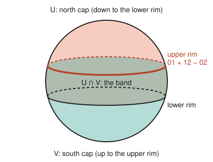

# Mayer-Vietoris and exact sequences: the holes of a whole from two overlapping pieces

[Syllabus](../../../SYLLABUS.md) → [Topology](../README.md) → [Homology](../README.md#s05) → Mayer-Vietoris and exact sequences

---

## General Overview

A common geodesic dome has 42 joints, 120 struts and 80 triangular panels. Survey it in two halves: a north cap of 60 panels and a south cap of 60, overlapping in a band of 40 around the middle.

Each cap is a bent disc: one piece, no loop around an opening, no sealed space. The band is a ring with one loop. Yet the whole dome encloses one sealed space, a 2-dimensional hole that neither half has.

It comes from the band's loop. In the north cap the loop is the rim of the north panels; in the south cap, the rim of the south panels. Two fillings of one loop, glued along it, close up into a shell.

The **Mayer-Vietoris sequence** turns that story into bookkeeping: a chain of homology groups joined by maps, each map's output exactly what the next one sends to zero. Reading along it gives the whole's Betti numbers (its hole counts in each dimension) from the pieces. The card works it by hand on an 8-corner sphere; the checks repeat it on the dome.

**Split a space into two overlapping pieces; then each hole of the whole is either a hole of the pieces that the overlap does not already account for, or a hole of the overlap, one dimension lower, that gets filled in both pieces.**

**What kind of fact this is:** a theorem. For a complex split into two subcomplexes it is proved on this card in Why it works. For a general space split into two open sets it is stated, with the extra step named and sourced. Excision, the rule that lets relative homology cut away part of a space, is proved here for subcomplexes and stated for open sets.

### The picture: two caps and their band

<p align="center"></p>

The drawing is schematic, not to scale. The north cap U reaches down to the lower rim, the south cap V up to the upper rim, and the band between belongs to both. The thick upper rim is the loop the connecting map (Why it works, Step 2) makes from the sphere's sealed space.

The small sphere used by hand has 8 corners: an upper ring 0, 1, 2, a lower ring 3, 4, 5, a north pole 6 and a south pole 7. The band is the 6-panel annulus from [Homology groups](02-homology-groups.md), and each cap adds a fan of 3 panels to one rim.

---

## The formula

From [Homology groups](02-homology-groups.md), in one line each:

- A **k-chain** is a sum of k-simplices (corners, edges, panels) with coefficients; they form $`C_k`$, and the **boundary** $`\partial_k`$ sends each simplex to its faces with alternating signs.
- $`H_k`$ is the k-cycles (chains with zero boundary) with the k-boundaries collapsed to zero. Its dimension over the rationals $`\mathbb{Q}`$ is the **Betti number** $`\beta_k`$: pieces for k = 0, loops for k = 1, sealed spaces for k = 2.

This card adds one idea. A row of groups joined by maps, $`P \to Q \to R`$, is **exact** at $`Q`$ when the image of the first map (everything it reaches) equals the kernel of the second (everything it sends to zero). A longer row is exact when it is exact at every inner spot: what arrives at a spot is exactly what dies on leaving it.

Split the space $`X`$ into two pieces $`U`$ and $`V`$ with $`X = U \cup V`$, overlapping in $`U \cap V`$. The Mayer-Vietoris sequence is exact:

```math
\cdots \to H_k(U \cap V) \xrightarrow{\; i_* \;} H_k(U) \oplus H_k(V) \xrightarrow{\; j_* \;} H_k(X) \xrightarrow{\; \partial_* \;} H_{k-1}(U \cap V) \xrightarrow{\; i_* \;} H_{k-1}(U) \oplus H_{k-1}(V) \to \cdots
```

**Read it aloud:** a hole of the overlap goes to the pair of holes it makes in the two pieces; a pair of holes in the pieces goes to their sum in the whole; a hole of the whole goes down one dimension, to the (k−1)-cycle where its two halves meet in the overlap: a loop, when the hole is a sealed space.

The three maps, in words:

- $`i_*`$ sends an overlap cycle $`c`$ to the pair $`(c, -c)`$, one entry per piece.
- $`j_*`$ sends a pair of cycles $`(a, b)`$ to their sum $`a + b`$ in the whole.
- $`\partial_*`$, the **connecting map**, cuts a cycle of the whole into a part in $`U`$ and a part in $`V`$, and returns the boundary of the cut, which lies in the overlap.

Over $`\mathbb{Q}`$ each group is a space of vectors, and exactness turns into counting. Write $`r_k`$ for the rank of $`i_*`$ in degree k: how many independent holes of the overlap stay holes in the pieces. Then

```math
\beta_k(X) = \big(\beta_k(U) + \beta_k(V) - r_k\big) + \big(\beta_{k-1}(U \cap V) - r_{k-1}\big)
```

**Read it aloud:** the k-holes of the whole are the k-holes of the two pieces, less those that are really one hole of the overlap seen twice, plus the (k−1)-holes of the overlap that get filled in both pieces.

On the small sphere, for sealed spaces (k = 2): $`(0 + 0 - 0) + (1 - 0) = 1`$.

### Relative homology and the sequence of a pair

A second exact sequence comes from one space $`X`$ and a piece $`A`$ inside it. **Relative homology** $`H_k(X, A)`$ is the homology of the chains of $`X`$ with every chain inside $`A`$ counted as zero. A **relative cycle** is a chain whose boundary lies in $`A`$: its loose ends are allowed, as long as they sit in $`A`$.

```math
\cdots \to H_k(A) \to H_k(X) \to H_k(X, A) \xrightarrow{\; \partial_* \;} H_{k-1}(A) \to H_{k-1}(X) \to \cdots
```

**Read it aloud:** holes of the piece go to holes of the whole, those go to relative holes, and a relative cycle goes to its loose ends, a cycle of the piece.

Relative homology ignores everything inside $`A`$: its holes, its pieces, and where in $`A`$ a loose end lands. The exception is a hole of $`A`$ that $`X`$ fills: it comes back one dimension up, as a relative class whose loose ends run round it. The north cap relative to its rim has $`\beta = 0, 0, 1`$ over $`\mathbb{Q}`$: the rim's loop, filled by the cap, comes back as a sealed space. Crush the rim to a point and the cap closes into a sphere.

| Symbol | Plain meaning | In our example | Push it up and the answer… |
| --- | --- | --- | --- |
| $`X`$ | the whole space, a complex of corners, edges and panels | the small sphere: 8, 18, 12 | — |
| $`U`$, $`V`$ | the two pieces; together they cover $`X`$ | north cap and south cap: 7, 15, 9 each | a hole added to a piece adds to the whole unless the overlap absorbs it |
| $`U \cap V`$ | the overlap: simplices in both pieces | the band: 6, 12, 6 | more overlap loops, more chances for sealed spaces |
| $`C_k`$, $`\partial_k`$ | k-chains and the boundary map, from [Homology groups](02-homology-groups.md) | 12 panel coefficients for $`C_2`$ | — |
| $`H_k`$, $`\beta_k`$, $`k`$ | homology group in dimension $`k`$, and its dimension over $`\mathbb{Q}`$ | sphere $`\beta = 1, 0, 1`$ for $`k = 0, 1, 2`$ | — |
| $`\oplus`$ | direct sum: pairs, one entry from each piece | $`H_0(U) \oplus H_0(V)`$ has dimension 2 | — |
| $`i_*`$ | overlap cycle $`c`$ to the pair $`(c, -c)`$ | the band's loop goes to (0, 0): it bounds in both caps | — |
| $`r_k`$ | the rank of $`i_*`$ in degree k | $`r_0 = 1`$, $`r_1 = 0`$, $`r_2 = 0`$ | with the pieces fixed, one more rank lowers both $`\beta_k(X)`$ and $`\beta_{k+1}(X)`$ by 1 |
| $`j_*`$ | pair $`(a, b)`$ to the sum $`a + b`$ in the whole | rank 1 in degree 0, 0 above | — |
| $`\partial_*`$ | the connecting map: cut a cycle in two, keep the cut's boundary | sphere's 2-cycle to the loop $`[0,1] - [0,2] + [1,2]`$ | — |
| $`H_k(X, A)`$, $`A`$ | homology of $`X`$ with chains inside the piece $`A`$ counted as zero | sphere relative to the south cap: $`\beta = 0, 0, 1`$ | a bigger $`A`$ ignores more |
| $`\chi`$ | the Euler characteristic: corners − edges + panels | 2 for the sphere, 1 for each cap, 0 for the band | — |

### When it holds

- **The pieces cover the whole.** If $`U \cup V`$ misses a panel, the sequence computes the homology of what it covers. Drop panel [3,4,7] from the south cap and it reads $`\beta = 1, 0, 0`$, the sphere with a hole, not 1, 0, 1.
- **The pieces are subcomplexes, or open sets.** In a complex, each piece must hold every face of its own simplices. In a general space, the pieces must be open, or at least their interiors must cover $`X`$. A circle split into an open arc and the one point it misses fails: arc and point have no loops and do not meet, so the sequence predicts no loop, but the circle has one.
- **The coefficients are named.** Over $`\mathbb{Q}`$ every group is a space of vectors and the counting formula holds. Over the whole numbers the sequence is still exact, but torsion makes plain dimension counts fail ([Smith normal form](03-computing-homology-by-smith-normal-form.md)).
- **For excision, the part cut away lies well inside $`A`$.** For open sets, its closure must lie in the interior of $`A`$.

---

## Why it works

### Step 0: a chain on the whole splits, and the only freedom is the overlap

Every panel of the sphere lies in a cap, so any chain on the sphere is a chain on $`U`$ plus a chain on $`V`$. The split is not unique: a band panel can go on either side. The freedom is exactly an overlap chain, added to one side and taken from the other.

That fact is a **short exact sequence** of chains: a row $`0 \to P \to Q \to R \to 0`$, exact at every spot. Exact chains force exact homology, with one extra map that steps down a dimension.

### Step 1: the chains form a short exact sequence

In each degree k:

```math
0 \to C_k(U \cap V) \xrightarrow{\; i \;} C_k(U) \oplus C_k(V) \xrightarrow{\; j \;} C_k(X) \to 0, \qquad i(c) = (c, -c), \quad j(a, b) = a + b
```

**Read it aloud:** an overlap chain goes in as itself and minus itself; a pair comes out as its sum; and the row is exact at all three spots.

- **Exact at the left:** $`(c, -c) = (0, 0)`$ only when $`c = 0`$.
- **Exact at the right:** every simplex of $`X`$ lies in $`U`$ or $`V`$, so $`j`$ reaches every chain. This is where the pieces must cover the whole.
- **Exact in the middle:** $`j(i(c)) = c - c = 0`$. Conversely, if $`a + b = 0`$ then $`a = -b`$ lies in both pieces, so it is an overlap chain $`c`$, and $`(a, b) = i(c)`$.

Both $`i`$ and $`j`$ only copy and add simplices, so they commute with the boundary $`\partial`$. The panel counts agree with the row's exactness: 9 + 9 − 6 = 12. Simplices subtract like this, which is why $`\chi = 1 + 1 - 0 = 2`$ works. Betti numbers do not.

### Step 2: the connecting map, on the sphere

The sphere's 12 panels, each with sign +1 or −1, add up to a 2-cycle $`z`$: its boundary is zero. The checks print the signs; the north fan enters as $`+[0,1,6] - [0,2,6] + [1,2,6]`$.

Split $`z = a + b`$, with $`a`$ the north fan (in $`U`$ only) and $`b`$ the other 9 panels (all in $`V`$). Since $`\partial z = 0`$, $`\partial a = -\partial b`$. The left side lies in $`U`$ and the right side in $`V`$, so it lies in the band.

```math
\partial a = \big([1,6] - [0,6] + [0,1]\big) - \big([2,6] - [0,6] + [0,2]\big) + \big([2,6] - [1,6] + [1,2]\big) = [0,1] - [0,2] + [1,2]
```

The spokes to the pole cancel, leaving the upper rim: the band's one loop. So $`\partial_*`$ sends the sphere's sealed space to the band's loop. Read backwards, the loop bounds the north fan in $`U`$ and the other 9 panels in $`V`$, and the two fillings glue into the sealed space.

In general $`\partial_*[z] = [\partial a]`$ for any split $`z = a + b`$, $`a`$ in $`U`$ and $`b`$ in $`V`$. Another split changes $`\partial a`$ only by an overlap boundary.

<details>
<summary>Detailed proof: the connecting map is well defined</summary>

Let $`z = a + b = a' + b'`$ be two splits of the same cycle. Then $`a - a' = b' - b`$ lies in both pieces, so it is an overlap chain $`y`$. Hence $`\partial a - \partial a' = \partial y`$, a boundary in $`U \cap V`$.

If $`z`$ is replaced by $`z + \partial x`$ for a chain $`x`$ of $`X`$, split $`x = x_U + x_V`$ and use $`a + \partial x_U`$ as the new $`U`$ part. Its boundary is

$`\displaystyle \partial(a + \partial x_U) = \partial a + \partial \partial x_U = \partial a,`$

because the boundary of a boundary is zero. So the class $`[\partial a]`$ depends only on the class $`[z]`$.

Finally $`\partial a`$ is a cycle: $`\partial \partial a = 0`$. So $`\partial_*`$ is a well-defined map from $`H_k(X)`$ to $`H_{k-1}(U \cap V)`$.

</details>

### Step 3: the long sequence is exact at every spot

Each spot needs two facts: the two maps through it compose to zero, and anything the second map kills came from the first.

- **At the pieces.** A pair from the overlap sums to $`c - c = 0`$. A pair whose sum bounds in $`X`$ can be corrected into a pair $`(c, -c)`$.
- **At the whole.** A sum of two cycles needs no cut, so its connecting image is zero. A cycle whose cut boundary bounds in the overlap can be re-split into two cycles.
- **At the overlap.** The cut boundary $`\partial a`$ bounds in both pieces. A cycle that bounds in both pieces is the cut of the cycle glued from its two fillings: the sphere story.

<details>
<summary>Detailed proof: exactness at the three spots</summary>

Write $`W = U \cap V`$. Classes are cycles modulo boundaries.

**At $`H_k(U) \oplus H_k(V)`$.** First, $`j_* i_* [c] = [c - c] = 0`$. Next, suppose $`a + b = \partial x`$ for cycles $`a`$ in $`U`$, $`b`$ in $`V`$. Split $`x = x_U + x_V`$. Then $`(a - \partial x_U) + (b - \partial x_V) = 0`$, so $`c = a - \partial x_U`$ lies in $`W`$ and $`b - \partial x_V = -c`$. The cycle $`c`$ satisfies $`i_*[c] = ([a], [b])`$.

**At $`H_k(X)`$.** For cycles $`a`$, $`b`$, the split of $`a + b`$ is $`a`$ and $`b`$ themselves, and $`\partial a = 0`$, so $`\partial_* j_* = 0`$. Next, suppose $`\partial_*[z] = 0`$: for a split $`z = a + b`$, $`\partial a = \partial y`$ with $`y`$ in $`W`$. Then $`a - y`$ and $`b + y`$ are cycles in $`U`$ and $`V`$, and their sum is $`z`$, so $`[z] = j_*([a - y], [b + y])`$.

**At $`H_{k-1}(W)`$.** For a split $`z = a + b`$, $`i_* [\partial a] = ([\partial a], [-\partial a]) = ([\partial a], [\partial b])`$, and both entries are boundaries, so $`i_* \partial_* = 0`$. Next, suppose $`i_*[c] = 0`$: $`c = \partial a`$ for a chain $`a`$ of $`U`$ and $`-c = \partial b`$ for a chain $`b`$ of $`V`$. Then

$`\displaystyle \partial(a + b) = c - c = 0,`$

so $`z = a + b`$ is a cycle of $`X`$, and its connecting image is $`[\partial a] = [c]`$.

</details>

### Step 4: exactness turns into counting

Over $`\mathbb{Q}`$, take three spots $`P \xrightarrow{f} Q \xrightarrow{g} R`$ of an exact row. By [Rank and nullity](../../03-Algebra/05-Solving%20Systems/05-rank-nullity.md), $`\dim Q`$ is what $`g`$ kills plus what $`g`$ keeps. Exactness says what $`g`$ kills is exactly what $`f`$ reaches. So

```math
\dim Q = \mathrm{rank}\, f + \mathrm{rank}\, g
```

**Read it aloud:** at an exact spot, the dimension is the rank of the map coming in plus the rank of the map going out.

At the pieces, $`\mathrm{rank}\, j_* = \beta_k(U) + \beta_k(V) - r_k`$. At the overlap one degree down, $`\mathrm{rank}\, \partial_* = \beta_{k-1}(U \cap V) - r_{k-1}`$. At the whole, $`\beta_k(X)`$ is the sum of the two: the counting formula.

The checks test all three dimension equations in every degree. With the zero composites of Step 3, that is exactness: what the second map kills contains what the first reaches, and has the same dimension.

### Step 5: relative homology is the same machine

Erasing the chains of $`A`$ gives another short exact sequence of chains: $`0 \to C_k(A) \to C_k(X) \to C_k(X)/C_k(A) \to 0`$. The homology of the right-hand end is $`H_k(X, A)`$. The connecting map of Step 2, run on this row, sends a relative cycle to its loose ends in $`A`$. Steps 2 and 3 apply word for word, which gives the sequence of a pair.

**Excision for subcomplexes.** When $`X = U \cup V`$, the simplices of $`X`$ outside $`V`$ are exactly the simplices of $`U`$ outside $`U \cap V`$. Erasing $`V`$'s simplices leaves the same matrices either way. So

```math
H_k(X, V) = H_k(U, U \cap V)
```

**Read it aloud:** homology of the whole relative to one piece equals homology of the other piece relative to the overlap; the part of $`V`$ outside the band can be cut away.

On the small sphere the checks compute both sides separately: $`\beta = 0, 0, 1`$ over $`\mathbb{Q}`$. Ignoring the south cap leaves the north fan, a disc whose rim does not count, so one sealed space. The Euler test agrees: $`0 - 0 + 1 = \chi(X) - \chi(V) = 2 - 1`$.

### Step 6: what this card does not prove

For a general space split into two open sets, chains are built from continuous maps of triangles, and one triangle may lie in neither piece. The repair cuts every triangle into small ones, each inside $`U`$ or $`V`$, and proves this changes no homology. That step and excision for open sets are stated here and proved in Hatcher's Section 2.1 (Sources).

---

## Worked numbers, by hand

The small sphere: caps of 7 corners, 15 edges and 9 panels each, a band of 6, 12 and 6, and the whole of 8, 18 and 12. All Betti numbers are over $`\mathbb{Q}`$.

| Step | Arithmetic | Value |
| --- | --- | --- |
| Euler check on the counts | caps 7 − 15 + 9 = 1 each; band 6 − 12 + 6 = 0; 1 + 1 − 0 | 2 = 8 − 18 + 12 |
| the pieces | each cap is a disc; the band is an annulus ([Homology groups](02-homology-groups.md)) | caps 1, 0, 0; band 1, 1, 0 |
| $`r_0`$ | a corner of the band goes to (corner, −corner), not zero | 1 |
| $`r_1`$ | the band's loop bounds in each cap, so it goes to (0, 0) | 0 |
| $`r_2`$ | the band has no 2-cycles | 0 |
| $`\beta_0(X)`$ | $`(1 + 1 - 1) + 0`$ | **1** |
| $`\beta_1(X)`$ | $`(0 + 0 - 0) + (1 - 1)`$ | **0** |
| $`\beta_2(X)`$ | $`(0 + 0 - 0) + (1 - 0)`$ | **1** |
| cross-check | $`1 - 0 + 1`$ against the counts | 2 = 2 |

The sphere is one piece with no unfilled loop and one sealed space: the band's loop, filled from both sides.

The same reading, as a chain of spots. Each box is one group with its dimension over $`\mathbb{Q}`$; each arrow label is the rank of that map.

```mermaid
flowchart LR
    A["H2(band)<br/>0"] -->|"i: rank 0"| B["H2(U) ⊕ H2(V)<br/>0"] -->|"j: rank 0"| C["H2(sphere)<br/>1"]
    C -->|"connecting map: rank 1"| D["H1(band)<br/>1"]
    D -->|"i: rank 0"| E["H1(U) ⊕ H1(V)<br/>0"] -->|"j: rank 0"| F["H1(sphere)<br/>0"]
    F -->|"connecting map: rank 0"| G["H0(band)<br/>1"]
    G -->|"i: rank 1"| H["H0(U) ⊕ H0(V)<br/>2"]
    H -->|"j: rank 1"| I["H0(sphere)<br/>1"]
```



At each spot the dimension is the rank in plus the rank out: at $`H_1`$ of the band, 1 = 1 + 0; at the pair of $`H_0`$s, 2 = 1 + 1. The checks run more cases, each against a direct count:

| Case | Overlap, caps, whole (corners, edges, panels) | $`r_0, r_1, r_2`$ | $`\beta`$ of the whole, direct | From the pieces |
| --- | --- | --- | --- | --- |
| small sphere | 6, 12, 6; 7, 15, 9 twice; 8, 18, 12 | 1, 0, 0 | 1, 0, 1 | 1, 0, 1 |
| dome | 30, 70, 40; 36, 95, 60 twice; 42, 120, 80 | 1, 0, 0 | 1, 0, 1 | 1, 0, 1 |
| dome, one north panel out | 30, 70, 40; 36, 95, 59 and 36, 95, 60; 42, 120, 79 | 1, 1, 0 | 1, 0, 0 | 1, 0, 0 |

The last row shows $`r_1`$ at work. With a panel out, the north cap is an annulus and the band's loop runs around its opening, so $`r_1 = 1`$. The loop is no longer filled on both sides, and the sealed space is gone: $`\beta_2 = (0 + 0 - 0) + (1 - 1) = 0`$.

### What breaks if you drop a piece

| Mistake | Comes out at | What went wrong |
| --- | --- | --- |
| Subtract Betti numbers like counts: $`\beta(U) + \beta(V) - \beta(U \cap V)`$ | 1, −1, 0 for the sphere; truly 1, 0, 1 | only simplex counts and $`\chi`$ subtract; holes move between degrees |
| Drop the connecting map: keep only $`\beta_k(U) + \beta_k(V) - r_k`$ | 1, 0, 0 | the band's loop, filled twice, is the sealed space; that term is $`\beta_1(U \cap V) - r_1`$ |
| Pieces miss a panel: south cap without [3,4,7] | the sequence gives 1, 0, 0; the sphere is 1, 0, 1 | it computes the homology of $`U \cup V`$, the sphere with a hole |
| Relative as subtraction: $`\beta(U) - \beta(\text{rim})`$ | 0, −1, 0; truly $`\beta(U, \text{rim}) = 0, 0, 1`$ | relative homology adds the cycles whose loose ends lie in $`A`$ |

The code prints all four.

---

## Code, from first principles, and it actually runs

Both programs build the small sphere and the dome from their panels, write every boundary with its signs, and find each rank by exact whole-number elimination. They build the three maps on actual cycles: $`i`$ as $`(c, -c)`$, $`j`$ as a sum, and the connecting map as the boundary of each cycle's part outside $`V`$. Three independent roads meet: the whole's Betti numbers counted directly, the same numbers predicted from the pieces and the ranks of $`i_*`$ alone, and the Euler counts. The dimension equations of exactness are tested at every spot in every degree, and excision by computing both sides separately. The sphere's printed 2-cycle is checked to have zero boundary, and its connecting image is pinned, signs included. The computations are exact on finite complexes, so they prove the results for each split printed; the open-set version of Step 6 is not checked.

### Python

```python
# Mayer-Vietoris and exact sequences -- the check behind the card.  Standard library only.
# A sphere's homology is found twice: from its own boundary ranks, and from two caps
# and their overlap through the Mayer-Vietoris sequence, whose maps i, j and d are
# built on actual cycles and ranked.  The dimension equations of exactness are tested
# at every spot, with Euler counts, and relative homology is checked against excision.
from functools import reduce
from itertools import combinations
from math import gcd

def echelon(rows, m):                       # exact integer elimination on the first m entries
    A, r = [row[:] for row in rows], 0
    for c in range(m):
        p = next((i for i in range(r, len(A)) if A[i][c]), None)
        if p is None:
            continue
        A[r], A[p] = A[p], A[r]
        for i in range(r + 1, len(A)):
            if A[i][c]:
                new = [A[r][c] * y - A[i][c] * x for x, y in zip(A[r], A[i])]
                g = reduce(gcd, new, 0)
                A[i] = [v // g for v in new] if g else new
        r += 1
    return A, r

def rank(vs):                               # the number of independent vectors
    return echelon(vs, len(vs[0]))[1] if vs else 0

def closure(tris):                          # every face of every panel
    return {f for t in tris for k in (1, 2, 3) for f in combinations(sorted(t), k)}

def levels(S):                              # the simplices by dimension, sorted
    return {k: sorted(s for s in S if len(s) == k + 1) for k in range(4)}

def bdry(X, s, Q):                          # boundary of one simplex, faces in Q erased
    k = len(s) - 1
    v = [0] * (len(X[k - 1]) if k else 1)
    for i in range(k + 1 if k else 0):
        if s[:i] + s[i + 1:] not in Q:
            v[X[k - 1].index(s[:i] + s[i + 1:])] += (-1) ** i
    return v

def cyc_bnd(X, S, Q, k):                    # a basis of k-cycles, and the k-boundaries, of chains on S mod Q
    cols, m = [s for s in X[k] if s in S and s not in Q], len(X[k - 1]) if k else 1
    A, r = echelon([bdry(X, s, Q) + [int(t == s) for t in X[k]] for s in cols], m)
    return [row[m:] for row in A[r:]], [bdry(X, s, Q) for s in X[k + 1] if s in S and s not in Q]

def betti(X, S, Q=frozenset()):             # over the rationals: independent cycles minus boundaries
    return [len(Z) - rank(B) for Z, B in (cyc_bnd(X, S, Q, k) for k in range(3))]

def chain_bd(X, z, k):                      # boundary of a k-chain written over X[k]
    out = [0] * len(X[k - 1])
    for c, s in zip(z, X[k]):
        out = [o + c * b for o, b in zip(out, bdry(X, s, ()))] if c else out
    return out

def lift_bd(X, z, k, V):                    # split z = a + b with a off V, b in V; return the boundary of a
    return chain_bd(X, [c if s not in V else 0 for c, s in zip(z, X[k])], k)

def mayer_vietoris(X, U, V):                # ranks of i, j and the connecting map d, degrees 0 to 2
    W, S, out = U & V, U | V, []
    for k in range(3):
        (ZW, _), (ZU, BU), (ZV, BV), (ZS, BS) = (cyc_bnd(X, A, (), k) for A in (W, U, V, S))
        pad = [0] * len(X[k])
        BUV = [b + pad for b in BU] + [pad + b for b in BV]
        ri = rank([z + [-x for x in z] for z in ZW] + BUV) - rank(BUV)      # i(c) = (c, -c)
        rj = rank(ZU + ZV + BS) - rank(BS)                                   # j(a, b) = a + b
        rd = 0
        if k:
            lifts, BW = [lift_bd(X, z, k, V) for z in ZS], cyc_bnd(X, W, (), k - 1)[1]
            assert all(not c or s in W for v in lifts for c, s in zip(v, X[k - 1]))   # d lands in the overlap
            rd = rank(lifts + BW) - rank(BW)
        out.append((ri, rj, rd))
    return out

def run(name, U, V):
    X, W, S = levels(U | V), U & V, U | V
    bW, bU, bV, bS = (betti(X, A) for A in (W, U, V, S))
    R = mayer_vietoris(X, U, V)
    n = lambda A: [len(levels(A)[k]) for k in range(3)]
    chi = lambda A: n(A)[0] - n(A)[1] + n(A)[2]
    print(f"{name}: overlap V E F {n(W)}, caps {n(U)} and {n(V)}, whole {n(S)}; "
          f"chi {chi(U)} + {chi(V)} - {chi(W)} = {chi(S)}")
    pred = []
    for k in range(3):
        ri, rj, rd = R[k]
        pred.append(bU[k] + bV[k] - ri + (bW[k - 1] - R[k - 1][0] if k else 0))
        print(f"  k={k}: b overlap {bW[k]}, b caps {bU[k]}+{bV[k]} | rank i {ri}, j {rj}, d {rd} | "
              f"b whole {bS[k]} direct, {pred[k]} from the pieces")
        assert bU[k] + bV[k] == ri + rj and bS[k] == rj + rd               # exact at two spots
        assert k == 0 or bW[k - 1] == rd + R[k - 1][0]                       # exact at the third
    assert bS == pred and chi(S) == chi(U) + chi(V) - chi(W) == bS[0] - bS[1] + bS[2]
    return X, bW, bU, bV, bS, R

# the small sphere: upper ring 0 1 2, lower ring 3 4 5, north pole 6, south pole 7
band = [(i, (i + 1) % 3, 3 + i) for i in range(3)] + [((i + 1) % 3, 3 + i, 3 + (i + 1) % 3) for i in range(3)]
north, south = [(i, (i + 1) % 3, 6) for i in range(3)], [(3 + i, 3 + (i + 1) % 3, 7) for i in range(3)]
U, V = closure(north + band), closure(band + south)
print("figure, schematic sphere: centre (210,160) radius 120; band from y=130 to y=190")
X, bW, bU, bV, bS, R = run("small sphere", U, V)

# the dome: an icosahedron, every face cut into 4 panels -> 42 joints, 120 struts, 80 panels
Up, Lo, rows = [1, 2, 3, 4, 5], [6, 7, 8, 9, 10], [[], [], [], []]
for i in range(5):
    j = (i + 1) % 5
    for r, t in enumerate([(0, Up[i], Up[j]), (Up[i], Up[j], Lo[i]), (Up[j], Lo[i], Lo[j]), (11, Lo[i], Lo[j])]):
        rows[r].append(t)
mid = {e: 12 + n for n, e in enumerate(sorted(e for e in closure(sum(rows, [])) if len(e) == 2))}
cut = lambda t: [(a, mid[tuple(sorted((a, b)))], mid[tuple(sorted((a, c)))]) for a, b, c in
                 [t, (t[1], t[2], t[0]), (t[2], t[0], t[1])]] + [tuple(mid[tuple(sorted(e))] for e in combinations(t, 2))]
dome = [[p for t in row for p in cut(t)] for row in rows]
DN, DS = dome[0] + dome[1] + dome[2], dome[1] + dome[2] + dome[3]
run("dome", closure(DN), closure(DS))
run("dome, one north panel out", closure(DN[:3] + DN[4:]), closure(DS))

z = cyc_bnd(X, U | V, (), 2)[0][0]
z = z if z[X[2].index((0, 1, 6))] == 1 else [-c for c in z]
loop = lift_bd(X, z, 2, V)
print("sphere 2-cycle, panel coefficients:", " ".join(f"{''.join(map(str, s))}:{c:+d}" for s, c in zip(X[2], z)))
print("d sends it to the boundary of its north fan:", " ".join(f"{c:+d}*{a}{b}" for (a, b), c in zip(X[1], loop) if c))
missing = run("missing panel, V without 347", U, closure(band + south[1:]))[4]

rim = closure([(3, 4), (4, 5), (3, 5)])
rel = {"sphere rel south cap": betti(X, U | V, V), "north cap rel band": betti(X, U, U & V),
       "north cap rel its rim": betti(X, U, rim)}
print("relative b0 b1 b2: " + "; ".join(f"{name} {b}" for name, b in rel.items()))
print(f"mistake 1, Betti numbers by inclusion-exclusion: {[bU[k] + bV[k] - bW[k] for k in range(3)]}, true {bS}")
print(f"mistake 2, drop the connecting map: {[bU[k] + bV[k] - R[k][0] for k in range(3)]}")
print(f"mistake 3, pieces miss a panel: Mayer-Vietoris gives {missing}, the sphere is {bS}")
print(f"mistake 4, relative as subtraction: {[a - b for a, b in zip(bU, betti(X, rim))]}, "
      f"true {rel['north cap rel its rim']}")

assert bS == [1, 0, 1] and bU == bV == [1, 0, 0] and bW == [1, 1, 0] and R[2] == (0, 0, 1)
assert all(abs(c) == 1 for c in z) and not any(chain_bd(X, z, 2))                 # z: a 2-cycle, each panel +1 or -1
assert {s: c for s, c in zip(X[1], loop) if c} == {(0, 1): 1, (0, 2): -1, (1, 2): 1}   # d of it: the upper rim, signed
assert rel["sphere rel south cap"] == rel["north cap rel band"] == [0, 0, 1]    # excision, two ways
assert sum((-1) ** k * b for k, b in enumerate(rel["sphere rel south cap"])) == 2 - 1   # chi(X) - chi(A)
assert missing == [1, 0, 0] and missing != bS
print("ALL CHECKS PASS")
```

**Ran 2026-11-15 on macOS, Python 3.14.10, standard library only. All checks passed. Output, pasted from the run:**

```
figure, schematic sphere: centre (210,160) radius 120; band from y=130 to y=190
small sphere: overlap V E F [6, 12, 6], caps [7, 15, 9] and [7, 15, 9], whole [8, 18, 12]; chi 1 + 1 - 0 = 2
  k=0: b overlap 1, b caps 1+1 | rank i 1, j 1, d 0 | b whole 1 direct, 1 from the pieces
  k=1: b overlap 1, b caps 0+0 | rank i 0, j 0, d 0 | b whole 0 direct, 0 from the pieces
  k=2: b overlap 0, b caps 0+0 | rank i 0, j 0, d 1 | b whole 1 direct, 1 from the pieces
dome: overlap V E F [30, 70, 40], caps [36, 95, 60] and [36, 95, 60], whole [42, 120, 80]; chi 1 + 1 - 0 = 2
  k=0: b overlap 1, b caps 1+1 | rank i 1, j 1, d 0 | b whole 1 direct, 1 from the pieces
  k=1: b overlap 1, b caps 0+0 | rank i 0, j 0, d 0 | b whole 0 direct, 0 from the pieces
  k=2: b overlap 0, b caps 0+0 | rank i 0, j 0, d 1 | b whole 1 direct, 1 from the pieces
dome, one north panel out: overlap V E F [30, 70, 40], caps [36, 95, 59] and [36, 95, 60], whole [42, 120, 79]; chi 0 + 1 - 0 = 1
  k=0: b overlap 1, b caps 1+1 | rank i 1, j 1, d 0 | b whole 1 direct, 1 from the pieces
  k=1: b overlap 1, b caps 1+0 | rank i 1, j 0, d 0 | b whole 0 direct, 0 from the pieces
  k=2: b overlap 0, b caps 0+0 | rank i 0, j 0, d 0 | b whole 0 direct, 0 from the pieces
sphere 2-cycle, panel coefficients: 013:-1 016:+1 025:+1 026:-1 035:-1 124:-1 126:+1 134:+1 245:+1 347:-1 357:+1 457:-1
d sends it to the boundary of its north fan: +1*01 -1*02 +1*12
missing panel, V without 347: overlap V E F [6, 12, 6], caps [7, 15, 9] and [7, 15, 8], whole [8, 18, 11]; chi 1 + 0 - 0 = 1
  k=0: b overlap 1, b caps 1+1 | rank i 1, j 1, d 0 | b whole 1 direct, 1 from the pieces
  k=1: b overlap 1, b caps 0+1 | rank i 1, j 0, d 0 | b whole 0 direct, 0 from the pieces
  k=2: b overlap 0, b caps 0+0 | rank i 0, j 0, d 0 | b whole 0 direct, 0 from the pieces
relative b0 b1 b2: sphere rel south cap [0, 0, 1]; north cap rel band [0, 0, 1]; north cap rel its rim [0, 0, 1]
mistake 1, Betti numbers by inclusion-exclusion: [1, -1, 0], true [1, 0, 1]
mistake 2, drop the connecting map: [1, 0, 0]
mistake 3, pieces miss a panel: Mayer-Vietoris gives [1, 0, 0], the sphere is [1, 0, 1]
mistake 4, relative as subtraction: [0, -1, 0], true [0, 0, 1]
ALL CHECKS PASS
```

### Rust

Same numbers, same labels, built with `rustc --edition 2021 -O`.

```rust
// Mayer-Vietoris and exact sequences -- the same check as the Python, in Rust.  No crates.
// A sphere's homology is found twice: from its own boundary ranks, and from two caps
// and their overlap through the Mayer-Vietoris sequence, whose maps i, j and d are
// built on actual cycles and ranked.  The dimension equations of exactness are tested
// at every spot, with Euler counts, and relative homology is checked against excision.
use std::collections::BTreeSet;

type S = Vec<usize>; type Set = BTreeSet<S>;   // a simplex by its corners; a set of simplices
type Lv = Vec<Vec<S>>; type Vv = Vec<Vec<i128>>; // simplices by dimension; a list of integer vectors

fn gcd(a: i128, b: i128) -> i128 { if b == 0 { a.abs() } else { gcd(b, a % b) } }

fn echelon(rows: &Vv, m: usize) -> (Vv, usize) {     // exact integer elimination on the first m entries
    let (mut a, mut r) = (rows.clone(), 0);
    for c in 0..m {
        let Some(p) = (r..a.len()).find(|&i| a[i][c] != 0) else { continue };
        a.swap(r, p);
        for i in r + 1..a.len() {
            if a[i][c] == 0 { continue; }
            let (p, q) = (a[r][c], a[i][c]);
            let new: Vec<i128> = a[r].iter().zip(&a[i]).map(|(x, y)| p.checked_mul(*y).unwrap().checked_sub(q.checked_mul(*x).unwrap()).unwrap()).collect();
            let g = new.iter().fold(0, |g, &v| gcd(g, v));
            a[i] = new.iter().map(|v| if g != 0 { v / g } else { *v }).collect();
        }
        r += 1;
    }
    (a, r)
}

fn rank(vs: &Vv) -> usize { if vs.is_empty() { 0 } else { echelon(vs, vs[0].len()).1 } }  // independent vectors

fn closure(tris: &[S]) -> Set {                       // every face of every panel
    let mut out = Set::new();
    for t in tris {
        let s: S = t.iter().copied().collect::<BTreeSet<_>>().into_iter().collect();
        for mask in 1u32..(1 << s.len()) { out.insert((0..s.len()).filter(|i| mask >> i & 1 == 1).map(|i| s[i]).collect()); }
    }
    out
}

fn levels(s: &Set) -> Lv { (0..4).map(|k| s.iter().filter(|x| x.len() == k + 1).cloned().collect()).collect() }

fn bdry(x: &Lv, s: &S, q: &Set) -> Vec<i128> {      // boundary of one simplex, faces in q erased
    let k = s.len() - 1;
    let mut v = vec![0i128; if k > 0 { x[k - 1].len() } else { 1 }];
    for i in 0..(if k > 0 { k + 1 } else { 0 }) {
        let mut f = s.clone(); f.remove(i);
        if !q.contains(&f) { v[x[k - 1].iter().position(|t| *t == f).unwrap()] += if i % 2 == 0 { 1 } else { -1 }; }
    }
    v
}

fn cyc_bnd(x: &Lv, s: &Set, q: &Set, k: usize) -> (Vv, Vv) {  // a basis of k-cycles, and the k-boundaries
    let m = if k > 0 { x[k - 1].len() } else { 1 };
    let rows: Vv = x[k].iter().filter(|c| s.contains(*c) && !q.contains(*c)).map(|c| {
        let mut r = bdry(x, c, q); r.extend(x[k].iter().map(|t| (t == c) as i128)); r }).collect();
    let (a, r) = echelon(&rows, m);
    (a[r..].iter().map(|row| row[m..].to_vec()).collect(),
     x[k + 1].iter().filter(|c| s.contains(*c) && !q.contains(*c)).map(|c| bdry(x, c, q)).collect())
}

fn betti(x: &Lv, s: &Set, q: &Set) -> Vec<i64> {      // over the rationals: cycles minus boundaries
    (0..3).map(|k| { let (z, b) = cyc_bnd(x, s, q, k); z.len() as i64 - rank(&b) as i64 }).collect()
}

fn lift_bd(x: &Lv, z: &[i128], k: usize, v: &Set) -> Vec<i128> {  // z = a + b, a off v, b in v: boundary of a
    let mut out = vec![0i128; x[k - 1].len()];
    for (c, s) in z.iter().zip(&x[k]) {
        if *c != 0 && !v.contains(s) { for (o, b) in out.iter_mut().zip(bdry(x, s, &Set::new())) { *o += c * b; } }
    }
    out
}

fn mayer_vietoris(x: &Lv, u: &Set, v: &Set) -> Vec<(usize, usize, usize)> {  // ranks of i, j, d
    let (w, s, e): (Set, Set, Set) = (u & v, u | v, Set::new());
    let mut out = Vec::new();
    for k in 0..3 {
        let ((zw, _), (zu, bu), (zv, bv), (zs, bs)) = (cyc_bnd(x, &w, &e, k), cyc_bnd(x, u, &e, k), cyc_bnd(x, v, &e, k), cyc_bnd(x, &s, &e, k));
        let pad = vec![0i128; x[k].len()];
        let mut buv: Vv = bu.iter().map(|b| [b.clone(), pad.clone()].concat()).collect();
        buv.extend(bv.iter().map(|b| [pad.clone(), b.clone()].concat()));
        let mut ii: Vv = zw.iter().map(|z| [z.clone(), z.iter().map(|c| -c).collect()].concat()).collect();  // i(c) = (c, -c)
        ii.extend(buv.iter().cloned());
        let ri = rank(&ii) - rank(&buv);
        let jj: Vv = zu.iter().chain(&zv).chain(&bs).cloned().collect();          // j(a, b) = a + b
        let rj = rank(&jj) - rank(&bs);
        let mut rd = 0;
        if k > 0 {
            let lifts: Vv = zs.iter().map(|z| lift_bd(x, z, k, v)).collect();
            assert!(lifts.iter().all(|l| l.iter().zip(&x[k - 1]).all(|(c, f)| *c == 0 || w.contains(f))));  // d lands in the overlap
            let bw = cyc_bnd(x, &w, &e, k - 1).1;
            rd = rank(&lifts.iter().chain(&bw).cloned().collect()) - rank(&bw);
        }
        out.push((ri, rj, rd));
    }
    out
}

fn run(name: &str, u: &Set, v: &Set) -> (Lv, Vec<i64>, Vec<i64>, Vec<i64>, Vec<i64>, Vec<(usize, usize, usize)>) {
    let (w, s, e): (Set, Set, Set) = (u & v, u | v, Set::new());
    let x = levels(&s);
    let (bw, bu, bv, bs) = (betti(&x, &w, &e), betti(&x, u, &e), betti(&x, v, &e), betti(&x, &s, &e));
    let r = mayer_vietoris(&x, u, v);
    let n = |a: &Set| -> Vec<i64> { levels(a).iter().take(3).map(|l| l.len() as i64).collect() };
    let chi = |a: &Set| { let c = n(a); c[0] - c[1] + c[2] };
    println!("{}: overlap V E F {:?}, caps {:?} and {:?}, whole {:?}; chi {} + {} - {} = {}", name, n(&w), n(u), n(v), n(&s), chi(u), chi(v), chi(&w), chi(&s));
    let mut pred = Vec::new();
    for k in 0..3 {
        let (ri, rj, rd) = r[k];
        pred.push(bu[k] + bv[k] - ri as i64 + if k > 0 { bw[k - 1] - r[k - 1].0 as i64 } else { 0 });
        println!("  k={}: b overlap {}, b caps {}+{} | rank i {}, j {}, d {} | b whole {} direct, {} from the pieces", k, bw[k], bu[k], bv[k], ri, rj, rd, bs[k], pred[k]);
        assert!(bu[k] + bv[k] == (ri + rj) as i64 && bs[k] == (rj + rd) as i64);   // exact at two spots
        assert!(k == 0 || bw[k - 1] == (rd + r[k - 1].0) as i64);                    // exact at the third
    }
    assert!(bs == pred && chi(&s) == chi(u) + chi(v) - chi(&w) && chi(&s) == bs[0] - bs[1] + bs[2]);
    (x, bw, bu, bv, bs, r)
}

fn main() {
    // the small sphere: upper ring 0 1 2, lower ring 3 4 5, north pole 6, south pole 7
    let band: Vec<S> = (0..3).map(|i| vec![i, (i + 1) % 3, 3 + i]).chain((0..3).map(|i| vec![(i + 1) % 3, 3 + i, 3 + (i + 1) % 3])).collect();
    let north: Vec<S> = (0..3).map(|i| vec![i, (i + 1) % 3, 6]).collect();
    let south: Vec<S> = (0..3).map(|i| vec![3 + i, 3 + (i + 1) % 3, 7]).collect();
    let (u, v) = (closure(&[north.clone(), band.clone()].concat()), closure(&[band.clone(), south.clone()].concat()));
    println!("figure, schematic sphere: centre (210,160) radius 120; band from y=130 to y=190");
    let (x, bw, bu, bv, bs, r) = run("small sphere", &u, &v);

    // the dome: an icosahedron, every face cut into 4 panels -> 42 joints, 120 struts, 80 panels
    let mut rows: Vec<Vec<S>> = vec![Vec::new(); 4];
    for i in 0..5 {
        let (ui, uj, li, lj) = (1 + i, 1 + (i + 1) % 5, 6 + i, 6 + (i + 1) % 5);
        for (k, t) in [vec![0, ui, uj], vec![ui, uj, li], vec![uj, li, lj], vec![11, li, lj]].into_iter().enumerate() { rows[k].push(t); }
    }
    let edges: Vec<S> = closure(&rows.concat()).into_iter().filter(|e| e.len() == 2).collect();
    let mid = |a: usize, b: usize| 12 + edges.iter().position(|e| *e == vec![a.min(b), a.max(b)]).unwrap();
    let cut = |t: &S| -> Vec<S> {
        let mut p: Vec<S> = [(t[0], t[1], t[2]), (t[1], t[2], t[0]), (t[2], t[0], t[1])].iter().map(|&(a, b, c)| vec![a, mid(a, b), mid(a, c)]).collect();
        p.push(vec![mid(t[0], t[1]), mid(t[0], t[2]), mid(t[1], t[2])]);
        p
    };
    let dome: Vec<Vec<S>> = rows.iter().map(|row| row.iter().flat_map(|t| cut(t)).collect()).collect();
    let (dn, ds) = ([dome[0].clone(), dome[1].clone(), dome[2].clone()].concat(), [dome[1].clone(), dome[2].clone(), dome[3].clone()].concat());
    run("dome", &closure(&dn), &closure(&ds));
    run("dome, one north panel out", &closure(&[dn[..3].to_vec(), dn[4..].to_vec()].concat()), &closure(&ds));

    let mut z = cyc_bnd(&x, &(&u | &v), &Set::new(), 2).0[0].clone();
    if z[x[2].iter().position(|s| *s == vec![0, 1, 6]).unwrap()] != 1 { z = z.iter().map(|c| -c).collect(); }
    let lp = lift_bd(&x, &z, 2, &v);
    let lab = |s: &S| s.iter().map(|d| d.to_string()).collect::<String>();
    println!("sphere 2-cycle, panel coefficients: {}", x[2].iter().zip(&z).map(|(s, c)| format!("{}:{:+}", lab(s), c)).collect::<Vec<_>>().join(" "));
    println!("d sends it to the boundary of its north fan: {}", x[1].iter().zip(&lp).filter(|(_, c)| **c != 0).map(|(s, c)| format!("{:+}*{}", c, lab(s))).collect::<Vec<_>>().join(" "));
    let missing = run("missing panel, V without 347", &u, &closure(&[band.clone(), south[1..].to_vec()].concat())).4;

    let rim = closure(&[vec![3, 4], vec![4, 5], vec![3, 5]]);
    let s_all: Set = &u | &v;
    let rel = [("sphere rel south cap", betti(&x, &s_all, &v)), ("north cap rel band", betti(&x, &u, &(&u & &v))), ("north cap rel its rim", betti(&x, &u, &rim))];
    println!("relative b0 b1 b2: {}", rel.iter().map(|(n, b)| format!("{} {:?}", n, b)).collect::<Vec<_>>().join("; "));
    let brim = betti(&x, &rim, &Set::new());
    println!("mistake 1, Betti numbers by inclusion-exclusion: {:?}, true {:?}", (0..3).map(|k| bu[k] + bv[k] - bw[k]).collect::<Vec<_>>(), bs);
    println!("mistake 2, drop the connecting map: {:?}", (0..3).map(|k| bu[k] + bv[k] - r[k].0 as i64).collect::<Vec<_>>());
    println!("mistake 3, pieces miss a panel: Mayer-Vietoris gives {:?}, the sphere is {:?}", missing, bs);
    println!("mistake 4, relative as subtraction: {:?}, true {:?}", (0..3).map(|k| bu[k] - brim[k]).collect::<Vec<_>>(), rel[2].1);

    assert!(bs == vec![1, 0, 1] && bu == vec![1, 0, 0] && bv == vec![1, 0, 0] && bw == vec![1, 1, 0] && r[2] == (0, 0, 1));
    assert!(z.iter().all(|c| c.abs() == 1) && lift_bd(&x, &z, 2, &Set::new()).iter().all(|c| *c == 0) && x[1].iter().zip(&lp).filter(|(_, c)| **c != 0).map(|(s, c)| (s.clone(), *c)).collect::<Vec<_>>() == vec![(vec![0, 1], 1), (vec![0, 2], -1), (vec![1, 2], 1)]);
    assert!(rel[0].1 == vec![0, 0, 1] && rel[1].1 == vec![0, 0, 1]);                       // excision, two ways
    assert!(rel[0].1[0] - rel[0].1[1] + rel[0].1[2] == 2 - 1);                                // chi(X) - chi(A)
    assert!(missing == vec![1, 0, 0] && missing != bs);
    println!("ALL CHECKS PASS");
}
```

**Ran 2026-11-15 on macOS, rustc 1.98.1, no crates. All checks passed. Output, pasted from the run:**

```
figure, schematic sphere: centre (210,160) radius 120; band from y=130 to y=190
small sphere: overlap V E F [6, 12, 6], caps [7, 15, 9] and [7, 15, 9], whole [8, 18, 12]; chi 1 + 1 - 0 = 2
  k=0: b overlap 1, b caps 1+1 | rank i 1, j 1, d 0 | b whole 1 direct, 1 from the pieces
  k=1: b overlap 1, b caps 0+0 | rank i 0, j 0, d 0 | b whole 0 direct, 0 from the pieces
  k=2: b overlap 0, b caps 0+0 | rank i 0, j 0, d 1 | b whole 1 direct, 1 from the pieces
dome: overlap V E F [30, 70, 40], caps [36, 95, 60] and [36, 95, 60], whole [42, 120, 80]; chi 1 + 1 - 0 = 2
  k=0: b overlap 1, b caps 1+1 | rank i 1, j 1, d 0 | b whole 1 direct, 1 from the pieces
  k=1: b overlap 1, b caps 0+0 | rank i 0, j 0, d 0 | b whole 0 direct, 0 from the pieces
  k=2: b overlap 0, b caps 0+0 | rank i 0, j 0, d 1 | b whole 1 direct, 1 from the pieces
dome, one north panel out: overlap V E F [30, 70, 40], caps [36, 95, 59] and [36, 95, 60], whole [42, 120, 79]; chi 0 + 1 - 0 = 1
  k=0: b overlap 1, b caps 1+1 | rank i 1, j 1, d 0 | b whole 1 direct, 1 from the pieces
  k=1: b overlap 1, b caps 1+0 | rank i 1, j 0, d 0 | b whole 0 direct, 0 from the pieces
  k=2: b overlap 0, b caps 0+0 | rank i 0, j 0, d 0 | b whole 0 direct, 0 from the pieces
sphere 2-cycle, panel coefficients: 013:-1 016:+1 025:+1 026:-1 035:-1 124:-1 126:+1 134:+1 245:+1 347:-1 357:+1 457:-1
d sends it to the boundary of its north fan: +1*01 -1*02 +1*12
missing panel, V without 347: overlap V E F [6, 12, 6], caps [7, 15, 9] and [7, 15, 8], whole [8, 18, 11]; chi 1 + 0 - 0 = 1
  k=0: b overlap 1, b caps 1+1 | rank i 1, j 1, d 0 | b whole 1 direct, 1 from the pieces
  k=1: b overlap 1, b caps 0+1 | rank i 1, j 0, d 0 | b whole 0 direct, 0 from the pieces
  k=2: b overlap 0, b caps 0+0 | rank i 0, j 0, d 0 | b whole 0 direct, 0 from the pieces
relative b0 b1 b2: sphere rel south cap [0, 0, 1]; north cap rel band [0, 0, 1]; north cap rel its rim [0, 0, 1]
mistake 1, Betti numbers by inclusion-exclusion: [1, -1, 0], true [1, 0, 1]
mistake 2, drop the connecting map: [1, 0, 0]
mistake 3, pieces miss a panel: Mayer-Vietoris gives [1, 0, 0], the sphere is [1, 0, 1]
mistake 4, relative as subtraction: [0, -1, 0], true [0, 0, 1]
ALL CHECKS PASS
```

The two outputs match line for line.

### Lean

Lean proves the Mayer-Vietoris sequence, excision and Step 4's count, for any complex split into two subcomplexes, with any coefficients.

- Take two subcomplexes $`U`$ and $`V`$ that together cover $`X`$. Then the row of chains in Step 1, with $`i(c) = (c, -c)`$ and $`j(a, b) = a + b`$, is short exact.
- Take the same pieces. Then the long sequence is exact at every spot: at the pieces, at the whole, and at the overlap.
- Take the same pieces. Then $`H_k(U, U \cap V) = H_k(X, V)`$ in every degree $`k`$. The map between them keeps each chain unchanged.
- Take an exact spot $`P \xrightarrow{f} Q \xrightarrow{g} R`$ of spaces of vectors, with $`Q`$ of finite dimension. Then $`\dim Q = \mathrm{rank}\, f + \mathrm{rank}\, g`$.
- The hand arithmetic holds too: the Euler counts, the counting formula on the small sphere, and the first mistake's 1, −1, 0.

The actual ranks on the sphere and the dome, the signed 2-cycle and the four mistakes are left to the Python and Rust checks.

```lean
-- Mayer-Vietoris and exact sequences: for a simplicial set covered by two subcomplexes the Mayer-Vietoris row of chains is short exact and its homology row is exact at every spot, excision holds for subcomplexes, and at an exact spot of vector spaces the dimension is the rank in plus the rank out.
import Mathlib.AlgebraicTopology.SimplicialSet.Homology.Relative
import Mathlib.AlgebraicTopology.SimplicialSet.SubcomplexColimits
import Mathlib.CategoryTheory.Abelian.CommSq
import Mathlib.Algebra.Homology.HomologicalComplexLimits
import Mathlib.LinearAlgebra.FiniteDimensional.Lemmas
import Mathlib.Tactic.NormNum

open CategoryTheory Limits SSet

universe w

theorem mv_isPushout_sSet {X : SSet.{w}} (U V : X.Subcomplex) (hcover : U ⊔ V = ⊤) :
    IsPushout (Subcomplex.homOfLE (inf_le_left : U ⊓ V ≤ U))
      (Subcomplex.homOfLE (inf_le_right : U ⊓ V ≤ V)) U.ι V.ι := by
  have sq : Subcomplex.BicartSq (U ⊓ V) U V ⊤ := ⟨hcover, rfl⟩
  exact sq.isPushout.of_iso (Iso.refl _) (Iso.refl _) (Iso.refl _) (Subcomplex.topIso X)
    rfl rfl rfl rfl

theorem mv_isPushout_X {𝒜 : Type*} [Category* 𝒜] [Preadditive 𝒜] [HasCoproducts.{w} 𝒜]
    {A B C D : SSet.{w}} {t : A ⟶ B} {l : A ⟶ C} {r : B ⟶ D} {b : C ⟶ D}
    (h : IsPushout t l r b) (R : 𝒜) (n : ℕ) :
    IsPushout ((chainComplexMap t R).f n) ((chainComplexMap l R).f n)
      ((chainComplexMap r R).f n) ((chainComplexMap b R).f n) := by
  have h1 := h.map ((evaluation _ _).obj (Opposite.op (SimplexCategory.mk n)))
  have h2 := h1.map (sigmaConst.{w}.obj R)
  exact h2

theorem mv_isPushout_chain {𝒜 : Type*} [Category* 𝒜] [Preadditive 𝒜] [HasCoproducts.{w} 𝒜]
    {A B C D : SSet.{w}} {t : A ⟶ B} {l : A ⟶ C} {r : B ⟶ D} {b : C ⟶ D}
    (h : IsPushout t l r b) (R : 𝒜) :
    IsPushout (chainComplexMap t R) (chainComplexMap l R)
      (chainComplexMap r R) (chainComplexMap b R) := by
  have w : chainComplexMap t R ≫ chainComplexMap r R =
      chainComplexMap l R ≫ chainComplexMap b R := by
    simp only [← Functor.map_comp, h.w]
  refine ⟨⟨w⟩, ⟨HomologicalComplex.isColimitOfEval _ _ (fun n => ?_)⟩⟩
  exact (PushoutCocone.isColimitMapCoconeEquiv _ _).2 (mv_isPushout_X h R n).isColimit

theorem mv_isIso_of_isPushout {𝒜 : Type*} [Category* 𝒜] [Preadditive 𝒜]
    {X₁ X₂ X₃ X₄ : 𝒜} {t : X₁ ⟶ X₂} {l : X₁ ⟶ X₃} {r : X₂ ⟶ X₄} {b : X₃ ⟶ X₄}
    (hP : IsPushout t l r b) {c₁ : CokernelCofork t} {c₂ : CokernelCofork b}
    (hc₁ : IsColimit c₁) (hc₂ : IsColimit c₂) (φ : c₁.pt ⟶ c₂.pt)
    (hφ : c₁.π ≫ φ = r ≫ c₂.π) : IsIso φ := by
  let d : X₄ ⟶ c₁.pt := hP.desc c₁.π 0 (by simp [c₁.condition])
  have hd : b ≫ d = 0 := by simp [d]
  let ψ : c₂.pt ⟶ c₁.pt := Cofork.IsColimit.desc hc₂ d (by simpa using hd)
  have hψ : c₂.π ≫ ψ = d := Cofork.IsColimit.π_desc' hc₂ d _
  refine ⟨ψ, ?_, ?_⟩
  · apply Cofork.IsColimit.hom_ext hc₁
    rw [reassoc_of% hφ, hψ]
    simp [d]
  · apply Cofork.IsColimit.hom_ext hc₂
    rw [reassoc_of% hψ]
    apply hP.hom_ext
    · simp [d, hφ]
    · simp [d, reassoc_of% hd, c₂.condition]

section MayerVietoris

variable {𝒜 : Type*} [Category* 𝒜] [Abelian 𝒜] [HasCoproducts.{w} 𝒜]

/-- The Mayer-Vietoris row of chains for two subcomplexes `U`, `V` of `X`, coefficients `R`:
`C(U ∩ V) → C(U) ⊕ C(V) → C(X)`, with `i(c) = (c, -c)` and `j(a, b) = a + b`. -/
noncomputable def mayerVietorisChains {X : SSet.{w}} (U V : X.Subcomplex) (R : 𝒜) :
    ShortComplex (ChainComplex 𝒜 ℕ) :=
  ShortComplex.mk
    (biprod.lift (chainComplexMap (Subcomplex.homOfLE (inf_le_left : U ⊓ V ≤ U)) R)
      (-chainComplexMap (Subcomplex.homOfLE (inf_le_right : U ⊓ V ≤ V)) R))
    (biprod.desc (chainComplexMap U.ι R) (chainComplexMap V.ι R))
    (by simp [← Functor.map_comp])

/-- Mayer-Vietoris: split a complex `X` into two subcomplexes `U` and `V` that together cover it.
Then the row of chains `0 → C(U ∩ V) → C(U) ⊕ C(V) → C(X) → 0` is exact, and the long row
`H_k(U ∩ V) → H_k(U) ⊕ H_k(V) → H_k(X) → H_{k-1}(U ∩ V) → ⋯`, with `i_*`, `j_*` and the
connecting map `∂_*`, is exact at every spot: at the pieces, at the whole, and at the overlap. -/
theorem mayer_vietoris_sequence_exact {X : SSet.{w}} (U V : X.Subcomplex)
    (hcover : U ⊔ V = ⊤) (R : 𝒜) :
    ∃ hS : (mayerVietorisChains U V R).ShortExact,
      (∀ k : ℕ, (ShortComplex.mk
          (HomologicalComplex.homologyMap (mayerVietorisChains U V R).f k)
          (HomologicalComplex.homologyMap (mayerVietorisChains U V R).g k)
          (by rw [← HomologicalComplex.homologyMap_comp, ShortComplex.zero,
            HomologicalComplex.homologyMap_zero])).Exact) ∧
      (∀ (k m : ℕ) (h : m + 1 = k),
        (ShortComplex.mk _ _ (hS.comp_δ k m h)).Exact) ∧
      (∀ (k m : ℕ) (h : m + 1 = k),
        (ShortComplex.mk _ _ (hS.δ_comp k m h)).Exact) := by
  have hP := mv_isPushout_chain (mv_isPushout_sSet U V hcover) R
  have hS : (mayerVietorisChains U V R).ShortExact := by
    have hmono : Mono (chainComplexMap (Subcomplex.homOfLE (inf_le_left : U ⊓ V ≤ U)) R) :=
      inferInstanceAs (Mono (SSet.chainComplexMap
        (SSetPair.of (Subcomplex.homOfLE (inf_le_left : U ⊓ V ≤ U))).hom R))
    have : Mono (mayerVietorisChains U V R).f :=
      @mono_of_mono_fac _ _ _ _ _ _ _ _ hmono (biprod.lift_fst
        (chainComplexMap (Subcomplex.homOfLE (inf_le_left : U ⊓ V ≤ U)) R)
        (-chainComplexMap (Subcomplex.homOfLE (inf_le_right : U ⊓ V ≤ V)) R))
    exact { exact := hP.exact_shortComplex, epi_g := hP.epi_shortComplex_g }
  exact ⟨hS, fun k => hS.homology_exact₂ k, fun k m h => hS.homology_exact₃ k m h,
    fun k m h => hS.homology_exact₁ k m h⟩

/-- Excision for subcomplexes: when `X = U ∪ V`, the inclusion of pairs `(U, U ∩ V) → (X, V)`
induces an isomorphism `H_k(U, U ∩ V) ≅ H_k(X, V)` in every degree `k`. -/
theorem excision_for_subcomplexes {X : SSet.{w}} (U V : X.Subcomplex)
    (hcover : U ⊔ V = ⊤) (R : 𝒜) (k : ℕ) :
    IsIso (SSetPair.homologyMap
      (SSetPair.homMk (X := SSetPair.of (Subcomplex.homOfLE (inf_le_left : U ⊓ V ≤ U)))
        (Y := V.pair) (Subcomplex.homOfLE (inf_le_right : U ⊓ V ≤ V)) U.ι rfl) R k) := by
  have hP := mv_isPushout_chain (mv_isPushout_sSet U V hcover) R
  have : IsIso (SSetPair.chainComplexMap
      (SSetPair.homMk (X := SSetPair.of (Subcomplex.homOfLE (inf_le_left : U ⊓ V ≤ U)))
        (Y := V.pair) (Subcomplex.homOfLE (inf_le_right : U ⊓ V ≤ V)) U.ι rfl) R) := by
    refine mv_isIso_of_isPushout hP
      (SSetPair.isColimitCokernelCoforkChainComplex
        (SSetPair.of (Subcomplex.homOfLE (inf_le_left : U ⊓ V ≤ U))) R)
      (V.pair.isColimitCokernelCoforkChainComplex R) _ ?_
    exact (((SSetPair.chainComplexFunctorπ 𝒜).app R).naturality _).symm
  infer_instance

end MayerVietoris

/-- Exactness turns into counting: at an exact spot `P → Q → R` of vector spaces over a field
(image of the first map equals kernel of the second), `dim Q = rank f + rank g`. -/
theorem finrank_eq_rank_in_add_rank_out {K P Q R : Type*} [Field K]
    [AddCommGroup P] [Module K P] [AddCommGroup Q] [Module K Q] [AddCommGroup R] [Module K R]
    [FiniteDimensional K Q] (f : P →ₗ[K] Q) (g : Q →ₗ[K] R)
    (hexact : LinearMap.range f = LinearMap.ker g) :
    Module.finrank K Q =
      Module.finrank K (LinearMap.range f) + Module.finrank K (LinearMap.range g) := by
  rw [hexact, add_comm]
  exact (LinearMap.finrank_range_add_finrank_ker g).symm

-- Euler checks on the small sphere: caps, band, whole, and χ(U) + χ(V) - χ(U ∩ V) = χ(X)
example : (7 : ℤ) - 15 + 9 = 1 ∧ (6 : ℤ) - 12 + 6 = 0 ∧ (8 : ℤ) - 18 + 12 = 2 := by norm_num
example : (1 : ℤ) + 1 - 0 = 2 ∧ (9 : ℕ) + 9 - 6 = 12 := by norm_num
-- Euler checks on the dome: caps 36, 95, 60; band 30, 70, 40; whole 42, 120, 80
example : (36 : ℤ) - 95 + 60 = 1 ∧ (30 : ℤ) - 70 + 40 = 0 ∧ (42 : ℤ) - 120 + 80 = 2 := by norm_num
-- the counting formula on the small sphere, k = 0, 1, 2
example : ((1 : ℤ) + 1 - 1) + 0 = 1 ∧ ((0 : ℤ) + 0 - 0) + (1 - 1) = 0 ∧
    ((0 : ℤ) + 0 - 0) + (1 - 0) = 1 := by norm_num
-- Betti cross-check 1 - 0 + 1 = 2; ranks at exact spots: 1 = 1 + 0 and 2 = 1 + 1
example : (1 : ℤ) - 0 + 1 = 2 ∧ (1 : ℕ) = 1 + 0 ∧ (2 : ℕ) = 1 + 1 := by norm_num
-- mistake 1, Betti numbers by inclusion-exclusion: 1, -1, 0 instead of 1, 0, 1
example : ((1 : ℤ) + 1 - 1, (0 : ℤ) + 0 - 1, (0 : ℤ) + 0 - 0) = (1, -1, 0) := by norm_num
-- dome with one north panel out: β₂ = (0 + 0 - 0) + (1 - 1) = 0; relative Euler 0 - 0 + 1 = 2 - 1
example : ((0 : ℤ) + 0 - 0) + (1 - 1) = 0 ∧ (0 : ℤ) - 0 + 1 = 2 - 1 := by norm_num

#print axioms mayer_vietoris_sequence_exact
#print axioms excision_for_subcomplexes
#print axioms finrank_eq_rank_in_add_rank_out
#print axioms mv_isPushout_sSet
#print axioms mv_isPushout_X
#print axioms mv_isPushout_chain
#print axioms mv_isIso_of_isPushout
```

**Checked 2026-11-15 on macOS, Lean 4.36.0-rc2, Mathlib v4.36.0-rc2. Every proof is complete and uses only Lean's standard axioms. Output, pasted from the run:**

```
'mayer_vietoris_sequence_exact' depends on axioms: [propext, Classical.choice, Quot.sound]
'excision_for_subcomplexes' depends on axioms: [propext, Classical.choice, Quot.sound]
'finrank_eq_rank_in_add_rank_out' depends on axioms: [propext, Classical.choice, Quot.sound]
'mv_isPushout_sSet' depends on axioms: [propext, Classical.choice, Quot.sound]
'mv_isPushout_X' depends on axioms: [propext, Classical.choice, Quot.sound]
'mv_isPushout_chain' depends on axioms: [propext, Classical.choice, Quot.sound]
'mv_isIso_of_isPushout' depends on axioms: [propext, Classical.choice, Quot.sound]
```

> [!TIP]
> **Try changing**
> - **Guess first: shrink the overlap to a circle.** Change `closure(band + south)` in the line that sets `U, V` to `closure(south)`. The overlap is now just the lower rim, 3, 3, 0, with the same $`\beta = 1, 1, 0`$. The sphere still reads 1, 0, 1 and the run passes: for subcomplexes, a thin overlap is enough.
> - **Guess first: two openings in the north cap.** In the line `run("dome, one north panel out", …)`, change `DN[:3] + DN[4:]` to `DN[:3] + DN[4:11] + DN[12:]`. The north cap reads $`\beta_1 = 2`$ and the whole dome 1, 1, 0: one opening kills the sealed space, the second adds a loop.
> - **Guess first: drop the minus sign in $`i`$.** Change `z + [-x for x in z]` to `z + z`. Every rank and every line of output stay the same, and the run passes. Ranks cannot see the sign; the proof can, because $`j(i(c))`$ becomes $`2c`$, not 0.

---

## The usual mistake

> [!warning]
> **Adding and subtracting Betti numbers like counts.** Simplex counts subtract, so $`\chi(X) = \chi(U) + \chi(V) - \chi(U \cap V)`$: 1 + 1 − 0 = 2 on the sphere. Betti numbers do not: the same subtraction gives 1, −1, 0, a negative loop count, while the sphere is 1, 0, 1. An overlap hole can become a hole of the whole one dimension up, and only the connecting map tracks that.
>
> - **Forgetting the connecting map.** Holes of the pieces alone give the sphere 1, 0, 0: no sealed space. The sealed space is the band's loop, filled in both caps.
> - **Pieces that do not cover.** Leave panel [3,4,7] out of the south cap and the sequence answers 1, 0, 0. It is right, but about the sphere with a hole.
> - **Reading relative homology as a difference.** The north cap minus its rim, Betti number by Betti number, is 0, −1, 0. Relative to its rim it is 0, 0, 1: the cap with its rim ignored closes into a sphere.
> - **Unnamed coefficients.** All counts here are over $`\mathbb{Q}`$. Over the whole numbers torsion breaks the dimension count.

---

## Where you meet it in real life

- **Sensor networks.** Sensors that hear each other build a complex, and the fence around the region is a piece $`A`$. De Silva and Ghrist (Sources) prove the region is covered when some class in $`H_2`$, relative to the fence, has a nonzero boundary on the fence. Relative homology ignores the fence, which is the point.
- **Joining two circuits.** A circuit is corners and edges with no panels. Join two connected circuits at several shared junctions and nothing else. The overlap is that many separate corners, with $`r_0 = 1`$, so every shared junction after the first adds one independent loop current to those of the two circuits.
- **Spheres in every dimension.** Cover a sphere of any dimension by two caps whose overlap is a band around the sphere one dimension lower. The connecting map then moves the top hole up one dimension at a time, which is how [Homology of spheres, and degree](07-homology-of-spheres-and-degree.md) starts.

> **Say it back**
> A row of groups and maps is exact when what each map reaches is exactly what the next one kills. Split a space into two overlapping pieces, and the chains form a short exact row, which forces a long exact row of homology groups. Its new map, the connecting map, cuts a cycle of the whole in two and returns the boundary of the cut, a cycle of the overlap. Over the rationals the row turns into counting: the sphere's sealed space is the band's loop, filled in both caps, so the sphere reads 1, 0, 1. Relative homology runs the same machine with one piece erased, and it ignores everything inside that piece, except holes the whole fills, which come back one dimension up.

---

## What this builds on

- [Cellular homology](05-cellular-homology.md): homology of a space built from cells. It gives the sphere's homology directly from one point and one 2-dimensional cell; this card gets the same answer by gluing.
- [Rank and nullity](../../03-Algebra/05-Solving%20Systems/05-rank-nullity.md): what a map kills plus what it keeps is the dimension it starts from, which turns every exact spot into a sum of two ranks.

## Where this goes next

- [Homology of spheres, and degree](07-homology-of-spheres-and-degree.md): the caps argument repeated in every dimension, then the degree of a map from a sphere to itself, read from its top homology.
- [Cohomology and the cup product in outline](08-cohomology-and-cup-product-in-outline.md): the same two-piece sequence with every arrow reversed.
- [Singular homology](09-singular-homology-and-excision.md): hole counts for any space, with no triangulation, and excision proved.
- [Eilenberg-Steenrod axioms](10-eilenberg-steenrod-axioms.md): five rules that force every homology theory to agree on cell complexes.
- [Higher homotopy groups](../07-Higher%20Homotopy%20and%20Mapping%20Spaces/02-higher-homotopy-groups-and-fibrations.md): wrap a sphere around a space, and the Hopf fibration that wraps S^3 around S^2.
- [Spectral sequences in outline](../07-Higher%20Homotopy%20and%20Mapping%20Spaces/04-spectral-sequences-and-eilenberg-maclane-spaces-in-outline.md): compute the homology of a fibration page by page.

This card leaves open what a map between two spaces does to their holes, and how the connecting map of the caps turns that into a single number for spheres.

---

## Sources

Verified 2026-11-15: every link below resolves to the publisher's page, except Hatcher's author page, which carries the full text, and every DOI was checked against Crossref.

- Hatcher, Allen. *Algebraic Topology*. Cambridge University Press, 2002. [Author's page, with the free edition](https://pi.math.cornell.edu/~hatcher/AT/ATpage.html). Section 2.1 builds exact sequences, relative homology and excision; Section 2.2 derives the Mayer-Vietoris sequence for open sets.
- Munkres, James R. *Elements of Algebraic Topology*. CRC Press, 2018 reissue of the 1984 edition. [doi:10.1201/9780429493911](https://doi.org/10.1201/9780429493911). Relative homology, the sequence of a pair and the Mayer-Vietoris sequence for simplicial complexes, the setting of this card.
- Vietoris, L. "Über die Homologiegruppen der Vereinigung zweier Komplexe." *Monatshefte für Mathematik und Physik* 37 (1930): 159–162. [doi:10.1007/BF01696765](https://doi.org/10.1007/BF01696765). The original paper on the homology of a union of two complexes.
- Edelsbrunner, Herbert, and John L. Harer. *Computational Topology: An Introduction*. American Mathematical Society, 2010. [doi:10.1090/mbk/069](https://doi.org/10.1090/mbk/069). Homology as ranks of boundary matrices, the computation the checks use.
- de Silva, Vin, and Robert Ghrist. "Coverage in sensor networks via persistent homology." *Algebraic & Geometric Topology* 7 (2007): 339–358. [doi:10.2140/agt.2007.7.339](https://doi.org/10.2140/agt.2007.7.339). Coverage proved from a relative homology class, the sensor application.
