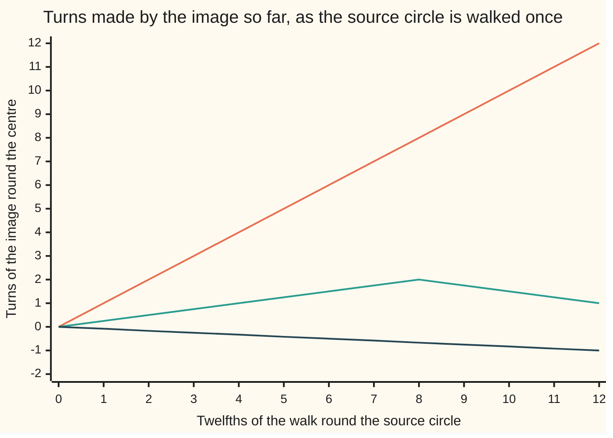

# Homology of spheres, and degree: how many times one sphere wraps around another

[Syllabus](../../../SYLLABUS.md) → [Topology](../README.md) → [Homology](../README.md#s05) → Homology of spheres, and degree

---

## General Overview

A wall clock runs for 12 hours. The hour hand goes round once; the minute hand goes round 12 times. Read the minute hand's position as a function of the hour hand's, and you have a map from one circle to another that wraps it 12 times.

Pick a minute-hand position, say straight up at 12. It happens 12 times: with the hour hand at 0°, 30°, 60° and so on to 330°. Every other position also happens 12 times. That count is the map's **degree**.

The count is stubborn. Let the minute hand run fast, slow or stop for a while: as long as it moves continuously and ends where it started, the net count stays 12. Write a point of the dial as a complex number z of size 1. Multiplying complex numbers adds their angles, so the clock's map is $`z \mapsto z^{12}`$, and in general $`z \mapsto z^n`$ has degree n.

Homology makes the count exact for spheres of every dimension. A sphere has one piece, one hole of its own dimension, and nothing else. That top hole is a copy of the whole numbers, so a map from a sphere to itself can only multiply it by a whole number: the degree. It decides questions such as "must this equation have a solution?" and "must this map fix a point?"

**A sphere of dimension n has homology only in dimensions 0 and n, each a copy of the whole numbers; a map from the sphere to itself multiplies the top copy by a whole number, its degree, which equals the number of points sent to a typical target, counted with signs.**

**What kind of fact this is:** a theorem (the homology of spheres), proved on this card in Why it works; a definition (the degree); and a theorem (degree as a signed count), proved here for maps built from simplices and stated with a source for all continuous maps.

### The picture: three circle maps, turn by turn



Orange: the clock, $`z \mapsto z^{12}`$, ending at 12 turns. Teal: a zigzag map that winds forward 2 turns, then back 1, ending at 1. Dark blue: the mirror map, the hour hand's position seen in a mirror, $`z \mapsto \bar z`$, ending at −1. The end value of each line is its degree. Both checks print every point.

---

## The formula

Three things first, each in one line.

- The **n-sphere** $`S^n`$ is the set of points at distance 1 from the centre in (n + 1)-dimensional space: $`S^1`$ is a circle, $`S^2`$ the surface of a ball, $`S^0`$ the two points −1 and 1.
- The **homology group** $`H_k`$ is the k-cycles with the boundaries divided out ([Homology groups](02-homology-groups.md)). Here the coefficients are the whole numbers $`\mathbb{Z}`$, so torsion would show; [Smith normal form](03-computing-homology-by-smith-normal-form.md) finds it.
- A continuous map $`f`$ sends cycles to cycles and boundaries to boundaries, so it gives a map $`f_*`$ on homology. Maps that slide into each other give the same $`f_*`$ ([Homotopy invariance](04-homotopy-invariance-of-homology.md)).

The homology of every sphere, for n at least 1:

```math
H_k(S^n) \cong \begin{cases} \mathbb{Z} & k = 0 \text{ or } k = n \\ 0 & \text{otherwise} \end{cases} \qquad\qquad H_0(S^0) \cong \mathbb{Z}^2
```

**Read it aloud:** a sphere of dimension n has one piece and one n-dimensional hole, and no holes in between; the zero-sphere is two points, so two pieces.

The **fundamental class** $`[S^n]`$ is a generator of $`H_n(S^n)`$: the whole sphere covered once, in a chosen direction. A map f from $`S^n`$ to itself sends it to a whole-number multiple of itself, and that multiple is the **degree**:

```math
f_*[S^n] = (\deg f)\,[S^n], \qquad \deg f = \sum_{x \in f^{-1}(y)} \varepsilon_x
```

**Read it aloud:** f covers the sphere deg f times over; to find deg f, list the points x sent to a typical target y, score each +1 if f keeps direction there and −1 if it reverses, and add.

For the clock, y is the minute hand at 12. The 12 points x are the hour hand at 0°, 30°, …, 330°, each scoring +1: degree 12.

| Symbol | Plain meaning | In our example | Push it up and the answer… |
| --- | --- | --- | --- |
| $`S^n`$ | the n-sphere | $`S^1`$, the dial's rim | — |
| $`n`$, $`k`$ | the sphere's dimension; the dimension a group counts | n = 1 for the clock, 2 for the Earth | the top hole moves up with n |
| $`H_k`$, $`\mathbb{Z}`$ | the k-th homology group; the whole numbers, its coefficients | $`H_1(S^1) \cong \mathbb{Z}`$ | — |
| $`[S^n]`$ | the fundamental class: the sphere covered once, in a chosen direction | the 36 edges of the hour circle, walked forward | — |
| $`f`$, $`f_*`$ | a continuous map of the sphere to itself; its effect on homology | hour hand to minute hand; $`f_*[S^1] = 12\,[S^1]`$ | — |
| $`\deg f`$ | the degree: the whole number $`f_*`$ multiplies by | 12 | more wraps, larger degree |
| $`y`$, $`f^{-1}(y)`$, $`\varepsilon_x`$ | a target; the points sent to it; the score +1 or −1 at each | minute hand at 12; 12 hour positions; +1 each | — |
| $`z`$, $`\bar z`$, $`z^n`$, $`p(z)`$ | a point of the unit circle as a complex number; its mirror image, the complex conjugate (here the bar is not a closure); its n-th power; a polynomial | $`z^{12}`$; $`p(z) = z^2 - 4z + 5`$ | larger n, more wraps |
| $`x`$, $`-x`$ | a point of $`S^n`$; the opposite point, its antipode | a city; the point on the far side of the Earth | — |
| $`U`$, $`V`$ | the sphere less its south pole; less its north pole | two overlapping caps of $`S^2`$ | — |
| $`t`$, $`F`$, $`G`$ | a time from 0 to 1; the two slides in the Step 7 proof | — | — |
| $`v`$ | an arrow along the surface at each point, such as the wind | the wind over the Earth | — |

### When it holds

- **The map is continuous.** With a jump, the count can be anything. A minute hand that jumps from 6 back to 12 every half hour covers the right half of the dial and never the left.
- **Source and target have the same dimension.** The degree reads off $`H_n`$ of both. A map from $`S^1`$ to $`S^2`$ has none, since $`H_1(S^2) = 0`$.
- **The target is typical, a regular value.** At each point sent to y, f must be locally one-to-one, with a direction to keep or reverse. Where the zigzag map turns back, it folds, and a fold has no score. For smooth maps, Sard's theorem says almost every y is typical.
- **The coefficients are whole numbers.** Mod 2, the mirror's −1 and the identity's 1 are equal; only parity survives.
- **Both spheres carry a chosen direction.** Reverse one and every degree changes sign.

---

## Why it works

### Step 0: a sphere is two caps glued along an equator

Cut the Earth's surface along the equator, with a little overlap. Each half squashes to a point, so it has no holes. The overlap is a band that squashes to a circle.

Mayer–Vietoris says how the holes of the pieces make the holes of the whole. Here the caps contribute nothing, so every hole of the sphere comes from a hole of the band, one dimension down: the circle's loop becomes the sphere's enclosed space. Repeat, and the hole climbs one dimension per sphere.

### Step 1: the homology of every sphere, by induction

Mayer–Vietoris ([Mayer-Vietoris and exact sequences](06-mayer-vietoris-and-long-exact-sequences.md)), in one line: for a space that is the union of open pieces U and V, there is an exact sequence (each map's image is exactly what the next map sends to zero; $`\oplus`$ pairs a class of U with a class of V, as in G × H)

```math
\cdots \to H_k(U \cap V) \to H_k(U) \oplus H_k(V) \to H_k(U \cup V) \to H_{k-1}(U \cap V) \to \cdots
```

On $`S^n`$, take U as the sphere less its south pole and V less its north pole. Each is a stretched copy of flat n-dimensional space, which squashes to a point. Their overlap squashes onto the equator, a copy of $`S^{n-1}`$. The caps' groups vanish above dimension 0, so for k at least 2

```math
H_k(S^n) \cong H_{k-1}(S^{n-1})
```

**Read it aloud:** a k-dimensional hole in the n-sphere matches a hole one dimension lower in the sphere one dimension lower.

Walking down gives $`H_n(S^n) \cong H_1(S^1) \cong \mathbb{Z}`$; every other group above dimension 0 lands on a zero group. The fold handles the low dimensions.

<details>
<summary>Detailed proof: the homology of spheres</summary>

Homotopy invariance replaces U and V by a point and $`U \cap V`$ by $`S^{n-1}`$.

**Dimension 0.** For n at least 1 the sphere is path-connected, so $`H_0(S^n) \cong \mathbb{Z}`$ ([Homology groups](02-homology-groups.md), Step 4). $`S^0`$ is two points: $`\mathbb{Z}^2`$.

**The circle.** A triangle's rim is a circle. Its one cycle bounds nothing, and there are no 2-simplices, so $`H_1(S^1) \cong \mathbb{Z}`$ and $`H_k(S^1) = 0`$ for k at least 2.

**Dimension 1, for n at least 2.** The sequence contains

$`\displaystyle 0 = H_1(U) \oplus H_1(V) \to H_1(S^n) \to H_0(U \cap V) \to H_0(U) \oplus H_0(V).`$

The overlap is connected, so the last map sends a generator of $`\mathbb{Z}`$ to (1, −1) in $`\mathbb{Z}^2`$. It is one-to-one, so the map before it is zero. The zero on the left makes that map one-to-one too, so $`H_1(S^n) = 0`$.

**Dimension k at least 2.** The stretch

$`\displaystyle 0 = H_k(U) \oplus H_k(V) \to H_k(S^n) \to H_{k-1}(U \cap V) \to H_{k-1}(U) \oplus H_{k-1}(V) = 0`$

has zeros at both ends, so the middle map is one-to-one and onto.

**Induction.** Step down until the dimension reaches 1 or the sphere reaches $`S^1`$. If k = n, the chain ends at $`H_1(S^1) \cong \mathbb{Z}`$. If k > n, it ends above dimension 1 on the circle: zero. If 2 ≤ k < n, it ends at $`H_1`$ of a sphere of dimension at least 2: zero.

</details>

### Step 2: the same answer, computed

[Cellular homology](05-cellular-homology.md) builds $`S^n`$ from one point and one n-dimensional disc whose whole rim is glued to that point ([CW complexes](../04-Homotopy/07-cw-complexes-and-gluing-cells.md)), and reads off one $`\mathbb{Z}`$ in dimensions 0 and n. That method uses this card's result for each cell's rim, so it confirms the answer rather than proving it again.

The checks cut each sphere into simplices two ways and reduce every boundary matrix to its integer Smith form:

| Sphere | Boundary of a simplex: simplices by dimension | Cross-polytope: simplices by dimension | Homology over $`\mathbb{Z}`$, both ways |
| --- | --- | --- | --- |
| $`S^0`$ | 2 | — | $`\mathbb{Z}^2`$ |
| $`S^1`$ | 3, 3 | 4, 4 (a square) | $`\mathbb{Z}`$, $`\mathbb{Z}`$ |
| $`S^2`$ | 4, 6, 4 | 6, 12, 8 (an octahedron) | $`\mathbb{Z}`$, 0, $`\mathbb{Z}`$ |
| $`S^3`$ | 5, 10, 10, 5 | 8, 24, 32, 16 | $`\mathbb{Z}`$, 0, 0, $`\mathbb{Z}`$ |
| $`S^4`$ | 6, 15, 20, 15, 6 | — | $`\mathbb{Z}`$, 0, 0, 0, $`\mathbb{Z}`$ |

No torsion appears. The Euler characteristic, simplices counted with alternating signs, is 2 for even n and 0 for odd n, matching the ranks. These 8 triangulations illustrate the theorem; Step 1 proves it.

### Step 3: the degree is a whole number, and it composes

$`H_n(S^n)`$ is a copy of $`\mathbb{Z}`$, and $`f_*`$ respects addition. Such a map is fixed by where it sends 1, so it multiplies by one whole number: deg f. Four properties follow.

1. **The identity has degree 1.**
2. **Degrees multiply.** Doing g after f multiplies the top class by deg f, then by deg g. $`z^2`$ then $`z^3`$ is $`z^6`$: 2 × 3 = 6.
3. **Sliding a map keeps its degree.** Homotopic maps give the same $`f_*`$, so no continuous regearing changes the clock's 12.
4. **Nonzero degree forces the map onto.** If f misses a point, it maps into the sphere less a point, which squashes to a point, whose $`H_n`$ is 0. Then deg f = 0.

### Step 4: the degree counts preimages with signs

Build both spheres from simplices, and let f send each source simplex onto a target simplex, corner to corner, or squash it flat. The fundamental class is the sum of all top simplices, each signed + or − so the boundaries cancel.

Push the class through f. Each source simplex lands on a target simplex, carrying its own sign, times −1 if f puts its corners an odd number of swaps out of order. If the result matches the target simplex's sign, f keeps direction there; if not, it reverses.

Pick a target simplex and a point y inside it. Each source simplex landing there holds exactly one point sent to y. So the pushed class puts on that simplex its own sign times the signed count of $`f^{-1}(y)`$. The pushed class is also deg f times the target class. So the signed count is deg f, wherever y lies.

On the clock, cut the hour circle into 36 edges, one per 10°, and the minute circle into a triangle with corners at 0°, 120° and 240°. Hour position 10k° goes to 120k°, the corner k mod 3. Each of the 36 edges lands forward on one of the 3 target edges, 12 on each.

This proves the count for maps built from simplices. Any continuous map slides to one of these by simplicial approximation, and the count holds at every regular value; Hatcher's Section 2.2 (Sources) proves the general case, and this card does not repeat it.

### Step 5: z to the n has degree n

The real map $`z \mapsto z^n`$ and the edge-by-edge version agree at the corners, and between corners both move forward across the same arc. Sliding one into the other is a homotopy, so both have degree n. For negative n each edge lands backward; for n = 0 every edge is squashed. The checks confirm every n from −3 to 12, 16 cases, by three roads; that illustrates the claim, and the homotopy argument proves it.

On the circle the degree is the winding number. [The argument principle](../../07-Complex%20analysis/06-Real%20Integrals%20and%20Counting%20Zeros/06-the-argument-principle.md) reads $`z^n`$ as an output curve winding n times round 0, and [The circle's fundamental group is the integers](../04-Homotopy/04-fundamental-group-of-the-circle.md) counts the same turns with loops. Homology gives the same number in every dimension.

### Step 6: mirrors and the antipodal map

A **reflection** flips one coordinate, as $`z \mapsto \bar z`$ does on the circle. Build $`S^n`$ as a cross-polytope, with corners at plus and minus each axis direction: a square for $`S^1`$, an octahedron for $`S^2`$. A reflection swaps the two corners on one axis, sending each top simplex to its neighbour across that axis, whose sign is opposite. So the class goes to minus itself: degree −1.

The **antipodal map** $`x \mapsto -x`$ is n + 1 reflections, one per axis, so its degree is $`(-1)^{n+1}`$. On the circle that is +1: the antipode is a half-turn. On the Earth's surface it is −1.

### Step 7: what the degree forces

**Fixed points.** If f(x) is never x, the straight path from f(x) to −x misses the centre, and sliding along it turns f into the antipodal map. So deg f = $`(-1)^{n+1}`$. On $`S^2`$, a map whose degree is not −1 must fix a point: a rotation of a globe, degree 1, fixes its poles. The Lefschetz fixed point theorem extends this to other spaces (Hatcher, Section 2.C).

**Combing a sphere.** Picture the wind as an arrow at each point of the Earth, flat along the surface. If no arrow were zero, each point could travel along its arrow, through half a great circle, to its antipode. That slides the identity, degree 1, into the antipodal map, degree −1. Impossible, so some arrow is zero.

<details>
<summary>Detailed proof: the two slides</summary>

**No fixed point.** Define

$`\displaystyle F(x, t) = \frac{(1 - t) f(x) - t x}{\lvert (1 - t) f(x) - t x \rvert}.`$

The bottom is zero only if (1 − t)f(x) = tx. Both have length 1, so t = 1/2 and f(x) = x, which was ruled out. So F slides f (t = 0) to the antipodal map (t = 1).

**Combing.** Let v(x) be a continuous arrow field with no zero, scaled to length 1 and perpendicular to x. Define

$`\displaystyle G(x, t) = \cos(\pi t)\, x + \sin(\pi t)\, v(x).`$

It has length 1, starts at the identity and ends at −x. So $`1 = (-1)^{n+1}`$ and n is odd. On $`S^2`$, n = 2: no such field.

</details>

**Roots of polynomials.** Take $`p(z) = z^2 - 4z + 5`$, the football's polynomial from [The fundamental theorem of algebra](../../03-Algebra/10-For%20the%20Curious/01-fundamental-theorem-of-algebra.md). On circles of radius 1, 2, 3 and 10 round 0, p(z) turns round 0 this many times: 0, 0, 2, 2. If p had no root, growing the circle would be a slide that never meets 0, and the count could not change. It jumps, so a root lies between radius 2 and 3: the roots 2 ± i sit at radius 2.236. For any polynomial of degree n the top power wins on a large circle, giving n. When p(0) is not 0, the constant wins on a tiny one, giving 0; otherwise 0 is a root already.

---

## Worked numbers, by hand

The clock: hour hand to minute hand, cut into edges.

| Step | Arithmetic | Value |
| --- | --- | --- |
| hour circle | one corner every 10° | 36 corners, 36 edges |
| minute circle | corners at 0°, 120°, 240° | 3 corners, 3 edges |
| where corner k goes | 10k° × 12 = 120k°, corner k mod 3 | 0, 1, 2, 0, 1, 2, … |
| edges landing on target edge 0 → 1 | k = 0, 3, 6, …, 33 | 12, all forward |
| signed count at a point inside that edge | 12 × (+1) | 12 |
| pushed fundamental class | each target edge gets 12 | 12 × the triangle's class |
| minute hand at 12 | hour hand at 0°, 30°, …, 330° | 12 points, each +1 |
| degree | | **12** |

In 12 hours every minute-hand position occurs exactly 12 times, always moving forward. Speeding, slowing or pausing the hands cannot change the net count, as long as they move continuously and finish where a true clock would.

### What breaks if you drop a piece

| Mistake | Comes out at | What went wrong |
| --- | --- | --- |
| The mirror map, $`z \mapsto \bar z`$, counted without signs | 1 point, so "degree 1"; truly −1 | conjugation reverses direction: the one preimage scores −1 |
| The zigzag map counted without signs | 3 points; truly 1 | the backward pass cancels one forward pass: +1 +1 −1 |
| Degrees of $`z^2`$ then $`z^3`$ added | 5; truly 6 | degrees multiply under composition |
| The antipode taken as degree 1 in every dimension | 1 on $`S^1`$ but −1 on $`S^2`$ | it is n + 1 reflections, each −1 |

The code prints all four.

---

## Code, from first principles, and it actually runs

Both programs build every sphere from simplices and reduce each signed boundary matrix to its integer Smith form, so torsion would show. Nothing imported knows any homology. Degrees come by three independent roads:

- the fundamental class pushed through the map, simplex by simplex, with the swap sign;
- the signed count of source edges landing on one target edge, walking the source circle in order;
- the real map's angle, added up in small turns read by atan2 (the angle of a point from its two coordinates) at 720 steps.

The first two are exact; the third is floating point, rounded to whole turns. Each sphere here is a finite complex computed exactly, so its homology is proved; the claim for every n is Step 1's.

### Python

```python
# Homology of spheres, and degree -- the check behind the card.  Standard library only.
# Spheres are triangulated two ways; their homology over Z comes from an integer Smith form.
# Degrees come three ways: the fundamental cycle pushed through the map, preimages counted
# with signs, and the real map's turning angle added up.  Exact except the angle sums.
from itertools import combinations, product
import cmath, math

def closure(tops):                       # every face of the top simplices, by dimension
    cells = {}
    for t in tops:
        for k in range(1, len(t) + 1):
            cells.setdefault(k - 1, set()).update(combinations(t, k))
    return [sorted(cells[k]) for k in sorted(cells)]

def boundary(rows, cols):                # signed matrix of the boundary map
    where, m = {s: i for i, s in enumerate(rows)}, [[0] * len(cols) for _ in rows]
    for j, s in enumerate(cols):
        for i in range(len(s)):
            m[where[s[:i] + s[i + 1:]]][j] = (-1) ** i
    return m

def smith(m):                            # nonzero diagonal of the integer Smith form
    m, diag = [r[:] for r in m], []
    while m and m[0] and any(v for r in m for v in r):
        _, i, j = min((abs(v), i, j) for i, r in enumerate(m) for j, v in enumerate(r) if v)
        m[0], m[i] = m[i], m[0]
        for r in m:
            r[0], r[j] = r[j], r[0]
        p = m[0][0]
        for i in range(1, len(m)):       # clear the pivot's column, then its row
            m[i] = [a - m[i][0] // p * b for a, b in zip(m[i], m[0])]
        q = [v // p for v in m[0]]
        for r in m:
            r[1:] = [v - qj * r[0] for v, qj in zip(r[1:], q[1:])]
        if any(r[0] for r in m[1:]) or any(m[0][1:]):
            continue                     # a remainder is left: pivot again on it
        bad = [r for r in m[1:] if any(v % p for v in r[1:])]
        if bad:                          # p must divide the rest: if not, mix a row in
            m[0] = [a + b for a, b in zip(m[0], bad[0])]
        else:
            diag, m = diag + [abs(p)], [r[1:] for r in m[1:]]
    return diag

def homology(tops):                      # H_k as (rank, torsion), and simplex counts
    c = closure(tops)
    sf = [[]] + [smith(boundary(c[k - 1], c[k])) for k in range(1, len(c))] + [[]]
    return [(len(c[k]) - len(sf[k]) - len(sf[k + 1]), [d for d in sf[k + 1] if d > 1])
            for k in range(len(c))], [len(x) for x in c]

yn = lambda claim: "yes" if claim else "no"
name = lambda rank, tors: " + ".join(([f"Z^{rank}"] if rank > 1 else ["Z"] * rank)
                                     + [f"Z/{d}" for d in tors]) or "0"

def is_cycle(chain):                     # does the chain have zero boundary?
    rim = {}
    for s, c in chain.items():
        for i in range(len(s)):
            rim[s[:i] + s[i + 1:]] = rim.get(s[:i] + s[i + 1:], 0) + (-1) ** i * c
    return not any(rim.values())
def degree(src, tgt, f):                 # f takes src's cycle to d times tgt's cycle
    img = {}
    for s, c in src.items():
        im = [f(v) for v in s]
        if len(set(im)) == len(im):      # a squashed simplex contributes nothing
            sign = (-1) ** sum(a > b for a, b in combinations(im, 2))   # reordering sign
            img[tuple(sorted(im))] = img.get(tuple(sorted(im)), 0) + sign * c
    ratios = {img.get(t, 0) * c for t, c in tgt.items()}
    assert len(ratios) == 1 and all(t in tgt for t, v in img.items() if v)
    return ratios.pop()

def ring(n):                             # fundamental cycle of an n-gon circle
    return {**{(k, k + 1): 1 for k in range(n - 1)}, (0, n - 1): -1}
def cross(n):                            # fundamental cycle of the cross-polytope S^n
    return {tuple(2 * i + b for i, b in enumerate(s)): (-1) ** sum(s)
            for s in product((0, 1), repeat=n + 1)}
def signs(n_src, f):                     # walk the source; edges laid on target edge 0-1
    hits = [(f(k), f((k + 1) % n_src)) for k in range(n_src)]
    return [1 if h == (0, 1) else -1 for h in hits if h in ((0, 1), (1, 0))]

def turns(g, steps=720):                 # running total turn of g(t) round 0, in turns
    pts, out, tot = [g(2 * math.pi * s / steps) for s in range(steps + 1)], [0.0], 0.0
    for a, b in zip(pts, pts[1:]):
        step = b * a.conjugate()         # the small turn from one value to the next
        tot += math.atan2(step.imag, step.real)
        out.append(tot / (2 * math.pi))
    return out

power = lambda n: lambda t: cmath.exp(1j * n * t)                  # z^n on the unit circle
zigzag = lambda t: cmath.exp(1j * (3 * t if t <= 4 * math.pi / 3 else 8 * math.pi - 3 * t))
quad = lambda r: lambda t: (w := r * cmath.exp(1j * t)) * w - 4 * w + 5

print("homology over Z of S^n, triangulated as the boundary of an (n+1)-simplex:")
for n in range(5):
    hs, cnt = homology(list(combinations(range(n + 2), n + 1)))
    chi = sum((-1) ** k * c for k, c in enumerate(cnt))
    print(f"S{n}: simplices {cnt}, chi {chi}; " + ", ".join(f"H{k} {name(*h)}" for k, h in enumerate(hs)))
    assert hs == [(2 if n == 0 else 1, [])] + [(int(k == n), []) for k in range(1, n + 1)]
    assert chi == sum((-1) ** k * h[0] for k, h in enumerate(hs)) == 1 + (-1) ** n
for n in (1, 2, 3):                      # the square, the octahedron, the 16-cell
    hs, cnt = homology(list(cross(n)))
    print(f"S{n} as a cross-polytope: simplices {cnt}; " + ", ".join(f"H{k} {name(*h)}" for k, h in enumerate(hs)))
    assert hs == [(1, [])] + [(int(k == n), []) for k in range(1, n + 1)]
    assert is_cycle(cross(n)) and not is_cycle({**cross(n), tuple(range(0, 2 * n + 2, 2)): -1})
clock = lambda k: k % 3                  # hour hand at 10k degrees, minute hand at 120k
d_chain, sg, d_turn = degree(ring(36), ring(3), clock), signs(36, clock), round(turns(power(12))[-1])
print(f"clock, z^12 as a 36-gon onto a triangle: fundamental cycle goes to {d_chain} x the target's")
print(f"clock: source edges laid on target edge 0-1: {len(sg)}, signs sum {sum(sg)}; angle turns {d_turn}")
print("clock: minute hand at 12 when the hour hand is at", [30 * h for h in range(12)], "degrees")
ns = list(range(-3, 13))
maps = [(3 * max(abs(n), 1), (lambda s: lambda k: s * k % 3)((n > 0) - (n < 0))) for n in ns]
by_chain = [degree(ring(N), ring(3), f) for N, f in maps]
by_signs, by_turns = [sum(signs(N, f)) for N, f in maps], [round(turns(power(n))[-1]) for n in ns]
print(f"z^n for n = -3..12, by chain map: {by_chain}")
print(f"same, by signed preimages: {yn(by_signs == ns)}; by angle turns: {yn(by_turns == ns)}")
mirror, zig = (lambda k: -k % 12), lambda k: [0, 1, 2, 3, 0, 1, 2, 3, 0, 3, 2, 1][k]
m_turn, z_turn = turns(power(-1)), turns(zigzag)
print(f"mirror, z to conj(z) on a 12-gon: chain {degree(ring(12), ring(12), mirror)}, "
      f"preimage signs {signs(12, mirror)}, turns {round(m_turn[-1])}")
print(f"zigzag, 2 turns on then 1 back: chain {degree(ring(12), ring(4), zig)}, "
      f"preimage signs {signs(12, zig)}, turns {round(z_turn[-1])}")
d2, d3 = degree(ring(18), ring(9), lambda k: k % 9), degree(ring(9), ring(3), lambda k: k % 3)
d6 = degree(ring(18), ring(3), lambda k: k % 9 % 3)
print(f"z^3 after z^2: degrees {d2} and {d3}, composite {d6}; added instead: {d2 + d3}")
anti = [degree(cross(n), cross(n), lambda v: v ^ 1) for n in (1, 2, 3)]
refl = [[degree(cross(n), cross(n), lambda v, i=i: v ^ (v // 2 == i)) for i in range(n + 1)]
        for n in (1, 2, 3)]
print(f"antipode on S1, S2, S3 by chain map: {anti}")
print(f"reflections in one axis each: {refl}; products {[math.prod(r) for r in refl]}")
fta = [round(turns(quad(r))[-1]) for r in (1, 2, 3, 10)]
print(f"z^2 - 4z + 5 round radius 1, 2, 3, 10: turns {fta}; roots 2 +- i at radius {math.sqrt(5):.3f}")
print("chart, turns so far at each twelfth of the walk:")
for label, tr in (("clock", turns(power(12))), ("zigzag", z_turn), ("mirror", m_turn)):
    print(label, " ".join(f"{tr[60 * k]:.2f}" for k in range(13)))
assert d_chain == sum(sg) == d_turn == 12 and len(sg) == 12        # three roads, the clock
assert by_chain == by_signs == by_turns == ns                       # z^n has degree n
assert degree(ring(12), ring(12), mirror) == sum(signs(12, mirror)) == round(m_turn[-1]) == -1
assert degree(ring(12), ring(4), zig) == sum(signs(12, zig)) == round(z_turn[-1]) == 1
assert d6 == d2 * d3 == 6 and anti == [math.prod(r) for r in refl] == [1, -1, 1]
assert fta == [0, 0, 2, 2]
print("ALL CHECKS PASS")
```

**Ran 2026-11-15 on macOS, Python 3.14.10, standard library only. All checks passed. Output, pasted from the run:**

```
homology over Z of S^n, triangulated as the boundary of an (n+1)-simplex:
S0: simplices [2], chi 2; H0 Z^2
S1: simplices [3, 3], chi 0; H0 Z, H1 Z
S2: simplices [4, 6, 4], chi 2; H0 Z, H1 0, H2 Z
S3: simplices [5, 10, 10, 5], chi 0; H0 Z, H1 0, H2 0, H3 Z
S4: simplices [6, 15, 20, 15, 6], chi 2; H0 Z, H1 0, H2 0, H3 0, H4 Z
S1 as a cross-polytope: simplices [4, 4]; H0 Z, H1 Z
S2 as a cross-polytope: simplices [6, 12, 8]; H0 Z, H1 0, H2 Z
S3 as a cross-polytope: simplices [8, 24, 32, 16]; H0 Z, H1 0, H2 0, H3 Z
clock, z^12 as a 36-gon onto a triangle: fundamental cycle goes to 12 x the target's
clock: source edges laid on target edge 0-1: 12, signs sum 12; angle turns 12
clock: minute hand at 12 when the hour hand is at [0, 30, 60, 90, 120, 150, 180, 210, 240, 270, 300, 330] degrees
z^n for n = -3..12, by chain map: [-3, -2, -1, 0, 1, 2, 3, 4, 5, 6, 7, 8, 9, 10, 11, 12]
same, by signed preimages: yes; by angle turns: yes
mirror, z to conj(z) on a 12-gon: chain -1, preimage signs [-1], turns -1
zigzag, 2 turns on then 1 back: chain 1, preimage signs [1, 1, -1], turns 1
z^3 after z^2: degrees 2 and 3, composite 6; added instead: 5
antipode on S1, S2, S3 by chain map: [1, -1, 1]
reflections in one axis each: [[-1, -1], [-1, -1, -1], [-1, -1, -1, -1]]; products [1, -1, 1]
z^2 - 4z + 5 round radius 1, 2, 3, 10: turns [0, 0, 2, 2]; roots 2 +- i at radius 2.236
chart, turns so far at each twelfth of the walk:
clock 0.00 1.00 2.00 3.00 4.00 5.00 6.00 7.00 8.00 9.00 10.00 11.00 12.00
zigzag 0.00 0.25 0.50 0.75 1.00 1.25 1.50 1.75 2.00 1.75 1.50 1.25 1.00
mirror 0.00 -0.08 -0.17 -0.25 -0.33 -0.42 -0.50 -0.58 -0.67 -0.75 -0.83 -0.92 -1.00
ALL CHECKS PASS
```

### Rust

Same numbers, same labels, built with `rustc --edition 2021 -O`.

```rust
// Homology of spheres, and degree -- the same check as the Python, in Rust.  No crates.
// Spheres are triangulated two ways; their homology over Z comes from an integer Smith form.
// Degrees come three ways: the fundamental cycle pushed through the map, preimages counted
// with signs, and the real map's turning angle added up.  Exact except the angle sums.
use std::collections::{BTreeMap, BTreeSet};
use std::f64::consts::PI;
type Chain = BTreeMap<Vec<usize>, i64>;

fn combos(items: &[usize], k: usize) -> Vec<Vec<usize>> {  // the k-subsets of items
    (0..1usize << items.len()).filter(|m| m.count_ones() as usize == k)
        .map(|m| (0..items.len()).filter(|i| m >> i & 1 == 1).map(|i| items[i]).collect()).collect()
}
fn closure(tops: &[Vec<usize>]) -> Vec<Vec<Vec<usize>>> {   // every face, by dimension
    let mut cells: Vec<BTreeSet<Vec<usize>>> = vec![BTreeSet::new(); tops[0].len()];
    for t in tops { for k in 1..=t.len() { cells[k - 1].extend(combos(t, k)) } }
    cells.into_iter().map(|c| c.into_iter().collect()).collect()
}
fn face(s: &[usize], i: usize) -> Vec<usize> { let mut f = s.to_vec(); f.remove(i); f }
fn boundary(rows: &[Vec<usize>], cols: &[Vec<usize>]) -> Vec<Vec<i64>> {
    let mut m = vec![vec![0i64; cols.len()]; rows.len()];
    for (j, s) in cols.iter().enumerate() {
        for i in 0..s.len() { m[rows.iter().position(|x| *x == face(s, i)).unwrap()][j] = 1 - 2 * (i % 2) as i64 }
    }
    m
}
fn fdiv(a: i64, b: i64) -> i64 { if b > 0 { a.div_euclid(b) } else { (-a).div_euclid(-b) } }  // floor
fn smith(mut m: Vec<Vec<i64>>) -> Vec<i64> {                // nonzero Smith diagonal
    let mut diag = vec![];
    while !m.is_empty() && !m[0].is_empty() && m.iter().flatten().any(|&v| v != 0) {
        let mut best = (i64::MAX, 0, 0);
        for (i, r) in m.iter().enumerate() {                 // the smallest nonzero entry
            for (j, &v) in r.iter().enumerate() { if v != 0 && (v.abs(), i, j) < best { best = (v.abs(), i, j) } }
        }
        let (_, i, j) = best; m.swap(0, i);
        for r in m.iter_mut() { r.swap(0, j) }
        let p = m[0][0];
        for i in 1..m.len() {                                // clear the column, then the row
            let (q, top) = (fdiv(m[i][0], p), m[0].clone());
            for (a, b) in m[i].iter_mut().zip(top) { *a -= q * b }
        }
        let q: Vec<i64> = m[0].iter().map(|&v| fdiv(v, p)).collect();
        for r in m.iter_mut() { let r0 = r[0]; for j in 1..r.len() { r[j] -= q[j] * r0 } }
        if m[1..].iter().any(|r| r[0] != 0) || m[0][1..].iter().any(|&v| v != 0) { continue }
        match m[1..].iter().find(|r| r[1..].iter().any(|v| v % p != 0)).cloned() {
            Some(bad) => { for (a, b) in m[0].iter_mut().zip(bad) { *a += b } }
            None => { diag.push(p.abs()); m = m[1..].iter().map(|r| r[1..].to_vec()).collect() }
        }
    }
    diag
}
fn homology(tops: &[Vec<usize>]) -> (Vec<(usize, Vec<i64>)>, Vec<usize>) {
    let c = closure(tops);
    let sf: Vec<Vec<i64>> = std::iter::once(vec![]).chain((1..c.len())
        .map(|k| smith(boundary(&c[k - 1], &c[k])))).chain(std::iter::once(vec![])).collect();
    let hs = (0..c.len()).map(|k| (c[k].len() - sf[k].len() - sf[k + 1].len(),
        sf[k + 1].iter().copied().filter(|&d| d > 1).collect())).collect();
    (hs, c.iter().map(|x| x.len()).collect())
}
fn name(rank: usize, tors: &[i64]) -> String {
    let mut out: Vec<String> = if rank > 1 { vec![format!("Z^{}", rank)] } else { vec!["Z".to_string(); rank] };
    out.extend(tors.iter().map(|d| format!("Z/{}", d)));
    if out.is_empty() { "0".to_string() } else { out.join(" + ") }
}
fn groups(hs: &[(usize, Vec<i64>)]) -> String {
    hs.iter().enumerate().map(|(k, h)| format!("H{} {}", k, name(h.0, &h.1))).collect::<Vec<_>>().join(", ")
}
fn is_cycle(chain: &Chain) -> bool {                        // does the chain have zero boundary?
    let mut rim: Chain = BTreeMap::new();
    for (s, c) in chain { for i in 0..s.len() { *rim.entry(face(s, i)).or_insert(0) += if i % 2 == 0 { *c } else { -*c } } }
    rim.values().all(|&v| v == 0)
}
fn degree(src: &Chain, tgt: &Chain, f: &dyn Fn(usize) -> usize) -> i64 {
    let mut img: Chain = BTreeMap::new();
    for (s, c) in src {
        let im: Vec<usize> = s.iter().map(|&v| f(v)).collect();
        let mut key = im.clone(); key.sort(); key.dedup();
        if key.len() < im.len() { continue }                // a squashed simplex gives nothing
        let inv = (0..im.len()).flat_map(|a| (a + 1..im.len()).map(move |b| (a, b)))
            .filter(|&(a, b)| im[a] > im[b]).count();      // the reordering sign
        *img.entry(key).or_insert(0) += if inv % 2 == 0 { *c } else { -*c };
    }
    let ratios: BTreeSet<i64> = tgt.iter().map(|(t, c)| img.get(t).copied().unwrap_or(0) * c).collect();
    assert!(ratios.len() == 1 && img.iter().all(|(t, &v)| v == 0 || tgt.contains_key(t)));
    *ratios.iter().next().unwrap()
}
fn ring(n: usize) -> Chain {                                // fundamental cycle of an n-gon
    (0..n - 1).map(|k| (vec![k, k + 1], 1)).chain([(vec![0, n - 1], -1)]).collect()
}
fn cross(n: usize) -> Chain {                               // the cross-polytope S^n
    (0..1usize << (n + 1)).map(|mask| ((0..=n).map(|i| 2 * i + (mask >> i & 1)).collect(),
        if mask.count_ones() % 2 == 0 { 1 } else { -1 })).collect()
}
fn signs(n_src: usize, f: &dyn Fn(usize) -> usize) -> Vec<i64> {
    (0..n_src).map(|k| (f(k), f((k + 1) % n_src)))
        .filter(|&h| h == (0, 1) || h == (1, 0)).map(|h| if h == (0, 1) { 1 } else { -1 }).collect()
}
fn turns(g: &dyn Fn(f64) -> (f64, f64)) -> Vec<f64> {      // running total turn round 0
    let pts: Vec<(f64, f64)> = (0..=720).map(|s| g(2.0 * PI * s as f64 / 720.0)).collect();
    let (mut out, mut tot) = (vec![0.0], 0.0);
    for w in pts.windows(2) {
        let ((ar, ai), (br, bi)) = (w[0], w[1]);
        tot += (bi * ar - br * ai).atan2(br * ar + bi * ai);      // the small turn between values
        out.push(tot / (2.0 * PI));
    }
    out
}
fn power(n: i64) -> impl Fn(f64) -> (f64, f64) { move |t| ((n as f64 * t).cos(), (n as f64 * t).sin()) }
fn yn(claim: bool) -> &'static str { if claim { "yes" } else { "no" } }
fn last(v: Vec<f64>) -> i64 { v[v.len() - 1].round() as i64 }
fn main() {
    println!("homology over Z of S^n, triangulated as the boundary of an (n+1)-simplex:");
    for n in 0..5usize {
        let (hs, cnt) = homology(&combos(&(0..n + 2).collect::<Vec<_>>(), n + 1));
        let chi: i64 = cnt.iter().enumerate().map(|(k, &c)| if k % 2 == 0 { c as i64 } else { -(c as i64) }).sum();
        println!("S{}: simplices {:?}, chi {}; {}", n, cnt, chi, groups(&hs));
        let want: Vec<(usize, Vec<i64>)> = (0..=n).map(|k| (if k == 0 { if n == 0 { 2 } else { 1 } } else { (k == n) as usize }, vec![])).collect();
        let alt: i64 = hs.iter().enumerate().map(|(k, h)| if k % 2 == 0 { h.0 as i64 } else { -(h.0 as i64) }).sum();
        assert!(hs == want && chi == alt && chi == 1 + if n % 2 == 0 { 1 } else { -1 });
    }
    for n in 1..4usize {                                    // the square, the octahedron, the 16-cell
        let (hs, cnt) = homology(&cross(n).keys().cloned().collect::<Vec<_>>());
        println!("S{} as a cross-polytope: simplices {:?}; {}", n, cnt, groups(&hs));
        let want: Vec<(usize, Vec<i64>)> = (0..=n).map(|k| (if k == 0 { 1 } else { (k == n) as usize }, vec![])).collect();
        let mut flipped = cross(n); flipped.insert((0..=n).map(|i| 2 * i).collect(), -1);
        assert!(hs == want && is_cycle(&cross(n)) && !is_cycle(&flipped));
    }
    let clock = |k: usize| k % 3;                           // hour hand at 10k degrees, minute hand at 120k
    let (d_chain, sg, d_turn) = (degree(&ring(36), &ring(3), &clock), signs(36, &clock), last(turns(&power(12))));
    println!("clock, z^12 as a 36-gon onto a triangle: fundamental cycle goes to {} x the target's", d_chain);
    println!("clock: source edges laid on target edge 0-1: {}, signs sum {}; angle turns {}", sg.len(), sg.iter().sum::<i64>(), d_turn);
    println!("clock: minute hand at 12 when the hour hand is at {:?} degrees", (0..12).map(|h| 30 * h).collect::<Vec<i64>>());
    let ns: Vec<i64> = (-3..13).collect();
    let map = |n: i64| move |k: usize| ((n.signum() * k as i64).rem_euclid(3)) as usize;
    let size = |n: i64| 3 * n.unsigned_abs().max(1) as usize;
    let by_chain: Vec<i64> = ns.iter().map(|&n| degree(&ring(size(n)), &ring(3), &map(n))).collect();
    let by_signs: Vec<i64> = ns.iter().map(|&n| signs(size(n), &map(n)).iter().sum()).collect();
    let by_turns: Vec<i64> = ns.iter().map(|&n| last(turns(&power(n)))).collect();
    println!("z^n for n = -3..12, by chain map: {:?}", by_chain);
    println!("same, by signed preimages: {}; by angle turns: {}", yn(by_signs == ns), yn(by_turns == ns));
    let mirror = |k: usize| (12 - k) % 12;
    let zig = |k: usize| [0, 1, 2, 3, 0, 1, 2, 3, 0, 3, 2, 1][k];
    let zigzag = |t: f64| { let a = if t <= 4.0 * PI / 3.0 { 3.0 * t } else { 8.0 * PI - 3.0 * t }; (a.cos(), a.sin()) };
    let (m_turn, z_turn) = (turns(&power(-1)), turns(&zigzag));
    let (dm, dz) = (degree(&ring(12), &ring(12), &mirror), degree(&ring(12), &ring(4), &zig));
    println!("mirror, z to conj(z) on a 12-gon: chain {}, preimage signs {:?}, turns {}", dm, signs(12, &mirror), last(m_turn.clone()));
    println!("zigzag, 2 turns on then 1 back: chain {}, preimage signs {:?}, turns {}", dz, signs(12, &zig), last(z_turn.clone()));
    let (d2, d3) = (degree(&ring(18), &ring(9), &|k| k % 9), degree(&ring(9), &ring(3), &|k| k % 3));
    let d6 = degree(&ring(18), &ring(3), &|k| k % 9 % 3);
    println!("z^3 after z^2: degrees {} and {}, composite {}; added instead: {}", d2, d3, d6, d2 + d3);
    let anti: Vec<i64> = (1..4).map(|n| degree(&cross(n), &cross(n), &|v| v ^ 1)).collect();
    let refl: Vec<Vec<i64>> = (1..4usize).map(|n| (0..=n)
        .map(|i| degree(&cross(n), &cross(n), &move |v| v ^ (v / 2 == i) as usize)).collect()).collect();
    let prods: Vec<i64> = refl.iter().map(|r| r.iter().product()).collect();
    println!("antipode on S1, S2, S3 by chain map: {:?}", anti);
    println!("reflections in one axis each: {:?}; products {:?}", refl, prods);
    let quad = |r: f64| move |t: f64| { let (x, y) = (r * t.cos(), r * t.sin()); (x * x - y * y - 4.0 * x + 5.0, 2.0 * x * y - 4.0 * y) };
    let fta: Vec<i64> = [1.0, 2.0, 3.0, 10.0].iter().map(|&r| last(turns(&quad(r)))).collect();
    println!("z^2 - 4z + 5 round radius 1, 2, 3, 10: turns {:?}; roots 2 +- i at radius {:.3}", fta, 5f64.sqrt());
    println!("chart, turns so far at each twelfth of the walk:");
    for (label, tr) in [("clock", turns(&power(12))), ("zigzag", z_turn.clone()), ("mirror", m_turn.clone())] {
        println!("{} {}", label, (0..13).map(|k| format!("{:.2}", tr[60 * k])).collect::<Vec<_>>().join(" "));
    }
    assert!(d_chain == 12 && sg.iter().sum::<i64>() == 12 && d_turn == 12 && sg.len() == 12);   // the clock
    assert!(by_chain == ns && by_signs == ns && by_turns == ns);                             // z^n has degree n
    assert!(dm == -1 && signs(12, &mirror).iter().sum::<i64>() == -1 && last(m_turn) == -1);
    assert!(dz == 1 && signs(12, &zig).iter().sum::<i64>() == 1 && last(z_turn) == 1);
    assert!(d6 == d2 * d3 && d6 == 6 && anti == prods && anti == vec![1, -1, 1]);
    assert!(fta == vec![0, 0, 2, 2]);
    println!("ALL CHECKS PASS");
}
```

**Ran 2026-11-15 on macOS, rustc 1.98.1, no crates. All checks passed. Output, pasted from the run:**

```
homology over Z of S^n, triangulated as the boundary of an (n+1)-simplex:
S0: simplices [2], chi 2; H0 Z^2
S1: simplices [3, 3], chi 0; H0 Z, H1 Z
S2: simplices [4, 6, 4], chi 2; H0 Z, H1 0, H2 Z
S3: simplices [5, 10, 10, 5], chi 0; H0 Z, H1 0, H2 0, H3 Z
S4: simplices [6, 15, 20, 15, 6], chi 2; H0 Z, H1 0, H2 0, H3 0, H4 Z
S1 as a cross-polytope: simplices [4, 4]; H0 Z, H1 Z
S2 as a cross-polytope: simplices [6, 12, 8]; H0 Z, H1 0, H2 Z
S3 as a cross-polytope: simplices [8, 24, 32, 16]; H0 Z, H1 0, H2 0, H3 Z
clock, z^12 as a 36-gon onto a triangle: fundamental cycle goes to 12 x the target's
clock: source edges laid on target edge 0-1: 12, signs sum 12; angle turns 12
clock: minute hand at 12 when the hour hand is at [0, 30, 60, 90, 120, 150, 180, 210, 240, 270, 300, 330] degrees
z^n for n = -3..12, by chain map: [-3, -2, -1, 0, 1, 2, 3, 4, 5, 6, 7, 8, 9, 10, 11, 12]
same, by signed preimages: yes; by angle turns: yes
mirror, z to conj(z) on a 12-gon: chain -1, preimage signs [-1], turns -1
zigzag, 2 turns on then 1 back: chain 1, preimage signs [1, 1, -1], turns 1
z^3 after z^2: degrees 2 and 3, composite 6; added instead: 5
antipode on S1, S2, S3 by chain map: [1, -1, 1]
reflections in one axis each: [[-1, -1], [-1, -1, -1], [-1, -1, -1, -1]]; products [1, -1, 1]
z^2 - 4z + 5 round radius 1, 2, 3, 10: turns [0, 0, 2, 2]; roots 2 +- i at radius 2.236
chart, turns so far at each twelfth of the walk:
clock 0.00 1.00 2.00 3.00 4.00 5.00 6.00 7.00 8.00 9.00 10.00 11.00 12.00
zigzag 0.00 0.25 0.50 0.75 1.00 1.25 1.50 1.75 2.00 1.75 1.50 1.25 1.00
mirror 0.00 -0.08 -0.17 -0.25 -0.33 -0.42 -0.50 -0.58 -0.67 -0.75 -0.83 -0.92 -1.00
ALL CHECKS PASS
```

The two outputs match line for line.

> [!TIP]
> **Try changing**
> Guess first, then run it.
> - **Move the roots.** In `quad`, change `+ 5` to `+ 1`. One root moves inside radius 1 and the other beyond radius 3, so the turns read 1, 1, 1, 2. The last assert stops the run.
> - **Zigzag forward three times.** Change the list's last four entries `0, 3, 2, 1` to `0, 1, 2, 3`. Chain map and signed count say 3; the angle road still says 1, and an assert stops the run.
> - **Drop the swap sign.** In `degree`, replace the sign with `1`. The clock's edges from corner 2 to corner 0 now disagree with the triangle's class, and the assert inside `degree` stops the run.
> - **Swap the antipode for the identity.** Change `v ^ 1` to `v`. The degrees read 1, 1, 1, no longer the reflections' products, and an assert stops the run.

---

## The usual mistake

> [!warning]
> **Counting preimages without signs.** The degree is not the number of points sent to y. It is that number with each point scored +1 or −1 by direction. The mirror map sends exactly one point to each target, yet its degree is −1, not 1. The zigzag map sends three points to every target, yet its degree is 1.
>
> - **Adding degrees under composition.** $`z^2`$ then $`z^3`$ is $`z^6`$: degree 6, not 5.
> - **Carrying the circle's answer up a dimension.** The antipodal map has degree 1 on the circle and −1 on $`S^2`$.
> - **Reading the degree mod 2.** Over $`\mathbb{Z}`$ mod 2 the mirror map reads 1, the same as doing nothing; only the whole numbers see its −1.
> - **Forgetting $`S^0`$.** Two points have $`H_0 \cong \mathbb{Z}^2`$, not $`\mathbb{Z}`$: the rule "one piece, one top hole" starts at n = 1.

---

## Where you meet it in real life

- **Weather maps.** Model the wind along the Earth's surface as a continuous field of arrows. Step 7 says somewhere there is no horizontal wind. Hopf (Sources) adds the count: the arrows' turning numbers round the calm points add up to the Euler characteristic, 2.
- **Solving equations.** Nonzero degree forces a map onto (Step 3), so every target has a solution. The fundamental theorem of algebra is the case worked here.
- **Control engineering.** The Nyquist test judges a feedback loop stable or not by how often a frequency-response curve turns round a point: a degree on the circle ([The argument principle](../../07-Complex%20analysis/06-Real%20Integrals%20and%20Counting%20Zeros/06-the-argument-principle.md)).
- **Fixed points in economics.** Brouwer's theorem, that a continuous map of a solid ball to itself fixes a point, rests on $`H_n(S^n) \cong \mathbb{Z}`$: a ball cannot be pushed onto its rim with the rim held still, since the rim's top class would pass through the ball's zero group. Economists use it to show a market model has prices where supply meets demand. [Brouwer and Borsuk-Ulam](../04-Homotopy/08-brouwer-and-borsuk-ulam.md) proves the flat-disc case with loops.

> **Say it back**
> A sphere of dimension n has one piece and one n-dimensional hole; Mayer–Vietoris proves this by gluing two caps along an equator. The top hole is a copy of the whole numbers, so a map from the sphere to itself multiplies it by one whole number, its degree. The degree equals the points sent to a typical target, each scored +1 or −1 by direction. The clock's minute hand, $`z^{12}`$, has degree 12; a mirror has degree −1. Nonzero degree forces solutions, and the antipode's −1 on $`S^2`$ forces a calm point in any wind.

---

## What this builds on

- [Mayer-Vietoris and exact sequences](06-mayer-vietoris-and-long-exact-sequences.md): the exact sequence that moves a sphere's hole up one dimension at a time.
- [The argument principle](../../07-Complex%20analysis/06-Real%20Integrals%20and%20Counting%20Zeros/06-the-argument-principle.md): the circle case of degree, read as how many times an output curve winds round 0.
- [The fundamental theorem of algebra](../../03-Algebra/10-For%20the%20Curious/01-fundamental-theorem-of-algebra.md): the root whose existence the turn count proves.
- [Homology groups](02-homology-groups.md) and [Homotopy invariance](04-homotopy-invariance-of-homology.md): the groups, and why sliding a map leaves its effect on them unchanged.

## Where this goes next

- [Cohomology and the cup product in outline](08-cohomology-and-cup-product-in-outline.md): the next card; the dual groups, which carry a multiplication that tells apart spaces with equal homology.
- [Sard's theorem and degree](../../23-Differential%20geometry%20and%20Lie%20groups/03-Manifolds/10-sards-theorem-and-degree.md): why almost every target point is typical, so the signed count works for smooth maps with no triangles at all.
- [Singular homology](09-singular-homology-and-excision.md): hole counts for any space, with no triangulation, and excision proved.
- [Eilenberg-Steenrod axioms](10-eilenberg-steenrod-axioms.md): five rules that force every homology theory to agree on cell complexes.
- [Higher homotopy groups](../07-Higher%20Homotopy%20and%20Mapping%20Spaces/02-higher-homotopy-groups-and-fibrations.md): wrap a sphere around a space, and the Hopf fibration that wraps S^3 around S^2.
- [Transversality and cobordism](../../23-Differential%20geometry%20and%20Lie%20groups/03-Manifolds/11-transversality-intersection-numbers-and-cobordism.md): crossings that survive a wiggle, and shapes that bound together.

Homology counts holes but cannot multiply them, so spaces with equal groups can still differ: the torus and a sphere with two loops attached at one point have the same homology. What extra structure tells them apart?

---

## Sources

Verified 2026-11-15: every link below resolves to the publisher's page, except Hatcher's author page, which carries the full text, and every DOI was checked against Crossref.

- Hatcher, Allen. *Algebraic Topology*. Cambridge University Press, 2002. [Author's page, with the free edition](https://pi.math.cornell.edu/~hatcher/AT/ATpage.html). Section 2.2 computes the homology of spheres by an exact sequence, defines degree, proves the local count, and gives the fixed-point and combing theorems; Section 2.C covers Lefschetz.
- Munkres, James R. *Elements of Algebraic Topology*. CRC Press, 2018 reissue of the 1984 edition. [doi:10.1201/9780429493911](https://doi.org/10.1201/9780429493911). Simplicial maps, the chain map they induce, and simplicial approximation, the route Step 4 takes.
- Brouwer, L. E. J. "Über Abbildung von Mannigfaltigkeiten." *Mathematische Annalen* 71 (1911): 97–115. [doi:10.1007/BF01456931](https://doi.org/10.1007/BF01456931). The paper that introduced the degree of a map and proved its invariance.
- Hopf, Heinz. "Vektorfelder in n-dimensionalen Mannigfaltigkeiten." *Mathematische Annalen* 96 (1927): 225–249. [doi:10.1007/BF01209164](https://doi.org/10.1007/BF01209164). The zeros of a vector field, counted with their turning numbers, add up to the Euler characteristic.
