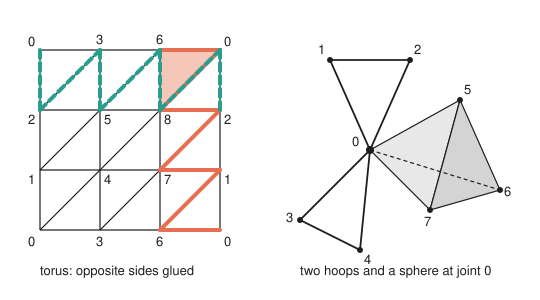

# Cohomology and the cup product in outline: the dual view, carrying a multiplication

[Syllabus](../../../SYLLABUS.md) → [Topology](../README.md) → [Homology](../README.md#s05) → Cohomology and the cup product in outline

---

## General Overview

Take an inner tube: a **torus**, the surface of a ring doughnut. Next to it, weld two wire hoops and a hollow ball together at one point: **two circles and a sphere joined up**.

Count their holes with [Homology groups](02-homology-groups.md). Each is 1 piece. Each has 2 independent loops that nothing fills. Each encloses 1 sealed space. Both have Euler characteristic 0 (joints minus struts plus panels). Every count agrees, yet a tube is clearly not two hoops and a ball.

Cohomology turns the question around. A chain is built out of struts and panels. A **cochain** is a measurement: one number on every strut, or on every panel. Paint a stripe across the tube, like a band on a sleeve. The measurement "around" counts how often a path crosses that stripe. A walk once around the long way reads 1; a walk once round the sleeve, through the hole, reads 0. A second stripe, painted along the tube, gives a second measurement, "through", which reads the other way: 0 and 1.

Measurements multiply, and that is the new thing. On the tube, "around" times "through" gives a panel measurement that reads 1 on the whole surface. On the hoops and ball, every such product reads 0.

**Cohomology measures chains instead of building them, so it counts the same holes, but its measurements multiply (the cup product), and the multiplication separates spaces whose hole counts agree.**

**What kind of fact this is:** definitions (cochain, coboundary, cohomology group, cup product) and three results proved in Why it works: over the rationals cohomology has the Betti numbers as its sizes, the cup product is well defined on classes, and on these two triangulations the torus's product is not zero while the other's is. Poincaré duality and the Künneth formula are stated, not proved, and checked on the torus.

### The picture: the torus grid and the joined-up space

<p align="center"></p>

Schematic. Left: the torus as a 3 × 3 grid, left side glued to right and top to bottom, each square cut into 2 panels: 9 joints, 27 struts, 18 panels. The measurement a is nonzero on the orange struts, b on the dashed teal ones. Their product is nonzero only on the shaded panel 0, 6, 8. Right: two hollow triangles and a tetrahedron's surface sharing joint 0: 8 joints, 12 struts, 4 panels.

---

## The formula

Carried over, each in one line:

- A **k-simplex** $`[v_0, \ldots, v_k]`$ is a joint, strut or panel, listed by its corners in increasing order. A **k-chain** is a sum of them with coefficients, and the boundary $`\partial`$, with alternating signs, has $`\partial \partial = 0`$ ([Simplicial complexes and chains](01-simplicial-complexes-and-chains.md)).
- The **Betti number** $`\beta_k`$ counts independent k-dimensional holes ([Homology groups](02-homology-groups.md)).

A **k-cochain** $`c`$ is one number on each k-simplex; together they form the group $`C^k`$, index up for the dual view. The **pairing** $`\langle c, z \rangle`$ measures a chain: multiply the cochain's number on each simplex by the chain's coefficient there, and add.

The **coboundary** $`\delta`$ turns a k-cochain into a (k+1)-cochain: its value on a simplex is the old cochain read on that simplex's boundary. (This $`\delta`$ is not the small distance of an ε–δ argument.) As a matrix, $`\delta^k`$ is $`\partial_{k+1}`$ transposed.

```math
\langle \delta c, \sigma \rangle = \langle c, \partial \sigma \rangle, \qquad H^k = \ker \delta^k \,/\, \mathrm{im}\, \delta^{k-1}
```

**Read it aloud:** the coboundary of a measurement, read on a simplex, is the measurement read around its rim; the k-th cohomology group is the measurements with zero coboundary, two counted the same when they differ by a coboundary.

A cochain with zero coboundary is a **cocycle**; one of the form $`\delta f`$ is a **coboundary**. The **cup product** multiplies two 1-cochains into a 2-cochain:

```math
(\alpha \smile \beta)[v_0, v_1, v_2] = \alpha[v_0, v_1] \cdot \beta[v_1, v_2]
```

**Read it aloud:** on each panel, the first measurement on the front edge times the second on the back edge.

**Poincaré duality**, for a closed (finite, with no rim) orientable surface $`M`$ with top 2-cycle $`[M]`$:

```math
\dim H^k(M) = \dim H_{2-k}(M), \qquad \det \big( \langle x_i \smile x_j, [M] \rangle \big) = \pm 1
```

**Read it aloud:** there are as many k-dimensional measurements as (2 − k)-dimensional holes, and for a basis $`x_1, x_2, \ldots`$ of the whole-number 1-dimensional classes, the table of products read on the surface has determinant 1 or −1.

| Symbol | Plain meaning | In our example | Push it up and the answer… |
| --- | --- | --- | --- |
| $`C^k`$, $`n_k`$ | the k-cochains: one number per k-simplex; the number of k-simplices | the torus's $`C^1`$ has $`n_1 = 27`$ entries | — |
| $`\langle c, z \rangle`$ | the pairing: measurement times coefficient, added | $`a`$ reads 1 on the loop around | — |
| $`\delta`$, $`\delta^k`$ | the coboundary; as a matrix, $`\partial_{k+1}`$ transposed | $`\delta^1`$: 18 × 27, rank 17 | — |
| $`H^k`$ | cohomology: cocycles, coboundaries counted as zero | the torus's $`H^1`$ has basis $`a, b`$ | its size over the rationals is $`\beta_k`$ |
| $`\smile`$ | the cup product: front edge times back edge | $`a \smile b`$ is 1 on panel 068 only | — |
| $`c`$, $`\alpha`$, $`\beta`$, $`f`$, $`h`$ | any cochain; $`f`$ is a 0-cochain, one number per joint; $`h`$ is a 1-cochain, one number per strut; this $`\beta`$ has no index and is not $`\beta_k`$ | $`f`$ is −1, 0 or 1 on each of 9 joints | — |
| $`a`$, $`b`$ | ±1 on struts that wrap over the column seam, or the row seam | 6 struts each | — |
| $`c_1`$, $`c_2`$ | 1 on strut [1,2], or on strut [3,4]: one per hoop | each reads 1 on its hoop | — |
| $`[M]`$, $`T`$, $`S`$ | the top 2-cycle: every panel with sign ±1, no rim left | $`T`$ on the torus, $`S`$ on the ball | — |
| $`\beta_k`$ | the Betti number over the rationals | 1, 2, 1 for both spaces | — |
| $`P(t)`$ | the Poincaré polynomial $`\beta_0 + \beta_1 t + \beta_2 t^2`$ | $`1 + 2t + t^2`$ for both | — |
| $`x_i`$, $`\det`$ | a basis of the whole-number 1-dimensional classes; the determinant of their 2 × 2 product table | $`x_1, x_2`$ are $`a, b`$ on the torus, $`c_1, c_2`$ on the joined-up space; det 1 and 0 | — |

### When it holds

- **The product is taken on cocycles.** Only then does it change by a coboundary when a factor does. Add 1 to $`b`$ on strut [1,4], so that $`\delta b`$ is no longer 0, and the reading on $`T`$ survives only 6,561 of the 19,683 shifts of $`a`$.
- **Duality needs a closed surface.** With one panel out, the torus reads 1, 2, 0: no sealed space to match its one piece.
- **Duality needs an orientable surface, or coefficients mod 2.** The Klein bottle reads 1, 1, 0 over the rationals but 1, 2, 1 over the integers mod 2 ([Orientability](../03-Surfaces%20and%20Manifolds/03-orientability-mobius-strip-and-klein-bottle.md)).
- **Duality needs a manifold.** The joined-up space has symmetric Betti numbers, but its product table has determinant 0. Near joint 0 it is not a surface.
- **Künneth's product rule needs a field** (numbers that can be divided, such as the rationals or the integers mod 2). Over the integers an extra term appears (Step 7).

---

## Why it works

### Step 0: measure instead of build

Every fact about chains becomes a fact about cochains, read through the pairing. Reading $`\delta c`$ on a region equals reading $`c`$ around its rim. That is the shape of [Stokes' theorem](../../06-Calculus%20and%20analysis/09-Vector%20Calculus/08-stokes-theorem.md), swirl over a sheet against push round its rim, with the integral now a finite sum.

### Step 1: cohomology counts the same holes

Since $`\delta`$ is $`\partial`$ transposed, $`\delta \delta`$ is $`\partial \partial`$ transposed, so it is 0. A matrix and its transpose have the same rank, so over the rationals, with $`n_k`$ the number of k-simplices:

```math
\dim H^k = (n_k - \mathrm{rank}\, \delta^k) - \mathrm{rank}\, \delta^{k-1} = n_k - \mathrm{rank}\, \partial_{k+1} - \mathrm{rank}\, \partial_k = \beta_k
```

The check computes both sides by separate eliminations: 1, 2, 1 for each space. The sizes add nothing new. The gain is the product.

### Step 2: the seam measurements are a basis

The grid has a column seam, where column 2 is glued back to column 0, and a row seam. The measurement $`a`$ gives a strut +1 if walking it from lower to higher corner wraps forward over the column seam, −1 if backward, else 0. It is nonzero on 6 struts; $`b`$ does the same for the row seam.

Every panel's rim crosses each seam as often forwards as backwards, so $`\delta a = \delta b = 0`$. On a loop around each way they read `[[1, 0], [0, 1]]`. A coboundary reads 0 on every loop, so no mix of them is a coboundary: they form a basis of $`H^1`$.

### Step 3: the product is well defined on classes

Shift $`a`$ to $`a + \delta f`$, with $`f`$ any number on each joint. The product changes by $`\delta f \smile b`$, and the **Leibniz rule** (a product rule for $`\delta`$) shows that is a coboundary when $`\delta b = 0`$:

```math
\delta (f \smile b) = \delta f \smile b + f \smile \delta b = \delta f \smile b
```

Here $`(f \smile b)[u, v] = f(u)\, b[u, v]`$. A coboundary reads 0 on the top cycle, since $`\langle \delta h, T \rangle = \langle h, \partial T \rangle = 0`$. So the reading of the product on $`T`$ ignores the shift.

The check tries every $`f`$ with values −1, 0 or 1 on the 9 joints, 3⁹ = 19,683 cases: the reading stays 1 and the Leibniz rule holds exactly in all of them. The fold proves it for every $`f`$.

<details>
<summary>Detailed proof: the Leibniz rule on one panel</summary>

Take a panel $`[u, v, w]`$, a 0-cochain $`f`$ and a 1-cochain $`\beta`$. A 1-cochain $`h`$ has $`\delta h[u, v, w] = h[v, w] - h[u, w] + h[u, v]`$, and $`\delta f[u, v] = f(v) - f(u)`$. So

$`\displaystyle \delta (f \smile \beta)[u, v, w] = f(v)\beta[v, w] - f(u)\beta[u, w] + f(u)\beta[u, v].`$

The two terms on the right of the rule are

$`\displaystyle (\delta f \smile \beta)[u, v, w] = \big(f(v) - f(u)\big)\beta[v, w], \qquad (f \smile \delta \beta)[u, v, w] = f(u)\big(\beta[v, w] - \beta[u, w] + \beta[u, v]\big).`$

Add them: the two $`f(u)\beta[v, w]`$ terms cancel and the first line is left. Shifting $`b`$ instead gives the same rule with a minus sign on the second term, and the same conclusion.

</details>

### Step 4: on the torus the product is not zero

$`a \smile b`$ is nonzero on 1 of the 18 panels: 068, in the corner square where the seams meet. It reads 1 there, and that panel enters $`T`$ with sign +1, so $`\langle a \smile b, T \rangle = 1`$. A coboundary would read 0, so $`a \smile b`$ is not one. Second road: adding it as a column raises the rank of $`\delta^1`$ from 17 to 18.

The full table on $`T`$ is `[[0, 1], [-1, 0]]`, determinant 1: $`a \smile a`$ and $`b \smile b`$ read 0, and $`b \smile a`$ reads −1.

### Step 5: on the joined-up space every product is zero

Neither hoop strut [1,2] nor [3,4] is the edge of a panel, so $`c_1`$ and $`c_2`$ are cocycles, and the check finds them a basis of $`H^1`$. The only panels are on the ball, which never touches a hoop strut, so every product is the zero cochain: table `[[0, 0], [0, 0]]`, determinant 0.

To rule out a lucky choice, shift them: add the coboundary of "1 at joint 5" to $`c_1`$ and of "1 at joint 6" to $`c_2`$. Their product is now the cochain `[1, 0, 0, 1]` on the 4 ball panels. But it reads 0 on $`S`$, and adding it to $`\delta^1`$ leaves the rank at 3. It is a coboundary; its class is still 0.

### Step 6: what the product separates

A homotopy equivalence (a map with an inverse up to deformation, ≃) carries cohomology to cohomology and products to products. That is stated here and proved in Hatcher's Sections 3.1 and 3.2. So the torus is not ≃ the joined-up space. Equal Betti numbers proved nothing; a different product proves a difference. [Van Kampen's theorem](../04-Homotopy/06-van-kampens-theorem.md) reaches the same verdict through loop groups.

### Step 7: Poincaré duality and Künneth, stated

**Poincaré duality.** On a closed orientable surface, k-dimensional measurements match (2 − k)-dimensional holes, and the product table on $`H^1`$ has determinant ±1. The proof idea: put a dual joint in each panel and a dual strut across each strut. A k-cochain on the old grid is then a (2 − k)-chain on the dual grid. Hatcher's Section 3.3 proves it in every dimension. The check confirms the torus: 1, 2, 1 and determinant 1.

**Künneth over a field.** The torus is a circle times a circle. Over a field, the Poincaré polynomial of a product is the product of the polynomials:

```math
P_{T}(t) = (1 + t)(1 + t) = 1 + 2t + t^2
```

That matches the 1, 2, 1 read from the matrices; three circles give 1, 3, 3, 1. Over the integers the formula gains a correction term, Tor, which [Universal coefficients and Kunneth](11-universal-coefficients-and-kunneth.md) builds for finitely generated groups; [Tor](../../22-Algebraic%20geometry/07-Exact%20Sequences%2C%20Ext%20and%20Tor/04-free-resolutions-and-tor.md) builds it in general, and Hatcher's Section 3.B proves the general formula.

### Step 8: what this outline leaves out

The cap product and duality in higher dimensions ([Poincare duality](12-cap-product-and-poincare-duality.md)), universal coefficients and Steenrod squares. On smooth spaces the same cohomology comes from calculus, as closed forms modulo derivatives: de Rham cohomology, in two later wings.

---

## Worked numbers, by hand

The product $`a \smile b`$ on its one nonzero panel of the torus:

| Step | Arithmetic | Value |
| --- | --- | --- |
| $`a`$ on strut [0,6] | column 0 to column 2: backward over the column seam | −1 |
| $`b`$ on strut [6,8] | row 0 to row 2: backward over the row seam | −1 |
| $`(a \smile b)[0, 6, 8]`$ | (−1) × (−1) | 1 |
| the other 17 panels | front edge misses the column seam or back edge misses the row seam | 0 |
| sign of 068 in $`T`$ | listed anticlockwise as 8, 0, 6; sorting takes two swaps | +1 |
| $`\langle a \smile b, T \rangle`$ | 1 × (+1) | **1** |
| $`\langle b \smile a, T \rangle`$ | factors swapped | −1 |
| torus determinant | 0 × 0 − 1 × (−1) | **1** |
| joined-up space determinant | 0 × 0 − 0 × 0 | **0** |

On the torus, "around" times "through" covers the surface once. On the joined-up space, no two loops multiply to cover anything.

### What breaks if you drop a piece

| Mistake | Comes out at | What went wrong |
| --- | --- | --- |
| Compare Betti numbers only | torus 1, 2, 1 = joined-up 1, 2, 1; $`\chi`$ 0 = 0 | equal invariants prove nothing |
| Read a nonzero cochain as a nonzero class | shifted product nonzero on 2 of 4 panels | it is a coboundary: 0 on $`S`$, rank stays 3 |
| Swap the factors | $`\langle b \smile a, T \rangle = -1`$, not 1 | degree-1 classes change sign when swapped |
| Duality on the Klein bottle over the rationals | 1, 1, 0 | not orientable; mod 2 it reads 1, 2, 1 |
| Duality with a panel out | 1, 2, 0 | the surface has a rim |

The code prints all five.

---

## Code, from first principles, and it actually runs

Both programs build the four complexes from their panels, write the signed boundary matrices, transpose them into coboundaries, and find every rank by exact whole-number elimination. Nothing imported knows any topology. The roads:

- Betti numbers from $`\partial`$ against cohomology sizes from $`\delta`$, separately eliminated, and again mod 2;
- whether $`a \smile b`$ is a coboundary, two ways: its reading on $`T`$, and the rank of $`\delta^1`$ with it added;
- all 19,683 shifts $`a + \delta f`$, with the Leibniz rule checked as a vector identity each time, and the reading redone against a factor that is not a cocycle;
- Künneth's $`(1 + t)^2`$ against the Betti numbers from the matrices.

These finite complexes are computed exactly, so their numbers are proved. The general theorems of Steps 6 and 7 are not checked here.

### Python

```python
# Cohomology and the cup product -- the check behind the card.  Standard library only.
# A cochain is a number on each simplex; the coboundary is the boundary matrix turned
# on its side.  The torus and two circles joined to a sphere get the same Betti
# numbers; the cup product, paired with the top 2-cycle, tells them apart.
from itertools import combinations, product
from math import gcd

def rank(M, p=0):                    # exact elimination over Q (p = 0) or over Z mod p
    A, r = [row[:] for row in M], 0
    for c in range(len(A[0]) if A else 0):
        piv = next((i for i in range(r, len(A)) if (A[i][c] % p if p else A[i][c])), None)
        if piv is None:
            continue
        A[r], A[piv] = A[piv], A[r]
        for i in range(r + 1, len(A)):
            new = [A[r][c] * y - A[i][c] * x for x, y in zip(A[r], A[i])]
            g = gcd(*new) if not p else 0
            A[i] = [v % p for v in new] if p else [v // g for v in new] if g else new
        r += 1
    return r

def closure(tris, edges=()):         # every face of every simplex, vertices in increasing order
    K = [set(), set(), set()]
    for s in list(tris) + list(edges):
        s = tuple(sorted(s))
        for k in range(len(s)):
            K[k].update(combinations(s, k + 1))
    return [sorted(x) for x in K]

def bd(K, k):                        # boundary d_k: rows (k-1)-simplices, columns k-simplices
    row = {s: i for i, s in enumerate(K[k - 1])}
    M = [[0] * len(K[k]) for _ in K[k - 1]]
    for j, s in enumerate(K[k]):
        for i in range(len(s)):
            M[row[s[:i] + s[i + 1:]]][j] = (-1) ** i
    return M

side = lambda M, n: [list(c) for c in zip(*M)] if M and M[0] else [[] for _ in range(n)]  # n = columns of M
mul = lambda M, x: [sum(a * b for a, b in zip(row, x)) for row in M]
pair = lambda c, z: sum(a * b for a, b in zip(c, z))            # <cochain, chain>

def counts(K, p=0):                  # Betti numbers from d, and cohomology dims from delta
    n = [len(x) for x in K]
    r1, r2 = rank(bd(K, 1), p), rank(bd(K, 2), p)
    s0, s1 = rank(side(bd(K, 1), n[1]), p), rank(side(bd(K, 2), n[2]), p)
    return [n[0] - r1, n[1] - r1 - r2, n[2] - r2], [n[0] - s0, n[1] - s0 - s1, n[2] - s1]

def cup(K, x, y):                    # (x cup y)[u, v, w] = x[u, v] * y[v, w]
    e = {s: i for i, s in enumerate(K[1])}
    return [x[e[(u, v)]] * y[e[(v, w)]] for u, v, w in K[2]]

def grid(twist, drop=0):             # 3 x 3 squares, two panels each; twist glues one side flipped
    def v(i, j):
        if i == 3:
            i, j = 0, (-j if twist else j)
        return 3 * (i % 3) + j % 3
    tris = [t for i, j in product(range(3), repeat=2)
            for t in [(v(i, j), v(i + 1, j), v(i + 1, j + 1)), (v(i, j), v(i + 1, j + 1), v(i, j + 1))]]
    return tris[drop:]               # each panel listed anticlockwise in the square

sgn = lambda t: (-1) ** sum(t[a] > t[b] for a, b in combinations(range(3), 2))
names = ["torus", "two circles and a sphere", "Klein bottle", "torus, one panel out"]
tor = closure(grid(False))
wed = closure(combinations((0, 5, 6, 7), 3), [(0, 1), (1, 2), (0, 2), (0, 3), (3, 4), (0, 4)])
kle, holed = closure(grid(True)), closure(grid(False, 1))
print("figure, schematic: torus corner (i, j) at (40 + 60i, 230 - 60j); wedge joint 0 at (370,150)")
print("space: V E F | Betti over Q from d | cohomology dims over Q from delta | over Z mod 2")
B = {}
for nm, K in zip(names, [tor, wed, kle, holed]):
    b, h = counts(K)
    B[nm] = (b, h, counts(K, 2)[0])
    print(f"{nm}: {len(K[0])} {len(K[1])} {len(K[2])} | {b} | {h} | {B[nm][2]}")
    assert b == h                                     # cohomology counts the same holes
top = {tuple(sorted(t)): sgn(t) for t in grid(False)}
T = [top[s] for s in tor[2]]                          # the torus's top 2-cycle, signs +1/-1
S = [{(5, 6, 7): 1, (0, 6, 7): -1, (0, 5, 7): 1, (0, 5, 6): -1}[s] for s in wed[2]]
ktop = {tuple(sorted(t)): sgn(t) for t in grid(True)}
kbad = sum(v != 0 for v in mul(bd(kle, 2), [ktop[s] for s in kle[2]]))
nz = lambda v: sum(x != 0 for x in v)                # how many entries are not zero
print(f"top cycle, nonzero boundary entries: torus {nz(mul(bd(tor, 2), T))}, sphere "
      f"{nz(mul(bd(wed, 2), S))}, Klein bottle with the same signs {kbad} of 27")

seam = lambda key: [{2: -1, -2: 1}.get(key(v) - key(u), 0) for u, v in tor[1]]
a, b = seam(lambda s: s // 3), seam(lambda s: s % 3)  # +1 or -1 on edges that wrap over a seam
d0, d1 = side(bd(tor, 1), 27), side(bd(tor, 2), 18)  # delta^0 and delta^1
loops = [[{(0, 3): 1, (3, 6): 1, (0, 6): -1}.get(e, 0) for e in tor[1]],
         [{(0, 1): 1, (1, 2): 1, (0, 2): -1}.get(e, 0) for e in tor[1]]]
print(f"torus: a on {nz(a)} struts, b on {nz(b)}; nonzero entries of delta a {nz(mul(d1, a))}, of delta b {nz(mul(d1, b))}; "
      f"a, b on the two loops {[[pair(c, z) for z in loops] for c in (a, b)]}")
basis = rank([r + [x, y] for r, x, y in zip(d0, a, b)]) - rank(d0)
P = [[pair(cup(tor, x, y), T) for y in (a, b)] for x in (a, b)]
ab = cup(tor, a, b)
print(f"torus: a, b independent mod coboundaries: {basis} of 2; pairing <x cup y, T> = {P}")
hit = [(s, v) for s, v in zip(tor[2], ab) if v]
print(f"torus: a cup b nonzero on {len(hit)} of 18 panels: {" ".join(f"{u}{v}{w} value {x}" for (u, v, w), x in hit)}; rank delta^1 {rank(d1)}, "
      f"with a cup b added {rank([r + [v] for r, v in zip(d1, ab)])}")
bx = [x + (e == (1, 4)) for x, e in zip(b, tor[1])]  # b plus 1 on strut [1,4]: not a cocycle
same, leib, kept, bx0 = 0, 0, 0, pair(cup(tor, a, bx), T)
for f in product((-1, 0, 1), repeat=9):              # every a + delta f, f in {-1, 0, 1}^9
    df = mul(d0, f)
    same += pair(cup(tor, [x + y for x, y in zip(a, df)], b), T) == P[0][1]
    kept += pair(cup(tor, [x + y for x, y in zip(a, df)], bx), T) == bx0
    fb = [f[u] * b[i] for i, (u, v) in enumerate(tor[1])]          # (f cup b)[u, v] = f(u) b[u, v]
    leib += mul(d1, fb) == cup(tor, df, b)
print(f"torus: <(a + delta f) cup b, T> unchanged for {same} of 3^9 = {3 ** 9} choices of f; "
      f"Leibniz rule holds for {leib}")
print(f"torus, b plus 1 on strut [1,4]: delta of it nonzero on {nz(mul(d1, bx))} panels; reading unchanged for {kept} of {3 ** 9}")

c1 = [int(e == (1, 2)) for e in wed[1]]              # one strut on each hoop
c2 = [int(e == (3, 4)) for e in wed[1]]
w0, w1 = side(bd(wed, 1), 12), side(bd(wed, 2), 4)
c1m = [x + y for x, y in zip(c1, mul(w0, [int(v == 5) for v in range(8)]))]
c2m = [x + y for x, y in zip(c2, mul(w0, [int(v == 6) for v in range(8)]))]
W = [[pair(cup(wed, x, y), S) for y in (c1, c2)] for x in (c1, c2)]
cm = cup(wed, c1m, c2m)
print(f"wedge: nonzero entries of delta c1, c2: {nz(mul(w1, c1))}, {nz(mul(w1, c2))}; independent "
      f"{rank([r + [x, y] for r, x, y in zip(w0, c1, c2)]) - rank(w0)} of 2; pairing <x cup y, S> = {W}")
print(f"wedge, shifted copies: c1' cup c2' nonzero on {nz(cm)} of 4 panels, value {cm}; "
      f"<., S> = {pair(cm, S)}; rank delta^1 {rank(w1)}, with it added {rank([r + [v] for r, v in zip(w1, cm)])}")

pm = lambda p, q: [sum(p[i] * q[k - i] for i in range(len(p)) if 0 <= k - i < len(q)) for k in range(len(p) + len(q) - 1)]
print(f"Kunneth over Q: (1 + t)(1 + t) = {pm([1, 1], [1, 1])}; three circles {pm(pm([1, 1], [1, 1]), [1, 1])}")
det = P[0][0] * P[1][1] - P[0][1] * P[1][0]
print(f"duality: torus pairing det {det}; wedge pairing det {W[0][0] * W[1][1] - W[0][1] * W[1][0]}")
print(f"mistake 1, Betti numbers only: torus {B['torus'][0]} = wedge {B['two circles and a sphere'][0]}, chi 0 = 0")
print(f"mistake 2, order of factors: <b cup a, T> = {P[1][0]}, not {P[0][1]}")
print(f"mistake 3, Klein bottle over Q: {B['Klein bottle'][0]}, b0 = 1 but b2 = 0; over Z mod 2 {B['Klein bottle'][2]}")
print(f"mistake 4, a panel out: {B['torus, one panel out'][0]}, b0 = 1 but b2 = 0")

assert B["torus"][0] == B["two circles and a sphere"][0] == [1, 2, 1] == pm([1, 1], [1, 1])
assert not any(mul(bd(tor, 2), T)) and not any(mul(bd(wed, 2), S)) and kbad > 0
assert basis == 2 and [[pair(c, z) for z in loops] for c in (a, b)] == [[1, 0], [0, 1]]
assert abs(det) == 1 and P[0][0] == P[1][1] == 0 and P[0][1] == -P[1][0]
assert rank([r + [v] for r, v in zip(d1, ab)]) == rank(d1) + 1                 # a cup b is no coboundary
assert same == leib == 3 ** 9 and kept == 3 ** 8 and any(mul(d1, bx)) and W == [[0, 0], [0, 0]] and any(cm) and pair(cm, S) == 0
assert rank([r + [v] for r, v in zip(w1, cm)]) == rank(w1)                      # c1' cup c2' is one
assert B["Klein bottle"][0] == [1, 1, 0] and B["Klein bottle"][2] == [1, 2, 1]
assert B["torus, one panel out"][0] == [1, 2, 0]
print("ALL CHECKS PASS")
```

**Ran 2026-11-15 on macOS, Python 3.14.10, standard library only. All checks passed. Output, pasted from the run:**

```
figure, schematic: torus corner (i, j) at (40 + 60i, 230 - 60j); wedge joint 0 at (370,150)
space: V E F | Betti over Q from d | cohomology dims over Q from delta | over Z mod 2
torus: 9 27 18 | [1, 2, 1] | [1, 2, 1] | [1, 2, 1]
two circles and a sphere: 8 12 4 | [1, 2, 1] | [1, 2, 1] | [1, 2, 1]
Klein bottle: 9 27 18 | [1, 1, 0] | [1, 1, 0] | [1, 2, 1]
torus, one panel out: 9 27 17 | [1, 2, 0] | [1, 2, 0] | [1, 2, 0]
top cycle, nonzero boundary entries: torus 0, sphere 0, Klein bottle with the same signs 3 of 27
torus: a on 6 struts, b on 6; nonzero entries of delta a 0, of delta b 0; a, b on the two loops [[1, 0], [0, 1]]
torus: a, b independent mod coboundaries: 2 of 2; pairing <x cup y, T> = [[0, 1], [-1, 0]]
torus: a cup b nonzero on 1 of 18 panels: 068 value 1; rank delta^1 17, with a cup b added 18
torus: <(a + delta f) cup b, T> unchanged for 19683 of 3^9 = 19683 choices of f; Leibniz rule holds for 19683
torus, b plus 1 on strut [1,4]: delta of it nonzero on 2 panels; reading unchanged for 6561 of 19683
wedge: nonzero entries of delta c1, c2: 0, 0; independent 2 of 2; pairing <x cup y, S> = [[0, 0], [0, 0]]
wedge, shifted copies: c1' cup c2' nonzero on 2 of 4 panels, value [1, 0, 0, 1]; <., S> = 0; rank delta^1 3, with it added 3
Kunneth over Q: (1 + t)(1 + t) = [1, 2, 1]; three circles [1, 3, 3, 1]
duality: torus pairing det 1; wedge pairing det 0
mistake 1, Betti numbers only: torus [1, 2, 1] = wedge [1, 2, 1], chi 0 = 0
mistake 2, order of factors: <b cup a, T> = -1, not 1
mistake 3, Klein bottle over Q: [1, 1, 0], b0 = 1 but b2 = 0; over Z mod 2 [1, 2, 1]
mistake 4, a panel out: [1, 2, 0], b0 = 1 but b2 = 0
ALL CHECKS PASS
```

### Rust

Same numbers, same labels, built with `rustc --edition 2021 -O`.

```rust
// Cohomology and the cup product -- the same check as the Python, in Rust.  No crates.
// A cochain is a number on each simplex; the coboundary is the boundary matrix turned
// on its side.  The torus and two circles joined to a sphere get the same Betti
// numbers; the cup product, paired with the top 2-cycle, tells them apart.
use std::collections::{BTreeMap, BTreeSet};

type S = Vec<usize>;
type M = Vec<Vec<i128>>;

fn gcd(a: i128, b: i128) -> i128 { if b == 0 { a.abs() } else { gcd(b, a % b) } }

fn rank(m: &M, p: i128) -> usize {            // exact elimination over Q (p = 0) or over Z mod p
    let (mut a, mut r) = (m.clone(), 0);
    let cols = if a.is_empty() { 0 } else { a[0].len() };
    let nz = |v: i128| if p != 0 { v % p != 0 } else { v != 0 };
    for c in 0..cols {
        let Some(piv) = (r..a.len()).find(|&i| nz(a[i][c])) else { continue };
        a.swap(r, piv);
        for i in r + 1..a.len() {
            let (x0, y0) = (a[r][c], a[i][c]);
            let new: Vec<i128> = a[r].iter().zip(&a[i]).map(|(x, y)| x0.checked_mul(*y).unwrap() - y0.checked_mul(*x).unwrap()).collect();
            let g = if p != 0 { 0 } else { new.iter().fold(0, |g, &v| gcd(g, v)) };
            a[i] = new.iter().map(|&v| if p != 0 { v.rem_euclid(p) } else if g != 0 { v / g } else { v }).collect();
        }
        r += 1;
    }
    r
}

fn closure(tris: &[S], edges: &[S]) -> [Vec<S>; 3] {   // every face, vertices in increasing order
    let mut k: [BTreeSet<S>; 3] = Default::default();
    for t in tris.iter().chain(edges) {
        let mut s = t.clone(); s.sort();
        for mask in 1u32..(1 << s.len()) {
            let f: S = (0..s.len()).filter(|i| mask >> i & 1 == 1).map(|i| s[i]).collect();
            k[f.len() - 1].insert(f);
        }
    }
    k.map(|x| x.into_iter().collect())
}

fn bd(k: &[Vec<S>; 3], d: usize) -> M {      // boundary d_k: rows (k-1)-simplices, columns k-simplices
    let row: BTreeMap<&S, usize> = k[d - 1].iter().enumerate().map(|(i, s)| (s, i)).collect();
    let mut m = vec![vec![0i128; k[d].len()]; k[d - 1].len()];
    for (j, s) in k[d].iter().enumerate() {
        for i in 0..s.len() { let mut f = s.clone(); f.remove(i); m[row[&f]][j] = if i % 2 == 0 { 1 } else { -1 }; }
    }
    m
}

// side: the matrix turned on its side (transposed); n = columns of m
fn side(m: &M, n: usize) -> M { (0..n).map(|j| m.iter().map(|r| r[j]).collect()).collect() }
fn mul(m: &M, x: &[i128]) -> Vec<i128> { m.iter().map(|r| r.iter().zip(x).map(|(a, b)| a * b).sum()).collect() }
fn pair(c: &[i128], z: &[i128]) -> i128 { c.iter().zip(z).map(|(a, b)| a * b).sum() }
fn nz(v: &[i128]) -> usize { v.iter().filter(|&&x| x != 0).count() }
fn aug(m: &M, cols: &[&Vec<i128>]) -> M { m.iter().enumerate().map(|(i, r)| { let mut r = r.clone(); r.extend(cols.iter().map(|c| c[i])); r }).collect() }

fn counts(k: &[Vec<S>; 3], p: i128) -> (Vec<i64>, Vec<i64>) {  // Betti numbers from d, cohomology dims from delta
    let n: Vec<i64> = k.iter().map(|x| x.len() as i64).collect();
    let (r1, r2) = (rank(&bd(k, 1), p) as i64, rank(&bd(k, 2), p) as i64);
    let (s0, s1) = (rank(&side(&bd(k, 1), k[1].len()), p) as i64, rank(&side(&bd(k, 2), k[2].len()), p) as i64);
    (vec![n[0] - r1, n[1] - r1 - r2, n[2] - r2], vec![n[0] - s0, n[1] - s0 - s1, n[2] - s1])
}

fn cup(k: &[Vec<S>; 3], x: &[i128], y: &[i128]) -> Vec<i128> {  // (x cup y)[u, v, w] = x[u, v] * y[v, w]
    let e: BTreeMap<&S, usize> = k[1].iter().enumerate().map(|(i, s)| (s, i)).collect();
    k[2].iter().map(|t| x[e[&vec![t[0], t[1]]]] * y[e[&vec![t[1], t[2]]]]).collect()
}

fn grid(twist: bool, drop: usize) -> Vec<S> {  // 3 x 3 squares, two panels each; twist glues one side flipped
    let v = |i: i64, j: i64| -> usize { let (i, j) = if i == 3 { (0, if twist { -j } else { j }) } else { (i, j) }; (3 * i.rem_euclid(3) + j.rem_euclid(3)) as usize };
    let mut t = Vec::new();
    for i in 0..3 { for j in 0..3 {
        t.push(vec![v(i, j), v(i + 1, j), v(i + 1, j + 1)]);
        t.push(vec![v(i, j), v(i + 1, j + 1), v(i, j + 1)]);
    } }
    t[drop..].to_vec()                          // each panel listed anticlockwise in the square
}

fn sgn(t: &S) -> i128 { let inv = (0..3).flat_map(|a| (a + 1..3).map(move |b| (a, b))).filter(|&(a, b)| t[a] > t[b]).count(); if inv % 2 == 0 { 1 } else { -1 } }
fn sorted(t: &S) -> S { let mut s = t.clone(); s.sort(); s }
fn pm(p: &[i64], q: &[i64]) -> Vec<i64> { (0..p.len() + q.len() - 1).map(|k| (0..p.len()).filter(|&i| k >= i && k - i < q.len()).map(|i| p[i] * q[k - i]).sum()).collect() }
fn det(p: &[Vec<i128>]) -> i128 { p[0][0] * p[1][1] - p[0][1] * p[1][0] }

fn main() {
    let names = ["torus", "two circles and a sphere", "Klein bottle", "torus, one panel out"];
    let tor = closure(&grid(false, 0), &[]);
    let tet: Vec<S> = vec![vec![0, 5, 6], vec![0, 5, 7], vec![0, 6, 7], vec![5, 6, 7]];
    let hoops: Vec<S> = [(0, 1), (1, 2), (0, 2), (0, 3), (3, 4), (0, 4)].iter().map(|&(a, b)| vec![a, b]).collect();
    let wed = closure(&tet, &hoops);
    let (kle, holed) = (closure(&grid(true, 0), &[]), closure(&grid(false, 1), &[]));
    println!("figure, schematic: torus corner (i, j) at (40 + 60i, 230 - 60j); wedge joint 0 at (370,150)");
    println!("space: V E F | Betti over Q from d | cohomology dims over Q from delta | over Z mod 2");
    let mut bb: BTreeMap<&str, (Vec<i64>, Vec<i64>)> = BTreeMap::new();
    for (nm, k) in names.iter().zip([&tor, &wed, &kle, &holed]) {
        let ((b, h), m2) = (counts(k, 0), counts(k, 2).0);
        println!("{}: {} {} {} | {:?} | {:?} | {:?}", nm, k[0].len(), k[1].len(), k[2].len(), b, h, m2);
        assert!(b == h);                                    // cohomology counts the same holes
        bb.insert(nm, (b, m2));
    }
    let top: BTreeMap<S, i128> = grid(false, 0).iter().map(|t| (sorted(t), sgn(t))).collect();
    let tt: Vec<i128> = tor[2].iter().map(|s| top[s]).collect();      // the torus's top 2-cycle
    let sph: BTreeMap<S, i128> = [(vec![5, 6, 7], 1), (vec![0, 6, 7], -1), (vec![0, 5, 7], 1), (vec![0, 5, 6], -1)].into_iter().collect();
    let ss: Vec<i128> = wed[2].iter().map(|s| sph[s]).collect();
    let ktop: BTreeMap<S, i128> = grid(true, 0).iter().map(|t| (sorted(t), sgn(t))).collect();
    let kbad = nz(&mul(&bd(&kle, 2), &kle[2].iter().map(|s| ktop[s]).collect::<Vec<_>>()));
    println!("top cycle, nonzero boundary entries: torus {}, sphere {}, Klein bottle with the same signs {} of 27",
             nz(&mul(&bd(&tor, 2), &tt)), nz(&mul(&bd(&wed, 2), &ss)), kbad);

    let seam = |key: fn(usize) -> i64| -> Vec<i128> { tor[1].iter().map(|e| match key(e[1]) - key(e[0]) { 2 => -1, -2 => 1, _ => 0 }).collect() };
    let (a, b) = (seam(|s| (s / 3) as i64), seam(|s| (s % 3) as i64));  // +1 or -1 on edges that wrap over a seam
    let (d0, d1) = (side(&bd(&tor, 1), 27), side(&bd(&tor, 2), 18));    // delta^0 and delta^1
    let lp = |t: &[(usize, usize, i128)]| -> Vec<i128> { tor[1].iter().map(|e| t.iter().find(|x| x.0 == e[0] && x.1 == e[1]).map_or(0, |x| x.2)).collect() };
    let loops = [lp(&[(0, 3, 1), (3, 6, 1), (0, 6, -1)]), lp(&[(0, 1, 1), (1, 2, 1), (0, 2, -1)])];
    let ev: Vec<Vec<i128>> = [&a, &b].iter().map(|c| loops.iter().map(|z| pair(c, z)).collect()).collect();
    println!("torus: a on {} struts, b on {}; nonzero entries of delta a {}, of delta b {}; a, b on the two loops {:?}", nz(&a), nz(&b), nz(&mul(&d1, &a)), nz(&mul(&d1, &b)), ev);
    let basis = rank(&aug(&d0, &[&a, &b]), 0) - rank(&d0, 0);
    let p: Vec<Vec<i128>> = [&a, &b].iter().map(|x| [&a, &b].iter().map(|y| pair(&cup(&tor, x, y), &tt)).collect()).collect();
    let ab = cup(&tor, &a, &b);
    println!("torus: a, b independent mod coboundaries: {} of 2; pairing <x cup y, T> = {:?}", basis, p);
    let hit: Vec<String> = tor[2].iter().zip(&ab).filter(|(_, &v)| v != 0).map(|(s, v)| format!("{}{}{} value {}", s[0], s[1], s[2], v)).collect();
    let (rd1, rab) = (rank(&d1, 0), rank(&aug(&d1, &[&ab]), 0));
    println!("torus: a cup b nonzero on {} of 18 panels: {}; rank delta^1 {}, with a cup b added {}", hit.len(), hit.join(" "), rd1, rab);
    let bx: Vec<i128> = tor[1].iter().zip(&b).map(|(e, &y)| y + (e[..] == [1, 4]) as i128).collect();  // b plus 1 on strut [1,4]: not a cocycle
    let (mut same, mut leib, mut kept, bx0) = (0, 0, 0, pair(&cup(&tor, &a, &bx), &tt));
    for code in 0..19683i128 {                              // every a + delta f, f in {-1, 0, 1}^9
        let f: Vec<i128> = (0..9).rev().map(|q| (code / 3i128.pow(q)) % 3 - 1).collect();
        let df = mul(&d0, &f);
        let a2: Vec<i128> = a.iter().zip(&df).map(|(x, y)| x + y).collect();
        if pair(&cup(&tor, &a2, &b), &tt) == p[0][1] { same += 1; }
        if pair(&cup(&tor, &a2, &bx), &tt) == bx0 { kept += 1; }
        let fb: Vec<i128> = tor[1].iter().zip(&b).map(|(e, &y)| f[e[0]] * y).collect();  // (f cup b)[u, v] = f(u) b[u, v]
        if mul(&d1, &fb) == cup(&tor, &df, &b) { leib += 1; }
    }
    println!("torus: <(a + delta f) cup b, T> unchanged for {} of 3^9 = {} choices of f; Leibniz rule holds for {}", same, 19683, leib);
    println!("torus, b plus 1 on strut [1,4]: delta of it nonzero on {} panels; reading unchanged for {} of {}", nz(&mul(&d1, &bx)), kept, 19683);

    let ind = |e: [usize; 2]| -> Vec<i128> { wed[1].iter().map(|s| (s[..] == e[..]) as i128).collect() };
    let (c1, c2) = (ind([1, 2]), ind([3, 4]));             // one strut on each hoop
    let (w0, w1) = (side(&bd(&wed, 1), 12), side(&bd(&wed, 2), 4));
    let shift = |c: &Vec<i128>, v: usize| -> Vec<i128> { c.iter().zip(mul(&w0, &(0..8).map(|u| (u == v) as i128).collect::<Vec<_>>())).map(|(x, y)| x + y).collect() };
    let (c1m, c2m) = (shift(&c1, 5), shift(&c2, 6));
    let w: Vec<Vec<i128>> = [&c1, &c2].iter().map(|x| [&c1, &c2].iter().map(|y| pair(&cup(&wed, x, y), &ss)).collect()).collect();
    let cm = cup(&wed, &c1m, &c2m);
    println!("wedge: nonzero entries of delta c1, c2: {}, {}; independent {} of 2; pairing <x cup y, S> = {:?}",
             nz(&mul(&w1, &c1)), nz(&mul(&w1, &c2)), rank(&aug(&w0, &[&c1, &c2]), 0) - rank(&w0, 0), w);
    let (rw1, rcm) = (rank(&w1, 0), rank(&aug(&w1, &[&cm]), 0));
    println!("wedge, shifted copies: c1' cup c2' nonzero on {} of 4 panels, value {:?}; <., S> = {}; rank delta^1 {}, with it added {}",
             nz(&cm), cm, pair(&cm, &ss), rw1, rcm);

    let k2 = pm(&[1, 1], &[1, 1]);
    println!("Kunneth over Q: (1 + t)(1 + t) = {:?}; three circles {:?}", k2, pm(&k2, &[1, 1]));
    println!("duality: torus pairing det {}; wedge pairing det {}", det(&p), det(&w));
    println!("mistake 1, Betti numbers only: torus {:?} = wedge {:?}, chi 0 = 0", bb["torus"].0, bb["two circles and a sphere"].0);
    println!("mistake 2, order of factors: <b cup a, T> = {}, not {}", p[1][0], p[0][1]);
    println!("mistake 3, Klein bottle over Q: {:?}, b0 = 1 but b2 = 0; over Z mod 2 {:?}", bb["Klein bottle"].0, bb["Klein bottle"].1);
    println!("mistake 4, a panel out: {:?}, b0 = 1 but b2 = 0", bb["torus, one panel out"].0);

    assert!(bb["torus"].0 == bb["two circles and a sphere"].0 && bb["torus"].0 == vec![1, 2, 1] && k2 == vec![1, 2, 1]);
    assert!(nz(&mul(&bd(&tor, 2), &tt)) == 0 && nz(&mul(&bd(&wed, 2), &ss)) == 0 && kbad > 0);
    assert!(basis == 2 && ev == vec![vec![1, 0], vec![0, 1]]);
    assert!(det(&p).abs() == 1 && p[0][0] == 0 && p[1][1] == 0 && p[0][1] == -p[1][0]);
    assert!(rab == rd1 + 1);                                  // a cup b is no coboundary
    assert!(same == 19683 && leib == 19683 && kept == 6561 && nz(&mul(&d1, &bx)) > 0 && w == vec![vec![0, 0], vec![0, 0]] && nz(&cm) > 0 && pair(&cm, &ss) == 0);
    assert!(rcm == rw1);                                      // c1' cup c2' is one
    assert!(bb["Klein bottle"].0 == vec![1, 1, 0] && bb["Klein bottle"].1 == vec![1, 2, 1]);
    assert!(bb["torus, one panel out"].0 == vec![1, 2, 0]);
    println!("ALL CHECKS PASS");
}
```

**Ran 2026-11-15 on macOS, rustc 1.98.1, no crates. All checks passed. Output, pasted from the run:**

```
figure, schematic: torus corner (i, j) at (40 + 60i, 230 - 60j); wedge joint 0 at (370,150)
space: V E F | Betti over Q from d | cohomology dims over Q from delta | over Z mod 2
torus: 9 27 18 | [1, 2, 1] | [1, 2, 1] | [1, 2, 1]
two circles and a sphere: 8 12 4 | [1, 2, 1] | [1, 2, 1] | [1, 2, 1]
Klein bottle: 9 27 18 | [1, 1, 0] | [1, 1, 0] | [1, 2, 1]
torus, one panel out: 9 27 17 | [1, 2, 0] | [1, 2, 0] | [1, 2, 0]
top cycle, nonzero boundary entries: torus 0, sphere 0, Klein bottle with the same signs 3 of 27
torus: a on 6 struts, b on 6; nonzero entries of delta a 0, of delta b 0; a, b on the two loops [[1, 0], [0, 1]]
torus: a, b independent mod coboundaries: 2 of 2; pairing <x cup y, T> = [[0, 1], [-1, 0]]
torus: a cup b nonzero on 1 of 18 panels: 068 value 1; rank delta^1 17, with a cup b added 18
torus: <(a + delta f) cup b, T> unchanged for 19683 of 3^9 = 19683 choices of f; Leibniz rule holds for 19683
torus, b plus 1 on strut [1,4]: delta of it nonzero on 2 panels; reading unchanged for 6561 of 19683
wedge: nonzero entries of delta c1, c2: 0, 0; independent 2 of 2; pairing <x cup y, S> = [[0, 0], [0, 0]]
wedge, shifted copies: c1' cup c2' nonzero on 2 of 4 panels, value [1, 0, 0, 1]; <., S> = 0; rank delta^1 3, with it added 3
Kunneth over Q: (1 + t)(1 + t) = [1, 2, 1]; three circles [1, 3, 3, 1]
duality: torus pairing det 1; wedge pairing det 0
mistake 1, Betti numbers only: torus [1, 2, 1] = wedge [1, 2, 1], chi 0 = 0
mistake 2, order of factors: <b cup a, T> = -1, not 1
mistake 3, Klein bottle over Q: [1, 1, 0], b0 = 1 but b2 = 0; over Z mod 2 [1, 2, 1]
mistake 4, a panel out: [1, 2, 0], b0 = 1 but b2 = 0
ALL CHECKS PASS
```

The two outputs match line for line.

### Lean

Lean proves three facts for every complex of joints, struts and panels, and checks the card's numbers on both spaces.

- Suppose $`\alpha`$ and $`\beta`$ are cocycles, and each is shifted by a coboundary. Then the product changes only by a coboundary, on every panel. So its reading on any 2-cycle, a 2-chain with no rim left, does not change.
- Take a field, and boundary matrices with $`\partial_k \partial_{k+1} = 0`$. Then $`\dim H^k`$ equals the size of the k-th homology over that field: $`\beta_k`$ over the rationals.
- Take any 0-cochain $`f`$ and 1-cochain $`\beta`$. Then $`\delta (f \smile \beta) = \delta f \smile \beta + f \smile \delta \beta`$ on every panel.
- On the torus, $`T`$ is a 2-cycle, and $`a`$ and $`b`$ are cocycles.
- On the loops around each way, $`a`$ and $`b`$ read `[[1, 0], [0, 1]]`.
- The product $`a \smile b`$ is nonzero on panel 068 only, where it reads 1.
- The product table on $`T`$ is `[[0, 1], [-1, 0]]`, with determinant 1.
- Take $`b`$ plus 1 on strut [1,4]. Then it is not a cocycle. Shifting $`a`$ by the coboundary of "1 at joint 1" moves the product's reading on $`T`$ from 1 to 0.
- On the joined-up space, $`S`$ is a 2-cycle, and $`c_1`$ and $`c_2`$ are cocycles.
- Every product of $`c_1`$ and $`c_2`$ is the zero cochain, so the table on $`S`$ is all zeros, determinant 0.
- Take $`c_1`$ shifted by the coboundary of "1 at joint 5", and $`c_2`$ by that of "1 at joint 6". Then their product reads `[1, 0, 0, 1]` on the 4 ball panels, yet 0 on $`S`$.
- Take the circle's Poincaré polynomial $`1 + t`$. Then its square is $`1 + 2t + t^2`$, and its cube gives 1, 3, 3, 1.

Poincaré duality, the Klein bottle, the 19,683 shifts and every rank are left to the Python and Rust checks.

```lean
-- Cohomology and the cup product in outline: the cup product of two cocycles changes only by a coboundary when either factor is shifted by a coboundary, so its reading on a 2-cycle is fixed; over a field cohomology has the same sizes as homology; and on the card's torus the product reads 1 while on the two circles joined to a sphere it reads 0.
import Mathlib.Algebra.BigOperators.Group.Finset.Basic
import Mathlib.LinearAlgebra.Matrix.ToLin
import Mathlib.LinearAlgebra.Matrix.Rank
import Mathlib.LinearAlgebra.Quotient.Basic
import Mathlib.LinearAlgebra.FiniteDimensional.Lemmas
import Mathlib.Algebra.Polynomial.Basic
import Mathlib.Tactic.Ring
import Mathlib.Tactic.LinearCombination

open Finset
open scoped Matrix

namespace CupOutline

variable {V R : Type*} [CommRing R]

/-! Cochains on a complex whose joints are `V`. A 0-cochain is a number on each joint, a 1-cochain
a number on each ordered pair `[u, v]` (a strut), a 2-cochain a number on each ordered triple
`[u, v, w]` (a panel). Only the values on the complex's own struts and panels are ever read. -/

/-- The coboundary of a 0-cochain: `δf[u, v] = f(v) - f(u)`. -/
def cobd0 (f : V → R) : V → V → R := fun u v => f v - f u

/-- The coboundary of a 1-cochain: `δh[u, v, w] = h[v, w] - h[u, w] + h[u, v]`. -/
def cobd1 (h : V → V → R) : V × V × V → R := fun t => h t.2.1 t.2.2 - h t.1 t.2.2 + h t.1 t.2.1

/-- The cup product of two 1-cochains: front edge times back edge,
`(α ⌣ β)[u, v, w] = α[u, v] * β[v, w]`. -/
def cup11 (α β : V → V → R) : V × V × V → R := fun t => α t.1 t.2.1 * β t.2.1 t.2.2

/-- The cup product of a 0-cochain with a 1-cochain: `(f ⌣ β)[u, v] = f(u) * β[u, v]`. -/
def cup01 (f : V → R) (β : V → V → R) : V → V → R := fun u v => f u * β u v

/-- The cup product of a 0-cochain with a 2-cochain: `(f ⌣ c)[u, v, w] = f(u) * c[u, v, w]`. -/
def cup02 (f : V → R) (c : V × V × V → R) : V × V × V → R := fun t => f t.1 * c t

/-- The boundary of a 2-chain `T` on the panels `F`: each panel `[u, v, w]` with coefficient
`T [u, v, w]` contributes `[v, w] - [u, w] + [u, v]`. Its value on the strut `[x, y]`. -/
def bdry2 [DecidableEq V] (F : Finset (V × V × V)) (T : V × V × V → R) : V → V → R :=
  fun x y => ∑ t ∈ F, T t * ((if (t.2.1, t.2.2) = (x, y) then 1 else 0)
    - (if (t.1, t.2.2) = (x, y) then 1 else 0) + (if (t.1, t.2.1) = (x, y) then 1 else 0))

/-- The pairing `⟨c, T⟩` of a 2-cochain with a 2-chain on the panels `F`. -/
def pair2 (F : Finset (V × V × V)) (c T : V × V × V → R) : R := ∑ t ∈ F, c t * T t

/-- **The cup product is well defined on classes.** Let `α` and `β` be cocycles on the panels `F`
(zero coboundary on every panel). Shift each by a coboundary, `α + δf` and `β + δg`. Then the
product changes by a coboundary `δh` on every panel, and its reading on any 2-cycle `T`
(a 2-chain with no rim left) does not change. -/
theorem cup_product_well_defined_on_classes [DecidableEq V] (F : Finset (V × V × V))
    (α β : V → V → R) (hα : ∀ t ∈ F, cobd1 α t = 0) (hβ : ∀ t ∈ F, cobd1 β t = 0)
    (f g : V → R) :
    (∃ h : V → V → R, ∀ t ∈ F,
        cup11 (α + cobd0 f) (β + cobd0 g) t - cup11 α β t = cobd1 h t) ∧
      ∀ T : V × V × V → R, (∀ x y, bdry2 F T x y = 0) →
        pair2 F (cup11 (α + cobd0 f) (β + cobd0 g)) T = pair2 F (cup11 α β) T := by
  set h : V → V → R := fun u v => -(α u v * g v) + f u * β u v + f u * (g v - g u) with hdef
  have key : ∀ t ∈ F, cup11 (α + cobd0 f) (β + cobd0 g) t - cup11 α β t = cobd1 h t := by
    intro t ht
    have h1 := hα t ht
    have h2 := hβ t ht
    simp only [cup11, cobd0, cobd1, hdef, Pi.add_apply] at h1 h2 ⊢
    linear_combination (g t.2.2) * h1 - (f t.1) * h2
  refine ⟨⟨h, key⟩, ?_⟩
  intro T hT
  have hdiff : pair2 F (cup11 (α + cobd0 f) (β + cobd0 g)) T - pair2 F (cup11 α β) T
      = ∑ t ∈ F, cobd1 h t * T t := by
    unfold pair2
    rw [← Finset.sum_sub_distrib]
    refine Finset.sum_congr rfl (fun t ht => ?_)
    rw [← key t ht]; ring
  set S : Finset (V × V) := F.image (fun t => (t.2.1, t.2.2)) ∪ F.image (fun t => (t.1, t.2.2))
    ∪ F.image (fun t => (t.1, t.2.1)) with hS
  have pick : ∀ e ∈ S, ∑ s ∈ S, h s.1 s.2 * (if e = (s.1, s.2) then (1 : R) else 0) = h e.1 e.2 := by
    intro e he
    rw [Finset.sum_eq_single e]
    · simp
    · intro b _ hb
      have : e ≠ (b.1, b.2) := by simpa using (Ne.symm hb)
      simp [this]
    · intro hn; exact absurd he hn
  have hzero : ∑ s ∈ S, h s.1 s.2 * bdry2 F T s.1 s.2 = 0 := by
    simp [hT]
  have hswap : ∑ s ∈ S, h s.1 s.2 * bdry2 F T s.1 s.2 = ∑ t ∈ F, cobd1 h t * T t := by
    unfold bdry2
    simp_rw [Finset.mul_sum]
    rw [Finset.sum_comm]
    refine Finset.sum_congr rfl (fun t ht => ?_)
    have e1 : (t.2.1, t.2.2) ∈ S := by
      simp only [hS, Finset.mem_union, Finset.mem_image]; left; left; exact ⟨t, ht, rfl⟩
    have e2 : (t.1, t.2.2) ∈ S := by
      simp only [hS, Finset.mem_union, Finset.mem_image]; left; right; exact ⟨t, ht, rfl⟩
    have e3 : (t.1, t.2.1) ∈ S := by
      simp only [hS, Finset.mem_union, Finset.mem_image]; right; exact ⟨t, ht, rfl⟩
    have := pick _ e1
    have := pick _ e2
    have := pick _ e3
    have expand : ∀ s : V × V, h s.1 s.2 * (T t * ((if (t.2.1, t.2.2) = (s.1, s.2) then (1 : R) else 0)
        - (if (t.1, t.2.2) = (s.1, s.2) then 1 else 0) + (if (t.1, t.2.1) = (s.1, s.2) then 1 else 0)))
        = T t * (h s.1 s.2 * (if (t.2.1, t.2.2) = (s.1, s.2) then (1 : R) else 0)
          - h s.1 s.2 * (if (t.1, t.2.2) = (s.1, s.2) then 1 else 0)
          + h s.1 s.2 * (if (t.1, t.2.1) = (s.1, s.2) then 1 else 0)) := fun s => by ring
    rw [Finset.sum_congr rfl (fun s _ => expand s), ← Finset.mul_sum, Finset.sum_add_distrib,
      Finset.sum_sub_distrib, pick _ e1, pick _ e2, pick _ e3]
    simp only [cobd1]; ring
  rw [← sub_eq_zero, hdiff, ← hswap, hzero]

/-- **Cohomology counts the same holes.** Over a field, let `∂ₖ` and `∂ₖ₊₁` be boundary matrices
with `∂ₖ ∂ₖ₊₁ = 0`. The coboundaries are their transposes. Then the k-th cohomology,
cocycles `ker δᵏ` modulo coboundaries `im δᵏ⁻¹`, has the same dimension as the k-th homology,
cycles `ker ∂ₖ` modulo boundaries `im ∂ₖ₊₁`: the Betti number `βₖ`. -/
theorem cohomology_dim_eq_betti_number {K : Type*} [Field K] {m n p : ℕ}
    (dk : Matrix (Fin m) (Fin n) K) (dk1 : Matrix (Fin n) (Fin p) K) (h : dk * dk1 = 0) :
    Module.finrank K (LinearMap.ker (Matrix.toLin' dk1ᵀ) ⧸
        (LinearMap.range (Matrix.toLin' dkᵀ)).comap (LinearMap.ker (Matrix.toLin' dk1ᵀ)).subtype) =
      Module.finrank K (LinearMap.ker (Matrix.toLin' dk) ⧸
        (LinearMap.range (Matrix.toLin' dk1)).comap (LinearMap.ker (Matrix.toLin' dk)).subtype) := by
  have hT : dk1ᵀ * dkᵀ = 0 := by rw [← Matrix.transpose_mul, h, Matrix.transpose_zero]
  have hle1 : LinearMap.range (Matrix.toLin' dkᵀ) ≤ LinearMap.ker (Matrix.toLin' dk1ᵀ) := by
    rintro _ ⟨x, rfl⟩
    simp [LinearMap.mem_ker, Matrix.toLin'_apply, Matrix.mulVec_mulVec, hT]
  have hle2 : LinearMap.range (Matrix.toLin' dk1) ≤ LinearMap.ker (Matrix.toLin' dk) := by
    rintro _ ⟨x, rfl⟩
    simp [LinearMap.mem_ker, Matrix.toLin'_apply, Matrix.mulVec_mulVec, h]
  have q1 := Submodule.finrank_quotient_add_finrank
    ((LinearMap.range (Matrix.toLin' dkᵀ)).comap (LinearMap.ker (Matrix.toLin' dk1ᵀ)).subtype)
  have q2 := Submodule.finrank_quotient_add_finrank
    ((LinearMap.range (Matrix.toLin' dk1)).comap (LinearMap.ker (Matrix.toLin' dk)).subtype)
  rw [(Submodule.comapSubtypeEquivOfLe hle1).finrank_eq] at q1
  rw [(Submodule.comapSubtypeEquivOfLe hle2).finrank_eq] at q2
  have r1 := LinearMap.finrank_range_add_finrank_ker (Matrix.toLin' dk1ᵀ)
  have r2 := LinearMap.finrank_range_add_finrank_ker (Matrix.toLin' dk)
  have k1 : Module.finrank K (LinearMap.range (Matrix.toLin' dk1ᵀ)) = dk1.rank := by
    rw [← Matrix.rank_transpose dk1]; rfl
  have k2 : Module.finrank K (LinearMap.range (Matrix.toLin' dkᵀ)) = dk.rank := by
    rw [← Matrix.rank_transpose dk]; rfl
  have k3 : Module.finrank K (LinearMap.range (Matrix.toLin' dk1)) = dk1.rank := rfl
  have k4 : Module.finrank K (LinearMap.range (Matrix.toLin' dk)) = dk.rank := rfl
  simp only [Module.finrank_fin_fun] at r1 r2
  omega

/-- **The Leibniz rule** (the card's detailed proof): for a 0-cochain `f` and a 1-cochain `β`,
`δ(f ⌣ β) = δf ⌣ β + f ⌣ δβ` on every panel. -/
theorem leibniz_rule (f : V → R) (β : V → V → R) (t : V × V × V) :
    cobd1 (cup01 f β) t = cup11 (cobd0 f) β t + cup02 f (cobd1 β) t := by
  simp only [cobd1, cup01, cup11, cobd0, cup02]; ring

/-! The torus: a 3 × 3 grid of squares, opposite sides glued, joint `(i, j)` numbered `3i + j`,
each square cut into 2 panels: 9 joints, 27 struts, 18 panels. -/

/-- The 9 panels that enter the top cycle `T` with sign +1. -/
def torusPos : Finset (Fin 9 × Fin 9 × Fin 9) :=
  {(0, 1, 6), (0, 2, 3), (0, 3, 4), (0, 6, 8), (1, 2, 7), (1, 4, 5), (3, 5, 6), (3, 6, 7), (4, 7, 8)}

/-- The 9 panels that enter the top cycle `T` with sign -1. -/
def torusNeg : Finset (Fin 9 × Fin 9 × Fin 9) :=
  {(0, 1, 4), (0, 2, 8), (1, 2, 5), (1, 6, 7), (2, 3, 5), (2, 7, 8), (3, 4, 7), (4, 5, 8), (5, 6, 8)}

/-- All 18 panels of the torus. -/
def torusPanels : Finset (Fin 9 × Fin 9 × Fin 9) := torusPos ∪ torusNeg

/-- The torus's top 2-cycle `T`: every panel with sign ±1. -/
def torusTop : Fin 9 × Fin 9 × Fin 9 → ℤ :=
  fun t => if t ∈ torusPos then 1 else if t ∈ torusNeg then -1 else 0

/-- The seam measurement `a`: -1 on a strut that wraps forward from row block 0 to row block 2
of the joint numbering (`u / 3 + 2 = v / 3`), +1 the other way, else 0. -/
def torusA : Fin 9 → Fin 9 → ℤ :=
  fun u v => if u.val / 3 + 2 = v.val / 3 then -1 else if v.val / 3 + 2 = u.val / 3 then 1 else 0

/-- The seam measurement `b`: the same for the other seam (`u % 3` against `v % 3`). -/
def torusB : Fin 9 → Fin 9 → ℤ :=
  fun u v => if u.val % 3 + 2 = v.val % 3 then -1 else if v.val % 3 + 2 = u.val % 3 then 1 else 0

-- T is a 2-cycle: its boundary is zero on every strut.
example : ∀ x y : Fin 9, bdry2 torusPanels torusTop x y = 0 := by decide

-- a and b are cocycles: zero coboundary on every panel.
example : ∀ t ∈ torusPanels, cobd1 torusA t = 0 ∧ cobd1 torusB t = 0 := by
  intro t ht
  simp only [torusPanels, torusPos, torusNeg, Finset.mem_union, Finset.mem_insert,
    Finset.mem_singleton] at ht
  rcases ht with (rfl|rfl|rfl|rfl|rfl|rfl|rfl|rfl|rfl) | (rfl|rfl|rfl|rfl|rfl|rfl|rfl|rfl|rfl) <;> decide

-- On the loop [0,3] + [3,6] - [0,6] and the loop [0,1] + [1,2] - [0,2], a and b read [[1, 0], [0, 1]].
example : torusA 0 3 + torusA 3 6 - torusA 0 6 = 1 ∧ torusA 0 1 + torusA 1 2 - torusA 0 2 = 0 ∧
    torusB 0 3 + torusB 3 6 - torusB 0 6 = 0 ∧ torusB 0 1 + torusB 1 2 - torusB 0 2 = 1 := by decide

-- a ⌣ b is nonzero on one panel only, 068, where it reads (-1) × (-1) = 1.
example : ∀ t ∈ torusPanels, cup11 torusA torusB t = if t = (0, 6, 8) then 1 else 0 := by
  intro t ht
  simp only [torusPanels, torusPos, torusNeg, Finset.mem_union, Finset.mem_insert,
    Finset.mem_singleton] at ht
  rcases ht with (rfl|rfl|rfl|rfl|rfl|rfl|rfl|rfl|rfl) | (rfl|rfl|rfl|rfl|rfl|rfl|rfl|rfl|rfl) <;> decide

-- The product table on T is [[0, 1], [-1, 0]].
example : pair2 torusPanels (cup11 torusA torusA) torusTop = 0 ∧
    pair2 torusPanels (cup11 torusA torusB) torusTop = 1 ∧
    pair2 torusPanels (cup11 torusB torusA) torusTop = -1 ∧
    pair2 torusPanels (cup11 torusB torusB) torusTop = 0 := by decide

-- Its determinant is 0 × 0 - 1 × (-1) = 1.
example : (0 : ℤ) * 0 - 1 * (-1) = 1 := by decide

-- What breaks: b plus 1 on strut [1,4] is not a cocycle, and shifting a by the coboundary of
-- "1 at joint 1" moves the reading on T from 1 to 0.
example : (∃ t ∈ torusPanels, cobd1 (fun u v => torusB u v + if (u, v) = (1, 4) then 1 else 0) t ≠ 0) ∧
    pair2 torusPanels (cup11 torusA (fun u v => torusB u v + if (u, v) = (1, 4) then 1 else 0))
      torusTop = 1 ∧
    pair2 torusPanels (cup11 (torusA + cobd0 (fun u => if u = 1 then 1 else 0))
      (fun u v => torusB u v + if (u, v) = (1, 4) then 1 else 0)) torusTop = 0 := by decide

/-! Two circles and a sphere joined at joint 0: hoops 0-1-2 and 0-3-4, and the surface of the
tetrahedron 0, 5, 6, 7. 8 joints, 12 struts, 4 panels. -/

/-- The 4 panels of the sphere. -/
def wedgePanels : Finset (Fin 8 × Fin 8 × Fin 8) := {(0, 5, 6), (0, 5, 7), (0, 6, 7), (5, 6, 7)}

/-- The sphere's top 2-cycle `S`. -/
def wedgeTop : Fin 8 × Fin 8 × Fin 8 → ℤ := fun t =>
  if t = (5, 6, 7) ∨ t = (0, 5, 7) then 1 else if t = (0, 6, 7) ∨ t = (0, 5, 6) then -1 else 0

/-- `c₁`: 1 on strut [1,2], one strut of the first hoop. -/
def wedgeC1 : Fin 8 → Fin 8 → ℤ := fun u v => if (u, v) = (1, 2) then 1 else 0

/-- `c₂`: 1 on strut [3,4], one strut of the second hoop. -/
def wedgeC2 : Fin 8 → Fin 8 → ℤ := fun u v => if (u, v) = (3, 4) then 1 else 0

-- S is a 2-cycle, and c₁, c₂ are cocycles.
example : (∀ x y : Fin 8, bdry2 wedgePanels wedgeTop x y = 0) ∧
    ∀ t ∈ wedgePanels, cobd1 wedgeC1 t = 0 ∧ cobd1 wedgeC2 t = 0 := by
  refine ⟨by decide, ?_⟩
  intro t ht
  simp only [wedgePanels, Finset.mem_insert, Finset.mem_singleton] at ht
  rcases ht with rfl | rfl | rfl | rfl <;> decide

-- Every product of c₁ and c₂ is the zero cochain, so the table on S is [[0, 0], [0, 0]], determinant 0.
example : ∀ t ∈ wedgePanels, cup11 wedgeC1 wedgeC1 t = 0 ∧ cup11 wedgeC1 wedgeC2 t = 0 ∧
    cup11 wedgeC2 wedgeC1 t = 0 ∧ cup11 wedgeC2 wedgeC2 t = 0 := by
  intro t ht
  simp only [wedgePanels, Finset.mem_insert, Finset.mem_singleton] at ht
  rcases ht with rfl | rfl | rfl | rfl <;> decide

-- Shifted copies c₁' = c₁ + δ(1 at joint 5), c₂' = c₂ + δ(1 at joint 6): the product reads
-- [1, 0, 0, 1] on the panels 056, 057, 067, 567, yet 0 on S.
example :
    let c1' := wedgeC1 + cobd0 (fun u => if u = 5 then 1 else 0)
    let c2' := wedgeC2 + cobd0 (fun u => if u = 6 then 1 else 0)
    cup11 c1' c2' (0, 5, 6) = 1 ∧ cup11 c1' c2' (0, 5, 7) = 0 ∧ cup11 c1' c2' (0, 6, 7) = 0 ∧
      cup11 c1' c2' (5, 6, 7) = 1 ∧ pair2 wedgePanels (cup11 c1' c2') wedgeTop = 0 := by decide

-- Künneth over a field: the circle's Poincaré polynomial is 1 + t; the torus's is (1 + t)² = 1 + 2t + t²,
-- and three circles give 1, 3, 3, 1.
open Polynomial in
example : ((1 + X : ℤ[X]) * (1 + X) = 1 + 2 * X + X ^ 2) ∧
    ((1 + X : ℤ[X]) ^ 3 = 1 + 3 * X + 3 * X ^ 2 + X ^ 3) := by constructor <;> ring

#print axioms cup_product_well_defined_on_classes
#print axioms cohomology_dim_eq_betti_number
#print axioms leibniz_rule

end CupOutline
```

**Checked 2026-11-15 on macOS, Lean 4.36.0-rc2, Mathlib v4.36.0-rc2. Every proof is complete and uses only Lean's standard axioms. Output, pasted from the run:**

```
'CupOutline.cup_product_well_defined_on_classes' depends on axioms: [propext, Classical.choice, Quot.sound]
'CupOutline.cohomology_dim_eq_betti_number' depends on axioms: [propext, Classical.choice, Quot.sound]
'CupOutline.leibniz_rule' depends on axioms: [propext, Quot.sound]
```

> [!TIP]
> **Try changing**
> - **Guess first: cut a bigger hole.** Change `grid(False, 1)` to `grid(False, 2)`. A whole square comes out, diagonal strut and all. The row reads 9 26 16 and still 1, 2, 0: one hole is one hole.
> - **Guess first: read the product on the wrong edges.** In `cup`, change `y[e[(v, w)]]` to `y[e[(u, w)]]`. The torus table becomes `[[-1, 1], [-1, -1]]`, determinant 2. The reading survives only 6,561 of 19,683 shifts, the Leibniz rule holds for 243, and the ball shows a fake nonzero class reading −1 on $`S`$. The asserts stop the run.
> - **Guess first: shift both hoops at one joint.** Change `v == 6` to `v == 5`. The shifted product becomes `[-1, -1, 0, 0]`, still 0 on $`S`$.
> - **Guess first: flip both seams.** Change `{2: -1, -2: 1}` to `{2: 1, -2: -1}`. The loops read `[[-1, 0], [0, -1]]`, but the product table is unchanged: two minus signs cancel. The loop assert stops the run.

---

## The usual mistake

> [!warning]
> **Reading a cochain instead of its class.** A product of cocycles can be a nonzero list of numbers and still be zero in cohomology. On the joined-up space the shifted product reads 1 on 2 of the 4 panels, yet it is a coboundary. Decide with a class-level test, a reading on the top cycle or a rank, never by the entries.
>
> - **Hole counts as proof of sameness.** Both spaces have Betti numbers 1, 2, 1 and $`\chi = 0`$.
> - **Assuming the product commutes.** $`\langle a \smile b, T \rangle = 1`$ but $`\langle b \smile a, T \rangle = -1`$.
> - **Duality without its hypotheses.** The Klein bottle reads 1, 1, 0 over the rationals; the torus with a panel out reads 1, 2, 0.

---

## Where you meet it in real life

- **Ranking from comparisons.** Votes like "film A beats film B by 2" are a 1-cochain on a graph of films; a consistent ranking is a 0-cochain whose coboundary matches them. Jiang, Lim, Yao and Ye (Sources) split votes into a ranking part and a cyclic part measured by cohomology.
- **Simulating fields.** Finite-element codes for electromagnetism store voltages on joints, fields on struts and fluxes on panels, with the coboundary as gradient and curl. Arnold, Falk and Winther (Sources) show that a discretization keeping the right cohomology avoids false solutions.
- **Circular coordinates in data.** Data that loops, such as a repeating cycle of sensor readings, carries a 1-cocycle like $`a`$. De Silva, Morozov and Vejdemo-Johansson (Sources) turn it into an angle for every data point.

> **Say it back**
> A cochain is a measurement: one number on each simplex. Its coboundary reads it around each simplex's rim, the boundary transposed, so over the rationals cohomology has the same sizes as homology. Two measurements multiply, front edge times back edge, and the Leibniz rule makes the product well defined on classes. The torus and two circles joined to a sphere both have Betti numbers 1, 2, 1, but the torus's product reads 1 on its top cycle and the other's reads 0, so they differ. On a closed orientable surface the product table has determinant ±1: Poincaré duality.

---

## What this builds on

- [Homology of spheres, and degree](07-homology-of-spheres-and-degree.md): top-dimensional homology and the top cycle of a sphere, which cochains are read on here.
- [Stokes' theorem](../../06-Calculus%20and%20analysis/09-Vector%20Calculus/08-stokes-theorem.md): the rim-against-region identity that the coboundary makes exact on a grid.
- [Homology groups](02-homology-groups.md): the Betti numbers that cohomology matches.

## Where this goes next

- [Cohomology of projective space](../../22-Algebraic%20geometry/05-Cohomology%20and%20the%20Hodge%20Conjecture/03-cohomology-of-projective-space.md): one class in every even degree, each a cup power of the first.
- [De Rham cohomology](../../22-Algebraic%20geometry/05-Cohomology%20and%20the%20Hodge%20Conjecture/02-de-rham-cohomology-of-varieties.md), in the algebraic-geometry wing, and [de Rham cohomology](../../23-Differential%20geometry%20and%20Lie%20groups/04-Differential%20Forms/08-de-rham-cohomology.md), in the differential-geometry wing: the same measurements as closed forms, with the cup product as the wedge product of forms.
- [Smith normal form](03-computing-homology-by-smith-normal-form.md), [Homotopy invariance](04-homotopy-invariance-of-homology.md), [Cellular homology](05-cellular-homology.md) and [Mayer-Vietoris and exact sequences](06-mayer-vietoris-and-long-exact-sequences.md): each has a cohomology version with the arrows reversed, not built in this outline.
- [Poincare duality](12-cap-product-and-poincare-duality.md): on a closed oriented manifold, k-dimensional holes match (n - k)-dimensional ones.
- [Spectral sequences in outline](../07-Higher%20Homotopy%20and%20Mapping%20Spaces/04-spectral-sequences-and-eilenberg-maclane-spaces-in-outline.md): compute the homology of a fibration page by page.
- [Ext](../../22-Algebraic%20geometry/07-Exact%20Sequences%2C%20Ext%20and%20Tor/05-ext-and-extensions.md): resolve, apply Hom, and count the ways to glue two modules together.
- [Cech cohomology](../../22-Algebraic%20geometry/08-Sheaf%20Cohomology%20and%20Differentials/04-cech-cohomology-of-projective-space.md): gluing failures counted on a cover, and the cohomology of O(d) on projective space.

This card leaves open how the product behaves in higher dimensions, where duality pairs degree k with degree n − k.

---

## Sources

Verified 2026-11-15: every link below resolves to the publisher's page, except Hatcher's author page, which carries the full text, and every DOI was checked against Crossref.

- Hatcher, Allen. *Algebraic Topology*. Cambridge University Press, 2002. [Author's page, with the free edition](https://pi.math.cornell.edu/~hatcher/AT/ATpage.html). Chapter 3: cohomology (3.1), the cup product and Künneth over a field (3.2), Poincaré duality (3.3), the general Künneth formula with Tor (3.B).
- Munkres, James R. *Elements of Algebraic Topology*. CRC Press, 2018 reissue of the 1984 edition. [doi:10.1201/9780429493911](https://doi.org/10.1201/9780429493911). Simplicial cochains, the cup product on ordered simplices, duality by the dual grid.
- Jiang, Xiaoye, Lek-Heng Lim, Yuan Yao, and Yinyu Ye. "Statistical ranking and combinatorial Hodge theory." *Mathematical Programming* 127 (2011): 203–244. [doi:10.1007/s10107-010-0419-x](https://doi.org/10.1007/s10107-010-0419-x). Rankings from comparisons as cochains.
- Arnold, Douglas N., Richard S. Falk, and Ragnar Winther. "Finite element exterior calculus, homological techniques, and applications." *Acta Numerica* 15 (2006): 1–155. [doi:10.1017/S0962492906210018](https://doi.org/10.1017/S0962492906210018). Cochains and cohomology in field simulation.
- de Silva, Vin, Dmitriy Morozov, and Mikael Vejdemo-Johansson. "Persistent cohomology and circular coordinates." *Discrete & Computational Geometry* 45 (2011): 737–759. [doi:10.1007/s00454-011-9344-x](https://doi.org/10.1007/s00454-011-9344-x). A 1-cocycle turned into an angle per data point.
