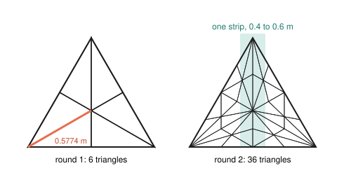

# Singular homology: hole counts for any space, with no triangulation, and excision proved

[Syllabus](../../../SYLLABUS.md) → [Topology](../README.md) → [Homology](../README.md#s05) → Singular homology

---

## General Overview

A geodesic dome is built from flat triangular panels, here 1 m on a side. Seen from very close, a point of a panel sits in a patch of flat plane. A point deep inside a concrete block sits in a patch of 3-dimensional space. This card proves that no homeomorphism (a continuous map with a continuous inverse) turns one patch into the other. It needs two new ideas.

- **Singular homology.** The homology on this shelf so far needs a space cut into triangles, and a patch of plane comes with none. Singular homology uses every continuous map of a triangle into the space, so it needs no cutting.
- **Excision.** Homology relative to a piece ignores what lies deep inside the piece, so that part can be cut away. Only a small neighbourhood of the point is left to count.

Excision rests on a fact you can measure. Cut a triangle through its centre into 6 smaller ones, and each is at most 2/3 as wide. After 6 rounds the panel is 46,656 triangles, each at most $`(2/3)^6 = 0.0878`$ m across: small enough that each fits inside one set of any cover with Lebesgue number 0.1 m (any set narrower than 0.1 m lies in one of its sets). The checks measure all of them: the widest is 0.0472 m.

**Singular homology counts holes with every continuous map of a triangle into a space, so it needs no triangulation; excision, proved by cutting chains small, lets a set deep inside a piece be cut away without changing homology relative to the piece; and homology near a point then detects dimension, so the plane is not 3-space.**

**What kind of fact this is:** theorems. The shrinking bound, the identity that makes subdivision harmless, and the step from it to all chains are proved in full; excision and invariance of dimension are proved from those. That singular and triangle-based homology agree on the dome is stated with a source, not proved.

### The picture: the panel cut once and twice

<p align="center"></p>

To scale: corners (0, 0), (1, 0) and (0.5, 0.8660) m, centre (0.5000, 0.2887) m. The red corner-to-centre edge is the widest piece after one round. The shaded band is one of the cover's 11 strips.

---

## The formula

- The **standard k-simplex** $`\Delta^k`$ is the solid simplex of dimension k: point, edge, triangle, tetrahedron.
- A **singular k-simplex** is any continuous map $`\sigma : \Delta^k \to X`$ into a space $`X`$. It may crush or fold the simplex; "singular" means it may.
- **Singular chains** $`C_k(X)`$ are whole-number combinations of singular simplices, with the signed boundary $`\partial`$ of [Simplicial complexes and chains](01-simplicial-complexes-and-chains.md). **Singular homology** $`H_k(X)`$ is their cycles modulo boundaries.
- **Relative homology** $`H_k(X, A)`$ sets every chain inside a piece $`A`$ to zero ([Mayer-Vietoris and exact sequences](06-mayer-vietoris-and-long-exact-sequences.md)). **Reduced homology** $`\tilde{H}_k`$ takes one piece off the count in dimension 0, so a point reads zero everywhere.
- $`\overline{Z}`$ is the closure of $`Z`$ (with its edge points added); $`\mathrm{int}\, A`$ is the interior of $`A`$ (points with a whole open ball inside $`A`$).

Excision is one isomorphism:

```math
H_k(X - Z,\ A - Z) \;\cong\; H_k(X, A) \qquad \text{whenever } \overline{Z} \subseteq \mathrm{int}\, A
```

**Read it aloud:** if a set and its edge lie deep inside the piece $`A`$, cutting it out of both the space and the piece leaves every relative hole count the same.

The engine is a shrinking bound. Cut an n-simplex by **barycentric subdivision**: join its centre to the centres of all its faces, giving $`(n + 1)!`$ smaller simplices. Repeat it r times:

```math
\mathrm{diam}(\text{each piece after } r \text{ rounds}) \;\le\; \left(\frac{n}{n+1}\right)^{r} \mathrm{diam}(\Delta^n)
```

**Read it aloud:** each round shrinks every piece to at most n over n + 1 of the width it came from; for the 1 m panel, n = 2, and 6 rounds give at most 0.0878 m.

The payoff is homology near a point. Write $`0`$ for the origin of $`\mathbb{R}^n`$ and $`S^{n-1}`$ for the sphere around it:

```math
H_k(\mathbb{R}^n,\ \mathbb{R}^n - 0) \;\cong\; \tilde{H}_{k-1}(S^{n-1}) \;\cong\; \begin{cases} \mathbb{Z} & k = n \\ 0 & \text{otherwise} \end{cases}
```

**Read it aloud:** n-space, relative to n-space with one point removed, has exactly one hole, in dimension n. The plane has it in dimension 2 and 3-space in dimension 3, so no homeomorphism joins them.

| Symbol | Plain meaning | In our example | Push it up and the answer… |
| --- | --- | --- | --- |
| $`\Delta^k`$, $`\sigma`$, $`\sigma_j`$ | the standard k-simplex; a continuous map of it into the space; its j-th face | a triangle mapped into the dome | — |
| $`C_k(X)`$, $`\partial`$ | singular chains; the signed sum of faces | $`\partial[a, b] = [b] - [a]`$ | — |
| $`H_k(X)`$, $`H_k(X, A)`$ | homology; homology relative to a piece $`A`$, counted over $`\mathbb{Q}`$ | dome: 1, 0, 1; panel relative to its rim: 0, 0, 1 | a bigger $`A`$ ignores more |
| $`\tilde{H}_k`$ | reduced homology: one piece fewer in dimension 0 | the rim, a loop: 0, 1 | — |
| $`X`$, $`A`$, $`Z`$ | the space; a piece of it; the set cut away | dome; dome minus a point; the dome outside a disc | a bigger $`Z`$ risks breaking the rule |
| $`\overline{Z}`$, $`\mathrm{int}\, A`$ | closure; interior | — | — |
| $`n`$, $`r`$ | a simplex's dimension; rounds of cutting | 2; 6 | bigger n shrinks more slowly |
| $`\mathrm{diam}`$ | diameter: the largest distance between two points | 1 m, then 0.0472 m measured | — |
| $`\ell`$, $`b_\ell`$, $`c`$, $`\mathrm{Sd}`$, $`T`$, $`D_r`$ | a straight simplex; its centre (barycentre); a chain; cutting, on chains; the sweep from a chain to its cut version; r sweeps added up | the panel; centre (0.5000, 0.2887) m | — |
| $`\mathcal{U}`$, $`\lambda`$, $`\rho`$ | an open cover; its Lebesgue number; the map onto small chains | 11 strips 0.2 m wide; 0.1 m | a bigger $`\lambda`$ needs fewer rounds |
| $`\mathbb{R}^n`$, $`\mathbb{R}^m`$, $`0`$, $`x`$, $`S^{n-1}`$ | n-space; m-space; the origin; any point; the sphere around it | the plane, a point of a panel, a circle | n moves the hole to dimension n |
| $`k`$, $`v_i`$, $`w_i`$, $`z`$, $`f`$, $`h`$, $`U`$, $`V`$ | a dimension; corners of a simplex (two lists); a cycle; a continuous map; a homeomorphism; the open sets it matches | $`k`$ = 0, 1, 2 on the dome | — |

Counts are over the rationals $`\mathbb{Q}`$ unless a group is written $`\mathbb{Z}`$. No space here has torsion, so integer counts agree.

### When it holds

- **The cut-away set and its edge lie inside the interior of the piece.** Cut away the panel's whole rim, which is all of $`A`$ and has no interior, and what is left counts 1, 0, 0, not 0, 0, 1.
- **The sphere's counts are reduced.** With the unreduced counts the plane's local homology would read 0, 1, 1: a false hole in dimension 1.
- **Enough rounds, set by the Lebesgue number of an open cover.** Use the factor 1/2 of an edge for a triangle and 4 rounds look enough; round 4 truly has pieces 0.1277 m wide, and 16 of them fit no strip.
- **The cover's sets are open, or at least their interiors cover the space.** Two closed half-lines meeting at 0 have no Lebesgue number: every tiny interval around 0 lies in neither.

---

## Why it works

### Step 0: any chain can be cut fine, so only nearby pieces matter

A hole is recorded by a chain. Cutting its simplices smaller changes the chain but not the hole. Cut finely enough, every piece sits inside one set of a cover. Pieces inside $`A`$ count as zero in $`H_k(X, A)`$ anyway, so deleting the deep part of $`A`$ loses nothing. Steps 3 to 6 make these sentences exact.

### Step 1: chains from all continuous maps

A singular simplex is any continuous map $`\sigma : \Delta^k \to X`$. Its i-th face is $`\sigma`$ restricted to the face of $`\Delta^k`$ without corner i. The boundary is

```math
\partial \sigma = \sum_{i=0}^{k} (-1)^i \, \sigma\big|_{[v_0, \dots, \hat{v}_i, \dots, v_k]}
```

**Read it aloud:** the boundary of a singular simplex is its faces, each with a sign that alternates with the position of the dropped corner (the hat marks the dropped corner).

The same cancellation as for triangles gives $`\partial\partial = 0`$. A continuous map $`f`$ sends $`\sigma`$ to $`f \circ \sigma`$, so maps act on homology directly, and homeomorphic spaces have equal homology.

The chain groups are huge, but homology comes out small. A point has one singular simplex per dimension. Its boundary is $`k + 1`$ copies of one face with alternating signs: that face once for even $`k \ge 2`$, zero for odd $`k`$. So a point reads 1, 0, 0, 0, 0, 0.

### Step 2: the pieces already on the shelf

Three facts come from earlier cards and are used as stated.

- **The sequence of a pair.** $`\cdots \to H_k(A) \to H_k(X) \to H_k(X, A) \to H_{k-1}(A) \to \cdots`$ is exact: each map's output is exactly what the next sends to zero ([Mayer-Vietoris and exact sequences](06-mayer-vietoris-and-long-exact-sequences.md)). It holds with reduced groups too.
- **Homotopy invariance.** Spaces that squeeze into each other have the same homology; the prism argument works for singular chains word for word ([Homotopy invariance](04-homotopy-invariance-of-homology.md)).
- **Spheres.** $`\tilde{H}_k(S^m) = \mathbb{Z}`$ for $`k = m`$ and 0 otherwise ([Homology of spheres, and degree](07-homology-of-spheres-and-degree.md)). That card's proof cuts the sphere into two open caps and uses Mayer-Vietoris for open sets, which rests on Step 5 below. Nothing in Steps 3 to 6 uses spheres, so the argument does not run in a circle.

### Step 3: each round shrinks a simplex to at most n/(n+1) of its width

Barycentric subdivision of $`[v_0, \dots, v_n]`$ makes one small simplex per ordering of the corners. Its corners are the first corner, the centre of the first edge, the centre of the first triangle, and so on up to the centre $`b`$. A triangle gives $`3! = 6`$ pieces, each with a corner, an edge's middle and the centre.

On the 1 m panel the longest new edge runs from a corner to the centre: $`1/\sqrt{3} = 0.5774`$ m, below the bound of 0.6667 m.

<details>
<summary>Detailed proof: the n/(n+1) bound</summary>

Let $`d`$ be the diameter of the simplex and $`b = \frac{1}{n+1}\sum_j v_j`$ its centre.

A simplex's diameter is the largest distance between two of its corners. Distance from a fixed point is a convex function, so over a simplex it is largest at a corner.

For a corner $`v_i`$:

$`\displaystyle \lvert v_i - b\rvert = \frac{1}{n+1}\Big\lvert \sum_{j \ne i} (v_i - v_j)\Big\rvert \le \frac{n}{n+1}\, d`$

since the sum has $`n`$ terms, each of length at most $`d`$. By convexity every point $`x`$ of the simplex has $`\lvert x - b\rvert \le \frac{n}{n+1} d`$ too.

Two corners of a small piece are centres $`b_F`$ and $`b_G`$ of faces $`F \subset G`$ in a chain of faces. The point $`b_F`$ lies in $`G`$, so by the line above applied to $`G`$, of dimension $`q \le n`$: $`\lvert b_F - b_G\rvert \le \frac{q}{q+1}\,\mathrm{diam}(G) \le \frac{n}{n+1}\, d`$, because $`q/(q+1)`$ grows with $`q`$ and $`\mathrm{diam}(G) \le d`$. Every pair of corners obeys the bound, so the piece's diameter does. Repeating r times multiplies the bounds.

</details>

### Step 4: cutting does not change homology

Cutting must be done to chains, not just to triangles. The **cone** on a point $`b`$ sends a straight simplex $`[w_0, \dots, w_k]`$ to $`[b, w_0, \dots, w_k]`$, written $`b \cdot`$. For a chain $`c`$ of dimension at least 1, its boundary obeys $`\partial(b \cdot c) = c - b \cdot \partial c`$; for a chain of points it is $`c`$ minus the sum of its coefficients times $`b`$, which is $`c`$ for every chain of points the proof cones. Define, for a straight simplex $`\ell`$ with centre $`b_\ell`$:

```math
\mathrm{Sd}\,\ell = b_\ell \cdot \mathrm{Sd}(\partial \ell), \qquad T\ell = b_\ell \cdot (\ell - T\partial\ell)
```

**Read it aloud:** to cut a simplex, cut its boundary and cone that from the centre; the sweep T cones from the centre the simplex minus the sweep of its boundary.

On points, Sd is the identity and T is zero. For a singular simplex, apply both to $`\Delta^k`$ and push forward by $`\sigma`$. They obey

```math
\partial \mathrm{Sd} = \mathrm{Sd}\, \partial, \qquad \partial T + T \partial = 1 - \mathrm{Sd}
```

**Read it aloud:** cutting commutes with taking boundaries, and the sweep's boundary is the chain minus its cut version, less the sweep of the chain's own boundary.

On a cycle $`z`$ this reads $`z - \mathrm{Sd}\, z = \partial(Tz)`$: the cut cycle records the same hole.

<details>
<summary>Detailed proof: the two identities, by induction on dimension</summary>

Both hold on points. Assume them in dimension $`k - 1`$, and let $`\ell`$ be a straight k-simplex with centre $`b`$. The cone rule gives

$`\displaystyle \partial\, \mathrm{Sd}\,\ell = \mathrm{Sd}\,\partial\ell - b \cdot \partial\, \mathrm{Sd}\,\partial\ell = \mathrm{Sd}\,\partial\ell - b \cdot \mathrm{Sd}\,\partial\partial\ell = \mathrm{Sd}\,\partial\ell`$

using the induction step and $`\partial\partial = 0`$. For the sweep, the induction step on $`\partial\ell`$ gives $`\partial T \partial\ell = \partial\ell - \mathrm{Sd}\,\partial\ell - T\partial\partial\ell = \partial\ell - \mathrm{Sd}\,\partial\ell`$. Then

$`\displaystyle \partial T\ell = \ell - T\partial\ell - b \cdot (\partial\ell - \partial T \partial\ell) = \ell - T\partial\ell - b \cdot \mathrm{Sd}\,\partial\ell = \ell - T\partial\ell - \mathrm{Sd}\,\ell`$

which is $`\partial T + T\partial = 1 - \mathrm{Sd}`$. For a singular simplex both sides are pushed forward by $`\sigma`$, and pushing forward commutes with $`\partial`$.

</details>

### Step 5: small chains carry all of homology

An **open cover** $`\mathcal{U}`$ of $`X`$ is a family of open sets whose union is $`X`$. A chain is $`\mathcal{U}`$**-small** when each of its simplices lands inside one set of $`\mathcal{U}`$.

For a singular simplex $`\sigma`$, the sets $`\sigma^{-1}(U)`$ are an open cover of the compact $`\Delta^k`$. So they have a **Lebesgue number** $`\lambda`$: every set of diameter less than $`\lambda`$ lies inside one of them ([Compactness three ways](../01-Metric%20Spaces/06-compactness-in-metric-spaces.md) states it for balls of radius $`\lambda`$, which contain such sets). By Step 3, enough rounds make every piece narrower than $`\lambda`$, and then $`\mathrm{Sd}^r \sigma`$ is $`\mathcal{U}`$-small.

For the panel with $`\lambda`$ = 0.1 m the bound needs 6 rounds, since $`(2/3)^5 = 0.1317`$ is too big. The checks find all 46,656 pieces inside one of 11 strips.

So small chains have the same homology as all chains: by Step 4, every cycle is a boundary away from a small cycle, and a small cycle that bounds a chain bounds a small chain. The fold gives the bookkeeping (Hatcher, Proposition 2.21).

<details>
<summary>Detailed proof: small chains carry all of homology</summary>

Write $`D_r = \sum_{i<r} T\,\mathrm{Sd}^i`$. Apply Step 4's identity to $`\mathrm{Sd}^i c`$ for i = 0 to r − 1 and add. Since Sd commutes with $`\partial`$, the sum telescopes:

$`\displaystyle \partial D_r + D_r \partial = 1 - \mathrm{Sd}^r`$

For each singular simplex $`\sigma`$, let $`r(\sigma)`$ be the fewest rounds that make $`\mathrm{Sd}^r \sigma`$ small; its faces $`\sigma_j`$ need no more. Set $`D\sigma = D_{r(\sigma)}\sigma`$ and $`\rho = 1 - \partial D - D\partial`$. Then $`\rho`$ commutes with $`\partial`$, leaves small chains alone (they need 0 rounds), and

$`\displaystyle \rho\,\sigma = \mathrm{Sd}^{r(\sigma)}\sigma + \sum_j (-1)^j \sum_{r(\sigma_j) \le i < r(\sigma)} T\,\mathrm{Sd}^i \sigma_j`$

Every term is small, since Sd and T keep each piece inside the image of the simplex it came from. So $`\rho`$ turns every chain into a small chain.

Onto: a cycle $`z`$ differs from the small cycle $`\rho z`$ by the boundary $`\partial D z`$. One-to-one: if a small cycle $`z`$ equals $`\partial c`$, then $`z = \rho z = \partial(\rho c)`$, and $`\rho c`$ is small.

</details>

### Step 6: excision

Let $`\overline{Z} \subseteq \mathrm{int}\, A`$. The two sets $`\mathrm{int}\, A`$ and $`X - \overline{Z}`$ are open and together they cover $`X`$. Step 5 works just as well for a family whose interiors cover $`X`$, so take $`\mathcal{U} = \{A,\ X - Z\}`$.

A $`\mathcal{U}`$-small simplex lies in $`A`$ or in $`X - Z`$. Once the chains in $`A`$ are set to zero, what is left is the same in both pairs:

```math
\frac{C^{\,\mathcal{U}}_k(X)}{C_k(A)} \;=\; \frac{C_k(X - Z)}{C_k(A - Z)}
```

**Read it aloud:** small chains of the space with the piece erased are exactly the chains of the cut space with the cut piece erased.

The right side computes $`H_k(X - Z, A - Z)`$, the left side $`H_k(X, A)`$. For the left, compare the sequences of the pair built from small chains and from all chains. Step 5 makes the maps on the absolute groups isomorphisms. The **five lemma** (a map of exact sequences that is an isomorphism at the four neighbours of a spot is one at that spot) finishes the proof.

A **good pair** $`(X, A)`$ has $`A`$ closed, non-empty, and a deformation retract of some open set around it. For a good pair, $`H_k(X, A) \cong \tilde{H}_k(X/A)`$, where $`X/A`$ crushes $`A`$ to a point. The proof excises $`A`$ from the open set around it and squeezes; it is Hatcher's Proposition 2.22. Every CW pair is a good pair. The same formula holds for every closed cofibration, an inclusion with the homotopy extension property ([Cofibrations](../04-Homotopy/11-cofibrations-mapping-cylinders-and-mapping-cones.md)). Attach a cone on $`A`$ (each point of $`A`$ joined to one new tip). Excising the tip and squeezing the rest of the cone onto $`A`$ makes $`H_k(X, A)`$ the homology of $`X`$ with the cone, relative to the cone; the cone is contractible, so this is the reduced homology of $`X`$ with the cone (Hatcher, page 125). Crushing the cone is a homotopy equivalence onto $`X/A`$ (Hatcher, Proposition 0.17). The panel relative to its rim is one, and crushing the rim gives a sphere: 0, 0, 1.

### Step 7: homology near a point, and invariance of dimension

$`\mathbb{R}^n`$ squeezes to a point, so its reduced homology is zero. In the sequence of the pair $`(\mathbb{R}^n, \mathbb{R}^n - 0)`$ the zeros on both sides force

```math
H_k(\mathbb{R}^n, \mathbb{R}^n - 0) \cong \tilde{H}_{k-1}(\mathbb{R}^n - 0) \cong \tilde{H}_{k-1}(S^{n-1})
```

**Read it aloud:** the relative group equals the reduced homology of the punctured space, one dimension down, and the punctured space squeezes onto the sphere around the hole.

By Step 2 this is $`\mathbb{Z}`$ when $`k = n`$ and 0 otherwise. Now take an open set $`U`$ around a point $`x`$ and excise $`Z = \mathbb{R}^n - U`$, which is closed and lies inside the open set $`\mathbb{R}^n - x`$. Excision gives $`H_k(U, U - x) \cong H_k(\mathbb{R}^n, \mathbb{R}^n - x)`$: the **local homology** at $`x`$ depends only on an open set around $`x`$, however small.

**Invariance of dimension.** Suppose an open set $`U`$ of $`\mathbb{R}^m`$ and an open set $`V`$ of $`\mathbb{R}^n`$ are homeomorphic by $`h`$. Then $`h`$ carries $`(U, U - x)`$ to $`(V, V - h(x))`$, so the local homologies match: $`\mathbb{Z}`$ in dimension m equals $`\mathbb{Z}`$ in dimension n, and m = n. So no patch of the plane is a patch of 3-space.

### Step 8: the dome gives the same answers by counting triangles

On a space cut into triangles, singular homology equals this shelf's triangle-based homology (Hatcher, Theorem 2.27, stated on [Homotopy invariance](04-homotopy-invariance-of-homology.md), not proved here; [Eilenberg-Steenrod axioms](10-eilenberg-steenrod-axioms.md) explains why). So the dome's singular counts are 1, 0, 1.

The dome minus a point p of a panel squeezes onto the dome minus that open panel. So the local homology at p is the dome relative to the dome minus one open panel. Excision for triangulated pieces ([Mayer-Vietoris and exact sequences](06-mayer-vietoris-and-long-exact-sequences.md)) cuts that to the panel relative to its rim. Both read 0, 0, 1, as does the rim's reduced homology shifted up one, as Step 7 predicts.

At joint 0, where 5 panels meet, the star (those panels) relative to its link (their outer pentagon) also reads 0, 0, 1, as in the plane.

---

## Worked numbers, by hand

| Step | Arithmetic | Value |
| --- | --- | --- |
| bound after r rounds, n = 2 | $`(2/3)^r`$ for r = 1 to 6 | 0.6667, 0.4444, 0.2963, 0.1975, 0.1317, 0.0878 m |
| rounds the bound needs for 0.1 m | 0.1317 > 0.1 > 0.0878 | **6** |
| round 1, measured | corner to centre: $`1/\sqrt{3}`$ | 0.5774 m, below 0.6667 m |
| pieces after 6 rounds | $`6^6`$ | 46,656 |
| widest piece after 6 rounds, measured | squared width 25213/11337408 | 0.0472 m, below 0.0878 m |
| pieces in no strip, rounds 0 to 6 | tested one by one | 1, 6, 28, 40, 16, 0, 0 |
| panel relative to its rim | one triangle, no relative edges or corners | 0, 0, 1 |
| the rim's reduced counts, shifted up one | rim 1, 1; reduced 0, 1; shifted | 0, 0, 1 |
| a solid tetrahedron relative to its surface | n = 3 | 0, 0, 0, 1 |
| plane against 3-space | $`\mathbb{Z}`$ in dimension 2 against dimension 3 | **not homeomorphic** |

Near a point the plane and 3-space have their one hole in different dimensions, so no homeomorphism joins them.

### What breaks if you drop a piece

| Mistake | Comes out at | What went wrong |
| --- | --- | --- |
| Shrink factor 1/2 for a triangle | 4 rounds look enough; round 4 is truly 0.1277 m wide and 16 pieces fit no strip | 1/2 is the factor for an edge; a triangle shrinks only by 2/3 |
| Unreduced counts of the rim, shifted | 0, 1, 1 instead of 0, 0, 1 | the sequence of the pair needs reduced groups, since the plane's own piece cancels |
| Excise the whole rim of the panel | 1, 0, 0 instead of 0, 0, 1 | the rim has no interior, so its closure is not inside the interior of the piece |

The code prints all three. The last line uses the closed panel for the open one, since each squeezes to its centre and so has the same counts.

---

## Code, from first principles, and it actually runs

Both programs cut exactly: each corner is three whole-number weights over $`12^6`$, so centres are exact averages and squared widths exact fractions. Three independent roads meet.

1. **Measured against proved.** Every piece of every round is measured against the $`(n/(n+1))^r`$ bound, and each child against its parent, for an edge, the panel and a tetrahedron.
2. **The Lebesgue step.** All pieces are tested against 11 open strips $`(0.1(j - 1),\ 0.1(j + 1))`$ m, Lebesgue number 0.1 m; the round the bound names must leave none out.
3. **Excision two ways, and the exact sequence.** The dome is an icosahedron with each face cut in 4. Relative homology over $`\mathbb{Q}`$, by exact elimination, is computed on the whole dome and on the excised piece, at a panel and at a joint, and checked against the rim's reduced counts shifted up one; the simplex relative to its surface likewise for n = 1 to 4.

The runs illustrate the theorems on the cases printed; the proofs are in Why it works.

### Python

```python
# Singular homology and excision -- the check behind the card.  Standard library only.
# Road 1: barycentric subdivision done exactly on a dome panel (an equilateral
#         triangle of side 1 m), every small triangle measured, against the bound.
# Road 2: every small triangle tested against a cover of 11 strips whose
#         Lebesgue number is 0.1 m; the bound predicts the round that is enough.
# Road 3: local homology by exact ranks over Q, two ways: the whole space against
#         the excised piece, and both against the exact sequence (reduced counts).
from fractions import Fraction
from itertools import combinations, permutations
from math import sqrt

S = 12 ** 6          # barycentric weights scaled by S stay whole numbers for 6 rounds

def corners(n):      # the n-simplex's corners, as scaled weight vectors
    return tuple(tuple(S if i == j else 0 for i in range(n + 1)) for j in range(n + 1))

def bary(pts):       # the barycentre (average) of some points, exactly
    tot = [sum(col) for col in zip(*pts)]
    assert all(t % len(pts) == 0 for t in tot)
    return tuple(t // len(pts) for t in tot)

def subdivide(s):    # one small simplex per ordering of the corners: corner, edge middle, ...
    return [tuple(bary([s[i] for i in order[:m + 1]]) for m in range(len(s)))
            for order in permutations(range(len(s)))]

def diam2(s):        # squared diameter in the regular simplex of side 1 m: sum of d_i^2, halved
    return max(Fraction(sum((a - b) ** 2 for a, b in zip(p, q)), 2 * S * S)
               for p, q in combinations(s, 2))

def rounds(n, r):    # every level of subdivision, checking each child against its parent
    levels, f = [[corners(n)]], Fraction(n, n + 1) ** 2
    for _ in range(r):
        nxt = []
        for s in levels[-1]:
            kids = subdivide(s)
            assert all(diam2(c) <= f * diam2(s) for c in kids)   # the one-round bound
            nxt += kids
        levels.append(nxt)
    return levels

def misfits(level):  # small triangles lying in no open strip (0.1(j-1), 0.1(j+1)) m, j = 0..10
    bad = 0
    for s in level:
        xs = [20 * w[1] + 10 * w[2] for w in s]            # 20 S times the x-coordinate
        bad += not any(2 * S * (j - 1) < min(xs) and max(xs) < 2 * S * (j + 1) for j in range(11))
    return bad

tri = rounds(2, 6)
c = bary(tri[0][0])
print(f"figure, panel corners (0,0) (1,0) (0.5,{sqrt(3) / 2:.4f}); centroid "
      f"({(c[1] + c[2] / 2) / S:.4f},{c[2] * sqrt(3) / 2 / S:.4f}) m")
big = [max(diam2(s) for s in lev) for lev in tri]
bad = [misfits(lev) for lev in tri]
for r, lev in enumerate(tri):
    print(f"round {r}: {len(lev)} triangles, largest diameter {sqrt(big[r]):.4f} m "
          f"(squared {big[r]}), bound (2/3)^{r} = {float(Fraction(2, 3) ** r):.4f}, in no strip {bad[r]}")
need = next(r for r in range(20) if Fraction(2, 3) ** r < Fraction(1, 10))
half = next(r for r in range(20) if Fraction(1, 2) ** r < Fraction(1, 10))
print(f"bound first below 0.1 m at round {need}; first round with every triangle in a strip "
      f"{bad.index(0)}")
assert all(big[r] <= Fraction(4, 9) ** r for r in range(7))  # road 1: measured within proved
assert big[1] == Fraction(1, 3)                               # corner to centre, 1/sqrt(3), by hand
assert (need, half) == (6, 4)                                 # by hand: (2/3)^5 > 0.1 > (2/3)^6; (1/2)^3 > 0.1 > (1/2)^4
assert bad[need] == 0 and bad[0] == 1                         # road 2: the bound's round suffices
for n, r in ((1, 4), (3, 3)):
    ds = [max(diam2(s) for s in lev) for lev in rounds(n, r)]
    assert all(d <= Fraction(n, n + 1) ** (2 * k) for k, d in enumerate(ds))
    print(f"{n}-simplex, {r} rounds: largest diameters " + ", ".join(f"{sqrt(d):.4f}" for d in ds)
          + f" m; bound ratio {n}/{n + 1}")

# ---- homology: chains, relative boundaries, ranks over Q ----
def rank(rows):
    m, rk = [[Fraction(x) for x in row] for row in rows], 0
    for col in range(len(m[0]) if m else 0):
        p = next((i for i in range(rk, len(m)) if m[i][col]), None)
        if p is None:
            continue
        m[rk], m[p] = m[p], m[rk]
        for i in range(rk + 1, len(m)):
            f = m[i][col] / m[rk][col]
            m[i] = [a - f * b for a, b in zip(m[i], m[rk])]
        rk += 1
    return rk

def closure(tops):   # every face of every listed simplex
    return {f for t in tops for k in range(1, len(t) + 1) for f in combinations(sorted(t), k)}

def betti(X, A=frozenset()):     # Betti numbers of X relative to A, over Q
    rel = {k: sorted(s for s in X - A if len(s) == k + 1) for k in range(6)}
    def bd(k):       # boundary from relative k-chains to relative (k-1)-chains, signs (-1)^i
        if k == 0 or not rel[k] or not rel[k - 1]:
            return 0
        row = {s: i for i, s in enumerate(rel[k - 1])}
        mat = [[0] * len(rel[k]) for _ in rel[k - 1]]
        for j, s in enumerate(rel[k]):
            for i in range(len(s)):
                if s[:i] + s[i + 1:] in row:
                    mat[row[s[:i] + s[i + 1:]]][j] = (-1) ** i
        return rank(mat)
    top = max([k for k in rel if rel[k]], default=0)
    return [len(rel[k]) - bd(k) - bd(k + 1) for k in range(top + 1)]

def reduced(b):      # reduced counts: one fewer piece, so a point reads all zeros
    return [b[0] - 1] + b[1:]

nb = lambda i: 1 + (i + 1) % 5   # icosahedron: top 0, upper ring 1-5, lower ring 6-10, bottom 11
ico = [f for i in range(5) for f in ((0, 1 + i, nb(i)), (11, 6 + i, 5 + nb(i)),
       (1 + i, nb(i), 6 + i), (nb(i), 6 + i, 5 + nb(i)))]
edges = sorted({e for f in ico for e in combinations(sorted(f), 2)})
mid = {e: 12 + k for k, e in enumerate(edges)} | {e[::-1]: 12 + k for k, e in enumerate(edges)}
panels = [p for a, b, c in ico for p in ((a, mid[a, b], mid[c, a]), (b, mid[a, b], mid[b, c]),
          (c, mid[b, c], mid[c, a]), (mid[a, b], mid[b, c], mid[c, a]))]
dome, P = closure(panels), panels[0]
star = [p for p in panels if 0 in p]
rim = closure(combinations(P, 2))
counts = [sum(len(s) == k + 1 for s in dome) for k in range(3)]
print(f"dome: simplices {counts}, Betti {betti(dome)}; joint 0 has {len(star)} panels")
pairs = {"dome rel dome minus one open panel": betti(dome, closure(panels[1:])),
         "one panel rel its rim": betti(closure([P]), rim),
         "dome rel dome minus open star of joint 0": betti(dome, closure([p for p in panels if 0 not in p])),
         "star of joint 0 rel its link": betti(closure(star), closure([e for p in star for e in combinations(p, 2) if 0 not in e]))}
for name, b in pairs.items():
    print(f"local, {name}: {b}")
print(f"local, the rim's reduced counts shifted up one: {[0] + reduced(betti(rim))}")
assert counts == [42, 120, 80] and betti(dome) == [1, 0, 1]
assert all(b == [0, 0, 1] == [0] + reduced(betti(rim)) for b in pairs.values())  # road 3
for n in range(1, 5):
    simplex = closure([tuple(range(n + 1))])
    edge = {s for s in simplex if len(s) <= n}
    rel, les = betti(simplex, edge), [0] + reduced(betti(edge))
    assert rel == les == [0] * n + [1]                      # Z only in degree n, two ways
    print(f"n = {n}: simplex rel rim {rel}; S^{n - 1} reduced, shifted {les}")
bds = [0] + [k % 2 == 0 for k in range(1, 7)]              # a point: one singular simplex per degree
print(f"point, singular chains to degree 5: Betti {[1 - bds[k] - bds[k + 1] for k in range(6)]}")
print(f"mistake, shrink factor 1/2: bound below 0.1 m at round {half}; round {half} truly "
      f"{sqrt(big[half]):.4f} m, {bad[half]} triangles in no strip")
print(f"mistake, unreduced rim shifted: {[0] + betti(rim)}, true {pairs['one panel rel its rim']}")
print(f"mistake, excise the whole rim: panel alone {betti(closure([P]))}, true {pairs['one panel rel its rim']}")
assert bad[half] > 0 and [0] + betti(rim) != pairs["one panel rel its rim"]
print("ALL CHECKS PASS")
```

**Ran 2026-11-24 on macOS, Python 3.14.10, standard library only. All checks passed. Output, pasted from the run:**

```
figure, panel corners (0,0) (1,0) (0.5,0.8660); centroid (0.5000,0.2887) m
round 0: 1 triangles, largest diameter 1.0000 m (squared 1), bound (2/3)^0 = 1.0000, in no strip 1
round 1: 6 triangles, largest diameter 0.5774 m (squared 1/3), bound (2/3)^1 = 0.6667, in no strip 6
round 2: 36 triangles, largest diameter 0.3469 m (squared 13/108), bound (2/3)^2 = 0.4444, in no strip 28
round 3: 216 triangles, largest diameter 0.2103 m (squared 43/972), bound (2/3)^3 = 0.2963, in no strip 40
round 4: 1296 triangles, largest diameter 0.1277 m (squared 571/34992), bound (2/3)^4 = 0.1975, in no strip 16
round 5: 7776 triangles, largest diameter 0.0776 m (squared 1897/314928), bound (2/3)^5 = 0.1317, in no strip 0
round 6: 46656 triangles, largest diameter 0.0472 m (squared 25213/11337408), bound (2/3)^6 = 0.0878, in no strip 0
bound first below 0.1 m at round 6; first round with every triangle in a strip 5
1-simplex, 4 rounds: largest diameters 1.0000, 0.5000, 0.2500, 0.1250, 0.0625 m; bound ratio 1/2
3-simplex, 3 rounds: largest diameters 1.0000, 0.6124, 0.4050, 0.2737 m; bound ratio 3/4
dome: simplices [42, 120, 80], Betti [1, 0, 1]; joint 0 has 5 panels
local, dome rel dome minus one open panel: [0, 0, 1]
local, one panel rel its rim: [0, 0, 1]
local, dome rel dome minus open star of joint 0: [0, 0, 1]
local, star of joint 0 rel its link: [0, 0, 1]
local, the rim's reduced counts shifted up one: [0, 0, 1]
n = 1: simplex rel rim [0, 1]; S^0 reduced, shifted [0, 1]
n = 2: simplex rel rim [0, 0, 1]; S^1 reduced, shifted [0, 0, 1]
n = 3: simplex rel rim [0, 0, 0, 1]; S^2 reduced, shifted [0, 0, 0, 1]
n = 4: simplex rel rim [0, 0, 0, 0, 1]; S^3 reduced, shifted [0, 0, 0, 0, 1]
point, singular chains to degree 5: Betti [1, 0, 0, 0, 0, 0]
mistake, shrink factor 1/2: bound below 0.1 m at round 4; round 4 truly 0.1277 m, 16 triangles in no strip
mistake, unreduced rim shifted: [0, 1, 1], true [0, 0, 1]
mistake, excise the whole rim: panel alone [1, 0, 0], true [0, 0, 1]
ALL CHECKS PASS
```

### Rust

Same numbers, same labels, built with `rustc --edition 2021 -O`.

```rust
// Singular homology and excision -- the check behind the card.  std only, no crates.
// Road 1: barycentric subdivision done exactly on a dome panel (an equilateral
//         triangle of side 1 m), every small triangle measured, against the bound.
// Road 2: every small triangle tested against a cover of 11 strips whose
//         Lebesgue number is 0.1 m; the bound predicts the round that is enough.
// Road 3: local homology by exact ranks over Q, two ways: the whole space against
//         the excised piece, and both against the exact sequence (reduced counts).
use std::collections::{BTreeMap, BTreeSet};
const S: i64 = 2_985_984; // 12^6: barycentric weights scaled by S stay whole for 6 rounds
const DEN: i128 = 2 * (S as i128) * (S as i128); // squared distances are num / (2 S^2)
type Simp = Vec<Vec<i64>>;
type Cx = BTreeSet<Vec<usize>>;
fn gcd(a: i128, b: i128) -> i128 { if b == 0 { a.abs() } else { gcd(b, a % b) } }
fn frac(n: i128, d: i128) -> String { let g = gcd(n, d); if d / g == 1 { format!("{}", n / g) } else { format!("{}/{}", n / g, d / g) } }
fn sqrtf(n: i128, d: i128) -> f64 { (n as f64 / d as f64).sqrt() }
fn bary(pts: &[Vec<i64>]) -> Vec<i64> {
    let m = pts.len() as i64;
    (0..pts[0].len()).map(|i| { let t: i64 = pts.iter().map(|p| p[i]).sum(); assert!(t % m == 0); t / m }).collect()
}
fn perms(items: &[usize]) -> Vec<Vec<usize>> { // every ordering, first item chosen first
    if items.is_empty() { return vec![vec![]]; }
    items.iter().enumerate().flat_map(|(i, &x)| {
        let rest: Vec<usize> = items.iter().enumerate().filter(|&(j, _)| j != i).map(|(_, &y)| y).collect();
        perms(&rest).into_iter().map(move |mut p| { p.insert(0, x); p }) }).collect()
}
fn combos<T: Clone>(v: &[T], k: usize) -> Vec<Vec<T>> {
    if k == 0 || v.len() < k { return if k == 0 { vec![vec![]] } else { vec![] }; }
    let mut out: Vec<Vec<T>> = combos(&v[1..], k - 1).into_iter().map(|mut c| { c.insert(0, v[0].clone()); c }).collect();
    out.extend(combos(&v[1..], k));
    out
}
fn subdivide(s: &Simp) -> Vec<Simp> {
    let idx: Vec<usize> = (0..s.len()).collect();
    perms(&idx).iter().map(|o| (0..s.len()).map(|m| bary(&o[..m + 1].iter().map(|&i| s[i].clone()).collect::<Vec<_>>())).collect()).collect()
}
fn diam2(s: &Simp) -> i128 { // numerator over 2 S^2 of the squared diameter, side 1 m
    combos(s, 2).iter().map(|pq| pq[0].iter().zip(&pq[1]).map(|(a, b)| ((a - b) as i128).pow(2)).sum::<i128>()).max().unwrap()
}
fn rounds(n: usize, r: usize) -> Vec<Vec<Simp>> {
    let corners: Simp = (0..=n).map(|j| (0..=n).map(|i| if i == j { S } else { 0 }).collect()).collect();
    let mut levels = vec![vec![corners]];
    let (fa, fb) = ((n * n) as i128, ((n + 1) * (n + 1)) as i128);
    for _ in 0..r {
        let mut nxt = vec![];
        for s in levels.last().unwrap() {
            let kids = subdivide(s);
            assert!(kids.iter().all(|c| diam2(c) * fb <= fa * diam2(s))); // the one-round bound
            nxt.extend(kids);
        }
        levels.push(nxt);
    }
    levels
}
fn misfits(level: &[Simp]) -> usize {
    level.iter().filter(|s| {
        let xs: Vec<i64> = s.iter().map(|w| 20 * w[1] + 10 * w[2]).collect(); // 20 S times x
        let (lo, hi) = (*xs.iter().min().unwrap(), *xs.iter().max().unwrap());
        !(0..11).any(|j: i64| 2 * S * (j - 1) < lo && hi < 2 * S * (j + 1))
    }).count()
}
fn rank(mut m: Vec<Vec<i128>>) -> i64 { // exact over Q, fraction-free elimination
    let (mut rk, cols) = (0, if m.is_empty() { 0 } else { m[0].len() });
    for col in 0..cols {
        let Some(p) = (rk..m.len()).find(|&i| m[i][col] != 0) else { continue };
        m.swap(rk, p);
        for i in rk + 1..m.len() {
            if m[i][col] == 0 { continue; }
            let (a, b) = (m[rk][col], m[i][col]);
            let row: Vec<i128> = (0..cols).map(|j| a * m[i][j] - b * m[rk][j]).collect();
            let g = row.iter().fold(0, |g, &x| gcd(g, x)).max(1);
            m[i] = row.iter().map(|x| x / g).collect();
        }
        rk += 1;
    }
    rk as i64
}
fn closure(tops: &[Vec<usize>]) -> Cx {
    let mut out = Cx::new();
    for t in tops { let mut t = t.clone(); t.sort(); for k in 1..=t.len() { out.extend(combos(&t, k)); } }
    out
}
fn betti(x: &Cx, a: &Cx) -> Vec<i64> { // Betti numbers of x relative to a, over Q
    let rel: Vec<Vec<Vec<usize>>> = (0..6).map(|k| x.difference(a).filter(|s| s.len() == k + 1).cloned().collect()).collect();
    let bd = |k: usize| -> i64 {
        if k == 0 || k >= 6 || rel[k].is_empty() || rel[k - 1].is_empty() { return 0; }
        let row: BTreeMap<&Vec<usize>, usize> = rel[k - 1].iter().enumerate().map(|(i, s)| (s, i)).collect();
        let mut mat = vec![vec![0i128; rel[k].len()]; rel[k - 1].len()];
        for (j, s) in rel[k].iter().enumerate() {
            for i in 0..s.len() {
                let mut f = s.clone(); f.remove(i);
                if let Some(&r) = row.get(&f) { mat[r][j] = if i % 2 == 0 { 1 } else { -1 }; }
            }
        }
        rank(mat)
    };
    let top = (0..6).filter(|&k| !rel[k].is_empty()).max().unwrap_or(0);
    (0..=top).map(|k| rel[k].len() as i64 - bd(k) - bd(k + 1)).collect()
}
fn shifted_reduced(b: &[i64]) -> Vec<i64> { let mut v = vec![0, b[0] - 1]; v.extend(&b[1..]); v }
fn main() {
    let tri = rounds(2, 6);
    let c = bary(&tri[0][0]);
    let r3 = 3f64.sqrt();
    println!("figure, panel corners (0,0) (1,0) (0.5,{:.4}); centroid ({:.4},{:.4}) m", r3 / 2.0,
             (c[1] as f64 + c[2] as f64 / 2.0) / S as f64, c[2] as f64 * r3 / 2.0 / S as f64);
    let big: Vec<i128> = tri.iter().map(|lev| lev.iter().map(diam2).max().unwrap()).collect();
    let bad: Vec<usize> = tri.iter().map(|lev| misfits(lev)).collect();
    for (r, lev) in tri.iter().enumerate() {
        println!("round {}: {} triangles, largest diameter {:.4} m (squared {}), bound (2/3)^{} = {:.4}, in no strip {}",
                 r, lev.len(), sqrtf(big[r], DEN), frac(big[r], DEN), r, 2f64.powi(r as i32) / 3f64.powi(r as i32), bad[r]);
    }
    let need = (0..20u32).find(|&r| 10 * 2i128.pow(r) < 3i128.pow(r)).unwrap() as usize;
    let half = (0..20u32).find(|&r| 10 < 2i128.pow(r)).unwrap() as usize;
    println!("bound first below 0.1 m at round {}; first round with every triangle in a strip {}", need, bad.iter().position(|&b| b == 0).unwrap());
    assert!((0..7u32).all(|r| big[r as usize] * 9i128.pow(r) <= DEN * 4i128.pow(r))); // road 1
    assert!(big[1] * 3 == DEN); // corner to centre, 1/sqrt(3), by hand
    assert!((need, half) == (6, 4)); // by hand: (2/3)^5 > 0.1 > (2/3)^6; (1/2)^3 > 0.1 > (1/2)^4
    assert!(bad[need] == 0 && bad[0] == 1); // road 2
    for (n, r) in [(1usize, 4usize), (3, 3)] {
        let ds: Vec<i128> = rounds(n, r).iter().map(|lev| lev.iter().map(diam2).max().unwrap()).collect();
        assert!(ds.iter().enumerate().all(|(k, &d)| d * ((n + 1) as i128).pow(2 * k as u32) <= DEN * (n as i128).pow(2 * k as u32)));
        let txt: Vec<String> = ds.iter().map(|&d| format!("{:.4}", sqrtf(d, DEN))).collect();
        println!("{}-simplex, {} rounds: largest diameters {} m; bound ratio {}/{}", n, r, txt.join(", "), n, n + 1);
    }
    // ---- homology: the dome, an icosahedron with each face cut in 4 ----
    let nb = |i: usize| 1 + (i + 1) % 5;
    let mut ico: Vec<[usize; 3]> = vec![];
    for i in 0..5 { ico.extend([[0, 1 + i, nb(i)], [11, 6 + i, 5 + nb(i)], [1 + i, nb(i), 6 + i], [nb(i), 6 + i, 5 + nb(i)]]); }
    let edges: BTreeSet<(usize, usize)> = ico.iter().flat_map(|f| { let mut g = *f; g.sort(); [(g[0], g[1]), (g[0], g[2]), (g[1], g[2])] }).collect();
    let mut mid = BTreeMap::new();
    for (k, &(a, b)) in edges.iter().enumerate() { mid.insert((a, b), 12 + k); mid.insert((b, a), 12 + k); }
    let mut panels: Vec<Vec<usize>> = vec![];
    for &[a, b, c] in &ico {
        let (ab, bc, ca) = (mid[&(a, b)], mid[&(b, c)], mid[&(c, a)]);
        panels.extend([vec![a, ab, ca], vec![b, ab, bc], vec![c, bc, ca], vec![ab, bc, ca]]);
    }
    let (dome, p, none) = (closure(&panels), panels[0].clone(), Cx::new());
    let star: Vec<Vec<usize>> = panels.iter().filter(|q| q.contains(&0)).cloned().collect();
    let rim = closure(&combos(&p, 2));
    let counts: Vec<usize> = (0..3).map(|k| dome.iter().filter(|s| s.len() == k + 1).count()).collect();
    println!("dome: simplices {:?}, Betti {:?}; joint 0 has {} panels", counts, betti(&dome, &none), star.len());
    let link: Vec<Vec<usize>> = star.iter().flat_map(|q| combos(q, 2)).filter(|e| !e.contains(&0)).collect();
    let away: Vec<Vec<usize>> = panels.iter().filter(|q| !q.contains(&0)).cloned().collect();
    let pairs = [("dome rel dome minus one open panel", betti(&dome, &closure(&panels[1..]))),
                 ("one panel rel its rim", betti(&closure(&[p.clone()]), &rim)),
                 ("dome rel dome minus open star of joint 0", betti(&dome, &closure(&away))),
                 ("star of joint 0 rel its link", betti(&closure(&star), &closure(&link)))];
    for (name, b) in &pairs { println!("local, {}: {:?}", name, b); }
    let les = shifted_reduced(&betti(&rim, &none));
    println!("local, the rim's reduced counts shifted up one: {:?}", les);
    assert!(counts == vec![42, 120, 80] && betti(&dome, &none) == vec![1, 0, 1]);
    assert!(pairs.iter().all(|(_, b)| *b == vec![0, 0, 1] && *b == les)); // road 3
    for n in 1..5usize {
        let simplex = closure(&[(0..=n).collect()]);
        let edge: Cx = simplex.iter().filter(|s| s.len() <= n).cloned().collect();
        let (rel, les) = (betti(&simplex, &edge), shifted_reduced(&betti(&edge, &none)));
        let mut want = vec![0i64; n]; want.push(1);
        assert!(rel == les && les == want); // Z only in degree n, two ways
        println!("n = {}: simplex rel rim {:?}; S^{} reduced, shifted {:?}", n, rel, n - 1, les);
    }
    let bds: Vec<i64> = (0..7).map(|k| if k > 0 && k % 2 == 0 { 1 } else { 0 }).collect(); // a point
    println!("point, singular chains to degree 5: Betti {:?}", (0..6).map(|k| 1 - bds[k] - bds[k + 1]).collect::<Vec<_>>());
    println!("mistake, shrink factor 1/2: bound below 0.1 m at round {}; round {} truly {:.4} m, {} triangles in no strip",
             half, half, sqrtf(big[half], DEN), bad[half]);
    let mut unred = vec![0i64]; unred.extend(betti(&rim, &none));
    println!("mistake, unreduced rim shifted: {:?}, true {:?}", unred, pairs[1].1);
    println!("mistake, excise the whole rim: panel alone {:?}, true {:?}", betti(&closure(&[p.clone()]), &none), pairs[1].1);
    assert!(bad[half] > 0 && unred != pairs[1].1);
    println!("ALL CHECKS PASS");
}
```

**Ran 2026-11-24 on macOS, rustc 1.98.1, no crates. All checks passed. Output, pasted from the run:**

```
figure, panel corners (0,0) (1,0) (0.5,0.8660); centroid (0.5000,0.2887) m
round 0: 1 triangles, largest diameter 1.0000 m (squared 1), bound (2/3)^0 = 1.0000, in no strip 1
round 1: 6 triangles, largest diameter 0.5774 m (squared 1/3), bound (2/3)^1 = 0.6667, in no strip 6
round 2: 36 triangles, largest diameter 0.3469 m (squared 13/108), bound (2/3)^2 = 0.4444, in no strip 28
round 3: 216 triangles, largest diameter 0.2103 m (squared 43/972), bound (2/3)^3 = 0.2963, in no strip 40
round 4: 1296 triangles, largest diameter 0.1277 m (squared 571/34992), bound (2/3)^4 = 0.1975, in no strip 16
round 5: 7776 triangles, largest diameter 0.0776 m (squared 1897/314928), bound (2/3)^5 = 0.1317, in no strip 0
round 6: 46656 triangles, largest diameter 0.0472 m (squared 25213/11337408), bound (2/3)^6 = 0.0878, in no strip 0
bound first below 0.1 m at round 6; first round with every triangle in a strip 5
1-simplex, 4 rounds: largest diameters 1.0000, 0.5000, 0.2500, 0.1250, 0.0625 m; bound ratio 1/2
3-simplex, 3 rounds: largest diameters 1.0000, 0.6124, 0.4050, 0.2737 m; bound ratio 3/4
dome: simplices [42, 120, 80], Betti [1, 0, 1]; joint 0 has 5 panels
local, dome rel dome minus one open panel: [0, 0, 1]
local, one panel rel its rim: [0, 0, 1]
local, dome rel dome minus open star of joint 0: [0, 0, 1]
local, star of joint 0 rel its link: [0, 0, 1]
local, the rim's reduced counts shifted up one: [0, 0, 1]
n = 1: simplex rel rim [0, 1]; S^0 reduced, shifted [0, 1]
n = 2: simplex rel rim [0, 0, 1]; S^1 reduced, shifted [0, 0, 1]
n = 3: simplex rel rim [0, 0, 0, 1]; S^2 reduced, shifted [0, 0, 0, 1]
n = 4: simplex rel rim [0, 0, 0, 0, 1]; S^3 reduced, shifted [0, 0, 0, 0, 1]
point, singular chains to degree 5: Betti [1, 0, 0, 0, 0, 0]
mistake, shrink factor 1/2: bound below 0.1 m at round 4; round 4 truly 0.1277 m, 16 triangles in no strip
mistake, unreduced rim shifted: [0, 1, 1], true [0, 0, 1]
mistake, excise the whole rim: panel alone [1, 0, 0], true [0, 0, 1]
ALL CHECKS PASS
```

### Lean

Lean proves the shrinking bound and the enough-rounds step for every simplex, and a point's homology.

- Suppose an n-simplex has diameter d and is cut by barycentric subdivision r times. Then each piece has diameter at most $`(n/(n+1))^r d`$.
- The bound holds for any corners, even a crushed simplex, in a space of any dimension.
- Suppose open sets cover a simplex. Then some number of rounds puts every piece inside one set of the cover.
- Take a point, with integer coefficients. Then $`H_0 \cong \mathbb{Z}`$, and $`H_k = 0`$ for every $`k \ge 1`$.
- Take the Lebesgue number 0.1 m. Then the bound needs 6 rounds, since $`(2/3)^5 > 0.1 > (2/3)^6`$.
- Take the wrong factor 1/2. Then only 4 rounds look enough, since $`(1/2)^3 > 0.1 > (1/2)^4`$.
- One round cuts the panel into 6 pieces, and 6 rounds give 46,656.
- The measured squared widths, 1/3 after round 1 and 25213/11337408 after round 6, both lie within the squared bound.

Excision on the dome, the measured widths and the 11-strip test are left to the Python and Rust checks.

```lean
-- Singular homology: barycentric subdivision shrinks every piece by n/(n+1) per round, so enough rounds fit any open cover, and a point has singular homology ℤ, 0, 0, ...
import Mathlib.Analysis.Normed.Module.Convex
import Mathlib.Analysis.Convex.Topology
import Mathlib.Topology.MetricSpace.Pseudo.Lemmas
import Mathlib.Algebra.Category.ModuleCat.Colimits
import Mathlib.Algebra.Category.ModuleCat.Abelian
import Mathlib.AlgebraicTopology.SingularHomology.Basic

open Metric

variable {E : Type*} [NormedAddCommGroup E] [NormedSpace ℝ E]

/-- One small simplex of the barycentric subdivision of the simplex with corners `v`,
one per ordering `σ` of the corners: its corner `m` is the centre (average) of the first
`m + 1` corners in that order, so the corners run from a corner of `v`, to the middle of
an edge, and so on up to the centre of the whole simplex. -/
noncomputable def sdPiece {n : ℕ} (v : Fin (n + 1) → E) (σ : Equiv.Perm (Fin (n + 1))) :
    Fin (n + 1) → E :=
  fun m => ((m : ℕ) + 1 : ℝ)⁻¹ • ∑ i ∈ Finset.Iic m, v (σ i)

theorem sdPiece_sub_eq {n : ℕ} (v : Fin (n + 1) → E) (σ : Equiv.Perm (Fin (n + 1)))
    (a b : Fin (n + 1)) :
    sdPiece v σ b - sdPiece v σ a = (((b : ℕ) + 1 : ℝ) * ((a : ℕ) + 1))⁻¹ •
      ∑ i ∈ Finset.Iic b, ∑ j ∈ Finset.Iic a, (v (σ i) - v (σ j)) := by
  simp only [sdPiece, Finset.sum_sub_distrib, Finset.sum_const, Fin.card_Iic]
  rw [← Finset.smul_sum, ← Nat.cast_smul_eq_nsmul ℝ, ← Nat.cast_smul_eq_nsmul ℝ, smul_sub,
    smul_smul, smul_smul]
  have ha : ((a : ℕ) + 1 : ℝ) ≠ 0 := by positivity
  have hb : ((b : ℕ) + 1 : ℝ) ≠ 0 := by positivity
  congr 2 <;> push_cast <;> field_simp

#print axioms sdPiece_sub_eq

theorem sdPiece_dist_le {n : ℕ} (v : Fin (n + 1) → E) (σ : Equiv.Perm (Fin (n + 1)))
    (a b : Fin (n + 1)) (hab : a ≤ b) :
    dist (sdPiece v σ b) (sdPiece v σ a) ≤ (n : ℝ) / (n + 1) * diam (Set.range v) := by
  set d := diam (Set.range v)
  have hd : ∀ i j, ‖v (σ i) - v (σ j)‖ ≤ d := fun i j => by
    rw [← dist_eq_norm]
    exact dist_le_diam_of_mem (Set.finite_range v).isBounded (Set.mem_range_self _)
      (Set.mem_range_self _)
  have hd0 : 0 ≤ d := diam_nonneg
  have hinner : ∀ j ∈ Finset.Iic a,
      ‖∑ i ∈ Finset.Iic b, (v (σ i) - v (σ j))‖ ≤ (b : ℕ) * d := by
    intro j hj
    have hjb : j ∈ Finset.Iic b := Finset.mem_Iic.2 ((Finset.mem_Iic.1 hj).trans hab)
    rw [← Finset.sum_erase (Finset.Iic b) (f := fun i => v (σ i) - v (σ j)) (a := j) (by simp)]
    refine (norm_sum_le _ _).trans ?_
    refine (Finset.sum_le_card_nsmul _ _ d (fun i _ => hd i j)).trans ?_
    rw [Finset.card_erase_of_mem hjb, Fin.card_Iic, nsmul_eq_mul]
    simp
  rw [dist_eq_norm, sdPiece_sub_eq, norm_smul, Finset.sum_comm]
  have hsum : ‖∑ j ∈ Finset.Iic a, ∑ i ∈ Finset.Iic b, (v (σ i) - v (σ j))‖ ≤
      ((a : ℕ) + 1 : ℝ) * ((b : ℕ) * d) := by
    refine (norm_sum_le _ _).trans ?_
    refine (Finset.sum_le_card_nsmul _ _ _ hinner).trans ?_
    rw [Fin.card_Iic, nsmul_eq_mul]; push_cast; rfl
  have ha : (0 : ℝ) < (a : ℕ) + 1 := by positivity
  have hb : (0 : ℝ) < (b : ℕ) + 1 := by positivity
  have hbn : ((b : ℕ) : ℝ) / ((b : ℕ) + 1) ≤ (n : ℝ) / (n + 1) := by
    rw [div_le_div_iff₀ hb (by positivity)]
    have : ((b : ℕ) : ℝ) ≤ n := by exact_mod_cast Nat.lt_succ_iff.1 b.isLt
    nlinarith
  rw [Real.norm_eq_abs, abs_of_pos (by positivity)]
  calc (((b : ℕ) + 1 : ℝ) * ((a : ℕ) + 1))⁻¹ * ‖∑ j ∈ Finset.Iic a, ∑ i ∈ Finset.Iic b, (v (σ i) - v (σ j))‖
      ≤ (((b : ℕ) + 1 : ℝ) * ((a : ℕ) + 1))⁻¹ * (((a : ℕ) + 1 : ℝ) * ((b : ℕ) * d)) :=
        mul_le_mul_of_nonneg_left hsum (by positivity)
    _ = ((b : ℕ) : ℝ) / ((b : ℕ) + 1) * d := by field_simp
    _ ≤ (n : ℝ) / (n + 1) * d := mul_le_mul_of_nonneg_right hbn hd0

#print axioms sdPiece_dist_le

theorem sdPiece_diam_le {n : ℕ} (v : Fin (n + 1) → E) (σ : Equiv.Perm (Fin (n + 1))) :
    diam (convexHull ℝ (Set.range (sdPiece v σ))) ≤
      ((n : ℝ) / (n + 1)) * diam (convexHull ℝ (Set.range v)) := by
  rw [convexHull_diam, convexHull_diam]
  refine diam_le_of_forall_dist_le (by positivity) ?_
  rintro _ ⟨a, rfl⟩ _ ⟨b, rfl⟩
  rcases le_total a b with h | h
  · rw [dist_comm]; exact sdPiece_dist_le v σ a b h
  · exact sdPiece_dist_le v σ b a h

#print axioms sdPiece_diam_le

theorem sdPiece_mem_convexHull {n : ℕ} (v : Fin (n + 1) → E) (σ : Equiv.Perm (Fin (n + 1)))
    (m : Fin (n + 1)) : sdPiece v σ m ∈ convexHull ℝ (Set.range v) := by
  have hc : (0 : ℝ) < (Finset.Iic m).card := by rw [Fin.card_Iic]; positivity
  have := Finset.centerMass_mem_convexHull (R := ℝ) (Finset.Iic m) (w := fun _ => (1 : ℝ))
    (z := fun i => v (σ i)) (fun _ _ => zero_le_one) (by simpa using hc)
    (fun i _ => Set.mem_range_self _)
  convert this using 1
  rw [Finset.centerMass]
  simp [sdPiece, Fin.card_Iic]

#print axioms sdPiece_mem_convexHull

theorem foldl_sdPiece_subset {n : ℕ} (σs : List (Equiv.Perm (Fin (n + 1)))) :
    ∀ v : Fin (n + 1) → E,
      convexHull ℝ (Set.range (σs.foldl sdPiece v)) ⊆ convexHull ℝ (Set.range v) := by
  induction σs with
  | nil => intro v; simp
  | cons σ σs ih =>
    intro v
    refine (ih (sdPiece v σ)).trans ?_
    refine convexHull_min ?_ (convex_convexHull ℝ _)
    rintro _ ⟨m, rfl⟩
    exact sdPiece_mem_convexHull v σ m

#print axioms foldl_sdPiece_subset

/-- The shrinking bound: cut an `n`-simplex by barycentric subdivision `r` times (the list
`σs` says which small simplex to keep at each round). Each piece left after `r` rounds has
diameter at most `(n/(n+1))^r` times the diameter of the simplex it came from. -/
theorem barycentric_subdivision_diam_le_pow {n : ℕ} (v : Fin (n + 1) → E)
    (σs : List (Equiv.Perm (Fin (n + 1)))) :
    diam (convexHull ℝ (Set.range (σs.foldl sdPiece v))) ≤
      ((n : ℝ) / (n + 1)) ^ σs.length * diam (convexHull ℝ (Set.range v)) := by
  induction σs generalizing v with
  | nil => simp
  | cons σ σs ih =>
    rw [List.foldl_cons, List.length_cons, pow_succ, mul_assoc]
    exact (ih (sdPiece v σ)).trans
      (mul_le_mul_of_nonneg_left (sdPiece_diam_le v σ) (by positivity))

/-- Enough rounds, set by the Lebesgue number of an open cover: if open sets cover the simplex,
then after some number `r` of rounds of barycentric subdivision every piece lies inside one
set of the cover. -/
theorem subdivision_pieces_eventually_small {n : ℕ} {ι : Type*} (v : Fin (n + 1) → E)
    (U : ι → Set E) (hU : ∀ i, IsOpen (U i))
    (hcover : convexHull ℝ (Set.range v) ⊆ ⋃ i, U i) :
    ∃ r : ℕ, ∀ σs : List (Equiv.Perm (Fin (n + 1))), σs.length = r →
      ∃ i, convexHull ℝ (Set.range (σs.foldl sdPiece v)) ⊆ U i := by
  obtain ⟨δ, hδ, hball⟩ := lebesgue_number_lemma_of_metric
    ((Set.finite_range v).isCompact_convexHull ℝ) hU hcover
  set D := diam (convexHull ℝ (Set.range v))
  have hD : 0 ≤ D := diam_nonneg
  have hc1 : (n : ℝ) / (n + 1) < 1 := by
    rw [div_lt_one (by positivity)]; linarith
  obtain ⟨r, hr⟩ := exists_pow_lt_of_lt_one (show 0 < δ / (D + 1) by positivity) hc1
  refine ⟨r, fun σs hlen => ?_⟩
  set w := σs.foldl sdPiece v
  have hx : w 0 ∈ convexHull ℝ (Set.range v) :=
    foldl_sdPiece_subset σs v (subset_convexHull ℝ _ (Set.mem_range_self 0))
  obtain ⟨i, hi⟩ := hball _ hx
  refine ⟨i, fun y hy => hi ?_⟩
  rw [mem_ball]
  have hdiam := barycentric_subdivision_diam_le_pow v σs
  rw [hlen] at hdiam
  have hbdd : Bornology.IsBounded (convexHull ℝ (Set.range w)) :=
    ((Set.finite_range w).isCompact_convexHull ℝ).isBounded
  have hpos : 0 ≤ ((n : ℝ) / (n + 1)) ^ r := by positivity
  calc dist y (w 0) ≤ diam (convexHull ℝ (Set.range w)) :=
        dist_le_diam_of_mem hbdd hy (subset_convexHull ℝ _ (Set.mem_range_self 0))
    _ ≤ ((n : ℝ) / (n + 1)) ^ r * D := hdiam
    _ ≤ ((n : ℝ) / (n + 1)) ^ r * (D + 1) := by nlinarith
    _ < δ / (D + 1) * (D + 1) := by
        exact mul_lt_mul_of_pos_right hr (by positivity)
    _ = δ := by field_simp

open AlgebraicTopology CategoryTheory Limits in
/-- A point's singular homology with integer coefficients reads 1, 0, 0, 0, ...:
`H_0` is `ℤ` and every `H_k` with `k ≥ 1` is zero. -/
theorem singular_homology_point :
    Nonempty (((singularHomologyFunctor (ModuleCat.{0} ℤ) 0).obj (ModuleCat.of ℤ ℤ)).obj
        (TopCat.of PUnit.{1}) ≅ ModuleCat.of ℤ ℤ) ∧
      ∀ k : ℕ, k ≠ 0 →
        IsZero (((singularHomologyFunctor (ModuleCat.{0} ℤ) k).obj (ModuleCat.of ℤ ℤ)).obj
          (TopCat.of PUnit.{1})) := by
  refine ⟨⟨singularHomologyFunctorZeroOfTotallyDisconnectedSpace _ _ _ ≪≫
    coproductUniqueIso (fun _ : TopCat.of PUnit.{1} => ModuleCat.of ℤ ℤ)⟩, fun k hk => ?_⟩
  exact isZero_singularHomologyFunctor_of_totallyDisconnectedSpace _ _ _ _ hk

-- The bound needs 6 rounds for a cover with Lebesgue number 0.1 m: (2/3)^5 > 1/10 > (2/3)^6.
example : (1 / 10 : ℚ) < (2 / 3) ^ 5 ∧ (2 / 3 : ℚ) ^ 6 < 1 / 10 := by norm_num
-- The wrong factor 1/2 asks for only 4 rounds: (1/2)^3 > 1/10 > (1/2)^4.
example : (1 / 10 : ℚ) < (1 / 2) ^ 3 ∧ (1 / 2 : ℚ) ^ 4 < 1 / 10 := by norm_num
-- A triangle cut once gives 3! = 6 pieces; after 6 rounds the panel is 6^6 = 46,656 triangles.
example : Nat.factorial 3 = 6 ∧ 6 ^ 6 = 46656 := by decide
-- Round 1, measured: corner to centre has squared width 1/3, within the bound (2/3)^2 = 4/9.
example : (1 / 3 : ℚ) ≤ (2 / 3) ^ 2 := by norm_num
-- Round 6, measured: squared width 25213/11337408, within the bound ((2/3)^6)^2.
example : (25213 / 11337408 : ℚ) ≤ ((2 / 3) ^ 6) ^ 2 := by norm_num

#print axioms barycentric_subdivision_diam_le_pow
#print axioms subdivision_pieces_eventually_small
#print axioms singular_homology_point
```

**Checked 2026-11-24 on macOS, Lean 4.36.0-rc2, Mathlib v4.36.0-rc2. Every proof is complete and uses only Lean's standard axioms. Output, pasted from the run:**

```
'sdPiece_sub_eq' depends on axioms: [propext, Classical.choice, Quot.sound]
'sdPiece_dist_le' depends on axioms: [propext, Classical.choice, Quot.sound]
'sdPiece_diam_le' depends on axioms: [propext, Classical.choice, Quot.sound]
'sdPiece_mem_convexHull' depends on axioms: [propext, Classical.choice, Quot.sound]
'foldl_sdPiece_subset' depends on axioms: [propext, Classical.choice, Quot.sound]
'barycentric_subdivision_diam_le_pow' depends on axioms: [propext, Classical.choice, Quot.sound]
'subdivision_pieces_eventually_small' depends on axioms: [propext, Classical.choice, Quot.sound]
'singular_homology_point' depends on axioms: [propext, Classical.choice, Quot.sound]
```

> [!TIP]
> **Try changing**
> Guess first, then run the Python. The asserts are pinned to the card's numbers, so each change stops the run at an assert.
> - **A coarser cover.** In `misfits`, change both `2 * S` to `4 * S` and `range(11)` to `range(6)`: 6 strips 0.4 m wide, Lebesgue number 0.2 m. In the line that sets `need`, change `Fraction(1, 10)` to `Fraction(1, 5)`. The bound now asks for 4 rounds; every piece already fits at round 3.
> - **A finer cover.** Change only `Fraction(1, 10)` to `Fraction(1, 20)`. The bound asks for 8 rounds, since $`(2/3)^7`$ is still above 0.05.
> - **Forget to reduce.** In `reduced`, change `b[0] - 1` to `b[0]`. The rim shifted up one reads 0, 1, 1, and the local homology assert stops the run.
> - **Forget the signs.** In `betti`, change `(-1) ** i` to `1`. The boundary of a boundary is no longer zero, and the dome stops reading 1, 0, 1.

---

## The usual mistake

> [!warning]
> **Excision does not let you cut away any part of the piece.** The set cut away, with its edge, must lie inside the interior of $`A`$. Cut away the panel's whole rim and nothing of $`A`$ is left to hold the loose ends: 0, 0, 1 becomes 1, 0, 0. The rule is what puts every small simplex wholly in $`A`$ or wholly outside the cut set.
>
> - **Global homology does not see dimension.** The plane and 3-space both squeeze to a point and both read 1, 0, 0, 0, 0, 0. Only homology near a point, relative to the punctured space, tells them apart.
> - **The sphere's counts must be reduced.** Unreduced, the plane's local homology comes out 0, 1, 1, with a false hole in dimension 1.
> - **The bound is a guarantee, not a forecast.** It asks for 6 rounds; the pieces all fit at round 5, where the widest is 0.0776 m. A bound that is not tight still proves the theorem.

---

## Where you meet it in real life

- **Checking 3D meshes.** Software for 3D printing checks that a triangle mesh is a true surface: the triangles at each corner must form one disc whose outer edges make one loop. That is Step 8's star and link test. A corner where two cones touch at their tips fails it.
- **Coordinates on the Earth.** Invariance of dimension proves that no patch of the Earth's surface matches an open piece of the line or of 3-space: every map chart needs exactly two numbers, as latitude and longitude do.
- **Spaces with no natural triangles.** The positions of a robot arm form a space given by distances, not triangles. Singular homology defines its hole counts directly.

> **Say it back**
> Singular homology builds chains from every continuous map of a simplex into a space, so it needs no triangulation. Barycentric subdivision cuts each simplex into pieces at most n/(n+1) as wide: after 6 rounds the 1 m panel's 46,656 pieces are each at most 0.0878 m across, small enough for any cover with Lebesgue number 0.1 m. Cutting changes a cycle only by a boundary, so small chains carry all of homology. Excision follows: a set deep inside the piece can be cut away without changing relative homology. Near a point, n-space has one hole, in dimension n, so the plane and 3-space are not homeomorphic.

---

## What this builds on

- [Simplicial complexes and chains](01-simplicial-complexes-and-chains.md): the signed boundary and $`\partial\partial = 0`$, reused for singular simplices.
- [Homology groups](02-homology-groups.md): cycles modulo boundaries and the Betti numbers that singular homology generalises.
- [Homotopy invariance](04-homotopy-invariance-of-homology.md): the prism argument for singular chains, and the statement that singular and triangle-based homology agree.
- [Mayer-Vietoris and exact sequences](06-mayer-vietoris-and-long-exact-sequences.md): relative homology, the sequence of a pair, and excision for triangulated pieces, which this card extends to open sets.
- [Homology of spheres, and degree](07-homology-of-spheres-and-degree.md): $`\tilde{H}_k(S^m)`$, the input to local homology.
- [Cofibrations](../04-Homotopy/11-cofibrations-mapping-cylinders-and-mapping-cones.md): the homotopy extension property behind good pairs and $`H_k(X, A) \cong \tilde{H}_k(X/A)`$.
- [Compactness three ways](../01-Metric%20Spaces/06-compactness-in-metric-spaces.md): the Lebesgue number of an open cover of a compact set.

## Where this goes next

- [Eilenberg-Steenrod axioms](10-eilenberg-steenrod-axioms.md): excision and the sequence of a pair become axioms, and any theory obeying them agrees with singular homology on triangulated spaces.
- [Universal coefficients and Kunneth](11-universal-coefficients-and-kunneth.md): singular homology with other coefficients, and the homology of a product.
- [Poincare duality](12-cap-product-and-poincare-duality.md): local homology at every point gives a closed manifold its orientation, and duality pairs its holes.

Local homology tells a surface from a solid point by point; what does it say at a point where a space is not a manifold at all, such as where two cones meet at their tips?

---

## Sources

Verified 2026-11-24: every link below resolves to the publisher's page, except Hatcher's author page, which carries the full text, and every DOI was checked against Crossref.

- Hatcher, Allen. *Algebraic Topology*. Cambridge University Press, 2002. [Author's page, with the free edition](https://pi.math.cornell.edu/~hatcher/AT/ATpage.html). Section 2.1: singular homology, excision by subdivision (Theorem 2.20, Proposition 2.21), good pairs (Proposition 2.22), invariance of dimension (Theorem 2.26), agreement with triangle-based homology (Theorem 2.27).
- Bredon, Glen E. *Topology and Geometry*. Springer, Graduate Texts in Mathematics 139, 1993. [doi:10.1007/978-1-4757-6848-0](https://doi.org/10.1007/978-1-4757-6848-0). Chapter IV: singular homology, subdivision and excision, a second treatment.
- Eilenberg, Samuel. "Singular homology theory." *Annals of Mathematics* 45, no. 3 (1944). [doi:10.2307/1969185](https://doi.org/10.2307/1969185). Sets up singular homology in the form used here.
- Brouwer, L. E. J. "Beweis der Invarianz der Dimensionenzahl." *Mathematische Annalen* 70 (1911). [doi:10.1007/BF01461154](https://doi.org/10.1007/BF01461154). The first proof that $`\mathbb{R}^m`$ and $`\mathbb{R}^n`$ are not homeomorphic for different m and n, by other means than homology.
