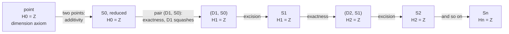

# Eilenberg-Steenrod axioms: five rules that force every homology theory to agree on cell complexes

[Syllabus](../../../SYLLABUS.md) → [Topology](../README.md) → [Homology](../README.md#s05) → Eilenberg-Steenrod axioms

---

## General Overview

A common geodesic dome has 42 joints, 120 struts and 80 triangular panels. Ask how many holes it has, and this shelf gives three ways to count.

- **Simplicial homology** treats the joints, struts and panels as simplices and reduces two boundary matrices, 42 × 120 and 120 × 80 ([Homology groups](02-homology-groups.md)).
- **Cellular homology** treats the dome as one point with one disc glued on along its rim, and reads the answer off matrices of zeros ([Cellular homology](05-cellular-homology.md)).
- **Singular homology** uses every continuous map of a triangle into the dome: infinitely many, never listed, but defined for every space ([Singular homology](09-singular-homology-and-excision.md)).

All three give the same answer: one piece, no loops, one sealed space. Take three panels out, well apart, and all three agree again: two loops that no panel fills, so the Betti number $`\beta_1`$ (the count of independent loops, over the whole numbers) is 2.

That is no coincidence. In 1945 Eilenberg and Steenrod listed a few rules that all these theories obey, and showed (in full in their 1952 book) that the rules alone fix the answer on every space cut into finitely many simplices. The form for every space built from finitely many cells came later.

The rules also compute. From "a point has one copy of the whole numbers in dimension 0" they push that copy up one dimension at a time, to every sphere. Off cell complexes they no longer decide: on the Warsaw circle, a closed-up wiggly curve, two honest theories disagree.

**Any rule that gives groups to spaces and obeys five axioms (maps carry over, deformations change nothing, pairs give exact sequences, cutting away inside a piece changes nothing, a point has only the whole numbers in dimension 0) gives the same groups on every finite cell complex, so simplicial, cellular and singular homology agree there.**

**What kind of fact this is:** the axioms are a definition. The homology of every sphere from the axioms alone is a theorem, proved on this card in Why it works. Uniqueness on finite cell complexes is a theorem, proved here in outline by induction over the cells; the full proof is in Eilenberg and Steenrod's book and Hatcher's Theorem 4.59 (Sources). The Warsaw circle's two answers are stated with a source, and the code illustrates the Čech side on 5 grids.

### The picture: one copy of the whole numbers climbs the spheres



Each arrow uses one axiom and moves the single copy of $`\mathbb{Z}`$ (the whole numbers) one box to the right. No chains, matrices or triangles appear anywhere.

---

## The formula

Notation first, in words.

- A **pair** $`(X, A)`$ is a space $`X`$ with a piece $`A`$ inside it, such as a disc with its rim. A space alone is the pair $`(X, \varnothing)`$, with $`\varnothing`$ the empty set.
- A **homology theory** $`h`$ gives each pair a group $`h_k(X, A)`$ in each dimension $`k = 0, 1, 2, \dots`$, and each **map of pairs** $`f : (X, A) \to (Y, B)`$ (a continuous map sending $`A`$ into $`B`$) a group map $`f_*`$. It also gives a **connecting map** $`\partial`$ from $`h_k(X, A)`$ to $`h_{k-1}(A)`$: a relative cycle goes to its loose ends in $`A`$ ([Mayer-Vietoris and exact sequences](06-mayer-vietoris-and-long-exact-sequences.md)).
- $`\simeq`$ means **homotopic**: one map slides into the other through continuous maps ([Homotopy invariance](04-homotopy-invariance-of-homology.md)).

The five **Eilenberg–Steenrod axioms**:

1. **Functoriality** (maps carry over in order): the identity map gives the identity, and doing $`f`$ then $`g`$ gives $`(g \circ f)_* = g_* \circ f_*`$.
2. **Homotopy**: if $`f \simeq g`$ as maps of pairs, then $`f_* = g_*`$.
3. **Exactness**: each pair gives a long exact sequence, and $`\partial`$ commutes with maps of pairs.
4. **Excision**: if the closure of $`U`$ lies inside the interior of $`A`$, cutting $`U`$ away changes nothing: $`h_k(X - U, A - U) \cong h_k(X, A)`$.
5. **Dimension**: a point has $`h_0 = \mathbb{Z}`$ and $`h_k = 0`$ for every other $`k`$.

A sixth, **additivity**, says a disjoint union of pieces has the direct sum $`\oplus`$ (one entry per piece) of their groups. For finitely many pieces it follows from the five; for infinitely many it was added in 1962 (Milnor, Sources).

The exactness axiom, written out:

```math
\cdots \to h_k(A) \xrightarrow{\;i_*\;} h_k(X) \xrightarrow{\;j_*\;} h_k(X, A) \xrightarrow{\;\partial\;} h_{k-1}(A) \to h_{k-1}(X) \to \cdots
```

**Read it aloud:** holes of the piece go to holes of the whole, those go to relative holes, and a relative hole goes to its loose ends; at every spot, what arrives is exactly what dies on leaving.

The two results this card proves from the axioms:

```math
\tilde h_k(S^n) \cong \tilde h_{k-1}(S^{n-1}), \qquad\text{so}\qquad h_k(S^n) \cong \begin{cases} \mathbb{Z} & k = 0 \text{ or } k = n \\ 0 & \text{otherwise} \end{cases} \quad (n \ge 1)
```

**Read it aloud:** a hole of the n-sphere is a hole of the sphere one dimension down, raised by one; so a sphere has one piece and one hole of its own dimension, and nothing else.

Here $`S^n`$ is the n-sphere, $`D^n`$ the solid n-disc whose rim is $`S^{n-1}`$, and $`\tilde h_k`$ the **reduced** group: $`h_k`$ with the point's copy of $`\mathbb{Z}`$ in dimension 0 removed (formally, the kernel of the map to a point).

```math
h_k(X) \cong H_k^{\mathrm{CW}}(X) \quad \text{for every finite CW complex } X
```

**Read it aloud:** on any space glued from finitely many cells, a theory obeying the five axioms has the cellular homology groups, whatever its own definition.

On the dome, every such theory gives $`\mathbb{Z}, 0, \mathbb{Z}`$.

| Symbol | Plain meaning | In our example | Push it up and the answer… |
| --- | --- | --- | --- |
| $`(X, A)`$ | a space and a piece inside it | disc $`D^n`$ with its rim $`S^{n-1}`$ | a bigger $`A`$ ignores more |
| $`h_k(X, A)`$, $`H_k`$ | the k-th group of a homology theory; $`H`$ for the usual one | $`h_1(D^1, S^0) = \mathbb{Z}`$ | — |
| $`\tilde h_k`$ | reduced group: the point's $`\mathbb{Z}`$ taken out of dimension 0 | $`\tilde h_0(S^0) = \mathbb{Z}`$, not $`\mathbb{Z}^2`$ | — |
| $`f`$, $`f_*`$, $`\circ`$ | a map of pairs; its effect on groups; "then" | inclusion of the rim in the disc | — |
| $`\simeq`$ | homotopic: slides into, continuously | the disc squashed to its centre $`\simeq`$ the identity | — |
| $`i_*`$, $`j_*`$, $`\partial`$ | the three maps of the exact sequence; $`\partial`$ steps down one dimension | $`\partial : h_1(D^1, S^0) \to \tilde h_0(S^0)`$, one-to-one and onto | — |
| $`U`$ | the part cut away by excision | the inside of the south cap | — |
| $`\mathbb{Z}`$, $`\oplus`$ | the whole numbers; direct sum, one entry per piece | $`h_0(S^0) = \mathbb{Z} \oplus \mathbb{Z}`$ | more pieces, more summands |
| $`S^n`$, $`D^n`$ | the n-sphere; the solid n-disc, whose rim is $`S^{n-1}`$ | $`S^2`$, the dome's shape | the hole moves up with n |
| $`n`$, $`k`$ | the sphere's dimension; the dimension a group counts | n = 2 for the dome | — |
| $`X^n`$, $`H_k^{\mathrm{CW}}`$ | the cells of dimension at most n; cellular homology | dome: $`X^0`$ one joint, $`X^2`$ adds one 2-cell (one panel, once the rest is collapsed) | — |
| $`\beta_k`$ | Betti number: the rank of the k-th group over $`\mathbb{Z}`$ | dome less 3 panels: $`\beta_1 = 2`$ | one more loop no panel fills |

### When it holds

- **The space is a finite CW complex** (built by gluing finitely many cells, [CW complexes](../04-Homotopy/07-cw-complexes-and-gluing-cells.md)). On the Warsaw circle, singular $`H_1 = 0`$ but Čech $`H^1 = \mathbb{Z}`$ (Čech theory reads holes off finer and finer open covers, Step 7): both theories are honest, and the uniqueness theorem says nothing there.
- **The dimension axiom holds.** Drop it and a theory whose point has $`\mathbb{Z}`$ in dimensions 0 and 2 gives $`S^2`$ ranks 1, 0, 2, 0, 1 in dimensions 0 to 4. K-theory and bordism (Step 8) are such theories, and they are useful.
- **The point's group is named.** With a point group $`G`$ in place of $`\mathbb{Z}`$, the axioms force homology with coefficients in $`G`$; the integers mod 2 give mod 2 homology.
- **Infinitely many pieces need additivity.** For a CW complex with infinitely many cells, the five axioms do not force the direct sum; Milnor's sixth axiom does.

---

## Why it works

### Step 0: every finite cell complex is a point plus discs, and the axioms say what one disc adds

A finite CW complex starts with points and then glues discs along their rims, one dimension at a time. The axioms describe exactly what happens when one disc is glued on: exactness links before and after, excision isolates the new disc, and homotopy shrinks it.

So the answer on a point decides the answer after each disc in turn, and two theories that agree on a point agree on everything built this way. The spheres come first, and they carry all the information the gluing needs.

### Step 1: two points, and reduced groups

$`S^0`$ is two points. By additivity, $`h_0(S^0) = \mathbb{Z} \oplus \mathbb{Z}`$ and every other group is 0. Removing the point's copy leaves $`\tilde h_0(S^0) = \mathbb{Z}`$: one copy, recording "two pieces, not one".

Reduced groups obey the same exact sequence when $`A`$ is not empty, and a space that squashes to a point has every reduced group 0.

### Step 2: the disc is contractible, so the pair sequence shifts by one

The disc $`D^n`$ squashes to its centre, so by the homotopy axiom it has a point's groups and every reduced group is 0. Put the pair $`(D^n, S^{n-1})`$ into the reduced exact sequence:

```math
0 = \tilde h_k(D^n) \to h_k(D^n, S^{n-1}) \xrightarrow{\;\partial\;} \tilde h_{k-1}(S^{n-1}) \to \tilde h_{k-1}(D^n) = 0
```

**Read it aloud:** with zeros on both sides, the connecting map is one-to-one and onto, so a relative hole of the disc is exactly a hole of its rim, one dimension down.

For n = 1: the rim is two points, so $`h_1(D^1, S^0) \cong \tilde h_0(S^0) = \mathbb{Z}`$. The relative class is the segment itself, whose loose ends are its two end points.

### Step 3: excision identifies the pair with the sphere

Split $`S^n`$ along its equator into a north cap $`D_+`$ and a south cap $`D_-`$, each a disc whose rim is the equator $`S^{n-1}`$.

1. $`D_-`$ squashes to a point, so the exact sequence of $`(S^n, D_-)`$ gives $`\tilde h_k(S^n) \cong h_k(S^n, D_-)`$.
2. Cut away the inside of the south cap. Excision gives $`h_k(S^n, D_-) \cong h_k(D_+, S^{n-1})`$.

The second move needs care, since excision asks that the closure of the cut lie inside the interior of the piece. The fold handles it by thickening the cap.

<details>
<summary>Detailed proof: the excision step, with the cap thickened</summary>

Let $`A`$ be the sphere's points below latitude 10° north: a slightly larger south cap. It squashes onto $`D_-`$, and $`D_-`$ onto a point.

Let $`U`$ be the points below latitude 10° south. Its closure, latitude 10° south and below, lies inside the interior of $`A`$. Excision cuts $`U`$ away:

$`\displaystyle h_k(S^n, A) \cong h_k(S^n - U, A - U).`$

$`S^n - U`$ is the north cap extended to 10° south, and $`A - U`$ is the band between 10° south and 10° north. Include $`(D_+, S^{n-1})`$ in this pair. The extended cap squashes onto $`D_+`$ and the band onto the equator, so by the homotopy axiom both absolute inclusions give isomorphisms.

Exactness puts the two pairs' sequences side by side, joined by the inclusion. The **five-lemma** is the algebra fact that finishes: in two exact sequences joined by maps that commute, if the four maps around a spot are isomorphisms, so is the one in the middle. So $`h_k(S^n - U, A - U) \cong h_k(D_+, S^{n-1})`$, and in the same way $`h_k(S^n, A) \cong h_k(S^n, D_-)`$.

</details>

### Step 4: climb from two points to every sphere

Steps 2 and 3 together give

```math
\tilde h_k(S^n) \cong h_k(D^n, S^{n-1}) \cong \tilde h_{k-1}(S^{n-1}).
```

**Read it aloud:** a hole of the n-sphere is a relative hole of the n-disc, which is a hole of the (n−1)-sphere one dimension down.

Apply it n times. $`\tilde h_k(S^n) \cong \tilde h_{k-n}(S^0)`$, which is $`\mathbb{Z}`$ when k = n and 0 otherwise (groups in negative dimensions count as 0). Adding back the point's $`\mathbb{Z}`$ in dimension 0 gives the sphere formula.

[Homology of spheres, and degree](07-homology-of-spheres-and-degree.md) reached the same groups by Mayer–Vietoris for singular homology. This route uses only the axioms, so it holds in every theory that obeys them.

### Step 5: uniqueness on finite CW complexes, by induction over the cells

Write $`X^n`$ for the cells of dimension at most n, the **n-skeleton**. Let $`h`$ be any theory obeying the five axioms. The proof has three steps; Hatcher's Theorem 2.35 gives them in full for singular homology, and the same words work for any $`h`$.

1. **One dimension at a time.** Crushing $`X^{n-1}`$ to a point turns each n-cell into its own n-sphere. Excision and Step 4 give $`h_k(X^n, X^{n-1}) = 0`$ for $`k \ne n`$, and $`\mathbb{Z}`$ per n-cell for $`k = n`$: the cellular chains.
2. **The skeleton holds everything.** Exact sequences of $`(X^n, X^{n-1})`$, used by induction on n, give $`h_k(X^n) = 0`$ for $`k > n`$ and $`h_k(X) \cong h_k(X^{k+1})`$.
3. **The boundary is the degree count.** The connecting map from $`h_n(X^n, X^{n-1})`$ to $`h_{n-1}(X^{n-1}, X^{n-2})`$ sends a cell to its rim's cells, each counted by a degree. Maps of a sphere to itself sort, up to homotopy, by degree alone, and the axioms force a map of degree d to multiply by d.

Chasing the sequences then gives $`h_n(X) \cong H_n^{\mathrm{CW}}(X)`$, kernel over image of the same integer matrices. Steps 2 and 3 are stated here with their key moves; the full chase is in the sources.

On the dome, the collapse in the checks removes panel after panel, each through a strut that touches no other panel. The dome less one panel shrinks to a single joint. Each collapse is a homotopy, so the dome is a point with one 2-cell glued on, and its cellular chains are $`\mathbb{Z}, 0, \mathbb{Z}`$ with zero boundaries: $`\mathbb{Z}, 0, \mathbb{Z}`$.

### Step 6: why simplicial, cellular and singular homology agree

Singular homology obeys all five axioms, on every pair of spaces and for every continuous map ([Singular homology](09-singular-homology-and-excision.md) proves excision). That is exactly what Step 5 uses, so singular homology equals cellular homology on every finite CW complex.

Simplicial homology joins by another route. Its maps must send simplices to simplices, so the homotopy and excision axioms cannot even be stated for it, and Step 5 does not apply to it on its own. But a simplicial complex is a CW complex whose cells are its simplices, and each face of a simplex meets the simplex's rim with degree +1 or −1, the sign in the simplicial boundary. So its cellular chains are its simplicial chains, and simplicial = cellular = singular.

Hatcher's Theorem 2.27 also gives a direct map: each simplex is itself a continuous map of a triangle, so a simplicial chain is a singular one. The base step is one n-simplex relative to its own rim, where both theories give one $`\mathbb{Z}`$, carried by the simplex itself. The five-lemma, skeleton by skeleton, then makes the map an isomorphism everywhere. That settles the claim [Homotopy invariance](04-homotopy-invariance-of-homology.md) stated without proof.

### Step 7: off cell complexes, the Warsaw circle

The **Warsaw circle** $`W`$ is the graph of $`y = \sin(1/x)`$ for x from 0 to $`1/\pi`$, the bar from $`(0, -1)`$ to $`(0, 1)`$ that the wiggles crowd against, and an arc closing them: down to $`y = -2`$, across, and up the y-axis to the bar.

- **Singular homology sees no loop.** A path cannot run along the wiggles into the bar: near the bar the wiggles never settle, so no continuous path arrives. Every loop then lies in a piece that shrinks to a point, so $`W`$ is simply connected (Hatcher, page 256). Singular $`H_1`$ of a path-connected space is its fundamental group made commutative (Hatcher, Theorem 2A.1), so singular $`H_1(W) = 0`$.
- **Čech cohomology sees one.** It covers $`W`$ with small open sets and reads homology off the **nerve**: one vertex per set, an edge where two sets meet. Near the bar, small sets bridge the gap no path can cross, so every fine enough nerve contains a loop, and Čech $`H^1(W) = \mathbb{Z}`$. Singular cohomology $`H^1(W)`$ is 0, like singular $`H_1`$, so the clash is between theories, not between homology and cohomology.

The checks show the Čech side on grids. Cover the plane with squares of side 1/N and keep those $`W`$ meets. At N = 10, 20, 40, 80 and 160 they enclose exactly 1 hole, the region under the wiggles. That is 5 cases, an illustration and not a proof.

Both theories obey the axioms on CW complexes and agree there. $`W`$ is no CW complex. Every CW complex lets each point reach its near neighbours by short paths, and near the bar $`W`$ does not: a small disc round a bar point meets infinitely many separate wiggles. So uniqueness is silent, and both answers are correct for their own theories.

### Step 8: theories without the dimension axiom

Drop the dimension axiom and Step 4 still works: a sphere's reduced groups are the point's groups shifted up by n. Two such **generalised theories** matter:

- **K-theory**, built from vector bundles (a vector space attached continuously at every point of the space), gives a point $`\mathbb{Z}`$ in every even dimension.
- **Bordism** counts closed manifolds mapped into the space, two counted equal when together they form the boundary of a manifold one dimension up. Oriented bordism of a point is $`\mathbb{Z}`$ in dimension 4, carried by the complex projective plane.

---

## Worked numbers, by hand

| Step | Arithmetic | Value |
| --- | --- | --- |
| a point | dimension axiom | $`h_0 = \mathbb{Z}`$ |
| two points, $`S^0`$ | additivity: $`\mathbb{Z} \oplus \mathbb{Z}`$, less the point's copy | $`\tilde h_0(S^0) = \mathbb{Z}`$ |
| the pair $`(D^1, S^0)`$ | exact: $`0 \to h_1(D^1, S^0) \to \tilde h_0(S^0) \to 0`$ | $`\mathbb{Z}`$ |
| the circle $`S^1`$ | the south cap squashes, then excision | $`h_1(S^1) = \mathbb{Z}`$ |
| $`S^2`$, then $`S^n`$ | the same two moves, once per dimension | $`h_n(S^n) = \mathbb{Z}`$ |
| dome | 42 − 120 + 80 | Euler characteristic 2 = 1 − 0 + 1 |
| dome less one panel | collapses to 0 panels, 1 joint, 0 struts | a point |
| dome | a point plus one 2-cell, cellular boundaries 0 | **$`\mathbb{Z}, 0, \mathbb{Z}`$** |
| dome less 3 panels | collapses to 8 joints, 9 struts; 9 − 8 + 1 | **$`\mathbb{Z}, \mathbb{Z}^2, 0`$** |

One copy of the whole numbers climbs from a point to every sphere. On the dome, every theory obeying the axioms counts one sealed space, and, with three panels out, two loops no panel fills.

### What breaks if you drop a piece

| Mistake | Comes out at | What went wrong |
| --- | --- | --- |
| Drop the dimension axiom: a point with $`\mathbb{Z}`$ in dimensions 0 and 2 | $`S^2`$ ranks 1, 0, 2, 0, 1 | the point's extra group climbs with every sphere |
| Push the unreduced $`h_0(S^0) = \mathbb{Z}^2`$ up the ladder | $`H_1(S^1)`$ rank 2; truly 1 | one copy belongs to the point, which no disc fills |
| Leave cell complexes: the Warsaw circle | singular $`H_1 = 0`$; grid holes 1 at every N | uniqueness needs cells; singular and Čech part ways |

The code prints all three.

---

## Code, from first principles, and it actually runs

Both programs print the axioms' bookkeeping, then take two independent roads to the same groups.

- **Road 1, the axioms' bookkeeping, printed:** Steps 1 to 4 as a shift by one per sphere, with no chains at all. It writes the proof out, so it can catch a slip in the code but cannot disagree with the proof.
- **Road 2, simplicial homology:** every disc, rim, pair, sphere and the dome is cut into simplices, and each signed boundary matrix is reduced to its integer Smith form ([Smith normal form](03-computing-homology-by-smith-normal-form.md)), so torsion would show.
- **Road 3, collapses and cells:** the dome's panels are peeled off through free struts, a homotopy, until a point or a graph remains; loops are then struts − joints + 1.

Each finite complex here is computed exactly, so its groups are proved. The sphere formula for every n is Step 4's. The Warsaw grids use floating-point sines only to decide which squares the curve meets, and print integer counts.

### Python

```python
# Eilenberg-Steenrod axioms -- the check behind the card.  Standard library only.
# Road 1: the axioms' bookkeeping walks one Z from a point up the spheres.  Road 2:
# simplicial homology over Z by integer Smith form, on discs, rims, pairs, spheres
# and a 42-joint dome.  Road 3: collapses (homotopy axiom) and cells, no matrices.
from itertools import combinations
from math import sin, pi, floor, ceil

def smith(m):                        # invariant factors of an integer matrix
    m, out = [r[:] for r in m if any(r)], []
    while m:
        _, i, j = min((abs(v), i, j) for i, r in enumerate(m) for j, v in enumerate(r) if v)
        m[0], m[i] = m[i], m[0]
        for r in m: r[0], r[j] = r[j], r[0]
        p = m[0][0]
        for r in m[1:]:              # clear column 0, then row 0, by the pivot
            q = r[0] // p
            r[:] = [a - q * b for a, b in zip(r, m[0])]
        q = [v // p for v in m[0]]
        for r in m: r[1:] = [a - k * r[0] for a, k in zip(r[1:], q[1:])]
        if any(r[0] for r in m[1:]) or any(m[0][1:]):
            continue                 # a smaller remainder becomes the next pivot
        bad = [r for r in m[1:] if any(v % p for v in r)]
        if bad:                      # pivot fails to divide the rest: mix a row in
            m[0] = [a + b for a, b in zip(m[0], bad[0])]
            continue
        out.append(abs(p))
        m = [r[1:] for r in m[1:] if any(r[1:])]
    return out

def homology(cx, rel=()):            # groups of complex cx relative to subcomplex rel
    cells = [[] for _ in range(max(map(len, cx)) + 1)]
    for s in sorted(set(cx) - set(rel)):
        cells[len(s) - 1].append(s)
    facs = [[]]
    for k in range(1, len(cells)):
        pos = {s: i for i, s in enumerate(cells[k - 1])}
        mat = [[0] * len(cells[k]) for _ in cells[k - 1]]
        for j, s in enumerate(cells[k]):
            for i in range(len(s)):  # face i of s, with sign (-1)^i
                if s[:i] + s[i + 1:] in pos:
                    mat[pos[s[:i] + s[i + 1:]]][j] = (-1) ** i
        facs.append(smith(mat))
    return [(len(cells[k]) - len(facs[k]) - len(facs[k + 1]),
             [d for d in facs[k + 1] if d > 1]) for k in range(len(cells) - 1)]

def show(h):                         # "Z^2 + Z/2" style, one group per degree
    return ", ".join(" + ".join((["Z" if r == 1 else f"Z^{r}"] if r else [])
                                + [f"Z/{d}" for d in t]) or "0" for r, t in h)

def closure(top):                    # every face of every listed simplex
    return sorted({f for s in top for k in range(1, len(s) + 1) for f in combinations(s, k)})

def axiom_spheres(point, n_max):     # reduced ranks by degree: S0 is the point's, then shift
    rows = [dict(point)]
    for _ in range(n_max):           # pair sequence with D contractible, then excision
        rows.append({k + 1: r for k, r in rows[-1].items()})
    return [[d.get(k, 0) for k in range(n_max + 1)] for d in rows]

up, lo = [1, 2, 3, 4, 5], [6, 7, 8, 9, 10]      # icosahedron: top 0, two rings, bottom 11
ico = [f for i in range(5) for f in ((0, up[i], up[i - 4]), (up[i], up[i - 4], lo[i]),
       (up[i - 4], lo[i], lo[i - 4]), (11, lo[i], lo[i - 4]))]
mid, dome, centre = {}, [], []
for a, b, c in ico:                  # each face into four panels, struts halved
    ab, bc, ca = (mid.setdefault(tuple(sorted(e)), 12 + len(mid)) for e in ((a, b), (b, c), (c, a)))
    dome += [tuple(sorted(t)) for t in ((a, ab, ca), (b, bc, ab), (c, ca, bc), (ab, bc, ca))]
    centre.append(tuple(sorted((ab, bc, ca))))
holes = [centre[0], centre[13], centre[19]]     # three panels with no joint in common

def collapse(panels):                # remove free struts with their panel, then leaf struts
    faces = set(panels)
    edges = {e for f in faces for e in combinations(f, 2)}
    while free := [e for e in sorted(edges) if sum(set(e) <= set(f) for f in faces) == 1]:
        faces = {f for f in faces if not set(free[0]) <= set(f)}
        edges.discard(free[0])
    verts = sorted({v for e in edges for v in e})
    while len(verts) > 1 and (leaf := [v for v in verts if sum(v in e for e in edges) <= 1]):
        verts.remove(leaf[0])
        edges = {e for e in edges if leaf[0] not in e}
    return len(faces), len(verts), len(edges)

def warsaw(n):                       # grid cells of side 1/n meeting the Warsaw circle
    h, xe = 1 / n, 1 / pi            # sine part for 0 < x <= 1/pi, bar at x = 0,
    ie = floor(xe / h)               # arc down to y = -2, across, and up the bar
    hit = {(i, j) for i in (-1, 0) for j in range(-2 * n - 1, n + 1)}
    hit |= {(i, j) for i in range(-1, ie + 1) for j in (-2 * n - 1, -2 * n)}
    hit |= {(ie, j) for j in range(-2 * n - 1, 1)}
    for i in range(1, ie + 1):       # sin(1/x) over one column: ends, peak, trough
        u, v = 1 / min((i + 1) * h, xe), 1 / (i * h)
        ys = [sin(u), sin(v)]
        if pi / 2 + 2 * pi * ceil((u - pi / 2) / (2 * pi)) <= v:
            ys.append(1.0)
        if -pi / 2 + 2 * pi * ceil((u + pi / 2) / (2 * pi)) <= v:
            ys.append(-1.0)
        hit |= {(i, j) for j in range(ceil(min(ys) / h) - 1, floor(max(ys) / h) + 1)}
    free = {(i, j) for i in range(-3, ie + 3) for j in range(-2 * n - 3, n + 3)} - hit
    seen, parts = set(), 0
    for c in sorted(free):           # flood-fill the free cells, edge to edge
        if c not in seen:
            parts, stack, seen = parts + 1, [c], seen | {c}
            while stack:
                i, j = stack.pop()
                for d in ((i + 1, j), (i - 1, j), (i, j + 1), (i, j - 1)):
                    if d in free and d not in seen:
                        seen.add(d)
                        stack.append(d)
    return len(hit), parts - 1       # one free part is the outside

spheres = axiom_spheres({0: 1}, 4)
print("road 1, axioms only: reduced ranks of S^n by degree, from H0(point) = Z")
for n, row in enumerate(spheres):
    print(f"S{n}: {row}")
shifted = axiom_spheres({0: 1, 2: 1}, 4)[2]
print(f"no dimension axiom, point Z in degrees 0 and 2: S2 ranks {[shifted[k] + (k in (0, 2)) for k in range(5)]}")
print(f"mistake, unreduced H0(S0) pushed up: H1(S1) rank {2 * spheres[0][0]}; truly {spheres[1][1]}")
print("road 2, Smith form over Z: disc D^n, rim S^(n-1), pair (D^n, rim), sphere S^n")
for n in range(1, 5):
    disc, rim = closure([tuple(range(n + 1))]), closure(combinations(range(n + 1), n))
    sph = closure(combinations(range(n + 2), n + 1))
    print(f"n={n}: D {show(homology(disc))}; rim {show(homology(rim))}; "
          f"pair {show(homology(disc, rim))}; S{n} {show(homology(sph))}")
full, cut = closure(dome), closure([p for p in dome if p not in holes])
counts = [sum(len(s) == k for s in full) for k in (1, 2, 3)]
print(f"dome: joints, struts, panels {counts}; chi {counts[0] - counts[1] + counts[2]}")
print(f"dome, Smith form: {show(homology(full))}")
print(f"dome less 3 panels, Smith form: {show(homology(cut))}")
one, three = collapse([p for p in dome if p != holes[0]]), collapse([p for p in dome if p not in holes])
print(f"road 3, dome less 1 panel collapses to panels, joints, struts {list(one)}")
print("so dome = point + one 2-cell; cellular chains Z, 0, Z with zero boundaries: Z, 0, Z")
print(f"dome less 3 panels collapses to panels, joints, struts {list(three)}; "
      f"loops {three[2] - three[1] + 1}: {show([(1, []), (three[2] - three[1] + 1, []), (0, [])])}")
print("Warsaw circle, singular H1 = 0 (stated, not computed); grid of side 1/N:")
grid = [(n,) + warsaw(n) for n in (10, 20, 40, 80, 160)]
print("\n".join(f"N={n}: cells met {c}, holes enclosed {k}" for n, c, k in grid))
assert spheres == [[int(k == n) for k in range(5)] for n in range(5)]
assert show(homology(closure(combinations(range(4), 3)))) == show(homology(full)) == "Z, 0, Z"
assert all(homology(closure([tuple(range(n + 1))]), closure(combinations(range(n + 1), n)))
           == [(0, [])] * n + [(1, [])] for n in range(1, 5))
assert homology(cut)[1][0] == three[2] - three[1] + 1 == 2 and one == (0, 1, 0)
assert counts == [42, 120, 80] and all(k == 1 for _, _, k in grid)
print("ALL CHECKS PASS")
```

**Ran 2026-11-24 on macOS, Python 3.14.10, standard library only. All checks passed. Output, pasted from the run:**

```
road 1, axioms only: reduced ranks of S^n by degree, from H0(point) = Z
S0: [1, 0, 0, 0, 0]
S1: [0, 1, 0, 0, 0]
S2: [0, 0, 1, 0, 0]
S3: [0, 0, 0, 1, 0]
S4: [0, 0, 0, 0, 1]
no dimension axiom, point Z in degrees 0 and 2: S2 ranks [1, 0, 2, 0, 1]
mistake, unreduced H0(S0) pushed up: H1(S1) rank 2; truly 1
road 2, Smith form over Z: disc D^n, rim S^(n-1), pair (D^n, rim), sphere S^n
n=1: D Z, 0; rim Z^2; pair 0, Z; S1 Z, Z
n=2: D Z, 0, 0; rim Z, Z; pair 0, 0, Z; S2 Z, 0, Z
n=3: D Z, 0, 0, 0; rim Z, 0, Z; pair 0, 0, 0, Z; S3 Z, 0, 0, Z
n=4: D Z, 0, 0, 0, 0; rim Z, 0, 0, Z; pair 0, 0, 0, 0, Z; S4 Z, 0, 0, 0, Z
dome: joints, struts, panels [42, 120, 80]; chi 2
dome, Smith form: Z, 0, Z
dome less 3 panels, Smith form: Z, Z^2, 0
road 3, dome less 1 panel collapses to panels, joints, struts [0, 1, 0]
so dome = point + one 2-cell; cellular chains Z, 0, Z with zero boundaries: Z, 0, Z
dome less 3 panels collapses to panels, joints, struts [0, 8, 9]; loops 2: Z, Z^2, 0
Warsaw circle, singular H1 = 0 (stated, not computed); grid of side 1/N:
N=10: cells met 121, holes enclosed 1
N=20: cells met 297, holes enclosed 1
N=40: cells met 762, holes enclosed 1
N=80: cells met 1983, holes enclosed 1
N=160: cells met 5336, holes enclosed 1
ALL CHECKS PASS
```

### Rust

Same numbers, same labels, built with `rustc --edition 2021 -O`.

```rust
// Eilenberg-Steenrod axioms -- the same check as the Python, in Rust.  No crates.
// Road 1: the axioms' bookkeeping walks one Z from a point up the spheres.  Road 2:
// simplicial homology over Z by integer Smith form, on discs, rims, pairs, spheres
// and a 42-joint dome.  Road 3: collapses (homotopy axiom) and cells, no matrices.
use std::collections::{BTreeSet, HashMap, HashSet};
use std::f64::consts::PI;
type Cx = Vec<Vec<usize>>;

fn smith(mut m: Vec<Vec<i64>>) -> Vec<i64> {        // invariant factors of an integer matrix
    m.retain(|r| r.iter().any(|&v| v != 0));
    let mut out = Vec::new();
    while !m.is_empty() {
        let (_, i, j) = m.iter().enumerate().flat_map(|(i, r)| r.iter().enumerate()
            .filter(|(_, v)| **v != 0).map(move |(j, v)| (v.abs(), i, j))).min().unwrap();
        m.swap(0, i);
        for r in m.iter_mut() { r.swap(0, j) }
        let p = m[0][0];
        let row0 = m[0].clone();
        for r in m.iter_mut().skip(1) {                 // clear column 0, then row 0
            let q = r[0].div_euclid(p);
            for (a, b) in r.iter_mut().zip(row0.iter()) { *a -= q * b }
        }
        let q: Vec<i64> = m[0].iter().map(|v| v.div_euclid(p)).collect();
        for r in m.iter_mut() { let r0 = r[0]; for c in 1..r.len() { r[c] -= q[c] * r0 } }
        if m[1..].iter().any(|r| r[0] != 0) || m[0][1..].iter().any(|&v| v != 0) { continue }
        if let Some(k) = (1..m.len()).find(|&k| m[k].iter().any(|v| v % p != 0)) {
            let bad = m[k].clone();                     // pivot fails to divide: mix a row in
            for (a, b) in m[0].iter_mut().zip(bad.iter()) { *a += b }; continue;
        }
        out.push(p.abs());
        m = m[1..].iter().map(|r| r[1..].to_vec()).filter(|r| r.iter().any(|&v| v != 0)).collect();
    }
    out
}

fn homology(cx: &Cx, rel: &Cx) -> Vec<(usize, Vec<i64>)> { // groups of cx relative to rel
    let top = cx.iter().map(|s| s.len()).max().unwrap();
    let mut cells: Vec<Cx> = vec![Vec::new(); top + 1];
    let keep: BTreeSet<&Vec<usize>> = cx.iter().filter(|s| !rel.contains(s)).collect();
    for s in keep { cells[s.len() - 1].push(s.clone()) }
    let mut facs: Vec<Vec<i64>> = vec![Vec::new()];
    for k in 1..cells.len() {
        let pos: HashMap<&Vec<usize>, usize> = cells[k - 1].iter().enumerate().map(|(i, s)| (s, i)).collect();
        let mut mat = vec![vec![0i64; cells[k].len()]; cells[k - 1].len()];
        for (j, s) in cells[k].iter().enumerate() {
            for i in 0..s.len() {                       // face i of s, with sign (-1)^i
                let mut f = s.clone(); f.remove(i);
                if let Some(&r) = pos.get(&f) { mat[r][j] = if i % 2 == 0 { 1 } else { -1 } }
            }
        }
        facs.push(smith(mat));
    }
    (0..cells.len() - 1).map(|k| (cells[k].len() - facs[k].len() - facs[k + 1].len(),
        facs[k + 1].iter().copied().filter(|&d| d > 1).collect())).collect()
}

fn show(h: &[(usize, Vec<i64>)]) -> String {        // "Z^2 + Z/2" style, one group per degree
    h.iter().map(|(r, t)| {
        let mut parts: Vec<String> = match r { 0 => vec![], 1 => vec!["Z".into()], _ => vec![format!("Z^{}", r)] };
        parts.extend(t.iter().map(|d| format!("Z/{}", d)));
        if parts.is_empty() { "0".to_string() } else { parts.join(" + ") }
    }).collect::<Vec<_>>().join(", ")
}

fn closure(top: &[Vec<usize>]) -> Cx {               // every face of every listed simplex
    top.iter().flat_map(|s| (1..1usize << s.len()).map(move |m| (0..s.len()).filter(|i| m >> i & 1 == 1)
        .map(|i| s[i]).collect::<Vec<_>>())).collect::<BTreeSet<_>>().into_iter().collect()
}
fn combos(n: usize, k: usize) -> Cx {                // k-element subsets of 0..n
    (0..1usize << n).filter(|m| m.count_ones() as usize == k)
        .map(|m| (0..n).filter(|i| m >> i & 1 == 1).collect()).collect()
}
fn axiom_spheres(point: &[(usize, i64)], n_max: usize) -> Vec<Vec<i64>> { // reduced ranks
    (0..=n_max).map(|n| (0..=n_max).map(|k| {      // pair sequence, D contractible, excision
        point.iter().filter(|p| p.0 + n == k).map(|p| p.1).sum() }).collect()).collect()
}
fn collapse(panels: &Cx) -> (usize, usize, usize) {  // free struts with their panel, then leaves
    let mut faces: BTreeSet<Vec<usize>> = panels.iter().cloned().collect();
    let mut edges: BTreeSet<(usize, usize)> =
        faces.iter().flat_map(|f| vec![(f[0], f[1]), (f[0], f[2]), (f[1], f[2])]).collect();
    let inside = |e: &(usize, usize), f: &Vec<usize>| f.contains(&e.0) && f.contains(&e.1);
    while let Some(&e) = edges.iter().find(|e| faces.iter().filter(|f| inside(e, f)).count() == 1) {
        faces.retain(|f| !inside(&e, f));
        edges.remove(&e);
    }
    let mut verts: Vec<usize> = edges.iter().flat_map(|e| vec![e.0, e.1]).collect::<BTreeSet<_>>().into_iter().collect();
    while verts.len() > 1 {
        let Some(&leaf) = verts.iter().find(|&&v| edges.iter().filter(|e| e.0 == v || e.1 == v).count() <= 1) else { break };
        verts.retain(|&v| v != leaf);
        edges.retain(|e| e.0 != leaf && e.1 != leaf);
    }
    (faces.len(), verts.len(), edges.len())
}

fn warsaw(n: i64) -> (usize, usize) {                // grid cells of side 1/n meeting the circle
    let (h, xe) = (1.0 / n as f64, 1.0 / PI);
    let ie = (xe / h).floor() as i64;
    let mut hit: HashSet<(i64, i64)> = HashSet::new();
    for j in -2 * n - 1..n + 1 { hit.insert((-1, j)); hit.insert((0, j)); }
    for i in -1..ie + 1 { hit.insert((i, -2 * n - 1)); hit.insert((i, -2 * n)); }
    for j in -2 * n - 1..1 { hit.insert((ie, j)); }
    for i in 1..ie + 1 {                            // sin(1/x) over one column
        let (u, v) = (1.0 / (((i + 1) as f64) * h).min(xe), 1.0 / (i as f64 * h));
        let mut ys = vec![u.sin(), v.sin()];
        if PI / 2.0 + 2.0 * PI * ((u - PI / 2.0) / (2.0 * PI)).ceil() <= v { ys.push(1.0) }
        if -PI / 2.0 + 2.0 * PI * ((u + PI / 2.0) / (2.0 * PI)).ceil() <= v { ys.push(-1.0) }
        let (lo, hi) = ys.iter().fold((f64::INFINITY, f64::NEG_INFINITY), |(a, b), &y| (a.min(y), b.max(y)));
        for j in (lo / h).ceil() as i64 - 1..(hi / h).floor() as i64 + 1 { hit.insert((i, j)); }
    }
    let free: HashSet<(i64, i64)> = (-3..ie + 3).flat_map(|i| (-2 * n - 3..n + 3).map(move |j| (i, j)))
        .filter(|c| !hit.contains(c)).collect();
    let (mut seen, mut parts) = (HashSet::new(), 0);
    for &c in &free {                               // flood-fill the free cells, edge to edge
        if !seen.insert(c) { continue }
        parts += 1; let mut stack = vec![c];
        while let Some((i, j)) = stack.pop() {
            for d in [(i + 1, j), (i - 1, j), (i, j + 1), (i, j - 1)] { if free.contains(&d) && seen.insert(d) { stack.push(d) } }
        }
    }
    (hit.len(), parts - 1)                          // one free part is the outside
}

fn main() {
    let spheres = axiom_spheres(&[(0, 1)], 4);
    println!("road 1, axioms only: reduced ranks of S^n by degree, from H0(point) = Z");
    for (n, row) in spheres.iter().enumerate() { println!("S{}: {:?}", n, row) }
    let shifted = &axiom_spheres(&[(0, 1), (2, 1)], 4)[2];
    println!("no dimension axiom, point Z in degrees 0 and 2: S2 ranks {:?}",
             (0..5).map(|k| shifted[k] + (k == 0 || k == 2) as i64).collect::<Vec<_>>());
    println!("mistake, unreduced H0(S0) pushed up: H1(S1) rank {}; truly {}", 2 * spheres[0][0], spheres[1][1]);
    println!("road 2, Smith form over Z: disc D^n, rim S^(n-1), pair (D^n, rim), sphere S^n");
    let mut pairs_ok = true;
    for n in 1..5 {
        let (disc, rim, sph) = (closure(&[(0..=n).collect()]), closure(&combos(n + 1, n)), closure(&combos(n + 2, n + 1)));
        let pair = homology(&disc, &rim);
        pairs_ok &= pair.iter().enumerate().all(|(k, g)| *g == ((k == n) as usize, vec![]));
        println!("n={}: D {}; rim {}; pair {}; S{} {}", n, show(&homology(&disc, &vec![])),
                 show(&homology(&rim, &vec![])), show(&pair), n, show(&homology(&sph, &vec![])));
    }
    let (up, lo) = ([1usize, 2, 3, 4, 5, 1], [6usize, 7, 8, 9, 10, 6]); // icosahedron: 0, rings, 11
    let ico: Vec<[usize; 3]> = (0..5).flat_map(|i| [[0, up[i], up[i + 1]], [up[i], up[i + 1], lo[i]],
        [up[i + 1], lo[i], lo[i + 1]], [11, lo[i], lo[i + 1]]]).collect();
    let (mut mid, mut dome, mut centre): (HashMap<(usize, usize), usize>, Cx, Cx) = (HashMap::new(), vec![], vec![]);
    for [a, b, c] in ico {                          // each face into four panels, struts halved
        let mut m = |x: usize, y: usize| { let k = (x.min(y), x.max(y)); let l = 12 + mid.len(); *mid.entry(k).or_insert(l) };
        let (ab, bc, ca) = (m(a, b), m(b, c), m(c, a));
        for t in [[a, ab, ca], [b, bc, ab], [c, ca, bc], [ab, bc, ca]] { let mut t = t.to_vec(); t.sort(); dome.push(t) }
        centre.push(dome[dome.len() - 1].clone());
    }
    let holes = vec![centre[0].clone(), centre[13].clone(), centre[19].clone()];
    let rest: Cx = dome.iter().filter(|p| !holes.contains(p)).cloned().collect();
    let (full, cut) = (closure(&dome), closure(&rest));
    let counts: Vec<usize> = (1..4).map(|k| full.iter().filter(|s| s.len() == k).count()).collect();
    println!("dome: joints, struts, panels {:?}; chi {}", counts, counts[0] as i64 - counts[1] as i64 + counts[2] as i64);
    let (hf, hc) = (homology(&full, &vec![]), homology(&cut, &vec![]));
    println!("dome, Smith form: {}\ndome less 3 panels, Smith form: {}", show(&hf), show(&hc));
    let (one, three) = (collapse(&dome.iter().filter(|p| **p != holes[0]).cloned().collect()), collapse(&rest));
    println!("road 3, dome less 1 panel collapses to panels, joints, struts {:?}", [one.0, one.1, one.2]);
    println!("so dome = point + one 2-cell; cellular chains Z, 0, Z with zero boundaries: Z, 0, Z");
    println!("dome less 3 panels collapses to panels, joints, struts {:?}; loops {}: {}", [three.0, three.1, three.2],
             three.2 + 1 - three.1, show(&[(1, vec![]), (three.2 + 1 - three.1, vec![]), (0, vec![])]));
    println!("Warsaw circle, singular H1 = 0 (stated, not computed); grid of side 1/N:");
    let grid: Vec<(i64, usize, usize)> = [10, 20, 40, 80, 160].iter().map(|&n| { let (c, k) = warsaw(n); (n, c, k) }).collect();
    for (n, c, k) in &grid { println!("N={}: cells met {}, holes enclosed {}", n, c, k) }
    assert!(spheres == (0..5).map(|n| (0..5).map(|k| (k == n) as i64).collect::<Vec<_>>()).collect::<Vec<_>>());
    assert!(show(&homology(&closure(&combos(4, 3)), &vec![])) == show(&hf) && show(&hf) == "Z, 0, Z");
    assert!(pairs_ok && hc[1].0 == three.2 + 1 - three.1 && hc[1].0 == 2 && one == (0, 1, 0));
    assert!(counts == vec![42, 120, 80] && grid.iter().all(|g| g.2 == 1));
    println!("ALL CHECKS PASS");
}
```

**Ran 2026-11-24 on macOS, rustc 1.98.1, no crates. All checks passed. Output, pasted from the run:**

```
road 1, axioms only: reduced ranks of S^n by degree, from H0(point) = Z
S0: [1, 0, 0, 0, 0]
S1: [0, 1, 0, 0, 0]
S2: [0, 0, 1, 0, 0]
S3: [0, 0, 0, 1, 0]
S4: [0, 0, 0, 0, 1]
no dimension axiom, point Z in degrees 0 and 2: S2 ranks [1, 0, 2, 0, 1]
mistake, unreduced H0(S0) pushed up: H1(S1) rank 2; truly 1
road 2, Smith form over Z: disc D^n, rim S^(n-1), pair (D^n, rim), sphere S^n
n=1: D Z, 0; rim Z^2; pair 0, Z; S1 Z, Z
n=2: D Z, 0, 0; rim Z, Z; pair 0, 0, Z; S2 Z, 0, Z
n=3: D Z, 0, 0, 0; rim Z, 0, Z; pair 0, 0, 0, Z; S3 Z, 0, 0, Z
n=4: D Z, 0, 0, 0, 0; rim Z, 0, 0, Z; pair 0, 0, 0, 0, Z; S4 Z, 0, 0, 0, Z
dome: joints, struts, panels [42, 120, 80]; chi 2
dome, Smith form: Z, 0, Z
dome less 3 panels, Smith form: Z, Z^2, 0
road 3, dome less 1 panel collapses to panels, joints, struts [0, 1, 0]
so dome = point + one 2-cell; cellular chains Z, 0, Z with zero boundaries: Z, 0, Z
dome less 3 panels collapses to panels, joints, struts [0, 8, 9]; loops 2: Z, Z^2, 0
Warsaw circle, singular H1 = 0 (stated, not computed); grid of side 1/N:
N=10: cells met 121, holes enclosed 1
N=20: cells met 297, holes enclosed 1
N=40: cells met 762, holes enclosed 1
N=80: cells met 1983, holes enclosed 1
N=160: cells met 5336, holes enclosed 1
ALL CHECKS PASS
```

The two outputs match line for line.

### Lean

Lean proves the sphere ladder of Step 4 from the facts of Steps 1 to 3, and two axioms for singular homology of spaces.

- Suppose a theory meets Steps 1 to 3: two points, zero reduced groups for discs, exact pair sequences and excision. Then $`\tilde h_k(S^n)`$ is $`\mathbb{Z}`$ when $`k = n`$ and 0 otherwise, for every $`n`$.
- Take singular homology of a point, over the whole numbers. Then it is $`\mathbb{Z}`$ in dimension 0 and 0 in every other dimension.
- Suppose two maps of spaces satisfy $`f \simeq g`$. Then $`f_* = g_*`$ on singular homology over the whole numbers, in every dimension.

The Smith forms, the dome's collapses and the Warsaw grids are left to the Python and Rust checks.

```lean
-- Eilenberg-Steenrod axioms: from what the axioms give on disc pairs, every sphere S^n has one copy of ℤ in dimension n and nothing else (reduced), and singular homology obeys the dimension and homotopy axioms.
import Mathlib.AlgebraicTopology.SingularHomology.Basic
import Mathlib.AlgebraicTopology.SingularHomology.HomotopyInvariance
import Mathlib.AlgebraicTopology.SingularHomology.HomologyZero
import Mathlib.Algebra.Category.Grp.Abelian
import Mathlib.Algebra.Category.Grp.Colimits
import Mathlib.Algebra.Exact.Basic
import Mathlib.Tactic.NormNum

open CategoryTheory Limits AlgebraicTopology

/-- The sphere ladder (Steps 1 to 4 of the card), from the axioms only.
Let `hS n k` be the reduced group h̃_k(S^n) of a homology theory, `hR n k` the relative group
h_k(D^n, S^(n-1)), and `hB n k` the reduced group h̃_k(D^n). Suppose the axioms give:
the disc squashes to a point, so every reduced group of the disc is 0 (homotopy axiom);
the pair (D^(n+1), S^n) has the exact sequence
h̃_(k+1)(D) → h_(k+1)(D, S) → h̃_k(S) → h̃_k(D), ending in h̃_0(D) → h_0(D, S) → 0
(exactness axiom, groups in negative dimensions being 0);
h̃_k(S^(n+1)) ≅ h_k(D^(n+1), S^n) (Step 3: a cap squashes, then excision);
and two points have reduced h̃_0(S^0) = ℤ and nothing else (dimension axiom and additivity).
Then every sphere S^n has reduced group ℤ in dimension n and 0 in every other dimension. -/
theorem reduced_sphere_homology_from_axioms
    (hS hR hB : ℕ → ℕ → Type)
    [∀ n k, AddCommGroup (hS n k)] [∀ n k, AddCommGroup (hR n k)]
    [∀ n k, AddCommGroup (hB n k)]
    (disc_contractible : ∀ n k, Subsingleton (hB n k))
    (j : ∀ n k, hB (n + 1) (k + 1) →+ hR (n + 1) (k + 1))
    (bd : ∀ n k, hR (n + 1) (k + 1) →+ hS n k)
    (i : ∀ n k, hS n k →+ hB (n + 1) k)
    (exact_at_pair : ∀ n k, Function.Exact (j n k) (bd n k))
    (exact_at_rim : ∀ n k, Function.Exact (bd n k) (i n k))
    (j₀ : ∀ n, hB (n + 1) 0 →+ hR (n + 1) 0)
    (exact_at_end : ∀ n, Function.Surjective (j₀ n))
    (excision : ∀ n k, Nonempty (hS (n + 1) k ≃+ hR (n + 1) k))
    (two_points : Nonempty (hS 0 0 ≃+ ℤ))
    (two_points_higher : ∀ k, k ≠ 0 → Subsingleton (hS 0 k)) :
    ∀ n k, (k = n → Nonempty (hS n k ≃+ ℤ)) ∧ (k ≠ n → Subsingleton (hS n k)) := by
  intro n
  induction n with
  | zero =>
    intro k
    refine ⟨fun hk => hk ▸ two_points, fun hk => two_points_higher k hk⟩
  | succ n ih =>
    intro k
    obtain ⟨e⟩ := excision n k
    cases k with
    | zero =>
      have hsurj := exact_at_end n
      have : Subsingleton (hR (n + 1) 0) := by
        constructor
        intro a b
        obtain ⟨a', rfl⟩ := hsurj a
        obtain ⟨b', rfl⟩ := hsurj b
        rw [Subsingleton.elim a' b']
      refine ⟨fun h => absurd h (by omega), fun _ => e.injective.subsingleton⟩
    | succ k =>
      have hinj : Function.Injective (bd n k) := by
        rw [injective_iff_map_eq_zero]
        intro a ha
        obtain ⟨b, rfl⟩ := (exact_at_pair n k a).1 ha
        rw [Subsingleton.elim b 0, map_zero]
      have hsurj : Function.Surjective (bd n k) := by
        intro a
        exact (exact_at_rim n k a).1 (Subsingleton.elim _ _)
      let f : hR (n + 1) (k + 1) ≃+ hS n k := AddEquiv.ofBijective (bd n k) ⟨hinj, hsurj⟩
      have e' : hS (n + 1) (k + 1) ≃+ hS n k := e.trans f
      refine ⟨fun h => ?_, fun h => ?_⟩
      · obtain ⟨g⟩ := (ih k).1 (by omega)
        exact ⟨e'.trans g⟩
      · have := (ih k).2 (by omega)
        exact e'.injective.subsingleton

/-- Singular homology obeys the dimension axiom: the one-point space has singular homology
ℤ in dimension 0 and 0 in every other dimension. -/
theorem singular_homology_dimension_axiom :
    Nonempty ((((singularHomologyFunctor AddCommGrpCat.{0} 0).obj (AddCommGrpCat.of ℤ)).obj
        (TopCat.of PUnit.{1})) ≅ AddCommGrpCat.of ℤ) ∧
    ∀ n : ℕ, n ≠ 0 →
      IsZero (((singularHomologyFunctor AddCommGrpCat.{0} n).obj (AddCommGrpCat.of ℤ)).obj
        (TopCat.of PUnit.{1})) := by
  have : PathConnectedSpace (TopCat.of PUnit.{1}) :=
    ⟨⟨PUnit.unit⟩, fun x y => by cases x; cases y; exact Joined.refl _⟩
  refine ⟨⟨asIso (TopCat.singularHomology₀ε (TopCat.of PUnit.{1}) (AddCommGrpCat.of ℤ))⟩, ?_⟩
  intro n hn
  exact isZero_singularHomologyFunctor_of_totallyDisconnectedSpace _ n _ _ hn

/-- Singular homology obeys the homotopy axiom: if two continuous maps f and g are homotopic,
they give the same map f_* = g_* on singular homology with whole-number coefficients,
in every dimension. -/
theorem singular_homology_homotopy_axiom {X Y : TopCat.{0}} (f g : X ⟶ Y)
    (hfg : ContinuousMap.Homotopic f.hom g.hom) (n : ℕ) :
    ((singularHomologyFunctor AddCommGrpCat.{0} n).obj (AddCommGrpCat.of ℤ)).map f =
      ((singularHomologyFunctor AddCommGrpCat.{0} n).obj (AddCommGrpCat.of ℤ)).map g := by
  obtain ⟨H⟩ := hfg
  exact TopCat.Homotopy.congr_homologyMap_singularChainComplexFunctor (f := f) (g := g) H _ n

-- The dome: 42 joints, 120 struts, 80 panels; Euler characteristic 2 = 1 - 0 + 1 (ℤ, 0, ℤ).
example : (42 : ℤ) - 120 + 80 = 2 := by norm_num
example : (42 : ℤ) - 120 + 80 = 1 - 0 + 1 := by norm_num
-- Dome less 3 panels collapses to 8 joints and 9 struts: loops 9 - 8 + 1 = 2, so β₁ = 2.
example : (9 : ℤ) - 8 + 1 = 2 := by norm_num
-- Its Euler characteristic matches ℤ, ℤ², 0, with 77 panels kept.
example : (42 : ℤ) - 120 + 77 = 1 - 2 + 0 := by norm_num

#print axioms reduced_sphere_homology_from_axioms
#print axioms singular_homology_dimension_axiom
#print axioms singular_homology_homotopy_axiom
```

**Checked 2026-11-24 on macOS, Lean 4.36.0-rc2, Mathlib v4.36.0-rc2. Every proof is complete and uses only Lean's standard axioms. Output, pasted from the run:**

```
'reduced_sphere_homology_from_axioms' depends on axioms: [propext, Classical.choice, Quot.sound]
'singular_homology_dimension_axiom' depends on axioms: [propext, Classical.choice, Quot.sound]
'singular_homology_homotopy_axiom' depends on axioms: [propext, Classical.choice, Quot.sound]
```

> [!TIP]
> **Try changing**
> Guess first, then run it. The asserts are pinned to the card's numbers, so expect some to stop the program.
> - **A coarser grid.** Change `(10, 20, 40, 80, 160)` to `(2, 3, 4, 5, 1000)`. Guess: the hole shows at every size? No: at N = 2 to 5 the squares fill it, 0 holes, and N = 1000 finds 1 again. Čech homology is a limit over finer covers, and the last assert stops it.
> - **Panels that touch.** Set `holes` to `[centre[0], centre[1], centre[2]]`, three panels sharing joints. Guess first: still two loops. The collapse ends at 17 joints and 18 struts, 18 − 17 + 1 = 2, and every check passes.
> - **A fourth panel out.** Add `centre[7]` to `holes`. Smith form gives $`\mathbb{Z}, \mathbb{Z}^3, 0`$ and the collapse ends at 12 joints, 14 struts, 3 loops; the fourth assert stops it.
> - **A point with group Z².** Change the first `axiom_spheres({0: 1}, 4)` to `axiom_spheres({0: 2}, 4)`. Every sphere's top rank becomes 2, the mistake line reads rank 4, and the first assert stops it.

---

## The usual mistake

> [!warning]
> **Reading "every theory agrees" as true for every space.** The uniqueness theorem covers spaces built from cells. On the Warsaw circle singular $`H_1`$ is 0 and Čech $`H^1`$ is $`\mathbb{Z}`$; the grids of side 1/N enclose 1 hole at N = 10, 20, 40, 80 and 160, yet no loop in the space goes round it.
>
> - **Forgetting the dimension axiom.** Without it, a point with $`\mathbb{Z}`$ in dimensions 0 and 2 gives $`S^2`$ ranks 1, 0, 2, 0, 1, not 1, 0, 1.
> - **Climbing with unreduced groups.** Shifting $`h_0(S^0) = \mathbb{Z}^2`$ up gives $`H_1(S^1)`$ rank 2; the true rank is 1.
> - **Excising without room.** Cutting the whole closed south cap out of $`(S^n, D_-)`$ breaks the axiom's hypothesis: the cut's closure touches the rim of the piece. Thicken the piece first, as in the Step 3 fold.
> - **Reading equal groups as equal spaces.** The dome less 3 panels, a surface with three rims, and a figure-eight of two loops both give $`\mathbb{Z}, \mathbb{Z}^2, 0`$, yet no continuous map with a continuous inverse joins them. Equal invariants prove nothing.

---

## Where you meet it in real life

- **Software for shapes.** Mesh and image libraries compute homology from whatever cells or cubes they were given. Uniqueness makes the answer the space's own, not the cutting's.
- **Data analysis.** Persistent homology computes the simplicial homology of a Čech complex built on data points, as a stand-in for the union of balls round them. Both are cell complexes up to homotopy, so every theory obeying the axioms gives them the same groups.
- **Physics and geometry.** On a manifold, integrals of closed forms (de Rham cohomology) count the same holes as singular cohomology with real coefficients. The proof compares the two theories piece by piece, as Step 5 does.
- **Wild sets from dynamics.** Attractors of dynamical systems can be as wild as the Warsaw circle. There singular homology can miss what Čech theory sees, so Čech theory is the one used.

> **Say it back**
> The Eilenberg–Steenrod axioms are five rules for a homology theory: maps carry over, homotopic maps act alike, pairs give exact sequences, cutting away inside a piece changes nothing, and a point has only the whole numbers in dimension 0. Exactness and excision push the point's copy of the whole numbers up one dimension per sphere. A finite cell complex is glued from discs, so the same moves fix its groups, and any two theories obeying the axioms agree there. That is why simplicial, cellular and singular homology give the dome the same $`\mathbb{Z}, 0, \mathbb{Z}`$. Off cell complexes they can differ: the Warsaw circle has singular $`H_1 = 0`$ but Čech $`H^1 = \mathbb{Z}`$.

---

## What this builds on

- [Singular homology](09-singular-homology-and-excision.md): the theory defined for every space, and its proof of excision.
- [Cellular homology](05-cellular-homology.md): the chain complex the uniqueness argument lands on, and the theorem it left stated.
- [Mayer-Vietoris and exact sequences](06-mayer-vietoris-and-long-exact-sequences.md): relative homology, the sequence of a pair, and excision for subcomplexes.
- [Homology of spheres, and degree](07-homology-of-spheres-and-degree.md): the sphere groups by Mayer–Vietoris, and the degree that sets the cellular boundary.
- [Smith normal form](03-computing-homology-by-smith-normal-form.md): the integer reduction that Road 2 runs on every complex.

## Where this goes next

- [Universal coefficients and Kunneth](11-universal-coefficients-and-kunneth.md): what changes when the point's group is not $`\mathbb{Z}`$, and the homology of a product.
- [Poincare duality](12-cap-product-and-poincare-duality.md): on a closed oriented manifold, homology in dimension k matches cohomology in the complementary dimension.
- [Vietoris-Rips, Cech and alpha complexes](../06-Topological%20Data%20Analysis/02-vietoris-rips-and-cech-complexes.md): Čech complexes built from data, where nerves stand in for spaces.
- [de Rham cohomology](../../23-Differential%20geometry%20and%20Lie%20groups/04-Differential%20Forms/08-de-rham-cohomology.md): a theory built from calculus that, on manifolds, agrees with singular cohomology with real coefficients.

The axioms fix the groups but say nothing about the extra structure some theories carry, such as products of classes; which of those structures are forced, and which tell theories apart, is the open question here.

---

## Sources

Verified 2026-11-24: every link below resolves to the publisher's page, except Hatcher's author page, which carries the full text, and every DOI was checked against Crossref.

- Eilenberg, Samuel, and Norman Steenrod. "Axiomatic approach to homology theory." *Proceedings of the National Academy of Sciences* 31, no. 4 (1945): 117–120. [doi:10.1073/pnas.31.4.117](https://doi.org/10.1073/pnas.31.4.117). The first statement of the axioms.
- Eilenberg, Samuel, and Norman Steenrod. *Foundations of Algebraic Topology*. Princeton University Press, 1952. [Publisher page](https://press.princeton.edu/books/hardcover/9780691653297/foundations-of-algebraic-topology). Chapter I states the axioms and derives their first consequences; the uniqueness theorem and Čech theory follow in later chapters.
- Hatcher, Allen. *Algebraic Topology*. Cambridge University Press, 2002. [Author's page, with the free edition](https://pi.math.cornell.edu/~hatcher/AT/ATpage.html). Section 2.3 states the axioms, the dimension axiom's role, bordism and uniqueness, which Theorem 4.59 proves; Theorems 2.27 and 2.35 prove simplicial and cellular homology equal singular; page 256 gives the quasi-circle, the Warsaw circle: it is simply connected, so its singular $`H^1`$ is 0, and by Theorem 2A.1 so is its singular $`H_1`$.
- Milnor, John. "On axiomatic homology theory." *Pacific Journal of Mathematics* 12, no. 1 (1962): 337–341. [doi:10.2140/pjm.1962.12.337](https://doi.org/10.2140/pjm.1962.12.337). Adds the additivity axiom for infinitely many pieces.
- Bredon, Glen E. *Topology and Geometry*. Springer, Graduate Texts in Mathematics 139, 1993. [doi:10.1007/978-1-4757-6848-0](https://doi.org/10.1007/978-1-4757-6848-0). Chapter IV, Homology Theory, develops singular and cellular homology side by side, a second account of Steps 5 and 6.
