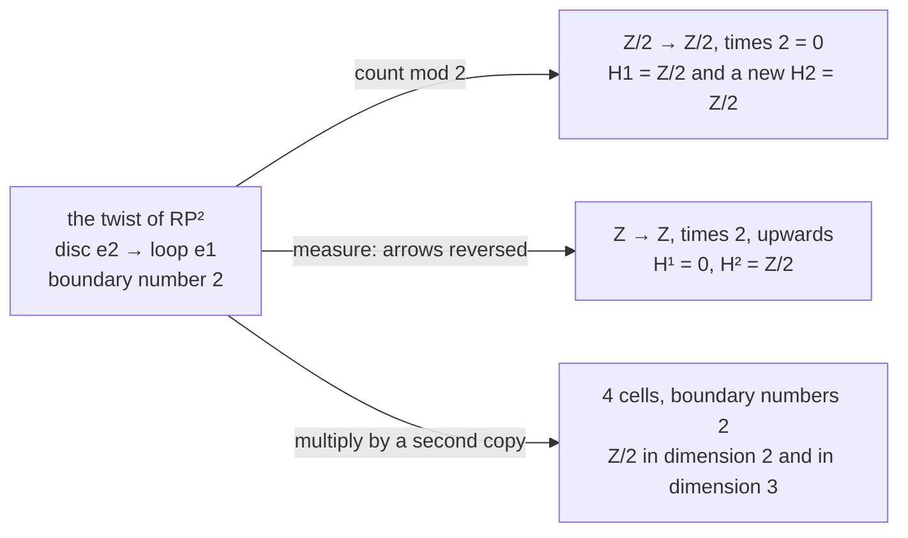

# Universal coefficients and Kunneth: change the number system, or multiply two spaces, and see what twists survive

[Syllabus](../../../SYLLABUS.md) → [Topology](../README.md) → [Homology](../README.md#s05) → Universal coefficients and Kunneth

---

## General Overview

Hold a pencil and point it somewhere. Its direction is a line through the hand that holds it, and the tip and the end count the same: "up" and "down" are one direction. The space of all such directions is the **projective plane** $`\mathbb{RP}^2`$: a sphere with each point glued to the point opposite. Rod-shaped molecules in a liquid-crystal screen have exactly this space of directions.

[Cellular homology](05-cellular-homology.md) builds $`\mathbb{RP}^2`$ from 1 point, 1 loop $`a`$ and 1 disc whose rim runs twice round $`a`$. Its integer homology is $`\mathbb{Z}`$, $`\mathbb{Z}/2`$, $`0`$ in dimensions 0, 1, 2. The $`\mathbb{Z}/2`$ is a **twist** (torsion: a loop that is no rim, though twice round it is the disc's rim).

Three questions follow, and this card answers all three from those three groups alone:

- **Count mod 2** (with the integers mod 2 as coefficients, as most software does). The answer is $`\mathbb{Z}/2`$, $`\mathbb{Z}/2`$, $`\mathbb{Z}/2`$. A new class appears in dimension 2.
- **Measure instead of count** (integer cohomology, from [Cohomology and the cup product in outline](08-cohomology-and-cup-product-in-outline.md)). The answer is $`\mathbb{Z}`$, $`0`$, $`\mathbb{Z}/2`$. The twist moves up one dimension.
- **Multiply two copies**, the space of directions of two pencils, $`\mathbb{RP}^2 \times \mathbb{RP}^2`$. Its dimension-3 group is $`\mathbb{Z}/2`$, a class built from two twists that is no product of a class from each factor.

**Integer homology decides everything: changing the coefficients, dualising to cohomology, or multiplying spaces gives the plain answer plus a correction made only from twists, Tor or Ext, which sits one dimension away from where a naive count would put it.**

**What kind of fact this is:** three theorems: the universal coefficient theorems for homology and for cohomology, and the Künneth theorem (Künneth is also spelled Kunneth). For finite cell complexes they are proved on this card in Why it works, given two stated facts: a subgroup of $`\mathbb{Z}^n`$ is free, and the cells of a product are the products of cells. Tor and Ext are built here only for finitely generated groups, as a kernel and a cokernel.

### The picture: one twist, three fates



Every result on this card is this picture applied to each twist of a space.

---

## The formula

Carried over, each in one line:

- $`H_k(X)`$ is the k-th **integer homology** group of a space $`X`$: cycles modulo boundaries, with whole-number coefficients ([Homology groups](02-homology-groups.md)). For a finite complex it is $`\mathbb{Z}^{\beta_k}`$ plus twists $`\mathbb{Z}/d`$, read off by [Smith normal form](03-computing-homology-by-smith-normal-form.md).
- $`H^k(X; \mathbb{Z})`$ is integer **cohomology**: measurements (cochains) modulo coboundaries, with the boundary matrices transposed ([Cohomology and the cup product in outline](08-cohomology-and-cup-product-in-outline.md)).

New here. A **coefficient group** $`G`$ is the number system the chains use: $`\mathbb{Z}`$, the rationals $`\mathbb{Q}`$, or $`\mathbb{Z}/p`$ for a prime $`p`$. $`H_k(X; G)`$ is homology with chains that take coefficients in $`G`$.

The **tensor product** $`A \otimes G`$ of two abelian groups (groups where swapping two terms of a sum never changes it) pairs them so that $`(a + a') \otimes g = a \otimes g + a' \otimes g`$ and the same in $`g`$. It is the group version of [Tensor products](../../03-Algebra/11-Duals%2C%20Quotients%20and%20Tensors/03-tensor-products.md). $`\mathrm{Hom}(A, \mathbb{Z})`$ is the group of maps from $`A`$ to $`\mathbb{Z}`$ that respect addition.

**Tor** and **Ext** are the corrections. For finitely generated groups they are fixed by four rules, where $`n \ge 1`$:

| Group $`A`$ | $`A \otimes G`$ | $`\mathrm{Tor}(A, G)`$ | $`\mathrm{Hom}(A, \mathbb{Z})`$ | $`\mathrm{Ext}(A, \mathbb{Z})`$ |
| --- | --- | --- | --- | --- |
| $`\mathbb{Z}`$ | $`G`$ | 0 | $`\mathbb{Z}`$ | 0 |
| $`\mathbb{Z}/n`$ | $`G / nG`$ | the n-torsion $`\{g : ng = 0\}`$ | 0 | $`\mathbb{Z}/n`$ |

Each column turns a direct sum $`\oplus`$ (groups side by side) into a direct sum. For two twists, $`\mathbb{Z}/m \otimes \mathbb{Z}/n`$ and $`\mathrm{Tor}(\mathbb{Z}/m, \mathbb{Z}/n)`$ are both $`\mathbb{Z}/\gcd(m, n)`$.

**Universal coefficients for homology:**

```math
H_k(X; G) \cong \big( H_k(X) \otimes G \big) \oplus \mathrm{Tor}\big( H_{k-1}(X), G \big)
```

**Read it aloud:** homology with coefficients in G is integer homology tensored with G, plus the Tor of the group one dimension down with G.

**Universal coefficients for cohomology:**

```math
H^k(X; \mathbb{Z}) \cong \mathrm{Hom}\big( H_k(X), \mathbb{Z} \big) \oplus \mathrm{Ext}\big( H_{k-1}(X), \mathbb{Z} \big)
```

**Read it aloud:** integer cohomology in dimension k is the free part of homology in dimension k, plus the twists of homology one dimension down.

**Künneth, for a product of spaces:**

```math
H_n(X \times Y) \cong \bigoplus_{i + j = n} H_i(X) \otimes H_j(Y) \;\oplus \bigoplus_{i + j = n - 1} \mathrm{Tor}\big( H_i(X), H_j(Y) \big)
```

**Read it aloud:** the n-th homology of a product is every tensor of a class from X with a class from Y whose dimensions add to n, plus every Tor of groups whose dimensions add to n − 1.

On $`\mathbb{RP}^2`$ with $`G = \mathbb{Z}/2`$, dimension 2 reads $`(0 \otimes \mathbb{Z}/2) \oplus \mathrm{Tor}(\mathbb{Z}/2, \mathbb{Z}/2) = \mathbb{Z}/2`$.

| Symbol | Plain meaning | In our example | Push it up and the answer… |
| --- | --- | --- | --- |
| $`X`$, $`Y`$, $`\mathbb{RP}^2`$ | spaces; the projective plane, directions of a line | $`X = Y = \mathbb{RP}^2`$ | — |
| $`e_k`$, $`a`$, $`d`$ | the k-cell of $`\mathbb{RP}^2`$, with $`e_1`$ the loop $`a`$; a boundary number, the times a rim runs round a cell below | $`e_2 \mapsto 2 e_1`$, so $`d = 2`$ | $`d = 1`$ kills the twist; larger $`d`$ gives $`\mathbb{Z}/d`$ |
| $`H_k(X)`$, $`\beta_k`$, $`\mathbb{Q}`$ | integer homology; its number of $`\mathbb{Z}`$ copies, the Betti number over the rationals $`\mathbb{Q}`$ | $`\mathbb{Z}`$, $`\mathbb{Z}/2`$, 0; $`\beta = 1, 0, 0`$ | — |
| $`G`$, $`g`$, $`p`$, $`H_k(X; G)`$ | the coefficient group; one of its elements; a prime; homology with coefficients in $`G`$ | $`\mathbb{Z}/2`$ and $`\mathbb{Z}/3`$; mod 2, $`\mathbb{Z}/2`$ in each dimension 0, 1, 2 | — |
| $`\otimes`$ | tensor product: the plain part of a coefficient change | $`\mathbb{Z}/2 \otimes \mathbb{Z}/2 = \mathbb{Z}/2`$ | — |
| $`\mathrm{Tor}`$ | the twists of one group that the other kills: n-torsion | $`\mathrm{Tor}(\mathbb{Z}/2, \mathbb{Z}/2) = \mathbb{Z}/2`$; with $`\mathbb{Z}/3`$, 0 | appears only when both sides have a twist of a shared factor |
| $`H^k(X; \mathbb{Z})`$, $`\mathrm{Hom}`$ | integer cohomology; maps into $`\mathbb{Z}`$ that respect addition | $`\mathbb{Z}`$, 0, $`\mathbb{Z}/2`$ | — |
| $`\mathrm{Ext}`$ | the twists, moved up one dimension | $`\mathrm{Ext}(\mathbb{Z}/2, \mathbb{Z}) = \mathbb{Z}/2`$ | — |
| $`m`$, $`n`$, $`\gcd`$ | twist orders; greatest common divisor | $`\gcd(2, 2) = 2`$ | coprime orders give 0 |
| $`X \times Y`$, $`e \times f`$, $`z`$ | the product space; a product of a cell of each, of dimension dim e + dim f; the dimension-3 class of Step 6 | 9 cells: 1, 2, 3, 2, 1 per dimension; $`z = e_1 \times e_2 + e_2 \times e_1`$ | — |
| $`\chi`$, $`t`$ | Euler characteristic: cells counted + − +; the variable of a Poincaré polynomial | 1 for $`\mathbb{RP}^2`$, 1 for the product; mod 2 the product gives $`(1 + t + t^2)^2`$ | — |
| $`C_k`$, $`c_k`$, $`\partial_k`$, $`\oplus`$ | the k-chains, one $`\mathbb{Z}`$ per k-cell; the number of k-cells; the boundary matrix; direct sum, groups side by side | $`C_2 = C_1 = C_0 = \mathbb{Z}`$, $`c_k = 1`$, $`\partial_2 = [2]`$; product $`H_1 = \mathbb{Z}/2 \oplus \mathbb{Z}/2`$ | — |

The proof folds name their own pieces where they use them: $`Z_k`$ and $`B_k`$ (cycles and boundaries, as on [Homology groups](02-homology-groups.md)), $`W_k`$, $`z_i`$, $`w_i`$, $`d_i`$, $`r`$ and $`s`$ in Step 1; $`e'`$, $`f'`$, $`a`$, $`b`$, $`s`$ and $`g`$ in Step 5, where $`a`$ and $`b`$ are dimensions and $`g`$ is a gcd.

### When it holds

- **The chain groups are free**, one $`\mathbb{Z}`$ per cell, as for every cell or simplicial complex. For the complex $`\mathbb{Z}/4 \to \mathbb{Z}/4`$, times 2, which has no cells behind it, the mod 2 formula predicts 2 classes in dimension 1, and the complex has 1.
- **The groups are finitely generated**, as for any finite complex. Then the four rules above compute every Tor and Ext. For infinite groups the general functors are needed (see Where this goes next).
- **The splitting is not natural.** A map of spaces respects the plain part and the correction, but not the way the sum splits. Two spaces with equal groups are not thereby equal: this decides groups, not maps.
- **Over a field the corrections vanish.** A field is a number system where every nonzero number can be divided by, such as $`\mathbb{Q}`$ or $`\mathbb{Z}/p`$. With field coefficients throughout, Tor is 0, and Künneth becomes the product of Poincaré polynomials (the Betti numbers as coefficients of 1, t, t², …) used in the cohomology card. Over $`\mathbb{Z}`$, dropping Tor loses the dimension-3 class of $`\mathbb{RP}^2 \times \mathbb{RP}^2`$.

---

## Why it works

### Step 0: everything happens on one pair of cells

A twist comes from a pair of cells: a cell $`e_{k+1}`$ whose rim runs $`d`$ times round a cell $`e_k`$, with $`d \ge 2`$. Changing coefficients, dualising and multiplying all act on such pairs one at a time. So it is enough to see what each operation does to one pair, then add up.

### Step 1: split the chain complex into pieces

Let $`C_k`$ be the k-chains of a finite complex, $`\mathbb{Z}^{c_k}`$, with boundary matrices $`\partial_k`$. Change bases with whole-number moves, as in Smith normal form. Then the complex falls apart into a sum of two kinds of piece:

1. **a lone cell**: one $`\mathbb{Z}`$ in dimension k with boundary 0. It carries one free hole.
2. **a pair**: $`\mathbb{Z} \xrightarrow{\;d\;} \mathbb{Z}`$ from dimension k + 1 to k, with $`d \ge 1`$. Its homology is $`\mathbb{Z}/d`$ in dimension k: nothing when $`d = 1`$, a twist when $`d \ge 2`$.

$`\mathbb{RP}^2`$ is already split: $`e_0`$ is a lone cell, and $`e_2 \to e_1`$ is a pair with $`d = 2`$.

<details>
<summary>Detailed proof: a free chain complex of finite type splits into lone cells and pairs</summary>

Write $`Z_k = \ker \partial_k`$ and $`B_k = \mathrm{im}\, \partial_{k+1}`$. The map $`\partial_k`$ carries $`C_k / Z_k`$ onto $`B_{k-1}`$, a subgroup of $`\mathbb{Z}^{c_{k-1}}`$. A subgroup of $`\mathbb{Z}^n`$ is free, with a basis of at most n elements (stated here; [Modules](../../22-Algebraic%20geometry/06-Schemes%20and%20Modern%20Language/05-modules-and-the-structure-theorem.md) proves it). So $`B_{k-1}`$ is free, and lifting a basis of it splits $`C_k = Z_k \oplus W_k`$, with $`\partial_k`$ one-to-one on $`W_k`$.

Now $`\partial_{k+1}`$ maps $`W_{k+1}`$ one-to-one into $`Z_k`$. Smith normal form applied to this inclusion gives a basis $`z_1, \ldots, z_s`$ of $`Z_k`$ and a basis $`w_1, \ldots, w_r`$ of $`W_{k+1}`$ with

$`\displaystyle \partial_{k+1} w_i = d_i z_i \quad (i \le r), \qquad d_i \ge 1.`$

Each $`w_i \mapsto d_i z_i`$ is a pair, and each $`z_i`$ with $`i > r`$ is a lone cell. Do this in every dimension: the bases of the $`W`$s and $`Z`$s together form a basis of each $`C_k`$, so the complex is the sum of these pieces.

</details>

### Step 2: change coefficients, one piece at a time

Tensoring with $`G`$ replaces each $`\mathbb{Z}`$ by $`G`$ and keeps the boundary numbers.

- A lone cell becomes $`G`$ in dimension k. That is $`\mathbb{Z} \otimes G`$.
- A pair becomes $`G \xrightarrow{\;d\;} G`$. Its kernel, the elements $`g`$ with $`dg = 0`$, sits in dimension k + 1. Its cokernel $`G / dG`$ sits in dimension k.

The cokernel is $`\mathbb{Z}/d \otimes G`$, the plain part. The kernel is the new class, one dimension up: that is $`\mathrm{Tor}(\mathbb{Z}/d, G)`$. Add the pieces and the universal coefficient theorem for homology follows.

For $`\mathbb{RP}^2`$ and $`G = \mathbb{Z}/2`$, the pair becomes $`\mathbb{Z}/2 \to \mathbb{Z}/2`$, times 2, which is the zero map. Both cells survive: $`\mathbb{Z}/2`$ in dimension 1 and a new $`\mathbb{Z}/2`$ in dimension 2. Mod 3, times 2 is invertible and both die: 1, 0, 0.

### Step 3: dualise, and the arrow turns round

Cochains are $`\mathrm{Hom}(C_k, \mathbb{Z})`$ and the coboundary is the boundary transposed. A lone cell gives $`\mathbb{Z}`$ in dimension k. A pair becomes $`\mathbb{Z} \xrightarrow{\;d\;} \mathbb{Z}`$ from dimension k **up** to dimension k + 1. Times $`d`$ has kernel 0 and cokernel $`\mathbb{Z}/d`$, so the twist now appears in dimension k + 1. That is $`\mathrm{Ext}(\mathbb{Z}/d, \mathbb{Z}) = \mathbb{Z}/d`$, and $`\mathrm{Hom}(\mathbb{Z}/d, \mathbb{Z}) = 0`$.

For $`\mathbb{RP}^2`$: $`H^0 = \mathbb{Z}`$, $`H^1 = 0`$, $`H^2 = \mathbb{Z}/2`$. A measurement on the loop $`a`$ must read 0, because $`2a`$ is a rim. But a measurement on the disc that reads 1 is not the coboundary of anything, since every coboundary reads an even number there.

### Step 4: Tor and Ext without new machinery

Every twist $`\mathbb{Z}/n`$ comes with a two-step description: $`0 \to \mathbb{Z} \xrightarrow{\;n\;} \mathbb{Z} \to \mathbb{Z}/n \to 0`$. This is a pair from Step 1. Applying $`\otimes G`$ or $`\mathrm{Hom}(\cdot, G)`$ to it and reading off kernel and cokernel gives:

```math
\mathbb{Z}/n \otimes G = G/nG, \qquad \mathrm{Tor}(\mathbb{Z}/n, G) = \{ g \in G : ng = 0 \}, \qquad \mathrm{Ext}(\mathbb{Z}/n, G) = G/nG
```

**Read it aloud:** tensor and Ext with a twist of order n are G modulo n times G; Tor is the part of G that n times kills.

That is all this card uses: a kernel and a cokernel of multiplication by n. For $`G = \mathbb{Z}/m`$, both the kernel and the cokernel have $`\gcd(m, n)`$ elements. The check counts them by brute force for all 144 pairs with $`m, n \le 12`$.

### Step 5: multiply two spaces

The cells of $`X \times Y`$ are the products $`e \times f`$ of a cell of each, of dimension $`\dim e + \dim f`$ (stated; Hatcher, the Appendix and Section 3.B). Their boundary is the product rule with a sign:

```math
\partial (e \times f) = \partial e \times f + (-1)^{\dim e}\, e \times \partial f
```

**Read it aloud:** the boundary of a product cell is the boundary of the first times the second, plus or minus the first times the boundary of the second.

The sign makes $`\partial \partial = 0`$. Split each factor into pieces (Step 1) and multiply piece by piece:

- **lone times lone** is a lone cell: $`\mathbb{Z} \otimes \mathbb{Z}`$.
- **lone times a pair** is a pair with the same $`d`$: $`\mathbb{Z} \otimes \mathbb{Z}/d`$.
- **a pair times a pair**, with numbers $`m`$ and $`n`$, gives 4 cells. Its homology is $`\mathbb{Z}/\gcd(m, n)`$ in the lowest dimension, the tensor term, and $`\mathbb{Z}/\gcd(m, n)`$ one dimension higher, the Tor term.

Adding the pieces gives the Künneth formula. The check builds all 36 products of pairs with $`m, n \le 6`$ and finds the formula's answer by Smith form every time. The fold proves the pair case for every $`m, n`$.

<details>
<summary>Detailed proof: a pair times a pair has Z/gcd twice</summary>

Let the first pair be $`e' \mapsto m e`$ and the second $`f' \mapsto n f`$, with $`e`$ in dimension $`a`$ and $`f`$ in dimension $`b`$. The product has $`e \times f`$ in dimension $`a + b`$; $`e' \times f`$ and $`e \times f'`$ in dimension $`a + b + 1`$; and $`e' \times f'`$ in dimension $`a + b + 2`$. Write $`s = (-1)^{a}`$ and $`g = \gcd(m, n)`$. The product rule gives

$`\displaystyle \partial(e' \times f) = m\, (e \times f), \qquad \partial(e \times f') = s\, n\, (e \times f), \qquad \partial(e' \times f') = m\, (e \times f') - s\, n\, (e' \times f).`$

Bottom: the image is all multiples of $`g`$, so the homology is $`\mathbb{Z}/g`$.

Middle: $`x(e' \times f) + y(e \times f')`$ has boundary $`(mx + sny)(e \times f)`$. It is a cycle when $`mx + sny = 0`$, so the cycles are the multiples of $`z = (n/g)(e' \times f) - s(m/g)(e \times f')`$. The top cell's boundary is $`-s g z`$. So the homology is $`\mathbb{Z}/g`$.

Top: $`\partial(e' \times f') \ne 0`$ when $`m, n \ge 1`$, so nothing survives. These are the tensor term and the Tor term, both $`\mathbb{Z}/g`$.

</details>

### Step 6: the dimension-3 class of two pencils

For $`\mathbb{RP}^2 \times \mathbb{RP}^2`$, the pair times itself has $`m = n = 2`$ and $`a = 1`$. The middle cells are $`e_1 \times e_2`$ and $`e_2 \times e_1`$, in dimension 3:

- $`\partial(e_2 \times e_1) = 2\,(e_1 \times e_1)`$ and $`\partial(e_1 \times e_2) = -2\,(e_1 \times e_1)`$. Neither cell is a cycle alone.
- Their sum $`z = e_1 \times e_2 + e_2 \times e_1`$ is a cycle.
- $`\partial(e_2 \times e_2) = 2z`$, so $`z`$ is a twist of order 2.

A product of a class from each factor would be a tensor term, and in dimension 3 every tensor term is 0: $`H_1 \otimes H_2`$ and $`H_2 \otimes H_1`$ have a 0 factor, and $`H_3(\mathbb{RP}^2) = 0`$. So $`z`$ is no product: it exists only as the Tor term $`\mathrm{Tor}(H_1, H_1) = \mathbb{Z}/2`$.

### Step 7: from cells to every space

The proof above runs on cellular chains. Singular homology, defined for every space ([Singular homology](09-singular-homology-and-excision.md)), has free chain groups too. Its chain groups are not finitely generated, so the four rules give way to the general Tor and Ext, but the same theorems hold: Hatcher proves them in Sections 3.1 and 3.A. For products, singular chains of $`X \times Y`$ match the tensor product of the two chain complexes up to chain homotopy (the Eilenberg–Zilber theorem, stated here, not proved). Hatcher, Section 3.B, proves the Künneth formula for CW complexes from their cellular chains and the algebraic Künneth formula (Theorems 3B.5 and 3B.6); Section 4.1 extends it to all spaces by CW approximation (a CW complex mapped into the space, matching all its homotopy groups).

---

## Worked numbers, by hand

$`\mathbb{RP}^2`$ has integer homology $`\mathbb{Z}`$, $`\mathbb{Z}/2`$, 0.

| Step | Arithmetic | Value |
| --- | --- | --- |
| mod 2, dimension 0 | $`\mathbb{Z} \otimes \mathbb{Z}/2`$ | $`\mathbb{Z}/2`$ |
| mod 2, dimension 1 | $`\mathbb{Z}/2 \otimes \mathbb{Z}/2 \oplus \mathrm{Tor}(\mathbb{Z}, \mathbb{Z}/2) = \mathbb{Z}/\gcd(2, 2) \oplus 0`$ | $`\mathbb{Z}/2`$ |
| mod 2, dimension 2 | $`0 \otimes \mathbb{Z}/2 \oplus \mathrm{Tor}(\mathbb{Z}/2, \mathbb{Z}/2)`$ | $`\mathbb{Z}/2`$ |
| mod 3, dimensions 0, 1, 2 | $`\gcd(2, 3) = 1`$, so the twist dies | $`\mathbb{Z}/3`$, 0, 0 |
| cohomology, $`H^0`$ | $`\mathrm{Hom}(\mathbb{Z}, \mathbb{Z})`$ | $`\mathbb{Z}`$ |
| cohomology, $`H^1`$ | $`\mathrm{Hom}(\mathbb{Z}/2, \mathbb{Z}) \oplus \mathrm{Ext}(\mathbb{Z}, \mathbb{Z})`$ | 0 |
| cohomology, $`H^2`$ | $`\mathrm{Hom}(0, \mathbb{Z}) \oplus \mathrm{Ext}(\mathbb{Z}/2, \mathbb{Z})`$ | $`\mathbb{Z}/2`$ |
| product, $`H_1`$ | $`H_1 \otimes H_0 \oplus H_0 \otimes H_1`$ | $`\mathbb{Z}/2 \oplus \mathbb{Z}/2`$ |
| product, $`H_2`$ | $`H_1 \otimes H_1`$; $`\mathrm{Tor}(H_0, H_1) = 0`$ | $`\mathbb{Z}/2`$ |
| product, $`H_3`$ | tensor terms all 0; $`\mathrm{Tor}(H_1, H_1) = \mathbb{Z}/\gcd(2, 2)`$ | **$`\mathbb{Z}/2`$** |
| product, $`H_4`$ | $`H_2 \otimes H_2 = 0`$; $`\mathrm{Tor}(H_1, H_2) = 0`$ | 0 |

Two pencils' directions carry one dimension-3 twist that no pair of single-pencil classes builds. Mod 2 the product reads 1, 2, 3, 2, 1, which is $`(1 + t + t^2)^2`$, the field version of Künneth.

### What breaks if you drop a piece

| Mistake | Comes out at | What went wrong |
| --- | --- | --- |
| Mod 2 by tensoring only | 1, 1, 0; alternating sum 0, but $`\chi = 1`$ | Tor of the dimension-1 twist is the missing top class |
| Cohomology copied from homology | $`\mathbb{Z}`$, $`\mathbb{Z}/2`$, 0 | the twist moves up: $`\mathbb{Z}`$, 0, $`\mathbb{Z}/2`$ |
| Künneth over $`\mathbb{Z}`$ without Tor | $`H_3 = 0`$; then mod 2 1, 2, 3, 1, 0 | the product complex reads 1, 2, 3, 2, 1 mod 2 |
| Chain groups not free: $`\mathbb{Z}/4 \to \mathbb{Z}/4`$, times 2 | formula says 2 classes mod 2 in dimension 1; the complex has 1 | Step 1's splitting needs free groups |

The code prints all four.

---

## Code, from first principles, and it actually runs

Both programs compute every group two independent ways and compare. Nothing imported knows any homology or group theory.

- **Road 1, the formulas.** From the integer homology, apply the rules for $`\otimes`$, Tor, Hom and Ext on cyclic groups.
- **Road 2, the chain complexes.** Change coefficients by elimination mod p, dualise by Smith form on transposed matrices, and multiply by building the product complex with the sign rule. This runs on two models of $`\mathbb{RP}^2`$: 3 cells, and 10 triangles on 6 vertices.
- **Brute force** for the rules themselves: Tor and $`\otimes`$ of $`\mathbb{Z}/m`$ and $`\mathbb{Z}/n`$ by counting elements, 144 pairs, and the product of two pairs by Smith form, 36 pairs.

The finite computations are exact, so they prove their numbers. The general theorems rest on Why it works, not on these cases.

### Python

```python
# Universal coefficients and Kunneth on the projective plane RP2 and on RP2 x RP2.
# Road 1: the formulas, from integer homology through tensor, Tor and Ext of cyclic groups.
# Road 2: direct computation on the chain complexes (Smith form over Z, elimination mod p),
# on two models of RP2 (one cell per dimension, and 10 triangles) and on the product complex.
from itertools import combinations
from math import gcd

def normal(ds):  # orders of cyclic pieces -> invariant factors, each dividing the next
    ds = sorted(ds)
    for i in range(len(ds)):
        for j in range(i + 1, len(ds)):
            g = gcd(ds[i], ds[j]); ds[i], ds[j] = g, ds[i] * ds[j] // g
    return [x for x in ds if x > 1]

def smith(m):  # nonzero diagonal of the Smith form, by whole-number row and column moves
    a, ds = [r[:] for r in m], []
    while True:
        nz = [(abs(x), i, j) for i, r in enumerate(a) for j, x in enumerate(r) if x]
        if not nz: return len(ds), normal(ds)
        _, i, j = min(nz); p, clean = a[i][j], True
        for k in range(len(a)):
            if k != i and a[k][j]:
                q = a[k][j] // p; a[k] = [x - q * y for x, y in zip(a[k], a[i])]; clean &= a[k][j] == 0
        for k in range(len(a[0])):
            if k != j and a[i][k]:
                q = a[i][k] // p
                for r in a: r[k] -= q * r[j]
                clean &= a[i][k] == 0
        if clean: ds.append(abs(p)); a = [r[:j] + r[j + 1:] for k, r in enumerate(a) if k != i]

def rank_p(m, p):  # rank over the integers mod a prime p
    a, rk = [[x % p for x in r] for r in m], 0
    for c in range(len(a[0]) if a else 0):
        piv = next((i for i in range(rk, len(a)) if a[i][c]), None)
        if piv is None: continue
        a[rk], a[piv] = a[piv], a[rk]; inv = pow(a[rk][c], p - 2, p); a[rk] = [x * inv % p for x in a[rk]]
        for i in range(len(a)):
            if i != rk and a[i][c]: a[i] = [(x - a[i][c] * y) % p for x, y in zip(a[i], a[rk])]
        rk += 1
    return rk

T = lambda m: [list(c) for c in zip(*m)]
def homology(n, d):  # H_k = (rank, torsion) from the Smith forms of d_k and d_(k+1)
    s = {k: smith(m) for k, m in d.items()}; r = lambda k: s[k][0] if k in s else 0
    return [(n[k] - r(k) - r(k + 1), s[k + 1][1] if k + 1 in s else []) for k in range(len(n))]
def cohomology(n, d):  # H^k from the coboundaries delta^k = d_(k+1) transposed
    s = {k: smith(T(m)) for k, m in d.items()}; r = lambda k: s[k][0] if k in s else 0
    return [(n[k] - r(k + 1) - r(k), s[k][1] if k in s else []) for k in range(len(n))]
def betti_p(n, d, p):
    r = lambda k: rank_p(d[k], p) if k in d else 0
    return [n[k] - r(k) - r(k + 1) for k in range(len(n))]

# road 1: a group is a list of cyclic orders, 0 for a copy of Z
grp = lambda h: [0] * h[0] + h[1]
canon = lambda g: (g.count(0), normal([x for x in g if x > 1]))
tensor = lambda g, h: [gcd(a, b) for a in g for b in h if gcd(a, b) != 1]
tor = lambda g, h: [gcd(a, b) for a in g for b in h if a and b and gcd(a, b) > 1]
uct_p = lambda H, p: [len(tensor(grp(H[k]), [p])) + (len(tor(grp(H[k - 1]), [p])) if k else 0) for k in range(len(H))]
uct_co = lambda H: [canon([0] * H[k][0] + (H[k - 1][1] if k else [])) for k in range(len(H))]
def kunneth(HX, HY, tor_on=True):
    out = []
    for n in range(len(HX) + len(HY) - 1):
        g = [x for i in range(len(HX)) for j in range(len(HY)) if i + j == n for x in tensor(grp(HX[i]), grp(HY[j]))]
        g += [x for i in range(len(HX)) for j in range(len(HY)) if i + j == n - 1 and tor_on for x in tor(grp(HX[i]), grp(HY[j]))]
        out.append(canon(g))
    return out

def simplicial(tris):
    f = [sorted({(v,) for t in tris for v in t}), sorted({e for t in tris for e in combinations(t, 2)}), sorted(tris)]
    ix, d = [{s: i for i, s in enumerate(x)} for x in f], {}
    for k in (1, 2):
        d[k] = [[0] * len(f[k]) for _ in f[k - 1]]
        for c, s in enumerate(f[k]):
            for i in range(k + 1): d[k][ix[k - 1][s[:i] + s[i + 1:]]][c] = (-1) ** i
    return [len(x) for x in f], d

def product(X, Y):  # cells e x f; d(e x f) = de x f + (-1)^dim(e) e x df
    (nx, dx), (ny, dy) = X, Y
    cells = [[(k, i, n - k, j) for k in range(len(nx)) if 0 <= n - k < len(ny) for i in range(nx[k]) for j in range(ny[n - k])]
             for n in range(len(nx) + len(ny) - 1)]
    ix, d = [{c: t for t, c in enumerate(cs)} for cs in cells], {}
    for n in range(1, len(cells)):
        d[n] = [[0] * len(cells[n]) for _ in cells[n - 1]]
        for t, (k, i, l, j) in enumerate(cells[n]):
            for i2 in range(nx[k - 1] if k else 0): d[n][ix[n - 1][(k - 1, i2, l, j)]][t] += dx[k][i2][i]
            for j2 in range(ny[l - 1] if l else 0): d[n][ix[n - 1][(k, i, l - 1, j2)]][t] += (-1) ** k * dy[l][j2][j]
    return [len(c) for c in cells], d, cells

D, P = 2, 2  # the disc's rim runs D times round the loop; P is the prime for counting mod P
yn = lambda b: "yes" if b else "no"
fmt = lambda H, s="H": "; ".join(f"{s}{k}: rank {r}, torsion {t}" for k, (r, t) in enumerate(H))
cell = ([1, 1, 1], {1: [[0]], 2: [[D]]})
tris = [tuple(sorted(t)) for t in [(0, 1, 2), (0, 2, 3), (0, 3, 4), (0, 4, 5), (0, 5, 1), (1, 2, 4), (2, 3, 5), (3, 4, 1), (4, 5, 2), (5, 1, 3)]]
simp = simplicial(tris)
H = homology(*cell)
print(f"RP2, one cell each, rim a^{D}: cells {cell[0]}; d1 = {cell[1][1]}; d2 = {cell[1][2]}")
print(f"integer homology: {fmt(H)}")
print(f"RP2 as {simp[0][0]} vertices, {simp[0][1]} edges, {simp[0][2]} triangles: same groups: {yn(homology(*simp) == H)}")
assert D != 2 or homology(*simp) == H
for p in sorted({2, 3, P}):
    tp = [len(tensor(grp(h), [p])) for h in H]
    print(f"mod {p}: formula {uct_p(H, p)} (tensor part {tp}); ranks mod {p}: cells {betti_p(*cell, p)}, triangles {betti_p(*simp, p)}")
    assert uct_p(H, p) == betti_p(*cell, p) and (D != 2 or uct_p(H, p) == betti_p(*simp, p))
print(f"cohomology, formula Hom + Ext: {fmt(uct_co(H), 'H^')}")
print(f"cohomology, transposed matrices, cells: {fmt(cohomology(*cell), 'H^')}; triangles agree: {yn(cohomology(*simp) == uct_co(H))}")
assert uct_co(H) == cohomology(*cell) and (D != 2 or uct_co(H) == cohomology(*simp))
n2, d2, cells = product(cell, cell)
dd = all(all(x == 0 for r in [[sum(a * b for a, b in zip(row, col)) for col in T(d2[k + 1])] for row in d2[k]] for x in r) for k in range(1, 4))
HP = homology(n2, d2)
print(f"RP2 x RP2: cells per dimension {n2}; d d = 0: {yn(dd)}")
print(f"product complex, Smith form: {fmt(HP)}")
print(f"Kunneth formula:             {fmt(kunneth(H, H))}")
assert dd and HP == kunneth(H, H)
name = lambda c: f"e{c[0]} x e{c[2]}"
bd = lambda k, t: ", ".join(f"{r[t]} on {name(cells[k - 1][i])}" for i, r in enumerate(d2[k]) if r[t])
print("; ".join(f"d{k} of {name(cells[k][t])}: {bd(k, t)}" for k in (3, 4) for t in range(len(cells[k]))))
for p in sorted({2, 3, P}):
    print(f"RP2 x RP2 mod {p}: ranks {betti_p(n2, d2, p)}; from integer groups {uct_p(HP, p)}")
    assert betti_p(n2, d2, p) == uct_p(HP, p)
print(f"RP2 x RP2 over Q: {[r for r, _ in HP]}; chi {sum((-1) ** k * c for k, c in enumerate(n2))} = {cell[0][0] - cell[0][1] + cell[0][2]} squared")
ok1 = sum(sum(n * x % m == 0 for x in range(m)) == gcd(m, n) == m // len({n * x % m for x in range(m)})
          for m in range(1, 13) for n in range(1, 13))
print(f"brute force: Tor(Z/m, Z/n) and Z/m (x) Z/n both have gcd(m, n) elements for {ok1} of 144 pairs m, n = 1..12")
ok2 = sum(homology(*product(([1, 1], {1: [[m]]}), ([1, 1], {1: [[n]]}))[:2]) == kunneth([(0, normal([m])), (0, [])], [(0, normal([n])), (0, [])])
          for m in range(1, 7) for n in range(1, 7))
print(f"Kunneth on pieces Z -m-> Z times Z -n-> Z: formula = Smith form for {ok2} of 36 pairs m, n = 1..6")
assert ok1 == 144 and ok2 == 36
naive = [len(tensor(grp(h), [2])) for h in H]
print(f"mistake 1, mod 2 without Tor: {naive}, alternating sum {naive[0] - naive[1] + naive[2]}, but chi = {cell[0][0] - cell[0][1] + cell[0][2]}")
print(f"mistake 2, cohomology copied from homology: {fmt(H, 'H^')}")
nt = kunneth(H, H, False)
print(f"mistake 3, Kunneth without Tor: H3 rank {nt[3][0]}, torsion {nt[3][1]}; then mod 2 {uct_p(nt, 2)}, not {betti_p(n2, d2, 2)}")
h1, h0 = sum(2 * x % 4 == 0 for x in range(4)), 4 // len({2 * x % 4 for x in range(4)})
f1, k1 = len(tensor([h1], [2])) + len(tor([h0], [2])), sum(2 * x % gcd(4, 2) == 0 for x in range(gcd(4, 2))).bit_length() - 1
print(f"mistake 4, Z/4 -2-> Z/4, chain groups not free: H1, H0 have {h1}, {h0} elements; mod 2 in degree 1 the formula says {f1}, the complex gives {k1}")
assert naive != uct_p(H, 2) and nt != HP
print("ALL CHECKS PASS")
```

**Ran 2026-11-24 on macOS, Python 3.14.10, standard library only. All checks passed. Output, pasted from the run:**

```
RP2, one cell each, rim a^2: cells [1, 1, 1]; d1 = [[0]]; d2 = [[2]]
integer homology: H0: rank 1, torsion []; H1: rank 0, torsion [2]; H2: rank 0, torsion []
RP2 as 6 vertices, 15 edges, 10 triangles: same groups: yes
mod 2: formula [1, 1, 1] (tensor part [1, 1, 0]); ranks mod 2: cells [1, 1, 1], triangles [1, 1, 1]
mod 3: formula [1, 0, 0] (tensor part [1, 0, 0]); ranks mod 3: cells [1, 0, 0], triangles [1, 0, 0]
cohomology, formula Hom + Ext: H^0: rank 1, torsion []; H^1: rank 0, torsion []; H^2: rank 0, torsion [2]
cohomology, transposed matrices, cells: H^0: rank 1, torsion []; H^1: rank 0, torsion []; H^2: rank 0, torsion [2]; triangles agree: yes
RP2 x RP2: cells per dimension [1, 2, 3, 2, 1]; d d = 0: yes
product complex, Smith form: H0: rank 1, torsion []; H1: rank 0, torsion [2, 2]; H2: rank 0, torsion [2]; H3: rank 0, torsion [2]; H4: rank 0, torsion []
Kunneth formula:             H0: rank 1, torsion []; H1: rank 0, torsion [2, 2]; H2: rank 0, torsion [2]; H3: rank 0, torsion [2]; H4: rank 0, torsion []
d3 of e1 x e2: -2 on e1 x e1; d3 of e2 x e1: 2 on e1 x e1; d4 of e2 x e2: 2 on e1 x e2, 2 on e2 x e1
RP2 x RP2 mod 2: ranks [1, 2, 3, 2, 1]; from integer groups [1, 2, 3, 2, 1]
RP2 x RP2 mod 3: ranks [1, 0, 0, 0, 0]; from integer groups [1, 0, 0, 0, 0]
RP2 x RP2 over Q: [1, 0, 0, 0, 0]; chi 1 = 1 squared
brute force: Tor(Z/m, Z/n) and Z/m (x) Z/n both have gcd(m, n) elements for 144 of 144 pairs m, n = 1..12
Kunneth on pieces Z -m-> Z times Z -n-> Z: formula = Smith form for 36 of 36 pairs m, n = 1..6
mistake 1, mod 2 without Tor: [1, 1, 0], alternating sum 0, but chi = 1
mistake 2, cohomology copied from homology: H^0: rank 1, torsion []; H^1: rank 0, torsion [2]; H^2: rank 0, torsion []
mistake 3, Kunneth without Tor: H3 rank 0, torsion []; then mod 2 [1, 2, 3, 1, 0], not [1, 2, 3, 2, 1]
mistake 4, Z/4 -2-> Z/4, chain groups not free: H1, H0 have 2, 2 elements; mod 2 in degree 1 the formula says 2, the complex gives 1
ALL CHECKS PASS
```

### Rust

Same numbers, same labels, built with `rustc --edition 2021 -O`.

```rust
// Universal coefficients and Kunneth on the projective plane RP2 and on RP2 x RP2.
// Road 1: the formulas, from integer homology through tensor, Tor and Ext of cyclic groups.
// Road 2: direct computation on the chain complexes (Smith form over Z, elimination mod p),
// on two models of RP2 (one cell per dimension, and 10 triangles) and on the product complex.
use std::collections::{BTreeSet, HashMap};
type Mat = Vec<Vec<i64>>;
type Cx = (Vec<usize>, Vec<Mat>); // cells per dimension; d[k] for k >= 1 (d[0] unused)
type Hom = Vec<(usize, Vec<i64>)>; // per dimension: rank, torsion

fn gcd(a: i64, b: i64) -> i64 { if b == 0 { a.abs() } else { gcd(b, a % b) } }
fn fdiv(a: i64, b: i64) -> i64 { if a % b != 0 && (a < 0) != (b < 0) { a / b - 1 } else { a / b } }
fn normal(mut ds: Vec<i64>) -> Vec<i64> {
    ds.sort();
    for i in 0..ds.len() { for j in i + 1..ds.len() { let g = gcd(ds[i], ds[j]); let l = ds[i] * ds[j] / g; ds[i] = g; ds[j] = l; } }
    ds.into_iter().filter(|&x| x > 1).collect()
}
fn smith(m: &Mat) -> (usize, Vec<i64>) {
    let (mut a, mut ds) = (m.clone(), vec![]);
    loop {
        let mut best: Option<(i64, usize, usize)> = None;
        for (i, r) in a.iter().enumerate() { for (j, &x) in r.iter().enumerate() {
            if x != 0 && best.map_or(true, |b| (x.abs(), i, j) < b) { best = Some((x.abs(), i, j)); } } }
        let Some((_, i, j)) = best else { return (ds.len(), normal(ds)) };
        let (p, mut clean) = (a[i][j], true);
        for k in 0..a.len() { if k != i && a[k][j] != 0 {
            let q = fdiv(a[k][j], p); let ri = a[i].clone(); for (x, y) in a[k].iter_mut().zip(ri) { *x -= q * y; } clean &= a[k][j] == 0; } }
        for k in 0..a[0].len() { if k != j && a[i][k] != 0 {
            let q = fdiv(a[i][k], p); for r in a.iter_mut() { r[k] -= q * r[j]; } clean &= a[i][k] == 0; } }
        if clean { ds.push(p.abs()); a = a.iter().enumerate().filter(|&(k, _)| k != i)
            .map(|(_, r)| r.iter().enumerate().filter(|&(c, _)| c != j).map(|(_, &x)| x).collect()).collect(); }
    }
}
fn rank_p(m: &Mat, p: i64) -> usize {
    let mut a: Mat = m.iter().map(|r| r.iter().map(|x| x.rem_euclid(p)).collect()).collect();
    let mut rk = 0;
    for c in 0..(if a.is_empty() { 0 } else { a[0].len() }) {
        let Some(piv) = (rk..a.len()).find(|&i| a[i][c] != 0) else { continue };
        a.swap(rk, piv);
        let mut inv = 1; for _ in 0..p - 2 { inv = inv * a[rk][c] % p; }
        a[rk] = a[rk].iter().map(|x| x * inv % p).collect();
        for i in 0..a.len() { if i != rk && a[i][c] != 0 {
            let f = a[i][c]; let r = a[rk].clone(); a[i] = a[i].iter().zip(r).map(|(x, y)| (x - f * y).rem_euclid(p)).collect(); } }
        rk += 1;
    }
    rk
}
fn tr(m: &Mat) -> Mat { if m.is_empty() { return vec![]; } (0..m[0].len()).map(|j| m.iter().map(|r| r[j]).collect()).collect() }
fn homology(c: &Cx, co: bool) -> Hom {
    let (n, d) = c;
    let s: Vec<(usize, Vec<i64>)> = (0..n.len()).map(|k| if k == 0 { (0, vec![]) } else if co { smith(&tr(&d[k])) } else { smith(&d[k]) }).collect();
    let r = |k: usize| if k >= 1 && k < n.len() { s[k].0 } else { 0 };
    (0..n.len()).map(|k| (n[k] - r(k) - r(k + 1), if co { s[k].1.clone() } else if k + 1 < n.len() { s[k + 1].1.clone() } else { vec![] })).collect()
}
fn betti_p(c: &Cx, p: i64) -> Vec<usize> {
    let r = |k: usize| if k >= 1 && k < c.0.len() { rank_p(&c.1[k], p) } else { 0 };
    (0..c.0.len()).map(|k| c.0[k] - r(k) - r(k + 1)).collect()
}
// road 1: a group is a list of cyclic orders, 0 for a copy of Z
fn grp(h: &(usize, Vec<i64>)) -> Vec<i64> { let mut g = vec![0; h.0]; g.extend(h.1.iter()); g }
fn canon(g: &[i64]) -> (usize, Vec<i64>) { (g.iter().filter(|&&x| x == 0).count(), normal(g.iter().copied().filter(|&x| x > 1).collect())) }
fn tensor(g: &[i64], h: &[i64]) -> Vec<i64> { g.iter().flat_map(|&a| h.iter().map(move |&b| gcd(a, b))).filter(|&x| x != 1).collect() }
fn tor(g: &[i64], h: &[i64]) -> Vec<i64> { g.iter().flat_map(|&a| h.iter().map(move |&b| (a, b))).filter(|&(a, b)| a != 0 && b != 0 && gcd(a, b) > 1).map(|(a, b)| gcd(a, b)).collect() }
fn uct_p(h: &Hom, p: i64) -> Vec<usize> { (0..h.len()).map(|k| tensor(&grp(&h[k]), &[p]).len() + if k > 0 { tor(&grp(&h[k - 1]), &[p]).len() } else { 0 }).collect() }
fn uct_co(h: &Hom) -> Hom { (0..h.len()).map(|k| { let mut g = vec![0; h[k].0]; if k > 0 { g.extend(h[k - 1].1.iter()); } canon(&g) }).collect() }
fn kunneth(hx: &Hom, hy: &Hom, tor_on: bool) -> Hom {
    (0..hx.len() + hy.len() - 1).map(|n| { let mut g = vec![];
        for i in 0..hx.len() { for j in 0..hy.len() {
            if i + j == n { g.extend(tensor(&grp(&hx[i]), &grp(&hy[j]))); }
            if i + j + 1 == n && tor_on { g.extend(tor(&grp(&hx[i]), &grp(&hy[j]))); } } }
        canon(&g) }).collect()
}
fn simplicial(tris: &[Vec<usize>]) -> Cx {
    let mut f: Vec<Vec<Vec<usize>>> = vec![vec![]; 3];
    f[0] = tris.iter().flatten().map(|&v| vec![v]).collect::<BTreeSet<_>>().into_iter().collect();
    f[1] = tris.iter().flat_map(|t| vec![vec![t[0], t[1]], vec![t[0], t[2]], vec![t[1], t[2]]]).collect::<BTreeSet<_>>().into_iter().collect();
    f[2] = tris.iter().cloned().collect::<BTreeSet<_>>().into_iter().collect();
    let mut d = vec![vec![]];
    for k in 1..3 {
        let ix: HashMap<&Vec<usize>, usize> = f[k - 1].iter().enumerate().map(|(i, s)| (s, i)).collect();
        let mut m = vec![vec![0i64; f[k].len()]; f[k - 1].len()];
        for (c, s) in f[k].iter().enumerate() { for i in 0..=k {
            let mut face = s.clone(); face.remove(i); m[ix[&face]][c] = if i % 2 == 0 { 1 } else { -1 }; } }
        d.push(m);
    }
    (f.iter().map(|x| x.len()).collect(), d)
}
type Cell = (usize, usize, usize, usize);
fn product(x: &Cx, y: &Cx) -> (Cx, Vec<Vec<Cell>>) { // d(e x f) = de x f + (-1)^dim(e) e x df
    let ((nx, dx), (ny, dy)) = (x, y);
    let cells: Vec<Vec<Cell>> = (0..nx.len() + ny.len() - 1).map(|n| { let mut v = vec![];
        for k in 0..nx.len() { if n >= k && n - k < ny.len() { for i in 0..nx[k] { for j in 0..ny[n - k] { v.push((k, i, n - k, j)); } } } }
        v }).collect();
    let mut d = vec![vec![]];
    for n in 1..cells.len() {
        let ix: HashMap<Cell, usize> = cells[n - 1].iter().enumerate().map(|(t, &c)| (c, t)).collect();
        let mut m = vec![vec![0i64; cells[n].len()]; cells[n - 1].len()];
        for (t, &(k, i, l, j)) in cells[n].iter().enumerate() {
            if k > 0 { for i2 in 0..nx[k - 1] { m[ix[&(k - 1, i2, l, j)]][t] += dx[k][i2][i]; } }
            if l > 0 { for j2 in 0..ny[l - 1] { m[ix[&(k, i, l - 1, j2)]][t] += if k % 2 == 0 { 1 } else { -1 } * dy[l][j2][j]; } }
        }
        d.push(m);
    }
    ((cells.iter().map(|c| c.len()).collect(), d), cells)
}
fn yn(b: bool) -> &'static str { if b { "yes" } else { "no" } }
fn fmt(h: &Hom, s: &str) -> String { h.iter().enumerate().map(|(k, (r, t))| format!("{}{}: rank {}, torsion {:?}", s, k, r, t)).collect::<Vec<_>>().join("; ") }

fn main() {
    let (dd2, pp) = (2i64, 2i64); // the disc's rim runs D times round the loop; P is the prime for counting mod P
    let cell: Cx = (vec![1, 1, 1], vec![vec![], vec![vec![0]], vec![vec![dd2]]]);
    let raw = [[0, 1, 2], [0, 2, 3], [0, 3, 4], [0, 4, 5], [0, 5, 1], [1, 2, 4], [2, 3, 5], [3, 4, 1], [4, 5, 2], [5, 1, 3]];
    let tris: Vec<Vec<usize>> = raw.iter().map(|t| { let mut v = t.to_vec(); v.sort(); v }).collect();
    let simp = simplicial(&tris);
    let h = homology(&cell, false);
    println!("RP2, one cell each, rim a^{}: cells {:?}; d1 = {:?}; d2 = {:?}", dd2, cell.0, cell.1[1], cell.1[2]);
    println!("integer homology: {}", fmt(&h, "H"));
    println!("RP2 as {} vertices, {} edges, {} triangles: same groups: {}", simp.0[0], simp.0[1], simp.0[2], yn(homology(&simp, false) == h));
    assert!(dd2 != 2 || homology(&simp, false) == h);
    let primes: BTreeSet<i64> = [2, 3, pp].into_iter().collect();
    for &p in &primes {
        let tp: Vec<usize> = h.iter().map(|x| tensor(&grp(x), &[p]).len()).collect();
        println!("mod {}: formula {:?} (tensor part {:?}); ranks mod {}: cells {:?}, triangles {:?}", p, uct_p(&h, p), tp, p, betti_p(&cell, p), betti_p(&simp, p));
        assert!(uct_p(&h, p) == betti_p(&cell, p) && (dd2 != 2 || uct_p(&h, p) == betti_p(&simp, p)));
    }
    println!("cohomology, formula Hom + Ext: {}", fmt(&uct_co(&h), "H^"));
    println!("cohomology, transposed matrices, cells: {}; triangles agree: {}", fmt(&homology(&cell, true), "H^"), yn(homology(&simp, true) == uct_co(&h)));
    assert!(uct_co(&h) == homology(&cell, true) && (dd2 != 2 || uct_co(&h) == homology(&simp, true)));
    let (prod, cells) = product(&cell, &cell);
    let dd = (1..4).all(|k| prod.1[k].iter().all(|row| tr(&prod.1[k + 1]).iter().all(|col| row.iter().zip(col).map(|(a, b)| a * b).sum::<i64>() == 0)));
    let hp = homology(&prod, false);
    println!("RP2 x RP2: cells per dimension {:?}; d d = 0: {}", prod.0, yn(dd));
    println!("product complex, Smith form: {}", fmt(&hp, "H"));
    println!("Kunneth formula:             {}", fmt(&kunneth(&h, &h, true), "H"));
    assert!(dd && hp == kunneth(&h, &h, true));
    let name = |c: &Cell| format!("e{} x e{}", c.0, c.2);
    let mut parts = vec![];
    for k in [3, 4] { for t in 0..cells[k].len() {
        let b: Vec<String> = prod.1[k].iter().enumerate().filter(|(_, r)| r[t] != 0).map(|(i, r)| format!("{} on {}", r[t], name(&cells[k - 1][i]))).collect();
        parts.push(format!("d{} of {}: {}", k, name(&cells[k][t]), b.join(", "))); } }
    println!("{}", parts.join("; "));
    for &p in &primes {
        println!("RP2 x RP2 mod {}: ranks {:?}; from integer groups {:?}", p, betti_p(&prod, p), uct_p(&hp, p));
        assert!(betti_p(&prod, p) == uct_p(&hp, p));
    }
    let chi = |n: &Vec<usize>| n.iter().enumerate().map(|(k, &c)| if k % 2 == 0 { c as i64 } else { -(c as i64) }).sum::<i64>();
    println!("RP2 x RP2 over Q: {:?}; chi {} = {} squared", hp.iter().map(|x| x.0).collect::<Vec<_>>(), chi(&prod.0), chi(&cell.0));
    let mut ok1 = 0;
    for m in 1..13i64 { for n in 1..13i64 {
        let tors = (0..m).filter(|x| n * x % m == 0).count() as i64; let img = (0..m).map(|x| n * x % m).collect::<BTreeSet<_>>().len() as i64;
        if tors == gcd(m, n) && gcd(m, n) == m / img { ok1 += 1; } } }
    println!("brute force: Tor(Z/m, Z/n) and Z/m (x) Z/n both have gcd(m, n) elements for {} of 144 pairs m, n = 1..12", ok1);
    let mut ok2 = 0;
    for m in 1..7i64 { for n in 1..7i64 {
        let piece = |a: i64| -> Cx { (vec![1, 1], vec![vec![], vec![vec![a]]]) };
        let (hx, hy): (Hom, Hom) = (vec![(0, normal(vec![m])), (0, vec![])], vec![(0, normal(vec![n])), (0, vec![])]);
        if homology(&product(&piece(m), &piece(n)).0, false) == kunneth(&hx, &hy, true) { ok2 += 1; } } }
    println!("Kunneth on pieces Z -m-> Z times Z -n-> Z: formula = Smith form for {} of 36 pairs m, n = 1..6", ok2);
    assert!(ok1 == 144 && ok2 == 36);
    let naive: Vec<usize> = h.iter().map(|x| tensor(&grp(x), &[2]).len()).collect();
    println!("mistake 1, mod 2 without Tor: {:?}, alternating sum {}, but chi = {}", naive, naive[0] as i64 - naive[1] as i64 + naive[2] as i64, chi(&cell.0));
    println!("mistake 2, cohomology copied from homology: {}", fmt(&h, "H^"));
    let nt = kunneth(&h, &h, false);
    println!("mistake 3, Kunneth without Tor: H3 rank {}, torsion {:?}; then mod 2 {:?}, not {:?}", nt[3].0, nt[3].1, uct_p(&nt, 2), betti_p(&prod, 2));
    let h1 = (0..4).filter(|x| 2 * x % 4 == 0).count() as i64; let h0 = 4 / (0..4).map(|x| 2 * x % 4).collect::<BTreeSet<i64>>().len() as i64;
    let g = gcd(4, 2); let (f1, k1) = (tensor(&[h1], &[2]).len() + tor(&[h0], &[2]).len(), (0..g).filter(|x| 2 * x % g == 0).count().ilog2());
    println!("mistake 4, Z/4 -2-> Z/4, chain groups not free: H1, H0 have {}, {} elements; mod 2 in degree 1 the formula says {}, the complex gives {}", h1, h0, f1, k1);
    assert!(naive != uct_p(&h, 2) && nt != hp);
    println!("ALL CHECKS PASS");
}
```

**Ran 2026-11-24 on macOS, rustc 1.98.1, no crates. All checks passed. Output, pasted from the run:**

```
RP2, one cell each, rim a^2: cells [1, 1, 1]; d1 = [[0]]; d2 = [[2]]
integer homology: H0: rank 1, torsion []; H1: rank 0, torsion [2]; H2: rank 0, torsion []
RP2 as 6 vertices, 15 edges, 10 triangles: same groups: yes
mod 2: formula [1, 1, 1] (tensor part [1, 1, 0]); ranks mod 2: cells [1, 1, 1], triangles [1, 1, 1]
mod 3: formula [1, 0, 0] (tensor part [1, 0, 0]); ranks mod 3: cells [1, 0, 0], triangles [1, 0, 0]
cohomology, formula Hom + Ext: H^0: rank 1, torsion []; H^1: rank 0, torsion []; H^2: rank 0, torsion [2]
cohomology, transposed matrices, cells: H^0: rank 1, torsion []; H^1: rank 0, torsion []; H^2: rank 0, torsion [2]; triangles agree: yes
RP2 x RP2: cells per dimension [1, 2, 3, 2, 1]; d d = 0: yes
product complex, Smith form: H0: rank 1, torsion []; H1: rank 0, torsion [2, 2]; H2: rank 0, torsion [2]; H3: rank 0, torsion [2]; H4: rank 0, torsion []
Kunneth formula:             H0: rank 1, torsion []; H1: rank 0, torsion [2, 2]; H2: rank 0, torsion [2]; H3: rank 0, torsion [2]; H4: rank 0, torsion []
d3 of e1 x e2: -2 on e1 x e1; d3 of e2 x e1: 2 on e1 x e1; d4 of e2 x e2: 2 on e1 x e2, 2 on e2 x e1
RP2 x RP2 mod 2: ranks [1, 2, 3, 2, 1]; from integer groups [1, 2, 3, 2, 1]
RP2 x RP2 mod 3: ranks [1, 0, 0, 0, 0]; from integer groups [1, 0, 0, 0, 0]
RP2 x RP2 over Q: [1, 0, 0, 0, 0]; chi 1 = 1 squared
brute force: Tor(Z/m, Z/n) and Z/m (x) Z/n both have gcd(m, n) elements for 144 of 144 pairs m, n = 1..12
Kunneth on pieces Z -m-> Z times Z -n-> Z: formula = Smith form for 36 of 36 pairs m, n = 1..6
mistake 1, mod 2 without Tor: [1, 1, 0], alternating sum 0, but chi = 1
mistake 2, cohomology copied from homology: H^0: rank 1, torsion []; H^1: rank 0, torsion [2]; H^2: rank 0, torsion []
mistake 3, Kunneth without Tor: H3 rank 0, torsion []; then mod 2 [1, 2, 3, 1, 0], not [1, 2, 3, 2, 1]
mistake 4, Z/4 -2-> Z/4, chain groups not free: H1, H0 have 2, 2 elements; mod 2 in degree 1 the formula says 2, the complex gives 1
ALL CHECKS PASS
```

The two outputs match line for line.

### Lean

Lean proves Step 4's rules for twists and Step 5's pair times a pair, for every $`m, n \ge 1`$.

- Take twists $`\mathbb{Z}/m`$ and $`\mathbb{Z}/n`$ with $`m, n \ge 1`$. Then $`\mathbb{Z}/m \otimes \mathbb{Z}/n`$ is $`\mathbb{Z}/\gcd(m, n)`$.
- Take the same twists. Then $`\mathrm{Tor}(\mathbb{Z}/m, \mathbb{Z}/n)`$ is $`\mathbb{Z}/\gcd(m, n)`$ too.
- Take a twist $`\mathbb{Z}/n`$ with $`n \ge 1`$ and any abelian group $`G`$. Then $`\mathbb{Z}/n \otimes G`$ is $`G/nG`$.
- Take a pair with number $`m`$ times a pair with number $`n`$, both at least 1. Then the 4 cells carry $`\mathbb{Z}/\gcd(m, n)`$ in the bottom and middle dimensions, and 0 at the top.
- Take any of the 144 pairs with $`m, n \le 12`$. Then $`\mathbb{Z}/n`$ has $`\gcd(m, n)`$ elements $`g`$ with $`mg = 0`$.
- Step 6's numbers hold: $`z`$ is a cycle, and $`\partial(e_2 \times e_2) = 2z`$.

Ext and the full groups of $`\mathbb{RP}^2`$ and its product are left to the Python and Rust checks.

```lean
-- Universal coefficients and Kunneth: the tensor and Tor of two twists Z/m and Z/n are both Z/gcd(m, n), a twist tensored with any group G is G/nG, and a pair of cells times a pair of cells has Z/gcd(m, n) in two dimensions.
import Mathlib.LinearAlgebra.TensorProduct.Basic
import Mathlib.LinearAlgebra.Quotient.Basic
import Mathlib.LinearAlgebra.Prod
import Mathlib.Data.ZMod.Basic
import Mathlib.Algebra.Polynomial.Basic
import Mathlib.Tactic.Ring
import Mathlib.Tactic.NormNum
import Mathlib.LinearAlgebra.TensorProduct.Quotient
import Mathlib.Data.ZMod.QuotientRing
import Mathlib.Tactic.LinearCombination
import Mathlib.LinearAlgebra.Isomorphisms

open TensorProduct

theorem twist_tensor_quot_aux (n : ℕ) (G : Type*) [AddCommGroup G] :
    Nonempty ((ZMod n ⊗[ℤ] G) ≃+
      (G ⧸ LinearMap.range (n • LinearMap.id : G →ₗ[ℤ] G))) := by
  let e1 : ZMod n ≃ₗ[ℤ] ℤ ⧸ Ideal.span {(n : ℤ)} :=
    (Int.quotientSpanNatEquivZMod n).symm.toAddEquiv.toIntLinearEquiv
  have h : (Ideal.span {(n : ℤ)} • ⊤ : Submodule ℤ G) =
      LinearMap.range (n • LinearMap.id : G →ₗ[ℤ] G) := by
    rw [Submodule.ideal_span_singleton_smul]
    ext x
    simp [Submodule.mem_smul_pointwise_iff_exists]
  exact ⟨((TensorProduct.congr e1 (LinearEquiv.refl ℤ G)) ≪≫ₗ
    TensorProduct.quotTensorEquivQuotSMul G _ ≪≫ₗ Submodule.quotEquivOfEq _ _ h).toAddEquiv⟩

#print axioms twist_tensor_quot_aux

theorem zmod_quot_range_aux (m n : ℕ) (hn : 1 ≤ n) :
    Nonempty ((ZMod n ⧸ LinearMap.range (m • LinearMap.id : ZMod n →ₗ[ℤ] ZMod n)) ≃+
      ZMod (Nat.gcd m n)) := by
  have : NeZero n := ⟨by omega⟩
  have hsm : ∀ y : ZMod n, (m • LinearMap.id : ZMod n →ₗ[ℤ] ZMod n) y = (m : ZMod n) * y :=
    fun y => by rw [LinearMap.smul_apply, LinearMap.id_apply, nsmul_eq_mul]
  let f : ZMod n →ₗ[ℤ] ZMod (Nat.gcd m n) :=
    (ZMod.castHom (Nat.gcd_dvd_right m n) (ZMod (Nat.gcd m n))).toAddMonoidHom.toIntLinearMap
  have hf : ∀ k : ℤ, f (k : ZMod n) = (k : ZMod (Nat.gcd m n)) := fun k => by
    simp [f]
  have hsurj : Function.Surjective f := by
    intro z
    obtain ⟨k, rfl⟩ := ZMod.intCast_surjective z
    exact ⟨k, hf k⟩
  have hker : LinearMap.ker f = LinearMap.range (m • LinearMap.id : ZMod n →ₗ[ℤ] ZMod n) := by
    ext x
    obtain ⟨k, rfl⟩ := ZMod.intCast_surjective x
    rw [LinearMap.mem_ker, LinearMap.mem_range]
    constructor
    · intro hk
      rw [hf, ZMod.intCast_zmod_eq_zero_iff_dvd] at hk
      obtain ⟨c, hc⟩ := hk
      have hb := Int.gcd_eq_gcd_ab (m : ℤ) (n : ℤ)
      rw [Int.gcd_natCast_natCast] at hb
      refine ⟨((Int.gcdA (m : ℤ) n * c : ℤ) : ZMod n), ?_⟩
      rw [hsm, hc, hb]
      have h0 : ((n : ℕ) : ZMod n) = 0 := ZMod.natCast_self n
      push_cast
      rw [h0]
      ring
    · rintro ⟨y, hy⟩
      rw [← hy, LinearMap.smul_apply, map_nsmul, nsmul_eq_mul]
      have : ((m : ℕ) : ZMod (Nat.gcd m n)) = 0 :=
        (CharP.cast_eq_zero_iff (ZMod (Nat.gcd m n)) _ m).2 (Nat.gcd_dvd_left m n)
      rw [this, zero_mul]
  exact ⟨((Submodule.quotEquivOfEq _ _ hker.symm).trans
    (f.quotKerEquivOfSurjective hsurj)).toAddEquiv⟩

#print axioms zmod_quot_range_aux

theorem zmod_ker_smul_aux (m n : ℕ) (hm : 1 ≤ m) (hn : 1 ≤ n) :
    Nonempty (LinearMap.ker (m • LinearMap.id : ZMod n →ₗ[ℤ] ZMod n) ≃+ ZMod (Nat.gcd m n)) := by
  have hg0 : 0 < Nat.gcd m n := Nat.gcd_pos_of_pos_left n (by omega)
  obtain ⟨m', hm'⟩ := Nat.gcd_dvd_left m n
  obtain ⟨n', hn'⟩ := Nat.gcd_dvd_right m n
  have hcop : Nat.Coprime m' n' := by
    have h := Nat.coprime_div_gcd_div_gcd hg0
    rwa [Nat.div_eq_of_eq_mul_left hg0 (by rw [mul_comm]; exact hm'),
      Nat.div_eq_of_eq_mul_left hg0 (by rw [mul_comm]; exact hn')] at h
  generalize Nat.gcd m n = g at hg0 hm' hn' ⊢
  subst hm' hn'
  have : NeZero (g * n') := ⟨by omega⟩
  have : NeZero g := ⟨by omega⟩
  have hsm : ∀ y : ZMod (g * n'), (((g * m' : ℕ)) • LinearMap.id : ZMod (g * n') →ₗ[ℤ] ZMod (g * n')) y
      = ((g * m' : ℕ) : ZMod (g * n')) * y :=
    fun y => by rw [LinearMap.smul_apply, LinearMap.id_apply, nsmul_eq_mul]
  let f0 : ℤ →+ ZMod (g * n') :=
    (AddMonoidHom.mulLeft ((n' : ℕ) : ZMod (g * n'))).comp (Int.castAddHom (ZMod (g * n')))
  have hf0 : f0 g = 0 := by
    simp only [f0, AddMonoidHom.comp_apply, AddMonoidHom.coe_mulLeft, Int.coe_castAddHom]
    push_cast
    rw [← Nat.cast_mul, mul_comm, ZMod.natCast_self]
  let ψ : ZMod g →+ ZMod (g * n') := ZMod.lift _ ⟨f0, hf0⟩
  have hψ : ∀ c : ℤ, ψ (c : ZMod g) = ((n' : ℤ) * c : ℤ) := fun c => by
    simp [ψ, ZMod.lift_coe, f0]
  have hmem : ∀ x, ψ x ∈ LinearMap.ker
      (((g * m' : ℕ)) • LinearMap.id : ZMod (g * n') →ₗ[ℤ] ZMod (g * n')) := by
    intro x
    obtain ⟨c, rfl⟩ := ZMod.intCast_surjective x
    rw [LinearMap.mem_ker, hsm, hψ]
    have : ((g * m' : ℕ) : ZMod (g * n')) * (((n' : ℤ) * c : ℤ) : ZMod (g * n')) =
        (((m' * c : ℤ) * ((g * n' : ℕ) : ℤ) : ℤ) : ZMod (g * n')) := by
      push_cast; ring
    rw [this, Int.cast_mul, Int.cast_natCast, ZMod.natCast_self, mul_zero]
  let ψ' := ψ.codRestrict _ hmem
  have hn'0 : (n' : ℤ) ≠ 0 := by
    have : n' ≠ 0 := by rintro rfl; omega
    exact_mod_cast this
  have hg' : (g : ℤ) ≠ 0 := by exact_mod_cast hg0.ne'
  have hbij : Function.Bijective ψ' := by
    constructor
    · rw [injective_iff_map_eq_zero]
      intro x hx
      obtain ⟨c, rfl⟩ := ZMod.intCast_surjective x
      have hx' : ψ (c : ZMod g) = 0 := congrArg Subtype.val hx
      rw [hψ, ZMod.intCast_zmod_eq_zero_iff_dvd] at hx'
      rw [ZMod.intCast_zmod_eq_zero_iff_dvd]
      rw [Nat.cast_mul, mul_comm] at hx'
      exact (mul_dvd_mul_iff_left hn'0).1 hx'
    · rintro ⟨y, hy⟩
      obtain ⟨k, rfl⟩ := ZMod.intCast_surjective y
      rw [LinearMap.mem_ker, hsm] at hy
      have hy' : ((((g * m' : ℕ) : ℤ) * k : ℤ) : ZMod (g * n')) = 0 := by push_cast at hy ⊢; exact hy
      rw [ZMod.intCast_zmod_eq_zero_iff_dvd] at hy'
      push_cast at hy'
      rw [mul_assoc] at hy'
      have h2 : (n' : ℤ) ∣ (m' : ℤ) * k := (mul_dvd_mul_iff_left hg').1 hy'
      have h3 : (n' : ℤ) ∣ k :=
        (Nat.isCoprime_iff_coprime.2 hcop.symm).dvd_of_dvd_mul_left h2
      obtain ⟨c, rfl⟩ := h3
      refine ⟨(c : ZMod g), ?_⟩
      apply Subtype.ext
      show ψ _ = _
      rw [hψ]
  exact ⟨(AddEquiv.ofBijective ψ' hbij).symm⟩

#print axioms zmod_ker_smul_aux

/-- For two twists Z/m and Z/n with m, n ≥ 1, the tensor product Z/m ⊗ Z/n and
Tor(Z/m, Z/n), the m-torsion {g ∈ Z/n : m g = 0}, are both the cyclic group Z/gcd(m, n). -/
theorem twist_tensor_and_tor_are_zmod_gcd (m n : ℕ) (hm : 1 ≤ m) (hn : 1 ≤ n) :
    Nonempty ((ZMod m ⊗[ℤ] ZMod n) ≃+ ZMod (Nat.gcd m n)) ∧
    Nonempty (LinearMap.ker (m • LinearMap.id : ZMod n →ₗ[ℤ] ZMod n) ≃+ ZMod (Nat.gcd m n)) := by
  obtain ⟨e⟩ := twist_tensor_quot_aux m (ZMod n)
  obtain ⟨e'⟩ := zmod_quot_range_aux m n hn
  exact ⟨⟨e.trans e'⟩, zmod_ker_smul_aux m n hm hn⟩

/-- The tensor rule for a twist Z/n, n ≥ 1, and any abelian group G: Z/n ⊗ G is G/nG,
the cokernel of multiplication by n on G. -/
theorem twist_tensor_eq_quotient_by_multiples (n : ℕ) (hn : 1 ≤ n)
    (G : Type*) [AddCommGroup G] :
    Nonempty ((ZMod n ⊗[ℤ] G) ≃+
      (G ⧸ LinearMap.range (n • LinearMap.id : G →ₗ[ℤ] G))) := by
  exact twist_tensor_quot_aux n G

/-- A pair of cells e' ↦ m e times a pair f' ↦ n f (m, n ≥ 1, e in dimension a) gives four cells
with ∂(e' × f) = m (e × f), ∂(e × f') = s n (e × f) and ∂(e' × f') = m (e × f') − s n (e' × f),
where s = (−1)^a. Its homology is Z/gcd(m, n) in the bottom dimension (the tensor term),
Z/gcd(m, n) one dimension up (the Tor term), and 0 in the top dimension.
Coordinates (x, y) stand for x (e' × f) + y (e × f'). -/
theorem pair_times_pair_has_zmod_gcd_twice (m n a : ℕ) (hm : 1 ≤ m) (hn : 1 ≤ n) :
    let s : ℤ := (-1) ^ a
    let d₁ : ℤ × ℤ →ₗ[ℤ] ℤ := (m : ℤ) • LinearMap.fst ℤ ℤ ℤ + (s * n) • LinearMap.snd ℤ ℤ ℤ
    let d₂ : ℤ →ₗ[ℤ] ℤ × ℤ := LinearMap.prod (-(s * n) • LinearMap.id) ((m : ℤ) • LinearMap.id)
    Nonempty ((ℤ ⧸ LinearMap.range d₁) ≃+ ZMod (Nat.gcd m n)) ∧
    Nonempty ((LinearMap.ker d₁ ⧸ (LinearMap.range d₂).comap (LinearMap.ker d₁).subtype) ≃+
      ZMod (Nat.gcd m n)) ∧
    LinearMap.ker d₂ = ⊥ := by
  intro s d₁ d₂
  have hs : s * s = 1 := by
    simp only [s]; rw [← pow_add, ← two_mul, pow_mul]; norm_num
  have hd₁ : ∀ p : ℤ × ℤ, d₁ p = m * p.1 + s * n * p.2 := fun p => by simp [d₁]
  have hd₂ : ∀ t : ℤ, d₂ t = (-(s * n) * t, m * t) := fun t => by simp [d₂]; ring
  have hg0 : 0 < Nat.gcd m n := Nat.gcd_pos_of_pos_left n (by omega)
  have hb := Int.gcd_eq_gcd_ab (m : ℤ) (n : ℤ)
  rw [Int.gcd_natCast_natCast] at hb
  obtain ⟨m', hm'⟩ := Nat.gcd_dvd_left m n
  obtain ⟨n', hn'⟩ := Nat.gcd_dvd_right m n
  have hm'' : (m : ℤ) = (Nat.gcd m n : ℤ) * m' := by exact_mod_cast hm'
  have hn'' : (n : ℤ) = (Nat.gcd m n : ℤ) * n' := by exact_mod_cast hn'
  clear hm' hn'
  generalize Nat.gcd m n = g at hb hm'' hn'' hg0 ⊢
  generalize Int.gcdA (m : ℤ) n = A at hb
  generalize Int.gcdB (m : ℤ) n = B at hb
  have hg' : (g : ℤ) ≠ 0 := by exact_mod_cast hg0.ne'
  have : NeZero g := ⟨by omega⟩
  have h1 : A * m' + B * n' = 1 := by
    apply mul_left_cancel₀ hg'
    linear_combination -hb - A * hm'' - B * hn''
  refine ⟨?_, ?_, ?_⟩
  · -- the tensor term
    have hr : LinearMap.range d₁ = Ideal.span {(g : ℤ)} := by
      ext x
      rw [LinearMap.mem_range, Ideal.mem_span_singleton]
      constructor
      · rintro ⟨p, rfl⟩
        exact ⟨m' * p.1 + s * n' * p.2, by rw [hd₁, hm'', hn'']; ring⟩
      · rintro ⟨c, rfl⟩
        exact ⟨(A * c, s * B * c), by rw [hd₁]; linear_combination (-c) * hb + (c * n * B) * hs⟩
    exact ⟨((Submodule.quotEquivOfEq _ _ hr).toAddEquiv.trans
      (Int.quotientSpanNatEquivZMod g).toAddEquiv)⟩
  · -- the Tor term
    let φ : LinearMap.ker d₁ →ₗ[ℤ] ZMod g :=
      (Int.castAddHom (ZMod g)).toIntLinearMap ∘ₗ
        ((A • LinearMap.snd ℤ ℤ ℤ - (s * B) • LinearMap.fst ℤ ℤ ℤ) ∘ₗ (LinearMap.ker d₁).subtype)
    have hφ : ∀ p, φ p = ((A * p.1.2 - s * B * p.1.1 : ℤ) : ZMod g) := fun p => by
      simp [φ]
    have hsurj : Function.Surjective φ := by
      intro z
      obtain ⟨c, rfl⟩ := ZMod.intCast_surjective z
      have hv : ((-(s * n') * c, m' * c) : ℤ × ℤ) ∈ LinearMap.ker d₁ := by
        rw [LinearMap.mem_ker, hd₁]
        simp only
        rw [hm'', hn'']
        linear_combination (0 : ℤ) * hs
      refine ⟨⟨_, hv⟩, ?_⟩
      rw [hφ]
      congr 1
      simp only
      linear_combination c * h1 + (c * B * n') * hs
    have hker : LinearMap.ker φ = (LinearMap.range d₂).comap (LinearMap.ker d₁).subtype := by
      ext ⟨⟨x, y⟩, hp⟩
      have hp' : (m : ℤ) * x + s * n * y = 0 := by rw [LinearMap.mem_ker, hd₁] at hp; exact hp
      have hkey : (m' : ℤ) * x + s * n' * y = 0 := by
        apply mul_left_cancel₀ hg'
        linear_combination hp' - x * hm'' - s * y * hn''
      rw [LinearMap.mem_ker, hφ, Submodule.mem_comap, Submodule.coe_subtype, LinearMap.mem_range,
        ZMod.intCast_zmod_eq_zero_iff_dvd]
      simp only
      constructor
      · rintro ⟨c, hc⟩
        refine ⟨c, ?_⟩
        rw [hd₂]
        ext
        · simp only
          linear_combination -((s * c) * hn'' - (s * n') * hc - (n' * B * x) * hs - x * h1 + A * hkey)
        · simp only
          linear_combination -((-c) * hm'' + m' * hc - y * h1 + (B * s) * hkey - (B * n' * y) * hs)
      · rintro ⟨t, ht⟩
        rw [hd₂] at ht
        simp only [Prod.mk.injEq] at ht
        obtain ⟨hx, hy⟩ := ht
        refine ⟨t, ?_⟩
        rw [← hx, ← hy]
        linear_combination (-t) * hb + (B * n * t) * hs
    exact ⟨((Submodule.quotEquivOfEq _ _ hker.symm).trans
      (φ.quotKerEquivOfSurjective hsurj)).toAddEquiv⟩
  · -- nothing in the top dimension
    rw [LinearMap.ker_eq_bot']
    intro t ht
    have h2 := congrArg Prod.snd ht
    rw [hd₂] at h2
    simp only [Prod.snd_zero] at h2
    have hm0 : (m : ℤ) ≠ 0 := by exact_mod_cast (show m ≠ 0 by omega)
    exact (mul_eq_zero.1 h2).resolve_left hm0

-- RP²: Tor(Z/2, Z/2), the elements g of Z/2 with 2g = 0, has gcd(2, 2) = 2 elements.
example : ((Finset.range 2).filter (fun g => 2 * g % 2 = 0)).card = Nat.gcd 2 2 := by decide

-- Mod 3 the twist of RP² dies: gcd(2, 3) = 1.
example : Nat.gcd 2 3 = 1 := by decide

-- The brute-force check: Tor(Z/m, Z/n) has gcd(m, n) elements for all 144 pairs m, n = 1..12.
example : ∀ m ∈ Finset.Icc 1 12, ∀ n ∈ Finset.Icc 1 12,
    ((Finset.range n).filter (fun g => m * g % n = 0)).card = Nat.gcd m n := by decide

-- Mistake 1: mod 2 by tensoring only gives 1, 1, 0, alternating sum 0, but χ(RP²) = 1 − 1 + 1 = 1.
example : (1 : ℤ) - 1 + 0 ≠ 1 - 1 + 1 := by norm_num

-- RP² × RP²: 1, 2, 3, 2, 1 cells per dimension, so χ = 1 = χ(RP²)².
example : (1 : ℤ) - 2 + 3 - 2 + 1 = (1 - 1 + 1) ^ 2 := by norm_num

-- RP² × RP² mod 2 reads 1, 2, 3, 2, 1, the coefficients of (1 + t + t²)².
example : ((1 + Polynomial.X + Polynomial.X ^ 2) ^ 2 : Polynomial ℤ) =
    1 + 2 * Polynomial.X + 3 * Polynomial.X ^ 2 + 2 * Polynomial.X ^ 3 + Polynomial.X ^ 4 := by
  ring

-- Step 6 (m = n = 2, a = 1, s = −1): z = (e₂ × e₁) + (e₁ × e₂) is a cycle, 2·1 + (−1)·2·1 = 0,
-- and ∂(e₂ × e₂) = (2, 2) = 2z.
example : (2 : ℤ) * 1 + (-1) * 2 * 1 = 0 ∧ ((-((-1 : ℤ) * 2), (2 : ℤ)) = 2 • ((1 : ℤ), (1 : ℤ))) := by
  norm_num

#print axioms twist_tensor_and_tor_are_zmod_gcd
#print axioms twist_tensor_eq_quotient_by_multiples
#print axioms pair_times_pair_has_zmod_gcd_twice
```

**Checked 2026-11-24 on macOS, Lean 4.36.0-rc2, Mathlib v4.36.0-rc2. Every proof is complete and uses only Lean's standard axioms. Output, pasted from the run:**

```
'twist_tensor_quot_aux' depends on axioms: [propext, Classical.choice, Quot.sound]
'zmod_quot_range_aux' depends on axioms: [propext, Classical.choice, Quot.sound]
'zmod_ker_smul_aux' depends on axioms: [propext, Classical.choice, Quot.sound]
'twist_tensor_and_tor_are_zmod_gcd' depends on axioms: [propext, Classical.choice, Quot.sound]
'twist_tensor_eq_quotient_by_multiples' depends on axioms: [propext, Classical.choice, Quot.sound]
'pair_times_pair_has_zmod_gcd_twice' depends on axioms: [propext, Classical.choice, Quot.sound]
```

> [!TIP]
> **Try changing**
> - **Guess first: a rim that runs 4 times round.** Set `D, P = 4, 2`. The twist is $`\mathbb{Z}/4`$, yet mod 2 still reads 1, 1, 1, since $`\gcd(4, 2) = 2`$. The product's dimension-3 group becomes $`\mathbb{Z}/4`$. The triangle model is still $`\mathbb{RP}^2`$, so it now prints "no", and the guarded asserts skip it.
> - **Guess first: an odd twist.** Set `D, P = 3, 2`. Mod 2 sees nothing past dimension 0 (1, 0, 0); mod 3 reads 1, 1, 1; cohomology is $`\mathbb{Z}`$, 0, $`\mathbb{Z}/3`$. The last assert stops the run: with no 2-torsion, dropping Tor mod 2 changes nothing.
> - **Guess first: another prime.** Set `D, P = 2, 5`. A mod 5 line appears: 1, 0, 0 for $`\mathbb{RP}^2`$ and 1, 0, 0, 0, 0 for the product. Tor with $`\mathbb{Z}/5`$ is 0.
> - **Guess first: drop the sign in the product rule.** In `product`, change `(-1) ** k * dy` to `dy`. The line reads `d d = 0: no` and the assert stops the run: without the sign the product is not a chain complex.

---

## The usual mistake

> [!warning]
> **Assuming a twist stays where it is.** Changing coefficients mod p turns each twist whose order p divides into one $`\mathbb{Z}/p`$ and adds a second $`\mathbb{Z}/p`$ one dimension up. Dualising moves the twist one dimension up. On $`\mathbb{RP}^2`$ the mod 2 answer is 1, 1, 1, not 1, 1, 0, and the cohomology is $`\mathbb{Z}`$, 0, $`\mathbb{Z}/2`$, not $`\mathbb{Z}`$, $`\mathbb{Z}/2`$, 0.
>
> - **Reading a mod 2 Betti number as a free hole.** $`\mathbb{RP}^2`$ has mod 2 Betti numbers 1, 1, 1 but rational ones 1, 0, 0. Every Betti number names its coefficients.
> - **Using Künneth's field form over $`\mathbb{Z}`$.** It gives $`H_3(\mathbb{RP}^2 \times \mathbb{RP}^2) = 0`$ instead of $`\mathbb{Z}/2`$.
> - **Expecting every class of a product to be a product of classes.** The dimension-3 class $`z`$ is a sum of two cells, neither a cycle.
> - **Applying the formula to chains that are not free.** $`\mathbb{Z}/4 \to \mathbb{Z}/4`$, times 2, gives 1 class mod 2 in dimension 1, not 2.

---

## Where you meet it in real life

- **Topological data analysis.** Persistence software works over $`\mathbb{Z}/2`$, because a field makes the barcode exist (Zomorodian and Carlsson, Sources). Universal coefficients say what that hides: an integer twist of order 2 shows as two bars, in adjacent dimensions, while an odd twist does not show at all.
- **Liquid crystals.** The rod-shaped molecules of a nematic liquid crystal, as in a screen, have $`\mathbb{RP}^2`$ as their space of directions (Mermin, Sources). The $`\mathbb{Z}/2`$ of loops in dimension 1 (here homology and the fundamental group agree) is why two line defects of the same kind can cancel each other.
- **Robot arms.** A two-joint arm's positions form a circle times a circle. Its groups have no twists, so Künneth gives 1, 2, 1 with no Tor term, and the same answer over every coefficient group.
- **Checking homology code.** The answers over $`\mathbb{Z}`$, $`\mathbb{Q}`$ and $`\mathbb{Z}/p`$ must fit the universal coefficient theorem. The code on this card tests itself that way.

> **Say it back**
> Integer homology decides homology with any coefficients, and cohomology. A finite chain complex splits into lone cells and pairs, and each pair with number d is one twist. Mod p, a twist with p dividing d survives as $`\mathbb{Z}/p`$ and also leaves a copy one dimension up: that copy is Tor. Dualised, the twist moves one dimension up: that is Ext. For a product of spaces, two twists multiply into a tensor term and a Tor term one dimension higher, which is how $`\mathbb{RP}^2 \times \mathbb{RP}^2`$ gets a $`\mathbb{Z}/2`$ in dimension 3 that no product of classes makes.

---

## What this builds on

- [Cohomology and the cup product in outline](08-cohomology-and-cup-product-in-outline.md): cochains and the transposed boundary, and Künneth over a field, which this card extends to the integers.
- [Smith normal form](03-computing-homology-by-smith-normal-form.md): the whole-number reduction that splits a chain complex into pairs, and the mod p counting rule that this card turns into a theorem.
- [Cellular homology](05-cellular-homology.md): the 3-cell recipe for $`\mathbb{RP}^2`$, with boundary number 2.
- [Singular homology](09-singular-homology-and-excision.md): homology for every space, with free chain groups, so the theorems reach beyond cell complexes.
- [Tensor products](../../03-Algebra/11-Duals%2C%20Quotients%20and%20Tensors/03-tensor-products.md): the tensor product for vector spaces, here used for abelian groups.

## Where this goes next

- [Poincare duality](12-cap-product-and-poincare-duality.md): on a closed oriented n-manifold, cohomology in dimension k matches homology in dimension n − k. Universal coefficients turn that into the statement that the twists of $`H_k`$ and $`H_{n-k-1}`$ agree.
- [Modules](../../22-Algebraic%20geometry/06-Schemes%20and%20Modern%20Language/05-modules-and-the-structure-theorem.md): the structure theorem for finitely generated modules over a ring like $`\mathbb{Z}`$, which proves the free-subgroup fact Step 1 uses.
- Tor and Ext for every module, by resolutions (planned, in the algebraic-geometry wing): the general functors, for groups that are not finitely generated.

This card leaves open what the cup product does with the twists: on $`\mathbb{RP}^2`$ mod 2, the square of the dimension-1 class is the dimension-2 class, which no group count can see.

---

## Sources

Verified 2026-11-24: every link below resolves to the publisher's page, except Hatcher's author page, which carries the full text, and every DOI was checked against Crossref.

- Hatcher, Allen. *Algebraic Topology*. Cambridge University Press, 2002. [Author's page, with the free edition](https://pi.math.cornell.edu/~hatcher/AT/ATpage.html). Section 3.1: universal coefficients for cohomology. Section 3.A: universal coefficients for homology. Section 3.B: the general Künneth formula, with the product cell structure and its boundary formula; Section 4.1 extends it to all spaces. The Appendix: products of cell complexes.
- Bredon, Glen E. *Topology and Geometry*. Springer, Graduate Texts in Mathematics 139, 1993. [doi:10.1007/978-1-4757-6848-0](https://doi.org/10.1007/978-1-4757-6848-0). Chapter V (Cohomology): Ext and universal coefficients. Chapter VI (Products and Duality): the Künneth theorem.
- Mermin, N. David. "The topological theory of defects in ordered media." *Reviews of Modern Physics* 51 (1979): 591–648. [doi:10.1103/RevModPhys.51.591](https://doi.org/10.1103/RevModPhys.51.591). The projective plane as the space of directions of a nematic liquid crystal.
- Zomorodian, Afra, and Gunnar Carlsson. "Computing persistent homology." *Discrete & Computational Geometry* 33 (2005): 249–274. [doi:10.1007/s00454-004-1146-y](https://doi.org/10.1007/s00454-004-1146-y). Persistence over a field, and why a field is needed.
