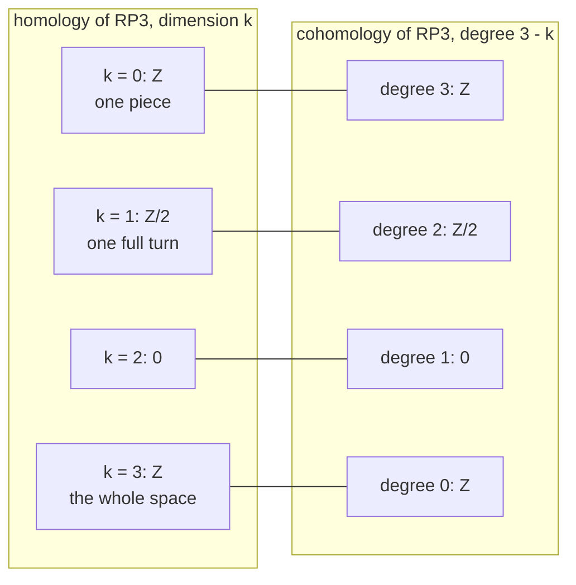

# Poincare duality: on a closed oriented manifold, k-dimensional holes match (n - k)-dimensional ones

[Syllabus](../../../SYLLABUS.md) → [Topology](../README.md) → [Homology](../README.md#s05) → Poincare duality

---

## General Overview

Every attitude of a satellite (which way it faces, and how far it is rolled about that direction) is one position of a rigid body. Together, these positions form a three-dimensional space with no edge: **real projective 3-space**, written $`\mathbb{RP}^3`$. It is the space of rotations that attitude controllers on satellites, drones and phones move around in.

Count its holes ([Homology groups](02-homology-groups.md)). Read in dimensions 0, 1, 2, 3, the homology groups are Z, Z/2, 0, Z. Here Z means "one hole of this dimension" and Z/2 means "a loop that vanishes when walked twice". The Z/2 is a real fact about rotations: one full turn about an axis is a loop of positions that cannot be shrunk to "no turn", but two full turns can.

Now count the cohomology: the measurements, one dimension at a time ([Cohomology and the cup product in outline](08-cohomology-and-cup-product-in-outline.md)). The list is Z, 0, Z/2, Z. Read it backwards and it is the first list: Z, Z/2, 0, Z. The torsion (the Z/2 part) matches too.

That is no accident. On a closed (finite, no edge) manifold whose pieces can all be given one consistent sense of turning, cohomology in degree k equals homology in degree n − k. The projective plane $`\mathbb{RP}^2`$ has no such sense, and there the match fails: its top cohomology is Z/2 but its bottom homology is Z. Count with coefficients mod 2, where turning sense does not matter, and the match comes back.

**On a closed n-dimensional manifold with an orientation, one top-dimensional cycle, the fundamental class, turns every k-dimensional measurement into an (n − k)-dimensional cycle, and this cap product with it is an isomorphism, so the k-th cohomology equals the (n − k)-th homology.**

**What kind of fact this is:** a theorem, Poincaré duality, stated here with its proof in outline and a named source. On this card's finite examples it is checked exactly: the torus's duality map, its cap-product identities, the projective plane's failure, and $`\mathbb{RP}^n`$ up to dimension 6; duality also rebuilds all of $`\mathbb{RP}^3`$'s groups from two of them. The consequence that a closed odd-dimensional manifold has Euler characteristic 0 is proved on the card from the theorem.

### The picture: the two lists for the space of rotations



Each line joins a homology group to the cohomology group three degrees away from it. The two match on every line, including the torsion.

---

## The formula

Carried over, each in one line:

- A **topological n-manifold** looks like flat n-dimensional space near every point ([Topological manifold](../03-Surfaces%20and%20Manifolds/01-topological-manifolds.md)). **Closed** means compact (finite in extent) with no boundary.
- **Orientable** means a turning sense can be chosen on every piece so that neighbours agree ([Orientability](../03-Surfaces%20and%20Manifolds/03-orientability-mobius-strip-and-klein-bottle.md)).
- $`H_k`$ is homology, $`H^k`$ is cohomology, and the **cup product** $`\smile`$ multiplies cochains, front face times back face ([Cohomology and the cup product in outline](08-cohomology-and-cup-product-in-outline.md)).
- **Relative homology** $`H_k(X, A)`$ counts chains of $`X`$ whose rim lies in $`A`$, and **excision** lets a calculation shrink to a small neighbourhood ([Singular homology](09-singular-homology-and-excision.md)).

**Local orientation.** Pick a point $`x`$ of an n-manifold $`M`$. Near $`x`$ the manifold is a small ball, and excision gives

```math
H_n(M, M - x) \cong H_n(\mathbb{R}^n, \mathbb{R}^n - 0) \cong \mathbb{Z}
```

**Read it aloud:** the top homology of the manifold, counted relative to everything except one point, is one copy of the whole numbers.

A generator of that Z, written $`\mu_x`$, is a turning sense at $`x`$: plus one or minus one. An **orientation** is a choice of $`\mu_x`$ at every point that agrees between nearby points.

**Fundamental class.** A class $`[M]`$ in $`H_n(M)`$ is a **fundamental class** when it restricts to the chosen $`\mu_x`$ at every point. On a triangulated surface it is a sign, plus or minus one, on every panel, chosen so that the rim of the sum is zero.

**Cap product.** For a k-cochain $`\varphi`$ (a measurement on k-simplices) and an n-simplex $`\sigma = [v_0, \ldots, v_n]`$:

```math
\sigma \frown \varphi = \varphi([v_0, \ldots, v_k]) \cdot [v_k, \ldots, v_n]
```

**Read it aloud:** measure the simplex's front k-face, and multiply its back (n − k)-face by that number.

**Poincaré duality.** For a closed, connected, oriented n-manifold, the **duality map** $`D`$ is an isomorphism for every k:

```math
D : H^k(M; \mathbb{Z}) \to H_{n-k}(M; \mathbb{Z}), \qquad D(\varphi) = [M] \frown \varphi
```

**Read it aloud:** capping each k-dimensional measurement with the fundamental class gives an (n − k)-dimensional cycle, and this matches the two groups one for one.

Over a field $`F`$ (numbers that can be divided, such as the rationals or the integers mod 2), the same statement makes the **cup-product pairing** perfect: the square table of readings $`\langle \varphi \smile \psi, [M] \rangle`$, for bases of $`H^k`$ and $`H^{n-k}`$, has nonzero determinant. Mod 2 no orientation is needed at all.

| Symbol | Plain meaning | In our example | Push it up and the answer… |
| --- | --- | --- | --- |
| $`M`$, $`n`$ | the manifold and its dimension | $`\mathbb{RP}^3`$, n = 3; the torus, n = 2 | larger n: more degrees to pair |
| $`k`$ | the degree of a measurement or a hole | 0 to n | the partner degree n − k goes down |
| $`H_k`$, $`H^k`$, $`\tilde{H}_k`$ | homology and cohomology, as groups; reduced homology, one piece fewer in dimension 0 | $`\mathbb{RP}^3`$: Z, Z/2, 0, Z and Z, 0, Z/2, Z | — |
| $`\mathbb{Z}/2`$, $`F`$ | a hole that cancels when doubled; also the integers mod 2, one example of a field $`F`$ | one full turn of a rigid body | — |
| $`x`$, $`\mu_x`$, $`U`$, $`V`$ | a point; a generator of its local group, a turning sense there; open pieces of the manifold (Step 5) | any joint of the torus grid, rank 1 at all 9 | — |
| $`[M]`$, $`T`$ | the fundamental class; on the torus grid, a sign on each of 18 panels | $`T`$, one of the 2 sign choices with no rim | — |
| $`\varphi`$, $`\psi`$, $`f`$, $`a`$, $`b`$ | cochains: measurements, or their classes in $`H^k`$; $`f`$ a 0-cochain, one number per joint; $`a`$ and $`b`$ count crossings of the torus's two seams | $`a`$ reads 1 on loop A, $`b`$ on loop B | — |
| $`\frown`$, $`\smile`$ | cap product (cochain on a chain); cup product (cochain times cochain) | $`T \frown a`$ is a loop on 3 struts | — |
| $`D`$ | the duality map $`\varphi \mapsto [M] \frown \varphi`$ | on the torus's $`H^1`$: matrix `[[0, 1], [-1, 0]]` | — |
| $`\sigma`$, $`\partial`$, $`d_k`$, $`\delta`$, $`\delta^k`$ | a simplex; the boundary of a chain, $`d_k`$ out of degree k; the coboundary of a cochain, $`\delta^k`$ out of degree k | $`\sigma = [0, 1, 4]`$, a torus panel; $`\mathbb{RP}^3`$: $`d_2 = 2`$, $`\delta^1 = 2`$ | — |
| $`\langle \varphi, z \rangle`$ | a measurement read on a chain | $`\langle b, T \frown a \rangle = 1`$ | — |
| $`\beta_k`$, $`\chi`$ | Betti number over the rationals; Euler characteristic $`\sum (-1)^k \beta_k`$ | $`\mathbb{RP}^3`$: 1, 0, 0, 1 and $`\chi = 0`$ | — |

### When it holds

- **Closed.** The torus with one panel out has $`H^2 = 0`$ but $`H_0 = Z`$. It has a rim, and no sign choice on its 17 panels leaves the rim empty. (A version for manifolds with boundary pairs $`H^k(M)`$ with $`H_{n-k}(M, \partial M)`$.)
- **Oriented, over the integers.** $`\mathbb{RP}^2`$ has local groups of rank 1 at all 6 joints, but no sign choice on its 10 panels has zero rim, so there is no fundamental class, and $`H^2 = Z/2`$ while $`H_0 = Z`$.
- **Or coefficients mod 2.** Every closed manifold has a mod-2 fundamental class: the sum of all its panels. Mod 2 the projective plane reads 1, 1, 1 and duality holds.
- **A manifold.** The joined-up space of hoops and a ball on [Cohomology and the cup product in outline](08-cohomology-and-cup-product-in-outline.md) has symmetric Betti numbers, yet its cup-product table has determinant 0: near the shared joint it is not a manifold.

---

## Why it works

### Step 0: one cycle that covers everything once

A closed oriented manifold carries one top-dimensional cycle that passes over every point exactly once, with the right turning sense. Capping with that cycle trades a k-dimensional measurement for the (n − k)-dimensional set where the measurement lives. On a surface, a measurement that counts crossings of a stripe becomes the loop that runs along the stripe.

### Step 1: local orientation and the fundamental class

Near a point, a manifold is a small ball. Removing the point leaves a ball with a hole in it, which deforms onto a sphere of dimension n − 1. Excision ([Singular homology](09-singular-homology-and-excision.md)) and the long exact sequence of the pair give $`H_n(M, M - x) \cong \tilde{H}_{n-1}(S^{n-1}) = Z`$. The sphere's group is the reduced one (one piece fewer in dimension 0): for n = 1 the unreduced group would be Z². So every point has two possible senses, the two generators.

On a triangulated surface the check computes this local group at a joint as the top homology of the joint's star (its fan of panels) relative to the star's rim. It finds rank 1 at all 9 joints of the torus and all 6 joints of $`\mathbb{RP}^2`$. With one torus panel removed, the three joints of the missing panel read 0: they sit on the rim and are not interior points.

A fundamental class must pick the local senses consistently. The check tries every sign on every panel:

- the torus: 2 of the $`2^{18}`$ choices have zero rim, $`T`$ and $`-T`$;
- $`\mathbb{RP}^2`$: 0 of $`2^{10}`$;
- the torus with one panel out: 0;
- mod 2, where a choice is a set of panels: 1 nonzero cycle for the torus and 1 for $`\mathbb{RP}^2`$.

The torus's cycle found by search is the anticlockwise listing of its panels, up to one overall sign. That exhaustive search proves these finite statements. The general fact, that a closed connected n-manifold has $`H_n = Z`$ if orientable and 0 if not, and $`H_n(M; \mathbb{Z}/2) = \mathbb{Z}/2`$ always, is Hatcher's Theorem 3.26.

### Step 2: the cap product and the cup product are one table read two ways

Reading $`\psi`$ on $`\sigma \frown \varphi`$ reads $`\varphi`$ on the front face and $`\psi`$ on the back face. That is the cup product read on $`\sigma`$:

```math
\langle \psi, \sigma \frown \varphi \rangle = \langle \varphi \smile \psi, \sigma \rangle
```

The check confirms this on all 27 × 27 pairs of basis 1-cochains on the torus. Both sides are linear in each cochain, so the basis pairs prove it for every pair.

### Step 3: capping a cocycle with a cycle gives a cycle

The cap product obeys a boundary rule. For a 1-cochain on a 2-chain with no rim it reads $`\partial (T \frown \varphi) = T \frown \delta \varphi`$, and for a 0-cochain $`\partial (T \frown f) = -\,T \frown \delta f`$. Here $`\partial`$ is the boundary and $`\delta`$ the coboundary. The check confirms both on every basis cochain, which again proves them for all cochains on this grid.

Two consequences follow:

1. If $`\varphi`$ is a cocycle ($`\delta \varphi = 0`$), then $`T \frown \varphi`$ is a cycle.
2. If $`\varphi = \delta f`$ is a coboundary, then $`T \frown \varphi = -\,\partial (T \frown f)`$ is a boundary.

So $`D`$ is well defined on classes: it sends cohomology classes to homology classes.

<details>
<summary>Detailed proof: the boundary rule for the cap product</summary>

Take a 2-simplex $`\sigma = [v_0, v_1, v_2]`$ and a 1-cochain $`\varphi`$. Then $`\sigma \frown \varphi = \varphi[v_0, v_1] \cdot [v_1, v_2]`$, and its boundary is

$`\displaystyle \partial(\sigma \frown \varphi) = \varphi[v_0, v_1] \big( [v_2] - [v_1] \big).`$

The rim $`\partial \sigma = [v_1, v_2] - [v_0, v_2] + [v_0, v_1]`$, capped with $`\varphi`$, gives 0-chains: $`\varphi[v_1, v_2][v_2] - \varphi[v_0, v_2][v_2] + \varphi[v_0, v_1][v_1]`$. The coboundary term is

$`\displaystyle \sigma \frown \delta \varphi = \big( \varphi[v_1, v_2] - \varphi[v_0, v_2] + \varphi[v_0, v_1] \big) [v_2].`$

Subtract: $`\sigma \frown \delta\varphi - \partial\sigma \frown \varphi = \varphi[v_0, v_1]([v_2] - [v_1])`$, which is the first line. So $`\partial(\sigma \frown \varphi) = \sigma \frown \delta \varphi - \partial \sigma \frown \varphi`$. Add over the panels of $`T`$ with their signs: the last term is $`\partial T \frown \varphi = 0`$. The 0-cochain case is the same computation one degree down, with the sign of Hatcher's formula $`\partial(\sigma \frown \varphi) = (-1)^k (\partial \sigma \frown \varphi - \sigma \frown \delta \varphi)`$ at k = 0.

</details>

### Step 4: the torus, capped

The seam measurement $`a`$ (±1 on the struts that wrap over the column seam) capped with $`T`$ is nonzero on 3 struts only: [6, 7], [6, 8] and [7, 8], with values 1, −1, 1. That is the loop 6 → 7 → 8 → 6, running along the seam. Its boundary is zero, as Step 3 promised.

To say which loop it is, read it with $`a`$ and $`b`$, which read `[[1, 0], [0, 1]]` on loops A and B. $`D(a)`$ reads (0, 1): it is loop B, and the check confirms that $`D(a)`$ minus loop B is a boundary. $`D(b)`$ reads (−1, 0): it is loop A walked backwards.

So on $`H^1`$ the duality map has matrix `[[0, 1], [-1, 0]]` and determinant 1. A whole-number matrix with determinant ±1 has a whole-number inverse, so $`D : H^1 \to H_1`$ is an isomorphism over Z. In the other degrees:

- $`D(1) = T`$: the measurement "1 on every joint" becomes the generator of $`H_2`$;
- 1 on panel [0, 1, 4] becomes −1 times joint 4: a generator of $`H_0`$.

All three degrees of the torus match: $`H^0, H^1, H^2`$ are Z, Z², Z, and so are $`H_2, H_1, H_0`$.

### Step 5: why duality holds in general, in outline

The full proof is Hatcher's Theorem 3.30. Its key steps:

1. **Measure with compact support.** On an open set that is not closed, use cochains that vanish outside a compact piece. Duality is then stated for every open subset $`U`$ of the manifold, and for a closed manifold it is the theorem above.
2. **One ball.** For a convex open piece of $`\mathbb{R}^n`$, both sides are Z in one degree and 0 elsewhere, and the cap product matches the generators.
3. **Glue two pieces.** If duality holds on $`U`$, $`V`$ and $`U \cap V`$, the two Mayer–Vietoris sequences ([Mayer-Vietoris and exact sequences](06-mayer-vietoris-and-long-exact-sequences.md)) sit side by side, joined by the duality maps. The **five lemma** (if four maps in a row of exact sequences are isomorphisms, so is the fifth) gives duality on $`U \cup V`$.
4. **Build up.** Finite unions of convex pieces build any open set of $`\mathbb{R}^n`$ step by step, increasing unions finish it, and charts carry it to the manifold.

The orientation enters in step 2: the generators of the pieces must be chosen consistently, so that they glue. Without that, step 3 fails, as the projective plane shows.

A second picture, for a triangulated manifold: put a dual joint inside each top simplex and a dual cell across each lower simplex. A k-cochain on the old cells is then an (n − k)-chain on the dual cells. That dual-cell picture is the form in which Poincaré first stated the theorem.

### Step 6: torsion moves up one degree

For $`\mathbb{RP}^3`$ the cellular chain complex ([Cellular homology](05-cellular-homology.md)) has one cell in each dimension 0 to 3. The boundary maps are 0, 2, 0: the 2-cell's rim wraps the 1-cell twice. Smith normal form ([Smith normal form](03-computing-homology-by-smith-normal-form.md)) gives homology Z, Z/2, 0, Z. The transposed matrices give cohomology Z, 0, Z/2, Z.

Universal coefficients ([Universal coefficients and Kunneth](11-universal-coefficients-and-kunneth.md)) predicts the same list from homology alone. Cohomology in degree k is the free part of $`H_k`$ plus the torsion of $`H_{k-1}`$. So the Z/2 in $`H_1`$ shows up in $`H^2`$, and duality pairs $`H^2`$ with $`H_1`$. The torsion of both lists lands in matching places. Run together, the two rules fill in groups not yet known: Worked numbers rebuilds all eight groups of $`\mathbb{RP}^3`$ from $`H_0`$ and $`H_1`$ alone.

### Step 7: the cup-product pairing over a field

Over a field, cohomology is the dual of homology, so $`H^{n-k}`$ is the dual of $`H_{n-k}`$. Step 2 says the pairing $`\langle \varphi \smile \psi, [M] \rangle`$ equals $`\langle \psi, D(\varphi) \rangle`$. Since $`D`$ is an isomorphism, the pairing is perfect: no nonzero $`\varphi`$ pairs to zero with everything.

On $`\mathbb{RP}^2`$ mod 2 the check tries all $`2^{15}`$ = 32,768 strut measurements. 64 are cocycles and 32 are coboundaries, so $`H^1`$ mod 2 has two classes. Every cocycle $`\varphi`$ outside the coboundaries has $`\varphi \smile \varphi`$ reading 1 on the whole surface, and every coboundary reads 0: 64 of 64. The 1 × 1 pairing table is `[[1]]`, nonzero mod 2.

### Step 8: odd dimension forces Euler characteristic 0

Over the rationals, duality gives $`\beta_k = \beta_{n-k}`$. For odd n, the degrees k and n − k have opposite parity, so their terms in $`\chi = \sum (-1)^k \beta_k`$ cancel in pairs:

```math
\chi(M) = \sum_{k=0}^{n} (-1)^k \beta_k = -\chi(M) \quad \Rightarrow \quad \chi(M) = 0 \text{ for odd } n
```

The non-orientable case follows the same way from duality mod 2, since the Euler characteristic is also the alternating sum of the mod-2 Betti numbers. For $`\mathbb{RP}^3`$: cells 1 − 1 + 1 − 1 = 0. The check finds $`\chi = 0`$ for $`\mathbb{RP}^1`$, $`\mathbb{RP}^3`$, $`\mathbb{RP}^5`$ and $`\chi = 1`$ for the even ones.

---

## Worked numbers, by hand

$`\mathbb{RP}^3`$ from its cells, one in each dimension, boundary maps $`d_1 = 0`$, $`d_2 = 2`$, $`d_3 = 0`$:

| Step | Arithmetic | Value |
| --- | --- | --- |
| $`H_0`$ | 1 cell, nothing hits it ($`d_1 = 0`$) | Z |
| $`H_1`$ | 1 cell, $`d_1 = 0`$; hit twice by $`d_2 = 2`$ | Z/2 |
| $`H_2`$ | $`d_2 = 2`$ kills the only 2-cell | 0 |
| $`H_3`$ | $`d_3 = 0`$, top dimension | Z |
| $`H^0`$ to $`H^3`$ | transposes: $`\delta^0 = 0`$, $`\delta^1 = 2`$, $`\delta^2 = 0`$ | Z, 0, Z/2, Z |
| $`H^k`$ against $`H_{3-k}`$ | Z = Z, 0 = 0, Z/2 = Z/2, Z = Z | **all four match** |
| $`\chi`$ | 1 − 1 + 1 − 1 | **0** |

Duality also fills in groups not yet known. Take a closed oriented 3-manifold known only to have $`H_0`$ = Z and $`H_1`$ = Z/2. Universal coefficients give $`H^k`$ as the free part of $`H_k`$ plus the torsion of $`H_{k-1}`$, and duality gives $`H_{3-k} = H^k`$:

| Step | Arithmetic | Value |
| --- | --- | --- |
| $`H_3`$ | equals $`H^0`$: the free part of $`H_0`$ | Z |
| $`H_2`$ | equals $`H^1`$: no free part in $`H_1`$, no torsion in $`H_0`$ | 0 |
| $`H^2`$, $`H^3`$ | equal $`H_1`$, $`H_0`$ | Z/2, Z |
| all eight groups | against the cells of $`\mathbb{RP}^3`$ above | **the same** |

Two groups fix all eight. In any dimension n, the groups up to degree n/2 fix the rest the same way.

On the torus, the duality map on $`H^1`$:

| Step | Arithmetic | Value |
| --- | --- | --- |
| $`T \frown a`$ | nonzero on [6, 7], [6, 8], [7, 8] | 1, −1, 1 |
| read by $`a`$ and $`b`$ | the loop runs along the column seam, crosses the row seam once | (0, 1): loop B |
| $`T \frown b`$, read | loop A walked backwards | (−1, 0) |
| determinant | 0 × 0 − 1 × (−1) | **1** |

The rotation space's lists match in every degree, torsion included, and the torus's duality map is invertible over the whole numbers.

### What breaks if you drop a piece

| Mistake | Comes out at | What went wrong |
| --- | --- | --- |
| Duality on $`\mathbb{RP}^2`$ over Z | $`H^2`$ = Z/2 but $`H_0`$ = Z | not orientable: no fundamental class |
| Duality with one torus panel out | $`H^2`$ = 0 but $`H_0`$ = Z; 0 sign choices with no rim | not closed: the surface has a rim |
| Reading $`\mathbb{RP}^3`$ forwards | $`H^1`$ = 0 but $`H_1`$ = Z/2 | duality pairs k with n − k, not k with k |

The code prints all three.

---

## Code, from first principles, and it actually runs

Both programs build the torus grid, the torus with one panel out, and a 6-joint projective plane from their panels. They write the signed boundary matrices and reduce them by a hand-written Smith normal form, so the torsion comes out exactly. Nothing imported knows any topology. The roads:

- homology from the boundary matrices against cohomology from their transposes, and both against universal coefficients for $`\mathbb{RP}^3`$ and against the groups duality fills in from $`H_0`$ and $`H_1`$;
- the fundamental class two ways: an exhaustive search over every sign choice, and the anticlockwise listing of the panels;
- the cap product two ways: directly, and through the cup product, on every pair of basis cochains;
- the duality map's image two ways: its readings by $`a`$ and $`b`$, and a rank test that it differs from a named loop by a boundary;
- the $`\mathbb{RP}^2`$ cup square mod 2, against an exhaustive list of cocycles and coboundaries.

These finite complexes are computed exactly, so their numbers are proved. The general theorem is not checked here.

### Python

```python
# Poincare duality and the cap product -- the check behind the card.  Standard library only.
# Homology and cohomology come from integer boundary matrices by a hand-written Smith
# normal form.  The torus's fundamental class is found by trying every sign; capping
# with it turns each measurement into a loop.  RP^n is checked in every dimension to 6.
from itertools import combinations

def snf(M):                          # diagonal of a Smith-style reduction: the nonzero factors
    A, out = [r[:] for r in M if any(r)], []
    while A and any(any(r) for r in A):
        i, j = min(((i, j) for i, r in enumerate(A) for j, x in enumerate(r) if x), key=lambda q: abs(A[q[0]][q[1]]))
        A[0], A[i] = A[i], A[0]
        A = [[r[j]] + r[1:j] + [r[0]] + r[j + 1:] if j else r for r in A]
        for r in A[1:]:              # clear below the smallest entry, then to its right
            q = r[0] // A[0][0]
            r[:] = [x - q * y for x, y in zip(r, A[0])]
        for c in range(1, len(A[0])):
            q = A[0][c] // A[0][0]
            A = [r[:c] + [r[c] - q * r[0]] + r[c + 1:] for r in A]
        if not any(r[0] for r in A[1:]) and not any(A[0][1:]):
            out, A = out + [abs(A[0][0])], [r[1:] for r in A[1:]]
    return out
side = lambda M, n: [[r[j] for r in M] for j in range(n)]          # transpose; n = columns of M
name = lambda free, tors: " + ".join((["Z" if free == 1 else f"Z^{free}"] if free else []) + [f"Z/{t}" for t in tors]) or "0"
def groups(ns, ds):                  # ds[k-1] is d_k: rows n_(k-1), columns n_k
    n, d = len(ns) - 1, [[]] + ds + [[]]
    f = [snf(m) for m in d]                                         # factors of each d_k
    g = [[]] + [snf(side(d[k], ns[k])) for k in range(1, n + 1)] + [[]]   # of each transpose
    H = [name(ns[k] - len(f[k]) - len(f[k + 1]), [x for x in f[k + 1] if x > 1]) for k in range(n + 1)]
    C = [name(ns[k] - len(g[k + 1]) - len(g[k]), [x for x in g[k] if x > 1]) for k in range(n + 1)]
    m2 = [ns[k] - sum(x % 2 for x in f[k]) - sum(x % 2 for x in f[k + 1]) for k in range(n + 1)]
    return H, C, m2, sum((-1) ** k * (ns[k] - len(f[k]) - len(f[k + 1])) for k in range(n + 1))
def closure(tris):                   # joints, struts, panels; vertices in increasing order
    return [sorted({c for t in tris for c in combinations(sorted(t), k)}) for k in (1, 2, 3)]
def bd(K, k):                        # signed boundary d_k of a simplicial complex
    row, M = {s: i for i, s in enumerate(K[k - 1])}, [[0] * len(K[k]) for _ in K[k - 1]]
    for j, s in enumerate(K[k]):
        for i in range(len(s)):
            M[row[s[:i] + s[i + 1:]]][j] = (-1) ** i
    return M
def top_cycles(K, mod2):             # every sign (or every subset) of the panels, in Gray-code order
    cols = [[(i, r[j]) for i, r in enumerate(bd(K, 2)) if r[j]] for j in range(len(K[2]))]
    s, B = [1] * len(cols), [sum(r) % 2 if mod2 else sum(r) for r in bd(K, 2)]
    bad, found, count = sum(map(bool, B)), None, 0
    for step in range(1, 2 ** len(cols) + 1):
        if bad == 0:
            count, found = count + 1, (list(s) if s[0] == 1 else found)
        j = (step & -step).bit_length() - 1
        if j == len(cols):
            return count, found
        s[j] = -s[j]
        for i, v in cols[j]:
            bad -= bool(B[i])
            B[i] = (B[i] + 1) % 2 if mod2 else B[i] + 2 * s[j] * v
            bad += bool(B[i])
def local(K, v):                     # rank of H_2(star of v, its rim): the local group at joint v
    tris = [K[2].index(t) for t in K[2] if v in t]
    return len(tris) - len(snf([[r[t] for t in tris] for r, e in zip(bd(K, 2), K[1]) if v in e]))
sq = lambda i, j: 3 * (i % 3) + j % 3                               # the 3 x 3 torus grid, anticlockwise
grid = [t for i in range(3) for j in range(3) for t in
        [(sq(i, j), sq(i + 1, j), sq(i + 1, j + 1)), (sq(i, j), sq(i + 1, j + 1), sq(i, j + 1))]]
rp2 = [(0, 1, 2), (0, 2, 3), (0, 3, 4), (0, 4, 5), (0, 1, 5), (1, 2, 4), (2, 3, 5), (1, 3, 4), (2, 4, 5), (1, 3, 5)]
tor, holed, prp = closure(grid), closure(grid[1:]), closure(rp2)
cnt = lambda K: [len(x) for x in K]
print("simplicial: space | V E F | H_0 H_1 H_2 | H^0 H^1 H^2 | Betti mod 2 | +-1 top cycles of 2^F sign choices | nonzero mod-2 ones")
res = {}
for nm, K in [("torus", tor), ("torus, one panel out", holed), ("RP2", prp)]:
    res[nm] = groups(cnt(K), [bd(K, 1), bd(K, 2)]) + (top_cycles(K, False), top_cycles(K, True)[0] - 1)
    H, C, m2, _, (z, _), z2 = res[nm]
    print(f"{nm} | {' '.join(map(str, cnt(K)))} | {', '.join(H)} | {', '.join(C)} | {m2} | {z} | {z2}")
loc = [[local(K, v) for v in range(len(K[0]))] for K in (tor, prp, holed)]
print(f"local group rank at each joint: torus {loc[0]}, RP2 {loc[1]}, one panel out {loc[2]}")
par = lambda t: (-1) ** sum(t[a] > t[b] for a, b in combinations(range(3), 2))
T = lst = [{tuple(sorted(t)): par(t) for t in grid}[s] for s in tor[2]]   # [M]: signs of the anticlockwise listing
print(f"torus: the search's cycle, panel {tor[2][0]} positive, is {res['torus'][4][1][0] * lst[0]} x the anticlockwise listing: {res['torus'][4][1] == [res['torus'][4][1][0] * lst[0] * x for x in lst]}")

E, P = {e: i for i, e in enumerate(tor[1])}, {t: i for i, t in enumerate(tor[2])}
def cap(phi, k):                     # T cap phi: phi on each panel's front k-face, times its back face
    out = [0] * len(tor[2 - k])
    for t, (u, v, w) in zip(T, tor[2]):
        i, x = (P[(u, v, w)], phi[u]) if k == 0 else (E[(v, w)], phi[E[(u, v)]]) if k == 1 else (w, phi[P[(u, v, w)]])
        out[i] += t * x
    return out
cup = lambda x, y: [x[E[(u, v)]] * y[E[(v, w)]] for u, v, w in tor[2]]
pair = lambda c, z: sum(p * q for p, q in zip(c, z))
mul = lambda M, x: [pair(r, x) for r in M]
unit = lambda n, i: [int(j == i) for j in range(n)]
d1, d2 = bd(tor, 1), bd(tor, 2)
ok_pair = all(pair(unit(27, j), cap(unit(27, i), 1)) == pair(cup(unit(27, i), unit(27, j)), T) for i in range(27) for j in range(27))
ok_b1 = all(mul(d1, cap(unit(27, i), 1)) == cap(mul(side(d2, 18), unit(27, i)), 2) for i in range(27))
ok_b0 = all(mul(d2, cap(unit(9, i), 0)) == [-x for x in cap(mul(side(d1, 27), unit(9, i)), 1)] for i in range(9))
print(f"<psi, T cap phi> = <phi cup psi, T> on all 27 x 27 basis pairs: {ok_pair}")
print(f"d(T cap phi) = T cap (delta phi) on all 27 basis 1-cochains: {ok_b1}; d(T cap f) = -T cap (delta f) on all 9 joints: {ok_b0}")
seam = lambda key: [{2: -1, -2: 1}.get(key(v) - key(u), 0) for u, v in tor[1]]
a, b = seam(lambda s: s // 3), seam(lambda s: s % 3)               # +1 or -1 on struts over a seam
loopA = [{(0, 3): 1, (3, 6): 1, (0, 6): -1}.get(e, 0) for e in tor[1]]
loopB = [{(0, 1): 1, (1, 2): 1, (0, 2): -1}.get(e, 0) for e in tor[1]]
Da, Db = cap(a, 1), cap(b, 1)
coord = lambda z: [pair(a, z), pair(b, z)]                          # a, b read 1 on loops A, B
same = lambda z, l, s: len(snf(d2)) == len(snf([r + [x - s * y] for r, x, y in zip(d2, z, l)]))
D = [coord(Da), coord(Db)]
det = D[0][0] * D[1][1] - D[0][1] * D[1][0]
print(f"a, b read on loops A, B: {[coord(loopA), coord(loopB)]}; D(a) = T cap a: {[tor[1][i] for i, x in enumerate(Da) if x]}, values {[x for x in Da if x]}")
print(f"D(a) boundary zero: {not any(mul(d1, Da))}; D(a) reads {D[0]}, D(b) reads {D[1]}; D(a) - loop B a boundary: {same(Da, loopB, 1)}; D(b) + loop A a boundary: {same(Db, loopA, -1)}")
print(f"duality matrix H^1 -> H_1 {D}, det {det}; D(1) = T: {cap([1] * 9, 0) == T}; D(1 on panel {tor[2][0]}) = {cap(unit(18, 0), 2)}")

e2 = {e: i for i, e in enumerate(prp[1])}                           # RP2 mod 2: every 1-cochain
cob = {tuple(pair(r, [x >> i & 1 for i in range(6)]) % 2 for r in side(bd(prp, 1), 15)) for x in range(64)}
cocyc, good = 0, 0
for x in range(2 ** 15):
    c = [x >> i & 1 for i in range(15)]
    if not any((c[e2[(u, v)]] + c[e2[(v, w)]] + c[e2[(u, w)]]) % 2 for u, v, w in prp[2]):
        cocyc += 1
        good += sum(c[e2[(u, v)]] * c[e2[(v, w)]] for u, v, w in prp[2]) % 2 == (tuple(c) not in cob)
print(f"RP2 mod 2, all 2^15 = {2 ** 15} strut measurements: {cocyc} cocycles, {len(cob)} coboundaries; x cup x reads 1 on the whole surface exactly off the coboundaries: {good} of {cocyc}")
print("cellular RP^n: n | H_0..H_n | H^0..H^n | duality over Z | Betti mod 2 | Euler characteristic")
rp = {}
for n in range(1, 7):
    rp[n] = groups([1] * (n + 1), [[[0 if k % 2 else 2]] for k in range(1, n + 1)])
    H, C, m2, chi = rp[n]
    print(f"{n} | {', '.join(H)} | {', '.join(C)} | {'holds' if all(C[k] == H[n - k] for k in range(n + 1)) else 'fails'} | {m2} | {chi}")
ucf = lambda Hs, k: name(int(Hs[k] == "Z"), [2] if k and Hs[k - 1] == "Z/2" else [])   # H^k = free part of H_k + torsion of H_(k-1)
uc = [ucf(rp[3][0], k) for k in range(4)]
print(f"RP3: cohomology from homology by universal coefficients {', '.join(uc)}; cells 1 - 1 + 1 - 1 = 0")
fill = ["Z", "Z/2"] + [ucf(["Z", "Z/2"], k) for k in (1, 0)]      # duality fills in a closed oriented 3-manifold: H_(3-k) = H^k
cofill = [ucf(fill, k) for k in (0, 1)] + [fill[1], fill[0]]        # and H^(3-k) = H_k
print(f"duality fill-in from H_0 = Z, H_1 = Z/2 alone: H_2 = H^1 = {fill[2]}, H_3 = H^0 = {fill[3]}; homology {', '.join(fill)}; cohomology {', '.join(cofill)}; cells agree: {(fill, cofill) == rp[3][:2]}")
print(f"mistake 1, RP2 over Z: H^2 = {rp[2][1][2]} but H_0 = {rp[2][0][0]}")
print(f"mistake 2, one panel out: H^2 = {res['torus, one panel out'][1][2]} but H_0 = {res['torus, one panel out'][0][0]}; +-1 top cycles {res['torus, one panel out'][4][0]}")
print(f"mistake 3, RP3 read forwards: H^1 = {rp[3][1][1]} but H_1 = {rp[3][0][1]}")

assert res["torus"][:2] == (["Z", "Z^2", "Z"], ["Z", "Z^2", "Z"]) and res["torus"][4][0] == 2
assert res["RP2"][:3] == (["Z", "Z/2", "0"], ["Z", "0", "Z/2"], [1, 1, 1]) and res["RP2"][4][0] == 0 and res["RP2"][5] == 1
assert res["torus, one panel out"][4][0] == 0 and loc[0] == [1] * 9 and loc[1] == [1] * 6 and loc[2].count(0) == 3
assert res["torus"][4][1] in (lst, [-x for x in lst])               # search and listing agree
assert ok_pair and ok_b1 and ok_b0 and not any(mul(d1, Da)) and same(Da, loopB, 1) and same(Db, loopA, -1)
assert abs(det) == 1 and [coord(loopA), coord(loopB)] == [[1, 0], [0, 1]]
assert cocyc == 64 and len(cob) == 32 and good == 64
assert rp[3][:2] == (["Z", "Z/2", "0", "Z"], ["Z", "0", "Z/2", "Z"]) and uc == rp[3][1] and (fill, cofill) == rp[3][:2]
assert all((rp[n][1] == rp[n][0][::-1]) == (n % 2 == 1) and rp[n][2] == [1] * (n + 1) and rp[n][3] == (n + 1) % 2 for n in rp)
print("ALL CHECKS PASS")
```

**Ran 2026-11-24 on macOS, Python 3.14.10, standard library only. All checks passed. Output, pasted from the run:**

```
simplicial: space | V E F | H_0 H_1 H_2 | H^0 H^1 H^2 | Betti mod 2 | +-1 top cycles of 2^F sign choices | nonzero mod-2 ones
torus | 9 27 18 | Z, Z^2, Z | Z, Z^2, Z | [1, 2, 1] | 2 | 1
torus, one panel out | 9 27 17 | Z, Z^2, 0 | Z, Z^2, 0 | [1, 2, 0] | 0 | 0
RP2 | 6 15 10 | Z, Z/2, 0 | Z, 0, Z/2 | [1, 1, 1] | 0 | 1
local group rank at each joint: torus [1, 1, 1, 1, 1, 1, 1, 1, 1], RP2 [1, 1, 1, 1, 1, 1], one panel out [0, 1, 1, 0, 0, 1, 1, 1, 1]
torus: the search's cycle, panel (0, 1, 4) positive, is -1 x the anticlockwise listing: True
<psi, T cap phi> = <phi cup psi, T> on all 27 x 27 basis pairs: True
d(T cap phi) = T cap (delta phi) on all 27 basis 1-cochains: True; d(T cap f) = -T cap (delta f) on all 9 joints: True
a, b read on loops A, B: [[1, 0], [0, 1]]; D(a) = T cap a: [(6, 7), (6, 8), (7, 8)], values [1, -1, 1]
D(a) boundary zero: True; D(a) reads [0, 1], D(b) reads [-1, 0]; D(a) - loop B a boundary: True; D(b) + loop A a boundary: True
duality matrix H^1 -> H_1 [[0, 1], [-1, 0]], det 1; D(1) = T: True; D(1 on panel (0, 1, 4)) = [0, 0, 0, 0, -1, 0, 0, 0, 0]
RP2 mod 2, all 2^15 = 32768 strut measurements: 64 cocycles, 32 coboundaries; x cup x reads 1 on the whole surface exactly off the coboundaries: 64 of 64
cellular RP^n: n | H_0..H_n | H^0..H^n | duality over Z | Betti mod 2 | Euler characteristic
1 | Z, Z | Z, Z | holds | [1, 1] | 0
2 | Z, Z/2, 0 | Z, 0, Z/2 | fails | [1, 1, 1] | 1
3 | Z, Z/2, 0, Z | Z, 0, Z/2, Z | holds | [1, 1, 1, 1] | 0
4 | Z, Z/2, 0, Z/2, 0 | Z, 0, Z/2, 0, Z/2 | fails | [1, 1, 1, 1, 1] | 1
5 | Z, Z/2, 0, Z/2, 0, Z | Z, 0, Z/2, 0, Z/2, Z | holds | [1, 1, 1, 1, 1, 1] | 0
6 | Z, Z/2, 0, Z/2, 0, Z/2, 0 | Z, 0, Z/2, 0, Z/2, 0, Z/2 | fails | [1, 1, 1, 1, 1, 1, 1] | 1
RP3: cohomology from homology by universal coefficients Z, 0, Z/2, Z; cells 1 - 1 + 1 - 1 = 0
duality fill-in from H_0 = Z, H_1 = Z/2 alone: H_2 = H^1 = 0, H_3 = H^0 = Z; homology Z, Z/2, 0, Z; cohomology Z, 0, Z/2, Z; cells agree: True
mistake 1, RP2 over Z: H^2 = Z/2 but H_0 = Z
mistake 2, one panel out: H^2 = 0 but H_0 = Z; +-1 top cycles 0
mistake 3, RP3 read forwards: H^1 = 0 but H_1 = Z/2
ALL CHECKS PASS
```

### Rust

Same numbers, same labels, built with `rustc --edition 2021 -O`.

```rust
// Poincare duality and the cap product -- the same check as the Python, in Rust.  No crates.
// Homology and cohomology come from integer boundary matrices by a hand-written Smith
// normal form.  The torus's fundamental class is found by trying every sign; capping
// with it turns each measurement into a loop.  RP^n is checked in every dimension to 6.
use std::collections::{BTreeMap, BTreeSet};
type M = Vec<Vec<i64>>;
type S = Vec<usize>;
type K = [Vec<S>; 3];
fn fdiv(a: i64, b: i64) -> i64 { let q = a / b; if a % b != 0 && ((a < 0) != (b < 0)) { q - 1 } else { q } }
fn snf(m: &M) -> Vec<i64> {                  // diagonal of a Smith-style reduction: the nonzero factors
    let (mut a, mut out): (M, Vec<i64>) = (m.iter().filter(|r| r.iter().any(|&x| x != 0)).cloned().collect(), vec![]);
    while !a.is_empty() && a.iter().any(|r| r.iter().any(|&x| x != 0)) {
        let mut best = (0, 0, i64::MAX);
        for (i, r) in a.iter().enumerate() { for (j, &x) in r.iter().enumerate() { if x != 0 && x.abs() < best.2 { best = (i, j, x.abs()) } } }
        a.swap(0, best.0); for r in a.iter_mut() { r.swap(0, best.1) }
        for i in 1..a.len() { let q = fdiv(a[i][0], a[0][0]); for c in 0..a[0].len() { a[i][c] -= q * a[0][c] } }  // clear below
        for c in 1..a[0].len() { let q = fdiv(a[0][c], a[0][0]); for r in a.iter_mut() { r[c] -= q * r[0] } }  // then to the right
        if a[1..].iter().all(|r| r[0] == 0) && a[0][1..].iter().all(|&x| x == 0) { out.push(a[0][0].abs()); a = a[1..].iter().map(|r| r[1..].to_vec()).collect() }
    }
    out
}
fn side(m: &M, n: usize) -> M { (0..n).map(|j| m.iter().map(|r| r[j]).collect()).collect() }  // transpose
fn name(free: i64, tors: &[i64]) -> String {  // a group printed as Z, Z^2, Z/2 or 0
    let mut p: Vec<String> = if free == 0 { vec![] } else if free == 1 { vec!["Z".into()] } else { vec![format!("Z^{}", free)] };
    p.extend(tors.iter().map(|t| format!("Z/{}", t)));
    if p.is_empty() { "0".into() } else { p.join(" + ") }
}
fn groups(ns: &[i64], ds: Vec<M>) -> (Vec<String>, Vec<String>, Vec<i64>, i64) {  // ds[k-1] is d_k
    let (n, mut d): (usize, Vec<M>) = (ns.len() - 1, vec![vec![]]); d.extend(ds); d.push(vec![]);
    let f: Vec<Vec<i64>> = d.iter().map(snf).collect();
    let mut g: Vec<Vec<i64>> = vec![vec![]];
    for k in 1..=n { g.push(snf(&side(&d[k], ns[k] as usize))) } g.push(vec![]);
    let (fl, gl) = (|k: usize| f[k].len() as i64, |k: usize| g[k].len() as i64);
    let big = |v: &Vec<i64>| -> Vec<i64> { v.iter().filter(|&&x| x > 1).cloned().collect() };
    let h = (0..=n).map(|k| name(ns[k] - fl(k) - fl(k + 1), &big(&f[k + 1]))).collect();
    let c = (0..=n).map(|k| name(ns[k] - gl(k + 1) - gl(k), &big(&g[k]))).collect();
    let odd = |v: &Vec<i64>| v.iter().map(|x| x % 2).sum::<i64>();
    let m2 = (0..=n).map(|k| ns[k] - odd(&f[k]) - odd(&f[k + 1])).collect();
    let chi = (0..=n).map(|k| if k % 2 == 0 { 1 } else { -1 } * (ns[k] - fl(k) - fl(k + 1))).sum();
    (h, c, m2, chi)
}
fn closure(tris: &[S]) -> K {                // joints, struts, panels; vertices in increasing order
    let mut k: [BTreeSet<S>; 3] = Default::default();
    for t in tris { let mut s = t.clone(); s.sort();
        for mask in 1u32..8 { let f: S = (0..3).filter(|i| mask >> i & 1 == 1).map(|i| s[i]).collect(); k[f.len() - 1].insert(f); } }
    k.map(|x| x.into_iter().collect())
}
fn bd(k: &K, d: usize) -> M {               // signed boundary d_k of a simplicial complex
    let row: BTreeMap<&S, usize> = k[d - 1].iter().enumerate().map(|(i, s)| (s, i)).collect();
    let mut m = vec![vec![0i64; k[d].len()]; k[d - 1].len()];
    for (j, s) in k[d].iter().enumerate() { for i in 0..s.len() { let mut f = s.clone(); f.remove(i); m[row[&f]][j] = if i % 2 == 0 { 1 } else { -1 } } }
    m
}
fn top_cycles(k: &K, mod2: bool) -> (i64, Vec<i64>) {  // every sign (or subset) of the panels, Gray-code order
    let b2 = bd(k, 2);
    let cols: Vec<Vec<(usize, i64)>> = (0..k[2].len()).map(|j| (0..b2.len()).filter(|&i| b2[i][j] != 0).map(|i| (i, b2[i][j])).collect()).collect();
    let mut s = vec![1i64; cols.len()]; let mut bb: Vec<i64> = b2.iter().map(|r| { let x: i64 = r.iter().sum(); if mod2 { x.rem_euclid(2) } else { x } }).collect();
    let (mut bad, mut found, mut count) = (bb.iter().filter(|&&x| x != 0).count() as i64, vec![], 0);
    for step in 1u64..=(1u64 << cols.len()) {
        if bad == 0 { count += 1; if s[0] == 1 { found = s.clone() } }
        let j = step.trailing_zeros() as usize;
        if j == cols.len() { break }
        s[j] = -s[j];
        for &(i, v) in &cols[j] { bad -= (bb[i] != 0) as i64; bb[i] = if mod2 { (bb[i] + 1) % 2 } else { bb[i] + 2 * s[j] * v }; bad += (bb[i] != 0) as i64 }
    }
    (count, found)
}
fn local(k: &K, v: usize) -> i64 {           // rank of H_2(star of v, its rim): the local group at joint v
    let tris: Vec<usize> = (0..k[2].len()).filter(|&t| k[2][t].contains(&v)).collect();
    let m: M = bd(k, 2).iter().zip(&k[1]).filter(|(_, e)| e.contains(&v)).map(|(r, _)| tris.iter().map(|&t| r[t]).collect()).collect();
    tris.len() as i64 - snf(&m).len() as i64
}
fn pair(c: &[i64], z: &[i64]) -> i64 { c.iter().zip(z).map(|(p, q)| p * q).sum() }
fn mul(m: &M, x: &[i64]) -> Vec<i64> { m.iter().map(|r| pair(r, x)).collect() }
fn unit(n: usize, i: usize) -> Vec<i64> { (0..n).map(|j| (j == i) as i64).collect() }
fn tf(b: bool) -> &'static str { if b { "True" } else { "False" } }
fn tup(s: &S) -> String { format!("({})", s.iter().map(|x| x.to_string()).collect::<Vec<_>>().join(", ")) }
fn main() {
    let sq = |i: usize, j: usize| 3 * (i % 3) + j % 3;           // the 3 x 3 torus grid, anticlockwise
    let mut grid: Vec<S> = vec![];
    for i in 0..3 { for j in 0..3 { grid.push(vec![sq(i, j), sq(i + 1, j), sq(i + 1, j + 1)]); grid.push(vec![sq(i, j), sq(i + 1, j + 1), sq(i, j + 1)]); } }
    let rp2: Vec<S> = [[0, 1, 2], [0, 2, 3], [0, 3, 4], [0, 4, 5], [0, 1, 5], [1, 2, 4], [2, 3, 5], [1, 3, 4], [2, 4, 5], [1, 3, 5]].iter().map(|t| t.to_vec()).collect();
    let (tor, holed, prp) = (closure(&grid), closure(&grid[1..]), closure(&rp2));
    let cnt = |k: &K| -> Vec<i64> { k.iter().map(|x| x.len() as i64).collect() }; let j = |v: &Vec<String>| v.join(", ");
    println!("simplicial: space | V E F | H_0 H_1 H_2 | H^0 H^1 H^2 | Betti mod 2 | +-1 top cycles of 2^F sign choices | nonzero mod-2 ones");
    let mut res = vec![];
    for (nm, k) in [("torus", &tor), ("torus, one panel out", &holed), ("RP2", &prp)] {
        let (h, c, m2, _) = groups(&cnt(k), vec![bd(k, 1), bd(k, 2)]);
        let ((z, found), z2, n) = (top_cycles(k, false), top_cycles(k, true).0 - 1, cnt(k));
        println!("{} | {} {} {} | {} | {} | {:?} | {} | {}", nm, n[0], n[1], n[2], j(&h), j(&c), m2, z, z2);
        res.push((h, c, m2, z, found, z2));
    }
    let loc: Vec<Vec<i64>> = [&tor, &prp, &holed].iter().map(|k| (0..k[0].len()).map(|v| local(k, v)).collect()).collect();
    println!("local group rank at each joint: torus {:?}, RP2 {:?}, one panel out {:?}", loc[0], loc[1], loc[2]);
    let par = |t: &S| -> i64 { if (0..3).flat_map(|a| (a + 1..3).map(move |b| (a, b))).filter(|&(a, b)| t[a] > t[b]).count() % 2 == 0 { 1 } else { -1 } };
    let lmap: BTreeMap<S, i64> = grid.iter().map(|t| { let mut s = t.clone(); s.sort(); (s, par(t)) }).collect();
    let t: Vec<i64> = tor[2].iter().map(|s| lmap[s]).collect();  // [M]: signs of the anticlockwise listing
    let sg = res[0].4[0] * t[0]; println!("torus: the search's cycle, panel {} positive, is {} x the anticlockwise listing: {}", tup(&tor[2][0]), sg, tf(res[0].4 == t.iter().map(|x| sg * x).collect::<Vec<_>>()));

    let (e, p): (BTreeMap<&S, usize>, BTreeMap<&S, usize>) = (tor[1].iter().enumerate().map(|(i, s)| (s, i)).collect(), tor[2].iter().enumerate().map(|(i, s)| (s, i)).collect());
    let cap = |phi: &[i64], k: usize| -> Vec<i64> {             // T cap phi: phi on the front k-face, times the back face
        let mut out = vec![0i64; tor[2 - k].len()];
        for (sgn, s) in t.iter().zip(&tor[2]) {
            let (i, x) = match k { 0 => (p[s], phi[s[0]]), 1 => (e[&vec![s[1], s[2]]], phi[e[&vec![s[0], s[1]]]]), _ => (s[2], phi[p[s]]) };
            out[i] += sgn * x;
        }
        out
    };
    let cup = |x: &[i64], y: &[i64]| -> Vec<i64> { tor[2].iter().map(|s| x[e[&vec![s[0], s[1]]]] * y[e[&vec![s[1], s[2]]]]).collect() };
    let (d1, d2) = (bd(&tor, 1), bd(&tor, 2));
    let ok_pair = (0..27).all(|i| (0..27).all(|jj| pair(&unit(27, jj), &cap(&unit(27, i), 1)) == pair(&cup(&unit(27, i), &unit(27, jj)), &t)));
    let ok_b1 = (0..27).all(|i| mul(&d1, &cap(&unit(27, i), 1)) == cap(&mul(&side(&d2, 18), &unit(27, i)), 2));
    let ok_b0 = (0..9).all(|i| mul(&d2, &cap(&unit(9, i), 0)) == cap(&mul(&side(&d1, 27), &unit(9, i)), 1).iter().map(|x| -x).collect::<Vec<_>>());
    println!("<psi, T cap phi> = <phi cup psi, T> on all 27 x 27 basis pairs: {}", tf(ok_pair));
    println!("d(T cap phi) = T cap (delta phi) on all 27 basis 1-cochains: {}; d(T cap f) = -T cap (delta f) on all 9 joints: {}", tf(ok_b1), tf(ok_b0));
    let seam = |key: fn(usize) -> i64| -> Vec<i64> { tor[1].iter().map(|s| match key(s[1]) - key(s[0]) { 2 => -1, -2 => 1, _ => 0 }).collect() };
    let (a, b) = (seam(|s| (s / 3) as i64), seam(|s| (s % 3) as i64));  // +1 or -1 on struts over a seam
    let lp = |l: &[(usize, usize, i64)]| -> Vec<i64> { tor[1].iter().map(|s| l.iter().find(|x| x.0 == s[0] && x.1 == s[1]).map_or(0, |x| x.2)).collect() };
    let (loop_a, loop_b) = (lp(&[(0, 3, 1), (3, 6, 1), (0, 6, -1)]), lp(&[(0, 1, 1), (1, 2, 1), (0, 2, -1)]));
    let (da, db) = (cap(&a, 1), cap(&b, 1));
    let coord = |z: &[i64]| vec![pair(&a, z), pair(&b, z)];       // a, b read 1 on loops A, B
    let same = |z: &[i64], l: &[i64], s: i64| snf(&d2).len() == snf(&d2.iter().enumerate().map(|(i, r)| { let mut r = r.clone(); r.push(z[i] - s * l[i]); r }).collect()).len();
    let dm = vec![coord(&da), coord(&db)]; let det = dm[0][0] * dm[1][1] - dm[0][1] * dm[1][0];
    let supp: Vec<String> = (0..27).filter(|&i| da[i] != 0).map(|i| tup(&tor[1][i])).collect();
    println!("a, b read on loops A, B: {:?}; D(a) = T cap a: [{}], values {:?}", vec![coord(&loop_a), coord(&loop_b)], supp.join(", "), da.iter().filter(|&&x| x != 0).collect::<Vec<_>>());
    println!("D(a) boundary zero: {}; D(a) reads {:?}, D(b) reads {:?}; D(a) - loop B a boundary: {}; D(b) + loop A a boundary: {}", tf(mul(&d1, &da).iter().all(|&x| x == 0)), dm[0], dm[1], tf(same(&da, &loop_b, 1)), tf(same(&db, &loop_a, -1)));
    println!("duality matrix H^1 -> H_1 {:?}, det {}; D(1) = T: {}; D(1 on panel {}) = {:?}", dm, det, tf(cap(&[1; 9], 0) == t), tup(&tor[2][0]), cap(&unit(18, 0), 2));

    let e2: BTreeMap<&S, usize> = prp[1].iter().enumerate().map(|(i, s)| (s, i)).collect();  // RP2 mod 2: every 1-cochain
    let w0 = side(&bd(&prp, 1), 15);
    let cob: BTreeSet<Vec<i64>> = (0..64).map(|x| w0.iter().map(|r| pair(r, &(0..6).map(|i| x >> i & 1).collect::<Vec<i64>>()).rem_euclid(2)).collect()).collect();
    let (mut cocyc, mut good) = (0, 0);
    for x in 0..(1i64 << 15) {
        let c: Vec<i64> = (0..15).map(|i| x >> i & 1).collect();
        let ed = |u: usize, v: usize| c[e2[&vec![u, v]]];
        if prp[2].iter().all(|s| (ed(s[0], s[1]) + ed(s[1], s[2]) + ed(s[0], s[2])) % 2 == 0) {
            cocyc += 1;
            if (prp[2].iter().map(|s| ed(s[0], s[1]) * ed(s[1], s[2])).sum::<i64>() % 2 == 1) == !cob.contains(&c) { good += 1 }
        }
    }
    println!("RP2 mod 2, all 2^15 = {} strut measurements: {} cocycles, {} coboundaries; x cup x reads 1 on the whole surface exactly off the coboundaries: {} of {}", 1 << 15, cocyc, cob.len(), good, cocyc);
    println!("cellular RP^n: n | H_0..H_n | H^0..H^n | duality over Z | Betti mod 2 | Euler characteristic");
    let mut rp = vec![(vec![], vec![], vec![], 0)];
    for n in 1..=6usize {
        let r = groups(&vec![1; n + 1], (1..=n).map(|k| vec![vec![if k % 2 == 1 { 0 } else { 2 }]]).collect());
        println!("{} | {} | {} | {} | {:?} | {}", n, j(&r.0), j(&r.1), if (0..=n).all(|k| r.1[k] == r.0[n - k]) { "holds" } else { "fails" }, r.2, r.3);
        rp.push(r);
    }
    let ucf = |hs: &Vec<String>, k: usize| name((hs[k] == "Z") as i64, if k > 0 && hs[k - 1] == "Z/2" { &[2] } else { &[] });  // H^k = free part of H_k + torsion of H_(k-1)
    let uc: Vec<String> = (0..4).map(|k| ucf(&rp[3].0, k)).collect();
    println!("RP3: cohomology from homology by universal coefficients {}; cells 1 - 1 + 1 - 1 = 0", j(&uc));
    let fill: Vec<String> = { let g: Vec<String> = vec!["Z".into(), "Z/2".into()]; let h = vec![ucf(&g, 1), ucf(&g, 0)]; [g, h].concat() };  // duality: H_(3-k) = H^k
    let cofill: Vec<String> = vec![ucf(&fill, 0), ucf(&fill, 1), fill[1].clone(), fill[0].clone()];  // and H^(3-k) = H_k
    println!("duality fill-in from H_0 = Z, H_1 = Z/2 alone: H_2 = H^1 = {}, H_3 = H^0 = {}; homology {}; cohomology {}; cells agree: {}", fill[2], fill[3], j(&fill), j(&cofill), tf(fill == rp[3].0 && cofill == rp[3].1));
    println!("mistake 1, RP2 over Z: H^2 = {} but H_0 = {}", rp[2].1[2], rp[2].0[0]);
    println!("mistake 2, one panel out: H^2 = {} but H_0 = {}; +-1 top cycles {}", res[1].1[2], res[1].0[0], res[1].3);
    println!("mistake 3, RP3 read forwards: H^1 = {} but H_1 = {}", rp[3].1[1], rp[3].0[1]);

    let v = |x: &[&str]| -> Vec<String> { x.iter().map(|s| s.to_string()).collect() };
    assert!(res[0].0 == v(&["Z", "Z^2", "Z"]) && res[0].1 == v(&["Z", "Z^2", "Z"]) && res[0].3 == 2);
    assert!(res[2].0 == v(&["Z", "Z/2", "0"]) && res[2].1 == v(&["Z", "0", "Z/2"]) && res[2].2 == vec![1, 1, 1] && res[2].3 == 0 && res[2].5 == 1);
    assert!(res[1].3 == 0 && loc[0] == vec![1; 9] && loc[1] == vec![1; 6] && loc[2].iter().filter(|&&x| x == 0).count() == 3);
    assert!(res[0].4 == t || res[0].4 == t.iter().map(|x| -x).collect::<Vec<_>>());   // search and listing agree
    assert!(ok_pair && ok_b1 && ok_b0 && mul(&d1, &da).iter().all(|&x| x == 0) && same(&da, &loop_b, 1) && same(&db, &loop_a, -1));
    assert!(det.abs() == 1 && vec![coord(&loop_a), coord(&loop_b)] == vec![vec![1, 0], vec![0, 1]]);
    assert!(cocyc == 64 && cob.len() == 32 && good == 64);
    assert!(rp[3].0 == v(&["Z", "Z/2", "0", "Z"]) && rp[3].1 == v(&["Z", "0", "Z/2", "Z"]) && uc == rp[3].1 && fill == rp[3].0 && cofill == rp[3].1);
    assert!((1..=6).all(|n| (rp[n].1.iter().rev().cloned().collect::<Vec<_>>() == rp[n].0) == (n % 2 == 1) && rp[n].2 == vec![1; n + 1] && rp[n].3 == ((n + 1) % 2) as i64));
    println!("ALL CHECKS PASS");
}
```

**Ran 2026-11-24 on macOS, rustc 1.98.1, no crates. All checks passed. Output, pasted from the run:**

```
simplicial: space | V E F | H_0 H_1 H_2 | H^0 H^1 H^2 | Betti mod 2 | +-1 top cycles of 2^F sign choices | nonzero mod-2 ones
torus | 9 27 18 | Z, Z^2, Z | Z, Z^2, Z | [1, 2, 1] | 2 | 1
torus, one panel out | 9 27 17 | Z, Z^2, 0 | Z, Z^2, 0 | [1, 2, 0] | 0 | 0
RP2 | 6 15 10 | Z, Z/2, 0 | Z, 0, Z/2 | [1, 1, 1] | 0 | 1
local group rank at each joint: torus [1, 1, 1, 1, 1, 1, 1, 1, 1], RP2 [1, 1, 1, 1, 1, 1], one panel out [0, 1, 1, 0, 0, 1, 1, 1, 1]
torus: the search's cycle, panel (0, 1, 4) positive, is -1 x the anticlockwise listing: True
<psi, T cap phi> = <phi cup psi, T> on all 27 x 27 basis pairs: True
d(T cap phi) = T cap (delta phi) on all 27 basis 1-cochains: True; d(T cap f) = -T cap (delta f) on all 9 joints: True
a, b read on loops A, B: [[1, 0], [0, 1]]; D(a) = T cap a: [(6, 7), (6, 8), (7, 8)], values [1, -1, 1]
D(a) boundary zero: True; D(a) reads [0, 1], D(b) reads [-1, 0]; D(a) - loop B a boundary: True; D(b) + loop A a boundary: True
duality matrix H^1 -> H_1 [[0, 1], [-1, 0]], det 1; D(1) = T: True; D(1 on panel (0, 1, 4)) = [0, 0, 0, 0, -1, 0, 0, 0, 0]
RP2 mod 2, all 2^15 = 32768 strut measurements: 64 cocycles, 32 coboundaries; x cup x reads 1 on the whole surface exactly off the coboundaries: 64 of 64
cellular RP^n: n | H_0..H_n | H^0..H^n | duality over Z | Betti mod 2 | Euler characteristic
1 | Z, Z | Z, Z | holds | [1, 1] | 0
2 | Z, Z/2, 0 | Z, 0, Z/2 | fails | [1, 1, 1] | 1
3 | Z, Z/2, 0, Z | Z, 0, Z/2, Z | holds | [1, 1, 1, 1] | 0
4 | Z, Z/2, 0, Z/2, 0 | Z, 0, Z/2, 0, Z/2 | fails | [1, 1, 1, 1, 1] | 1
5 | Z, Z/2, 0, Z/2, 0, Z | Z, 0, Z/2, 0, Z/2, Z | holds | [1, 1, 1, 1, 1, 1] | 0
6 | Z, Z/2, 0, Z/2, 0, Z/2, 0 | Z, 0, Z/2, 0, Z/2, 0, Z/2 | fails | [1, 1, 1, 1, 1, 1, 1] | 1
RP3: cohomology from homology by universal coefficients Z, 0, Z/2, Z; cells 1 - 1 + 1 - 1 = 0
duality fill-in from H_0 = Z, H_1 = Z/2 alone: H_2 = H^1 = 0, H_3 = H^0 = Z; homology Z, Z/2, 0, Z; cohomology Z, 0, Z/2, Z; cells agree: True
mistake 1, RP2 over Z: H^2 = Z/2 but H_0 = Z
mistake 2, one panel out: H^2 = 0 but H_0 = Z; +-1 top cycles 0
mistake 3, RP3 read forwards: H^1 = 0 but H_1 = Z/2
ALL CHECKS PASS
```

The two outputs match line for line.

Lean is not used on this card. Its mathematics library has no cap product, orientation class or Poincaré duality yet, and rechecking the table of groups alone would not prove the theorem.

> [!TIP]
> **Try changing**
> - **Guess first: go to dimension 8.** Change `range(1, 7)` to `range(1, 9)`. $`\mathbb{RP}^7`$ reads Z, Z/2, 0, Z/2, 0, Z/2, 0, Z, duality holds and $`\chi = 0`$; $`\mathbb{RP}^8`$ fails over Z and has $`\chi = 1`$.
> - **Guess first: cap on the wrong face.** In `cap`, swap the roles of the front strut $`(u, v)`$ and the back strut $`(v, w)`$. $`D(a)`$ becomes the loop on joints 0, 1, 2, still a cycle, but the cap–cup identity and the boundary rule fail, and $`D(a)`$ minus loop B is no longer a boundary. The asserts stop the run.
> - **Guess first: cut the projective plane open.** Delete the last panel, `(1, 3, 5)`, from `rp2`. What is left is a Möbius strip: homology Z, Z, 0, no top cycle even mod 2, and local rank 0 at joints 1, 3 and 5 on its rim. The asserts stop the run.
> - **Guess first: drop two torus panels.** Change `grid[1:]` to `grid[2:]`. The row reads 9 26 16 and Z, Z², 0: a bigger hole is still one hole, and still no fundamental class. The asserts stop the run.

---

## The usual mistake

> [!warning]
> **Matching $`H^k`$ with $`H_k`$ instead of $`H_{n-k}`$.** Duality turns the list around. For $`\mathbb{RP}^3`$, $`H^1 = 0`$ but $`H_1 = Z/2`$; the Z/2 of $`H_1`$ is matched by $`H^2`$. Reading the lists side by side, not end to end, makes duality look false.
>
> - **Forgetting the orientation.** Over Z, $`\mathbb{RP}^2`$ has $`H^2 = Z/2`$ but $`H_0 = Z`$. Every point still has a local Z; the senses just cannot be chosen consistently.
> - **Forgetting "closed".** The torus with one panel out has $`H^2 = 0`$ but $`H_0 = Z`$, and 0 sign choices with no rim.
> - **Expecting torsion in the same degree.** Torsion in $`H_k`$ shows up in $`H^{k+1}`$: $`\mathbb{RP}^3`$'s Z/2 sits in $`H_1`$ and in $`H^2`$.
> - **Trusting Betti numbers alone.** The joined-up hoops and ball have Betti numbers 1, 2, 1, symmetric like a surface's, but their cup table on $`H^1`$ has determinant 0, as [Cohomology and the cup product in outline](08-cohomology-and-cup-product-in-outline.md) computes. The space is not a manifold, so duality does not apply.

---

## Where you meet it in real life

- **Attitude control.** The orientations of a rigid body form $`\mathbb{RP}^3`$, a closed manifold. A closed manifold cannot be deformed to a point: its fundamental class mod 2 survives any deformation. Bhat and Bernstein (Sources) use that kind of obstruction to show that no continuous feedback law can steer every orientation of a spacecraft to one target attitude and hold it there stably.
- **Sensor coverage.** De Silva and Ghrist (Sources) certify that a field of sensors with overlapping ranges covers a region by finding a relative top-dimensional class whose boundary is the region's fence: a fundamental class, built only from which sensors can hear each other.
- **Simulation on meshes.** Field solvers that put some quantities on a mesh and others on its dual mesh, one point per cell, use the dual-cell picture of Step 5. A k-quantity on one mesh is an (n − k)-quantity on the other.
- **Checking a periodic mesh.** Simulations of a periodic box glue opposite faces, which makes a closed 3-manifold, the 3-torus. Its tetrahedral mesh must have joints − struts + panels − solids = 0 by Step 8; any other count flags a gluing error.

> **Say it back**
> At every point of an n-manifold the local group $`H_n(M, M - x)`$ is one copy of Z, and an orientation chooses a generator at every point consistently. On a closed oriented manifold those choices add up to one fundamental class $`[M]`$. Capping a k-dimensional measurement with $`[M]`$ gives an (n − k)-dimensional cycle, and this map is an isomorphism: $`\mathbb{RP}^3`$ has homology Z, Z/2, 0, Z and cohomology Z, 0, Z/2, Z, the same list reversed. Without an orientation it fails over Z, as on $`\mathbb{RP}^2`$, but mod 2 it always holds. In odd dimensions it forces the Euler characteristic to be 0.

---

## What this builds on

- [Universal coefficients and Kunneth](11-universal-coefficients-and-kunneth.md): cohomology from homology, with torsion moved up one degree, which is why $`\mathbb{RP}^3`$'s lists can match.
- [Cohomology and the cup product in outline](08-cohomology-and-cup-product-in-outline.md): cochains, the cup product and the torus grid with its seam measurements $`a`$ and $`b`$; it states duality for surfaces, and this card does every dimension.
- [Singular homology](09-singular-homology-and-excision.md): relative homology and excision, which make the local group $`H_n(M, M - x)`$ a single Z.
- [Topological manifold](../03-Surfaces%20and%20Manifolds/01-topological-manifolds.md): the charts that make every point look like flat space.
- [Orientability](../03-Surfaces%20and%20Manifolds/03-orientability-mobius-strip-and-klein-bottle.md): the turning sense on panels and why the projective plane has none.

## Where this goes next

- [de Rham cohomology](../../23-Differential%20geometry%20and%20Lie%20groups/04-Differential%20Forms/08-de-rham-cohomology.md): on smooth manifolds the same duality pairs closed k-forms with closed (n − k)-forms by integrating their product.
- [Hodge star](../../23-Differential%20geometry%20and%20Lie%20groups/04-Differential%20Forms/09-hodge-star-and-maxwell-in-forms.md): a metric turns duality into an operation on forms, k-forms to (n − k)-forms.
- [Cohomology of projective space](../../22-Algebraic%20geometry/05-Cohomology%20and%20the%20Hodge%20Conjecture/03-cohomology-of-projective-space.md): complex projective space, where the perfect cup pairing makes every class a power of one.
- [Hodge decomposition](../../22-Algebraic%20geometry/05-Cohomology%20and%20the%20Hodge%20Conjecture/05-hodge-decomposition.md): on compact Kähler manifolds duality matches the pieces of the splitting by type.

The torsion of $`\mathbb{RP}^3`$ matches across degrees, but the cup product cannot pair torsion classes; the finer pairing that does, the linking form, is the question this card leaves open.

---

## Sources

Verified 2026-11-24: every link below resolves to the publisher's page, except Hatcher's author page, which carries the full text, and every DOI was checked against Crossref.

- Hatcher, Allen. *Algebraic Topology*. Cambridge University Press, 2002. [Author's page, with the free edition](https://pi.math.cornell.edu/~hatcher/AT/ATpage.html). Section 3.3: local orientation, the fundamental class (Theorem 3.26), the cap product and Poincaré duality (Theorem 3.30), with the proof outlined in Step 5.
- Bredon, Glen E. *Topology and Geometry*. Springer, Graduate Texts in Mathematics 139, 1993. [doi:10.1007/978-1-4757-6848-0](https://doi.org/10.1007/978-1-4757-6848-0). Chapter VI: cap products, orientation and duality, including the dual-cell picture.
- Bhat, Sanjay P., and Dennis S. Bernstein. "A topological obstruction to continuous global stabilization of rotational motion and the unwinding phenomenon." *Systems & Control Letters* 39 (2000): 63–70. [doi:10.1016/S0167-6911(99)00090-0](https://doi.org/10.1016/S0167-6911(99)00090-0). Why the closed rotation space blocks global continuous stabilization.
- de Silva, Vin, and Robert Ghrist. "Coverage in sensor networks via persistent homology." *Algebraic & Geometric Topology* 7 (2007): 339–358. [doi:10.2140/agt.2007.7.339](https://doi.org/10.2140/agt.2007.7.339). A relative fundamental class as a certificate of coverage.
