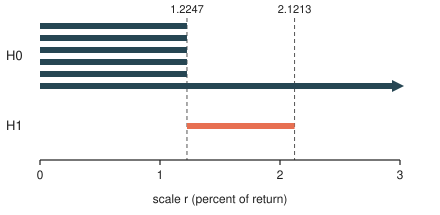
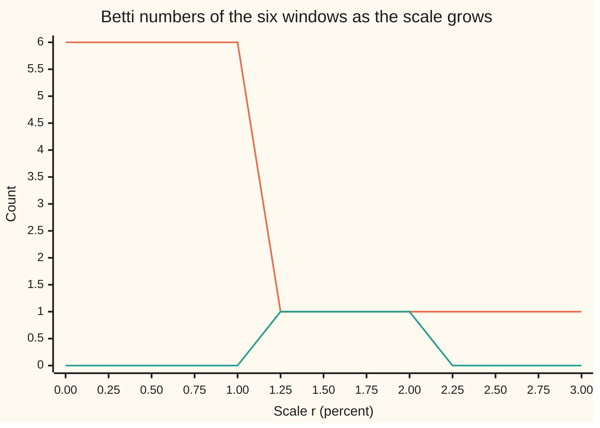

# Filtration and persistent homology: watch each hole appear and close as the scale grows

[Syllabus](../../../SYLLABUS.md) → [Topology](../README.md) → [Topological Data Analysis](../README.md#s06) → Filtration and persistent homology

---

## General Overview

Take a made-up daily return series that repeats every six trading days: +1, +2, +1, −1, −2, −1 percent, then the same again. It is simulated, chosen so the arithmetic stays exact; real returns are noisier.

Cut it into three-day windows. The window starting on day 0 reads (1, 2, 1). The one starting on day 1 reads (2, 1, −1). Each window is three numbers, so it is a point in three-dimensional space. Because the pattern comes back to its start, the six windows sit around a ring.

A computer sees only six points, and six points have no hole. To find the ring, give each point a ball of radius r and join two points when their balls touch. Fill in a triangle when all three of its pairs are joined. Then let r grow from 0.

- At r = 1.2247 percent, each window joins its two neighbours. The six joins close a loop around an empty middle: a hole is **born**.
- At r = 2.1213 percent, windows two days apart join too. Triangles fill the middle and the hole is gone: it **dies**.

The loop lived from 1.2247 to 2.1213. That interval is a **bar**. The list of all bars, one per hole, is the **barcode**, and it is the answer persistent homology gives.

**A filtration is a family of shapes that only grows as the scale r grows; persistent homology follows every hole through it, records the scale where the hole is born and the scale where it dies, and the resulting barcode is one complete and unique summary of the holes at every scale.**

**What kind of fact this is:** definitions (filtration, birth, death, bar, barcode) carrying two theorems. That adding one simplex changes one hole count by exactly one is proved on this card in Why it works. That the bars exist and are unique (the structure theorem) is stated here and proved for finite filtrations on [The persistence algorithm](03-the-persistence-algorithm.md). The return series is simulated, and nothing here predicts a market.

### The picture: the barcode of the six windows

<p align="center"></p>

Each horizontal bar is one hole, drawn from the scale where it is born to the scale where it dies. The top group is $`H_0`$, pieces: six separate windows, five of which merge into the sixth at r = 1.2247. One piece never dies, so its bar runs off the right edge. The bottom bar is $`H_1`$, the loop. The drawing is to scale, with coordinates printed by both checks.

---

## The formula

Some words first, each in one line.

- **Homology**, from [Homology groups](../05-Homology/02-homology-groups.md): $`H_k`$ collects the k-dimensional holes of a complex (pieces for k = 0, loops for k = 1), and its dimension $`\beta_k`$, the Betti number, counts them.
- **Coefficients.** This card counts over $`\mathbb{Z}`$ mod 2: every coefficient is 0 or 1, and 1 + 1 = 0. Then no signs are needed, and each chain is just a set of simplices.
- **Distance.** The distance $`|x - y|`$ between two windows is the ordinary straight-line distance, in percent. On this shelf a bare letter d means a death; a distance written with d always carries a subscript.

Now the new words. A **simplex** is a corner, an edge or a filled triangle. The complex at scale r, written $`K_r`$, holds every simplex whose corners are pairwise within distance $`2r`$ of each other. This rule is the Vietoris–Rips complex, compared with other rules on [Vietoris-Rips, Cech and alpha complexes](02-vietoris-rips-and-cech-complexes.md). Some software indexes by the distance $`2r`$ itself, which doubles every scale on this card.

A **filtration** is a family of complexes, one per scale, in which nothing is ever removed:

```math
K_r \subseteq K_s \quad \text{whenever } r \le s
```

**Read it aloud:** the complex at a smaller scale sits inside the complex at any larger scale.

Because of that nesting, a loop in $`K_r`$ is still a loop in $`K_s`$, and can be followed. Its **birth** b is the first scale where it exists. Its **death** d is the first scale where it is filled in, or merges with an older hole. The **bar** is the half-open interval $`[b, d)`$: alive at b, gone at d. A hole that never dies has $`d = \infty`$.

The structure theorem says these bars carry everything the filtration knows about holes:

```math
\beta_k^{\,r,s} = \text{the number of } k\text{-bars } [b, d) \text{ with } b \le r \text{ and } s < d
```

**Read it aloud:** for scales r no larger than s, the number of k-dimensional holes present at scale r that are still holes at scale s equals the number of bars that start by r and last past s.

With $`r = s`$ the left side is the ordinary Betti number $`\beta_k(K_r)`$: the holes at one scale are the bars alive there. At r = 1.5, the loop bar $`[1.2247, 2.1213)`$ contains 1.5, so $`\beta_1(K_{1.5}) = 1`$. At r = 2.5 no loop bar is alive, so $`\beta_1(K_{2.5}) = 0`$.

| Symbol | Plain meaning | In our example | Push it up and the answer… |
| --- | --- | --- | --- |
| $`w_t`$ | the three-day window starting on day t, a point in space | $`w_0 = (1, 2, 1)`$ | — |
| $`\lvert x - y\rvert`$ | straight-line distance between two windows, in percent | $`\lvert w_0 - w_1\rvert = \sqrt{6}`$ | a later join |
| $`r`$, $`s`$ | scales: ball radii, in percent | r = 1.5 | a bigger, fuller complex |
| $`K_r`$ | the complex at scale r: simplices with corners pairwise within $`2r`$ | $`K_{1.5}`$ is the hexagon of six sides | — |
| $`k`$ | the dimension of a hole: 0 for pieces, 1 for loops | 1 for the ring | — |
| $`H_k(K_r)`$ | the k-dimensional holes of $`K_r`$, over $`\mathbb{Z}`$ mod 2 | $`H_1(K_{1.5})`$ holds the ring | — |
| $`\beta_k(K_r)`$ | the Betti number: how many independent k-holes at scale r | $`\beta_0 = 1`$, $`\beta_1 = 1`$ at r = 1.5 | — |
| $`\beta_k^{\,r,s}`$ | the k-holes at scale r still holes at scale s | $`\beta_1^{\,1.5,\,2} = 1`$, $`\beta_1^{\,1.5,\,2.5} = 0`$ | larger s: fewer survive |
| $`[b, d)`$ | a bar: alive from birth b up to, not including, death d | $`[1.2247, 2.1213)`$ | — |
| $`b`$ | birth: the scale where a hole first appears | 1.2247 for the ring | — |
| $`d`$ | death: the scale where it is filled or merged | 2.1213 for the ring | a longer bar |
| $`\mathbb{Z}`$ mod 2 | coefficients 0 and 1, with 1 + 1 = 0 | every chain is a set of simplices | — |

### When it holds

- **Every stage is a complex, and stages only grow.** A triangle may not arrive before its own edges. Enter each triangle at its shortest edge instead of its longest and 9 bars come out dying before they are born.
- **The coefficients form a field.** Over $`\mathbb{Z}`$ mod 2, or any field (numbers that can all be divided), the bars exist and are unique. Over the whole numbers, torsion (a cycle that is not a rim though twice it is, found by [Smith normal form](../05-Homology/03-computing-homology-by-smith-normal-form.md)) can block a clean split into bars.
- **The filtration is finite.** Here there are 6 corners, 15 edges, their triangles, and three scales where anything happens. With infinitely many changes the bars need extra conditions to exist.
- **A dimension is tracked only when the next one is built.** Loops are filled by triangles, so this card builds up to triangles and reports pieces and loops only. Between r = 2.1213 and 2.4495 the complex is a hollow octahedron, which encloses a sealed space; counting that needs solid pyramids, which this card does not build.
- **There is no noise here.** On real data a bar counts as a feature only against a stated noise band, corrected for many tests. That band is the job of [Persistence diagram and stability](04-persistence-diagrams-and-stability.md).

---

## Why it works

### Step 0: nesting lets a hole be followed

A loop of edges in $`K_r`$ is still a loop of edges in $`K_s`$, because nothing is removed. So each hole at scale r is still something at scale s: either still a hole, or now the rim of filled triangles.

Once filled, it stays filled, because the triangles stay. So a hole has a first scale and a last scale, and between them it is alive. That is why the answer is an interval, not a scattered set of scales.

### Step 1: one simplex changes one count by exactly one

Grow the complex one simplex at a time, in order of scale. At equal scales, edges come before triangles, then vertex order breaks the tie. Each new simplex either creates one hole or kills one hole, never both, never more.

- **The first side, edge 01**, joins two separate windows: $`\beta_0`$ goes down by 1. A death, of a piece.
- **The last side, edge 45**, joins windows already connected the long way round, through 3, 2, 1, 0 and 5. It closes a loop: $`\beta_1`$ goes up by 1. A birth.
- **At 2.1213**, each new diagonal such as 02 closes a small loop such as 01, 12, 02, and a triangle entering at the same scale fills it. Born and killed at one scale, such a hole has a bar of length zero, which is dropped.

<details>
<summary>Detailed proof: a new k-simplex either raises the k-count or lowers the (k−1)-count by one</summary>

Work over $`\mathbb{Z}`$ mod 2. Let $`K`$ be a complex and add one k-simplex $`\sigma`$ whose faces are already in $`K`$. Its rim $`\partial \sigma`$ is a (k−1)-cycle of $`K`$, because the boundary of a boundary is zero.

Case A: $`\partial \sigma`$ is already a boundary in $`K`$, say $`\partial \sigma = \partial c`$. Then $`\sigma + c`$ has rim $`\partial c + \partial c = 0`$: it is a new k-cycle. It is not a boundary, since nothing of dimension k + 1 contains $`\sigma`$ yet. The k-boundaries are unchanged, so

$`\displaystyle \beta_k \text{ rises by } 1, \quad \beta_{k-1} \text{ is unchanged.}`$

Case B: $`\partial \sigma`$ is not a boundary in $`K`$. Then no new k-cycle appears: any k-cycle using $`\sigma`$ would give $`\partial \sigma`$ as a sum of rims from $`K`$. The (k−1)-cycles are unchanged, but the (k−1)-boundaries gain one new direction, $`\partial \sigma`$. Since $`\beta_{k-1}`$ is cycles minus boundaries,

$`\displaystyle \beta_{k-1} \text{ falls by } 1, \quad \beta_k \text{ is unchanged.}`$

Exactly one case holds, so every simplex is either a birth or a death.

</details>

### Step 2: which hole dies: the younger one

When a simplex kills, it must name its victim. The rule is the **elder rule**: of the holes it could kill, the youngest dies, and the older one lives on. So a bar is as long as it can honestly be.

For pieces this rule is Kruskal's algorithm for the cheapest spanning tree ([The cheapest skeleton](../../04-Combinatorics%20and%20graphs/10-Trees%20and%20Cheapest%20Routes/04-minimum-spanning-trees.md)): the tree that joins every point with the least total edge length. Sort the edges by length. An edge that joins two pieces kills one of them; an edge inside one piece kills nothing. The $`H_0`$ deaths are the spanning tree's edge lengths, halved. Here the spanning tree is five hexagon sides, each $`\sqrt{6}`$, so five pieces die at $`\sqrt{6}/2 = 1.2247`$. The check computes those deaths both ways and they agree.

### Step 3: the structure theorem

Steps 1 and 2 pair every killing simplex with one birth. The structure theorem says this pairing is no accident of order: the bars are the same however the ties are broken.

> **Structure theorem for persistence.** Over a field, the homology of a finite filtration splits into bars $`[b, d)`$, one per independent hole, and the list of bars is unique.

Behind it is algebra. All the $`H_k(K_r)`$, with the maps between scales, form one module over a ring of polynomials in one symbol, which stands for "move one scale up". Over a field this ring is a principal ideal domain (every ideal is generated by one element), like the whole numbers, and modules over such rings split into cyclic modules, each generated by one element. Each of those is a bar. That module theory belongs to Modules (planned), in the algebraic geometry wing. The proof for finite filtrations, by reducing the boundary matrix column by column, is on [The persistence algorithm](03-the-persistence-algorithm.md). Zomorodian and Carlsson (in Sources) gave both the theorem and the algorithm.

The formula follows. A bar $`[b, d)`$ is one hole alive on exactly that interval. It is present at r and still present at s exactly when $`b \le r`$ and $`s < d`$. Counting such bars counts $`\beta_k^{\,r,s}`$.

### Step 4: the ring, scale by scale

Each window is the one before, moved on one day, and three days on the series flips sign. So every pair of neighbours is the same distance apart, and so is every pair two days apart. Only three distances occur, and the check counts the edges at each:

- **Neighbours**, $`\sqrt{6}`$: six edges at r = 1.2247.
- **Two days apart**, $`\sqrt{18}`$: six edges at r = 2.1213.
- **Opposite**, $`\sqrt{24}`$: three edges at r = 2.4495.

Below 1.2247 nothing is joined: six pieces, no loop. At 1.2247 the six sides make one piece and one loop. At 2.1213 the hexagon becomes a rim, because over $`\mathbb{Z}`$ mod 2

```math
\partial\big([0,1,2] + [2,3,4] + [0,4,5] + [0,2,4]\big) = 01 + 12 + 23 + 34 + 45 + 05
```

The three diagonals 02, 24 and 04 each appear twice and cancel, since 1 + 1 = 0. The check finds the same fact a second way: adding the hexagon to the triangle columns leaves their rank unchanged at 2.1213, and raises it just below.

---

## Worked numbers, by hand

The six windows, one bar:

| Step | Arithmetic | Value |
| --- | --- | --- |
| windows $`w_0`$ to $`w_5`$ | three days each, wrapping round | (1,2,1) (2,1,−1) (1,−1,−2) (−1,−2,−1) (−2,−1,1) (−1,1,2) |
| neighbours, squared | $`\lvert w_0 - w_1\rvert^2 = 1 + 1 + 4`$ | 6 |
| two apart, squared | $`\lvert w_0 - w_2\rvert^2 = 0 + 9 + 9`$ | 18 |
| opposite, squared | $`\lvert w_0 - w_3\rvert^2 = 4 + 16 + 4`$ | 24 |
| sides join | $`r = \sqrt{6}/2`$ | 1.2247 |
| pieces after the sides | 6 pieces, 5 merging edges | 1 |
| loops after the sides | edges − corners + pieces = 6 − 6 + 1 | 1: a birth |
| diagonals join, triangles fill | $`r = \sqrt{18}/2`$; the hexagon is a rim | 2.1213: a death |
| the loop's bar | $`[\sqrt{6}/2, \sqrt{18}/2)`$ | **[1.2247, 2.1213)** |
| its length | 2.1213 − 1.2247 | 0.8966 |

The ring is visible over a range of scales 0.8966 percent wide, and at no scale outside it. With no noise in this series, nothing competes with it; on real returns that length is what gets compared with a noise band.

The bar depends on a choice: the window length. With two-day windows (1,2), (2,1), (1,−1), (−1,−2), (−2,−1), (−1,1), the sides have squared lengths 2, 5, 5, 2, 5, 5 and the opposite pair $`w_2, w_5`$ only 8. That short chord splits the ring in two, and both halves fill at squared length 9. The loop bars are [1.1180, 1.5000) and [1.4142, 1.5000), of lengths 0.3820 and 0.0858. The ring is still there, but far less clear: the answer depends on the window length.

### What breaks if you drop a piece

| Mistake | Comes out at | What went wrong |
| --- | --- | --- |
| Edges only, no triangles | 10 loop bars that never end, the first [1.2247, ∞) | nothing can fill a loop, so every edge past the spanning tree is a permanent hole: 15 − 6 + 1 = 10 |
| Scale read as the distance, not the radius | [2.4495, 4.2426) | the joining distance is $`2r`$; software that indexes by distance doubles both ends |
| One scale only | 0 loops at r = 1.00 and 0 at r = 2.50 | the ring exists only on [1.2247, 2.1213); one scale can miss it entirely |
| A triangle entered at its shortest edge | 9 bars die before they are born, such as [2.1213, 1.2247) | the stages are no longer complexes: a triangle arrives before its own edges, breaking the nesting |

The code prints all four.

---

## Growing the scale

The Betti numbers change only at the three distances, so the whole story is a step chart. Both checks compute the counts from scratch at 13 scales and compare them with the bars alive there.

| Scale r | Pieces $`\beta_0`$ | Loops $`\beta_1`$ | What happened |
| --- | ---: | ---: | --- |
| 0 to below 1.2247 | 6 | 0 | six separate windows |
| 1.2247 to below 2.1213 | 1 | 1 | the sides join: one ring |
| 2.1213 to below 2.4495 | 1 | 0 | diagonals and triangles fill the ring |
| 2.4495 and up | 1 | 0 | every pair joined |



Orange line: pieces, $`\beta_0`$. Teal line: loops, $`\beta_1`$. Each count at r equals the number of bars alive at r, which is the structure theorem with $`r = s`$. The chart shows counts; only the barcode says that the loop at 1.5 and the loop at 2.0 are the same loop.

---

## Code, from first principles, and it actually runs

Both programs build every edge and triangle on the six windows, enter each at its squared length (an exact whole number), and pair births with deaths by reducing the boundary matrix over $`\mathbb{Z}`$ mod 2, the method of [The persistence algorithm](03-the-persistence-algorithm.md). No library knows any topology. Four independent roads check the bars:

- the Betti numbers recomputed from scratch at 13 scales, by ranks mod 2, against the bars alive there;
- the $`H_0`$ deaths against Kruskal's spanning tree, built by union-find with no matrix;
- the hexagon itself, tested directly for being a rim just below and at its death, and at r = 2.00 and 2.50 against the formula's counts with r below s;
- the three squared distances and the two-day bars, against the values worked by hand above, and the 9 backward bars of the last mistake, one for each edge longer than a side.

The six windows are finite and every simplex is listed, so these bars are proved for this example, not sampled. Square roots print to 4 decimals.

### Python

```python
# Filtration and persistent homology -- the check behind the card.  Standard library only.
# Six three-day windows of a made-up return series that repeats every six days.
# Bars come from mod-2 column reduction of the filtered boundary matrix.  They are
# checked against Betti numbers recomputed from scratch at 13 scales, against
# Kruskal's spanning tree for the pieces, and by testing the loop itself for a filling.
from itertools import combinations
from math import sqrt

S = [1, 2, 1, -1, -2, -1]                     # daily returns in percent, repeating every 6 days

def windows(s, m):                            # m-day windows; the series repeats, so wrap round
    return [tuple(s[(t + j) % len(s)] for j in range(m)) for t in range(len(s))]

def d2(p, q):                                 # squared distance, an exact integer
    return sum((a - b) ** 2 for a, b in zip(p, q))

def filtration(pts, top=2):                   # simplices up to dimension top, entered at squared diameter D
    simp = []
    for k in range(top + 1):
        for c in combinations(range(len(pts)), k + 1):
            simp.append((max((d2(pts[a], pts[b]) for a, b in combinations(c, 2)), default=0), k, c))
    return sorted(simp)                       # ties: lower dimension first, then vertex order

def bars(simp, top=1):                        # mod-2 column reduction; bar = (dim, birth D, death D or None)
    index = {c: i for i, (_, _, c) in enumerate(simp)}
    pivot, killed, out = {}, set(), []
    for j, (D, k, c) in enumerate(simp):
        col = {index[f] for f in combinations(c, k)} if k else set()
        while col and max(col) in pivot:
            col ^= pivot[max(col)]
        if col:
            i = max(col)
            pivot[i] = col
            killed |= {i, j}
            if simp[i][0] != D:               # drop bars of length zero
                out.append((simp[i][1], simp[i][0], D))
    out += [(k, D, None) for j, (D, k, c) in enumerate(simp) if j not in killed]
    return sorted([b for b in out if b[0] <= top], key=lambda b: (b[0], b[1], b[2] is None, b[2] or 0))

def r(D):                                     # scale r = half the distance, so r = sqrt(D) / 2
    return "inf" if D is None else f"{sqrt(D) / 2:.4f}"

def show(bs):
    return " ".join(f"H{k}[{r(b)},{r(d)})" for k, b, d in bs)

def rank2(cols):                              # rank mod 2, columns as bitmasks
    piv = {}
    for c in cols:
        while c and c.bit_length() in piv:
            c ^= piv[c.bit_length()]
        if c:
            piv[c.bit_length()] = c
    return len(piv)

def betti_fresh(simp, Q, extra=None):         # the complex built from scratch: every simplex with 4 D <= Q
    K = [[c for D, k, c in simp if k == j and 4 * D <= Q] for j in range(3)]
    pos = [{c: i for i, c in enumerate(K[j])} for j in range(3)]
    d = [[sum(1 << pos[j - 1][f] for f in combinations(c, j)) for c in K[j]] for j in (1, 2)]
    r1, r2 = rank2(d[0]), rank2(d[1])
    if extra is not None:                     # is this edge chain a boundary here?  rank goes up if not
        z = sum(1 << pos[1][e] for e in extra) if all(e in pos[1] for e in extra) else None
        return z is not None and rank2(d[1] + [z]) == r2
    return len(K[0]) - r1, len(K[1]) - r1 - r2

def alive(bs, k, q, p=None):                  # bars of dimension k with b <= r and s < d, at r = q/4, s = p/4
    p = q if p is None else p
    return sum(1 for j, b, d in bs if j == k and 4 * b <= q * q and (d is None or p * p < 4 * d))

def kruskal(pts):                             # pieces merge along the shortest edges, by union-find
    parent, deaths = list(range(len(pts))), []
    def find(v):
        while parent[v] != v:
            v = parent[v]
        return v
    for D, a, b in sorted((d2(pts[a], pts[b]), a, b) for a, b in combinations(range(len(pts)), 2)):
        if find(a) != find(b):
            parent[find(a)] = find(b)
            deaths.append(D)
    return deaths

W = windows(S, 3)
F = filtration(W)
B = bars(F)
print("windows (percent):", " ".join(f"w{t}=({','.join(map(str, w))})" for t, w in enumerate(W)))
dist = sorted({D for D, k, c in F if k == 1})
for D in dist:
    edges = [c for E, k, c in F if k == 1 and E == D]
    print(f"squared distance {D}: {len(edges)} edges, r = sqrt({D})/2 = {r(D)}")
print("bars over Z mod 2:", show(B))
print("figure, barcode x = 40 + 120 r:", " ".join(f"H{k} {40 + 120 * sqrt(b) / 2:.2f}-"
      + ("400" if d is None else f"{40 + 120 * sqrt(d) / 2:.2f}") for k, b, d in B))
print("r     b0 b1 | bars alive b0 b1")
curve = []
for q in range(13):
    f0, f1 = betti_fresh(F, q * q)          # r = q/4, so 4 D <= q^2
    a0, a1 = alive(B, 0, q), alive(B, 1, q)
    curve.append((f0, f1))
    print(f"{q / 4:.2f}  {f0:2d} {f1:2d} | {a0:2d} {a1:2d}")
    assert (f0, f1) == (a0, a1)               # road 2: fresh ranks agree with the bars at every scale
H0 = [b for b in B if b[0] == 0]
print("H0 deaths from bars:", [d for k, b, d in H0 if d], "Kruskal merges:", kruskal(W))
assert [d for k, b, d in H0 if d] == kruskal(W)       # road 3: Kruskal's spanning tree
hexagon = [(0, 1), (1, 2), (2, 3), (3, 4), (4, 5), (0, 5)]
filled = [D for D in dist if betti_fresh(F, 4 * D, hexagon)]
print("hexagon loop is a boundary first at squared distance", filled[0], "r =", r(filled[0]))
loop = [b for b in B if b[0] == 1]
assert betti_fresh(F, 4 * filled[0] - 1, hexagon) is False
assert len(loop) == 1 and loop[0][1:] == (6, filled[0])  # road 4: the loop itself, filled at its death
print(f"loop bar length: {(sqrt(loop[0][2]) - sqrt(loop[0][1])) / 2:.4f}")
p2, p5 = alive(B, 1, 6, 8), alive(B, 1, 6, 10)    # the formula with r < s: from r = 1.50 to 2.00 and 2.50
print(f"persistent b1 from r = 1.50: to 2.00 = {p2}, to 2.50 = {p5}")
assert (p2, p5) == (int(not betti_fresh(F, 64, hexagon)), int(not betti_fresh(F, 100, hexagon)))

G = bars(filtration(W, 1))                    # mistake 1: edges only, no triangles to fill anything
G1 = [b for b in G if b[0] == 1]
print("mistake 1, edges only:", len(G1), "loop bars, all endless:", show(G1[:1]), "and", len(G1) - 1, "more")
print(f"mistake 2, scale read as diameter: H1[{sqrt(loop[0][1]):.4f},{sqrt(loop[0][2]):.4f})")
print(f"mistake 3, one scale only: loops at r = 1.00: {curve[4][1]}, at r = 2.50: {curve[10][1]}")
lo = {c: D for D, k, c in F if k == 1}       # mistake 4: a triangle entered at its SHORTEST edge
X = bars(sorted((min(lo[e] for e in combinations(c, 2)) if k == 2 else D, k, c) for D, k, c in F))
back = [b for b in X if b[2] is not None and b[2] < b[1]]
print("mistake 4, triangles before their edges:", len(back), "bars die before birth, e.g.", show(back[:1]))
W2 = windows(S, 2)
print("second choice, two-day windows:", " ".join(f"({','.join(map(str, w))})" for w in W2))
B2 = bars(filtration(W2))
L2 = [b for b in B2 if b[0] == 1]
print("  loop bars:", show(L2), "lengths", " ".join(f"{(sqrt(d) - sqrt(b)) / 2:.4f}" for k, b, d in L2))
assert len(G1) == len(lo) - len(W) + 1 and all(d is None for k, b, d in G1)   # edges - corners + 1
assert len(back) == sum(D > dist[0] for D in lo.values())       # mistake 4: one per edge longer than a side
assert L2 == [(1, 5, 9), (1, 8, 9)] and dist == [6, 18, 24]  # worked by hand on the card
print("ALL CHECKS PASS")
```

**Ran 2026-11-15 on macOS, Python 3.14.10, standard library only. All checks passed. Output, pasted from the run:**

```
windows (percent): w0=(1,2,1) w1=(2,1,-1) w2=(1,-1,-2) w3=(-1,-2,-1) w4=(-2,-1,1) w5=(-1,1,2)
squared distance 6: 6 edges, r = sqrt(6)/2 = 1.2247
squared distance 18: 6 edges, r = sqrt(18)/2 = 2.1213
squared distance 24: 3 edges, r = sqrt(24)/2 = 2.4495
bars over Z mod 2: H0[0.0000,1.2247) H0[0.0000,1.2247) H0[0.0000,1.2247) H0[0.0000,1.2247) H0[0.0000,1.2247) H0[0.0000,inf) H1[1.2247,2.1213)
figure, barcode x = 40 + 120 r: H0 40.00-186.97 H0 40.00-186.97 H0 40.00-186.97 H0 40.00-186.97 H0 40.00-186.97 H0 40.00-400 H1 186.97-294.56
r     b0 b1 | bars alive b0 b1
0.00   6  0 |  6  0
0.25   6  0 |  6  0
0.50   6  0 |  6  0
0.75   6  0 |  6  0
1.00   6  0 |  6  0
1.25   1  1 |  1  1
1.50   1  1 |  1  1
1.75   1  1 |  1  1
2.00   1  1 |  1  1
2.25   1  0 |  1  0
2.50   1  0 |  1  0
2.75   1  0 |  1  0
3.00   1  0 |  1  0
H0 deaths from bars: [6, 6, 6, 6, 6] Kruskal merges: [6, 6, 6, 6, 6]
hexagon loop is a boundary first at squared distance 18 r = 2.1213
loop bar length: 0.8966
persistent b1 from r = 1.50: to 2.00 = 1, to 2.50 = 0
mistake 1, edges only: 10 loop bars, all endless: H1[1.2247,inf) and 9 more
mistake 2, scale read as diameter: H1[2.4495,4.2426)
mistake 3, one scale only: loops at r = 1.00: 0, at r = 2.50: 0
mistake 4, triangles before their edges: 9 bars die before birth, e.g. H1[2.1213,1.2247)
second choice, two-day windows: (1,2) (2,1) (1,-1) (-1,-2) (-2,-1) (-1,1)
  loop bars: H1[1.1180,1.5000) H1[1.4142,1.5000) lengths 0.3820 0.0858
ALL CHECKS PASS
```

### Rust

Same numbers, same labels, built with `rustc --edition 2021 -O`.

```rust
// Filtration and persistent homology -- the same check as the Python, in Rust.  No crates.
// Six three-day windows of a made-up return series that repeats every six days.
// Bars come from mod-2 column reduction of the filtered boundary matrix.  They are
// checked against Betti numbers recomputed from scratch at 13 scales, against
// Kruskal's spanning tree for the pieces, and by testing the loop itself for a filling.
use std::collections::{BTreeMap, BTreeSet};

type Simp = (i64, usize, Vec<usize>);          // (squared diameter D, dimension k, corners)
type Bar = (usize, i64, Option<i64>);          // (dimension, birth D, death D or None)
const S: [i64; 6] = [1, 2, 1, -1, -2, -1];     // daily returns in percent, repeating every 6 days

fn combos(c: &[usize], k: usize) -> Vec<Vec<usize>> {   // k-element subsets, in lexicographic order
    if k == 0 { return vec![vec![]]; }
    let mut out = Vec::new();
    for i in 0..c.len() {
        for mut rest in combos(&c[i + 1..], k - 1) { rest.insert(0, c[i]); out.push(rest); }
    }
    out
}

fn windows(s: &[i64], m: usize) -> Vec<Vec<i64>> {  // m-day windows; the series repeats, so wrap round
    (0..s.len()).map(|t| (0..m).map(|j| s[(t + j) % s.len()]).collect()).collect()
}
fn d2(p: &[i64], q: &[i64]) -> i64 { p.iter().zip(q).map(|(a, b)| (a - b) * (a - b)).sum() }

fn filtration(pts: &[Vec<i64>], top: usize) -> Vec<Simp> {  // simplices up to dimension top, at squared diameter
    let all: Vec<usize> = (0..pts.len()).collect();
    let mut simp: Vec<Simp> = Vec::new();
    for k in 0..=top {
        for c in combos(&all, k + 1) {
            let d = combos(&c, 2).iter().map(|e| d2(&pts[e[0]], &pts[e[1]])).max().unwrap_or(0);
            simp.push((d, k, c));
        }
    }
    simp.sort();                               // ties: lower dimension first, then vertex order
    simp
}

fn bars(simp: &[Simp], top: usize) -> Vec<Bar> {  // mod-2 column reduction
    let index: BTreeMap<&Vec<usize>, usize> = simp.iter().enumerate().map(|(i, s)| (&s.2, i)).collect();
    let (mut pivot, mut killed, mut out): (BTreeMap<usize, BTreeSet<usize>>, BTreeSet<usize>, Vec<Bar>) =
        (BTreeMap::new(), BTreeSet::new(), Vec::new());
    for (j, (d, k, c)) in simp.iter().enumerate() {
        let mut col: BTreeSet<usize> = if *k > 0 { combos(c, *k).iter().map(|f| index[f]).collect() } else { BTreeSet::new() };
        while let Some(p) = col.iter().next_back().and_then(|t| pivot.get(t)) { col = col.symmetric_difference(p).copied().collect(); }
        if let Some(&i) = col.iter().next_back() {
            pivot.insert(i, col);
            killed.insert(i); killed.insert(j);
            if simp[i].0 != *d { out.push((simp[i].1, simp[i].0, Some(*d))); }   // drop bars of length zero
        }
    }
    for (j, (d, k, _)) in simp.iter().enumerate() { if !killed.contains(&j) { out.push((*k, *d, None)); } }
    let mut out: Vec<Bar> = out.into_iter().filter(|b| b.0 <= top).collect();
    out.sort_by_key(|b| (b.0, b.1, b.2.is_none(), b.2.unwrap_or(0)));
    out
}

fn r(d: Option<i64>) -> String {               // scale r = half the distance, so r = sqrt(D) / 2
    match d { None => "inf".to_string(), Some(d) => format!("{:.4}", (d as f64).sqrt() / 2.0) }
}

fn show(bs: &[Bar]) -> String {
    bs.iter().map(|b| format!("H{}[{},{})", b.0, r(Some(b.1)), r(b.2))).collect::<Vec<_>>().join(" ")
}

fn rank2(cols: &[u64]) -> usize {              // rank mod 2, columns as bitmasks
    let mut piv: BTreeMap<u32, u64> = BTreeMap::new();
    for &c0 in cols {
        let mut c = c0;
        while c != 0 && piv.contains_key(&(64 - c.leading_zeros())) { c ^= piv[&(64 - c.leading_zeros())]; }
        if c != 0 { piv.insert(64 - c.leading_zeros(), c); }
    }
    piv.len()
}

struct Fresh { n: [usize; 3], d1: Vec<u64>, d2: Vec<u64>, pos1: BTreeMap<Vec<usize>, usize> }

fn fresh(simp: &[Simp], q: i64) -> Fresh {     // the complex built from scratch: every simplex with 4 D <= Q
    let kk: Vec<Vec<Vec<usize>>> = (0..3).map(|j| simp.iter().filter(|s| s.1 == j && 4 * s.0 <= q).map(|s| s.2.clone()).collect()).collect();
    let pos: Vec<BTreeMap<Vec<usize>, usize>> = kk.iter().map(|l| l.iter().cloned().enumerate().map(|(i, c)| (c, i)).collect()).collect();
    let bd = |j: usize| -> Vec<u64> { kk[j].iter().map(|c| combos(c, j).iter().map(|f| 1u64 << pos[j - 1][f]).sum()).collect() };
    Fresh { n: [kk[0].len(), kk[1].len(), kk[2].len()], d1: bd(1), d2: bd(2), pos1: pos[1].clone() }
}

fn betti_fresh(simp: &[Simp], q: i64) -> (i64, i64) {
    let f = fresh(simp, q);
    let (r1, r2) = (rank2(&f.d1), rank2(&f.d2));
    ((f.n[0] - r1) as i64, (f.n[1] - r1 - r2) as i64)
}

fn is_boundary(simp: &[Simp], q: i64, chain: &[Vec<usize>]) -> bool {  // rank goes up if the chain is not one
    let f = fresh(simp, q);
    if !chain.iter().all(|e| f.pos1.contains_key(e)) { return false; }
    let z: u64 = chain.iter().map(|e| 1u64 << f.pos1[e]).sum();
    let mut aug = f.d2.clone(); aug.push(z);
    rank2(&aug) == rank2(&f.d2)
}

fn alive(bs: &[Bar], k: usize, q: i64, p: i64) -> usize {   // bars of dimension k with b <= r and s < d, at r = q/4, s = p/4
    bs.iter().filter(|b| b.0 == k && 4 * b.1 <= q * q && b.2.map_or(true, |d| p * p < 4 * d)).count()
}

fn kruskal(pts: &[Vec<i64>]) -> Vec<i64> {     // pieces merge along the shortest edges, by union-find
    let mut parent: Vec<usize> = (0..pts.len()).collect();
    fn find(p: &[usize], mut v: usize) -> usize { while p[v] != v { v = p[v]; } v }
    let all: Vec<usize> = (0..pts.len()).collect();
    let mut edges: Vec<(i64, usize, usize)> = combos(&all, 2).iter().map(|e| (d2(&pts[e[0]], &pts[e[1]]), e[0], e[1])).collect();
    edges.sort();
    let mut deaths = Vec::new();
    for (d, a, b) in edges {
        let (fa, fb) = (find(&parent, a), find(&parent, b));
        if fa != fb { parent[fa] = fb; deaths.push(d); }
    }
    deaths
}

fn tup(w: &[i64]) -> String { format!("({})", w.iter().map(|v| v.to_string()).collect::<Vec<_>>().join(",")) }
fn x(d: i64) -> f64 { 40.0 + 120.0 * (d as f64).sqrt() / 2.0 }

fn main() {
    let w = windows(&S, 3);
    let f = filtration(&w, 2);
    let b = bars(&f, 1);
    println!("windows (percent): {}", w.iter().enumerate().map(|(t, p)| format!("w{}={}", t, tup(p))).collect::<Vec<_>>().join(" "));
    let dist: Vec<i64> = f.iter().filter(|s| s.1 == 1).map(|s| s.0).collect::<BTreeSet<_>>().into_iter().collect();
    for &d in &dist {
        let n = f.iter().filter(|s| s.1 == 1 && s.0 == d).count();
        println!("squared distance {}: {} edges, r = sqrt({})/2 = {}", d, n, d, r(Some(d)));
    }
    println!("bars over Z mod 2: {}", show(&b));
    println!("figure, barcode x = 40 + 120 r: {}", b.iter().map(|z| format!("H{} {:.2}-{}", z.0, x(z.1),
        z.2.map_or("400".to_string(), |d| format!("{:.2}", x(d))))).collect::<Vec<_>>().join(" "));
    println!("r     b0 b1 | bars alive b0 b1");
    let mut curve = Vec::new();
    for q in 0..13i64 {
        let (f0, f1) = betti_fresh(&f, q * q);  // r = q/4, so 4 D <= q^2
        let (a0, a1) = (alive(&b, 0, q, q) as i64, alive(&b, 1, q, q) as i64);
        curve.push((f0, f1));
        println!("{:.2}  {:2} {:2} | {:2} {:2}", q as f64 / 4.0, f0, f1, a0, a1);
        assert!((f0, f1) == (a0, a1));         // road 2: fresh ranks agree with the bars at every scale
    }
    let h0: Vec<i64> = b.iter().filter(|z| z.0 == 0).filter_map(|z| z.2).collect();
    println!("H0 deaths from bars: {:?} Kruskal merges: {:?}", h0, kruskal(&w));
    assert!(h0 == kruskal(&w));                // road 3: Kruskal's spanning tree
    let hexagon: Vec<Vec<usize>> = vec![vec![0, 1], vec![1, 2], vec![2, 3], vec![3, 4], vec![4, 5], vec![0, 5]];
    let filled: Vec<i64> = dist.iter().copied().filter(|&d| is_boundary(&f, 4 * d, &hexagon)).collect();
    println!("hexagon loop is a boundary first at squared distance {} r = {}", filled[0], r(Some(filled[0])));
    let lp: Vec<Bar> = b.iter().filter(|z| z.0 == 1).cloned().collect();
    let (p2, p5) = (alive(&b, 1, 6, 8), alive(&b, 1, 6, 10));  // the formula with r < s: from r = 1.50 to 2.00 and 2.50
    assert!(!is_boundary(&f, 4 * filled[0] - 1, &hexagon) && (p2, p5) == (!is_boundary(&f, 64, &hexagon) as usize, !is_boundary(&f, 100, &hexagon) as usize));
    assert!(lp.len() == 1 && lp[0].1 == 6 && lp[0].2 == Some(filled[0]));  // road 4: the loop itself
    println!("loop bar length: {:.4}\npersistent b1 from r = 1.50: to 2.00 = {}, to 2.50 = {}", ((lp[0].2.unwrap() as f64).sqrt() - (lp[0].1 as f64).sqrt()) / 2.0, p2, p5);
    let g1: Vec<Bar> = bars(&filtration(&w, 1), 1).into_iter().filter(|z| z.0 == 1).collect();  // mistake 1
    println!("mistake 1, edges only: {} loop bars, all endless: {} and {} more", g1.len(), show(&g1[..1]), g1.len() - 1);
    println!("mistake 2, scale read as diameter: H1[{:.4},{:.4})", (lp[0].1 as f64).sqrt(), (lp[0].2.unwrap() as f64).sqrt());
    println!("mistake 3, one scale only: loops at r = 1.00: {}, at r = 2.50: {}", curve[4].1, curve[10].1);
    let lo: BTreeMap<Vec<usize>, i64> = f.iter().filter(|s| s.1 == 1).map(|s| (s.2.clone(), s.0)).collect();
    let mut bad: Vec<Simp> = f.iter().map(|s| if s.1 == 2 { (combos(&s.2, 2).iter().map(|e| lo[e]).min().unwrap(), 2, s.2.clone()) } else { s.clone() }).collect();
    bad.sort();                                // mistake 4: a triangle entered at its SHORTEST edge
    let back: Vec<Bar> = bars(&bad, 1).into_iter().filter(|z| z.2.map_or(false, |d| d < z.1)).collect();
    println!("mistake 4, triangles before their edges: {} bars die before birth, e.g. {}", back.len(), show(&back[..1]));
    let w2 = windows(&S, 2);
    println!("second choice, two-day windows: {}", w2.iter().map(|p| tup(p)).collect::<Vec<_>>().join(" "));
    let l2: Vec<Bar> = bars(&filtration(&w2, 2), 1).into_iter().filter(|z| z.0 == 1).collect();
    println!("  loop bars: {} lengths {}", show(&l2), l2.iter().map(|z| format!("{:.4}",
        ((z.2.unwrap() as f64).sqrt() - (z.1 as f64).sqrt()) / 2.0)).collect::<Vec<_>>().join(" "));
    assert!(g1.len() == lo.len() - w.len() + 1 && g1.iter().all(|z| z.2.is_none()));  // edges - corners + 1
    assert!(back.len() == lo.values().filter(|&&d| d > dist[0]).count() && l2 == vec![(1, 5, Some(9)), (1, 8, Some(9))] && dist == vec![6, 18, 24]);  // one per long edge; by hand
    println!("ALL CHECKS PASS");
}
```

**Ran 2026-11-15 on macOS, rustc 1.98.1, no crates. All checks passed. Output, pasted from the run:**

```
windows (percent): w0=(1,2,1) w1=(2,1,-1) w2=(1,-1,-2) w3=(-1,-2,-1) w4=(-2,-1,1) w5=(-1,1,2)
squared distance 6: 6 edges, r = sqrt(6)/2 = 1.2247
squared distance 18: 6 edges, r = sqrt(18)/2 = 2.1213
squared distance 24: 3 edges, r = sqrt(24)/2 = 2.4495
bars over Z mod 2: H0[0.0000,1.2247) H0[0.0000,1.2247) H0[0.0000,1.2247) H0[0.0000,1.2247) H0[0.0000,1.2247) H0[0.0000,inf) H1[1.2247,2.1213)
figure, barcode x = 40 + 120 r: H0 40.00-186.97 H0 40.00-186.97 H0 40.00-186.97 H0 40.00-186.97 H0 40.00-186.97 H0 40.00-400 H1 186.97-294.56
r     b0 b1 | bars alive b0 b1
0.00   6  0 |  6  0
0.25   6  0 |  6  0
0.50   6  0 |  6  0
0.75   6  0 |  6  0
1.00   6  0 |  6  0
1.25   1  1 |  1  1
1.50   1  1 |  1  1
1.75   1  1 |  1  1
2.00   1  1 |  1  1
2.25   1  0 |  1  0
2.50   1  0 |  1  0
2.75   1  0 |  1  0
3.00   1  0 |  1  0
H0 deaths from bars: [6, 6, 6, 6, 6] Kruskal merges: [6, 6, 6, 6, 6]
hexagon loop is a boundary first at squared distance 18 r = 2.1213
loop bar length: 0.8966
persistent b1 from r = 1.50: to 2.00 = 1, to 2.50 = 0
mistake 1, edges only: 10 loop bars, all endless: H1[1.2247,inf) and 9 more
mistake 2, scale read as diameter: H1[2.4495,4.2426)
mistake 3, one scale only: loops at r = 1.00: 0, at r = 2.50: 0
mistake 4, triangles before their edges: 9 bars die before birth, e.g. H1[2.1213,1.2247)
second choice, two-day windows: (1,2) (2,1) (1,-1) (-1,-2) (-2,-1) (-1,1)
  loop bars: H1[1.1180,1.5000) H1[1.4142,1.5000) lengths 0.3820 0.0858
ALL CHECKS PASS
```

The two outputs match line for line.

### Lean

Lean proves the structure theorem and Step 1's one-simplex rule over any field, numbering a filtration's stages 0, 1, 2, and checks the worked numbers.

- Suppose the coefficients form a field, every stage is a complex, stages only grow, and corners are finitely many. Then exactly one list of bars $`[b, d)`$ with $`b < d`$ fits the formula for all stages $`r \le s`$.
- Take a complex and add one new k-simplex, with k at least 1, whose faces are already in the complex. Then either $`\beta_k`$ rises by 1, or $`\beta_{k-1}`$ falls by 1, and the other count stays the same.
- The six three-day windows, their squared distances 6, 18 and 24, and the edge counts 6, 6 and 3 out of 15.
- Over $`\mathbb{Z}`$ mod 2, the four triangles of Step 4 have the hexagon as their rim.
- The loop counts 6 − 6 + 1 = 1 after the sides, and 15 − 6 + 1 = 10 with edges only.
- The two-day sides, squared lengths 2, 5, 5, 2, 5, 5, and the short chord's 8.
- Take the card's bars. Then the formula gives $`\beta_1^{\,1.5,\,2} = 1`$ and $`\beta_1^{\,1.5,\,2.5} = 0`$, and 6 pieces below 1.2247 but 1 above.

Finding the bars themselves, for three-day and two-day windows, and the four mistakes is left to the Python and Rust checks.

```lean
-- Filtration and persistent homology: over a field, the holes of a finite filtration of simplicial complexes are counted by one unique list of bars [b, d), and adding one simplex either creates one hole or kills one.
import Mathlib.LinearAlgebra.Matrix.ToLin
import Mathlib.LinearAlgebra.FiniteDimensional.Lemmas
import Mathlib.Algebra.BigOperators.Intervals
import Mathlib.LinearAlgebra.Quotient.Basic
import Mathlib.LinearAlgebra.Dimension.Finrank
import Mathlib.Data.ENat.Lattice
import Mathlib.Data.ZMod.Basic
import Mathlib.Tactic.NormNum

namespace FiltrationsPersistentHomology

open Finset

variable {V : Type*} [LinearOrder V] [Fintype V]

/-- The k-simplices of a family of simplices: those with k + 1 corners. -/
def simplices (K : Finset (Finset V)) (k : ℕ) : Finset (Finset V) :=
  K.filter (fun s => s.card = k + 1)

/-- A finite simplicial complex: every nonempty face of every simplex is in the complex. -/
def IsComplex (K : Finset (Finset V)) : Prop :=
  ∀ s ∈ K, ∀ t ⊆ s, t.Nonempty → t ∈ K

/-- The signed coefficient of the face `t` in the boundary of the simplex `s`, corners listed in
increasing order: dropping the corner `v` gets sign `(-1)^i`, where `i` is the number of corners
of `s` below `v`. Over `ℤ mod 2` every sign is 1. -/
def bdCoeff (s t : Finset V) : ℤ :=
  ∑ v ∈ s, if s.erase v = t then (-1) ^ (s.filter (· < v)).card else 0

section Homology

variable (𝕜 : Type*) [Field 𝕜]

/-- The k-chains of `K` with coefficients in the field `𝕜`, inside the space of all coefficient
lists on finite sets of corners: the lists that vanish off the k-simplices of `K`. -/
def chains (K : Finset (Finset V)) (k : ℕ) : Submodule 𝕜 (Finset V → 𝕜) :=
  Submodule.pi {s | s ∉ simplices K k} (fun _ => ⊥)

/-- The boundary map `∂`, sending a chain to the signed sum of the faces of its simplices. -/
def bd : (Finset V → 𝕜) →ₗ[𝕜] (Finset V → 𝕜) :=
  Matrix.mulVecLin (fun t s => (bdCoeff s t : 𝕜))

/-- The k-cycles `Z_k` of `K`: every 0-chain, and the (k+1)-chains with zero boundary. -/
def cycles (K : Finset (Finset V)) : ℕ → Submodule 𝕜 (Finset V → 𝕜)
  | 0 => chains 𝕜 K 0
  | k + 1 => chains 𝕜 K (k + 1) ⊓ LinearMap.ker (bd 𝕜)

/-- The k-boundaries `B_k` of `K`: the boundaries of (k+1)-chains of `K`. -/
def boundaries (K : Finset (Finset V)) (k : ℕ) : Submodule 𝕜 (Finset V → 𝕜) :=
  (chains 𝕜 K (k + 1)).map (bd 𝕜)

/-- The persistent Betti number `β_k^{r,s}` for complexes `K ⊆ L`: the dimension of the
k-cycles of `K` modulo those that are boundaries in `L`, that is, how many independent k-holes of
`K` are still holes in `L`. -/
noncomputable def persistentBetti (K L : Finset (Finset V)) (k : ℕ) : ℕ :=
  Module.finrank 𝕜 (↥(cycles 𝕜 K k) ⧸ (boundaries 𝕜 L k).comap (cycles 𝕜 K k).subtype)

/-- The Betti number `β_k(K) = dim H_k(K)`: the persistent Betti number with `r = s`. -/
noncomputable def betti (K : Finset (Finset V)) (k : ℕ) : ℕ :=
  persistentBetti 𝕜 K K k

/-! ### Helper lemmas -/

/-- Dimension count for two pairs of nested subspaces. -/
lemma finrank_inf_quad {𝔽 W : Type*} [Field 𝔽] [AddCommGroup W] [Module 𝔽 W]
    [Module.Finite 𝔽 W] (A A' C C' : Submodule 𝔽 W) (hA : A ≤ A') (hC : C ≤ C') :
    Module.finrank 𝔽 ↥(A' ⊓ C) + Module.finrank 𝔽 ↥(A ⊓ C') ≤
      Module.finrank 𝔽 ↥(A' ⊓ C') + Module.finrank 𝔽 ↥(A ⊓ C) := by
  have h1 := Submodule.finrank_sup_add_finrank_inf_eq (A' ⊓ C) (A ⊓ C')
  have h2 : (A' ⊓ C) ⊓ (A ⊓ C') = A ⊓ C := by
    apply le_antisymm
    · exact le_inf (inf_le_right.trans inf_le_left) (inf_le_left.trans inf_le_right)
    · exact le_inf (inf_le_inf hA le_rfl) (inf_le_inf le_rfl hC)
  have h3 : (A' ⊓ C) ⊔ (A ⊓ C') ≤ A' ⊓ C' :=
    sup_le (inf_le_inf le_rfl hC) (inf_le_inf hA le_rfl)
  have h4 := Submodule.finrank_mono h3
  rw [h2] at h1
  omega

/-- Telescoping sum over an interval. -/
lemma sum_Ico_telescope (f : ℕ → ℤ) (s T : ℕ) (h : s ≤ T) :
    ∑ e ∈ Finset.Ico s T, (f e - f (e + 1)) = f s - f T := by
  induction T, h using Nat.le_induction with
  | base => simp
  | succ n hn ih => rw [Finset.sum_Ico_succ_top hn, ih]; ring

/-- Splitting a count by a second condition. -/
lemma countP_split {α : Type*} (p q : α → Prop) [DecidablePred p] [DecidablePred q]
    (M : Multiset α) :
    M.countP p = M.countP (fun x => p x ∧ q x) + M.countP (fun x => p x ∧ ¬ q x) := by
  induction M using Multiset.induction_on with
  | empty => simp
  | cons a M ih =>
    simp only [Multiset.countP_cons]
    rw [ih]
    by_cases hp : p a <;> by_cases hq : q a <;> simp [hp, hq] <;> omega

/-- Counting in a repeated element. -/
lemma countP_replicate' {α : Type*} (p : α → Prop) [DecidablePred p] (n : ℕ) (a : α) :
    (Multiset.replicate n a).countP p = if p a then n else 0 := by
  induction n with
  | zero => simp
  | succ n ih =>
    rw [Multiset.replicate_succ, Multiset.countP_cons, ih]
    split_ifs <;> simp

/-- Existence of a barcode for two growing families of subspaces. -/
lemma barcode_exists_of_subspaces {𝔽 W : Type*} [Field 𝔽] [AddCommGroup W] [Module 𝔽 W]
    [Module.Finite 𝔽 W] (Z B : ℕ → Submodule 𝔽 W) (hZ : Monotone Z) (hB : Monotone B) :
    ∃ M : Multiset (ℕ × ℕ∞), (∀ bar ∈ M, (bar.1 : ℕ∞) < bar.2) ∧
      ∀ r s : ℕ, r ≤ s →
        ((M.filter (fun bar => bar.1 ≤ r ∧ (s : ℕ∞) < bar.2)).card : ℤ)
          = (Module.finrank 𝔽 ↥(Z r) : ℤ) - Module.finrank 𝔽 ↥(Z r ⊓ B s) := by
  obtain ⟨T1, hT1⟩ := WellFoundedGT.monotone_chain_condition (⟨Z, hZ⟩ : ℕ →o Submodule 𝔽 W)
  obtain ⟨T2, hT2⟩ := WellFoundedGT.monotone_chain_condition (⟨B, hB⟩ : ℕ →o Submodule 𝔽 W)
  set T := max T1 T2 with hTdef
  have hZT : ∀ n, T ≤ n → Z n = Z T := fun n hn => by
    have a := hT1 n (le_trans (le_max_left _ _) hn)
    have b := hT1 T (le_max_left _ _)
    simp only [OrderHom.coe_mk] at a b
    rw [← a, ← b]
  have hBT : ∀ n, T ≤ n → B n = B T := fun n hn => by
    have a := hT2 n (le_trans (le_max_right _ _) hn)
    have b := hT2 T (le_max_right _ _)
    simp only [OrderHom.coe_mk] at a b
    rw [← a, ← b]
  let Zx : ℕ → Submodule 𝔽 W := fun i => if i = 0 then ⊥ else Z (i - 1)
  have hZx : ∀ i, Zx i ≤ Zx (i + 1) := by
    intro i
    rcases i with _ | i
    · simp [Zx]
    · simp only [Zx, if_neg (Nat.succ_ne_zero _)]
      exact hZ (by omega)
  let g : ℕ → ℕ → ℤ := fun i s =>
    (Module.finrank 𝔽 ↥(Zx i) : ℤ) - Module.finrank 𝔽 ↥(Zx i ⊓ B s)
  let D : ℕ → ℕ → ℤ := fun b s => g (b + 1) s - g b s
  have hN1 : ∀ b s, 0 ≤ D b s - D b (s + 1) := by
    intro b s
    have := finrank_inf_quad (Zx b) (Zx (b + 1)) (B s) (B (s + 1)) (hZx b) (hB (Nat.le_succ s))
    simp only [D, g]
    omega
  have hN2 : ∀ b, 0 ≤ D b T := by
    intro b
    have := finrank_inf_quad (Zx b) (Zx (b + 1)) (B T) ⊤ (hZx b) le_top
    rw [inf_top_eq, inf_top_eq] at this
    simp only [D, g]
    omega
  have hg0 : ∀ s, g 0 s = 0 := by intro s; simp [g, Zx]
  have hgB : ∀ i s, T ≤ s → g i s = g i T := by
    intro i s hs; simp only [g]; rw [hBT s hs]
  let blk : ℕ → Multiset (ℕ × ℕ∞) := fun b =>
    (∑ e ∈ Finset.Ico b T, Multiset.replicate (D b e - D b (e + 1)).toNat (b, ((e + 1 : ℕ) : ℕ∞)))
      + Multiset.replicate (D b T).toNat (b, ⊤)
  refine ⟨∑ b ∈ Finset.range (T + 1), blk b, ?_, ?_⟩
  · intro bar hbar
    rw [Multiset.mem_sum] at hbar
    obtain ⟨b, -, hb⟩ := hbar
    simp only [blk, Multiset.mem_add, Multiset.mem_sum] at hb
    rcases hb with ⟨e, he, hm⟩ | hm
    · rw [Multiset.mem_replicate] at hm
      rw [hm.2]
      simp only [Finset.mem_Ico] at he
      show ((b : ℕ) : ℕ∞) < ((e + 1 : ℕ) : ℕ∞)
      exact_mod_cast (by omega : b < e + 1)
    · rw [Multiset.mem_replicate] at hm
      rw [hm.2]
      exact ENat.natCast_lt_top b
  · intro r s hrs
    set p : ℕ × ℕ∞ → Prop := fun bar => bar.1 ≤ r ∧ (s : ℕ∞) < bar.2 with hp
    rw [← Multiset.countP_eq_card_filter]
    have hsum : ∀ (S : Finset ℕ) (f : ℕ → Multiset (ℕ × ℕ∞)),
        (∑ i ∈ S, f i).countP p = ∑ i ∈ S, (f i).countP p := fun S f =>
      map_sum (Multiset.countPAddMonoidHom p) f S
    have key : ∀ b, (((blk b).countP p : ℕ) : ℤ) = if b ≤ r then D b s else 0 := by
      intro b
      simp only [blk, Multiset.countP_add, hsum, countP_replicate']
      by_cases hb : b ≤ r
      · rw [if_pos hb]
        have hpe : ∀ e : ℕ, p (b, ((e + 1 : ℕ) : ℕ∞)) ↔ s ≤ e := by
          intro e; simp only [hp]; constructor
          · rintro ⟨-, h⟩; exact_mod_cast (Nat.lt_succ_iff.mp (by exact_mod_cast h))
          · intro h; exact ⟨hb, by exact_mod_cast Nat.lt_succ_of_le h⟩
        have hpt : p (b, ⊤) := ⟨hb, ENat.natCast_lt_top s⟩
        simp only [hpe, if_pos hpt]
        push_cast
        rw [Int.toNat_of_nonneg (hN2 b)]
        have hinner : ∑ e ∈ Finset.Ico b T,
            ((if s ≤ e then (D b e - D b (e + 1)).toNat else 0 : ℕ) : ℤ)
              = ∑ e ∈ Finset.Ico s T, (D b e - D b (e + 1)) := by
          rw [← Finset.sum_filter_add_sum_filter_not (Finset.Ico b T) (fun e => s ≤ e)]
          rw [Finset.sum_eq_zero (s := Finset.filter (fun e => ¬ s ≤ e) (Finset.Ico b T))
            (fun e he => by simp only [Finset.mem_filter] at he; simp [he.2])]
          rw [add_zero]
          have hfil : Finset.filter (fun e => s ≤ e) (Finset.Ico b T) = Finset.Ico s T := by
            ext e; simp only [Finset.mem_filter, Finset.mem_Ico]; omega
          rw [hfil]
          refine Finset.sum_congr rfl fun e he => ?_
          simp only [Finset.mem_Ico] at he
          rw [if_pos he.1, Int.toNat_of_nonneg (hN1 b e)]
        push_cast at hinner ⊢
        rw [hinner]
        by_cases hsT : s ≤ T
        · rw [sum_Ico_telescope (fun e => D b e) s T hsT]; ring
        · rw [Finset.Ico_eq_empty (by omega), Finset.sum_empty]
          simp only [D]
          rw [hgB _ s (by omega), hgB _ s (by omega)]
          ring
      · rw [if_neg hb]
        have hpe : ∀ x : ℕ∞, ¬ p (b, x) := fun x h => hb h.1
        simp [hpe]
    rw [hsum]
    push_cast
    rw [Finset.sum_congr rfl (fun b _ => key b)]
    rw [← Finset.sum_filter]
    have hfil : Finset.filter (fun b => b ≤ r) (Finset.range (T + 1))
        = Finset.range (min r T + 1) := by
      ext b; simp only [Finset.mem_filter, Finset.mem_range]; omega
    rw [hfil, Finset.sum_range_sub (fun i => g i s), hg0, sub_zero]
    have hZx' : ∀ i, Zx (i + 1) = Z i := fun i => by simp [Zx]
    simp only [g]
    rw [hZx']
    by_cases hrT : r ≤ T
    · rw [min_eq_left hrT]
    · rw [min_eq_right (by omega), hZT r (by omega)]

/-- Uniqueness of a barcode from its counts. -/
lemma barcode_unique_of_counts (M1 M2 : Multiset (ℕ × ℕ∞))
    (h1 : ∀ bar ∈ M1, (bar.1 : ℕ∞) < bar.2) (h2 : ∀ bar ∈ M2, (bar.1 : ℕ∞) < bar.2)
    (h : ∀ r s : ℕ, r ≤ s → (M1.filter (fun bar => bar.1 ≤ r ∧ (s : ℕ∞) < bar.2)).card
          = (M2.filter (fun bar => bar.1 ≤ r ∧ (s : ℕ∞) < bar.2)).card) : M1 = M2 := by
  have hG : ∀ r s : ℕ, r ≤ s → M1.countP (fun bar => bar.1 ≤ r ∧ (s : ℕ∞) < bar.2)
      = M2.countP (fun bar => bar.1 ≤ r ∧ (s : ℕ∞) < bar.2) := by
    intro r s hrs; rw [Multiset.countP_eq_card_filter, Multiset.countP_eq_card_filter]
    exact h r s hrs
  -- the count of bars born exactly at b and alive after s
  have hsplitG : ∀ (M : Multiset (ℕ × ℕ∞)) (b s : ℕ),
      M.countP (fun bar => bar.1 ≤ b + 1 ∧ (s : ℕ∞) < bar.2)
        = M.countP (fun bar => bar.1 = b + 1 ∧ (s : ℕ∞) < bar.2)
          + M.countP (fun bar => bar.1 ≤ b ∧ (s : ℕ∞) < bar.2) := by
    intro M b s
    rw [countP_split _ (fun bar : ℕ × ℕ∞ => bar.1 = b + 1) M]
    congr 1
    · exact Multiset.countP_congr rfl fun x _ => by
        apply propext; constructor
        · rintro ⟨⟨-, h⟩, h'⟩; exact ⟨h', h⟩
        · rintro ⟨h', h⟩; exact ⟨⟨h'.le, h⟩, h'⟩
    · exact Multiset.countP_congr rfl fun x _ => by
        apply propext; constructor
        · rintro ⟨⟨h1, h⟩, h'⟩; exact ⟨by omega, h⟩
        · rintro ⟨h1, h⟩; exact ⟨⟨by omega, h⟩, by omega⟩
  have hH : ∀ b s : ℕ, b ≤ s → M1.countP (fun bar => bar.1 = b ∧ (s : ℕ∞) < bar.2)
      = M2.countP (fun bar => bar.1 = b ∧ (s : ℕ∞) < bar.2) := by
    intro b s hbs
    rcases b with _ | b
    · have e : ∀ M : Multiset (ℕ × ℕ∞), M.countP (fun bar => bar.1 = 0 ∧ (s : ℕ∞) < bar.2)
          = M.countP (fun bar => bar.1 ≤ 0 ∧ (s : ℕ∞) < bar.2) := fun M =>
        Multiset.countP_congr rfl fun x _ => by simp
      rw [e, e]; exact hG 0 s hbs
    · have a1 := hsplitG M1 b s
      have a2 := hsplitG M2 b s
      have g1 := hG (b + 1) s hbs
      have g2 := hG b s (by omega)
      omega
  apply Multiset.ext'
  rintro ⟨b, d⟩
  induction d using ENat.recTopCoe with
  | top =>
    let S := b + (M1.map (fun x => x.2.toNat)).sum + (M2.map (fun x => x.2.toNat)).sum
    have e : ∀ M : Multiset (ℕ × ℕ∞), (∀ x ∈ M, x.2.toNat ≤ S) →
        M.count (b, ⊤) = M.countP (fun bar => bar.1 = b ∧ (S : ℕ∞) < bar.2) := by
      intro M hM
      rw [Multiset.count]
      apply Multiset.countP_congr rfl
      intro x hx
      obtain ⟨x1, x2⟩ := x
      apply propext
      induction x2 using ENat.recTopCoe with
      | top => simp [eq_comm]
      | coe n =>
        have := hM _ hx
        simp only [ENat.toNat_natCast] at this
        simp only [Prod.mk.injEq, ENat.top_ne_natCast, and_false, false_iff, not_and, Nat.cast_lt]
        intro _; omega
    rw [e M1, e M2]
    · exact hH b S (by omega)
    · intro x hx
      have := Multiset.le_sum_of_mem (Multiset.mem_map_of_mem (fun x => x.2.toNat) hx)
      omega
    · intro x hx
      have := Multiset.le_sum_of_mem (Multiset.mem_map_of_mem (fun x => x.2.toNat) hx)
      omega
  | coe e =>
    by_cases hbe : e ≤ b
    · have z : ∀ M : Multiset (ℕ × ℕ∞), (∀ bar ∈ M, (bar.1 : ℕ∞) < bar.2) →
          M.count (b, (e : ℕ∞)) = 0 := by
        intro M hM
        rw [Multiset.count_eq_zero]
        intro hmem
        have := hM _ hmem
        simp only [Nat.cast_lt] at this
        omega
      rw [z M1 h1, z M2 h2]
    · obtain ⟨e', rfl⟩ : ∃ e', e = e' + 1 := ⟨e - 1, by omega⟩
      have sp : ∀ M : Multiset (ℕ × ℕ∞),
          M.countP (fun bar => bar.1 = b ∧ (e' : ℕ∞) < bar.2)
            = M.count (b, ((e' + 1 : ℕ) : ℕ∞))
              + M.countP (fun bar => bar.1 = b ∧ ((e' + 1 : ℕ) : ℕ∞) < bar.2) := by
        intro M
        rw [countP_split _ (fun bar : ℕ × ℕ∞ => bar.2 = ((e' + 1 : ℕ) : ℕ∞)) M, Multiset.count]
        congr 1
        · exact Multiset.countP_congr rfl fun x _ => by
            obtain ⟨x1, x2⟩ := x
            apply propext
            induction x2 using ENat.recTopCoe with
            | top =>
              simp only [ENat.top_ne_natCast, ENat.natCast_ne_top, ENat.natCast_lt_top, Prod.mk.injEq,
                and_false, and_true, not_false_eq_true]
            | coe n =>
              simp only [Prod.mk.injEq, Nat.cast_lt, Nat.cast_inj]
              omega
        · exact Multiset.countP_congr rfl fun x _ => by
            obtain ⟨x1, x2⟩ := x
            apply propext
            induction x2 using ENat.recTopCoe with
            | top =>
              simp only [ENat.top_ne_natCast, ENat.natCast_ne_top, ENat.natCast_lt_top, Prod.mk.injEq,
                and_false, and_true, not_false_eq_true]
            | coe n =>
              simp only [Nat.cast_lt, Nat.cast_inj]
              omega
      have a1 := sp M1
      have a2 := sp M2
      have g1 := hH b e' (by omega)
      have g2 := hH b (e' + 1) (by omega)
      omega


/-- Membership in the chains. -/
lemma mem_chains {K : Finset (Finset V)} {j : ℕ} {x : Finset V → 𝕜} :
    x ∈ chains 𝕜 K j ↔ ∀ s, s ∉ simplices K j → x s = 0 := by
  simp [chains, Submodule.mem_pi]

/-- The boundary map as a matrix. -/
lemma bd_eq : bd 𝕜 = Matrix.mulVecLin (Matrix.of fun t s => (bdCoeff s t : 𝕜) :
    Matrix (Finset V) (Finset V) 𝕜) := rfl

/-- The boundary map, entry by entry. -/
lemma bd_apply (x : Finset V → 𝕜) (t : Finset V) :
    bd 𝕜 x t = ∑ s, (bdCoeff s t : 𝕜) * x s := by
  rw [bd_eq, Matrix.mulVecLin_apply]
  simp [Matrix.mulVec, dotProduct]

/-- A nonzero boundary coefficient comes from dropping one corner. -/
lemma bdCoeff_ne_zero {s t : Finset V} (h : bdCoeff s t ≠ 0) : ∃ v ∈ s, s.erase v = t := by
  by_contra hc
  push_neg at hc
  exact h (Finset.sum_eq_zero fun v hv => if_neg (hc v hv))

/-- Corners below `w` after removing a smaller corner `v`. -/
lemma card_filter_erase_lt {σ : Finset V} {v w : V} (hv : v ∈ σ) (hvw : v < w) :
    ((σ.erase v).filter (· < w)).card + 1 = (σ.filter (· < w)).card := by
  rw [Finset.filter_erase, Finset.card_erase_add_one]
  exact Finset.mem_filter.mpr ⟨hv, hvw⟩

/-- Corners below `v` after removing a larger corner `w`. -/
lemma card_filter_erase_gt {σ : Finset V} {v w : V} (hvw : v < w) :
    ((σ.erase w).filter (· < v)).card = (σ.filter (· < v)).card := by
  rw [Finset.filter_erase, Finset.erase_eq_of_notMem]
  simp [not_lt.mpr hvw.le]

/-- The two ways of dropping two corners cancel. -/
lemma bd_pair_cancel (σ t : Finset V) {v w : V} (hv : v ∈ σ) (hvw : v < w) :
    ((if (σ.erase v).erase w = t then (-1 : ℤ) ^ ((σ.erase v).filter (· < w)).card else 0)
        * (-1) ^ (σ.filter (· < v)).card)
      + ((if (σ.erase w).erase v = t then (-1 : ℤ) ^ ((σ.erase w).filter (· < v)).card else 0)
        * (-1) ^ (σ.filter (· < w)).card) = 0 := by
  rw [Finset.erase_right_comm (s := σ) (a := w) (b := v)]
  split_ifs
  · rw [card_filter_erase_gt hvw]
    have h1 := card_filter_erase_lt hv hvw
    obtain ⟨n, hn⟩ : ∃ n, (σ.filter (· < w)).card = n + 1 := ⟨_, h1.symm⟩
    rw [hn] at h1 ⊢
    rw [show ((σ.erase v).filter (· < w)).card = n by omega]
    ring
  · simp

/-- The boundary of a boundary is zero, coefficient by coefficient. -/
lemma bdCoeff_bdCoeff (σ t : Finset V) : ∑ u : Finset V, bdCoeff u t * bdCoeff σ u = 0 := by
  have hsplit : ∀ (f : V → ℤ) (v : V), ∑ w ∈ σ.erase v, f w = ∑ w ∈ σ, if w ≠ v then f w else 0 :=
    fun f v => by rw [← Finset.sum_filter, Finset.filter_ne']
  let G : V → V → ℤ := fun v w =>
    if w ≠ v then
      (if (σ.erase v).erase w = t then (-1 : ℤ) ^ ((σ.erase v).filter (· < w)).card else 0)
        * (-1) ^ (σ.filter (· < v)).card
    else 0
  have step : ∑ u : Finset V, bdCoeff u t * bdCoeff σ u = ∑ p ∈ σ ×ˢ σ, G p.1 p.2 := by
    rw [Finset.sum_product]
    calc ∑ u : Finset V, bdCoeff u t * bdCoeff σ u
        = ∑ u : Finset V, ∑ v ∈ σ,
            (if σ.erase v = u then bdCoeff u t * (-1) ^ (σ.filter (· < v)).card else 0) := by
          refine Finset.sum_congr rfl fun u _ => ?_
          rw [show bdCoeff σ u = ∑ v ∈ σ,
            if σ.erase v = u then (-1) ^ (σ.filter (· < v)).card else 0 from rfl,
            Finset.mul_sum]
          refine Finset.sum_congr rfl fun v _ => ?_
          split_ifs <;> simp
      _ = ∑ v ∈ σ, ∑ u : Finset V,
            (if σ.erase v = u then bdCoeff u t * (-1) ^ (σ.filter (· < v)).card else 0) :=
          Finset.sum_comm
      _ = ∑ v ∈ σ, bdCoeff (σ.erase v) t * (-1) ^ (σ.filter (· < v)).card := by
          refine Finset.sum_congr rfl fun v _ => ?_
          rw [Finset.sum_ite_eq]
          simp
      _ = ∑ v ∈ σ, ∑ w ∈ σ, G v w := by
          refine Finset.sum_congr rfl fun v _ => ?_
          rw [show bdCoeff (σ.erase v) t = ∑ w ∈ σ.erase v,
            if (σ.erase v).erase w = t then (-1) ^ ((σ.erase v).filter (· < w)).card else 0
            from rfl, hsplit, Finset.sum_mul]
          refine Finset.sum_congr rfl fun w _ => ?_
          simp only [G]
          split_ifs <;> simp
  rw [step]
  refine Finset.sum_involution (fun p _ => (p.2, p.1)) ?_ ?_ ?_ ?_
  · rintro ⟨v, w⟩ hp
    simp only [Finset.mem_product] at hp
    rcases lt_trichotomy v w with h | h | h
    · simp only [G, if_pos h.ne', if_pos h.ne]
      exact bd_pair_cancel σ t hp.1 h
    · subst h; simp [G]
    · simp only [G, if_pos h.ne', if_pos h.ne]
      rw [add_comm]
      exact bd_pair_cancel σ t hp.2 h
  · rintro ⟨v, w⟩ _ hne heq
    simp only [Prod.mk.injEq] at heq
    apply hne
    simp only [G, heq.1, ne_eq, not_true_eq_false, if_false]
  · rintro ⟨v, w⟩ hp
    simp only [Finset.mem_product] at hp ⊢
    exact ⟨hp.2, hp.1⟩
  · rintro ⟨v, w⟩ _
    rfl

/-- `∂ ∘ ∂ = 0`. -/
lemma bd_bd (x : Finset V → 𝕜) : bd 𝕜 (bd 𝕜 x) = 0 := by
  have hA : (Matrix.of fun t s => (bdCoeff s t : 𝕜) : Matrix (Finset V) (Finset V) 𝕜)
      * (Matrix.of fun t s => (bdCoeff s t : 𝕜)) = 0 := by
    ext t s
    simp only [Matrix.mul_apply, Matrix.zero_apply, Matrix.of_apply]
    have := congrArg (fun z : ℤ => (z : 𝕜)) (bdCoeff_bdCoeff s t)
    push_cast at this
    exact this
  rw [bd_eq, Matrix.mulVecLin_apply, Matrix.mulVecLin_apply, Matrix.mulVec_mulVec, hA,
    Matrix.zero_mulVec]

/-- In a complex, the boundary of a (j+1)-chain is a j-chain. -/
lemma bd_mem_chains {K : Finset (Finset V)} (hK : IsComplex K) {j : ℕ} {x : Finset V → 𝕜}
    (hx : x ∈ chains 𝕜 K (j + 1)) : bd 𝕜 x ∈ chains 𝕜 K j := by
  rw [mem_chains] at hx ⊢
  intro t ht
  rw [bd_apply]
  refine Finset.sum_eq_zero fun s _ => ?_
  by_cases hs : s ∈ simplices K (j + 1)
  · by_cases hc : bdCoeff s t = 0
    · simp [hc]
    · exfalso
      obtain ⟨v, hv, rfl⟩ := bdCoeff_ne_zero hc
      apply ht
      simp only [simplices, Finset.mem_filter] at hs ⊢
      have hcard : (s.erase v).card = j + 1 := by
        rw [Finset.card_erase_of_mem hv, hs.2]; rfl
      refine ⟨hK s hs.1 _ (Finset.erase_subset v s) ?_, hcard⟩
      rw [← Finset.card_pos, hcard]; omega
  · simp [hx s hs]

lemma chains_mono {K L : Finset (Finset V)} (h : K ⊆ L) (j : ℕ) :
    chains 𝕜 K j ≤ chains 𝕜 L j := by
  intro x hx
  rw [mem_chains] at hx ⊢
  intro s hs
  apply hx
  intro hs'
  apply hs
  simp only [simplices, Finset.mem_filter] at hs' ⊢
  exact ⟨h hs'.1, hs'.2⟩

lemma cycles_mono {K L : Finset (Finset V)} (h : K ⊆ L) (j : ℕ) :
    cycles 𝕜 K j ≤ cycles 𝕜 L j := by
  rcases j with _ | j
  · exact chains_mono 𝕜 h 0
  · exact inf_le_inf_right _ (chains_mono 𝕜 h _)

lemma boundaries_mono {K L : Finset (Finset V)} (h : K ⊆ L) (j : ℕ) :
    boundaries 𝕜 K j ≤ boundaries 𝕜 L j :=
  Submodule.map_mono (chains_mono 𝕜 h _)

lemma chains_inf_ker_le_cycles (K : Finset (Finset V)) (j : ℕ) :
    chains 𝕜 K j ⊓ LinearMap.ker (bd 𝕜) ≤ cycles 𝕜 K j := by
  rcases j with _ | j
  · exact inf_le_left
  · exact le_rfl

/-- Persistent Betti number as a difference of dimensions. -/
lemma persistentBetti_add (K L : Finset (Finset V)) (j : ℕ) :
    persistentBetti 𝕜 K L j + Module.finrank 𝕜 ↥(cycles 𝕜 K j ⊓ boundaries 𝕜 L j)
      = Module.finrank 𝕜 ↥(cycles 𝕜 K j) := by
  unfold persistentBetti
  rw [← Submodule.map_comap_subtype, Submodule.finrank_map_subtype_eq]
  exact Submodule.finrank_quotient_add_finrank _

/-- Adding a vector outside a subspace raises the dimension by one. -/
lemma finrank_sup_span_singleton {W : Type*} [AddCommGroup W] [Module 𝕜 W]
    [Module.Finite 𝕜 W] (p : Submodule 𝕜 W) {w : W} (hw : w ∉ p) :
    Module.finrank 𝕜 ↥(p ⊔ Submodule.span 𝕜 {w}) = Module.finrank 𝕜 ↥p + 1 := by
  have hw0 : w ≠ 0 := fun h => hw (h ▸ p.zero_mem)
  have h1 := Submodule.finrank_sup_add_finrank_inf_eq p (Submodule.span 𝕜 {w})
  rw [disjoint_iff.mp (Submodule.disjoint_span_singleton_of_notMem hw), finrank_bot,
    finrank_span_singleton hw0] at h1
  omega

#print axioms finrank_inf_quad
#print axioms sum_Ico_telescope
#print axioms countP_split
#print axioms countP_replicate'
#print axioms barcode_exists_of_subspaces
#print axioms barcode_unique_of_counts
#print axioms mem_chains
#print axioms bd_eq
#print axioms bd_apply
#print axioms bdCoeff_ne_zero
#print axioms card_filter_erase_lt
#print axioms card_filter_erase_gt
#print axioms bd_pair_cancel
#print axioms bdCoeff_bdCoeff
#print axioms bd_bd
#print axioms bd_mem_chains
#print axioms chains_mono
#print axioms cycles_mono
#print axioms boundaries_mono
#print axioms chains_inf_ker_le_cycles
#print axioms persistentBetti_add
#print axioms finrank_sup_span_singleton

/-- **Structure theorem for persistence, as the barcode formula.** Over a field, let
`K_0 ⊆ K_1 ⊆ K_2 ⊆ ...` be a filtration: every stage is a simplicial complex, stages only grow,
and the corners come from a finite set, so the filtration is finite. Then for each dimension k
there is one and only one finite list of bars `[b, d)`, with `b < d` and `d = ⊤` for a hole that
never dies, such that for all stages `r ≤ s` the number of k-holes present at `r` that are still
holes at `s` equals the number of bars with `b ≤ r` and `s < d`. -/
theorem barcode_exists_unique (𝕜 : Type*) [Field 𝕜] (F : ℕ → Finset (Finset V))
    (hF : ∀ i, IsComplex (F i)) (hmono : Monotone F) (k : ℕ) :
    ∃! M : Multiset (ℕ × ℕ∞), (∀ bar ∈ M, (bar.1 : ℕ∞) < bar.2) ∧
      ∀ r s : ℕ, r ≤ s →
        persistentBetti 𝕜 (F r) (F s) k
          = (M.filter (fun bar => bar.1 ≤ r ∧ (s : ℕ∞) < bar.2)).card := by
  obtain ⟨M, hM1, hM2⟩ := barcode_exists_of_subspaces (fun r => cycles 𝕜 (F r) k)
    (fun s => boundaries 𝕜 (F s) k) (fun a b hab => cycles_mono 𝕜 (hmono hab) k)
    (fun a b hab => boundaries_mono 𝕜 (hmono hab) k)
  refine ⟨M, ⟨hM1, fun r s hrs => ?_⟩, fun M' hM' => ?_⟩
  · have h1 := hM2 r s hrs
    have h2 := persistentBetti_add 𝕜 (F r) (F s) k
    omega
  · refine barcode_unique_of_counts M' M hM'.1 hM1 (fun r s hrs => ?_)
    rw [← hM'.2 r s hrs]
    have h1 := hM2 r s hrs
    have h2 := persistentBetti_add 𝕜 (F r) (F s) k
    omega

/-- **One simplex, one change.** Add to a complex `K` one new (k+1)-simplex `σ` whose faces are
already in `K`. Then exactly one of two things happens: either `β_{k+1}` rises by 1 and `β_k` is
unchanged (a birth), or `β_k` falls by 1 and `β_{k+1}` is unchanged (a death). -/
theorem add_simplex_birth_or_death (𝕜 : Type*) [Field 𝕜] (K : Finset (Finset V))
    (hK : IsComplex K) (σ : Finset V) (hσ : σ ∉ K) (hσK : IsComplex (insert σ K)) (k : ℕ)
    (hcard : σ.card = k + 2) :
    (betti 𝕜 (insert σ K) (k + 1) = betti 𝕜 K (k + 1) + 1 ∧
        betti 𝕜 (insert σ K) k = betti 𝕜 K k) ∨
      (betti 𝕜 (insert σ K) k + 1 = betti 𝕜 K k ∧
        betti 𝕜 (insert σ K) (k + 1) = betti 𝕜 K (k + 1)) := by
  classical
  set K' := insert σ K with hK'
  have hsimp_ne : ∀ j, j ≠ k + 1 → simplices K' j = simplices K j := by
    intro j hj
    simp only [simplices, hK', Finset.filter_insert]
    rw [if_neg (by omega)]
  have hsimp_eq : simplices K' (k + 1) = insert σ (simplices K (k + 1)) := by
    simp only [simplices, hK', Finset.filter_insert]
    rw [if_pos hcard]
  have hchains_ne : ∀ j, j ≠ k + 1 → chains 𝕜 K' j = chains 𝕜 K j := by
    intro j hj; unfold chains; rw [hsimp_ne j hj]
  have hZk : cycles 𝕜 K' k = cycles 𝕜 K k := by
    rcases k with _ | k
    · exact hchains_ne 0 (by omega)
    · show chains 𝕜 K' (k + 1) ⊓ _ = chains 𝕜 K (k + 1) ⊓ _
      rw [hchains_ne (k + 1) (by omega)]
  have hB1 : boundaries 𝕜 K' (k + 1) = boundaries 𝕜 K (k + 1) := by
    unfold boundaries; rw [hchains_ne (k + 1 + 1) (by omega)]
  set C := chains 𝕜 K (k + 1) with hCdef
  set C' := chains 𝕜 K' (k + 1) with hC'def
  set e : Finset V → 𝕜 := Pi.single σ 1 with hedef
  set c := bd 𝕜 e with hcdef
  have hσK' : σ ∈ simplices K' (k + 1) := by rw [hsimp_eq]; exact Finset.mem_insert_self _ _
  have hσnot : σ ∉ simplices K (k + 1) := fun h => hσ (Finset.mem_filter.mp h).1
  have he_mem : e ∈ C' := by
    rw [hC'def, mem_chains]; intro s hs
    have : s ≠ σ := fun h => hs (h ▸ hσK')
    simp [e, Pi.single_apply, this]
  have he_not : e ∉ C := by
    rw [hCdef, mem_chains]; intro h
    have := h σ hσnot; simp [e] at this
  have hCC' : C ≤ C' := chains_mono 𝕜 (Finset.subset_insert σ K) (k + 1)
  have hdecomp : ∀ y ∈ C', ∃ y0 ∈ C, y = y0 + y σ • e := by
    intro y hy
    refine ⟨y - y σ • e, ?_, by abel⟩
    rw [hC'def, mem_chains] at hy
    rw [hCdef, mem_chains]
    intro s hs
    by_cases hsσ : s = σ
    · subst hsσ; simp [e]
    · have : s ∉ simplices K' (k + 1) := by rw [hsimp_eq, Finset.mem_insert]; tauto
      simp [hy s this, e, Pi.single_apply, hsσ]
  have hC'eq : C' = C ⊔ Submodule.span 𝕜 {e} := by
    apply le_antisymm
    · intro y hy
      obtain ⟨y0, hy0, hy⟩ := hdecomp y hy
      rw [hy]
      exact Submodule.add_mem_sup hy0
        (Submodule.smul_mem _ _ (Submodule.mem_span_singleton_self e))
    · exact sup_le hCC' ((Submodule.span_singleton_le_iff_mem _ _).mpr he_mem)
  have hBk : boundaries 𝕜 K' k = boundaries 𝕜 K k ⊔ Submodule.span 𝕜 {c} := by
    show C'.map (bd 𝕜) = C.map (bd 𝕜) ⊔ _
    rw [hC'eq, Submodule.map_sup, Submodule.map_span, Set.image_singleton]
  have hB1C : boundaries 𝕜 K (k + 1) ≤ C := by
    rw [boundaries, Submodule.map_le_iff_le_comap]
    intro x hx; exact bd_mem_chains 𝕜 hK hx
  have hc_cyc : c ∈ cycles 𝕜 K k := by
    apply chains_inf_ker_le_cycles
    rw [Submodule.mem_inf]
    refine ⟨?_, ?_⟩
    · rw [← hchains_ne k (by omega)]; exact bd_mem_chains 𝕜 hσK he_mem
    · rw [LinearMap.mem_ker]; exact bd_bd 𝕜 e
  have hZ1' : cycles 𝕜 K' (k + 1) = C' ⊓ LinearMap.ker (bd 𝕜) := rfl
  have hZ1 : cycles 𝕜 K (k + 1) = C ⊓ LinearMap.ker (bd 𝕜) := rfl
  have hZB1 : cycles 𝕜 K' (k + 1) ⊓ boundaries 𝕜 K' (k + 1)
      = cycles 𝕜 K (k + 1) ⊓ boundaries 𝕜 K (k + 1) := by
    rw [hZ1', hZ1, hB1]
    apply le_antisymm
    · exact le_inf (le_inf (inf_le_right.trans hB1C) (inf_le_left.trans inf_le_right))
        inf_le_right
    · exact inf_le_inf_right _ (inf_le_inf_right _ hCC')
  have pK1 := persistentBetti_add 𝕜 K K (k + 1)
  have pK'1 := persistentBetti_add 𝕜 K' K' (k + 1)
  have pK := persistentBetti_add 𝕜 K K k
  have pK' := persistentBetti_add 𝕜 K' K' k
  unfold betti
  rw [hZB1] at pK'1
  rw [hZk] at pK'
  by_cases hcB : c ∈ boundaries 𝕜 K k
  · left
    have hBeq : boundaries 𝕜 K' k = boundaries 𝕜 K k := by
      rw [hBk]; exact sup_eq_left.mpr ((Submodule.span_singleton_le_iff_mem _ _).mpr hcB)
    obtain ⟨x, hxC, hxc⟩ := Submodule.mem_map.mp hcB
    have hw_not : e - x ∉ cycles 𝕜 K (k + 1) := by
      intro h
      rw [hZ1, Submodule.mem_inf] at h
      apply he_not
      have := C.add_mem h.1 hxC
      simpa using this
    have hZeq : cycles 𝕜 K' (k + 1) = cycles 𝕜 K (k + 1) ⊔ Submodule.span 𝕜 {e - x} := by
      apply le_antisymm
      · intro y hy
        rw [hZ1', Submodule.mem_inf] at hy
        obtain ⟨hyC', hyker⟩ := hy
        obtain ⟨y0, hy0, hy⟩ := hdecomp y hyC'
        have hmem : y - y σ • (e - x) ∈ cycles 𝕜 K (k + 1) := by
          rw [hZ1, Submodule.mem_inf]
          refine ⟨?_, ?_⟩
          · have : y - y σ • (e - x) = y0 + y σ • x := by
              calc y - y σ • (e - x) = (y0 + y σ • e) - y σ • (e - x) := by rw [← hy]
                _ = y0 + y σ • x := by module
            rw [this]; exact C.add_mem hy0 (C.smul_mem _ hxC)
          · rw [LinearMap.mem_ker] at hyker ⊢
            rw [map_sub, map_smul, map_sub, hyker, hxc, ← hcdef]; simp
        have : y = (y - y σ • (e - x)) + y σ • (e - x) := by abel
        rw [this]
        exact Submodule.add_mem_sup hmem
          (Submodule.smul_mem _ _ (Submodule.mem_span_singleton_self _))
      · apply sup_le
        · rw [hZ1, hZ1']; exact inf_le_inf_right _ hCC'
        · rw [Submodule.span_singleton_le_iff_mem, hZ1', Submodule.mem_inf]
          refine ⟨C'.sub_mem he_mem (hCC' hxC), ?_⟩
          rw [LinearMap.mem_ker, map_sub, hxc, ← hcdef, sub_self]
    have hdim := finrank_sup_span_singleton 𝕜 (cycles 𝕜 K (k + 1)) hw_not
    rw [← hZeq] at hdim
    rw [hBeq] at pK'
    constructor <;> omega
  · right
    have hZeq : cycles 𝕜 K' (k + 1) = cycles 𝕜 K (k + 1) := by
      apply le_antisymm
      · intro y hy
        rw [hZ1', Submodule.mem_inf] at hy
        obtain ⟨hyC', hyker⟩ := hy
        obtain ⟨y0, hy0, hy⟩ := hdecomp y hyC'
        by_cases ha : y σ = 0
        · rw [hZ1, Submodule.mem_inf]
          refine ⟨?_, hyker⟩
          rw [hy, ha, zero_smul, add_zero]; exact hy0
        · exfalso; apply hcB
          rw [LinearMap.mem_ker, hy, map_add, map_smul] at hyker
          refine Submodule.mem_map.mpr ⟨-(y σ)⁻¹ • y0, C.smul_mem _ hy0, ?_⟩
          rw [map_smul]
          have : bd 𝕜 y0 = -(y σ • c) := eq_neg_of_add_eq_zero_left hyker
          rw [this, smul_neg, smul_smul, neg_mul, inv_mul_cancel₀ ha, neg_smul, one_smul,
            neg_neg]
      · rw [hZ1, hZ1']; exact inf_le_inf_right _ hCC'
    rw [hZeq] at pK'1
    have hle : Submodule.span 𝕜 {c} ≤ cycles 𝕜 K k :=
      (Submodule.span_singleton_le_iff_mem _ _).mpr hc_cyc
    have hnot : c ∉ cycles 𝕜 K k ⊓ boundaries 𝕜 K k := fun h => hcB h.2
    have heq : cycles 𝕜 K k ⊓ (boundaries 𝕜 K k ⊔ Submodule.span 𝕜 {c})
        = cycles 𝕜 K k ⊓ boundaries 𝕜 K k ⊔ Submodule.span 𝕜 {c} := by
      calc cycles 𝕜 K k ⊓ (boundaries 𝕜 K k ⊔ Submodule.span 𝕜 {c})
          = (Submodule.span 𝕜 {c} ⊔ boundaries 𝕜 K k) ⊓ cycles 𝕜 K k := by
            rw [inf_comm, sup_comm]
        _ = Submodule.span 𝕜 {c} ⊔ boundaries 𝕜 K k ⊓ cycles 𝕜 K k :=
            sup_inf_assoc_of_le _ hle
        _ = cycles 𝕜 K k ⊓ boundaries 𝕜 K k ⊔ Submodule.span 𝕜 {c} := by
            rw [sup_comm, inf_comm]
    have hdim := finrank_sup_span_singleton 𝕜 (cycles 𝕜 K k ⊓ boundaries 𝕜 K k) hnot
    rw [hBk, heq, hdim] at pK'
    constructor <;> omega

end Homology

/-! ### The card's worked examples -/

/-- The simulated daily returns in percent, repeating every six days. -/
def returns : Fin 6 → ℤ := ![1, 2, 1, -1, -2, -1]

/-- The m-day window starting on day t, wrapping round. -/
def window (m : ℕ) (t : Fin 6) : Fin m → ℤ :=
  fun j => returns ⟨(t.val + j.val) % 6, Nat.mod_lt _ (by decide)⟩

/-- The squared straight-line distance between two windows. -/
def sqDist {m : ℕ} (p q : Fin m → ℤ) : ℤ :=
  ∑ j, (p j - q j) ^ 2

-- the six three-day windows (1,2,1) (2,1,-1) (1,-1,-2) (-1,-2,-1) (-2,-1,1) (-1,1,2)
example : window 3 0 = ![1, 2, 1] ∧ window 3 1 = ![2, 1, -1] ∧ window 3 2 = ![1, -1, -2] ∧
    window 3 3 = ![-1, -2, -1] ∧ window 3 4 = ![-2, -1, 1] ∧ window 3 5 = ![-1, 1, 2] := by
  decide

-- neighbours 1 + 1 + 4 = 6, two apart 0 + 9 + 9 = 18, opposite 4 + 16 + 4 = 24
example : sqDist (window 3 0) (window 3 1) = 6 ∧ sqDist (window 3 0) (window 3 2) = 18 ∧
    sqDist (window 3 0) (window 3 3) = 24 := by
  decide

-- only three distances occur: 6 edges at squared distance 6, 6 at 18, 3 at 24, 15 in all
example :
    ((univ : Finset (Fin 6 × Fin 6)).filter
        (fun p => p.1 < p.2 ∧ sqDist (window 3 p.1) (window 3 p.2) = 6)).card = 6 ∧
    ((univ : Finset (Fin 6 × Fin 6)).filter
        (fun p => p.1 < p.2 ∧ sqDist (window 3 p.1) (window 3 p.2) = 18)).card = 6 ∧
    ((univ : Finset (Fin 6 × Fin 6)).filter
        (fun p => p.1 < p.2 ∧ sqDist (window 3 p.1) (window 3 p.2) = 24)).card = 3 ∧
    ((univ : Finset (Fin 6 × Fin 6)).filter (fun p => p.1 < p.2)).card = 15 := by
  decide

-- over ℤ mod 2, ∂([0,1,2] + [2,3,4] + [0,4,5] + [0,2,4]) = 01 + 12 + 23 + 34 + 45 + 05:
-- the diagonals 02, 24, 04 appear twice and cancel
example : ∀ e : Finset (Fin 6), e.card = 2 →
    ((bdCoeff {0, 1, 2} e + bdCoeff {2, 3, 4} e + bdCoeff {0, 4, 5} e + bdCoeff {0, 2, 4} e : ℤ)
        : ZMod 2)
      = if e ∈ ({{0, 1}, {1, 2}, {2, 3}, {3, 4}, {4, 5}, {0, 5}} : Finset (Finset (Fin 6)))
        then 1 else 0 := by
  decide

-- loops after the sides: edges - corners + pieces = 6 - 6 + 1 = 1;
-- edges only, no triangles: 15 - 6 + 1 = 10 loop bars that never end
example : (6 : ℤ) - 6 + 1 = 1 ∧ (15 : ℤ) - 6 + 1 = 10 := by norm_num

-- two-day windows: sides of squared length 2, 5, 5, 2, 5, 5, and the short chord w2 w5 of 8
example : sqDist (window 2 0) (window 2 1) = 2 ∧ sqDist (window 2 1) (window 2 2) = 5 ∧
    sqDist (window 2 2) (window 2 3) = 5 ∧ sqDist (window 2 3) (window 2 4) = 2 ∧
    sqDist (window 2 4) (window 2 5) = 5 ∧ sqDist (window 2 5) (window 2 0) = 5 ∧
    sqDist (window 2 2) (window 2 5) = 8 := by
  decide

-- the barcode read back, stages 0: below 1.2247, 1: up to 2.1213, 2: up to 2.4495, 3: beyond.
-- H1 = {[1, 2)}: β_1 = 1 at r = 1.5, persists to s = 2 (stage 1), gone by s = 2.5 (stage 3);
-- H0 = five bars [0, 1) and one [0, ⊤): 6 pieces at stage 0, 1 piece at stage 1
example :
    (({(1, 2)} : Multiset (ℕ × ℕ∞)).filter (fun bar => bar.1 ≤ 1 ∧ ((1 : ℕ) : ℕ∞) < bar.2)).card
      = 1 ∧
    (({(1, 2)} : Multiset (ℕ × ℕ∞)).filter (fun bar => bar.1 ≤ 1 ∧ ((3 : ℕ) : ℕ∞) < bar.2)).card
      = 0 ∧
    ((Multiset.replicate 5 ((0 : ℕ), (1 : ℕ∞)) + {(0, ⊤)}).filter
        (fun bar => bar.1 ≤ 0 ∧ ((0 : ℕ) : ℕ∞) < bar.2)).card = 6 ∧
    ((Multiset.replicate 5 ((0 : ℕ), (1 : ℕ∞)) + {(0, ⊤)}).filter
        (fun bar => bar.1 ≤ 1 ∧ ((1 : ℕ) : ℕ∞) < bar.2)).card = 1 := by
  decide

#print axioms barcode_exists_unique
#print axioms add_simplex_birth_or_death

end FiltrationsPersistentHomology
```

**Checked 2026-11-15 on macOS, Lean 4.36.0-rc2, Mathlib v4.36.0-rc2. Every proof is complete and uses only Lean's standard axioms. Output, pasted from the run:**

```
'FiltrationsPersistentHomology.finrank_inf_quad' depends on axioms: [propext, Classical.choice, Quot.sound]
'FiltrationsPersistentHomology.sum_Ico_telescope' depends on axioms: [propext, Classical.choice, Quot.sound]
'FiltrationsPersistentHomology.countP_split' depends on axioms: [propext, Quot.sound]
'FiltrationsPersistentHomology.countP_replicate'' depends on axioms: [propext, Quot.sound]
'FiltrationsPersistentHomology.barcode_exists_of_subspaces' depends on axioms: [propext, Classical.choice, Quot.sound]
'FiltrationsPersistentHomology.barcode_unique_of_counts' depends on axioms: [propext, Classical.choice, Quot.sound]
'FiltrationsPersistentHomology.mem_chains' depends on axioms: [propext, Classical.choice, Quot.sound]
'FiltrationsPersistentHomology.bd_eq' depends on axioms: [propext, Classical.choice, Quot.sound]
'FiltrationsPersistentHomology.bd_apply' depends on axioms: [propext, Classical.choice, Quot.sound]
'FiltrationsPersistentHomology.bdCoeff_ne_zero' depends on axioms: [propext, Classical.choice, Quot.sound]
'FiltrationsPersistentHomology.card_filter_erase_lt' depends on axioms: [propext, Classical.choice, Quot.sound]
'FiltrationsPersistentHomology.card_filter_erase_gt' depends on axioms: [propext, Classical.choice, Quot.sound]
'FiltrationsPersistentHomology.bd_pair_cancel' depends on axioms: [propext, Classical.choice, Quot.sound]
'FiltrationsPersistentHomology.bdCoeff_bdCoeff' depends on axioms: [propext, Classical.choice, Quot.sound]
'FiltrationsPersistentHomology.bd_bd' depends on axioms: [propext, Classical.choice, Quot.sound]
'FiltrationsPersistentHomology.bd_mem_chains' depends on axioms: [propext, Classical.choice, Quot.sound]
'FiltrationsPersistentHomology.chains_mono' depends on axioms: [propext, Classical.choice, Quot.sound]
'FiltrationsPersistentHomology.cycles_mono' depends on axioms: [propext, Classical.choice, Quot.sound]
'FiltrationsPersistentHomology.boundaries_mono' depends on axioms: [propext, Classical.choice, Quot.sound]
'FiltrationsPersistentHomology.chains_inf_ker_le_cycles' depends on axioms: [propext, Classical.choice, Quot.sound]
'FiltrationsPersistentHomology.persistentBetti_add' depends on axioms: [propext, Classical.choice, Quot.sound]
'FiltrationsPersistentHomology.finrank_sup_span_singleton' depends on axioms: [propext, Classical.choice, Quot.sound]
'FiltrationsPersistentHomology.barcode_exists_unique' depends on axioms: [propext, Classical.choice, Quot.sound]
'FiltrationsPersistentHomology.add_simplex_birth_or_death' depends on axioms: [propext, Classical.choice, Quot.sound]
```

> [!TIP]
> **Try changing**
> Guess first, then run it. The asserts are pinned to the six-day ring, so expect one to stop each run after the bars print.
> - **A calm last day.** Set `S` to `[1, 2, 1, -1, -2, 0]`. The ring survives, but its bar shrinks to [1.5000, 2.1794), length 0.6794: the three windows that hold the last day bend, which delays the birth and moves the death.
> - **Four-day windows.** Change `windows(S, 3)` to `windows(S, 4)` in the line `W = ...`. The loop bar becomes [1.5811, 2.5981), length 1.0169: longer windows spread the ring out.
> - **An eight-day cycle.** Set `S` to `[1, 2, 2, 1, -1, -2, -2, -1]`. Eight windows give one loop bar, [1.2247, 2.4495); the hexagon test then fails, because the ring now has eight corners.

---

## The usual mistake

> [!warning]
> **Reading the shape off one scale.** At r = 1.00 the six windows show 0 loops, and at r = 2.50 also 0 loops. Only scales between 1.2247 and 2.1213 see the ring. Persistent homology exists to avoid choosing one scale: report the bar, not a count.
>
> - **Radius against distance.** Read by joining distance, the ring's bar is [2.4495, 4.2426), twice the radius bar [1.2247, 2.1213). Say which one a number means.
> - **Forgetting to fill.** A graph with no triangles never kills a loop: 10 endless loop bars instead of one bar of length 0.8966.
> - **Counting the endless piece as news.** One $`H_0`$ bar is always $`[0, \infty)`$: the whole cloud is one piece in the end. It says nothing about the data.
> - **Trusting one window length.** Two-day windows give a longest loop bar of 0.3820, three-day windows 0.8966. A bar that hangs on a choice must be shown under a second choice.

---

## Where you meet it in real life

- **Repeating signals.** Windows cut from a signal that repeats trace a loop, and a long loop bar flags the repetition without knowing its period in advance. Perea and Harer (in Sources) prove this and show how the window length changes the bar.
- **Return series.** The house example of this shelf is twenty years of daily returns cut into three-day windows. Real windows are noisy, and [Persistence in practice](07-persistence-in-practice.md) asks what their bars are worth; nothing here claims a bar predicts prices.
- **Sensor coverage.** Sensors that can hear each other are joined; a loop that persists marks a coverage gap, found with no sensor knowing its position ([Homology groups](../05-Homology/02-homology-groups.md) gives the fixed-scale version).
- **Pores and tunnels.** In a scanned material or a protein shape, a long $`H_1`$ bar is a tunnel and a long $`H_2`$ bar a sealed cavity, measured by the scale range where each lasts.

> **Say it back**
> A filtration is a family of complexes that only grows as the scale grows. Because nothing is removed, each hole can be followed from the scale where it appears to the scale where it is filled or merges into an older one. Adding one simplex changes one hole count by exactly one, and the elder rule picks which hole dies. Over a field the structure theorem says the holes split into bars, uniquely, and the holes at any scale are the bars alive there. Six windows of a six-day cycle give one loop bar, [1.2247, 2.1213) percent.

---

## What this builds on

- [Homology groups](../05-Homology/02-homology-groups.md): cycles, boundaries and Betti numbers on one fixed complex; this card follows them as the complex grows.
- [Stationarity and autocorrelation](../../09-Probability%20and%20statistics/12-Time%20Series/01-stationarity-and-autocorrelation.md): a series that keeps its character, so windows from different dates can be pooled as one cloud of points.

## Where this goes next

- [Vietoris-Rips, Cech and alpha complexes](02-vietoris-rips-and-cech-complexes.md): the joining rule used here, compared with balls that must share a common point, and why the choice can change a bar.
- [The persistence algorithm](03-the-persistence-algorithm.md): column reduction pairing every birth with its death, and the proof of the structure theorem.
- [Persistence diagram and stability](04-persistence-diagrams-and-stability.md): bars drawn as points, and why small noise moves them only a little.
- [Comparing diagrams](05-comparing-diagrams-and-vectorising-them.md): distances between barcodes, and error bars on them.
- [Mapper and Reeb graphs](06-mapper-and-reeb-graphs.md): a network summary of the same cloud along one chosen direction.
- [Persistence in practice](07-persistence-in-practice.md): sliding windows on real returns, and what their bars are worth.
- [Modules](../../22-Algebraic%20geometry/06-Schemes%20and%20Modern%20Language/05-modules-and-the-structure-theorem.md): the algebra behind the structure theorem.

This card had no noise to fight; it leaves open how long a bar must be before it is a feature of the data and not of the noise.

---

## Sources

Verified 2026-11-15: every link below resolves to the publisher's page, and every DOI was checked against Crossref for title and first author.

- Zomorodian, Afra, and Gunnar Carlsson. "Computing persistent homology." *Discrete & Computational Geometry* 33 (2005): 249–274. [doi:10.1007/s00454-004-1146-y](https://doi.org/10.1007/s00454-004-1146-y). The structure theorem as a module over a polynomial ring, and the algorithm that finds the bars.
- Edelsbrunner, Herbert, David Letscher, and Afra Zomorodian. "Topological persistence and simplification." *Discrete & Computational Geometry* 28 (2002): 511–533. [doi:10.1007/s00454-002-2885-2](https://doi.org/10.1007/s00454-002-2885-2). Filtrations, births and deaths, and the one-simplex-at-a-time pairing.
- Ghrist, Robert. "Barcodes: the persistent topology of data." *Bulletin of the American Mathematical Society* 45 (2008): 61–75. [doi:10.1090/S0273-0979-07-01191-3](https://doi.org/10.1090/S0273-0979-07-01191-3). The barcode as a summary of persistent homology, surveyed for a general mathematical reader.
- Perea, Jose A., and John Harer. "Sliding windows and persistence: an application of topological methods to signal analysis." *Foundations of Computational Mathematics* 15 (2015): 799–838. [doi:10.1007/s10208-014-9206-z](https://doi.org/10.1007/s10208-014-9206-z). Why windows of a repeating signal trace a loop, and how window length changes the bar.
- Edelsbrunner, Herbert, and John L. Harer. *Computational Topology: An Introduction*. American Mathematical Society, 2010. [doi:10.1090/mbk/069](https://doi.org/10.1090/mbk/069). Filtrations, persistence and the elder rule, worked at textbook pace.
