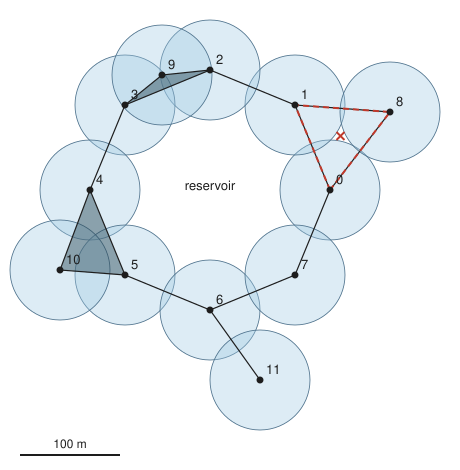

# Vietoris-Rips, Cech and alpha complexes: three ways to make a shape out of points

[Syllabus](../../../SYLLABUS.md) → [Topology](../README.md) → [Topological Data Analysis](../README.md#s06) → Vietoris-Rips, Cech and alpha complexes

---

## General Overview

A water company guards a reservoir with twelve motion sensors on the bank, numbered 0 to 11 and surveyed on a 1 m grid. Each sees reliably up to 50 metres. The water in the middle is meant to be unwatched; any other unwatched patch is a blind spot.

The watched ground is the **union of discs**: every point within 50 m of some sensor. One hole in it means only the reservoir. Two holes means a blind spot on the bank.

A computer cannot count holes in a drawing. It can count them in a list of which sensors, pairs and triples belong together. Such a list is a **simplicial complex** (a set of points, edges and triangles, closed under taking corners, from [Simplicial complexes and chains](../05-Homology/01-simplicial-complexes-and-chains.md)). This card builds the list three ways:

- **Rips:** join two sensors when their discs overlap, meaning they stand within 100 m, and fill every triangle whose three sides are joined. Sensors can learn this by radio, without a map.
- **Čech:** fill a triangle only when all three discs share a point. This needs the real positions.
- **Alpha:** clip each disc to the ground nearer its own sensor than to any other, then ask the Čech question.

At 50 m the Rips list has 30 simplices and one hole. The Čech list has 29 and two holes. A flood fill of the real union on a 1 m grid also finds two: the reservoir, and a 153 square-metre blind spot between sensors 0, 1 and 8. Rips filled a triangle whose middle nobody watches.

**Put a disc of radius r on every point: Čech keeps the sets of discs that share a point, and so the holes of their union; Rips keeps the sets whose pairs overlap, which is cheaper but can fill a real hole; alpha clips each disc to its Voronoi cell and keeps Čech's holes with no more simplices than Čech.**

**What kind of fact this is:** three definitions and four theorems. Čech inside Rips, and Rips inside Čech at a larger radius in the plane, are proved in Why it works. Helly's theorem and the nerve theorem are stated with key steps and sources, not proved. The code checks all four on these twelve sites: one example, not a proof.

### The picture: twelve sensors, their discs and the Rips edges

<p align="center"></p>

To scale: 1 m is one unit, and the bar is 100 m. Black lines are the 15 Rips edges. The two shaded triangles are filled by both complexes. The dashed red triangle 0, 1, 8 is filled by Rips only. The red cross at (280.48, 254.02) is the point inside it that is equally far from all three sensors, 55.03 m from each: farther than any of them can see.

---

## The formula

Notation first, in words. A site is a point $`x_i`$ of the plane, in metres. $`B(x, r)`$ is the closed disc of radius $`r`$ round $`x`$. A **simplex** $`\sigma`$ is a set of sites, written in increasing order, such as $`[0, 1, 8]`$. The **enclosing radius** $`\rho(\sigma)`$ is the radius of the smallest disc that holds every site of $`\sigma`$.

On this shelf the scale is always the disc radius $`r`$, and a Rips edge joins sites within $`2r`$. Some software, such as ripser, uses the edge length $`2r`$ as the scale, so its scales are double these.

The **Vietoris–Rips complex** $`\mathrm{VR}_r`$ asks only about pairs:

```math
\sigma \in \mathrm{VR}_r \iff \lvert x_i - x_j\rvert \le 2r \text{ for every pair } i, j \text{ in } \sigma
```

**Read it aloud:** a set of sites is a Rips simplex when every two of them stand within twice the radius.

The **Čech complex** $`\check{C}_r`$ asks about the whole set at once:

```math
\sigma \in \check{C}_r \iff \bigcap_{i \in \sigma} B(x_i, r) \ne \varnothing \iff \rho(\sigma) \le r
```

**Read it aloud:** a set of sites is a Čech simplex when their discs have a point in common, that is, when the sites fit in one disc of radius $`r`$.

The two complexes nest, and in the plane the gap between them is a fixed factor:

```math
\check{C}_r \subseteq \mathrm{VR}_r \subseteq \check{C}_{2r/\sqrt{3}}
```

**Read it aloud:** every Čech simplex is a Rips simplex, and every Rips simplex is a Čech simplex once the radius grows by the factor two over root three, about 1.15.

The **nerve theorem** says which one to trust. Here $`\simeq`$ means **homotopy equivalent**: one shape deforms into the other without tearing, so they have the same pieces and the same holes in every dimension:

```math
\check{C}_r \simeq \bigcup_{i} B(x_i, r)
```

**Read it aloud:** the Čech complex has the same shape as the union of the discs.

| Symbol | Plain meaning | In our example | Push it up and the answer… |
| --- | --- | --- | --- |
| $`x_i`$, $`n`$ | site number i, a point in metres; n, how many coordinates a point has | $`x_0`$ = (270, 200); n = 2 in the plane | — |
| $`r`$ | disc radius: how far one sensor sees | 50 m | more simplices; small holes close |
| $`B(x, r)`$, $`y`$ | closed disc of radius r round x; y, a point that every disc of a simplex holds | 50 m round each sensor; for [0, 1, 8] no such y exists | — |
| $`\lvert x - y\rvert`$ | straight-line distance | 98.4 m from site 0 to site 8 | — |
| $`\sigma`$ | a simplex: a set of sites | [0, 1, 8] | — |
| $`\rho(\sigma)`$, $`R`$ | enclosing radius: smallest disc holding $`\sigma`$; $`R`$ is the circumradius, of the circle through a triangle's corners | 55.03 m for [0, 1, 8], both | $`\sigma`$ joins Čech later |
| $`a`$, $`b`$, $`c`$, $`A`$, $`\alpha`$ | a triangle's sides; its area A (no subscript: $`A_r`$ is the alpha complex); $`\alpha`$, the angle opposite side a | [0, 1, 8]: sides 91.9, 98.4, 95.3 m; area 3915.0 m² | — |
| $`\mathrm{VR}_r`$ | Rips complex: pairs within 2r, all cliques filled | 30 simplices | — |
| $`\check{C}_r`$ | Čech complex: discs with a common point | 29 simplices | — |
| $`A_r`$ | alpha complex: discs clipped to Voronoi cells | inside the Delaunay triangulation | — |
| $`\simeq`$ | same shape up to deformation | Čech and union: 1 piece, 2 holes | — |
| $`\beta_k`$, $`\chi`$ | Betti number over ℤ mod 2: pieces ($`\beta_0`$), loops ($`\beta_1`$); $`\chi`$, the Euler characteristic: vertices minus edges plus triangles | $`\beta_1`$ = 1 for Rips, 2 for Čech; $`\chi`$ = 0 for Rips, −1 for Čech | — |

### When it holds

- **Ordinary straight-line distance in the plane.** The factor two over root three belongs to the plane. In space it is $`\sqrt{3/2}`$, and in n dimensions $`\sqrt{2n/(n+1)}`$, so the gap between Rips and Čech widens.
- **Convex sensing regions.** The nerve theorem needs every overlap to be one solid blob. A wall that shadows part of a disc breaks this, and the Čech count can then be wrong too.
- **One radius for every site.** With different ranges the Čech test still works disc by disc, but one Rips threshold of 2r no longer means overlap.
- **Triples are enough only in the plane.** In space four balls can miss a common point while every three share one, so the Čech test must look at fours.

---

## Why it works

### Step 0: replace a picture by a list, and keep the holes

The union of twelve discs has infinitely many points, but only its holes matter. So swap it for a finite list of which discs meet: the **nerve**, with one vertex per disc and one simplex per set of discs with a common point. That is the Čech complex.

The nerve theorem says the swap keeps every hole when each overlap is convex, as overlaps of discs are. The Rips list is a cheaper guess at the nerve: it keeps the pair overlaps, which are exact, and guesses the rest from them.

### Step 1: testing a Čech simplex is a smallest-disc problem

Discs of radius $`r`$ share a point $`y`$ exactly when $`y`$ is within $`r`$ of every site: when the sites fit in a disc of radius $`r`$ centred at $`y`$. So the test is $`\rho(\sigma) \le r`$.

For two sites, $`\rho`$ is half their distance. For three sites, it depends on the largest angle:

- **Right or obtuse triangle** (largest angle 90° or more): the longest side is a diameter, so $`\rho`$ is half the longest side.
- **Acute triangle** (every angle under 90°): $`\rho`$ is the **circumradius**, the radius of the circle through all three corners. With sides a, b, c and area A, the circumradius squared is $`R^2 = a^2 b^2 c^2 / (16 A^2)`$.

Triangle [2, 3, 9] is obtuse: its sides squared are 8450, 2329 and 2269, and 2329 + 2269 = 4598 falls short of 8450. Its circumradius is 84.19 m, but the sites fit in a disc of 45.96 m, half the 91.9 m side.

<details>
<summary>Detailed proof: the smallest disc round a triangle</summary>

A disc holding two points has a diameter at least their distance. So every enclosing disc has radius at least half the longest side c.

If the angle opposite c is 90° or more, the third corner lies on or inside the circle with c as diameter. A point sees c at 90° or more exactly when it lies on or inside that circle (Thales' theorem and its converse). That circle holds all three corners and has the least possible radius.

If every angle is under 90°, take any disc holding the three corners and shrink it until it is as small as possible. It must touch at least two corners. If it touches only two, they lie on a diameter, because otherwise the disc could slide toward them and shrink further. Then the angle at the third corner, which lies inside, is at least 90°: a contradiction. So the smallest disc touches all three corners. Only one circle passes through three corners, the circumcircle.

For the circumradius itself, the inscribed angle theorem gives $`a = 2R \sin \alpha`$ where $`\alpha`$ is the angle opposite side a. The area is $`A = \tfrac12 bc \sin \alpha`$. Eliminate $`\sin \alpha`$:

$`\displaystyle R = \frac{abc}{4A}, \qquad R^2 = \frac{a^2 b^2 c^2}{16 A^2}.`$

</details>

### Step 2: in the plane, triples decide everything

**Helly's theorem:** finitely many convex sets in the plane share a point if every three of them do. So a set of four or more sites is a Čech simplex exactly when every three of them are. The plane Čech complex is fixed by its triangles, just as the Rips complex is fixed by its edges.

The key step is four sets. For each set, pick a point that lies in the other three. Radon's lemma splits any four points of the plane into two groups whose convex hulls (the smallest convex sets holding them) meet. Each set's own point sits in one group, and every point of the other group lies in the set. So the set holds that other group's hull, and with it the meeting point. More sets follow by induction. Edelsbrunner and Harer give the full proof.

The code checks it by brute force: it finds the enclosing radius of all 781 sets of two, three and four sites. At 50 m no four sites are pairwise within 100 m, so there the check covers only the 17 edges and triangles, the same as the triple rule. So it runs again at 85 m, where three sets of four sites are pairwise joined. The triple rule passes two of them, and brute force finds exactly those two, agreeing on all 46 simplices.

### Step 3: Čech sits inside Rips

Take a Čech simplex. Its discs share a point $`y`$. Any two of its sites are each within $`r`$ of $`y`$, so they are within $`r + r = 2r`$ of each other, by the triangle inequality. So every pair passes the Rips test. That is the whole proof.

The reverse fails. Sites 0, 1 and 8 are pairwise 91.9, 98.4 and 95.3 m apart, all within 100 m. But the triangle is acute and its circumradius is 55.03 m. No point is within 50 m of all three.

### Step 4: Rips sits inside Čech at two over root three

Take three sites, pairwise within $`2r`$. If the triangle is right or obtuse, its enclosing radius is half the longest side, at most $`r`$. If it is acute, its largest angle $`\alpha`$ is at least 60°, since the three angles add to 180°, and under 90°. Then $`\sin \alpha \ge \sqrt{3}/2`$, and the opposite side is at most $`2r`$, so the circumradius is at most

```math
R = \frac{a}{2 \sin \alpha} \le \frac{2r}{2 \cdot \sqrt{3}/2} = \frac{2r}{\sqrt{3}}
```

**Read it aloud:** the worst case is the equilateral triangle with side 2r, whose circumradius is 2r over root 3.

With every triple inside a disc of radius $`2r/\sqrt{3}`$, Helly's theorem (Step 2) gives the same for every larger Rips simplex. In any dimension the same bound comes from Jung's theorem (a set of a given diameter, the largest distance between two of its points, fits in a ball of a known radius); de Silva and Ghrist state the sandwich with the factor $`\sqrt{2n/(n+1)}`$ in n dimensions. At 50 m the bound is 57.74 m. The gap triangle needs 55.03 m, inside the bound.

### Step 5: the nerve theorem

**Nerve theorem:** if finitely many closed convex sets are given, the nerve of the sets is homotopy equivalent to their union. More generally it holds whenever every non-empty overlap can shrink to a point within itself.

The key steps, in words. Map the union to the nerve: send each point to the simplex of the discs that hold it, weighted by how deep inside each disc it sits. Map back: send each simplex into the overlap of its discs, which is convex, so straight lines stay inside it. Each round trip slides back to its start along straight lines. Borsuk proved the first version in 1948; Edelsbrunner and Harer prove it for convex sets.

So $`\beta_1`$ of the Čech complex counts the holes of the watched ground. The code checks this on a 1 m grid at four radii.

### Step 6: the alpha complex keeps the answer and drops simplices

The **Voronoi cell** of a site is the ground nearer to it than to any other site ([Nearest-neighbour maps](../../05-Geometry%20and%20trig/07-Points%2C%20Convexity%20and%20Fractals/04-voronoi-and-delaunay.md) builds the cells and the Delaunay triangulation: the triangles of sites whose circumcircles hold no other site). Clip each disc to its site's cell. The clipped pieces are still convex, and they still cover the same union. So, by the nerve theorem, their nerve, the **alpha complex** $`A_r`$, has the same holes as the Čech complex.

Clipped pieces of three sites can meet only at a point equally near all three with no site nearer: the centre of an empty circle, so a Delaunay triangle. So $`A_r`$ is a subcomplex (a part that is itself a complex) of the Delaunay triangulation that grows toward all of it as $`r`$ grows. For twelve sites it never holds more than 30 edges and 19 triangles.

Sites 2, 3 and 9 show the saving. The midpoint of 2 and 3 is only 13.66 m from site 9, so it lies in 9's cell. The first point equally near 2 and 3 with no site nearer is the circumcentre of 2, 3 and 9 (the centre of the circle through them), 84.19 m away. So at 50 m the alpha complex has neither edge [2, 3] nor triangle [2, 3, 9], which Čech has. The holes are unchanged: the path 2 to 9 to 3 still closes the ring.

---

## Worked numbers, by hand

The twelve sites, in metres: 0 (270, 200), 1 (235, 285), 2 (150, 320), 3 (65, 285), 4 (30, 200), 5 (65, 115), 6 (150, 80), 7 (235, 115), 8 (330, 278), 9 (102, 315), 10 (0, 120), 11 (200, 10). The radius is 50 m.

| Step | Arithmetic | Value |
| --- | --- | --- |
| Edges: pairs within 100 m | eight ring pairs at 91.9; 0–8 at 98.4, 1–8 at 95.3, 2–9 at 48.3, 3–9 at 47.6, 4–10 at 85.4, 5–10 at 65.2, 6–11 at 86.0 | 15 |
| Rips triangles: triples with all three edges | [0, 1, 8], [2, 3, 9], [4, 5, 10] | 3 |
| Rips size | 12 + 15 + 3 | 30 |
| [2, 3, 9]: obtuse? | 2329 + 2269 = 4598, short of 8450 | yes: radius 91.9 / 2 = 45.96, in Čech |
| [4, 5, 10]: acute; circumradius | 8450 × 7300 × 4250 / (16 × 2675.0²), then the root | 47.85, in Čech |
| [0, 1, 8]: acute; circumradius | 8450 × 9684 × 9074 / (16 × 3915.0²) = 206256557/68121, then the root | 55.03, not in Čech |
| Čech size | 12 + 15 + 2 | 29 |
| Euler characteristic, Rips and Čech | 12 − 15 + 3; 12 − 15 + 2 | 0; −1 |
| Loops, $`\beta_1 = \beta_0 + \beta_2 - \chi`$, with one piece and no closed shell | 1 + 0 − 0; 1 + 0 − (−1) | Rips 1; **Čech 2** |
| Union of discs, flood fill on a 1 m grid | one piece; enclosed unwatched patches | **2 holes: 17955 and 153 m²** |

Here $`\chi`$ is the Euler characteristic: vertices minus edges plus triangles, which equals $`\beta_0 - \beta_1 + \beta_2`$.

**Čech counts two loops, the union has two holes, and Rips counts one.** The reservoir is the large hole. The 153 m² patch round the point (280.48, 254.02) is a blind spot, and only the Čech complex reports it.

### A second radius, and two more

Whether the blind spot exists hangs on the radius, so the code repeats the count at four radii.

| r (m) | Rips: edges, triangles; pieces, loops | Čech: edges, triangles; pieces, loops | Union: pieces, holes (m²) |
| --- | --- | --- | --- |
| 45 | 5, 0; 7, 0 | 5, 0; 7, 0 | 7; none |
| 50 | 15, 3; 1, 1 | 15, 2; 1, 2 | 1; 153 and 17955 |
| 60 | 16, 4; 1, 1 | 16, 4; 1, 1 | 1; 12765 |
| 75 | 18, 6; 1, 1 | 18, 6; 1, 1 | 1; 7000 |

At 45 m the ring breaks into seven pieces and nothing is enclosed. At 60 m, past 55.03, the blind spot is gone and the complexes agree. At 50 m they differ because the gap triangle's pairs overlap while its three discs do not yet meet.

### What breaks if you drop a piece

| Mistake | Comes out at | What went wrong |
| --- | --- | --- |
| Trust Rips to find the holes | 1 loop, not 2 | It filled [0, 1, 8] because each pair overlaps; the three discs never meet, and the blind spot vanishes from the count |
| Join sites within r = 50 m, not 2r = 100 m | 2 edges, 10 pieces | Disc radius read as edge length: the radius-against-diameter mix-up, which halves every scale |
| Use the circumradius for every triangle | 1 triangle, 3 loops | The obtuse [2, 3, 9] has circumradius 84.19 m but fits a 45.96 m disc; dropping it opens a false hole |

---

## Code, from first principles, and it actually runs

The script builds both complexes at 50 m with integer squared distances and exact fractions, and counts pieces and loops from boundary-matrix ranks over ℤ mod 2. Three independent roads check it:

- the angle rule with Helly's triples, against a brute-force smallest enclosing circle on every set of up to four sites, at 50 m and again at 85 m, where some sets of four are pairwise joined;
- the pieces from the ranks, against union-find, a separate way to count connected groups;
- the Čech pieces and loops, against a flood fill of the real union on a 1 m grid at four radii: the nerve theorem, checked on these cases.

### Python

```python
# Vietoris-Rips and Cech complexes -- the check behind the card.  Standard library only.
# Twelve sensor sites (metres), ball radius r: a Rips edge joins sites within 2r.
# Roads: Cech membership by the angle rule plus Helly, against a brute-force smallest
# enclosing circle on every subset; holes by mod-2 ranks, against union-find for the
# pieces and against a flood fill of the real union of discs (the nerve theorem).
from fractions import Fraction as F
from itertools import combinations
P = [(270, 200), (235, 285), (150, 320), (65, 285), (30, 200), (65, 115), (150, 80),
     (235, 115), (330, 278), (102, 315), (0, 120), (200, 10)]
N = len(P)

def d2(a, b):
    return (P[a][0] - P[b][0]) ** 2 + (P[a][1] - P[b][1]) ** 2
def cross(a, b, c):
    return (P[b][0] - P[a][0]) * (P[c][1] - P[a][1]) - (P[b][1] - P[a][1]) * (P[c][0] - P[a][0])

def circum2(a, b, c):                        # circumradius squared, exact
    return F(d2(a, b) * d2(b, c) * d2(a, c), 4 * cross(a, b, c) ** 2)

def tri_ok(t, rr, rule=True):                # road 1: discs of radius r around a, b, c share a point
    s = sorted(d2(*e) for e in combinations(t, 2))
    if rule and s[2] >= s[0] + s[1]:         # right or obtuse: the longest side is a diameter
        return s[2] <= 4 * rr
    return s[2] <= 4 * rr and circum2(*t) <= rr

def centres(s):                              # every candidate centre of a smallest enclosing circle
    for a, b in combinations(s, 2):
        yield (F(P[a][0] + P[b][0], 2), F(P[a][1] + P[b][1], 2))
    for a, b, c in combinations(s, 3):
        D = 2 * cross(a, b, c)
        if D:
            bx, by, cx, cy = P[b][0] - P[a][0], P[b][1] - P[a][1], P[c][0] - P[a][0], P[c][1] - P[a][1]
            yield (P[a][0] + F(cy * d2(a, b) - by * d2(a, c), D), P[a][1] + F(bx * d2(a, c) - cx * d2(a, b), D))

def meb2(s):                                 # road 2: smallest enclosing circle, brute force
    return min(max((x - P[v][0]) ** 2 + (y - P[v][1]) ** 2 for v in s) for x, y in centres(s))

def complexes(rr, rule=True):
    E = [e for e in combinations(range(N), 2) if d2(*e) <= 4 * rr]
    R, C = {0: [(v,) for v in range(N)], 1: E}, {0: [(v,) for v in range(N)], 1: E}
    for k in range(2, N):
        R[k] = [s for s in combinations(range(N), k + 1) if all(e in E for e in combinations(s, 2))]
        C[k] = [s for s in R[k] if all(tri_ok(t, rr, rule) for t in combinations(s, 3))]  # Helly
        if not R[k]:
            break
    return R, C

def betti(K):                                # over Z mod 2: columns as sorted lists, reduced by lowest row
    rank = {}
    for k in range(1, len(K)):
        row, low, rk = {s: i for i, s in enumerate(K[k - 1])}, {}, 0
        for s in K[k]:
            c = sorted(row[s[:i] + s[i + 1:]] for i in range(len(s)))
            while c and c[-1] in low:
                c = sorted(set(c) ^ set(low[c[-1]]))
            if c:
                low[c[-1]], rk = c, rk + 1
        rank[k] = rk
    return [len(K[k]) - rank.get(k, 0) - rank.get(k + 1, 0) for k in range(len(K))]

def pieces(E):                               # union-find on the edges: betti0 without any rank
    root = list(range(N))
    def find(v):
        while root[v] != v:
            v = root[v]
        return v
    for a, b in E:
        root[find(a)] = find(b)
    return len({find(v) for v in range(N)})

def union(rr):                               # flood fill on a 1 m grid: covered pieces, enclosed gaps
    m = int(rr ** 0.5) + 10
    xs, ys = range(min(p[0] for p in P) - m, max(p[0] for p in P) + m + 1), range(min(p[1] for p in P) - m, max(p[1] for p in P) + m + 1)
    cov = {(x, y): any((x - a) ** 2 + (y - b) ** 2 <= rr for a, b in P) for x in xs for y in ys}
    seen, pieces, gaps = set(), 0, []
    for start, val in cov.items():
        if start in seen:
            continue
        stack, size, edge = [start], 0, False
        seen.add(start)
        while stack:
            x, y = stack.pop()
            size += 1
            edge |= x in (xs[0], xs[-1]) or y in (ys[0], ys[-1])
            steps = [(1, 0), (-1, 0), (0, 1), (0, -1)] + ([] if val else [(1, 1), (1, -1), (-1, 1), (-1, -1)])
            for dx, dy in steps:
                q = (x + dx, y + dy)
                if q in cov and q not in seen and cov[q] == val:
                    seen.add(q)
                    stack.append(q)
        if val:
            pieces += 1
        elif not edge:
            gaps.append(size)
    return pieces, sorted(gaps)

r = 50
R, C = complexes(r * r)
size = lambda K: [len(K[k]) for k in range(len(K)) if K[k]]
bR, bC = betti(R), betti(C)
print("sites", N, "| ball radius", r, "m | edge if distance <=", 2 * r, "m")
print("edges, length m:", ", ".join(f"{a}-{b} {d2(a, b) ** 0.5:.1f}" for a, b in R[1]))
print("Rips simplices by dimension", size(R), "total", sum(size(R)), "| betti mod 2", bR[:3])
print("Cech simplices by dimension", size(C), "total", sum(size(C)), "| betti mod 2", bC[:3])
print("triangles Rips fills, Cech leaves open", [t for t in R[2] if t not in C[2]])
for t in R[2]:
    print("triangle", t, "sides m", " ".join(f"{d2(*e) ** 0.5:.1f}" for e in combinations(t, 2)), "| squared", *[d2(*e) for e in combinations(t, 2)],
          "| area m^2", f"{abs(cross(*t)) / 2:.1f}", "| circumradius", f"{float(circum2(*t)) ** 0.5:.2f}", "| enclosing radius", f"{float(meb2(t)) ** 0.5:.2f}")
gap = (0, 1, 8)
print("gap triangle: circumradius^2", circum2(*gap), "m^2, so its discs share a point only from r =", f"{float(circum2(*gap)) ** 0.5:.2f}", "m")
for rad, (Rh, Ch) in ((r, (R, C)), (85, complexes(85 * 85))):   # Helly: at 85 m some four sites are pairwise joined
    brute = {s for k in range(2, 5) for s in combinations(range(N), k) if meb2(s) <= rad * rad}
    assert brute == {s for k in (1, 2, 3) for s in Ch.get(k, [])}, "angle rule + Helly disagrees with brute force"
    print("Cech by brute-force enclosing circles on", sum(1 for k in range(2, 5) for _ in combinations(range(N), k)), "subsets at r =", rad,
          "m: same", len(brute), "simplices | sets of four: Rips", len(Rh.get(3, [])), "Cech", len(Ch.get(3, [])))
for name, K, b in (("Rips", R, bR), ("Cech", C, bC)):
    chi = sum((-1) ** k * n for k, n in enumerate(size(K)))
    assert b[0] == pieces(K[1]), "ranks disagree with union-find"
    print("Euler characteristic", name, chi, "= betti0 - betti1 + betti2")
rr2 = F(4 * r * r, 3)                        # Jung: Rips at r sits inside Cech at 2r/sqrt3
assert all(meb2(s) <= rr2 for k in (1, 2) for s in R[k])
print("every Rips simplex lies in Cech at 2r/sqrt3 =", f"{(4 * r * r / 3) ** 0.5:.2f}", "m")
print("r m | Rips sizes, betti0, betti1 | Cech sizes, betti0, betti1 | union pieces, gaps, gap sizes m^2")
for rad in (45, 50, 60, 75):
    Rx, Cx = complexes(rad * rad)
    pieces, gaps = union(rad * rad)
    bx = betti(Cx)
    assert (bx[0], bx[1]) == (pieces, len(gaps)), "nerve theorem: Cech must match the union"
    print(rad, "|", size(Rx), *betti(Rx)[:2], "|", size(Cx), *bx[:2], "|", pieces, len(gaps), gaps)
Rd, _ = complexes(r * r // 4)                # mistake: edge within r, not 2r
print("mistake, edge if distance <= r:", size(Rd), "betti", betti(Rd)[:2])
_, Cc = complexes(r * r, rule=False)         # mistake: circumradius for every triangle
print("mistake, circumradius for every triangle:", size(Cc), "betti", betti(Cc)[:2])
assert betti(Cc)[1] == bC[1] + 1 and (2, 3, 9) not in Cc[2], "the obtuse triangle should be lost"
m, (cx, cy) = (F(P[2][0] + P[3][0], 2), F(P[2][1] + P[3][1], 2)), list(centres((2, 3, 9)))[-1]
assert all((cx - a) ** 2 + (cy - b) ** 2 > circum2(2, 3, 9) for i, (a, b) in enumerate(P) if i not in (2, 3, 9))  # empty circle
print("alpha: midpoint of 2-3 is", f"{float((m[0] - 102) ** 2 + (m[1] - 315) ** 2) ** 0.5:.2f}", "m from site 9; edge 2-3 enters at r =",
      f"{float(circum2(2, 3, 9)) ** 0.5:.2f}", "m | Delaunay ceiling: edges <=", 3 * N - 6, "triangles <=", 2 * N - 5)
print("figure, sites", P, "| gap centre at", "({:.2f}, {:.2f})".format(*map(float, list(centres(gap))[-1])))
print("ALL CHECKS PASS")
```

**Ran 2026-11-15 on macOS, Python 3.14.10, standard library only. All checks passed. Output, pasted from the run:**

```
sites 12 | ball radius 50 m | edge if distance <= 100 m
edges, length m: 0-1 91.9, 0-7 91.9, 0-8 98.4, 1-2 91.9, 1-8 95.3, 2-3 91.9, 2-9 48.3, 3-4 91.9, 3-9 47.6, 4-5 91.9, 4-10 85.4, 5-6 91.9, 5-10 65.2, 6-7 91.9, 6-11 86.0
Rips simplices by dimension [12, 15, 3] total 30 | betti mod 2 [1, 1, 0]
Cech simplices by dimension [12, 15, 2] total 29 | betti mod 2 [1, 2, 0]
triangles Rips fills, Cech leaves open [(0, 1, 8)]
triangle (0, 1, 8) sides m 91.9 98.4 95.3 | squared 8450 9684 9074 | area m^2 3915.0 | circumradius 55.03 | enclosing radius 55.03
triangle (2, 3, 9) sides m 91.9 48.3 47.6 | squared 8450 2329 2269 | area m^2 627.5 | circumradius 84.19 | enclosing radius 45.96
triangle (4, 5, 10) sides m 91.9 85.4 65.2 | squared 8450 7300 4250 | area m^2 2675.0 | circumradius 47.85 | enclosing radius 47.85
gap triangle: circumradius^2 206256557/68121 m^2, so its discs share a point only from r = 55.03 m
Cech by brute-force enclosing circles on 781 subsets at r = 50 m: same 17 simplices | sets of four: Rips 0 Cech 0
Cech by brute-force enclosing circles on 781 subsets at r = 85 m: same 46 simplices | sets of four: Rips 3 Cech 2
Euler characteristic Rips 0 = betti0 - betti1 + betti2
Euler characteristic Cech -1 = betti0 - betti1 + betti2
every Rips simplex lies in Cech at 2r/sqrt3 = 57.74 m
r m | Rips sizes, betti0, betti1 | Cech sizes, betti0, betti1 | union pieces, gaps, gap sizes m^2
45 | [12, 5] 7 0 | [12, 5] 7 0 | 7 0 []
50 | [12, 15, 3] 1 1 | [12, 15, 2] 1 2 | 1 2 [153, 17955]
60 | [12, 16, 4] 1 1 | [12, 16, 4] 1 1 | 1 1 [12765]
75 | [12, 18, 6] 1 1 | [12, 18, 6] 1 1 | 1 1 [7000]
mistake, edge if distance <= r: [12, 2] betti [10, 0]
mistake, circumradius for every triangle: [12, 15, 1] betti [1, 3]
alpha: midpoint of 2-3 is 13.66 m from site 9; edge 2-3 enters at r = 84.19 m | Delaunay ceiling: edges <= 30 triangles <= 19
figure, sites [(270, 200), (235, 285), (150, 320), (65, 285), (30, 200), (65, 115), (150, 80), (235, 115), (330, 278), (102, 315), (0, 120), (200, 10)] | gap centre at (280.48, 254.02)
ALL CHECKS PASS
```

### Rust

```rust
// Vietoris-Rips and Cech complexes -- the check behind the card.  std only, no crates.
// Twelve sensor sites (metres), ball radius r: a Rips edge joins sites within 2r.
// Roads: Cech membership by the angle rule plus Helly, against a brute-force smallest
// enclosing circle on every subset; holes by mod-2 ranks, against union-find for the
// pieces and against a flood fill of the real union of discs (the nerve theorem).
use std::{cmp::Ordering, collections::{BTreeMap, HashSet}};
const P: [(i64, i64); 12] = [(270, 200), (235, 285), (150, 320), (65, 285), (30, 200), (65, 115), (150, 80),
    (235, 115), (330, 278), (102, 315), (0, 120), (200, 10)];
const N: usize = 12; type Cx = Vec<Vec<Vec<usize>>>;
#[derive(Clone, Copy, PartialEq, Eq, Debug)]
struct Q { n: i128, d: i128 } // an exact fraction, lowest terms, positive denominator
fn gcd(a: i128, b: i128) -> i128 { if b == 0 { a.abs() } else { gcd(b, a % b) } }
impl Q {
    fn new(n: i128, d: i128) -> Q { let g = gcd(n, d) * d.signum(); Q { n: n / g, d: d / g } }
    fn add(self, o: Q) -> Q { Q::new(self.n * o.d + o.n * self.d, self.d * o.d) }
    fn sub(self, o: Q) -> Q { Q::new(self.n * o.d - o.n * self.d, self.d * o.d) }
    fn mul(self, o: Q) -> Q { Q::new(self.n * o.n, self.d * o.d) }  fn f(self) -> f64 { self.n as f64 / self.d as f64 }
    fn int(v: i64) -> Q { Q::new(v as i128, 1) }
}
impl PartialOrd for Q { fn partial_cmp(&self, o: &Q) -> Option<Ordering> { Some(self.cmp(o)) } }
impl Ord for Q { fn cmp(&self, o: &Q) -> Ordering { (self.n * o.d).cmp(&(o.n * self.d)) } }
fn d2(a: usize, b: usize) -> i64 { (P[a].0 - P[b].0).pow(2) + (P[a].1 - P[b].1).pow(2) }
fn cross(a: usize, b: usize, c: usize) -> i64 { (P[b].0 - P[a].0) * (P[c].1 - P[a].1) - (P[b].1 - P[a].1) * (P[c].0 - P[a].0) }
fn circum2(a: usize, b: usize, c: usize) -> Q { // circumradius squared, exact
    Q::new((d2(a, b) * d2(b, c) * d2(a, c)) as i128, 4 * (cross(a, b, c) as i128).pow(2))
}
fn combos(items: &[usize], k: usize) -> Vec<Vec<usize>> {
    if k == 0 { return vec![vec![]]; }
    (0..items.len()).flat_map(|i| combos(&items[i + 1..], k - 1).into_iter().map(move |r| [vec![items[i]], r].concat())).collect()
}
fn tri_ok(t: &[usize], rr: i64, rule: bool) -> bool { // road 1: discs around a, b, c share a point
    let mut s: Vec<i64> = combos(t, 2).iter().map(|e| d2(e[0], e[1])).collect();
    s.sort();
    if rule && s[2] >= s[0] + s[1] { return s[2] <= 4 * rr; } // right or obtuse: longest side is a diameter
    s[2] <= 4 * rr && circum2(t[0], t[1], t[2]) <= Q::int(rr)
}
fn centres(s: &[usize]) -> Vec<(Q, Q)> { // every candidate centre of a smallest enclosing circle
    let mut out: Vec<(Q, Q)> = combos(s, 2).iter()
        .map(|e| (Q::new((P[e[0]].0 + P[e[1]].0) as i128, 2), Q::new((P[e[0]].1 + P[e[1]].1) as i128, 2))).collect();
    for t in combos(s, 3) {
        let (a, b, c) = (t[0], t[1], t[2]);
        let (dd, bx, by, cx, cy) = (2 * cross(a, b, c) as i128, P[b].0 - P[a].0, P[b].1 - P[a].1, P[c].0 - P[a].0, P[c].1 - P[a].1);
        if dd != 0 { out.push((Q::int(P[a].0).add(Q::new((cy * d2(a, b) - by * d2(a, c)) as i128, dd)),
                               Q::int(P[a].1).add(Q::new((bx * d2(a, c) - cx * d2(a, b)) as i128, dd)))); }
    }
    out
}
fn dist2(c: (Q, Q), v: usize) -> Q { let (dx, dy) = (c.0.sub(Q::int(P[v].0)), c.1.sub(Q::int(P[v].1))); dx.mul(dx).add(dy.mul(dy)) }
fn meb2(s: &[usize]) -> Q { // road 2: smallest enclosing circle, brute force
    centres(s).iter().map(|&c| s.iter().map(|&v| dist2(c, v)).max().unwrap()).min().unwrap()
}
fn complexes(rr: i64, rule: bool) -> (Cx, Cx) {
    let all: Vec<usize> = (0..N).collect();
    let verts: Vec<Vec<usize>> = (0..N).map(|v| vec![v]).collect();
    let e: Vec<Vec<usize>> = combos(&all, 2).into_iter().filter(|e| d2(e[0], e[1]) <= 4 * rr).collect();
    let (mut r, mut c) = (vec![verts.clone(), e.clone()], vec![verts, e.clone()]);
    for k in 2..N {
        let rk: Vec<Vec<usize>> = combos(&all, k + 1).into_iter().filter(|s| combos(s, 2).iter().all(|p| e.contains(p))).collect();
        let ck = rk.iter().filter(|s| combos(s, 3).iter().all(|t| tri_ok(t, rr, rule))).cloned().collect(); // Helly
        let empty = rk.is_empty(); r.push(rk); c.push(ck);
        if empty { break; }
    }
    (r, c)
}
fn betti(k: &Cx) -> Vec<i64> { // over Z mod 2: columns as sorted lists, reduced by lowest row
    let mut rank = vec![0i64; k.len() + 1];
    for d in 1..k.len() {
        let mut low: BTreeMap<usize, Vec<usize>> = BTreeMap::new();
        for s in &k[d] {
            let mut col: Vec<usize> = (0..s.len()).map(|i| { let mut f = s.clone(); f.remove(i); k[d - 1].iter().position(|x| *x == f).unwrap() }).collect();
            col.sort();
            while let Some(&l) = col.last() {
                let Some(p) = low.get(&l) else { break };
                let (a, b): (HashSet<usize>, HashSet<usize>) = (col.iter().cloned().collect(), p.iter().cloned().collect());
                col = a.symmetric_difference(&b).cloned().collect(); col.sort();
            }
            if let Some(&l) = col.last() { low.insert(l, col); rank[d] += 1; }
        }
    }
    (0..k.len()).map(|d| k[d].len() as i64 - rank[d] - rank[d + 1]).collect()
}
fn pieces(e: &[Vec<usize>]) -> i64 { // union-find on the edges: betti0 without any rank
    fn find(r: &[usize], mut v: usize) -> usize { while r[v] != v { v = r[v]; } v }
    let mut root: Vec<usize> = (0..N).collect();
    for p in e { let (a, b) = (find(&root, p[0]), find(&root, p[1])); root[a] = b; }
    (0..N).map(|v| find(&root, v)).collect::<HashSet<_>>().len() as i64
}
fn union(rr: i64) -> (usize, Vec<usize>) { // flood fill on a 1 m grid: covered pieces, enclosed gaps
    let m = (rr as f64).sqrt() as i64 + 10; let (x0, x1) = (P.iter().map(|p| p.0).min().unwrap() - m, P.iter().map(|p| p.0).max().unwrap() + m);
    let (y0, y1) = (P.iter().map(|p| p.1).min().unwrap() - m, P.iter().map(|p| p.1).max().unwrap() + m);
    let (w, h) = ((x1 - x0 + 1) as usize, (y1 - y0 + 1) as usize);
    let cov: Vec<bool> = (0..w * h).map(|i| { let (x, y) = (x0 + (i / h) as i64, y0 + (i % h) as i64);
        P.iter().any(|&(a, b)| (x - a).pow(2) + (y - b).pow(2) <= rr) }).collect();
    let (mut seen, mut pieces, mut gaps) = (vec![false; w * h], 0, vec![]);
    for st in 0..w * h {
        if seen[st] { continue; }
        let val = cov[st];
        let (mut stack, mut size, mut edge) = (vec![st], 0, false); seen[st] = true;
        while let Some(i) = stack.pop() {
            size += 1;
            let (x, y) = ((i / h) as i64, (i % h) as i64); edge |= x == 0 || y == 0 || x == w as i64 - 1 || y == h as i64 - 1;
            let steps = [(1, 0), (-1, 0), (0, 1), (0, -1), (1, 1), (1, -1), (-1, 1), (-1, -1)];
            for &(dx, dy) in &steps[..if val { 4 } else { 8 }] {
                let (nx, ny) = (x + dx, y + dy);
                if nx < 0 || ny < 0 || nx >= w as i64 || ny >= h as i64 { continue; }
                let q = nx as usize * h + ny as usize;
                if !seen[q] && cov[q] == val { seen[q] = true; stack.push(q); }
            }
        }
        if val { pieces += 1; } else if !edge { gaps.push(size); }
    }
    gaps.sort(); (pieces, gaps)
}
fn size(k: &Cx) -> Vec<usize> { k.iter().map(|x| x.len()).filter(|&n| n > 0).collect() }
fn ls<T: std::fmt::Display>(v: &[T]) -> String { format!("[{}]", v.iter().map(|x| x.to_string()).collect::<Vec<_>>().join(", ")) }
fn tup(v: &[usize]) -> String { ls(v).replace('[', "(").replace(']', ")") }
fn sq(q: Q) -> String { format!("{:.2}", q.f().sqrt()) }
fn main() {
    let r: i64 = 50;
    let (rc, cc) = complexes(r * r, true);
    let (br, bc) = (betti(&rc), betti(&cc));
    println!("sites {} | ball radius {} m | edge if distance <= {} m", N, r, 2 * r);
    println!("edges, length m: {}", rc[1].iter().map(|e| format!("{}-{} {:.1}", e[0], e[1], (d2(e[0], e[1]) as f64).sqrt())).collect::<Vec<_>>().join(", "));
    println!("Rips simplices by dimension {} total {} | betti mod 2 {}", ls(&size(&rc)), size(&rc).iter().sum::<usize>(), ls(&br[..3]));
    println!("Cech simplices by dimension {} total {} | betti mod 2 {}", ls(&size(&cc)), size(&cc).iter().sum::<usize>(), ls(&bc[..3]));
    println!("triangles Rips fills, Cech leaves open {}", ls(&rc[2].iter().filter(|t| !cc[2].contains(t)).map(|t| tup(t)).collect::<Vec<_>>()));
    for t in &rc[2] {
        let sides: Vec<String> = combos(t, 2).iter().map(|e| format!("{:.1}", (d2(e[0], e[1]) as f64).sqrt())).collect();
        println!("triangle {} sides m {} | squared {} | area m^2 {:.1} | circumradius {} | enclosing radius {}", tup(t), sides.join(" "), combos(t, 2).iter().map(|e| d2(e[0], e[1]).to_string()).collect::<Vec<_>>().join(" "),
                 cross(t[0], t[1], t[2]).abs() as f64 / 2.0, sq(circum2(t[0], t[1], t[2])), sq(meb2(t)));
    }
    let g = circum2(0, 1, 8);
    println!("gap triangle: circumradius^2 {}/{} m^2, so its discs share a point only from r = {} m", g.n, g.d, sq(g));
    let subsets: Vec<Vec<usize>> = (2..5).flat_map(|k| combos(&(0..N).collect::<Vec<_>>(), k)).collect();
    for (rad, (rh, ch)) in [(r, (rc.clone(), cc.clone())), (85, complexes(85 * 85, true))] { // Helly: at 85 m some four sites are pairwise joined
        let brute: HashSet<Vec<usize>> = subsets.iter().filter(|s| meb2(s) <= Q::int(rad * rad)).cloned().collect();
        let rule: HashSet<Vec<usize>> = (1..ch.len()).flat_map(|k| ch[k].iter().cloned()).collect();
        assert!(brute == rule, "angle rule + Helly disagrees with brute force");
        println!("Cech by brute-force enclosing circles on {} subsets at r = {} m: same {} simplices | sets of four: Rips {} Cech {}", subsets.len(), rad,
                 brute.len(), rh.get(3).map_or(0, |x| x.len()), ch.get(3).map_or(0, |x| x.len()));
    }
    for (name, k, b) in [("Rips", &rc, &br), ("Cech", &cc, &bc)] {
        let chi: i64 = size(k).iter().enumerate().map(|(i, &n)| if i % 2 == 0 { n as i64 } else { -(n as i64) }).sum();
        assert!(b[0] == pieces(&k[1]), "ranks disagree with union-find");
        println!("Euler characteristic {} {} = betti0 - betti1 + betti2", name, chi);
    }
    let jung = Q::new(4 * (r * r) as i128, 3); // Jung: Rips at r sits inside Cech at 2r/sqrt3
    assert!((1..3).all(|k| rc[k].iter().all(|s| meb2(s) <= jung)));
    println!("every Rips simplex lies in Cech at 2r/sqrt3 = {:.2} m", (4.0 * (r * r) as f64 / 3.0).sqrt());
    println!("r m | Rips sizes, betti0, betti1 | Cech sizes, betti0, betti1 | union pieces, gaps, gap sizes m^2");
    for rad in [45i64, 50, 60, 75] {
        let (rx, cx) = complexes(rad * rad, true);
        let (pieces, gaps) = union(rad * rad);
        let (bx, brx) = (betti(&cx), betti(&rx));
        assert!(bx[0] == pieces as i64 && bx[1] == gaps.len() as i64, "nerve theorem: Cech must match the union");
        println!("{} | {} {} {} | {} {} {} | {} {} {}", rad, ls(&size(&rx)), brx[0], brx[1], ls(&size(&cx)), bx[0], bx[1], pieces, gaps.len(), ls(&gaps));
    }
    let (rd, _) = complexes(r * r / 4, true); // mistake: edge within r, not 2r
    println!("mistake, edge if distance <= r: {} betti {}", ls(&size(&rd)), ls(&betti(&rd)[..2]));
    let (_, cm) = complexes(r * r, false); // mistake: circumradius for every triangle
    println!("mistake, circumradius for every triangle: {} betti {}", ls(&size(&cm)), ls(&betti(&cm)[..2]));
    assert!(betti(&cm)[1] == bc[1] + 1 && !cm[2].contains(&vec![2, 3, 9]), "the obtuse triangle should be lost");
    let (m, c239) = ((Q::new((P[2].0 + P[3].0) as i128, 2), Q::new((P[2].1 + P[3].1) as i128, 2)), *centres(&[2, 3, 9]).last().unwrap());
    assert!((0..N).filter(|i| ![2, 3, 9].contains(i)).all(|i| dist2(c239, i) > circum2(2, 3, 9))); // empty circle
    println!("alpha: midpoint of 2-3 is {} m from site 9; edge 2-3 enters at r = {} m | Delaunay ceiling: edges <= {} triangles <= {}",
             sq(dist2(m, 9)), sq(circum2(2, 3, 9)), 3 * N - 6, 2 * N - 5);
    let (gc, sites): ((Q, Q), Vec<String>) = (*centres(&[0, 1, 8]).last().unwrap(), P.iter().map(|p| format!("({}, {})", p.0, p.1)).collect());
    println!("figure, sites {} | gap centre at ({:.2}, {:.2})", ls(&sites), gc.0.f(), gc.1.f());
    println!("ALL CHECKS PASS");
}
```

**Ran 2026-11-15 on macOS, rustc 1.98.1, no crates. All checks passed. Output, pasted from the run:**

```
sites 12 | ball radius 50 m | edge if distance <= 100 m
edges, length m: 0-1 91.9, 0-7 91.9, 0-8 98.4, 1-2 91.9, 1-8 95.3, 2-3 91.9, 2-9 48.3, 3-4 91.9, 3-9 47.6, 4-5 91.9, 4-10 85.4, 5-6 91.9, 5-10 65.2, 6-7 91.9, 6-11 86.0
Rips simplices by dimension [12, 15, 3] total 30 | betti mod 2 [1, 1, 0]
Cech simplices by dimension [12, 15, 2] total 29 | betti mod 2 [1, 2, 0]
triangles Rips fills, Cech leaves open [(0, 1, 8)]
triangle (0, 1, 8) sides m 91.9 98.4 95.3 | squared 8450 9684 9074 | area m^2 3915.0 | circumradius 55.03 | enclosing radius 55.03
triangle (2, 3, 9) sides m 91.9 48.3 47.6 | squared 8450 2329 2269 | area m^2 627.5 | circumradius 84.19 | enclosing radius 45.96
triangle (4, 5, 10) sides m 91.9 85.4 65.2 | squared 8450 7300 4250 | area m^2 2675.0 | circumradius 47.85 | enclosing radius 47.85
gap triangle: circumradius^2 206256557/68121 m^2, so its discs share a point only from r = 55.03 m
Cech by brute-force enclosing circles on 781 subsets at r = 50 m: same 17 simplices | sets of four: Rips 0 Cech 0
Cech by brute-force enclosing circles on 781 subsets at r = 85 m: same 46 simplices | sets of four: Rips 3 Cech 2
Euler characteristic Rips 0 = betti0 - betti1 + betti2
Euler characteristic Cech -1 = betti0 - betti1 + betti2
every Rips simplex lies in Cech at 2r/sqrt3 = 57.74 m
r m | Rips sizes, betti0, betti1 | Cech sizes, betti0, betti1 | union pieces, gaps, gap sizes m^2
45 | [12, 5] 7 0 | [12, 5] 7 0 | 7 0 []
50 | [12, 15, 3] 1 1 | [12, 15, 2] 1 2 | 1 2 [153, 17955]
60 | [12, 16, 4] 1 1 | [12, 16, 4] 1 1 | 1 1 [12765]
75 | [12, 18, 6] 1 1 | [12, 18, 6] 1 1 | 1 1 [7000]
mistake, edge if distance <= r: [12, 2] betti [10, 0]
mistake, circumradius for every triangle: [12, 15, 1] betti [1, 3]
alpha: midpoint of 2-3 is 13.66 m from site 9; edge 2-3 enters at r = 84.19 m | Delaunay ceiling: edges <= 30 triangles <= 19
figure, sites [(270, 200), (235, 285), (150, 320), (65, 285), (30, 200), (65, 115), (150, 80), (235, 115), (330, 278), (102, 315), (0, 120), (200, 10)] | gap centre at (280.48, 254.02)
ALL CHECKS PASS
```

### Lean

Lean proves Steps 2, 3 and 4 and the obtuse rule of Step 1, for any sites in the plane and any radius.

- Every Čech simplex at radius r is a Rips simplex at r.
- Every Rips simplex at radius r, of any size, is a Čech simplex at radius $`2r/\sqrt{3}`$.
- A set of sites is a Čech simplex exactly when every part of it with at most three sites is one.
- Suppose a triangle of sites has a right or obtuse angle. Then its three discs of radius r share a point exactly when its longest side is at most 2r.
- Take the twelve sites at 50 m. Then there are 15 edges, and the three Rips triangles have the squared sides in the table.
- [2, 3, 9] is obtuse, since 2329 + 2269 = 4598 falls short of 8450.
- For [0, 1, 8], the table's arithmetic gives 206256557/68121. That is more than $`50^2`$ but at most $`100^2/3`$, the sandwich bound squared.
- The sums behind the sizes hold: Rips 30 with $`\chi = 0`$, Čech 29 with $`\chi = -1`$, and loops 1 and 2.

The circumradius formula, nerve theorem, alpha complex, Betti numbers and flood fill are left to the Python and Rust checks.

```lean
-- Vietoris-Rips, Cech and alpha complexes: in the plane every Cech simplex at radius r is a Rips simplex at r, and every Rips simplex at r is a Cech simplex at 2r/√3.
import Mathlib.Analysis.InnerProductSpace.PiL2
import Mathlib.Analysis.Convex.Radon
import Mathlib.Analysis.Normed.Module.Convex

open Metric

/-- The plane, with ordinary straight-line distance. -/
abbrev Plane := EuclideanSpace ℝ (Fin 2)

/-- Rips test at ball radius `r`: every two sites of `σ` stand within `2r`. -/
def IsRipsSimplex {ι : Type*} (x : ι → Plane) (r : ℝ) (σ : Finset ι) : Prop :=
  ∀ i ∈ σ, ∀ j ∈ σ, dist (x i) (x j) ≤ 2 * r

/-- Čech test at ball radius `r`: the closed discs of radius `r` round the sites of `σ`
share a point. -/
def IsCechSimplex {ι : Type*} (x : ι → Plane) (r : ℝ) (σ : Finset ι) : Prop :=
  (⋂ i ∈ σ, closedBall (x i) r).Nonempty

lemma dist_sq_plane (p q : Plane) : dist p q ^ 2 = (p 0 - q 0) ^ 2 + (p 1 - q 1) ^ 2 := by
  rw [EuclideanSpace.dist_sq_eq, Fin.sum_univ_two, Real.dist_eq, Real.dist_eq, sq_abs, sq_abs]

lemma le_of_sq_le_sq_nonneg {s t : ℝ} (_hs : 0 ≤ s) (ht : 0 ≤ t) (h : s ^ 2 ≤ t ^ 2) : s ≤ t := by
  nlinarith

lemma midpoint_close (a b c : Plane) (h : dist a b ^ 2 + dist b c ^ 2 ≤ dist a c ^ 2) :
    ∃ m : Plane, dist m a ≤ dist a c / 2 ∧ dist m b ≤ dist a c / 2 ∧ dist m c ≤ dist a c / 2 := by
  have hab := dist_sq_plane a b
  have hbc := dist_sq_plane b c
  have hac := dist_sq_plane a c
  refine ⟨!₂[(a 0 + c 0) / 2, (a 1 + c 1) / 2], ?_, ?_, ?_⟩ <;>
  · apply le_of_sq_le_sq_nonneg dist_nonneg (by positivity)
    rw [div_pow, dist_sq_plane, hac]
    simp
    nlinarith

lemma circ_real (u0 u1 v0 v1 x y z dd : ℝ) (hxd : x = u0 ^ 2 + u1 ^ 2)
    (hyd : y = v0 ^ 2 + v1 ^ 2) (hzd : z = (u0 - v0) ^ 2 + (u1 - v1) ^ 2)
    (hx : x ≤ dd) (hy : y ≤ x) (hz : z ≤ x) (hacute : x < y + z) :
    ∃ o0 o1 : ℝ, o0 ^ 2 + o1 ^ 2 ≤ dd / 3 ∧ (o0 - u0) ^ 2 + (o1 - u1) ^ 2 = o0 ^ 2 + o1 ^ 2 ∧
      (o0 - v0) ^ 2 + (o1 - v1) ^ 2 = o0 ^ 2 + o1 ^ 2 := by
  have hD2 : 4 * (u0 * v1 - u1 * v0) ^ 2 = 4 * y * z - (y + z - x) ^ 2 := by
    rw [hxd, hyd, hzd]; ring
  have hy0 : 0 < y := by linarith
  have hz0 : 0 < z := by linarith
  have ht : (y + z - x) ^ 2 ≤ y * z := by nlinarith
  have h3 : 3 * y * z ≤ 4 * (u0 * v1 - u1 * v0) ^ 2 := by linarith
  have hDpos : 0 < (u0 * v1 - u1 * v0) ^ 2 := by nlinarith
  have hD : u0 * v1 - u1 * v0 ≠ 0 := by
    intro h0; rw [h0] at hDpos; simp at hDpos
  have hx0 : 0 ≤ x := by rw [hxd]; positivity
  refine ⟨(x * v1 - y * u1) / (2 * (u0 * v1 - u1 * v0)),
    (y * u0 - x * v0) / (2 * (u0 * v1 - u1 * v0)), ?_, ?_, ?_⟩
  · have hnum : (x * v1 - y * u1) ^ 2 + (y * u0 - x * v0) ^ 2 = x * y * z := by
      rw [hxd, hyd, hzd]; ring
    rw [div_pow, div_pow, ← add_div, hnum, div_le_div_iff₀ (by positivity) (by norm_num)]
    nlinarith [mul_le_mul_of_nonneg_left h3 hx0,
      mul_le_mul_of_nonneg_right hx (le_of_lt hDpos)]
  · have hdot : (x * v1 - y * u1) / (2 * (u0 * v1 - u1 * v0)) * u0
        + (y * u0 - x * v0) / (2 * (u0 * v1 - u1 * v0)) * u1 = x / 2 := by
      rw [div_mul_eq_mul_div, div_mul_eq_mul_div, ← add_div,
        div_eq_iff (mul_ne_zero two_ne_zero hD)]
      rw [hxd]; ring
    linear_combination (-2) * hdot - hxd
  · have hdot : (x * v1 - y * u1) / (2 * (u0 * v1 - u1 * v0)) * v0
        + (y * u0 - x * v0) / (2 * (u0 * v1 - u1 * v0)) * v1 = y / 2 := by
      rw [div_mul_eq_mul_div, div_mul_eq_mul_div, ← add_div,
        div_eq_iff (mul_ne_zero two_ne_zero hD)]
      rw [hyd]; ring
    linear_combination (-2) * hdot - hyd

lemma jung3_core (a b c : Plane) (d : ℝ) (hd : 0 ≤ d) (hac : dist a c ≤ d)
    (h1 : dist a b ≤ dist a c) (h2 : dist b c ≤ dist a c) :
    ∃ p : Plane, dist p a ≤ d / √3 ∧ dist p b ≤ d / √3 ∧ dist p c ≤ d / √3 := by
  have hs3 : 0 < √3 := by positivity
  have hs3' : √3 ^ 2 = 3 := Real.sq_sqrt (by norm_num)
  have hR : 0 ≤ d / √3 := by positivity
  have hRsq : (d / √3) ^ 2 = d ^ 2 / 3 := by rw [div_pow, hs3']
  by_cases hob : dist a b ^ 2 + dist b c ^ 2 ≤ dist a c ^ 2
  · obtain ⟨m, hma, hmb, hmc⟩ := midpoint_close a b c hob
    have key : dist a c / 2 ≤ d / √3 := by
      rw [div_le_div_iff₀ (by norm_num) hs3]
      nlinarith [dist_nonneg (x := a) (y := c)]
    exact ⟨m, hma.trans key, hmb.trans key, hmc.trans key⟩
  · push Not at hob
    have e1 : dist a c ^ 2 = (c 0 - a 0) ^ 2 + (c 1 - a 1) ^ 2 := by rw [dist_sq_plane]; ring
    have e2 : dist a b ^ 2 = (b 0 - a 0) ^ 2 + (b 1 - a 1) ^ 2 := by rw [dist_sq_plane]; ring
    have e3 : dist b c ^ 2 = ((c 0 - a 0) - (b 0 - a 0)) ^ 2 + ((c 1 - a 1) - (b 1 - a 1)) ^ 2 := by
      rw [dist_sq_plane]; ring
    have hx : dist a c ^ 2 ≤ d ^ 2 := pow_le_pow_left₀ dist_nonneg hac 2
    have hy : dist a b ^ 2 ≤ dist a c ^ 2 := pow_le_pow_left₀ dist_nonneg h1 2
    have hz : dist b c ^ 2 ≤ dist a c ^ 2 := pow_le_pow_left₀ dist_nonneg h2 2
    obtain ⟨o0, o1, ho, hou, hov⟩ := circ_real (c 0 - a 0) (c 1 - a 1) (b 0 - a 0) (b 1 - a 1)
      _ _ _ (d ^ 2) e1 e2 e3 hx hy hz (by linarith)
    have ho' : o0 ^ 2 + o1 ^ 2 ≤ (d / √3) ^ 2 := by rw [hRsq]; exact ho
    refine ⟨!₂[a 0 + o0, a 1 + o1], ?_, ?_, ?_⟩ <;>
    · apply le_of_sq_le_sq_nonneg dist_nonneg hR
      rw [dist_sq_plane]
      simp only [Matrix.cons_val_zero, Matrix.cons_val_one]
      nlinarith [ho', hou, hov]

lemma jung3 (a b c : Plane) (d : ℝ) (hd : 0 ≤ d) (hab : dist a b ≤ d) (hbc : dist b c ≤ d)
    (hac : dist a c ≤ d) :
    ∃ p : Plane, dist p a ≤ d / √3 ∧ dist p b ≤ d / √3 ∧ dist p c ≤ d / √3 := by
  have cab := dist_comm a b
  have cbc := dist_comm b c
  have cac := dist_comm a c
  have hacb : ∀ p : Plane, dist p a ≤ d / √3 → dist p c ≤ d / √3 → dist p b ≤ d / √3 →
      ∃ p : Plane, dist p a ≤ d / √3 ∧ dist p b ≤ d / √3 ∧ dist p c ≤ d / √3 :=
    fun p h1 h2 h3 => ⟨p, h1, h3, h2⟩
  have hbac : ∀ p : Plane, dist p b ≤ d / √3 → dist p a ≤ d / √3 → dist p c ≤ d / √3 →
      ∃ p : Plane, dist p a ≤ d / √3 ∧ dist p b ≤ d / √3 ∧ dist p c ≤ d / √3 :=
    fun p h1 h2 h3 => ⟨p, h2, h1, h3⟩
  rcases le_total (dist a b) (dist a c) with h1 | h1
  · rcases le_total (dist b c) (dist a c) with h2 | h2
    · exact jung3_core a b c d hd hac h1 h2
    · obtain ⟨p, h1', h2', h3'⟩ := jung3_core b a c d hd hbc (by linarith) (by linarith)
      exact hbac p h1' h2' h3'
  · rcases le_total (dist b c) (dist a b) with h2 | h2
    · obtain ⟨p, h1', h2', h3'⟩ := jung3_core a c b d hd hab (by linarith) (by linarith)
      exact hacb p h1' h2' h3'
    · obtain ⟨p, h1', h2', h3'⟩ := jung3_core b a c d hd hbc (by linarith) (by linarith)
      exact hbac p h1' h2' h3'

lemma finset_le_three {ι : Type*} (τ : Finset ι) (h : τ.card ≤ 3) (hne : τ.Nonempty) :
    ∃ i ∈ τ, ∃ j ∈ τ, ∃ k ∈ τ, ∀ l ∈ τ, l = i ∨ l = j ∨ l = k := by
  classical
  have hpos := hne.card_pos
  rcases (show τ.card = 1 ∨ τ.card = 2 ∨ τ.card = 3 by omega) with hc | hc | hc
  · obtain ⟨i, rfl⟩ := Finset.card_eq_one.1 hc
    exact ⟨i, by simp, i, by simp, i, by simp, by simp⟩
  · obtain ⟨i, j, -, rfl⟩ := Finset.card_eq_two.1 hc
    exact ⟨i, by simp, j, by simp, j, by simp, by simp⟩
  · obtain ⟨i, j, k, -, -, -, rfl⟩ := Finset.card_eq_three.1 hc
    exact ⟨i, by simp, j, by simp, k, by simp, by simp⟩

lemma finrank_plane : Module.finrank ℝ Plane = 2 := finrank_euclideanSpace_fin

#print axioms dist_sq_plane
#print axioms le_of_sq_le_sq_nonneg
#print axioms midpoint_close
#print axioms circ_real
#print axioms jung3_core
#print axioms jung3
#print axioms finset_le_three
#print axioms finrank_plane

/-- **Rips–Čech sandwich in the plane.** Every Čech simplex at radius `r` is a Rips simplex at
radius `r`, and every Rips simplex at radius `r` is a Čech simplex at radius `2r/√3`:
`Č_r ⊆ VR_r ⊆ Č_{2r/√3}`. -/
theorem cech_subset_rips_subset_cech_two_div_sqrt_three {ι : Type*} (x : ι → Plane) (r : ℝ)
    (σ : Finset ι) :
    (IsCechSimplex x r σ → IsRipsSimplex x r σ) ∧
      (IsRipsSimplex x r σ → IsCechSimplex x (2 * r / Real.sqrt 3) σ) := by
  constructor
  · rintro ⟨p, hp⟩ i hi j hj
    rw [Set.mem_iInter₂] at hp
    have hi' : dist p (x i) ≤ r := hp i hi
    have hj' : dist p (x j) ≤ r := hp j hj
    calc dist (x i) (x j) ≤ dist (x i) p + dist p (x j) := dist_triangle _ _ _
      _ ≤ 2 * r := by rw [dist_comm] at hi'; linarith
  · intro hR
    classical
    rcases σ.eq_empty_or_nonempty with rfl | ⟨i0, hi0⟩
    · simp [IsCechSimplex]
    have hr : 0 ≤ r := by
      have := hR i0 hi0 i0 hi0
      simp at this; linarith
    unfold IsCechSimplex
    apply Convex.helly_theorem' (𝕜 := ℝ) (fun i _ => convex_closedBall _ _)
    intro τ hτσ hτc
    rw [finrank_plane] at hτc
    rcases τ.eq_empty_or_nonempty with rfl | hne
    · simp
    obtain ⟨i, hi, j, hj, k, hk, hall⟩ := finset_le_three τ (by omega) hne
    obtain ⟨p, hpi, hpj, hpk⟩ := jung3 (x i) (x j) (x k) (2 * r) (by linarith)
      (hR i (hτσ hi) j (hτσ hj)) (hR j (hτσ hj) k (hτσ hk)) (hR i (hτσ hi) k (hτσ hk))
    refine ⟨p, Set.mem_iInter₂.2 fun l hl => ?_⟩
    rw [mem_closedBall]
    rcases hall l hl with rfl | rfl | rfl
    · exact hpi
    · exact hpj
    · exact hpk

/-- **Helly in the plane: triples decide.** A set of sites is a Čech simplex exactly when every
part of it with at most three sites is one. -/
theorem cech_simplex_iff_every_triple {ι : Type*} (x : ι → Plane) (r : ℝ) (σ : Finset ι) :
    IsCechSimplex x r σ ↔ ∀ τ ⊆ σ, τ.card ≤ 3 → IsCechSimplex x r τ := by
  unfold IsCechSimplex
  constructor
  · rintro ⟨p, hp⟩ τ hτ -
    refine ⟨p, Set.mem_iInter₂.2 fun i hi => ?_⟩
    exact Set.mem_iInter₂.1 hp i (hτ hi)
  · intro h
    apply Convex.helly_theorem' (𝕜 := ℝ) (fun i _ => convex_closedBall _ _)
    intro τ hτ hc
    rw [finrank_plane] at hc
    exact h τ hτ hc

/-- **Right or obtuse triangle.** If the angle at `b` is 90° or more
(`|a - c|² ≥ |a - b|² + |b - c|²`), the discs of radius `r` round `a`, `b`, `c` share a point
exactly when the longest side `|a - c|` is at most `2r`: the longest side is a diameter. -/
theorem obtuse_triangle_cech_iff_longest_side {a b c : Plane} (r : ℝ)
    (hobtuse : dist a b ^ 2 + dist b c ^ 2 ≤ dist a c ^ 2) :
    (closedBall a r ∩ closedBall b r ∩ closedBall c r).Nonempty ↔ dist a c ≤ 2 * r := by
  constructor
  · rintro ⟨p, ⟨hpa, -⟩, hpc⟩
    rw [mem_closedBall] at hpa hpc
    calc dist a c ≤ dist a p + dist p c := dist_triangle _ _ _
      _ ≤ 2 * r := by rw [dist_comm] at hpa; linarith
  · intro h
    obtain ⟨m, hma, hmb, hmc⟩ := midpoint_close a b c hobtuse
    exact ⟨m, ⟨mem_closedBall.2 (by linarith), mem_closedBall.2 (by linarith)⟩,
      mem_closedBall.2 (by linarith)⟩

/-! The card's twelve sensor sites, in metres, and its whole-number worked examples. -/

/-- The twelve sites, numbered 0 to 11. -/
def site : Fin 12 → ℤ × ℤ :=
  ![(270, 200), (235, 285), (150, 320), (65, 285), (30, 200), (65, 115), (150, 80),
    (235, 115), (330, 278), (102, 315), (0, 120), (200, 10)]

/-- Squared distance between two sites, in square metres. -/
def d2 (i j : Fin 12) : ℤ :=
  ((site i).1 - (site j).1) ^ 2 + ((site i).2 - (site j).2) ^ 2

-- Squared sides of the gap triangle [0, 1, 8] and of the obtuse triangle [2, 3, 9].
example : d2 0 1 = 8450 ∧ d2 0 8 = 9684 ∧ d2 1 8 = 9074 := by decide
example : d2 2 3 = 8450 ∧ d2 2 9 = 2329 ∧ d2 3 9 = 2269 := by decide
example : d2 4 5 = 8450 ∧ d2 4 10 = 7300 ∧ d2 5 10 = 4250 := by decide

-- At r = 50 m an edge needs squared distance at most 100² = 10000: there are 15 edges.
example : ((Finset.univ : Finset (Fin 12 × Fin 12)).filter
    (fun p => p.1 < p.2 ∧ d2 p.1 p.2 ≤ 10000)).card = 15 := by decide

-- [2, 3, 9] is obtuse: 2329 + 2269 = 4598 falls short of 8450.
example : (2329 : ℤ) + 2269 = 4598 ∧ (4598 : ℤ) < 8450 := by norm_num

-- [0, 1, 8]: twice its area is 7830, and its circumradius squared is
-- 8450 · 9684 · 9074 / (4 · 7830²) = 206256557/68121, more than 50² = 2500 but at most
-- (2 · 50)² / 3 = 10000/3, the Rips–Čech bound.
example : (235 - 270) * (278 - 200) - (285 - 200) * (330 - 270) = (-7830 : ℤ) := by norm_num
example : ((8450 * 9684 * 9074 : ℚ) / (4 * 7830 ^ 2)) = 206256557 / 68121 := by norm_num
example : (2500 : ℚ) < 206256557 / 68121 ∧ (206256557 : ℚ) / 68121 ≤ 10000 / 3 := by norm_num

-- Sizes and Euler characteristics at 50 m: Rips 12 + 15 + 3 = 30, χ = 0; Čech 12 + 15 + 2 = 29,
-- χ = -1; loops β₁ = β₀ + β₂ - χ: Rips 1, Čech 2.
example : 12 + 15 + 3 = 30 ∧ 12 + 15 + 2 = 29 := by norm_num
example : (12 : ℤ) - 15 + 3 = 0 ∧ (12 : ℤ) - 15 + 2 = -1 := by norm_num
example : (1 : ℤ) + 0 - 0 = 1 ∧ (1 : ℤ) + 0 - (-1) = 2 := by norm_num

-- Delaunay ceiling for twelve sites: 3 · 12 - 6 = 30 edges and 2 · 12 - 5 = 19 triangles.
example : 3 * 12 - 6 = 30 ∧ 2 * 12 - 5 = 19 := by norm_num

#print axioms cech_subset_rips_subset_cech_two_div_sqrt_three
#print axioms cech_simplex_iff_every_triple
#print axioms obtuse_triangle_cech_iff_longest_side
```

**Checked 2026-11-15 on macOS, Lean 4.36.0-rc2, Mathlib v4.36.0-rc2. Every proof is complete and uses only Lean's standard axioms. Output, pasted from the run:**

```
'dist_sq_plane' depends on axioms: [propext, Classical.choice, Quot.sound]
'le_of_sq_le_sq_nonneg' depends on axioms: [propext, Classical.choice, Quot.sound]
'midpoint_close' depends on axioms: [propext, Classical.choice, Quot.sound]
'circ_real' depends on axioms: [propext, Classical.choice, Quot.sound]
'jung3_core' depends on axioms: [propext, Classical.choice, Quot.sound]
'jung3' depends on axioms: [propext, Classical.choice, Quot.sound]
'finset_le_three' depends on axioms: [propext, Classical.choice, Quot.sound]
'finrank_plane' depends on axioms: [propext, Classical.choice, Quot.sound]
'cech_subset_rips_subset_cech_two_div_sqrt_three' depends on axioms: [propext, Classical.choice, Quot.sound]
'cech_simplex_iff_every_triple' depends on axioms: [propext, Classical.choice, Quot.sound]
'obtuse_triangle_cech_iff_longest_side' depends on axioms: [propext, Classical.choice, Quot.sound]
```

> [!TIP]
> **Try changing**
> - **Guess first: move sensor 8 to (310, 265).** Change its entry in `P`. Triangle [0, 1, 8] becomes acute with circumradius 47.98 m, so Čech fills it. Both complexes now hold 30 simplices and one loop, the union has one hole, and the run passes.
> - **Guess first: set `r = 60`.** Rips and Čech agree at 32 simplices and one loop each. A fourth triangle appears, [6, 7, 11], with circumradius 56.83 m.
> - **Guess first: add 55 to the list of radii in the sweep.** The nerve assert stops the run. Čech still sees the blind spot, since 55 is short of 55.03, but the spot is now only 0.03 m deep, finer than the 1 m grid. The complex is exact; the grid is not.

---

## The usual mistake

> [!warning]
> **Reading holes off a Rips complex as if it were the union.** Rips checks only pairs, so it fills [0, 1, 8] although no point is within 50 m of all three sensors. It reports one hole where the ground has two, and the 153 m² blind spot disappears. Rips at 50 m is only guaranteed to sit between Čech at 50 m and Čech at 57.74 m.
>
> - **Radius against diameter.** Joining sites within 50 m instead of 100 m leaves 2 edges and 10 pieces. Software that indexes by edge length doubles every scale, so compare like with like.
> - **Circumradius for an obtuse triangle.** [2, 3, 9] has circumradius 84.19 m but fits a 45.96 m disc. Testing the circumradius drops it and invents a third hole.
> - **Trusting a grid near a threshold.** At 55 m the blind spot is 0.03 m deep. A 1 m grid misses it; the exact enclosing radius, 55.03 m, does not.

---

## Where you meet it in real life

- **Sensor coverage.** de Silva and Ghrist show how to certify coverage when sensors know only which neighbours they can hear: a Rips complex, with the Rips–Čech sandwich to make the answer safe.
- **Persistent homology software.** Rips is the usual default because it needs only distances. Alpha complexes are preferred in two or three dimensions, where the Delaunay triangulation is cheap.
- **Molecular shape.** Alpha shapes describe the surface of a protein and find its pockets: atoms are the sites, and the radius is an atom's reach.
- **Market data.** The shelf's house example, twenty years of daily returns cut into three-day windows, is a cloud of points in three dimensions. Its Rips complex at a scale in percent is the input to [Persistence in practice](07-persistence-in-practice.md).

> **Say it back**
> Put a disc of radius r on every point and ask which discs meet. The Čech complex keeps a set of points when their discs share a point, and by the nerve theorem it has exactly the holes of the union. The Rips complex keeps a set when every pair overlaps, which is cheaper and never smaller, and can fill a real hole. In the plane, Rips at r sits inside Čech at r times two over root three. At 50 m round the reservoir, Rips sees one hole and Čech sees two, the second a 153 m² blind spot; the alpha complex sees the same two without edge [2, 3] and triangle [2, 3, 9].

---

## What this builds on

- [Filtration and persistent homology](01-filtrations-and-persistent-homology.md): a complex that grows with a scale, and the bars that record when each hole is born and dies. This card supplies the complexes that grow.
- [Nearest-neighbour maps](../../05-Geometry%20and%20trig/07-Points%2C%20Convexity%20and%20Fractals/04-voronoi-and-delaunay.md): Voronoi cells, the Delaunay triangulation and the empty-circle property, which make the alpha complex.
- [Graphs](../../04-Combinatorics%20and%20graphs/09-Graphs%20-%20Dots%20and%20Lines/01-graphs-vertices-and-edges.md): vertices and edges. The Rips complex is the graph of near pairs with every complete subgraph filled in.
- [Simplicial complexes and chains](../05-Homology/01-simplicial-complexes-and-chains.md) and [Homology groups](../05-Homology/02-homology-groups.md): the lists of simplices, and Betti numbers from boundary ranks.

## Where this goes next

- [The persistence algorithm](03-the-persistence-algorithm.md): runs column reduction on these complexes as r grows, and pairs each hole's birth with its death.
- [Persistence diagram and stability](04-persistence-diagrams-and-stability.md): shows that moving the sites a little moves the Rips and Čech answers only a little.
- [Persistence in practice](07-persistence-in-practice.md): builds the Rips complex on a real time series and asks what its holes are worth.

This card counts holes at one radius at a time. How to tell a lasting hole from a brief one, like the blind spot that lives only up to 55.03 m, is still open.

---

## Sources

Verified 2026-11-15: every link below resolves to the publisher's page, and every DOI was checked against Crossref.

- Edelsbrunner, Herbert, and John L. Harer. *Computational Topology: An Introduction*. American Mathematical Society, 2010. [doi:10.1090/mbk/069](https://doi.org/10.1090/mbk/069). Nerves, Čech, Vietoris–Rips and alpha complexes, Helly's theorem and the nerve theorem for convex sets.
- de Silva, Vin, and Robert Ghrist. "Coverage in sensor networks via persistent homology." *Algebraic & Geometric Topology* 7 (2007): 339–358. [doi:10.2140/agt.2007.7.339](https://doi.org/10.2140/agt.2007.7.339). Coverage from Rips complexes, and the Rips–Čech comparison by Jung's theorem.
- Borsuk, Karol. "On the imbedding of systems of compacta in simplicial complexes." *Fundamenta Mathematicae* 35 (1948): 217–234. [doi:10.4064/fm-35-1-217-234](https://doi.org/10.4064/fm-35-1-217-234). The first form of the nerve theorem.
- Edelsbrunner, Herbert, David G. Kirkpatrick, and Raimund Seidel. "On the shape of a set of points in the plane." *IEEE Transactions on Information Theory* 29 (1983): 551–559. [doi:10.1109/TIT.1983.1056714](https://doi.org/10.1109/TIT.1983.1056714). Alpha shapes, built from the Delaunay triangulation.
