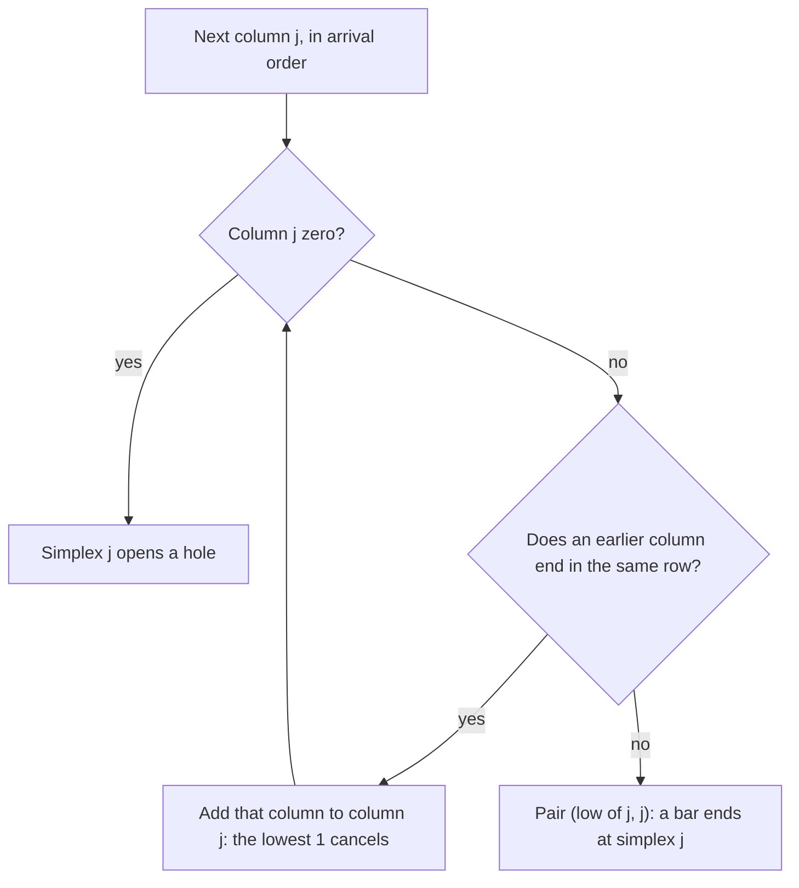

# The persistence algorithm: column reduction pairs every birth with its death

[Syllabus](../../../SYLLABUS.md) → [Topology](../README.md) → [Topological Data Analysis](../README.md#s06) → The persistence algorithm

---

## General Overview

Take a stock's daily returns and cut them into three-day windows. Each window is three numbers, so it is a point in ordinary 3D space. Thirty windows make a cloud of thirty points. Here the returns are **simulated**: a 10-day cycle that swings 2% up and down, plus noise of up to 0.20% a day. Returns are written in basis points (bp, hundredths of a percent), so the first window is (193, 179, 71) bp.

A repeating cycle traces a loop in window space. Grow a ball of radius r round every point, join two points when their balls touch (distance at most 2r), and fill a triangle when all three of its edges are in. As r grows, a loop closes at r = 0.910% and fills in at r = 1.679%. That stretch is a **bar**, written `[0.910, 1.679)`: a feature born at one scale and dead at another ([Filtration and persistent homology](01-filtrations-and-persistent-homology.md)).

The full complex has 30 points, 435 edges and 4,060 triangles: 4,525 simplices, the general name for points, edges and filled triangles. This card shows how a computer finds every bar among them. It writes each simplex's faces as a column of 0s and 1s, in arrival order, and sweeps left to right. When two columns end in the same row, it adds the earlier into the later. At the end, each nonzero column pairs a birth with a death: its last row is the birth, the column is the death. Pairs that start and end at the same scale are dropped; the rest are the bars.

### The picture: the cloud's main bars

```
r from 0 to 2% in steps of 0.05%:
  H0 forever ######################################## [0.000, inf)
  H0 longest #################....................... [0.000, 0.849)
  H1 ring    ..................################...... [0.910, 1.679)
```

H0 counts separate clusters and H1 counts loops. One cluster lives forever; the last two merge at r = 0.849%. A second H1 bar, from 0.389% to 0.399%, is too short to show at this step size.

**Write the boundary matrix in arrival order, add earlier columns to later ones until no two columns share a lowest 1, and each lowest 1 then pairs the simplex that gave birth to a hole with the simplex that killed it; those pairs are exactly the bars.**

**What kind of fact this is:** an algorithm, with a theorem proved on this card in Why it works: over ℤ mod 2, the reduced matrix splits any finite filtration into bars, and the bars do not depend on the choices made during reduction. The cost cuts at the end are measured on this cloud, not proved in general.

---

## The formula

Number the simplices (points, edges, triangles) in arrival order: $`\sigma_1, \sigma_2, \dots`$. Ties break by dimension, then by vertex order, so every simplex comes after its own faces. The **boundary matrix** $`D`$ has a 1 in row i, column j when $`\sigma_i`$ is a face of $`\sigma_j`$ one dimension down. All arithmetic is mod 2: 1 + 1 = 0.

Column reduction produces a reduced matrix $`R`$ and a record $`V`$ of which columns were added:

```math
R = D\,V, \qquad V \text{ upper triangular with 1s on its diagonal}, \qquad \mathrm{low}(j) \neq \mathrm{low}(j') \ \text{ for nonzero columns } j \neq j'
```

**Read it aloud:** the reduced matrix is the boundary matrix after adding earlier columns to later ones, and in it no two nonzero columns have their lowest 1 in the same row.

The bars are read straight off $`R`$:

```math
\mathrm{low}(j) = i \ \Longrightarrow\ \text{a bar } [\,r_i,\ r_j\,); \qquad R_i = 0 \text{ and } i \text{ is no column's low} \ \Longrightarrow\ \text{a bar } [\,r_i,\ \infty)
```

**Read it aloud:** if column j's lowest 1 sits in row i, a hole was born when simplex i arrived and died when simplex j arrived; a simplex whose column reduced to zero and that no column claims starts a hole that never dies.

Bars of zero length, where $`r_i = r_j`$, are dropped. Bars are half-open, [b, d), and computed over ℤ mod 2. The count of holes at any scale then follows:

```math
\beta_k(r) = \#\{\text{bars } [b, d) \text{ of dimension } k : b \le r < d\}
```

**Read it aloud:** the number of k-dimensional holes at scale r is the number of k-dimensional bars that have started and not yet ended.

At r = 1.200% the cloud has one H0 bar and one H1 bar alive, so $`\beta_0 = 1`$ and $`\beta_1 = 1`$: one cluster, one loop.

| Symbol | Plain meaning | In our example | Push it up and the answer… |
| --- | --- | --- | --- |
| $`\sigma_i`$ | the i-th simplex in arrival order | 4,525 simplices in the cloud | — |
| $`r_i`$ | radius at which simplex i arrives: half its longest edge | ring born at 0.910%, dies at 1.679% | — |
| $`D`$ | boundary matrix mod 2: column j lists the faces of $`\sigma_j`$ | 4,525 columns | more simplices, more work |
| $`R`$, $`R_j`$, $`V`$ | the reduced matrix; its column j; the record of additions, upper triangular | 435 nonzero columns after 36,134 additions | — |
| $`\mathrm{low}(j)`$ | row of the lowest 1 in column j of R | low(ACD) = CD in the rectangle | — |
| $`[b, d)`$ | a bar: born at radius b, dead at radius d | [0.910, 1.679) | a longer bar is harder to explain as noise |
| $`K_r`$, $`L_j`$ | the complex at scale r; the complex of the first j simplices | $`K_r`$ has 1,300 simplices at r = 1.700% | more simplices |
| $`c_i`$ | the cycle born with simplex i, used in the proof | on the rectangle, $`c_{CD} = R_{ACD}`$ = AD + BC + AB + CD | — |
| $`\beta_k(r)`$ | Betti number mod 2: k-dimensional holes in $`K_r`$ | $`\beta_1 = 1`$ at r = 1.200% | — |
| $`\delta`$ | the farthest the noise moved any window | 0.295% | wider noise band |
| $`d_H`$ | Hausdorff distance: farthest any point is from the nearest landmark | 0.466% with 12 landmarks | bars move further |

### When it holds

- **Every simplex arrives after its faces.** Break ties against dimension, triangles before their own edges, and the 4-point rectangle below gives 2 pairs that die before they are born.
- **Coefficients in a field, here ℤ mod 2.** Every nonzero entry is 1 and one addition clears it. Over the whole numbers a column can end on a 2, which leaves a twist (torsion) instead of killing a hole, as seen on [Smith normal form](../05-Homology/03-computing-homology-by-smith-normal-form.md).
- **Only earlier columns are added to later ones.** That keeps V upper triangular. Adding a later column into an earlier one mixes in a simplex that has not arrived yet.
- **Read the pairs only after reduction.** In the raw matrix, lowest 1s collide: counting raw nonzero columns as deaths gives the rectangle $`\beta_0 = 4 - 6 = -2`$ at r = 2.5.
- **A finite filtration.** Finitely many simplices give a finite matrix. The homology of a finite filtration is a finitely generated module over a polynomial ring (Modules, planned, in the algebraic-geometry wing); infinite filtrations need extra conditions for bars to exist.

---

## Why it works

### Step 0: each new simplex either opens a hole or closes one

When one simplex arrives, one hole count changes by exactly one, as [Filtration and persistent homology](01-filtrations-and-persistent-homology.md) proves: either it completes a new cycle (a chain with no loose ends) and a hole is born, or its own boundary is a cycle not yet filled and that hole dies. The algorithm decides which, and for each death finds the birth it ends.

The tool is [Gaussian elimination](../../03-Algebra/05-Solving%20Systems/02-gaussian-elimination.md) on columns, with one restriction: columns are only added from left to right. Adding an earlier column changes a chain but keeps it inside the complex at that time, so every move respects the arrival order.

### Step 1: the reduction, and why it stops

1. Take the columns in arrival order.
2. While column j is nonzero and some earlier column has the same lowest 1, add that earlier column to column j.
3. If column j is now zero, simplex j opened a hole. Otherwise its lowest 1, in row i, is new: record the pair (i, j).



Each addition cancels the lowest 1, so the lowest 1 moves strictly up. A column has finitely many rows, so each column stops. Afterwards no two nonzero columns share a lowest 1, which is the condition in The formula.

### Step 2: a zero column opens a hole; a nonzero column closes one

Write $`L_j`$ for the complex made of the first j simplices; each scale's $`K_r`$ is one of these. The nonzero columns of R are independent, because their lowest 1s are in different rows. Columns 1 to j of R span the same space as columns 1 to j of D, because V is upper triangular. So the rank of the boundary map on $`L_j`$ is the count of nonzero columns of R among the first j.

If $`R_j = 0`$, simplex j adds no rank. The cycle count in its dimension then grows by one: $`V_j`$, column j of V, is a new cycle that contains simplex j. If $`R_j \neq 0`$, the rank one dimension down grows by one, and one hole there is filled.

### Step 3: the lowest 1 says which hole dies

Suppose low(j) = i. The column $`R_j`$ is the boundary of the chain $`V_j`$, so it is a cycle. Its youngest simplex is $`\sigma_i`$. So $`R_j`$ exists from time i on and is filled at time j.

Simplex i must have a zero column. If $`R_i`$ were nonzero, adding $`\sigma_i`$ would not have created any new cycle, by Step 2. But $`R_j`$ is a cycle that uses $`\sigma_i`$ and nothing younger, so a new cycle did appear at time i. That contradiction shows each death is paired with a birth. After reduction each row is the low of at most one column, so **each birth has at most one death.**

### Step 4: the pairs are the bars

This is the barcode decomposition for a finite filtration over ℤ mod 2. For each birth i, take one cycle:

- if i is paired with j, the cycle $`c_i = R_j`$;
- if i is unpaired, the cycle $`c_i = V_i`$.

Each $`c_i`$ has youngest simplex $`\sigma_i`$. At every time t, the cycles $`c_i`$ with $`i \le t`$ form a basis of all cycles in $`L_t`$. The ones whose pair has arrived by t form a basis of the boundaries. So the holes at time t have a basis: one class per bar that has started and not ended. Including $`L_s`$ into $`L_t`$ sends each $`c_i`$ to itself. So the holes split into independent strands, one per bar, each alive on exactly [b, d).

<details>
<summary>Detailed proof: the cycles c_i give a basis that every inclusion respects</summary>

Fix a dimension k and a time t. Among the k-simplices with index at most t, call those with a zero column of R births and the rest deaths. Recall $`Z_k`$, $`B_k`$ and $`H_k`$: the cycles, the boundaries, and the holes, cycles modulo boundaries.

Cycles. By Step 2 the rank of the boundary map on k-chains of $`L_t`$ is the number of deaths, so the cycle space $`Z_k(L_t)`$ has dimension equal to the number of births. The cycles $`c_i`$ for those births lie in $`L_t`$ and have distinct youngest simplices, so they are independent. There are just enough of them, so they are a basis of $`Z_k(L_t)`$.

Boundaries. The boundary space $`B_k(L_t)`$ is spanned by the columns of D for (k+1)-simplices with index at most t. These span the same space as the matching columns of R, since V is upper triangular. The nonzero ones are exactly $`c_i`$ for the births i paired with some j at most t. They are independent, so they are a basis of $`B_k(L_t)`$.

Quotient. The homology $`H_k(L_t)`$ is $`Z_k(L_t) / B_k(L_t)`$. Its basis is the classes of $`c_i`$ for births i at most t that are unpaired or paired with j greater than t:

$`\displaystyle \dim H_k(L_t) = \#\{ i : i \le t < j(i) \}, \quad j(i) = \infty \text{ if } i \text{ is unpaired}`$

Maps. For s at most t, the inclusion of $`L_s`$ into $`L_t`$ sends the class of $`c_i`$ to the class of the same chain. That class is a basis element of $`H_k(L_t)`$ if i is still alive at t, and zero otherwise. So the rank of the map is the number of bars alive at both s and t:

$`\displaystyle \mathrm{rank}\,\big(H_k(L_s) \to H_k(L_t)\big) = \#\{ i : i \le s \text{ and } t < j(i) \}`$

These ranks are defined from the complexes alone, with no reference to the reduction. A list of bars is determined by them, so every valid reduction gives the same bars.

</details>

A second road, which the code takes: whether (i, j) is a pair can be read from ranks of corner blocks of the unreduced D, rows from i down and columns up to j. On the rectangle below it finds the same 6 pairs.

### Step 5: dimension 0 is Kruskal's walk

For points and edges, a zero column is an edge that closes a loop, and a nonzero column is an edge that joins two clusters. That is the test in Kruskal's walk on [The cheapest skeleton](../../04-Combinatorics%20and%20graphs/10-Trees%20and%20Cheapest%20Routes/04-minimum-spanning-trees.md). So the H0 deaths are the spanning tree's edge lengths, halved. On the cloud, all 29 finite H0 deaths equal Kruskal's 29 edges, and the longest, 0.849%, is the last merge. The real work of the algorithm is in higher dimensions.

### Step 6: cutting the cost

On the cloud, the left-to-right sweep makes 36,134 column additions. Of these, 34,177 go into the 3,654 triangles that reduce to zero. Those triangles open 2-dimensional holes that this card does not read, since no solid tetrahedra are built. Four ways to cut the cost:

| Cut | How it works | On the cloud | Same answer? |
| --- | --- | --- | --- |
| Clearing | reduce triangles first; any edge that is already a triangle's low has a zero column, so skip it | 34,210 additions; 406 edge columns skipped | same pairs, exactly |
| Scale cap | build only simplices with $`r_i \le`$ 1.700% | 1,300 columns, 5,275 additions | same bars that die below the cap |
| Subsampling | keep 12 landmarks, each the point farthest from those already kept | 298 columns, 1,226 additions | ring [0.980, 1.811): moved, within $`d_H`$ = 0.466% |
| Collapsing | remove a simplex and a face only it uses, when both arrive at the same scale | not run here; it can remove at most 404 pairs, the count of zero-length pairs | same bars, proved by discrete Morse theory |

Subsampling changes the cloud, so it moves the bars. [Persistence diagram and stability](04-persistence-diagrams-and-stability.md) bounds the move: with radius as the scale, no bar end moves further than $`d_H`$. The ring moved from [0.910, 1.679) to [0.980, 1.811), each end by less than 0.466%. That is checked on this one case, not proved by it. The same theorem gives the noise band: no window moved more than $`\delta`$ = 0.295%, so any bar shorter than 2δ = 0.590% may be noise. The ring, from 0.910% to 1.679%, is longer than the band; the [0.389, 0.399) bar is far shorter.

---

## Worked numbers, by hand

Four points sit at the corners of a 4-by-3 rectangle: A (0, 0), B (4, 0), C (4, 3), D (0, 3). The short sides join at r = 1.5, the long sides at r = 2.0, both diagonals and all four triangles at r = 2.5. Arrival order: A B C D AD BC AB CD AC BD ABC ABD ACD BCD. Each column below is written as its list of faces, and each addition cancels matching faces mod 2.

| Step | Arithmetic | Value |
| --- | --- | --- |
| AD, r = 1.5 | faces A, D; row D unclaimed | pair (D, AD): H0 bar [0, 1.5) |
| BC, r = 1.5 | faces B, C; row C unclaimed | pair (C, BC): H0 bar [0, 1.5) |
| AB, r = 2.0 | faces A, B; row B unclaimed | pair (B, AB): H0 bar [0, 2.0) |
| CD, r = 2.0 | {C, D} + AD = {A, C}; + BC = {A, B}; + AB = {} | zero: a loop is born |
| AC, r = 2.5 | {A, C} + BC + AB = {} | zero: a birth |
| BD, r = 2.5 | {B, D} + AD + AB = {} | zero: a birth |
| ABC | faces BC, AB, AC; row AC unclaimed | pair (AC, ABC): zero length |
| ABD | faces AD, AB, BD; row BD unclaimed | pair (BD, ABD): zero length |
| ACD | {AD, CD, AC} + ABC = {AD, BC, AB, CD} | low CD: pair (CD, ACD) |
| BCD | {BC, CD, BD} + ABD + ACD = {} | zero: an unread 2-dimensional birth |
| read the bars | H0: three merges, one cluster left; H1: CD born at 2.0, killed at 2.5 | **H1 bar [2.0, 2.5)** |

The rectangle's loop appears when its fourth side arrives at r = 2.0 and is filled when the diagonals and triangles arrive at r = 2.5. The H0 deaths, 1.5, 1.5 and 2.0, are the three edges Kruskal would keep, halved. The reduction took 10 additions.

### What breaks if you drop a piece

| Mistake | Comes out at | What went wrong |
| --- | --- | --- |
| Pairs read from the unreduced matrix | rectangle $`\beta_0 = 4 - 6 = -2`$ at r = 2.5 | Raw columns share lowest 1s; six edges cannot each kill a cluster |
| Ties broken against dimension | 2 pairs die before they are born | Triangles listed before their own diagonals: the order is not a filtration |
| Diameter read as radius | ring [1.819, 3.359) | Some software indexes by edge length, doubling every number |
| Only 4 landmarks | H1: none; $`d_H`$ = 1.993% | The sample is too coarse to hold the loop; the bound allows the ring to vanish |

The code prints all four.

---

## Code, from first principles, and it actually runs

The script builds the complex up to triangles, reduces its boundary matrix mod 2 with columns stored as sets of row numbers, and reads the bars. Seven roads check them: the hand table; corner ranks of the unreduced rectangle matrix; Kruskal's walk for H0; a fresh rank at four scales; clearing, which must give identical pairs; the scale cap, identical H1 bars; and the noise-free cloud and 12 landmarks, which must stay within the stability bound. Distances are compared as whole-number squares, so the order is exact.

### Python

```python
# The persistence algorithm -- the check behind the card.  Standard library only.
# Boundary matrices are reduced mod 2, column by column; each lowest 1 pairs a birth
# with a death.  Roads: a rectangle by hand and by corner ranks; Kruskal; a fresh rank
# at four scales; clearing; a scale cap; a noise-free cloud and landmarks vs stability.
from itertools import combinations
from math import sqrt
RECT, NAMES = [(0, 0), (4, 0), (4, 3), (0, 3)], "ABCD"
CYCLE = [200, 162, 62, -62, -162, -200, -162, -62, 62, 162]  # 200 cos(36k deg), in bp
NOISE, SEED, CAP, M64 = 20, 7, 340, (1 << 64) - 1
def splitmix(s):
    s = (s + 0x9E3779B97F4A7C15) & M64
    z = ((s ^ (s >> 30)) * 0xBF58476D1CE4E5B9) & M64
    z = ((z ^ (z >> 27)) * 0x94D049BB133111EB) & M64
    return s, z ^ (z >> 31)
def windows(noise):                          # 32 simulated days -> 30 three-day windows
    s, x = SEED, []
    for t in range(32):
        s, z = splitmix(s)
        x.append(CYCLE[t % 10] + z % (2 * noise + 1) - noise)
    return [tuple(x[t:t + 3]) for t in range(30)]
sq = lambda p, q: sum((a - b) ** 2 for a, b in zip(p, q))
def rips(pts, by_dim=True):                  # (squared scale, dim, vertices), in filtration order
    out = [(max([sq(pts[a], pts[b]) for a, b in combinations(c, 2)], default=0), k - 1, c)
           for k in (1, 2, 3) for c in combinations(range(len(pts)), k)]
    return sorted(out) if by_dim else sorted(out, key=lambda s: (s[0], -s[1], s[2]))
def columns(simp):                           # boundary matrix mod 2: the rows of each face
    at = {c: i for i, (_, _, c) in enumerate(simp)}
    return [sorted(at[f] for f in combinations(c, k)) if k else [] for _, k, c in simp]
def reduce(simp, clear=False, log=None):     # owner {low row: column}, R, additions, skipped
    R, owner, adds, skipped = [set(c) for c in columns(simp)], {}, 0, 0
    order = sorted(range(len(R)), key=lambda j: -simp[j][1]) if clear else range(len(R))
    for j in order:
        if clear and simp[j][1] and j in owner:   # already a later column's low: it is zero
            R[j], skipped = set(), skipped + 1
            continue
        steps = []
        while R[j] and max(R[j]) in owner:   # same low as an earlier column: add that column
            steps.append(owner[max(R[j])])
            R[j] ^= R[steps[-1]]
        adds += len(steps)
        if R[j]: owner[max(R[j])] = j
        if log is not None: log.append((j, steps, max(R[j]) if R[j] else None))
    return owner, R, adds, skipped
def bars(simp, owner, R, dim):               # half-open [b, d) in squared scale; None = never dies
    out = [(simp[i][0], simp[j][0]) for i, j in owner.items() if simp[i][1] == dim]
    out += [(s[0], None) for i, s in enumerate(simp) if s[1] == dim and not R[i] and i not in owner]
    return sorted((b for b in out if b[0] != b[1]), key=lambda b: (b[1] is None, b[1] or 0, b[0]))
def rad(s, unit=200):                        # squared distance in bp -> radius in percent
    return "inf" if s is None else f"{sqrt(s) / unit:.3f}"
def show(bs, unit=200):
    return ", ".join(f"[{rad(b, unit)}, {rad(d, unit)})" for b, d in bs) or "none"
def kruskal(pts):                            # union-find: the cheapest skeleton's edges
    parent, out = list(range(len(pts))), []
    def find(a):
        while parent[a] != a:
            a = parent[a]
        return a
    for d, a, b in sorted((sq(pts[a], pts[b]), a, b) for a, b in combinations(range(len(pts)), 2)):
        if find(a) != find(b):
            parent[find(a)] = find(b)
            out.append(d)
    return out
def rank2(masks):                            # rank mod 2 of columns written as bit masks
    basis = {}
    for v in masks:
        while v and v.bit_length() in basis:
            v ^= basis[v.bit_length()]
        if v: basis[v.bit_length()] = v
    return len(basis)
def fresh(pts, s):                           # beta_0, beta_1 at squared scale s, from scratch
    simp = [x for x in rips(pts) if x[0] <= s]
    n, cols = [sum(1 for x in simp if x[1] == k) for k in range(3)], columns(simp)
    r = [rank2([sum(1 << i for i in cols[j]) for j in range(len(simp)) if simp[j][1] == k]) for k in (1, 2)]
    return n[0] - r[0], n[1] - r[0] - r[1]
alive = lambda bs, s: sum(1 for b, d in bs if b <= s and (d is None or s < d))
def landmarks(pts, m):                       # farthest-point sample; cover = squared Hausdorff
    L = [0]
    while len(L) < m:
        L.append(max(range(len(pts)), key=lambda i: (min(sq(pts[i], pts[l]) for l in L), -i)))
    return [pts[l] for l in L], max(min(sq(p, pts[l]) for l in L) for p in pts)
def run(simp):
    owner, R, adds, _ = reduce(simp)
    return owner, adds, bars(simp, owner, R, 0), bars(simp, owner, R, 1)
simp, log = rips(RECT), []
name = lambda j: "".join(NAMES[v] for v in simp[j][2])
owner, R, adds, _ = reduce(simp, log=log)
print(f"rectangle 4 x 3: {len(simp)} columns, order {' '.join(name(j) for j in range(len(simp)))}")
for j, steps, low in log[4:]:
    tail = f"low {name(low)}: pair ({name(low)}, {name(j)})" if low is not None else "zero: a birth"
    print(f"  {name(j)} at r = {sqrt(simp[j][0]) / 2:.1f}: faces {' '.join(name(i) for i in columns(simp)[j])}"
          + "".join(f" + {name(k)}" for k in steps) + f" -> {tail}")
rb0, rb1 = bars(simp, owner, R, 0), bars(simp, owner, R, 1)
print(f"rectangle bars: H0 {show(rb0, 2)}; H1 {show(rb1, 2)}; additions {adds}")
cols = columns(simp); rk = lambda i, j: rank2([sum(1 << r for r in cols[c] if r >= i) for c in range(j + 1)])
by_rank = {(i, j) for i in range(14) for j in range(i + 1, 14)
           if rk(i, j) - rk(i + 1, j) - rk(i, j - 1) + rk(i + 1, j - 1) == 1}
print(f"pairs from corner ranks of the unreduced matrix: {len(by_rank)}, same as reduction: {by_rank == set(owner.items())}")
assert rb1 == [(16, 25)] and [d for _, d in rb0] == [9, 9, 16, None] and by_rank == set(owner.items())
pts, clean = windows(NOISE), windows(0)
simp = rips(pts)
lg = []; owner, R, adds, _ = reduce(simp, log=lg); b0, b1 = bars(simp, owner, R, 0), bars(simp, owner, R, 1)
owner_c, _, adds_c, skipped = reduce(simp, clear=True)
zero = sum(1 for i, j in owner.items() if simp[i][0] == simp[j][0])
print(f"cloud: 30 windows, first {pts[0]} bp; {sum(1 for s in simp if s[1] == 1)} edges, "
      f"{sum(1 for s in simp if s[1] == 2)} triangles, {len(simp)} columns")
print(f"left to right: {adds} additions, {len(owner)} pairs, {zero} of zero length; triangles reducing to zero: "
      f"{sum(1 for j, _, low in lg if low is None and simp[j][1] == 2)}, using {sum(len(st) for j, st, low in lg if low is None and simp[j][1] == 2)} additions")
print(f"clearing: {adds_c} additions, {skipped} edge columns skipped, same pairs: {owner_c == owner}")
mst = kruskal(pts)
print(f"H0: {len(b0)} bars; finite deaths equal Kruskal's 29 edges: {[d for _, d in b0[:-1]] == mst}; "
      f"longest finite [0.000, {rad(mst[-1])})")
print(f"H1 bars (r in percent): {show(b1)}")
ring = max(b1, key=lambda b: b[1] - b[0])
delta = max(sq(p, q) for p, q in zip(pts, clean))
cring = run(rips(clean))[3]
print(f"noise: each window moved at most {rad(4 * delta)}%, so bars under {rad(16 * delta)}% may be noise; "
      f"noise-free ring {show(cring)}")
for d in (79, 160, 240, 320):
    print(f"r = {d / 200:.3f}%: bars alive H0 {alive(b0, d * d)}, H1 {alive(b1, d * d)}; fresh rank {fresh(pts, d * d)}")
    assert fresh(pts, d * d) == (alive(b0, d * d), alive(b1, d * d))
capped = run([s for s in simp if s[0] <= CAP * CAP])
print(f"cap at r = {CAP / 200:.3f}%: {sum(1 for s in simp if s[0] <= CAP * CAP)} columns, {capped[1]} additions, H1 {show(capped[3])}")
for m in (12, 4):
    lp, cover = landmarks(pts, m)
    lo, ladds, _, lb1 = run(rips(lp))
    print(f"{m} landmarks: Hausdorff {rad(4 * cover)}%, {len(rips(lp))} columns, {ladds} additions, H1 {show(lb1)}")
    if m == 12:
        land = max(lb1, key=lambda b: b[1] - b[0])
        assert all(abs(sqrt(x) - sqrt(y)) <= 2 * sqrt(cover) for x, y in zip(land, ring))
bo = reduce(rips(RECT, by_dim=False))[0]
print(f"mistake, matrix not reduced: beta_0 at r = 2.5 read as 4 - 6 = {4 - sum(1 for c in cols if len(c) == 2)}")
print(f"mistake, ties broken against dimension: {sum(1 for i, j in bo.items() if j < i)} pairs die before birth")
print(f"mistake, diameter read as radius: ring [{rad(ring[0], 100)}, {rad(ring[1], 100)})")
print("barcode, r from 0 to 2% in steps of 0.05%:")
for label, (b, d) in (("H0 forever", b0[-1]), ("H0 longest", b0[-2]), ("H1 ring", ring)):
    print(f"  {label:<11}" + "".join("#" if b <= (10 * k + 5) ** 2 and (d is None or (10 * k + 5) ** 2 < d)
                                     else "." for k in range(40)) + f" [{rad(b)}, {rad(d)})")
assert [d for _, d in b0[:-1]] == mst and owner_c == owner and adds_c < adds and capped[3] == b1
assert len(b1) == 2 and sqrt(ring[1]) - sqrt(ring[0]) > 4 * sqrt(delta) and all(abs(sqrt(x) - sqrt(y)) <= 2 * sqrt(delta) for x, y in zip(ring, cring[0]))
print("ALL CHECKS PASS")
```

**Ran 2026-11-15 on macOS, Python 3.14.10, standard library only. All checks passed. Output, pasted from the run:**

```
rectangle 4 x 3: 14 columns, order A B C D AD BC AB CD AC BD ABC ABD ACD BCD
  AD at r = 1.5: faces A D -> low D: pair (D, AD)
  BC at r = 1.5: faces B C -> low C: pair (C, BC)
  AB at r = 2.0: faces A B -> low B: pair (B, AB)
  CD at r = 2.0: faces C D + AD + BC + AB -> zero: a birth
  AC at r = 2.5: faces A C + BC + AB -> zero: a birth
  BD at r = 2.5: faces B D + AD + AB -> zero: a birth
  ABC at r = 2.5: faces BC AB AC -> low AC: pair (AC, ABC)
  ABD at r = 2.5: faces AD AB BD -> low BD: pair (BD, ABD)
  ACD at r = 2.5: faces AD CD AC + ABC -> low CD: pair (CD, ACD)
  BCD at r = 2.5: faces BC CD BD + ABD + ACD -> zero: a birth
rectangle bars: H0 [0.000, 1.500), [0.000, 1.500), [0.000, 2.000), [0.000, inf); H1 [2.000, 2.500); additions 10
pairs from corner ranks of the unreduced matrix: 6, same as reduction: True
cloud: 30 windows, first (193, 179, 71) bp; 435 edges, 4060 triangles, 4525 columns
left to right: 36134 additions, 435 pairs, 404 of zero length; triangles reducing to zero: 3654, using 34177 additions
clearing: 34210 additions, 406 edge columns skipped, same pairs: True
H0: 30 bars; finite deaths equal Kruskal's 29 edges: True; longest finite [0.000, 0.849)
H1 bars (r in percent): [0.389, 0.399), [0.910, 1.679)
noise: each window moved at most 0.295%, so bars under 0.590% may be noise; noise-free ring [0.940, 1.842)
r = 0.395%: bars alive H0 9, H1 1; fresh rank (9, 1)
r = 0.800%: bars alive H0 3, H1 0; fresh rank (3, 0)
r = 1.200%: bars alive H0 1, H1 1; fresh rank (1, 1)
r = 1.600%: bars alive H0 1, H1 1; fresh rank (1, 1)
cap at r = 1.700%: 1300 columns, 5275 additions, H1 [0.389, 0.399), [0.910, 1.679)
12 landmarks: Hausdorff 0.466%, 298 columns, 1226 additions, H1 [0.980, 1.811)
4 landmarks: Hausdorff 1.993%, 14 columns, 10 additions, H1 none
mistake, matrix not reduced: beta_0 at r = 2.5 read as 4 - 6 = -2
mistake, ties broken against dimension: 2 pairs die before birth
mistake, diameter read as radius: ring [1.819, 3.359)
barcode, r from 0 to 2% in steps of 0.05%:
  H0 forever ######################################## [0.000, inf)
  H0 longest #################....................... [0.000, 0.849)
  H1 ring    ..................################...... [0.910, 1.679)
ALL CHECKS PASS
```

### Rust

Same numbers, same labels, built with `rustc --edition 2021 -O`. Columns are `BTreeSet`s, so the lowest 1 is the set's last element; the fresh ranks use bit masks of 64-bit words.

```rust
// The persistence algorithm -- the check behind the card.  std only.
// Boundary matrices are reduced mod 2, column by column; each lowest 1 pairs a birth
// with a death.  Roads: a rectangle by hand and by corner ranks; Kruskal; a fresh rank
// at four scales; clearing; a scale cap; a noise-free cloud and landmarks vs stability.
use std::collections::{BTreeSet, HashMap};
type Simp = (i64, usize, Vec<usize>); // (squared scale, dim, vertices)
type Bar = (i64, Option<i64>); // half-open [b, d) in squared scale; None = never dies
const CYCLE: [i64; 10] = [200, 162, 62, -62, -162, -200, -162, -62, 62, 162]; // 200 cos(36k deg), bp
const NOISE: i64 = 20; const SEED: u64 = 7; const CAP: i64 = 340;
fn splitmix(s: u64) -> (u64, u64) {
    let s = s.wrapping_add(0x9E3779B97F4A7C15);
    let z = (s ^ (s >> 30)).wrapping_mul(0xBF58476D1CE4E5B9);
    let z = (z ^ (z >> 27)).wrapping_mul(0x94D049BB133111EB);
    (s, z ^ (z >> 31))
}
fn windows(noise: i64) -> Vec<Vec<i64>> { // 32 simulated days -> 30 three-day windows
    let (mut s, mut x) = (SEED, vec![]);
    for t in 0..32 { let z; (s, z) = splitmix(s); x.push(CYCLE[t % 10] + (z % (2 * noise as u64 + 1)) as i64 - noise); }
    (0..30).map(|t| x[t..t + 3].to_vec()).collect()
}
fn sq(p: &[i64], q: &[i64]) -> i64 { p.iter().zip(q).map(|(a, b)| (a - b) * (a - b)).sum() }
fn combos(n: usize, k: usize) -> Vec<Vec<usize>> {
    if k == 0 { return vec![vec![]]; }
    let mut out: Vec<Vec<usize>> = (k - 1..n).flat_map(|last| combos(last, k - 1).into_iter().map(move |mut c| { c.push(last); c })).collect();
    out.sort(); out
}
fn rips(pts: &[Vec<i64>], by_dim: bool) -> Vec<Simp> {
    let mut out: Vec<Simp> = (1..4).flat_map(|k| combos(pts.len(), k).into_iter().map(move |c|
        (combos(k, 2).iter().map(|e| sq(&pts[c[e[0]]], &pts[c[e[1]]])).max().unwrap_or(0), k - 1, c))).collect();
    if by_dim { out.sort(); } else { out.sort_by(|a, b| (a.0, -(a.1 as i64), &a.2).cmp(&(b.0, -(b.1 as i64), &b.2))); }
    out
}
fn columns(simp: &[Simp]) -> Vec<Vec<usize>> {
    let at: HashMap<&Vec<usize>, usize> = simp.iter().enumerate().map(|(i, s)| (&s.2, i)).collect();
    simp.iter().map(|(_, k, c)| {
        if *k == 0 { return vec![]; }
        let mut f: Vec<usize> = combos(c.len(), *k).iter().map(|ix| at[&ix.iter().map(|&i| c[i]).collect::<Vec<_>>()]).collect();
        f.sort(); f
    }).collect()
}
struct Red { owner: HashMap<usize, usize>, r: Vec<BTreeSet<usize>>, adds: usize, skipped: usize, log: Vec<(usize, Vec<usize>, Option<usize>)> }
fn reduce(simp: &[Simp], clear: bool) -> Red {
    let mut r: Vec<BTreeSet<usize>> = columns(simp).into_iter().map(|c| c.into_iter().collect()).collect();
    let mut order: Vec<usize> = (0..r.len()).collect();
    if clear { order.sort_by_key(|&j| std::cmp::Reverse(simp[j].1)); }
    let (mut owner, mut adds, mut skipped, mut log) = (HashMap::new(), 0, 0, vec![]);
    for j in order {
        if clear && simp[j].1 > 0 && owner.contains_key(&j) { r[j].clear(); skipped += 1; continue; }
        let mut steps = vec![];
        while let Some(&low) = r[j].iter().next_back() {
            let Some(&k) = owner.get(&low) else { break }; // same low as an earlier column: add it
            steps.push(k); r[j] = r[j].symmetric_difference(&r[k]).cloned().collect();
        }
        adds += steps.len();
        let low = r[j].iter().next_back().cloned();
        if let Some(l) = low { owner.insert(l, j); } log.push((j, steps, low));
    }
    Red { owner, r, adds, skipped, log }
}
fn bars(simp: &[Simp], red: &Red, dim: usize) -> Vec<Bar> {
    let mut out: Vec<Bar> = red.owner.iter().filter(|(i, _)| simp[**i].1 == dim).map(|(i, j)| (simp[*i].0, Some(simp[*j].0))).collect();
    out.extend(simp.iter().enumerate().filter(|(i, s)| s.1 == dim && red.r[*i].is_empty() && !red.owner.contains_key(i)).map(|(_, s)| (s.0, None)));
    out.retain(|b| b.1 != Some(b.0));
    out.sort_by_key(|b| (b.1.is_none(), b.1.unwrap_or(0), b.0)); out
}
fn rad(s: Option<i64>, unit: f64) -> String { match s { None => "inf".into(), Some(s) => format!("{:.3}", (s as f64).sqrt() / unit) } }
fn show(bs: &[Bar], unit: f64) -> String {
    if bs.is_empty() { return "none".into(); } bs.iter().map(|(b, d)| format!("[{}, {})", rad(Some(*b), unit), rad(*d, unit))).collect::<Vec<_>>().join(", ")
}
fn tf(b: bool) -> &'static str { if b { "True" } else { "False" } }
fn kruskal(pts: &[Vec<i64>]) -> Vec<i64> {
    let mut parent: Vec<usize> = (0..pts.len()).collect();
    fn find(p: &[usize], mut a: usize) -> usize { while p[a] != a { a = p[a]; } a }
    let (mut es, mut out): (Vec<(i64, usize, usize)>, Vec<i64>) = (combos(pts.len(), 2).iter().map(|e| (sq(&pts[e[0]], &pts[e[1]]), e[0], e[1])).collect(), vec![]);
    es.sort();
    for (d, a, b) in es { let (ra, rb) = (find(&parent, a), find(&parent, b)); if ra != rb { parent[ra] = rb; out.push(d); } }
    out
}
fn rank2(masks: Vec<Vec<u64>>) -> usize {
    let top = |v: &Vec<u64>| (0..v.len()).rev().find(|&w| v[w] != 0).map(|w| 64 * w + 63 - v[w].leading_zeros() as usize);
    let mut basis: HashMap<usize, Vec<u64>> = HashMap::new();
    for mut v in masks { while let Some(h) = top(&v) {
        match basis.get(&h) { Some(b) => { for (x, y) in v.iter_mut().zip(b) { *x ^= y; } } None => { basis.insert(h, v); break; } }
    } }
    basis.len()
}
fn mask(rows: impl Iterator<Item = usize>, n: usize) -> Vec<u64> { let mut m = vec![0u64; n / 64 + 1]; for r in rows { m[r / 64] |= 1 << (r % 64); } m }
fn fresh(pts: &[Vec<i64>], s: i64) -> (usize, usize) {
    let simp: Vec<Simp> = rips(pts, true).into_iter().filter(|x| x.0 <= s).collect();
    let (cols, n) = (columns(&simp), simp.len());
    let cnt = |k: usize| simp.iter().filter(|x| x.1 == k).count();
    let r: Vec<usize> = (1..3).map(|k| rank2((0..n).filter(|&j| simp[j].1 == k).map(|j| mask(cols[j].iter().cloned(), n)).collect())).collect();
    (cnt(0) - r[0], cnt(1) - r[0] - r[1])
}
fn alive(bs: &[Bar], s: i64) -> usize { bs.iter().filter(|(b, d)| *b <= s && d.map_or(true, |d| s < d)).count() }
fn landmarks(pts: &[Vec<i64>], m: usize) -> (Vec<Vec<i64>>, i64) {
    let mut l = vec![0usize];
    let near = |l: &Vec<usize>, i: usize| l.iter().map(|&x| sq(&pts[i], &pts[x])).min().unwrap();
    while l.len() < m { let i = (0..pts.len()).max_by_key(|&i| (near(&l, i), std::cmp::Reverse(i))).unwrap(); l.push(i); }
    let cover = (0..pts.len()).map(|i| near(&l, i)).max().unwrap();
    (l.iter().map(|&i| pts[i].clone()).collect(), cover)
}
fn rt(x: i64) -> f64 { (x as f64).sqrt() }
fn main() {
    let rect: Vec<Vec<i64>> = vec![vec![0, 0], vec![4, 0], vec![4, 3], vec![0, 3]];
    let simp = rips(&rect, true);
    let name = |j: usize| simp[j].2.iter().map(|&v| ["A", "B", "C", "D"][v]).collect::<String>();
    let (red, cols) = (reduce(&simp, false), columns(&simp));
    println!("rectangle 4 x 3: {} columns, order {}", simp.len(), (0..simp.len()).map(|j| name(j)).collect::<Vec<_>>().join(" "));
    for (j, steps, low) in &red.log[4..] {
        let tail = match low { Some(l) => format!("low {}: pair ({}, {})", name(*l), name(*l), name(*j)), None => "zero: a birth".into() };
        let faces = cols[*j].iter().map(|&i| name(i)).collect::<Vec<_>>().join(" ");
        let adds: String = steps.iter().map(|&k| format!(" + {}", name(k))).collect();
        println!("  {} at r = {:.1}: faces {}{} -> {}", name(*j), rt(simp[*j].0) / 2.0, faces, adds, tail);
    }
    let (rb0, rb1) = (bars(&simp, &red, 0), bars(&simp, &red, 1));
    println!("rectangle bars: H0 {}; H1 {}; additions {}", show(&rb0, 2.0), show(&rb1, 2.0), red.adds);
    let rk = |i: usize, j: i64| if j < 0 { 0 } else { rank2((0..=j as usize).map(|c| mask(cols[c].iter().cloned().filter(|&r| r >= i), 14)).collect()) };
    let mut by_rank: Vec<(usize, usize)> = vec![];
    for i in 0..14 { for j in i + 1..14 { let j2 = j as i64; if rk(i, j2) + rk(i + 1, j2 - 1) - rk(i + 1, j2) - rk(i, j2 - 1) == 1 { by_rank.push((i, j)); } } }
    let mut pairs: Vec<(usize, usize)> = red.owner.iter().map(|(a, b)| (*a, *b)).collect(); pairs.sort();
    println!("pairs from corner ranks of the unreduced matrix: {}, same as reduction: {}", by_rank.len(), tf(by_rank == pairs));
    assert!(rb1 == vec![(16, Some(25))] && rb0.iter().map(|b| b.1).collect::<Vec<_>>() == vec![Some(9), Some(9), Some(16), None] && by_rank == pairs);
    let (pts, clean) = (windows(NOISE), windows(0));
    let simp = rips(&pts, true);
    let (red, redc) = (reduce(&simp, false), reduce(&simp, true));
    let (b0, b1) = (bars(&simp, &red, 0), bars(&simp, &red, 1));
    let zero = red.owner.iter().filter(|(i, j)| simp[**i].0 == simp[**j].0).count();
    let cnt = |k: usize| simp.iter().filter(|s| s.1 == k).count();
    println!("cloud: 30 windows, first ({}, {}, {}) bp; {} edges, {} triangles, {} columns", pts[0][0], pts[0][1], pts[0][2], cnt(1), cnt(2), simp.len());
    println!("left to right: {} additions, {} pairs, {} of zero length; triangles reducing to zero: {}, using {} additions", red.adds, red.owner.len(), zero,
        red.log.iter().filter(|l| l.2.is_none() && simp[l.0].1 == 2).count(), red.log.iter().filter(|l| l.2.is_none() && simp[l.0].1 == 2).map(|l| l.1.len()).sum::<usize>());
    println!("clearing: {} additions, {} edge columns skipped, same pairs: {}", redc.adds, redc.skipped, tf(redc.owner == red.owner));
    let mst = kruskal(&pts); let fin: Vec<i64> = b0[..b0.len() - 1].iter().map(|b| b.1.unwrap()).collect();
    println!("H0: {} bars; finite deaths equal Kruskal's 29 edges: {}; longest finite [0.000, {})", b0.len(), tf(fin == mst), rad(Some(*mst.last().unwrap()), 200.0));
    println!("H1 bars (r in percent): {}", show(&b1, 200.0));
    let ring = *b1.iter().max_by_key(|b| b.1.unwrap() - b.0).unwrap();
    let delta = pts.iter().zip(&clean).map(|(p, q)| sq(p, q)).max().unwrap();
    let cs = rips(&clean, true); let cring = bars(&cs, &reduce(&cs, false), 1);
    println!("noise: each window moved at most {}%, so bars under {}% may be noise; noise-free ring {}", rad(Some(4 * delta), 200.0), rad(Some(16 * delta), 200.0), show(&cring, 200.0));
    for d in [79i64, 160, 240, 320] {
        let f = fresh(&pts, d * d);
        println!("r = {:.3}%: bars alive H0 {}, H1 {}; fresh rank ({}, {})", d as f64 / 200.0, alive(&b0, d * d), alive(&b1, d * d), f.0, f.1);
        assert!(f == (alive(&b0, d * d), alive(&b1, d * d)));
    }
    let cap: Vec<Simp> = simp.iter().filter(|s| s.0 <= CAP * CAP).cloned().collect();
    let capr = reduce(&cap, false); let capb1 = bars(&cap, &capr, 1);
    println!("cap at r = {:.3}%: {} columns, {} additions, H1 {}", CAP as f64 / 200.0, cap.len(), capr.adds, show(&capb1, 200.0));
    for m in [12usize, 4] {
        let (lp, cover) = landmarks(&pts, m);
        let ls = rips(&lp, true); let lr = reduce(&ls, false); let lb1 = bars(&ls, &lr, 1);
        println!("{} landmarks: Hausdorff {}%, {} columns, {} additions, H1 {}", m, rad(Some(4 * cover), 200.0), ls.len(), lr.adds, show(&lb1, 200.0));
        if m == 12 {
            let land = *lb1.iter().max_by_key(|b| b.1.unwrap() - b.0).unwrap();
            assert!((rt(land.0) - rt(ring.0)).abs() <= 2.0 * rt(cover) && (rt(land.1.unwrap()) - rt(ring.1.unwrap())).abs() <= 2.0 * rt(cover));
        }
    }
    let bo = reduce(&rips(&rect, false), false).owner;
    println!("mistake, matrix not reduced: beta_0 at r = 2.5 read as 4 - 6 = {}", 4 - cols.iter().filter(|c| c.len() == 2).count() as i64);
    println!("mistake, ties broken against dimension: {} pairs die before birth", bo.iter().filter(|(i, j)| j < i).count());
    println!("mistake, diameter read as radius: ring [{}, {})", rad(Some(ring.0), 100.0), rad(ring.1, 100.0));
    println!("barcode, r from 0 to 2% in steps of 0.05%:");
    for (label, (b, d)) in [("H0 forever", b0[b0.len() - 1]), ("H0 longest", b0[b0.len() - 2]), ("H1 ring", ring)] {
        let line: String = (0..40i64).map(|k| { let s = (10 * k + 5) * (10 * k + 5); if b <= s && d.map_or(true, |d| s < d) { '#' } else { '.' } }).collect();
        println!("  {:<11}{} [{}, {})", label, line, rad(Some(b), 200.0), rad(d, 200.0));
    }
    assert!(fin == mst && redc.owner == red.owner && redc.adds < red.adds && capb1 == b1);
    assert!(b1.len() == 2 && rt(ring.1.unwrap()) - rt(ring.0) > 4.0 * rt(delta) && (rt(ring.0) - rt(cring[0].0)).abs() <= 2.0 * rt(delta) && (rt(ring.1.unwrap()) - rt(cring[0].1.unwrap())).abs() <= 2.0 * rt(delta));
    println!("ALL CHECKS PASS");
}
```

**Ran 2026-11-15 on macOS, rustc 1.98.1, no crates. All checks passed. Output, pasted from the run:**

```
rectangle 4 x 3: 14 columns, order A B C D AD BC AB CD AC BD ABC ABD ACD BCD
  AD at r = 1.5: faces A D -> low D: pair (D, AD)
  BC at r = 1.5: faces B C -> low C: pair (C, BC)
  AB at r = 2.0: faces A B -> low B: pair (B, AB)
  CD at r = 2.0: faces C D + AD + BC + AB -> zero: a birth
  AC at r = 2.5: faces A C + BC + AB -> zero: a birth
  BD at r = 2.5: faces B D + AD + AB -> zero: a birth
  ABC at r = 2.5: faces BC AB AC -> low AC: pair (AC, ABC)
  ABD at r = 2.5: faces AD AB BD -> low BD: pair (BD, ABD)
  ACD at r = 2.5: faces AD CD AC + ABC -> low CD: pair (CD, ACD)
  BCD at r = 2.5: faces BC CD BD + ABD + ACD -> zero: a birth
rectangle bars: H0 [0.000, 1.500), [0.000, 1.500), [0.000, 2.000), [0.000, inf); H1 [2.000, 2.500); additions 10
pairs from corner ranks of the unreduced matrix: 6, same as reduction: True
cloud: 30 windows, first (193, 179, 71) bp; 435 edges, 4060 triangles, 4525 columns
left to right: 36134 additions, 435 pairs, 404 of zero length; triangles reducing to zero: 3654, using 34177 additions
clearing: 34210 additions, 406 edge columns skipped, same pairs: True
H0: 30 bars; finite deaths equal Kruskal's 29 edges: True; longest finite [0.000, 0.849)
H1 bars (r in percent): [0.389, 0.399), [0.910, 1.679)
noise: each window moved at most 0.295%, so bars under 0.590% may be noise; noise-free ring [0.940, 1.842)
r = 0.395%: bars alive H0 9, H1 1; fresh rank (9, 1)
r = 0.800%: bars alive H0 3, H1 0; fresh rank (3, 0)
r = 1.200%: bars alive H0 1, H1 1; fresh rank (1, 1)
r = 1.600%: bars alive H0 1, H1 1; fresh rank (1, 1)
cap at r = 1.700%: 1300 columns, 5275 additions, H1 [0.389, 0.399), [0.910, 1.679)
12 landmarks: Hausdorff 0.466%, 298 columns, 1226 additions, H1 [0.980, 1.811)
4 landmarks: Hausdorff 1.993%, 14 columns, 10 additions, H1 none
mistake, matrix not reduced: beta_0 at r = 2.5 read as 4 - 6 = -2
mistake, ties broken against dimension: 2 pairs die before birth
mistake, diameter read as radius: ring [1.819, 3.359)
barcode, r from 0 to 2% in steps of 0.05%:
  H0 forever ######################################## [0.000, inf)
  H0 longest #################....................... [0.000, 0.849)
  H1 ring    ..................################...... [0.910, 1.679)
ALL CHECKS PASS
```

The two outputs match line for line.

### Lean

Lean proves Steps 1, 3 and 4 for every finite boundary matrix mod 2, and checks the rectangle's hand table.

- Every boundary matrix has a reduction $`R = D\,V`$, using only additions of earlier columns into later ones.
- Suppose $`\mathrm{low}(j) = i`$ in a reduced $`R = D\,V`$. Then column i of $`R`$ is zero, so each death is paired with a birth.
- Suppose $`R = D\,V`$ is reduced, $`V`$ is upper triangular with 1s on its diagonal, and $`s \le t`$. Then the k-dimensional holes of $`L_s`$ still alive in $`L_t`$ are as many as the k-dimensional bars alive at both.
- On the rectangle, the matrix is a boundary matrix in arrival order, and the hand table's record $`V`$ reduces it.
- The six pairs are (D, AD), (C, BC), (B, AB), (AC, ABC), (BD, ABD) and (CD, ACD).
- CD, AC, BD and BCD reduce to zero.
- The loop born at CD is alive up to ABD and dead at ACD.
- One cluster is left at the end.
- Unreduced, all 6 edge columns are nonzero; reduced, only 3 are.

The thirty-window cloud, corner ranks, Kruskal's walk, clearing, the scale cap and landmarks are left to the Python and Rust checks.

```lean
-- The persistence algorithm: over ℤ mod 2, once a filtered boundary matrix is reduced by adding earlier columns to later ones, each lowest 1 pairs a birth with a death and these pairs are exactly the bars, counting the holes alive between any two times.
import Mathlib.Data.ZMod.Basic
import Mathlib.LinearAlgebra.Matrix.Block
import Mathlib.LinearAlgebra.Matrix.ToLin
import Mathlib.LinearAlgebra.Dimension.Finrank
import Mathlib.LinearAlgebra.FiniteDimensional.Lemmas
import Mathlib.Algebra.Field.ZMod

namespace PersistenceAlgorithm

open Finset

variable {n : ℕ}

/-! Simplices are numbered `0, 1, …, n - 1` in arrival order. Column `j` of the boundary matrix `D`
lists the faces of simplex `j`, with all arithmetic mod 2; `deg i` is the dimension of simplex `i`.
The complex `L_t` is made of the simplices numbered at most `t`. -/

/-- `low R j`: the row of the lowest 1 in column `j` of `R`, or `⊥` when the column is zero. -/
def low (R : Matrix (Fin n) (Fin n) (ZMod 2)) (j : Fin n) : WithBot (Fin n) :=
  (univ.filter fun i => R i j ≠ 0).max

/-- `R` is reduced: no two nonzero columns have their lowest 1 in the same row. -/
def IsReduced (R : Matrix (Fin n) (Fin n) (ZMod 2)) : Prop :=
  ∀ j j', j ≠ j' → low R j ≠ ⊥ → low R j ≠ low R j'

/-- The k-chains of `L_t`: sums of k-simplices numbered at most `t`. -/
def chains (deg : Fin n → ℕ) (k : ℕ) (t : Fin n) : Submodule (ZMod 2) (Fin n → ZMod 2) :=
  Submodule.span (ZMod 2) ((fun i => Pi.single i 1) '' {i | i ≤ t ∧ deg i = k})

/-- The k-cycles `Z_k(L_t)`: k-chains of `L_t` with zero boundary. -/
def cycles (D : Matrix (Fin n) (Fin n) (ZMod 2)) (deg : Fin n → ℕ) (k : ℕ) (t : Fin n) :
    Submodule (ZMod 2) (Fin n → ZMod 2) :=
  chains deg k t ⊓ LinearMap.ker D.mulVecLin

/-- The k-boundaries `B_k(L_t)`: boundaries of (k+1)-chains of `L_t`. -/
def boundaries (D : Matrix (Fin n) (Fin n) (ZMod 2)) (deg : Fin n → ℕ) (k : ℕ) (t : Fin n) :
    Submodule (ZMod 2) (Fin n → ZMod 2) :=
  (chains deg (k + 1) t).map D.mulVecLin

/-- The rank of the map `H_k(L_s) → H_k(L_t)` that the inclusion induces, for `s ≤ t`: its image is
`(Z_k(L_s) + B_k(L_t)) / B_k(L_t)`. With `s = t` this is the Betti number mod 2 of `L_t`. -/
noncomputable def persistentBetti (D : Matrix (Fin n) (Fin n) (ZMod 2)) (deg : Fin n → ℕ)
    (k : ℕ) (s t : Fin n) : ℕ :=
  Module.finrank (ZMod 2) ↥(cycles D deg k s ⊔ boundaries D deg k t)
    - Module.finrank (ZMod 2) ↥(boundaries D deg k t)

/-- The k-dimensional bars of the reduced matrix `R` alive at both `s` and `t`: births `i ≤ s`
(simplices whose column of `R` is zero) that no column `j ≤ t` claims as its lowest 1. -/
def barsAlive (R : Matrix (Fin n) (Fin n) (ZMod 2)) (deg : Fin n → ℕ) (k : ℕ) (s t : Fin n) : ℕ :=
  (univ.filter fun i => deg i = k ∧ i ≤ s ∧ (∀ r, R r i = 0) ∧
    ∀ j, j ≤ t → low R j ≠ (i : WithBot (Fin n))).card

/-! Helper lemmas. -/

open scoped Matrix

theorem zmod2_ne_zero_iff : ∀ x : ZMod 2, x ≠ 0 ↔ x = 1 := by
  decide

theorem zmod2_mul_ne_zero : ∀ x y : ZMod 2, x ≠ 0 → y ≠ 0 → x * y ≠ 0 := by
  decide

theorem zmod2_add_eq_zero : ∀ x y : ZMod 2, x ≠ 0 → y ≠ 0 → x + y = 0 := by
  decide

theorem lowv_eq_coe_iff (v : Fin n → ZMod 2) (p : Fin n) :
    (univ.filter fun i => v i ≠ 0).max = (p : WithBot (Fin n)) ↔
      v p ≠ 0 ∧ ∀ q, p < q → v q = 0 := by
  constructor
  · intro h
    have hp := Finset.mem_of_max h
    simp only [mem_filter, mem_univ, true_and] at hp
    refine ⟨hp, fun q hq => ?_⟩
    by_contra hne
    have := Finset.le_max (s := univ.filter fun i => v i ≠ 0) (by simpa using hne)
    rw [h] at this
    exact absurd (WithBot.coe_le_coe.mp this) (not_le.mpr hq)
  · rintro ⟨hp, hq⟩
    apply le_antisymm
    · apply Finset.max_le
      intro a ha
      simp only [mem_filter, mem_univ, true_and] at ha
      exact WithBot.coe_le_coe.mpr (not_lt.mp fun hlt => ha (hq a hlt))
    · exact Finset.le_max (by simpa using hp)

theorem lowv_eq_bot_iff (v : Fin n → ZMod 2) :
    (univ.filter fun i => v i ≠ 0).max = ⊥ ↔ v = 0 := by
  rw [Finset.max_eq_bot, Finset.filter_eq_empty_iff]
  simp [funext_iff]

theorem coe_le_lowv (v : Fin n → ZMod 2) (q : Fin n) (h : v q ≠ 0) :
    (q : WithBot (Fin n)) ≤ (univ.filter fun i => v i ≠ 0).max :=
  Finset.le_max (by simpa using h)

theorem lowv_lt_coe (v : Fin n → ZMod 2) (p : Fin n) (h : ∀ q, p ≤ q → v q = 0) :
    (univ.filter fun i => v i ≠ 0).max < (p : WithBot (Fin n)) := by
  by_cases hb : (univ.filter fun i => v i ≠ 0).max = ⊥
  · rw [hb]; exact WithBot.bot_lt_coe p
  · obtain ⟨q, hq⟩ := WithBot.ne_bot_iff_exists.mp hb
    rw [← hq]
    have := (lowv_eq_coe_iff v q).mp hq.symm
    exact WithBot.coe_lt_coe.mpr (not_le.mp fun hle => this.1 (h q hle))

/-- A combination of vectors whose nonzero members have distinct lowest entries has the lowest
entry of one of the vectors it really uses. -/
theorem lowv_sum {ι : Type*} [Fintype ι] (f : ι → Fin n → ZMod 2)
    (hf : ∀ a b, a ≠ b → f a ≠ 0 →
      (univ.filter fun i => f a i ≠ 0).max ≠ (univ.filter fun i => f b i ≠ 0).max)
    (c : ι → ZMod 2) (h : ∃ a, c a ≠ 0 ∧ f a ≠ 0) :
    ∃ a, c a ≠ 0 ∧ f a ≠ 0 ∧ (univ.filter fun i => (∑ b, c b • f b) i ≠ 0).max =
      (univ.filter fun i => f a i ≠ 0).max := by
  classical
  set T := univ.filter fun a => c a ≠ 0 ∧ f a ≠ 0 with hTdef
  have hT : T.Nonempty := by
    obtain ⟨a, ha⟩ := h
    exact ⟨a, by simp [T, ha]⟩
  obtain ⟨a, haT, hmax⟩ := T.exists_max_image (fun a => (univ.filter fun i => f a i ≠ 0).max) hT
  simp only [T, mem_filter, mem_univ, true_and] at haT
  obtain ⟨p, hp⟩ := WithBot.ne_bot_iff_exists.mp (mt (lowv_eq_bot_iff _).mp haT.2)
  have hpa := (lowv_eq_coe_iff _ p).mp hp.symm
  have hother : ∀ b, b ≠ a → ∀ q, p ≤ q → c b * f b q = 0 := by
    intro b hba q hq
    by_cases hcb : c b = 0
    · simp [hcb]
    by_cases hfb : f b = 0
    · simp [hfb]
    have hbT : b ∈ T := by simp [T, hcb, hfb]
    have hle := hmax b hbT
    have hne := hf b a hba hfb
    rw [← hp] at hle hne
    have hlt := lt_of_le_of_ne hle hne
    by_contra hz
    have h1 := coe_le_lowv (f b) q (fun h0 => hz (by rw [h0, mul_zero]))
    exact absurd (lt_of_le_of_lt h1 hlt) (not_lt.mpr (WithBot.coe_le_coe.mpr hq))
  refine ⟨a, haT.1, haT.2, ?_⟩
  rw [← hp, lowv_eq_coe_iff]
  simp only [Finset.sum_apply, Pi.smul_apply, smul_eq_mul]
  constructor
  · rw [Finset.sum_eq_single a (fun b _ hba => hother b hba p le_rfl) (by simp)]
    exact zmod2_mul_ne_zero _ _ haT.1 hpa.1
  · intro q hq
    apply Finset.sum_eq_zero
    intro b _
    by_cases hba : b = a
    · subst hba; rw [hpa.2 q hq, mul_zero]
    · exact hother b hba q hq.le

/-- The dimension of a space of mod-2 vectors is the number of rows that occur as lowest
entries of its nonzero members. -/
theorem finrank_eq_card_lows (W : Submodule (ZMod 2) (Fin n → ZMod 2)) (L : Finset (Fin n))
    (hL : ∀ p, p ∈ L ↔ ∃ w ∈ W, (univ.filter fun i => w i ≠ 0).max = (p : WithBot (Fin n))) :
    Module.finrank (ZMod 2) W = L.card := by
  classical
  apply le_antisymm
  · let φ : W →ₗ[ZMod 2] (L → ZMod 2) :=
      (LinearMap.funLeft (ZMod 2) (ZMod 2) (Subtype.val : L → Fin n)) ∘ₗ W.subtype
    have hφ : Function.Injective φ := by
      rw [← LinearMap.ker_eq_bot, LinearMap.ker_eq_bot']
      intro w hw
      by_contra hne
      have hw0 : (w : Fin n → ZMod 2) ≠ 0 := fun h => hne (Subtype.ext h)
      obtain ⟨p, hp⟩ := WithBot.ne_bot_iff_exists.mp (mt (lowv_eq_bot_iff _).mp hw0)
      have hpL : p ∈ L := (hL p).mpr ⟨w, w.2, hp.symm⟩
      have := congrFun hw ⟨p, hpL⟩
      exact ((lowv_eq_coe_iff _ p).mp hp.symm).1 this
    have := LinearMap.finrank_le_finrank_of_injective hφ
    rwa [Module.finrank_fintype_fun_eq_card, Fintype.card_coe] at this
  · have hex : ∀ p : L, ∃ w ∈ W, (univ.filter fun i => w i ≠ 0).max = ((p : Fin n) : WithBot (Fin n)) :=
      fun p => (hL p).mp p.2
    choose g hgW hglow using hex
    have hg0 : ∀ p, g p ≠ 0 := by
      intro p h0
      have := hglow p
      rw [(lowv_eq_bot_iff _).mpr h0] at this
      exact WithBot.bot_ne_coe this
    have hli : LinearIndependent (ZMod 2) g := by
      rw [Fintype.linearIndependent_iff]
      intro c hc i
      by_contra hci
      obtain ⟨a, -, -, ha⟩ := lowv_sum g (fun a b hab _ => by
        rw [hglow a, hglow b]
        exact fun h => hab (Subtype.ext (WithBot.coe_injective h))) c ⟨i, hci, hg0 i⟩
      rw [hc, hglow a] at ha
      simp at ha
    have h1 := finrank_span_eq_card hli
    have h2 : Submodule.span (ZMod 2) (Set.range g) ≤ W := by
      rw [Submodule.span_le]
      rintro _ ⟨p, rfl⟩
      exact hgW p
    have h3 := Submodule.finrank_mono h2
    rw [h1, Fintype.card_coe] at h3
    exact h3

theorem mem_chains_iff (deg : Fin n → ℕ) (k : ℕ) (t : Fin n) (w : Fin n → ZMod 2) :
    w ∈ chains deg k t ↔ ∀ q, w q ≠ 0 → q ≤ t ∧ deg q = k := by
  constructor
  · intro hw
    suffices h : ∀ q, ¬(q ≤ t ∧ deg q = k) → w q = 0 by
      intro q hq; by_contra hn; exact hq (h q hn)
    induction hw using Submodule.span_induction with
    | mem x hx =>
      obtain ⟨i, hi, rfl⟩ := hx
      intro q hq
      have : q ≠ i := fun h => hq (h ▸ hi)
      simp [this]
    | zero => intro q _; rfl
    | add x y _ _ hx hy => intro q hq; simp [hx q hq, hy q hq]
    | smul a x _ hx => intro q hq; simp [hx q hq]
  · intro h
    rw [← Finset.univ_sum_single w]
    apply Submodule.sum_mem
    intro q _
    by_cases hq : w q = 0
    · simp [hq]
    · rw [show (Pi.single q (w q) : Fin n → ZMod 2) = w q • (Pi.single q 1 : Fin n → ZMod 2) by
        ext i; simp [Pi.single_apply]]
      exact Submodule.smul_mem _ _ (Submodule.subset_span ⟨q, h q hq, rfl⟩)

theorem mulVec_proj (D : Matrix (Fin n) (Fin n) (ZMod 2)) (deg : Fin n → ℕ)
    (hdeg : ∀ i j, D i j ≠ 0 → deg j = deg i + 1) (m : ℕ) (x : Fin n → ZMod 2) :
    D *ᵥ (fun q => if deg q = m then x q else 0) =
      fun i => if deg i + 1 = m then (D *ᵥ x) i else 0 := by
  ext i
  simp only [Matrix.mulVec, dotProduct]
  split_ifs with h
  · apply Finset.sum_congr rfl
    intro q _
    by_cases hD : D i q = 0
    · simp [hD]
    · rw [if_pos (by rw [hdeg i q hD, h])]
  · apply Finset.sum_eq_zero
    intro q _
    by_cases hD : D i q = 0
    · simp [hD]
    · rw [if_neg (by rw [hdeg i q hD]; exact h)]; simp

theorem mul_col (D V : Matrix (Fin n) (Fin n) (ZMod 2)) (j : Fin n) :
    (fun i => (D * V) i j) = D *ᵥ (fun l => V l j) := by
  ext i; simp [Matrix.mul_apply, Matrix.mulVec, dotProduct]

theorem mulVec_eq_sum_cols (D : Matrix (Fin n) (Fin n) (ZMod 2)) (x : Fin n → ZMod 2) :
    D *ᵥ x = ∑ q, x q • (fun i => D i q) := by
  ext i; simp [Matrix.mulVec, dotProduct, Finset.sum_apply, mul_comm]

/-- In a reduced matrix, a nonzero combination of columns has the lowest 1 of one of those
columns. -/
theorem exists_low_of_mem_span (R : Matrix (Fin n) (Fin n) (ZMod 2)) (hR : IsReduced R)
    (S : Set (Fin n)) (w : Fin n → ZMod 2)
    (hw : w ∈ Submodule.span (ZMod 2) ((fun l i => R i l) '' S)) (hw0 : w ≠ 0) :
    ∃ l ∈ S, (fun i => R i l) ≠ 0 ∧ (univ.filter fun i => w i ≠ 0).max = low R l := by
  classical
  obtain ⟨c, hc⟩ := (Fintype.mem_span_image_iff_exists_fun (ZMod 2)).mp hw
  have hex : ∃ a : S, c a ≠ 0 ∧ (fun i => R i (a : Fin n)) ≠ 0 := by
    by_contra hno
    push_neg at hno
    apply hw0
    rw [← hc]
    apply Finset.sum_eq_zero
    intro a _
    by_cases hca : c a = 0
    · simp [hca]
    · simp [hno a hca]
  obtain ⟨a, -, hfa, ha⟩ := lowv_sum (fun (a : S) i => R i (a : Fin n)) (fun a b hab hfa => by
      have h1 : low R a ≠ ⊥ := fun h => hfa ((lowv_eq_bot_iff _).mp h)
      exact hR a b (fun h => hab (Subtype.ext h)) h1) c hex
  refine ⟨a, a.2, hfa, ?_⟩
  rw [← hc]
  exact ha

section Reduced

variable (D V : Matrix (Fin n) (Fin n) (ZMod 2))

/-- Each column of `D` differs from the same column of `R = D V` by earlier columns of `R`. -/
theorem col_sub_mem (hV : V.IsUpperTriangular) (hVdiag : ∀ i, V i i = 1) (q : Fin n) :
    (fun i => D i q) - (fun i => (D * V) i q) ∈
      Submodule.span (ZMod 2) ((fun l i => (D * V) i l) '' {l : Fin n | l.val < q.val}) := by
  suffices hsuff : ∀ m, ∀ q : Fin n, q.val = m → (fun i => D i q) - (fun i => (D * V) i q) ∈
      Submodule.span (ZMod 2) ((fun l i => (D * V) i l) '' {l : Fin n | l.val < q.val}) from
    hsuff _ q rfl
  intro m
  induction m using Nat.strong_induction_on with
  | _ m ih =>
  intro q hqm
  subst hqm
  have hR : (fun i => (D * V) i q) =
      (fun i => D i q) + ∑ l ∈ univ.erase q, V l q • (fun i => D i l) := by
    rw [mul_col, mulVec_eq_sum_cols, ← Finset.add_sum_erase _ _ (mem_univ q), hVdiag, one_smul]
  rw [hR, sub_add_cancel_left]
  apply Submodule.neg_mem
  apply Submodule.sum_mem
  intro l hl
  by_cases hVl : V l q = 0
  · simp [hVl]
  have hlq : l < q := by
    rcases lt_or_gt_of_ne (Finset.ne_of_mem_erase hl) with h | h
    · exact h
    · exact absurd (hV h) hVl
  apply Submodule.smul_mem
  have h1 := ih l.val hlq l rfl
  have hmono : Submodule.span (ZMod 2) ((fun l' i => (D * V) i l') '' {l' : Fin n | l'.val < l.val}) ≤
      Submodule.span (ZMod 2) ((fun l' i => (D * V) i l') '' {l' : Fin n | l'.val < q.val}) :=
    Submodule.span_mono (Set.image_mono fun l' (h : l'.val < l.val) => lt_trans h hlq)
  have h2 : (fun i => (D * V) i l) ∈
      Submodule.span (ZMod 2) ((fun l' i => (D * V) i l') '' {l' : Fin n | l'.val < q.val}) :=
    Submodule.subset_span ⟨l, hlq, rfl⟩
  have := Submodule.add_mem _ (hmono h1) h2
  rwa [sub_add_cancel] at this

/-- `D x` lies in the span of the columns of `R` before the end of `x`'s support. -/
theorem mulVec_mem_span (hV : V.IsUpperTriangular) (hVdiag : ∀ i, V i i = 1) (m : ℕ)
    (x : Fin n → ZMod 2) (hx : ∀ q : Fin n, m ≤ q.val → x q = 0) :
    D *ᵥ x ∈ Submodule.span (ZMod 2) ((fun l i => (D * V) i l) '' {l : Fin n | l.val < m}) := by
  rw [mulVec_eq_sum_cols]
  apply Submodule.sum_mem
  intro q _
  by_cases hxq : x q = 0
  · simp [hxq]
  have hqm : q.val < m := by
    by_contra h; exact hxq (hx q (not_lt.mp h))
  apply Submodule.smul_mem
  have h1 := col_sub_mem D V hV hVdiag q
  have hmono : Submodule.span (ZMod 2) ((fun l' i => (D * V) i l') '' {l' : Fin n | l'.val < q.val}) ≤
      Submodule.span (ZMod 2) ((fun l' i => (D * V) i l') '' {l' : Fin n | l'.val < m}) :=
    Submodule.span_mono (Set.image_mono fun l' (h : l'.val < q.val) => lt_trans h hqm)
  have h2 : (fun i => (D * V) i q) ∈
      Submodule.span (ZMod 2) ((fun l' i => (D * V) i l') '' {l' : Fin n | l'.val < m}) :=
    Submodule.subset_span ⟨q, hqm, rfl⟩
  have := Submodule.add_mem _ (hmono h1) h2
  rwa [sub_add_cancel] at this

/-- If a cycle has its lowest entry in row `p`, column `p` of the reduced matrix is zero. -/
theorem col_zero_of_cycle (hV : V.IsUpperTriangular) (hVdiag : ∀ i, V i i = 1)
    (hR : IsReduced (D * V)) (w : Fin n → ZMod 2) (hw : D *ᵥ w = 0) (p : Fin n)
    (hp : (univ.filter fun i => w i ≠ 0).max = (p : WithBot (Fin n))) :
    ∀ r, (D * V) r p = 0 := by
  have hwp := (lowv_eq_coe_iff w p).mp hp
  have hmem : (fun i => (D * V) i p) ∈
      Submodule.span (ZMod 2) ((fun l i => (D * V) i l) '' {l : Fin n | l.val < p.val}) := by
    have : (fun i => (D * V) i p) = D *ᵥ ((fun l => V l p) - w) := by
      rw [Matrix.mulVec_sub, hw, sub_zero, mul_col]
    rw [this]
    apply mulVec_mem_span D V hV hVdiag
    intro q hq
    rcases eq_or_lt_of_le (show p ≤ q from hq) with h | h
    · subst h
      simp [hVdiag, (zmod2_ne_zero_iff _).mp hwp.1]
    · simp [hV h, hwp.2 q h]
  by_contra hne
  push_neg at hne
  obtain ⟨r, hr⟩ := hne
  have hne0 : (fun i => (D * V) i p) ≠ 0 := fun h => hr (congrFun h r)
  obtain ⟨l, hl, -, hlow⟩ := exists_low_of_mem_span (D * V) hR _ _ hmem hne0
  have hlp : p ≠ l := fun h => by subst h; exact lt_irrefl _ (show p.val < p.val from hl)
  exact hR p l hlp (fun h => hne0 ((lowv_eq_bot_iff _).mp h)) hlow

end Reduced

/-- **The pairs are the bars.** Let `D` be the boundary matrix mod 2 of a finite filtration, every
simplex arriving after its faces, and let `R = D V` be reduced, where `V` records additions of
earlier columns to later ones (upper triangular with 1s on its diagonal). Then for any times
`s ≤ t`, the number of k-dimensional holes of `L_s` still alive in `L_t` equals the number of
k-dimensional bars read off `R` that have started by `s` and not ended by `t`. -/
theorem pairs_of_reduced_matrix_are_the_bars (D V : Matrix (Fin n) (Fin n) (ZMod 2))
    (deg : Fin n → ℕ) (hdeg : ∀ i j, D i j ≠ 0 → deg j = deg i + 1) (hDD : D * D = 0)
    (hfaces : ∀ i j, D i j ≠ 0 → i < j)
    (hV : V.IsUpperTriangular) (hVdiag : ∀ i, V i i = 1) (hR : IsReduced (D * V))
    (k : ℕ) (s t : Fin n) (hst : s ≤ t) :
    persistentBetti D deg k s t = barsAlive (D * V) deg k s t := by
  classical
  have hV' : ∀ i j, j < i → V i j = 0 := fun i j h => hV h
  have hDR : ∀ j, D *ᵥ (fun i => (D * V) i j) = 0 := by
    intro j; rw [mul_col, Matrix.mulVec_mulVec, hDD, Matrix.zero_mulVec]
  have memZ : ∀ w, w ∈ cycles D deg k s ↔ w ∈ chains deg k s ∧ D *ᵥ w = 0 := by
    intro w; simp [cycles, Submodule.mem_inf, LinearMap.mem_ker]
  have charZ_mp : ∀ w ∈ cycles D deg k s, ∀ p : Fin n,
      (univ.filter fun i => w i ≠ 0).max = (p : WithBot (Fin n)) →
        deg p = k ∧ p ≤ s ∧ ∀ r, (D * V) r p = 0 := by
    intro w hw p hp
    rw [memZ] at hw
    have hwp := (lowv_eq_coe_iff w p).mp hp
    obtain ⟨h1, h2⟩ := (mem_chains_iff deg k s w).mp hw.1 p hwp.1
    exact ⟨h2, h1, col_zero_of_cycle D V hV hVdiag hR w hw.2 p hp⟩
  have hZ : Module.finrank (ZMod 2) ↥(cycles D deg k s) =
      (univ.filter fun p : Fin n => deg p = k ∧ p ≤ s ∧ ∀ r, (D * V) r p = 0).card := by
    refine finrank_eq_card_lows _ _ fun p => ?_
    simp only [mem_filter, mem_univ, true_and]
    constructor
    · rintro ⟨hdp, hps, hRp⟩
      refine ⟨fun q => if deg q = k then V q p else 0, ?_, ?_⟩
      · rw [memZ, mem_chains_iff]
        refine ⟨fun q hq => ?_, ?_⟩
        · by_cases hdq : deg q = k
          · rw [if_pos hdq] at hq
            exact ⟨le_trans (not_lt.mp fun h => hq (hV' q p h)) hps, hdq⟩
          · rw [if_neg hdq] at hq; exact absurd rfl hq
        · rw [mulVec_proj D deg hdeg, ← mul_col]
          ext i; simp [hRp]
      · rw [lowv_eq_coe_iff]
        exact ⟨by simp [hdp, hVdiag], fun q hq => by simp [hV' q p hq]⟩
    · rintro ⟨w, hw, hp⟩
      exact charZ_mp w hw p hp
  have hZB : Module.finrank (ZMod 2) ↥(cycles D deg k s ⊓ boundaries D deg k t) =
      (univ.filter fun p : Fin n => (deg p = k ∧ p ≤ s ∧ ∀ r, (D * V) r p = 0) ∧
        ∃ j, j ≤ t ∧ low (D * V) j = (p : WithBot (Fin n))).card := by
    refine finrank_eq_card_lows _ _ fun p => ?_
    simp only [mem_filter, mem_univ, true_and]
    constructor
    · rintro ⟨⟨hdp, hps, hRp⟩, j, hjt, hj⟩
      have hjp := (lowv_eq_coe_iff (fun i => (D * V) i j) p).mp hj
      refine ⟨fun q => if deg q = k then (D * V) q j else 0, Submodule.mem_inf.mpr ⟨?_, ?_⟩, ?_⟩
      · rw [memZ, mem_chains_iff]
        refine ⟨fun q hq => ?_, ?_⟩
        · by_cases hdq : deg q = k
          · rw [if_pos hdq] at hq
            have hle : (q : WithBot (Fin n)) ≤ low (D * V) j := coe_le_lowv (fun i => (D * V) i j) q hq
            rw [hj] at hle
            exact ⟨le_trans (WithBot.coe_le_coe.mp hle) hps, hdq⟩
          · rw [if_neg hdq] at hq; exact absurd rfl hq
        · rw [mulVec_proj D deg hdeg, hDR j]
          ext i; simp
      · refine Submodule.mem_map.mpr ⟨fun q => if deg q = k + 1 then V q j else 0, ?_, ?_⟩
        · rw [mem_chains_iff]
          intro q hq
          by_cases hdq : deg q = k + 1
          · rw [if_pos hdq] at hq
            exact ⟨le_trans (not_lt.mp fun h => hq (hV' q j h)) hjt, hdq⟩
          · rw [if_neg hdq] at hq; exact absurd rfl hq
        · rw [Matrix.mulVecLin_apply, mulVec_proj D deg hdeg, ← mul_col]
          ext i; simp
      · rw [lowv_eq_coe_iff]
        exact ⟨by simpa [hdp] using hjp.1, fun q hq => by simp [hjp.2 q hq]⟩
    · rintro ⟨w, hw, hp⟩
      obtain ⟨hwZ, hwB⟩ := Submodule.mem_inf.mp hw
      refine ⟨charZ_mp w hwZ p hp, ?_⟩
      obtain ⟨y, hy, rfl⟩ := Submodule.mem_map.mp hwB
      have hymem := mulVec_mem_span D V hV hVdiag (t.val + 1) y (fun q hq => by
        by_contra hne
        have := ((mem_chains_iff deg (k + 1) t y).mp hy q hne).1
        rw [Fin.le_def] at this
        omega)
      have hw0 : D *ᵥ y ≠ 0 := by
        intro h0
        rw [Matrix.mulVecLin_apply, h0, (lowv_eq_bot_iff _).mpr rfl] at hp
        exact WithBot.bot_ne_coe hp
      obtain ⟨l, hl, -, hlow⟩ := exists_low_of_mem_span (D * V) hR _ (D *ᵥ y) hymem hw0
      refine ⟨l, Fin.le_def.mpr (by simp only [Set.mem_setOf_eq] at hl; omega), ?_⟩
      rw [← hlow]; exact hp
  have hsum := Submodule.finrank_sup_add_finrank_inf_eq (K := ZMod 2) (cycles D deg k s) (boundaries D deg k t)
  have hc := card_filter_add_card_filter_not
    (s := univ.filter fun p : Fin n => deg p = k ∧ p ≤ s ∧ ∀ r, (D * V) r p = 0)
    (fun p => ∃ j, j ≤ t ∧ low (D * V) j = (p : WithBot (Fin n)))
  rw [Finset.filter_filter, Finset.filter_filter] at hc
  have e2 : (univ.filter fun p : Fin n => (deg p = k ∧ p ≤ s ∧ ∀ r, (D * V) r p = 0) ∧
      ¬ ∃ j, j ≤ t ∧ low (D * V) j = (p : WithBot (Fin n))) =
      univ.filter fun i => deg i = k ∧ i ≤ s ∧ (∀ r, (D * V) r i = 0) ∧
        ∀ j, j ≤ t → low (D * V) j ≠ (i : WithBot (Fin n)) := by
    ext p; simp only [mem_filter, mem_univ, true_and, not_exists, not_and]; tauto
  rw [e2] at hc
  unfold persistentBetti barsAlive
  omega

/-- **The reduction always finishes.** Adding earlier columns to later ones mod 2 reduces any
finite boundary matrix: there is an upper triangular `V` with 1s on its diagonal such that no two
nonzero columns of `D V` share a lowest 1. -/
theorem column_reduction_terminates (D : Matrix (Fin n) (Fin n) (ZMod 2)) :
    ∃ V : Matrix (Fin n) (Fin n) (ZMod 2), V.IsUpperTriangular ∧ (∀ i, V i i = 1) ∧
      IsReduced (D * V) := by
  classical
  have key : ∀ j : Fin n, ∃ w : Fin n → ZMod 2, (∀ l, j ≤ l → w l = 0) ∧
      ∀ w' : Fin n → ZMod 2, (∀ l, j ≤ l → w' l = 0) →
        (univ.filter fun i => (D *ᵥ (Pi.single j 1 + w)) i ≠ 0).max ≤
          (univ.filter fun i => (D *ᵥ (Pi.single j 1 + w')) i ≠ 0).max := by
    intro j
    obtain ⟨x, ⟨w, hw, rfl⟩, hmin⟩ := WellFounded.has_min wellFounded_lt
      {x | ∃ w : Fin n → ZMod 2, (∀ l, j ≤ l → w l = 0) ∧
        (univ.filter fun i => (D *ᵥ (Pi.single j 1 + w)) i ≠ 0).max = x}
      ⟨_, 0, fun _ _ => rfl, rfl⟩
    exact ⟨w, hw, fun w' hw' => not_lt.mp (hmin _ ⟨w', hw', rfl⟩)⟩
  choose w hw hmin using key
  let V : Matrix (Fin n) (Fin n) (ZMod 2) := Matrix.of fun i j => ((Pi.single j (1 : ZMod 2) : Fin n → ZMod 2) + w j) i
  have hcol : ∀ j, (fun i => (D * V) i j) = D *ᵥ (Pi.single j 1 + w j) := by
    intro j; rw [mul_col]; rfl
  refine ⟨V, ?_, ?_, ?_⟩
  · intro i j hji
    have hji' : j < i := hji
    have hij : i ≠ j := ne_of_gt hji'
    simp [V, Pi.single_apply, hij, hw j i hji'.le]
  · intro i; simp [V, hw i i le_rfl]
  · have claim : ∀ a b : Fin n, a < b → low (D * V) a ≠ ⊥ → low (D * V) a ≠ low (D * V) b := by
      intro a b hab hbot heq
      obtain ⟨p, hp⟩ := WithBot.ne_bot_iff_exists.mp hbot
      have hpa := (lowv_eq_coe_iff (D *ᵥ (Pi.single a 1 + w a)) p).mp
        (by rw [← hcol]; exact hp.symm)
      have hpb := (lowv_eq_coe_iff (D *ᵥ (Pi.single b 1 + w b)) p).mp
        (by have hpb' : low (D * V) b = ↑p := by rw [← heq]; exact hp.symm
            rw [← hcol]; exact hpb')
      have hadm : ∀ l, b ≤ l → ((w b + Pi.single a 1 + w a : Fin n → ZMod 2)) l = 0 := by
        intro l hl
        have hla : l ≠ a := fun h => by subst h; exact absurd hab (not_lt.mpr hl)
        simp [hw b l hl, hw a l (le_trans hab.le hl), hla]
      have h1 := hmin b (w b + Pi.single a 1 + w a) hadm
      have hsum : (Pi.single b 1 + (w b + Pi.single a 1 + w a) : Fin n → ZMod 2) =
          (Pi.single b 1 + w b) + (Pi.single a 1 + w a) := by abel
      rw [hsum] at h1
      have h2 := lowv_lt_coe (D *ᵥ ((Pi.single b 1 + w b) + (Pi.single a 1 + w a))) p (by
        intro q hq
        rw [Matrix.mulVec_add]
        rcases eq_or_lt_of_le hq with h | h
        · subst h; simp only [Pi.add_apply]; exact zmod2_add_eq_zero _ _ hpb.1 hpa.1
        · simp [hpa.2 q h, hpb.2 q h])
      have h3 := (lowv_eq_coe_iff _ p).mpr hpb
      rw [h3] at h1
      exact absurd (lt_of_le_of_lt h1 h2) (lt_irrefl _)
    intro a b hab hbot
    rcases lt_or_gt_of_ne hab with h | h
    · exact claim a b h hbot
    · intro heq
      exact claim b a h (heq ▸ hbot) heq.symm

/-- **Every death is paired with a birth.** If column `j` of the reduced matrix `R = D V` has its
lowest 1 in row `i`, then column `i` of `R` is zero: simplex `i` opened the hole that simplex `j`
closes. -/
theorem lowest_one_row_is_a_birth (D V : Matrix (Fin n) (Fin n) (ZMod 2)) (hDD : D * D = 0)
    (hV : V.IsUpperTriangular) (hVdiag : ∀ i, V i i = 1) (hR : IsReduced (D * V))
    (i j : Fin n) (hij : low (D * V) j = i) : ∀ r, (D * V) r i = 0 := by
  apply col_zero_of_cycle D V hV hVdiag hR (fun r => (D * V) r j)
  · rw [mul_col, Matrix.mulVec_mulVec, hDD, Matrix.zero_mulVec]
  · exact hij

/-! The card's 4-by-3 rectangle. Arrival order: A B C D AD BC AB CD AC BD ABC ABD ACD BCD,
numbered 0 to 13. -/

/-- The rectangle's faces, as (face, simplex) pairs. -/
def rectFaces : List (ℕ × ℕ) :=
  [(0, 4), (3, 4), (1, 5), (2, 5), (0, 6), (1, 6), (2, 7), (3, 7), (0, 8), (2, 8), (1, 9), (3, 9),
   (5, 10), (6, 10), (8, 10), (4, 11), (6, 11), (9, 11), (4, 12), (7, 12), (8, 12),
   (5, 13), (7, 13), (9, 13)]

/-- The rectangle's boundary matrix mod 2. -/
def rectD : Matrix (Fin 14) (Fin 14) (ZMod 2) :=
  Matrix.of fun i j => if (i.val, j.val) ∈ rectFaces then 1 else 0

/-- The record of additions from the hand table: CD + AD + BC + AB, AC + BC + AB, BD + AD + AB,
ACD + ABC, and BCD + ABD + ACD (where ACD already holds ABC). -/
def rectV : Matrix (Fin 14) (Fin 14) (ZMod 2) :=
  Matrix.of fun i j => if i = j ∨ (i.val, j.val) ∈
    [(4, 7), (5, 7), (6, 7), (5, 8), (6, 8), (4, 9), (6, 9), (10, 12), (10, 13), (11, 13), (12, 13)]
    then 1 else 0

/-- Dimensions: 4 points, 6 edges, 4 triangles. -/
def rectDeg (i : Fin 14) : ℕ := if i.val < 4 then 0 else if i.val < 10 then 1 else 2

-- The rectangle's matrix is a boundary matrix in arrival order: ∂∂ = 0, every simplex arrives
-- after its faces, and each face is one dimension down.
example : rectD * rectD = 0 ∧ (∀ p : Fin 14 × Fin 14, rectD p.1 p.2 ≠ 0 → p.1 < p.2) ∧
    (∀ p : Fin 14 × Fin 14, rectD p.1 p.2 ≠ 0 → rectDeg p.2 = rectDeg p.1 + 1) := by
  decide +kernel

-- The record of additions only adds earlier columns to later ones: upper triangular, 1s on the
-- diagonal.
example : (∀ p : Fin 14 × Fin 14, p.2 < p.1 → rectV p.1 p.2 = 0) ∧ (∀ i : Fin 14, rectV i i = 1) := by
  decide +kernel

-- The reduced matrix has no two lowest 1s in the same row.
example : IsReduced (rectD * rectV) := by
  unfold IsReduced
  decide +kernel

-- The pairs: (D, AD), (C, BC), (B, AB), (AC, ABC), (BD, ABD), (CD, ACD).
example : low (rectD * rectV) 4 = (3 : Fin 14) ∧ low (rectD * rectV) 5 = (2 : Fin 14) ∧
    low (rectD * rectV) 6 = (1 : Fin 14) ∧ low (rectD * rectV) 10 = (8 : Fin 14) ∧
    low (rectD * rectV) 11 = (9 : Fin 14) ∧ low (rectD * rectV) 12 = (7 : Fin 14) := by
  decide +kernel

-- CD, AC, BD and BCD reduce to zero: births.
example : low (rectD * rectV) 7 = ⊥ ∧ low (rectD * rectV) 8 = ⊥ ∧
    low (rectD * rectV) 9 = ⊥ ∧ low (rectD * rectV) 13 = ⊥ := by
  decide +kernel

-- The H1 bar: the loop is alive from CD (7) up to just before ACD (12), and dead at 12.
example : barsAlive (rectD * rectV) rectDeg 1 7 11 = 1 ∧
    barsAlive (rectD * rectV) rectDeg 1 12 12 = 0 := by
  decide +kernel

-- At the end one cluster is left: one H0 bar never dies.
example : barsAlive (rectD * rectV) rectDeg 0 13 13 = 1 := by
  decide +kernel

-- Unreduced, all 6 edge columns are nonzero (4 - 6 = -2 clusters); reduced, only 3 are.
example : (univ.filter fun j => rectDeg j = 1 ∧ low rectD j ≠ ⊥).card = 6 ∧
    (univ.filter fun j => rectDeg j = 1 ∧ low (rectD * rectV) j ≠ ⊥).card = 3 := by
  decide +kernel

#print axioms zmod2_ne_zero_iff
#print axioms zmod2_mul_ne_zero
#print axioms zmod2_add_eq_zero
#print axioms lowv_eq_coe_iff
#print axioms lowv_eq_bot_iff
#print axioms coe_le_lowv
#print axioms lowv_lt_coe
#print axioms lowv_sum
#print axioms finrank_eq_card_lows
#print axioms mem_chains_iff
#print axioms mulVec_proj
#print axioms mul_col
#print axioms mulVec_eq_sum_cols
#print axioms exists_low_of_mem_span
#print axioms col_sub_mem
#print axioms mulVec_mem_span
#print axioms col_zero_of_cycle
#print axioms pairs_of_reduced_matrix_are_the_bars
#print axioms column_reduction_terminates
#print axioms lowest_one_row_is_a_birth

end PersistenceAlgorithm
```

**Checked 2026-11-15 on macOS, Lean 4.36.0-rc2, Mathlib v4.36.0-rc2. Every proof is complete and uses only Lean's standard axioms. Output, pasted from the run:**

```
'PersistenceAlgorithm.zmod2_ne_zero_iff' depends on axioms: [propext, Classical.choice, Quot.sound]
'PersistenceAlgorithm.zmod2_mul_ne_zero' depends on axioms: [propext, Classical.choice, Quot.sound]
'PersistenceAlgorithm.zmod2_add_eq_zero' depends on axioms: [propext, Classical.choice, Quot.sound]
'PersistenceAlgorithm.lowv_eq_coe_iff' depends on axioms: [propext, Classical.choice, Quot.sound]
'PersistenceAlgorithm.lowv_eq_bot_iff' depends on axioms: [propext, Classical.choice, Quot.sound]
'PersistenceAlgorithm.coe_le_lowv' depends on axioms: [propext, Classical.choice, Quot.sound]
'PersistenceAlgorithm.lowv_lt_coe' depends on axioms: [propext, Classical.choice, Quot.sound]
'PersistenceAlgorithm.lowv_sum' depends on axioms: [propext, Classical.choice, Quot.sound]
'PersistenceAlgorithm.finrank_eq_card_lows' depends on axioms: [propext, Classical.choice, Quot.sound]
'PersistenceAlgorithm.mem_chains_iff' depends on axioms: [propext, Classical.choice, Quot.sound]
'PersistenceAlgorithm.mulVec_proj' depends on axioms: [propext, Classical.choice, Quot.sound]
'PersistenceAlgorithm.mul_col' depends on axioms: [propext, Classical.choice, Quot.sound]
'PersistenceAlgorithm.mulVec_eq_sum_cols' depends on axioms: [propext, Classical.choice, Quot.sound]
'PersistenceAlgorithm.exists_low_of_mem_span' depends on axioms: [propext, Classical.choice, Quot.sound]
'PersistenceAlgorithm.col_sub_mem' depends on axioms: [propext, Classical.choice, Quot.sound]
'PersistenceAlgorithm.mulVec_mem_span' depends on axioms: [propext, Classical.choice, Quot.sound]
'PersistenceAlgorithm.col_zero_of_cycle' depends on axioms: [propext, Classical.choice, Quot.sound]
'PersistenceAlgorithm.pairs_of_reduced_matrix_are_the_bars' depends on axioms: [propext, Classical.choice, Quot.sound]
'PersistenceAlgorithm.column_reduction_terminates' depends on axioms: [propext, Classical.choice, Quot.sound]
'PersistenceAlgorithm.lowest_one_row_is_a_birth' depends on axioms: [propext, Classical.choice, Quot.sound]
```

> [!TIP]
> **Try changing**
> Guess first, then run the Python. Some asserts are pinned to this cloud, so expect some edits to stop the program.
> - **Double the noise.** Set `NOISE` to 40. Guess whether the ring still clears the noise band. It does not: the ring is [0.772, 1.676), but the band grows to 1.169%, and the noise-band assert stops the run.
> - **Lower the cap.** Set `CAP` to 300, a cap of r = 1.500%. Guess what happens to the ring. It prints as [0.910, inf): it dies after the cap, so the capped complex never sees it die, and an assert stops the run.
> - **Fewer landmarks.** Change `for m in (12, 4)` to `for m in (8, 4)`. Guess the cost. It is 92 columns and 251 additions, with $`d_H`$ = 1.317%; the ring moves to [1.252, 1.866), still within the bound.
> - **A square, not a rectangle.** Set C to (4, 4) and D to (0, 4). The loop is born at 2.000 and dies at 2.828, half the diagonal, and the rectangle assert stops the run.

---

## The usual mistake

> [!warning]
> **Reading pairs off the boundary matrix before it is reduced.** In the raw matrix, many columns share a lowest 1, so "each nonzero column kills something" overcounts the deaths. On the rectangle it leaves $`\beta_0 = 4 - 6 = -2`$, a negative number of clusters. Only after the reduction is each row claimed at most once.
>
> - **Diameter for radius.** Software that indexes by edge length reports the ring as [1.819, 3.359), twice this card's numbers. Halve before comparing with a radius, or with a stability bound written for radius.
> - **Counting zero-length pairs as bars.** 404 of the cloud's 435 pairs are born and killed at the same scale. They carry no feature and are dropped.
> - **Reading the 3,654 zero triangle columns as voids.** Without solid tetrahedra in the complex, nothing can fill a void, so those births never die. Read H2 only from a complex built one dimension higher.
> - **Calling every H1 bar a loop in the data.** The cloud has 2 H1 bars. Against the noise band of 0.590%, only the ring counts.

---

## Where you meet it in real life

- **Persistence software.** Libraries such as Ripser and GUDHI run this reduction. Ripser adds clearing, reduces the dual (cohomology) matrix, and never stores the full boundary matrix.
- **Clustering.** The H0 part is single-linkage clustering: merge the two closest groups, record the distance, repeat. The merge heights in its dendrogram (merge tree) are the H0 deaths, doubled when scales are radii.
- **Repeating signals.** Sliding windows of a sensor trace, a heartbeat or a seasonal sales series lie on a loop when the signal repeats. The H1 bar's length measures how clearly it repeats; see [Persistence in practice](07-persistence-in-practice.md).

> **Say it back**
> List the simplices of a growing complex in arrival order, faces first, and write each simplex's faces as a column of 0s and 1s. Sweep left to right, adding an earlier column whenever two columns end in the same row. A column that becomes zero opens a hole; a column that stays nonzero closes the hole born at its lowest row, and that pair is a bar. Because only earlier columns are added, every prefix still describes the complex at that time, and the bars do not depend on the choices made. On thirty simulated three-day windows the ring lives from r = 0.910% to 1.679%, and a scale cap or 12 landmarks find it with far less work, the landmarks moving it by less than 0.466%.

---

## What this builds on

- [Smith normal form](../05-Homology/03-computing-homology-by-smith-normal-form.md): boundary matrices and their reduction to read holes; this card reduces mod 2, by columns only, in a fixed order.
- [Vietoris-Rips, Cech and alpha complexes](02-vietoris-rips-and-cech-complexes.md): the complex built from balls of radius r, whose simplices this card puts in order.
- [Gaussian elimination](../../03-Algebra/05-Solving%20Systems/02-gaussian-elimination.md): the moves that leave a span unchanged, here restricted to adding earlier columns to later ones.
- [The cheapest skeleton](../../04-Combinatorics%20and%20graphs/10-Trees%20and%20Cheapest%20Routes/04-minimum-spanning-trees.md): Kruskal's walk, which is the reduction in dimension 0.

## Where this goes next

- [Persistence diagram and stability](04-persistence-diagrams-and-stability.md): the bars drawn as points, and the theorem that bounds how far they move when the data moves, used here for the noise band and the landmarks.
- [Comparing diagrams](05-comparing-diagrams-and-vectorising-them.md): distances between whole barcodes, and turning them into vectors for statistics.
- [Persistence in practice](07-persistence-in-practice.md): window length, delay and noise bands on real series.

This card measured the ring on one simulated cloud; how far a bar can move when the data moves, for every cloud at once, is the question it leaves open.

---

## Sources

Verified 2026-11-15: every link below resolves to the publisher's page, and every DOI was checked against Crossref for title and first author. The publisher's site showed a bot check, so titles were confirmed through Crossref.

- Zomorodian, Afra, and Gunnar Carlsson. "Computing Persistent Homology." *Discrete & Computational Geometry* 33 (2005): 249–274. [doi:10.1007/s00454-004-1146-y](https://doi.org/10.1007/s00454-004-1146-y). The barcode decomposition of a persistence module and the column-reduction algorithm that computes it.
- Edelsbrunner, Herbert, David Letscher, and Afra Zomorodian. "Topological Persistence and Simplification." *Discrete & Computational Geometry* 28 (2002): 511–533. [doi:10.1007/s00454-002-2885-2](https://doi.org/10.1007/s00454-002-2885-2). The original pairing of births with deaths over ℤ mod 2.
- Bauer, Ulrich. "Ripser: Efficient Computation of Vietoris–Rips Persistence Barcodes." *Journal of Applied and Computational Topology* 5 (2021): 391–423. [doi:10.1007/s41468-021-00071-5](https://doi.org/10.1007/s41468-021-00071-5). Clearing, cohomology, implicit matrices and zero-length pairs, with timings; indexes by diameter.
- Mischaikow, Konstantin, and Vidit Nanda. "Morse Theory for Filtrations and Efficient Computation of Persistent Homology." *Discrete & Computational Geometry* 50 (2013): 330–353. [doi:10.1007/s00454-013-9529-6](https://doi.org/10.1007/s00454-013-9529-6). Collapsing a filtered complex by discrete Morse theory before reduction, with the bars unchanged.
