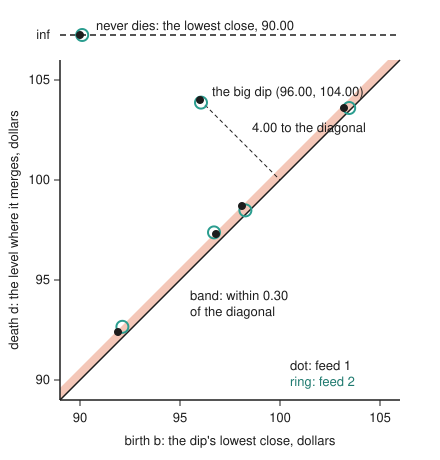

# Persistence diagram and stability: noise in the data moves the picture only a little

[Syllabus](../../../SYLLABUS.md) → [Topology](../README.md) → [Topological Data Analysis](../README.md#s06) → Persistence diagram and stability

---

## General Overview

Two data feeds report 16 daily closes of the same thinly traded share. Feed 1 records each day's last trade. Feed 2 records the midpoint between the best bid and the best offer (the highest price a buyer offers and the lowest a seller asks). They never differ by more than 30 cents. The prices are an illustrative path, not real data.

Feed 1 starts at $90.00, climbs to $104.00, falls to $96.00 and ends at $105.00, with four small wiggles of 40 to 60 cents on the way. Which dips belong to the share, and which are noise the other feed might not show?

Persistence answers with a picture. Flood the price chart from below. Each dip fills as its own pool, starting at its lowest close, and the pool ends when the water spills into an older, deeper pool. Each dip becomes one point: across, the level where its pool starts (its **birth**); up, the level where it spills over (its **death**). That chart is the **persistence diagram**.

Feed 1's diagram has one point far above the diagonal, the line where death equals birth: the big dip, born at $96.00 and merged at $104.00. Four small points hug the diagonal. Feed 2's diagram looks almost the same.

The **stability theorem** says how close. If the feeds differ by at most 30 cents every day, their diagrams pair off so that no point moves more than 30 cents in birth or death. A point may pair with the diagonal instead, meaning "the other feed lacks this feature". So any point more than 30 cents from the diagonal has a partner within 30 cents in the other diagram.

**A persistence diagram plots each feature's birth against its death; a feature's strength is its distance from the diagonal; and noise that moves no data value by more than some amount moves the whole diagram by no more than that amount, in bottleneck distance.**

**What kind of fact this is:** a theorem, published by Cohen-Steiner, Edelsbrunner and Harer in 2007. This card proves its counting half in Why it works and gives the key steps and the source for the rest. The code checks the bound on 1,000 noisy feeds; that illustrates the theorem and does not prove it.

### The picture: two feeds, one diagram

<p align="center"></p>

Births across, deaths up, in dollars, drawn to scale. Dots are feed 1, rings feed 2. The shaded band holds every point within 30 cents of the diagonal: the four small dips sit in it, the big dip sits 4.00 away. The dashed top row holds the bar that never ends, from the lowest close, $90.00. Both checks print every point's position on their `figure,` lines.

---

## The formula

Four words from earlier cards, each in one line:

- A **filtration** is a family of shapes that grows with a scale ([Filtration and persistent homology](01-filtrations-and-persistent-homology.md)). Here the scale is the water height, a price level $`t`$. The shape $`K_t`$ is the days with close at most $`t`$, neighbours linked when both are. Each run of linked days is a pool.
- $`H_0`$, the zeroth homology group, counts separate pieces ([Homology groups](../05-Homology/02-homology-groups.md)): here, pools. As on the whole shelf, it is computed over ℤ mod 2, where 1 + 1 = 0.
- A **bar** $`[b, d)`$ is one pool's life: alive from level $`b`$, gone from level $`d`$ on. When two pools meet, the younger (higher lowest close) dies. [The persistence algorithm](03-the-persistence-algorithm.md) computes the bars.
- The **worst-case distance** between two points is the larger of their coordinate gaps, the $`d_\infty`$ of [The distance menu](../01-Metric%20Spaces/02-distances-on-vectors-and-functions.md).

The **persistence diagram** $`\mathrm{Dgm}\, f`$ of a feed $`f`$ draws each bar $`[b, d)`$ as the point $`(b, d)`$, and also contains every point of the diagonal. The bar that never ends is drawn at $`d = \infty`$.

A **matching** between two diagrams pairs each point of one with one point of the other, or with the diagonal. The cost of a pair is their worst-case distance. Sending a point to the diagonal costs its distance from the diagonal, which is half its **persistence** $`d - b`$:

```math
\text{distance from } (b, d) \text{ to the diagonal} = \frac{d - b}{2}
```

The **bottleneck distance** $`d_B`$ is the smallest worst cost any matching achieves. The **Wasserstein distance** $`W_p`$ is the smallest value of (the sum of every cost to the power $`p`$) to the power $`1/p`$. The stability theorem bounds the first:

```math
d_B(\mathrm{Dgm}\, f,\ \mathrm{Dgm}\, g) \;\le\; \lVert f - g \rVert_\infty = \max_{\text{days } i} \lvert f_i - g_i \rvert
```

**Read it aloud:** the bottleneck distance between the two feeds' diagrams is at most the largest gap between the feeds on any single day.

For the two feeds, the largest gap is 0.30 and the bottleneck distance is 0.26.

| Symbol | Plain meaning | In our example | Push it up and the answer… |
| --- | --- | --- | --- |
| $`f`$, $`g`$, $`f_i`$ | the two feeds; $`f_i`$ is feed 1's close on day $`i`$ | $`f_9`$ = 96.00, $`g_9`$ = 96.05 | — |
| $`t`$, $`s`$ | price levels: the water height | $`t`$ runs up from 90.00 | more days go under water |
| $`K_t`$ | the days with close at most $`t`$, neighbours linked; $`K^f_t`$ and $`K^g_t`$ for each feed | at $`t`$ = 96.80: three pools | — |
| $`H_0`$ | the pools of $`K_t`$, counted over ℤ mod 2 | three pools at 96.80 | — |
| $`[b, d)`$, $`(b, d)`$ | a bar, and the point that draws it | $`[96.00, 104.00)`$ for the big dip | — |
| $`\mathrm{Dgm}\, f`$ | the persistence diagram of feed $`f`$ | five points, plus (90.00, ∞) | — |
| $`d - b`$ | persistence: how long the pool lasts; half of it is the distance from the diagonal | 8.00 for the big dip, so 4.00 from the diagonal | harder for noise to erase |
| $`\lVert f - g \rVert_\infty`$ | the largest gap between the feeds on any day | 0.30 | the bound loosens |
| $`\delta`$ | a shift in water level, at least the largest gap | 0.30 | — |
| $`d_B`$ | bottleneck distance: the best matching's worst cost | 0.26 | — |
| $`W_p`$, $`p`$ | Wasserstein distance of order $`p`$: the best matching's costs summed as $`p`$-th powers | $`W_1`$ = 1.08, $`W_2`$ = 0.447 | the worst pair counts more |
| $`d_H`$, $`r`$ | Hausdorff distance: the farthest any point of one cloud is from the other; $`r`$ is a ball's radius | Step 5 only | — |

### When it holds

- **The gap is bounded on every single day.** Record one close $6 low and the worst gap is 6.00. A fake dip appears 1.90 from the diagonal; the theorem holds, but a 30-cent band protects nothing.
- **Both diagrams use the same rule and scale.** The software ripser measures point clouds by diameter, not radius, which doubles every number and the bound.
- **Distances are worst-case.** Measured in straight lines, the two feeds come out 0.341 apart, above the 0.30 bound.
- **The diagonal is allowed in a matching.** Two 30-cent nudges erase the 0.60 dip, leaving 5 points against 4: without the diagonal no matching exists.
- **Finitely many bars.** Finite data always has them. The 2007 theorem asks for "tame" functions: finitely many bars across any range of levels.

---

## Why it works

### Step 0: noise moves every water level by at most the gap

Say no close moves by more than $`\delta`$ = 0.30. A day under water at level $`t`$ in feed 1 is then under water at level $`t + \delta`$ in feed 2. So feed 1's pools at $`t`$ sit inside feed 2's pools at $`t + \delta`$, which sit inside feed 1's pools at $`t + 2\delta`$.

A pool that lasts longer than $`2\delta`$ in feed 1 therefore cannot be missing from feed 2: it is still there two shifts later. The rest of this section turns that into a matching.

### Step 1: a point's distance from the diagonal is half its persistence

On the diagonal, death equals birth. The nearest diagonal point to $`(b, d)`$, in worst-case distance, is $`((b + d)/2, (b + d)/2)`$: each coordinate shifts by $`(d - b)/2`$, and any other diagonal point is farther in one coordinate.

For the big dip, (104.00 − 96.00)/2 = 4.00. For the dip at (98.10, 98.70), it is 0.30.

A diagonal point is a bar of length zero, a pool that never exists. Matching a point to it says "the other feed has no such pool", at the cost of shrinking the bar to nothing, each end moving halfway.

### Step 2: the two families of shapes interleave

If $`f_i \le t`$ then $`g_i \le f_i + \delta \le t + \delta`$. A link needs both of its days under water, so links carry over too. Hence

```math
K^f_t \subseteq K^g_{t+\delta} \subseteq K^f_{t+2\delta}, \qquad K^g_t \subseteq K^f_{t+\delta} \subseteq K^g_{t+2\delta}
```

Each inclusion sends every pool to the larger pool containing it: a shift map from $`H_0(K^f_t)`$ to $`H_0(K^g_{t+\delta})`$. Shifting then raising the water equals raising then shifting, and going to feed 2 and back equals raising the water by $`2\delta`$.

The **interleaving distance** is the smallest $`\delta`$ for which shift maps with these two properties exist both ways. For two feeds it is at most the largest daily gap. Category theory calls such a family of maps a natural transformation (Natural transformations and Yoneda, planned).

### Step 3: counting the bars that cover a stretch of levels

Take two levels $`s < t`$. The bars of $`f`$ alive at both are those born by $`s`$ and dying after $`t`$. Their number is the rank of the map from pools at $`s`$ to pools at $`t`$: how many pools at $`t`$ contain a pool from $`s`$ ([Filtration and persistent homology](01-filtrations-and-persistent-homology.md)).

The claim: if $`s + \delta \le t - \delta`$, then the bars of $`f`$ covering $`s`$ to $`t`$ number at most the bars of $`g`$ covering $`s + \delta`$ to $`t - \delta`$.

<details>
<summary>Detailed proof: the count for one feed is at most the count for the other</summary>

By Step 2 the inclusion of $`K^f_s`$ into $`K^f_t`$ is a chain of three inclusions:

$`\displaystyle K^f_s \subseteq K^g_{s+\delta} \subseteq K^g_{t-\delta} \subseteq K^f_t.`$

On pools, the map from $`s`$ to $`t`$ is therefore the composite of three maps, the middle one being feed 2's map from $`s + \delta`$ to $`t - \delta`$.

On pools a rank is concrete: the number of pools at the far end that receive at least one pool from the near end. Follow the pools of $`K^f_s`$ along the chain. The pools of $`K^f_t`$ they reach are among the images of the pools of $`K^g_{t-\delta}`$ that receive something from $`K^g_{s+\delta}`$. Each of those goes to exactly one pool of $`K^f_t`$, so the count for $`f`$ is at most the count for $`g`$.

Both ranks are bar counts by the fact above, which proves the claim. Swapping the feeds gives the reverse inequality.

</details>

So a bar $`[b, d)`$ of $`f`$ longer than $`2\delta`$ forces $`g`$ to have at least as many bars born by $`b + \delta`$ and still alive just before $`d - \delta`$ as $`f`$ has born by $`b`$ and alive just before $`d`$. For the big dip, $`f`$ has two such bars, the endless one and the dip itself. So $`g`$ needs a bar besides its endless one: (96.05, 103.87), the dip's partner. "At least one bar" would prove nothing here, since the endless bar always passes. The big dip, 8.00 long against a 0.60 allowance, is guaranteed in feed 2.

### Step 4: from counts to a matching

Cohen-Steiner, Edelsbrunner and Harer turn the counts of Step 3, taken at every pair of levels, into a matching in three moves. This card states them without full proof.

1. **The box lemma.** Apply the count to the corners of any box of births and deaths. The points of $`f`$ in the box number at most the points of $`g`$ in the same box grown by $`\delta`$ on every side.
2. **Small changes.** Suppose $`\delta`$ is much smaller than the gaps between the points of $`f`$ and their distances from the diagonal. Then the box lemma, applied both ways to a small box round each point, puts exactly as many points of $`g`$ in the box as points of $`f`$. Pairing inside the boxes, and sending every other point to the diagonal, costs at most $`\delta`$ per pair.
3. **Interpolation.** For a larger change, walk from $`f`$ to $`g`$ in many small steps, moving every close the same fraction of the way each time. Each step can be made small enough for move 2, by a compactness argument the source supplies, and costs at most its share of $`\delta`$. The bottleneck distance obeys the triangle inequality, so the shares add up: $`d_B \le \delta`$.

The same argument works for any two interleaved families, not only pools of a price feed. In that form the bottleneck distance equals the interleaving distance, proved in the 2016 book by Chazal, de Silva, Glisse and Oudot (Sources).

### Step 5: the same theorem for clouds of points

This shelf's house example reads daily returns, cut into three-day windows, as a cloud of points. Take as the function the distance to the nearest point of the cloud. Its water level at radius $`r`$ is the union of balls of radius $`r`$, whose pieces and holes the Čech complex counts ([Vietoris-Rips, Cech and alpha complexes](02-vietoris-rips-and-cech-complexes.md)).

Move every point by at most $`\delta`$. The Hausdorff distance $`d_H`$ between old and new cloud ([The distance menu](../01-Metric%20Spaces/02-distances-on-vectors-and-functions.md)) is at most $`\delta`$, and the two distance functions differ by at most $`d_H`$. So $`d_B \le d_H`$ for Čech diagrams. Chazal, de Silva and Oudot prove the same bound for Rips diagrams in this shelf's radius scale; in ripser's diameter scale it reads $`2 d_H`$.

### Step 6: computing the distances as an assignment problem

Give each diagram one diagonal copy for each point of the other. The table is now square, and every matching is a one-to-one assignment: point to point at their worst-case distance, point to its own diagonal copy at its distance from the diagonal, copy to copy at 0. [Comparing diagrams](05-comparing-diagrams-and-vectorising-them.md) builds this table in full.

$`W_p`$ is then the least sum of costs to the power $`p`$: [The assignment problem](../../14-Applied%20and%20computational/05-Operations%20Research/05-assignment-and-the-hungarian-algorithm.md), solved at scale by the Hungarian method. $`d_B`$ is the same problem with "largest" in place of "sum". To test whether $`d_B`$ is at most some amount, keep only the pairs that cost no more and ask whether everyone can still be paired: [Hall's theorem](../../04-Combinatorics%20and%20graphs/13-Matchings%20and%20Flows/02-halls-marriage-theorem.md) says exactly when. Moving one diagram onto another at least cost is the diagram case of optimal transport (Optimal transport, planned).

---

## Worked numbers, by hand

First read the big dip off feed 1, then match the two diagrams.

| Step | Arithmetic | Value |
| --- | --- | --- |
| big dip is born | lowest close of the dip, on day 9 | 96.00 |
| big dip dies | water must reach day 7's close to reach the old pool at 90.00 | 104.00 |
| its distance from the diagonal | (104.00 − 96.00) / 2 | 4.00 |
| the four small dips | (92.40 − 91.90) / 2, (97.30 − 96.80) / 2, (98.70 − 98.10) / 2, (103.60 − 103.20) / 2 | 0.25, 0.25, 0.30, 0.20 |
| largest daily gap | day 15: 105.00 − 104.70 | 0.30 |
| pair the big dips | larger of \|96.05 − 96.00\| and \|103.87 − 104.00\| | 0.13 |
| pair (91.90, 92.40) with (92.12, 92.66) | larger of \|92.12 − 91.90\| and \|92.66 − 92.40\| | 0.26 |
| pair (96.80, 97.30) with (96.70, 97.38) | larger of \|96.70 − 96.80\| and \|97.38 − 97.30\| | 0.10 |
| pair (98.10, 98.70) with (98.27, 98.48) | larger of \|98.27 − 98.10\| and \|98.48 − 98.70\| | 0.22 |
| (103.20, 103.60) and (103.46, 103.60) | each to the diagonal, against 0.26 to pair them | 0.20 and 0.07 |
| the never-ending bars | 90.11 − 90.00 | 0.11 |
| bottleneck distance | the worst cost in this matching, which no matching beats | **0.26** |

No point had to move more than 26 cents, inside the 30-cent bound. The big dip moved 13 cents and still sits 3.91 from the diagonal in feed 2. Brute force over all 1,546 matchings finds no matching with a worst cost below 0.26.

### What breaks if you drop a piece

| Mistake | Comes out at | What went wrong |
| --- | --- | --- |
| Calling every bar longer than 0.30 real | 5 features, where 1 is certain | The safe test is distance from the diagonal over 0.30, so length over 0.60. Two 30-cent nudges erase the 0.60 dip, at a bottleneck distance of exactly 0.300 |
| Measuring pairs by straight-line distance | 0.341, above the 0.30 bound | The theorem holds for worst-case distance; straight-line distance is never smaller and often larger |
| Matching without the diagonal | 5 points against 4: no matching | A feature that only one feed shows must be allowed to pair with nothing |
| Trusting a 30-cent band when one close is $6 low | a fake dip at (91.30, 95.10), 1.90 from the diagonal | The bound uses the worst day, now 6.00 |

The nudged feed also shows the bound is sharp: its bottleneck distance equals the 0.30 gap exactly.

---

## Code, from first principles, and it actually runs

Both programs count in whole cents (half-cents for distances), so no rounding hides anywhere. Each diagram comes two independent ways: reducing the boundary matrix mod 2, as in [The persistence algorithm](03-the-persistence-algorithm.md), and union-find with the younger-dies rule. Each distance comes two ways: the padded assignment problem solved exactly by a table over subsets of columns, and brute force over every matching. Then the theorem is checked on 1,000 feeds whose noise comes from the SplitMix64 generator with a fixed seed, so both languages draw the same numbers.

### Python

```python
# Persistence diagram and stability -- the check behind the card.  Standard library only.
# Sixteen daily closes of one share, in cents: an illustrative path, not real data.  A day
# joins the shape once the price level t reaches its close; two neighbouring days link once
# t reaches both.  Diagrams come two ways (column reduction mod 2, and union-find); distances
# between diagrams come two ways (an exact table over subsets, and every matching by brute force).
F = [9000, 9240, 9190, 9510, 9730, 9680, 10150, 10400,
     9920, 9600, 9870, 9810, 10190, 10360, 10320, 10500]
NOISE, SEED, DRAWS, M64 = 30, 10, 1000, (1 << 64) - 1     # every close off by 30 cents at most

def dgm_reduce(f):          # road 1: sort the cells, reduce each link's column mod 2
    cells = sorted([(f[i], 0, i) for i in range(len(f))] +
                   [(max(f[i], f[i + 1]), 1, i) for i in range(len(f) - 1)])
    pos = {(dim, i): k for k, (_, dim, i) in enumerate(cells)}
    low_of, pts = {}, []
    for t, dim, i in cells:
        if dim == 1:
            col = {pos[(0, i)], pos[(0, i + 1)]}
            while max(col) in low_of:
                col ^= low_of[max(col)]
            low_of[max(col)] = col
            if cells[max(col)][0] < t:                     # a bar of length zero is not drawn
                pts.append((cells[max(col)][0], t))
    ess = [(t, None) for k, (t, dim, i) in enumerate(cells) if dim == 0 and k not in low_of]
    return sorted(pts) + ess

def dgm_unionfind(f):       # road 2: add days lowest first; when two runs meet, the younger dies
    parent, pts = {}, []
    def root(i):
        while parent[i] != i:
            i = parent[i]
        return i
    for t, i in sorted((v, i) for i, v in enumerate(f)):
        parent[i] = i
        for j in (i - 1, i + 1):
            if j in parent and root(i) != root(j):
                old, young = sorted([root(i), root(j)], key=lambda r: (f[r], r))
                if f[young] < t:
                    pts.append((f[young], t))
                parent[young] = old
    return sorted(pts) + [(f[root(0)], None)]

def cost(x, y, line=False):  # half-cents: worst-case distance, or (line=True) straight-line squared
    if line:
        return 4 * ((x[0] - y[0]) ** 2 + (x[1] - y[1]) ** 2)
    return 2 * max(abs(x[0] - y[0]), abs(x[1] - y[1]))
def diag(x, line=False):    # to the diagonal: (d - b) / 2 worst-case, or (d - b) / root 2, squared
    return 2 * (x[1] - x[0]) ** 2 if line else x[1] - x[0]

def assign(A, B, op, line=False):  # road 1: the assignment problem, padded with diagonal copies,
    n, m, INF = len(A), len(B), float('inf')         # solved exactly by a table over subsets
    c = [[None] * (n + m) for _ in range(n + m)]
    for i in range(n):
        for j in range(m):
            c[i][j] = cost(A[i], B[j], line)
        c[i][m + i] = diag(A[i], line)
    for j in range(m):
        c[n + j][j] = diag(B[j], line)
        for i in range(n):
            c[n + j][m + i] = 0
    best = [0] + [INF] * ((1 << (n + m)) - 1)
    for mask in range(1 << (n + m)):
        r = bin(mask).count('1')
        for j in range(n + m):
            if r < n + m and best[mask] < INF and not mask >> j & 1 and c[r][j] is not None:
                best[mask | 1 << j] = min(best[mask | 1 << j], op(best[mask], c[r][j]))
    return best[-1]

def brute(A, B, used=(), k=0):   # road 2: every partial matching, as (worst, sum, sum of squares)
    if k == len(A):
        rest = [diag(y) for j, y in enumerate(B) if j not in used]
        return [(max(rest, default=0), sum(rest), sum(v * v for v in rest))]
    out = []
    for j in [None] + [j for j in range(len(B)) if j not in used]:
        v = diag(A[k]) if j is None else cost(A[k], B[j])
        for w, s, q in brute(A, B, used + ((j,) if j is not None else ()), k + 1):
            out.append((max(w, v), s + v, q + v * v))
    return out

def dist(D, E, op=max, line=False):  # the infinite bars are matched to each other, apart
    e = 2 * abs(D[-1][0] - E[-1][0])
    e, a = (e * e if line or op is sq else e), assign(D[:-1], E[:-1], op, line)
    return max(e, a) if op is max else e + a

add, sq = (lambda a, v: a + v), (lambda a, v: a + v * v)
def noisy(f, s):            # SplitMix64: each close moved by whole cents in [-NOISE, NOISE]
    g = []
    for v in f:
        s = (s + 0x9E3779B97F4A7C15) & M64
        z = ((s ^ (s >> 30)) * 0xBF58476D1CE4E5B9) & M64
        z = ((z ^ (z >> 27)) * 0x94D049BB133111EB) & M64
        g.append(v + (z ^ (z >> 31)) % (2 * NOISE + 1) - NOISE)
    return g, s

usd, hc = (lambda c: f"{c // 100}.{c % 100:02d}"), (lambda h: f"{h * 5 // 1000}.{h * 5 % 1000:03d}")
show = lambda D: " ".join(f"({usd(b)}, {'inf' if d is None else usd(d)})" for b, d in D)
gap = lambda f, g: max(abs(a - b) for a, b in zip(f, g))
D, (g, s) = dgm_reduce(F), noisy(F, SEED)
E = dgm_reduce(g)
print("feed 1 closes", " ".join(usd(v) for v in F))
print("feed 1 diagram", show(D))
for b, d in D[:-1]:              # hc turns half-cents into dollars
    print(f"  ({usd(b)}, {usd(d)}) lasts {usd(d - b)}, from the diagonal {hc(diag((b, d)))},"
          f" nearest feed 2 point {hc(min(cost((b, d), q) for q in E[:-1]))}")
print("bars longer than 0.30:", sum(d - b > NOISE for b, d in D[:-1]),
      " longer than 0.60:", sum(d - b > 2 * NOISE for b, d in D[:-1]))
print("feed 2 closes", " ".join(usd(v) for v in g))
print("feed 2 diagram", show(E))
print("feed 2 from the diagonal", " ".join(hc(diag(q)) for q in E[:-1]), " infinite bars", usd(E[-1][0] - D[-1][0]), "apart")
print("largest gap between the feeds", usd(gap(F, g)))
bf, ee = brute(D[:-1], E[:-1]), 2 * abs(D[-1][0] - E[-1][0])    # ee: the infinite bars' cost
dB, W1, W2 = dist(D, E), dist(D, E, add), dist(D, E, sq)
print("d_B  table", hc(dB), " brute force", hc(max(ee, min(w for w, _, _ in bf))))
print("W_1  table", hc(W1), " brute force", hc(ee + min(t for _, t, _ in bf)))
print(f"W_2  table {W2 ** 0.5 / 200:.3f}  matchings tried by brute force {len(bf)}")
line = dist(D, E, max, True)
print(f"wrong: straight-line d_B {line ** 0.5 / 200:.3f}, above the 0.30 bound")
worst, moved = 0.0, 0
for _ in range(DRAWS):                       # the theorem, checked on DRAWS noisy feeds
    h, s = noisy(F, s)
    Dh = dgm_reduce(h)
    assert Dh == dgm_unionfind(h) and dist(D, Dh) <= 2 * gap(F, h)
    worst, moved = max(worst, dist(D, Dh) / (2 * gap(F, h))), moved + (len(Dh) != len(D))
print(f"{DRAWS} feeds: worst d_B / gap {worst:.3f}, diagrams with a changed point count {moved}")
Da = dgm_reduce(F[:10] + [F[10] - 30, F[11] + 30] + F[12:])   # 30 cents down on day 10, up on day 11
print("nudged feed diagram", show(Da), " d_B", hc(dist(D, Da)))
print("wrong: no diagonal, so counts must match:", len(D) - 1, "points against", len(Da) - 1)
bad = F[:4] + [F[4] - 600] + F[5:]                 # one close recorded $6 low
Db = dgm_reduce(bad)
print("bad-tick diagram", show(Db), " d_B", hc(dist(D, Db)), " gap", usd(gap(F, bad)))
px = lambda D: " ".join(f"({(600 + 2 * (b - 8900)) / 10:.1f},{35 if d is None else (4000 - 2 * (d - 8900)) / 10:.1f})" for b, d in D)
print("figure, feed 1 at", px(D))
print("figure, feed 2 at", px(E))
assert D == dgm_unionfind(F) and E == dgm_unionfind(g)                 # two roads to each diagram
assert D[1] == (9600, 10400) and D[-1] == (9000, None) and len(D) == 6   # read off the path by hand
assert dB == max(ee, min(w for w, _, _ in bf)) == 52 and dB <= 2 * gap(F, g)  # 0.26 by hand, under 0.30
assert W1 == ee + min(t for _, t, _ in bf) and W2 == ee * ee + min(q for _, _, q in bf)  # table = brute
assert dist(D, Da) == 2 * NOISE and len(Da) == len(D) - 1                # the bound is reached exactly
assert line > (2 * gap(F, g)) ** 2 and W1 > 2 * gap(F, g)                # the two wrong readings exceed it
assert diag(Db[0]) > 2 * NOISE and dist(D, Db) <= 2 * gap(F, bad)        # a fake dip, yet within 6.00
print("ALL CHECKS PASS")
```

**Ran 2026-11-15 on macOS, Python 3.14.10, standard library only. All checks passed. Output, pasted from the run:**

```
feed 1 closes 90.00 92.40 91.90 95.10 97.30 96.80 101.50 104.00 99.20 96.00 98.70 98.10 101.90 103.60 103.20 105.00
feed 1 diagram (91.90, 92.40) (96.00, 104.00) (96.80, 97.30) (98.10, 98.70) (103.20, 103.60) (90.00, inf)
  (91.90, 92.40) lasts 0.50, from the diagonal 0.250, nearest feed 2 point 0.260
  (96.00, 104.00) lasts 8.00, from the diagonal 4.000, nearest feed 2 point 0.130
  (96.80, 97.30) lasts 0.50, from the diagonal 0.250, nearest feed 2 point 0.100
  (98.10, 98.70) lasts 0.60, from the diagonal 0.300, nearest feed 2 point 0.220
  (103.20, 103.60) lasts 0.40, from the diagonal 0.200, nearest feed 2 point 0.260
bars longer than 0.30: 5  longer than 0.60: 1
feed 2 closes 90.11 92.66 92.12 94.97 97.38 96.70 101.43 103.87 99.23 96.05 98.48 98.27 102.18 103.60 103.46 104.70
feed 2 diagram (92.12, 92.66) (96.05, 103.87) (96.70, 97.38) (98.27, 98.48) (103.46, 103.60) (90.11, inf)
feed 2 from the diagonal 0.270 3.910 0.340 0.105 0.070  infinite bars 0.11 apart
largest gap between the feeds 0.30
d_B  table 0.260  brute force 0.260
W_1  table 1.080  brute force 1.080
W_2  table 0.447  matchings tried by brute force 1546
wrong: straight-line d_B 0.341, above the 0.30 bound
1000 feeds: worst d_B / gap 1.000, diagrams with a changed point count 97
nudged feed diagram (91.90, 92.40) (96.00, 104.00) (96.80, 97.30) (103.20, 103.60) (90.00, inf)  d_B 0.300
wrong: no diagonal, so counts must match: 5 points against 4
bad-tick diagram (91.30, 95.10) (91.90, 92.40) (96.00, 104.00) (98.10, 98.70) (103.20, 103.60) (90.00, inf)  d_B 1.900  gap 6.00
figure, feed 1 at (118.0,332.0) (200.0,100.0) (216.0,234.0) (242.0,206.0) (344.0,108.0) (80.0,35.0)
figure, feed 2 at (122.4,326.8) (201.0,102.6) (214.0,232.4) (245.4,210.4) (349.2,108.0) (82.2,35.0)
ALL CHECKS PASS
```

None of the 1,000 noisy feeds broke the bound; a worst ratio of 1.000 means some reached it exactly. In 97 the diagram's number of points changed, so a small dip was born or erased there, and the bound still held. A feed that gains one dip and loses another keeps its count, so it is not among the 97.

### Rust

Same numbers, same labels, built with `rustc --edition 2021 -O`.

```rust
// Persistence diagram and stability -- the same check as the Python, in Rust.  No crates.
// Sixteen daily closes of one share, in cents: an illustrative path, not real data.  A day
// joins the shape once the price level t reaches its close; two neighbouring days link once
// t reaches both.  Diagrams come two ways (column reduction mod 2, and union-find); distances
// between diagrams come two ways (an exact table over subsets, and every matching by brute force).
use std::collections::BTreeSet;
const F: [i64; 16] = [9000, 9240, 9190, 9510, 9730, 9680, 10150, 10400,
                      9920, 9600, 9870, 9810, 10190, 10360, 10320, 10500];
const NOISE: i64 = 30; // every close off by 30 cents at most
const SEED: u64 = 10; const DRAWS: usize = 1000; // the second feed's seed, and the number of feeds
const INF: i64 = i64::MAX; // the death of a bar that never ends
type Dgm = Vec<(i64, i64)>;
#[derive(Clone, Copy, PartialEq)] enum Op { Max, Add, Sq } // how one pairing's cost joins the total
fn dgm_reduce(f: &[i64]) -> Dgm { // road 1: sort the cells, reduce each link's column mod 2
    let n = f.len();
    let mut cells: Vec<(i64, u8, usize)> = (0..n).map(|i| (f[i], 0, i)).collect();
    cells.extend((0..n - 1).map(|i| (f[i].max(f[i + 1]), 1, i)));
    cells.sort();
    let mut vpos = vec![0; n];
    for (k, c) in cells.iter().enumerate() { if c.1 == 0 { vpos[c.2] = k; } }
    let (mut low_of, mut pts): (Vec<Option<BTreeSet<usize>>>, Dgm) = (vec![None; cells.len()], Vec::new());
    for &(t, dim, i) in &cells {
        if dim == 0 { continue; }
        let mut col: BTreeSet<usize> = [vpos[i], vpos[i + 1]].into_iter().collect();
        while let Some(other) = low_of[*col.last().unwrap()].clone() {
            col = col.symmetric_difference(&other).cloned().collect();
        }
        let low = *col.last().unwrap();
        if cells[low].0 < t { pts.push((cells[low].0, t)); } // a bar of length zero is not drawn
        low_of[low] = Some(col);
    }
    pts.sort();
    for (k, c) in cells.iter().enumerate() { if c.1 == 0 && low_of[k].is_none() { pts.push((c.0, INF)); } }
    pts
}
fn root(p: &[Option<usize>], mut i: usize) -> usize { while p[i] != Some(i) { i = p[i].unwrap(); } i }
fn dgm_unionfind(f: &[i64]) -> Dgm { // road 2: add days lowest first; when two runs meet, the younger dies
    let (n, mut pts) = (f.len(), Vec::new());
    let mut parent = vec![None; n];
    let mut order: Vec<(i64, usize)> = (0..n).map(|i| (f[i], i)).collect();
    order.sort();
    for (t, i) in order {
        parent[i] = Some(i);
        for j in [i.wrapping_sub(1), i + 1] {
            if j >= n || parent[j].is_none() || root(&parent, i) == root(&parent, j) { continue; }
            let (a, b) = (root(&parent, i), root(&parent, j));
            let (old, young) = if (f[a], a) < (f[b], b) { (a, b) } else { (b, a) };
            if f[young] < t { pts.push((f[young], t)); }
            parent[young] = Some(old);
        }
    }
    pts.sort();
    pts.push((f[root(&parent, 0)], INF));
    pts
}
fn cost(x: (i64, i64), y: (i64, i64), line: bool) -> i64 { // half-cents: worst-case, or straight-line squared
    let (db, dd) = ((x.0 - y.0).abs(), (x.1 - y.1).abs());
    if line { 4 * (db * db + dd * dd) } else { 2 * db.max(dd) }
}
fn diag(x: (i64, i64), line: bool) -> i64 { if line { 2 * (x.1 - x.0).pow(2) } else { x.1 - x.0 } } // to the diagonal
fn comb(op: Op, a: i64, v: i64) -> i64 { match op { Op::Max => a.max(v), Op::Add => a + v, Op::Sq => a + v * v } }
fn assign(a: &[(i64, i64)], b: &[(i64, i64)], op: Op, line: bool) -> i64 { // road 1: the assignment
    let (n, m) = (a.len(), b.len()); // problem, padded with diagonal copies, solved by a table over subsets
    let c = |r: usize, j: usize| match (r < n, j < m) { // None: that pairing is not allowed
        (true, true) => Some(cost(a[r], b[j], line)), (false, false) => Some(0),
        (true, false) => if j - m == r { Some(diag(a[r], line)) } else { None },
        (false, true) => if r - n == j { Some(diag(b[j], line)) } else { None } };
    let mut best: Vec<i64> = (0..1usize << (n + m)).map(|k| if k == 0 { 0 } else { INF }).collect();
    for mask in 0..(1usize << (n + m)) {
        let r = mask.count_ones() as usize;
        if r == n + m || best[mask] == INF { continue; }
        for j in (0..n + m).filter(|j| mask >> j & 1 == 0) {
            if let Some(v) = c(r, j) { best[mask | 1 << j] = best[mask | 1 << j].min(comb(op, best[mask], v)); }
        }
    }
    best[(1 << (n + m)) - 1]
}
type Acc = (i64, i64, i64); // road 2: every partial matching, as (worst, sum, sum of squares)
fn brute(a: &[(i64, i64)], b: &[(i64, i64)], used: &mut Vec<usize>, k: usize, acc: Acc, out: &mut Vec<Acc>) {
    let add = |acc: Acc, v: i64| (acc.0.max(v), acc.1 + v, acc.2 + v * v);
    if k == a.len() {
        let rest = (0..b.len()).filter(|j| !used.contains(j)).map(|j| diag(b[j], false));
        out.push(rest.fold(acc, add));
        return;
    }
    brute(a, b, used, k + 1, add(acc, diag(a[k], false)), out);
    for j in 0..b.len() {
        if used.contains(&j) { continue; }
        used.push(j);
        brute(a, b, used, k + 1, add(acc, cost(a[k], b[j], false)), out);
        used.pop();
    }
}
fn dist(d: &Dgm, e: &Dgm, op: Op, line: bool) -> i64 { // the infinite bars are matched to each other, apart
    let ee = 2 * (d[d.len() - 1].0 - e[e.len() - 1].0).abs();
    let ee = if line || op == Op::Sq { ee * ee } else { ee };
    let a = assign(&d[..d.len() - 1], &e[..e.len() - 1], op, line);
    if op == Op::Max { ee.max(a) } else { ee + a }
}
fn noisy(f: &[i64], mut s: u64) -> (Vec<i64>, u64) { // SplitMix64: each close moved by whole cents
    let mut g = Vec::new(); // in [-NOISE, NOISE]
    for &v in f {
        s = s.wrapping_add(0x9E3779B97F4A7C15);
        let mut z = (s ^ (s >> 30)).wrapping_mul(0xBF58476D1CE4E5B9);
        z = (z ^ (z >> 27)).wrapping_mul(0x94D049BB133111EB);
        g.push(v + ((z ^ (z >> 31)) % (2 * NOISE as u64 + 1)) as i64 - NOISE);
    }
    (g, s)
}
fn usd(c: i64) -> String { format!("{}.{:02}", c / 100, c % 100) }
fn hc(h: i64) -> String { format!("{}.{:03}", h * 5 / 1000, h * 5 % 1000) } // half-cents to dollars
fn join<T>(v: &[T], f: impl Fn(&T) -> String) -> String { v.iter().map(f).collect::<Vec<_>>().join(" ") }
fn show(d: &Dgm) -> String { join(d, |&(b, x)| format!("({}, {})", usd(b), if x == INF { "inf".into() } else { usd(x) })) }
fn gap(f: &[i64], g: &[i64]) -> i64 { f.iter().zip(g).map(|(a, b)| (a - b).abs()).max().unwrap() }
fn px(d: &Dgm) -> String {
    join(d, |&(b, x)| format!("({:.1},{:.1})", (600 + 2 * (b - 8900)) as f64 / 10.0,
                             if x == INF { 35.0 } else { (4000 - 2 * (x - 8900)) as f64 / 10.0 }))
}
fn main() {
    let (d, (g, mut s)) = (dgm_reduce(&F), noisy(&F, SEED));
    let e = dgm_reduce(&g);
    let fin = &d[..d.len() - 1];
    println!("feed 1 closes {}\nfeed 1 diagram {}", join(&F, |&v| usd(v)), show(&d));
    for &(b, x) in fin {
        println!("  ({}, {}) lasts {}, from the diagonal {}, nearest feed 2 point {}", usd(b), usd(x), usd(x - b),
                 hc(diag((b, x), false)), hc(e[..e.len() - 1].iter().map(|&q| cost((b, x), q, false)).min().unwrap()));
    }
    println!("bars longer than 0.30: {}  longer than 0.60: {}", fin.iter().filter(|p| p.1 - p.0 > NOISE).count(),
             fin.iter().filter(|p| p.1 - p.0 > 2 * NOISE).count());
    println!("feed 2 closes {}\nfeed 2 diagram {}", join(&g, |&v| usd(v)), show(&e));
    let (ei, di) = (e[e.len() - 1].0, d[d.len() - 1].0); // where the two never-ending bars start
    println!("feed 2 from the diagonal {}  infinite bars {} apart", join(&e[..e.len() - 1], |&q| hc(diag(q, false))), usd(ei - di));
    println!("largest gap between the feeds {}", usd(gap(&F, &g)));
    let mut bf = Vec::new(); brute(fin, &e[..e.len() - 1], &mut Vec::new(), 0, (0, 0, 0), &mut bf);
    let ee = 2 * (di - ei).abs(); // the infinite bars' cost, in half-cents
    let (db, w1, w2) = (dist(&d, &e, Op::Max, false), dist(&d, &e, Op::Add, false), dist(&d, &e, Op::Sq, false));
    let mn = |k: usize| bf.iter().map(|x| [x.0, x.1, x.2][k]).min().unwrap();
    let (bw, bs, bq) = (mn(0), mn(1), mn(2));
    println!("d_B  table {}  brute force {}", hc(db), hc(ee.max(bw)));
    println!("W_1  table {}  brute force {}", hc(w1), hc(ee + bs));
    println!("W_2  table {:.3}  matchings tried by brute force {}", (w2 as f64).sqrt() / 200.0, bf.len());
    let line = dist(&d, &e, Op::Max, true);
    println!("wrong: straight-line d_B {:.3}, above the 0.30 bound", (line as f64).sqrt() / 200.0);
    let (mut worst, mut moved) = (0.0f64, 0);
    for _ in 0..DRAWS { // the theorem, checked on DRAWS noisy feeds
        let h = { let (h, s2) = noisy(&F, s); s = s2; h };
        let dh = dgm_reduce(&h);
        let (dbh, gh) = (dist(&d, &dh, Op::Max, false), gap(&F, &h));
        assert!(dh == dgm_unionfind(&h) && dbh <= 2 * gh);
        worst = worst.max(dbh as f64 / (2 * gh) as f64);
        moved += (dh.len() != d.len()) as usize;
    }
    println!("{} feeds: worst d_B / gap {:.3}, diagrams with a changed point count {}", DRAWS, worst, moved);
    let adv: Vec<i64> = (0..16).map(|i| F[i] + [0, -30, 30][(i == 10) as usize + 2 * (i == 11) as usize]).collect();
    let da = dgm_reduce(&adv); // 30 cents down on day 10, up on day 11
    println!("nudged feed diagram {}  d_B {}", show(&da), hc(dist(&d, &da, Op::Max, false)));
    println!("wrong: no diagonal, so counts must match: {} points against {}", d.len() - 1, da.len() - 1);
    let bad: Vec<i64> = (0..16).map(|i| F[i] - if i == 4 { 600 } else { 0 }).collect();
    let dbad = dgm_reduce(&bad); // one close recorded $6 low
    println!("bad-tick diagram {}  d_B {}  gap {}", show(&dbad), hc(dist(&d, &dbad, Op::Max, false)), usd(gap(&F, &bad)));
    println!("figure, feed 1 at {}\nfigure, feed 2 at {}", px(&d), px(&e));
    assert!(d == dgm_unionfind(&F) && e == dgm_unionfind(&g)); // two roads to each diagram
    assert!(d[1] == (9600, 10400) && d[5] == (9000, INF) && d.len() == 6); // read off the path by hand
    assert!(db == ee.max(bw) && db == 52 && db <= 2 * gap(&F, &g)); // 0.26 by hand, under 0.30
    assert!(w1 == ee + bs && w2 == ee * ee + bq); // W_1 and W_2: table against brute force
    assert!(dist(&d, &da, Op::Max, false) == 2 * NOISE && da.len() == d.len() - 1); // the bound, reached
    assert!(line > (2 * gap(&F, &g)).pow(2) && w1 > 2 * gap(&F, &g)); // the two wrong readings exceed it
    assert!(diag(dbad[0], false) > 2 * NOISE && dist(&d, &dbad, Op::Max, false) <= 2 * gap(&F, &bad));
    println!("ALL CHECKS PASS");
}
```

**Ran 2026-11-15 on macOS, rustc 1.98.1, no crates. All checks passed. Output, pasted from the run:**

```
feed 1 closes 90.00 92.40 91.90 95.10 97.30 96.80 101.50 104.00 99.20 96.00 98.70 98.10 101.90 103.60 103.20 105.00
feed 1 diagram (91.90, 92.40) (96.00, 104.00) (96.80, 97.30) (98.10, 98.70) (103.20, 103.60) (90.00, inf)
  (91.90, 92.40) lasts 0.50, from the diagonal 0.250, nearest feed 2 point 0.260
  (96.00, 104.00) lasts 8.00, from the diagonal 4.000, nearest feed 2 point 0.130
  (96.80, 97.30) lasts 0.50, from the diagonal 0.250, nearest feed 2 point 0.100
  (98.10, 98.70) lasts 0.60, from the diagonal 0.300, nearest feed 2 point 0.220
  (103.20, 103.60) lasts 0.40, from the diagonal 0.200, nearest feed 2 point 0.260
bars longer than 0.30: 5  longer than 0.60: 1
feed 2 closes 90.11 92.66 92.12 94.97 97.38 96.70 101.43 103.87 99.23 96.05 98.48 98.27 102.18 103.60 103.46 104.70
feed 2 diagram (92.12, 92.66) (96.05, 103.87) (96.70, 97.38) (98.27, 98.48) (103.46, 103.60) (90.11, inf)
feed 2 from the diagonal 0.270 3.910 0.340 0.105 0.070  infinite bars 0.11 apart
largest gap between the feeds 0.30
d_B  table 0.260  brute force 0.260
W_1  table 1.080  brute force 1.080
W_2  table 0.447  matchings tried by brute force 1546
wrong: straight-line d_B 0.341, above the 0.30 bound
1000 feeds: worst d_B / gap 1.000, diagrams with a changed point count 97
nudged feed diagram (91.90, 92.40) (96.00, 104.00) (96.80, 97.30) (103.20, 103.60) (90.00, inf)  d_B 0.300
wrong: no diagonal, so counts must match: 5 points against 4
bad-tick diagram (91.30, 95.10) (91.90, 92.40) (96.00, 104.00) (98.10, 98.70) (103.20, 103.60) (90.00, inf)  d_B 1.900  gap 6.00
figure, feed 1 at (118.0,332.0) (200.0,100.0) (216.0,234.0) (242.0,206.0) (344.0,108.0) (80.0,35.0)
figure, feed 2 at (122.4,326.8) (201.0,102.6) (214.0,232.4) (245.4,210.4) (349.2,108.0) (82.2,35.0)
ALL CHECKS PASS
```

The two outputs match line for line.

### Lean

Lean proves the counting half, the distance to the diagonal and the interleaving for every pair of feeds, plus the worked numbers.

- Take two feeds $`f`$ and $`g`$ that differ by at most $`\delta`$ every day, with $`s + \delta \le t - \delta`$. Then the rank of Step 3 for $`f`$ from $`s`$ to $`t`$ is at most that for $`g`$ from $`s + \delta`$ to $`t - \delta`$.
- Take a point $`(b, d)`$ with $`b \le d`$. Then its worst-case distance from the diagonal is exactly $`(d - b)/2`$.
- Take two feeds $`f`$ and $`g`$ that differ by at most $`\delta`$ every day. Then $`K^f_t \subseteq K^g_{t+\delta} \subseteq K^f_{t+2\delta}`$, read on the days under water.
- The largest daily gap between the two feeds is 30 cents.
- The big dip sits 4.00 from the diagonal, and the four small dips 0.25, 0.25, 0.30 and 0.20.
- Of the bar lengths 0.50, 8.00, 0.50, 0.60 and 0.40, five are longer than 0.30 and one longer than 0.60.
- The matching's costs are 0.13, 0.26, 0.10, 0.22, 0.20, 0.07 and 0.11, so its worst cost is 0.26, under the 0.30 gap.

Reading the diagrams off the closes, the best matching, $`W_p`$ and the 1,000 noisy feeds are left to the Python and Rust checks.

```lean
-- Persistence diagram and stability: if two price feeds differ by at most δ on every day, then the pools of one feed that last from level s to level t number at most the pools of the other that last from s + δ to t - δ (the counting half of the stability theorem), a bar's distance from the diagonal is half its length, and the feeds' sublevel shapes interleave.
import Mathlib.Combinatorics.SimpleGraph.Hasse
import Mathlib.Combinatorics.SimpleGraph.Connectivity.Connected
import Mathlib.Data.Set.Card
import Mathlib.Algebra.Order.Archimedean.Real.Basic
import Mathlib.Tactic.NormNum

namespace PersistenceStability

open SimpleGraph

variable {n : ℕ}

/-- The days under water at level `t`: those whose close is at most `t`. -/
def under (f : Fin n → ℝ) (t : ℝ) : Set (Fin n) :=
  {i | f i ≤ t}

/-- The shape `K_t` of a feed `f` with `n` daily closes: the days with close at most `t`,
neighbouring days linked when both are under water (the path graph on the days, restricted). -/
def K (f : Fin n → ℝ) (t : ℝ) : SimpleGraph (under f t) :=
  (pathGraph n).induce (under f t)

/-- The rank of the map on `H_0` from level `s` to level `t`, read concretely on pools: the number
of pools of `K_t` that contain at least one day already under water at level `s`. By the
fundamental fact of persistence it counts the bars born by `s` and still alive at `t`. -/
noncomputable def rank (f : Fin n → ℝ) (s t : ℝ) : ℕ :=
  Set.ncard {c : (K f t).ConnectedComponent |
    ∃ v : under f t, f v ≤ s ∧ (K f t).connectedComponentMk v = c}

/-- The counting half of the stability theorem (Step 3): if the two feeds differ by at most `δ`
on every day and `s + δ ≤ t - δ`, then the bars of `f` covering the levels `s` to `t` number at
most the bars of `g` covering `s + δ` to `t - δ`. -/
theorem rank_le_rank_of_gap_le (f g : Fin n → ℝ) (δ s t : ℝ)
    (hgap : ∀ i, |f i - g i| ≤ δ) (hst : s + δ ≤ t - δ) :
    rank f s t ≤ rank g (s + δ) (t - δ) := by
  have hsub : ∀ v : Fin n, g v ≤ t - δ → f v ≤ t := by
    intro v hv
    have := (abs_sub_le_iff.mp (hgap v)).1
    linarith
  let φ : K g (t - δ) →g K f t :=
    { toFun := fun v => ⟨v.1, hsub v.1 v.2⟩
      map_rel' := fun h => h }
  unfold rank
  refine le_trans (Set.ncard_le_ncard (t := (ConnectedComponent.map φ) ''
    {c : (K g (t - δ)).ConnectedComponent |
      ∃ v : under g (t - δ), g v ≤ s + δ ∧ (K g (t - δ)).connectedComponentMk v = c}) ?_)
    Set.ncard_image_le
  rintro c ⟨v, hv, rfl⟩
  have hg : g v ≤ s + δ := by
    have := (abs_sub_le_iff.mp (hgap v)).2
    linarith
  have hw : (v : Fin n) ∈ under g (t - δ) := by
    show g v ≤ t - δ
    linarith
  refine ⟨(K g (t - δ)).connectedComponentMk ⟨v.1, hw⟩, ⟨⟨v.1, hw⟩, hg, rfl⟩, ?_⟩
  rw [ConnectedComponent.map_mk]
  rfl

/-- A point's distance from the diagonal is half its persistence (Step 1): the worst-case
distance from `(b, d)` to the nearest diagonal point `(x, x)` is `(d - b) / 2`. -/
theorem dist_to_diagonal_eq_half_persistence (b d : ℝ) (hbd : b ≤ d) :
    (⨅ x : ℝ, max |b - x| |d - x|) = (d - b) / 2 := by
  have hlow : ∀ x : ℝ, (d - b) / 2 ≤ max |b - x| |d - x| := by
    intro x
    have h1 := le_max_left |b - x| |d - x|
    have h2 := le_max_right |b - x| |d - x|
    have h3 := neg_abs_le (b - x)
    have h4 := le_abs_self (d - x)
    linarith
  apply le_antisymm
  · have hmid : max |b - (b + d) / 2| |d - (b + d) / 2| = (d - b) / 2 := by
      have e1 : b - (b + d) / 2 = -((d - b) / 2) := by ring
      have e2 : d - (b + d) / 2 = (d - b) / 2 := by ring
      have hnn : 0 ≤ (d - b) / 2 := by linarith
      rw [e1, e2, abs_neg, abs_of_nonneg hnn, max_self]
    rw [← hmid]
    exact ciInf_le ⟨(d - b) / 2, by rintro _ ⟨x, rfl⟩; exact hlow x⟩ ((b + d) / 2)
  · exact le_ciInf hlow

/-- The two families of shapes interleave (Steps 0 and 2): if the feeds differ by at most `δ`
on every day, then `K^f_t ⊆ K^g_{t+δ} ⊆ K^f_{t+2δ}`, read on the days under water (a shape
is the path graph restricted to its days, so its links carry over with them). -/
theorem under_interleave (f g : Fin n → ℝ) (δ t : ℝ) (hgap : ∀ i, |f i - g i| ≤ δ) :
    under f t ⊆ under g (t + δ) ∧ under g (t + δ) ⊆ under f (t + 2 * δ) := by
  constructor
  · intro i hi
    have := (abs_sub_le_iff.mp (hgap i)).2
    show g i ≤ t + δ
    have hi' : f i ≤ t := hi
    linarith
  · intro i hi
    have := (abs_sub_le_iff.mp (hgap i)).1
    show f i ≤ t + 2 * δ
    have hi' : g i ≤ t + δ := hi
    linarith

/-! The card's worked numbers, in whole cents. -/

/-- Feed 1's sixteen closes, in cents. -/
def feed1 : List ℤ :=
  [9000, 9240, 9190, 9510, 9730, 9680, 10150, 10400,
   9920, 9600, 9870, 9810, 10190, 10360, 10320, 10500]

/-- Feed 2's sixteen closes, in cents. -/
def feed2 : List ℤ :=
  [9011, 9266, 9212, 9497, 9738, 9670, 10143, 10387,
   9923, 9605, 9848, 9827, 10218, 10360, 10346, 10470]

-- The largest daily gap between the feeds is 30 cents (day 15: 105.00 - 104.70).
example : (List.zipWith (fun a b => |a - b|) feed1 feed2).max? = some 30 := by decide

-- The big dip (96.00, 104.00) sits 400 cents from the diagonal; the small dips 25, 25, 30, 20.
example : ((10400 : ℚ) - 9600) / 2 = 400 := by norm_num
example : ((9240 : ℚ) - 9190) / 2 = 25 ∧ ((9730 : ℚ) - 9680) / 2 = 25 ∧
    ((9870 : ℚ) - 9810) / 2 = 30 ∧ ((10360 : ℚ) - 10320) / 2 = 20 := by norm_num

-- Bar lengths 50, 800, 50, 60, 40 cents: five longer than 30, one longer than 60.
example : [50, 800, 50, 60, 40].countP (fun x => decide (30 < x)) = 5 := by decide
example : [50, 800, 50, 60, 40].countP (fun x => decide (60 < x)) = 1 := by decide

-- The matching's costs in cents: big dips 13; the three small pairs 26, 10, 22; the two dips
-- near 103 each to the diagonal at 20 and 7; the never-ending bars 11. Worst cost 26, under 30.
example : max |(9605 : ℤ) - 9600| |(10387 : ℤ) - 10400| = 13 := by decide
example : max |(9212 : ℤ) - 9190| |(9266 : ℤ) - 9240| = 26 := by decide
example : max |(9670 : ℤ) - 9680| |(9738 : ℤ) - 9730| = 10 := by decide
example : max |(9827 : ℤ) - 9810| |(9848 : ℤ) - 9870| = 22 := by decide
example : ((10360 : ℚ) - 10346) / 2 = 7 ∧ |(9011 : ℤ) - 9000| = 11 := by norm_num
example : [13, 26, 10, 22, 20, 7, 11].max? = some (26 : ℤ) ∧ (26 : ℤ) ≤ 30 := by decide

#print axioms rank_le_rank_of_gap_le
#print axioms dist_to_diagonal_eq_half_persistence
#print axioms under_interleave

end PersistenceStability
```

**Checked 2026-11-15 on macOS, Lean 4.36.0-rc2, Mathlib v4.36.0-rc2. Every proof is complete and uses only Lean's standard axioms. Output, pasted from the run:**

```
'PersistenceStability.rank_le_rank_of_gap_le' depends on axioms: [propext, Classical.choice, Quot.sound]
'PersistenceStability.dist_to_diagonal_eq_half_persistence' depends on axioms: [propext, Classical.choice, Quot.sound]
'PersistenceStability.under_interleave' depends on axioms: [propext, Classical.choice, Quot.sound]
```

> [!TIP]
> **Try changing**
> Guess first, then run it. Asserts pinned to the card's numbers stop each run after it prints; that is expected.
> - **Double the noise.** Set `NOISE` to `60`. Does the big dip survive? Yes, far outside the band. The gap becomes 0.56, the bottleneck distance 0.560, and 553 of the 1,000 diagrams now change their number of points. (Labels that say 0.30 do not update.)
> - **Shrink the bad tick.** Change `600` to `100`, one close $1 low. A fake dip? No: the day stays above its left neighbour, the dip at 96.80 vanishes instead, and the bottleneck distance is 0.250 against a gap of 1.00.
> - **Nudge less.** Change both `30`s in the nudged feed to `20`. The 0.60 dip survives as (98.30, 98.50), at a bottleneck distance of 0.200.
> - **Draw another second feed.** Set `SEED` to `6`. The bottleneck distance is 0.240, and the straight-line reading 0.312 again breaks the bound.

---

## The usual mistake

> [!warning]
> **Quoting the bottleneck bound for the Wasserstein distance.** The theorem bounds $`d_B`$ by the worst daily gap, not $`W_p`$. $`W_p`$ adds up every pair's cost, so it grows with the number of features: for the two feeds $`W_1`$ = 1.080, well over the 0.30 gap, and $`W_2`$ = 0.447. Wasserstein stability needs stronger conditions (Cohen-Steiner, Edelsbrunner, Harer and Mileyko, in Sources).
>
> - **Reading height as strength.** The dip at (103.20, 103.60) has the highest birth of the five, yet it is the weakest feature, 0.20 from the diagonal. Strength is distance from the diagonal, not position along it.
> - **Reading length as distance.** The 0.60 dip is only 0.30 from the diagonal, on the edge of the band, so two 30-cent nudges erase it.
> - **Mixing radius and diameter.** In ripser's diameter scale every number doubles, so the noise band is $`2 d_H`$, not $`d_H`$.
> - **Reading the diagram as a forecast.** It describes closes that already happened, and says nothing about the next dip.

---

## Where you meet it in real life

- **Comparing two data sources.** Two vendors, sensors or runs of an experiment disagree slightly. Stability says which diagram features that disagreement cannot explain.
- **Terrain and images.** Flooding a height map or a grey-level image from below is this card's filtration. Watershed methods split an image into the same pools, and persistence says which basins are deep enough to keep.
- **Materials science.** Diagrams of atom positions in glasses and granular packings separate real rings and cavities from thermal jitter.
- **Neuroscience.** The firing of head-direction cells traces a loop: one big point in a diagram, which stability keeps through noisy recordings.
- **Machine learning on shapes.** Diagrams feed models as features. Stability promises that a small change in the input makes a small change in the feature; [Comparing diagrams](05-comparing-diagrams-and-vectorising-them.md) turns diagrams into vectors.

> **Say it back**
> A persistence diagram draws each feature as a point: birth across, death up. Its strength is its distance from the diagonal, half its lifetime. Two diagrams are compared by matching points, any point allowed to pair with the diagonal; the best matching's worst cost is the bottleneck distance. The stability theorem bounds it by the largest change in any single data value. So feeds 30 cents apart share every feature more than 30 cents from the diagonal, including the big dip, 4.00 out.

---

## What this builds on

- [The persistence algorithm](03-the-persistence-algorithm.md): the column reduction that turns a filtration into bars, which this card draws as points.
- [Filtration and persistent homology](01-filtrations-and-persistent-homology.md): bars, and the rank that counts bars covering a stretch of levels (Step 3).
- [The distance menu](../01-Metric%20Spaces/02-distances-on-vectors-and-functions.md): the worst-case distance that prices each pair, and the Hausdorff distance.
- [Hall's theorem](../../04-Combinatorics%20and%20graphs/13-Matchings%20and%20Flows/02-halls-marriage-theorem.md): enough partners for every group means everyone can be matched, the test behind $`d_B`$ (Step 6).
- [The assignment problem](../../14-Applied%20and%20computational/05-Operations%20Research/05-assignment-and-the-hungarian-algorithm.md): the least-cost pairing behind $`W_p`$ and $`d_B`$.

## Where this goes next

- [Comparing diagrams](05-comparing-diagrams-and-vectorising-them.md): the bottleneck distance at scale, landscapes and images that turn diagrams into vectors, and error bars when noise is random rather than bounded.
- [Persistence in practice](07-persistence-in-practice.md): diagrams of time series built from sliding windows, and what they are worth.
- [Natural transformations and Yoneda](../../24-Computability%20and%20complexity/07-Category%20Theory%20in%20Outline/03-natural-transformations-and-yoneda.md): the shift maps of Step 2, seen as natural transformations.
- [Optimal transport](../../25-Frontier/07-Physics%2C%20Finance%20and%20Machines/04-optimal-transport-and-machine-learning-theory.md): the general theory behind $`W_p`$, moving mass at least cost.

Left open: the bound here needs every data value within $`\delta`$. Real noise is random and sometimes large, so how far can a diagram be trusted when one value in a thousand is wild?

---

## Sources

Verified 2026-11-15: every link below resolves to the publisher's page.

- Cohen-Steiner, David, Herbert Edelsbrunner, and John Harer. "Stability of Persistence Diagrams." *Discrete & Computational Geometry* 37, no. 1 (2007): 103–120. [doi:10.1007/s00454-006-1276-5](https://doi.org/10.1007/s00454-006-1276-5). The theorem on this card, for tame functions, with the box lemma and the matching argument of Step 4.
- Chazal, Frédéric, Vin de Silva, Marc Glisse, and Steve Oudot. *The Structure and Stability of Persistence Modules*. SpringerBriefs in Mathematics. Springer, 2016. [doi:10.1007/978-3-319-42545-0](https://doi.org/10.1007/978-3-319-42545-0). Interleaving, and the algebraic form of stability for any two interleaved families.
- Chazal, Frédéric, Vin de Silva, and Steve Oudot. "Persistence Stability for Geometric Complexes." *Geometriae Dedicata* 173 (2014): 193–214. [doi:10.1007/s10711-013-9937-z](https://doi.org/10.1007/s10711-013-9937-z). The bound for Rips and Čech diagrams of point clouds in Step 5.
- Cohen-Steiner, David, Herbert Edelsbrunner, John Harer, and Yuriy Mileyko. "Lipschitz Functions Have Lp-Stable Persistence." *Foundations of Computational Mathematics* 10 (2010): 127–139. [doi:10.1007/s10208-010-9060-6](https://doi.org/10.1007/s10208-010-9060-6). Stability for the Wasserstein distances, and the extra conditions it needs.
