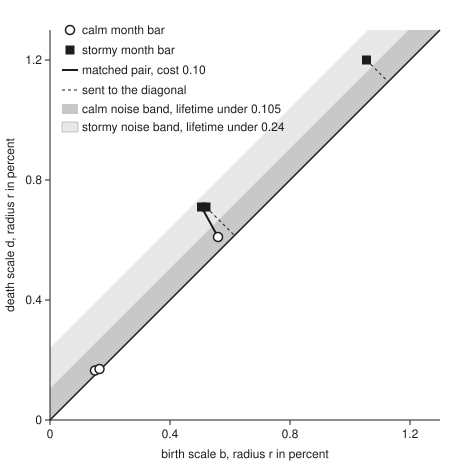
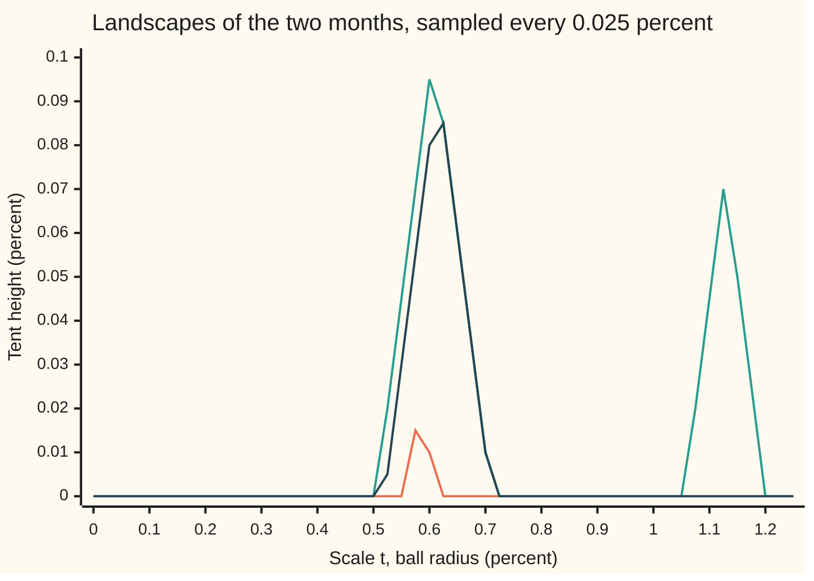

# Comparing diagrams: bottleneck distance, landscapes, images, and honest error bars

[Syllabus](../../../SYLLABUS.md) → [Topology](../README.md) → [Topological Data Analysis](../README.md#s06) → Comparing diagrams

---

## General Overview

Take two months of daily returns on a stock index. A **return** is the day's change in price, in percent. In the calm month a typical day moves 0.52%. In the stormy month it moves 1.44%. Both months are simulated by a small random-number generator, not taken from a market, so every number can be checked. Each has 21 trading days.

Cut each month into three-day windows: days 1 to 3, days 2 to 4, and so on. That gives 19 windows, each a point in three dimensions. The distance between two windows is the largest of their three day-by-day gaps: the worst-case distance $`d_\infty`$ of [The distance menu](../01-Metric%20Spaces/02-distances-on-vectors-and-functions.md). Elsewhere on this shelf windows are measured in straight lines; the worst gap is used here because it keeps every distance a whole number of basis points (hundredths of a percent), so the arithmetic is exact, and the stability theorem holds in any metric. The earlier cards on this shelf turn such a cloud into a **persistence diagram**: one dot for each loop in the cloud, placed at the scale where the loop appears and the scale where it fills in ([Persistence diagram and stability](04-persistence-diagrams-and-stability.md)). Each month has three loops.

Now the question this card answers: is the stormy month's shape really different, or is the difference noise? Three tools answer it.

- **A distance between diagrams.** The bottleneck distance pairs each dot of one diagram with a dot of the other, or deletes it, and reports the worst single move. Here it is 0.10%.
- **A fixed-length list of numbers.** A diagram can have any number of dots, so ordinary statistics cannot use it directly. A landscape turns it into 102 numbers and an image into 36.
- **An error bar.** Resampling the windows shows how far the diagram wobbles by chance. That wobble is 0.0525% for the calm month and 0.12% for the stormy one.

The verdict: none of the six loops is longer than its month's noise allows. The gap between the months, 0.10%, is smaller than their combined noise, 0.1725%. On 19 windows, the loops cannot tell these months apart, although their standard deviations (typical daily moves), 0.52% and 1.44%, differ almost threefold.

**Pair the dots of two diagrams, letting any dot retire to the diagonal at the cost of half its lifetime, and the largest move in the cheapest pairing is a distance; sample the diagram on a fixed grid and it becomes a vector; resample the data and the spread of that distance is the noise band a dot must clear.**

**What kind of fact this is:** three definitions (bottleneck distance, landscape, image), one theorem proved on this card in Why it works (a landscape moves no more than the bottleneck distance), one theorem quoted from [Persistence diagram and stability](04-persistence-diagrams-and-stability.md), and a method, the bootstrap band: a heuristic noise band modelled on the confidence sets in Sources, with no coverage guarantee claimed for it, here or in the source.

### The picture: two diagrams, one matching, two noise bands

<p align="center"></p>

Each dot is one loop: across is the scale where it appears, up is the scale where it fills in. The diagonal holds loops that die the moment they are born. The solid line is the one pair the cheapest matching makes, at cost 0.10%. Dashed lines are dots sent to the diagonal. The grey strips are the two noise bands. Every dot sits inside its own month's strip, so no loop counts as a feature.

---

## The formula

A diagram is a list of points $`p = (b, d)`$, one per bar $`[b, d)`$: the loop is born at scale $`b`$ and dies at scale $`d`$. Scales are the ball radius $`r`$, in percent: an edge joins two windows within $`2r`$ of each other. Bars are counted over ℤ mod 2, arithmetic where 1 + 1 = 0. The **diagonal** $`\Delta`$ is the line $`b = d`$. A **matching** $`\gamma`$ pairs each point of diagram $`A`$ with a point of diagram $`B`$ or with $`\Delta`$, and each point of $`B`$ that is left over with $`\Delta`$; no point is used twice.

```math
d_B(A, B) = \min_{\gamma}\ \max_{p}\ \lVert p - \gamma(p) \rVert_\infty, \qquad \lVert (b, d) - (b', d') \rVert_\infty = \max(\lvert b - b' \rvert, \lvert d - d' \rvert), \qquad \lVert (b, d) - \Delta \rVert_\infty = \tfrac{d - b}{2}
```

**Read it aloud:** "Over every way to pair the dots, or retire them to the diagonal, take the largest single move; the bottleneck distance is the smallest such largest move."

Retiring a dot costs half its **lifetime** $`d - b`$, because the nearest diagonal point to $`(b, d)`$ in the worst-coordinate distance is the midpoint $`\bigl(\tfrac{b+d}{2}, \tfrac{b+d}{2}\bigr)`$.

Two more formulas turn a diagram into numbers. The **landscape** stacks one tent per bar and reads off the k-th tallest:

```math
\lambda_k(t) = k\text{-th largest of } \max\bigl(0,\ \min(t - b,\ d - t)\bigr) \text{ over the bars}
```

**Read it aloud:** "At scale t, each bar stands as a tent of slope one rising from its birth and falling to its death; the k-th landscape is the k-th tallest tent at t."

The **noise band** comes from resampling. Let $`A^*`$ be the diagram of a resampled month:

```math
c = \text{the 95th percentile of } d_B(A, A^*) \text{ over 1,000 resamples}, \qquad \text{a bar is a feature when } d - b > 2c
```

**Read it aloud:** "Rebuild the diagram from resampled data a thousand times; the distance that 95 in 100 rebuilds stay within is the band, and only a bar longer than twice the band is called real."

| Symbol | Plain meaning | In our example | Push it up and the answer… |
| --- | --- | --- | --- |
| $`A, B`$ | the two diagrams being compared | calm month A, stormy month B, 3 dots each | more dots: more to pair or retire |
| $`p = (b, d)`$, $`r`$ | one bar: born at scale $`b`$, dead at $`d`$; scales are the ball radius $`r`$, in percent | A2 = (0.56, 0.61) | a later death moves the dot up, away from $`\Delta`$ |
| $`d - b`$ | lifetime: how long the loop lasts | A2: 0.05; B0: 0.205 | longer bars cost more to retire |
| $`\gamma`$, $`\Delta`$ | a matching: dot to dot, or dot to the diagonal $`\Delta`$, where bars die as they are born | A2 ↔ B0, the other four to $`\Delta`$ | — |
| $`\lVert\cdot\rVert_\infty`$ | the larger of the two coordinate gaps | A2 to B0: max(0.055, 0.10) = 0.10 | — |
| $`d_B`$, $`\varepsilon`$ | bottleneck distance: the worst move in the best matching; $`\varepsilon`$ is a trial value for it | 0.10% | rises as the diagrams drift apart |
| $`W_1`$ | Wasserstein distance: the sum of moves instead of the worst | 0.2775% | rises with every move, not only the worst |
| $`\lambda_k(t)`$, $`k`$, $`t`$ | the k-th landscape at scale $`t`$ | stormy $`\lambda_1(0.60) = 0.095`$ | larger $`k`$ reads lower tents |
| $`I`$, $`\sigma`$, $`(x, y)`$ | persistence image: 36 pixel values, bump standard deviation $`\sigma`$, pixel centre $`(x, y)`$ | $`\sigma`$ = 0.1%; months 3.3635 apart | wider bumps blur dots together |
| $`X`$, $`Y`$, $`\mathrm{Dgm}`$, $`d_H`$ | two clouds of windows; the diagram of a cloud; the Hausdorff distance between clouds | a month and its resample | a larger $`d_H`$ allows a larger $`d_B`$ |
| $`A^*`$, $`c`$, $`D`$ | a resampled month's diagram; the noise band, 95th percentile of $`d_B(A, A^*)`$; $`D`$ is the unseen true diagram | 1,000 resamples; calm 0.0525%, stormy 0.12% | a wider band makes fewer features |

### When it holds

- **Both diagrams use the same filtration and the same scale.** Mix the ball radius with the diameter, as some software reports, and every distance doubles: 0.10% becomes 0.20%.
- **Every bar is finite.** Loop bars here all die, because the full complex has no loops. A bar that never dies, such as the one component that survives in $`H_0`$, can only be matched to another endless bar; treat those apart.
- **The resampled windows behave like independent draws.** Overlapping windows share days, so they are not independent. The band then comes out too narrow. Resampling whole blocks of days is the usual repair.
- **The band is read as a rough guide.** No theorem gives this band 95% coverage, here or in its source. A resample drawn with replacement, repeats dropped, is only a subset of the month's windows, so the band measures how far the diagram moves when windows go missing. With 19 overlapping windows it is a rough guide, not a guarantee.
- **Vectors are built on one fixed grid.** Landscapes and images can only be compared when they use the same grid, bump width and weight. A grid step wider than a bar can skip the bar entirely.

---

## Why it works

### Step 0: let short bars retire

Two diagrams rarely have the same number of dots, so they cannot be subtracted list by list. The fix is the diagonal. A short bar is almost no loop at all and sits just above it. Let it slide onto the diagonal, and charge the distance it slides: half its lifetime.

Now any two diagrams line up. Each dot pairs with a dot of the other diagram or retires. The bottleneck distance judges a pairing by its single worst move, which suits a question about the longest loops.

### Step 1: the diagonal trick makes a square table

Give each diagram one diagonal slot for every dot of the other. Diagram A has 3 dots and B has 3, so the table is 6 by 6.

- Dot to dot costs the worst-coordinate gap.
- Dot to any diagonal slot costs half the dot's lifetime.
- Diagonal slot to diagonal slot costs 0.

Every matching of the diagrams is now one way to pair rows with columns. This is the shape of [The assignment problem](../../14-Applied%20and%20computational/05-Operations%20Research/05-assignment-and-the-hungarian-algorithm.md). Minimise the sum of the costs and you get $`W_1`$, which the Hungarian method solves. Minimise the largest cost and you get $`d_B`$.

The largest-cost version has a simpler solver. Its answer is one of the table's entries. For a trial value $`\varepsilon`$, keep only entries at most $`\varepsilon`$ and ask whether every row can still be paired. If that works for $`\varepsilon`$, it works for anything larger, so walk up the sorted entries and stop at the first that works. The pairing test adds one augmenting path at a time: a chain of reassignments that ends at a free column, matching one more row. When no chain exists, the matching is as large as it can be: Berge's theorem, proved on [Matchings](../../04-Combinatorics%20and%20graphs/13-Matchings%20and%20Flows/01-matchings-and-augmenting-paths.md).

### Step 2: it is a distance, and the data cannot move it far

The bottleneck distance is 0 only between equal diagrams, apart from dots on the diagonal. It is symmetric. It obeys the triangle inequality.

<details>
<summary>Detailed proof: the triangle inequality</summary>

Take diagrams A, B and C. Let $`\gamma_1`$ match A to B with worst move $`d_B(A, B)`$, and $`\gamma_2`$ match B to C with worst move $`d_B(B, C)`$.

Follow each dot of A through $`\gamma_1`$ and then $`\gamma_2`$. If it reaches a dot of C, the worst-coordinate distance obeys the ordinary triangle inequality:

$`\displaystyle \lVert p - \gamma_2(\gamma_1(p)) \rVert_\infty \le \lVert p - \gamma_1(p) \rVert_\infty + \lVert \gamma_1(p) - \gamma_2(\gamma_1(p)) \rVert_\infty \le d_B(A, B) + d_B(B, C).`$

If it reaches the diagonal at either stage, send it to the diagonal. The distance from a point to the diagonal is at most its distance to any point plus that point's distance to the diagonal, so the same bound holds. Dots of C reached from no dot of A retire the same way. The composed matching has worst move at most $`d_B(A, B) + d_B(B, C)`$, and the cheapest matching from A to C is no worse.

</details>

The reason to use this distance is stability, stated on [Persistence diagram and stability](04-persistence-diagrams-and-stability.md), which proves its counting half and quotes this form for clouds of points from its source. If every point of each cloud lies within some distance of the other cloud, the diagrams are at most that far apart in bottleneck distance. Here, with scales as ball radii:

```math
d_B\bigl(\mathrm{Dgm}(X), \mathrm{Dgm}(Y)\bigr) \le d_H(X, Y)
```

Here $`d_H`$ is the **Hausdorff distance** between the clouds X and Y: how far the furthest point of either lies from the other ([The distance menu](../01-Metric%20Spaces/02-distances-on-vectors-and-functions.md)), and $`\mathrm{Dgm}(X)`$ is the diagram of cloud X. The code checks this on all 2,000 resamples. That illustrates the theorem on 2,000 cases; it proves nothing new. The bound holds with a wide margin: the largest ratio $`d_B / d_H`$ is 0.159, so here it is far too loose to serve as a noise band.

### Step 3: landscapes turn a diagram into a function

Stand each bar up as a tent: zero at its birth, peaking at half its lifetime in the middle, zero again at its death. At each scale $`t`$, the tallest tent is $`\lambda_1(t)`$, the second $`\lambda_2(t)`$, and so on. Sample them on a fixed grid and the diagram becomes a vector of fixed length, whatever its number of dots.

Here the grid runs from 0 to 1.25% in steps of 0.025%: 51 scales, two levels, 102 numbers.



Orange: calm month, $`\lambda_1`$. Teal: stormy month, $`\lambda_1`$. Dark blue: stormy month, $`\lambda_2`$. The calm month's only visible tent is its loop near 0.58%, 0.015% high on the grid. Its two tiny loops near 0.16% fall between grid points and vanish from the vector. The calm $`\lambda_2`$ is zero at every grid point, so it is not drawn.

The landscape inherits stability from the diagram:

```math
\sup_t \bigl\lvert \lambda_k^A(t) - \lambda_k^B(t) \bigr\rvert \le d_B(A, B) \quad \text{for every } k
```

Here $`\sup`$ is the largest value over all scales.

<details>
<summary>Detailed proof: landscapes move no more than the bottleneck distance</summary>

Take a matching $`\gamma`$ with worst move $`\varepsilon`$. Fix a scale $`t`$.

A tent's height at $`t`$ is $`\max(0, \min(t - b, d - t))`$. Shift $`b`$ and $`d`$ each by at most $`\varepsilon`$ and each of $`t - b`$ and $`d - t`$ moves by at most $`\varepsilon`$. Taking a minimum, then a maximum with 0, cannot enlarge a change. So a matched pair's tents differ by at most $`\varepsilon`$ at $`t`$.

A dot sent to the diagonal has half-lifetime at most $`\varepsilon`$. Its tent never rises above its half-lifetime, so it differs from the flat zero tent by at most $`\varepsilon`$.

Pad both lists of tent heights with zeros so the matching pairs them one to one. Two lists whose paired entries differ by at most $`\varepsilon`$ have k-th largest entries that differ by at most $`\varepsilon`$: if the k-th largest of A were more than $`\varepsilon`$ above that of B, then A's top k entries would all exceed B's k-th largest by more than $`\varepsilon`$, and their k partners in B would all exceed B's k-th largest, which is too many. Swap A and B for the other direction. So $`\lvert \lambda_k^A(t) - \lambda_k^B(t) \rvert \le \varepsilon`$ at every $`t`$. Take the best matching, $`\varepsilon = d_B(A, B)`$.

</details>

On the grid the gaps are 0.085% for $`\lambda_1`$ and 0.085% for $`\lambda_2`$, both under $`d_B = 0.10\%`$.

### Step 4: images turn a diagram into a picture

Redraw each dot at (birth, lifetime), so the diagonal becomes the floor. Put a bell-shaped bump with standard deviation $`\sigma`$ = 0.1% on each dot, weighted by its lifetime over 0.2%, capped at 1. Read the total height at the centre $`(x, y)`$ of each pixel in a 12-by-3 grid of 0.1% squares:

```math
I(x, y) = \sum_{\text{bars } [b, d)} \min\Bigl(\frac{d - b}{0.2}, 1\Bigr) \exp\Bigl(-\frac{(x - b)^2 + \bigl(y - (d - b)\bigr)^2}{2\sigma^2}\Bigr)
```

The bump is not divided by its volume, so each dot adds at most its weight to a pixel. (The source adds up the bump over each pixel; reading the centre is a common shortcut.)

That gives 36 numbers per month. The stormy month's brightest pixel is 1.615, at birth 0.5% to 0.6% and lifetime 0.1% to 0.2%: its two loops born near 0.51%. The two images are 3.3635 apart in straight-line distance.

The weight makes images stable. A dot near the floor adds almost nothing, so creating or deleting it barely changes the picture. The source proves the image moves by at most a constant times $`W_1`$; many small moves can add up, so $`d_B`$ alone does not bound it.

### Step 5: the bootstrap band

The [Bootstrap](../../09-Probability%20and%20statistics/07-Sampling%20and%20Estimation/08-bootstrap.md) redraws a sample from itself, with replacement. What is new here is what gets measured: the bottleneck distance between the month's diagram and the resampled one.

1. Draw 19 windows from the month's 19, with replacement.
2. Drop repeats: a repeated point adds nothing to the complex.
3. Build the resample's diagram $`A^*`$.
4. Record $`d_B(A, A^*)`$.
5. Repeat 1,000 times and take the 95th percentile. That is $`c`$.

The idea: the resample is to the month as the month is to the true process. If that held, the true diagram would be within $`c`$ of the month's about 95% of the time; no theorem says it holds here (see When it holds). A dot within $`c`$ of the diagonal might be absent from the truth. Only a dot whose lifetime exceeds $`2c`$ counts as a **feature**.

One band covers all the dots at once, because it bounds the worst move over every dot. No per-dot correction for [Many tests](../../09-Probability%20and%20statistics/08-Confidence%20Intervals%20and%20Tests/08-multiple-testing.md) is needed.

Comparing two months is different. If both came from one true diagram D, the triangle inequality gives $`d_B(A, B) \le d_B(A, D) + d_B(D, B)`$, so two bands must hold at once. By the union bound, take each at 97.5% and both hold with at least 95% confidence. The months differ beyond noise only if $`d_B(A, B)`$ exceeds the sum of the two 97.5% bands.

---

## Worked numbers, by hand

Calm dots, as (birth, death) in percent: A0 = (0.15, 0.165), A1 = (0.165, 0.17), A2 = (0.56, 0.61). Stormy dots: B0 = (0.505, 0.71), B1 = (0.52, 0.71), B2 = (1.055, 1.20).

| Step | Arithmetic | Value |
| --- | --- | --- |
| retire A0, A1, A2 | half-lifetimes 0.015/2, 0.005/2, 0.05/2 | 0.0075, 0.0025, 0.0250 |
| retire B0, B1, B2 | half-lifetimes 0.205/2, 0.19/2, 0.145/2 | 0.1025, 0.0950, 0.0725 |
| pair A2 with B0 | max(0.56 − 0.505, 0.71 − 0.61) = max(0.055, 0.10) | 0.1000 |
| pair A2 with B1 | max(0.04, 0.10) | 0.1000 |
| pair A0 or A1 with B0 | max(0.355, 0.545), max(0.34, 0.54) | 0.5450, 0.5400 |
| lower bound | B0 must retire (0.1025) or pair; its cheapest pair is A2 (0.10) | at least 0.1000 |
| a plan that meets it | A2 ↔ B0; B1, B2, A0, A1 retire: max(0.10, 0.095, 0.0725, 0.0075, 0.0025) | 0.1000 |
| **bottleneck distance** | lower bound met | **0.1000%** |
| $`W_1`$: this plan is also cheapest in total | 0.0075 + 0.0025 + 0.10 + 0.095 + 0.0725 | 0.2775% |
| calm features | lifetimes 0.015, 0.005, 0.05 against 2 × 0.0525 = 0.105 | 0 |
| stormy features | lifetimes 0.205, 0.19, 0.145 against 2 × 0.12 = 0.24 | 0 |
| months compared | 0.10 against 0.0525 + 0.12 (both bands at 97.5%) | 0.10 < 0.1725 |

The two diagrams are 0.10% apart in the worst move, but each month's own diagram wobbles by up to 0.0525% and 0.12% under resampling. The difference between the months is within noise, and neither month has a loop that clears its band.

### What breaks if you drop a piece

| Mistake | Comes out at | What went wrong |
| --- | --- | --- |
| Match dots only to dots, no diagonal | 0.5900% | B2 is forced onto a calm dot, the nearest 0.59% away; with unequal counts no matching exists at all |
| Report scales as diameters, as some software does | 0.2000% | every scale doubles, so the distance doubles; the stability constant doubles with it |
| Call a bar real when its lifetime beats c, not 2c | 3 stormy "features" | lifetimes 0.205, 0.19 and 0.145 all beat 0.12; the band is a half-lifetime, so lifetime must beat 0.24 |
| Compare the months by counting bars | 3 and 3: "the same" | a count ignores where the dots sit; the bottleneck distance is 0.10% |

---

## Code, from first principles, and it actually runs

The script simulates both months from a written-out random generator (SplitMix64, seed 36), so Python and Rust draw identical numbers. It builds each diagram by reducing the boundary columns mod 2, as in [The persistence algorithm](03-the-persistence-algorithm.md). All scales are whole numbers of quarter basis points (a basis point is 0.01%), so every distance is exact. It takes these roads:

1. **Bottleneck, two ways.** The threshold walk with augmenting paths, against all 720 pairings of the 6-by-6 table.
2. **The bars, two ways.** The column reduction, against a fresh count of loops at every bar end: edges, minus points, plus pieces, minus the rank of the triangles mod 2.
3. **Two stability theorems, checked on cases.** The landscape gap against $`d_B`$ on 102 grid values, and $`d_B`$ against the Hausdorff distance on 2,000 resamples.

The asserts fail if either road disagrees, if the hand answers of 0.10% and 0.2775% move, or if either stability bound is broken.

### Python

```python
# Comparing persistence diagrams -- the check behind the card.  Nothing is
# imported but math.  Two SIMULATED months of daily returns (basis points,
# SplitMix64 seed 36) become clouds of three-day windows under the largest-
# single-day-gap distance.  Their H1 bars (Rips, scale r = ball radius, over Z
# mod 2) are compared by bottleneck distance two ways (threshold + matching,
# and every permutation), turned into landscapes and images, and given a
# bootstrap noise band.  Scales are held as integers in quarter basis points.
import math
M64 = (1 << 64) - 1
class SplitMix64:
    def __init__(s, seed): s.x = seed
    def below(s, n):
        s.x = (s.x + 0x9E3779B97F4A7C15) & M64; z = s.x
        z = ((z ^ (z >> 30)) * 0xBF58476D1CE4E5B9) & M64
        z = ((z ^ (z >> 27)) * 0x94D049BB133111EB) & M64
        return (z ^ (z >> 31)) % n
def month(g, s): return [sum(g.below(2 * s + 1) - s for _ in range(4)) for _ in range(21)]
def windows(r): return [tuple(r[i:i + 3]) for i in range(len(r) - 2)]
def gap(p, q): return max(abs(a - b) for a, b in zip(p, q))
def pct(q): return "%s%d.%04d" % ("-" if q < 0 else "", abs(q) * 25 // 10000, abs(q) * 25 % 10000)
def h1_bars(X):  # an edge joins windows within 2r; bars kept as 4r in bp = 2 * gap
    n = len(X); E = sorted((gap(X[i], X[j]), i, j) for i in range(n) for j in range(i + 1, n))
    eid = {(i, j): k for k, (_, i, j) in enumerate(E)}
    T = sorted((max(E[e][0] for e in es), i, j, k, sorted(es)) for i in range(n)
               for j in range(i + 1, n) for k in range(j + 1, n)
               for es in [[eid[(i, j)], eid[(i, k)], eid[(j, k)]]])
    low, bars = {}, []
    for v, i, j, k, col in T:   # reduce each triangle's column of edges over Z mod 2
        while col and col[-1] in low: col = sorted(set(col) ^ set(low[col[-1]]))
        if col:
            low[col[-1]] = col
            if E[col[-1]][0] < v: bars.append((2 * E[col[-1]][0], 2 * v))
    return sorted(bars)
def augmented(P, Q):  # P's points + diagonal slots against Q's points + diagonal slots
    n, m = len(P), len(Q); C = [[0] * (n + m) for _ in range(n + m)]
    for i in range(n + m):
        for j in range(n + m):
            if i < n and j < m: C[i][j] = max(abs(P[i][0] - Q[j][0]), abs(P[i][1] - Q[j][1]))
            elif i < n: C[i][j] = (P[i][1] - P[i][0]) // 2
            elif j < m: C[i][j] = (Q[j][1] - Q[j][0]) // 2
    return C
def bottleneck(P, Q):  # road 1: smallest threshold that admits a perfect matching
    C = augmented(P, Q); k = len(C)
    for eps in sorted(set(v for row in C for v in row)):
        mate = [-1] * k
        def grow(i, seen):
            for j in range(k):
                if C[i][j] <= eps and j not in seen:
                    seen.add(j)
                    if mate[j] < 0 or grow(mate[j], seen): mate[j] = i; return True
            return False
        if all(grow(i, set()) for i in range(k)): return eps
def every_matching(C, i=0, used=(), worst=0, total=0, best=None):  # road 2: all n! pairings
    best = best if best is not None else [None, None, None]
    if i == len(C):
        if best[0] is None or worst < best[0]: best[0], best[2] = worst, used
        if best[1] is None or total < best[1]: best[1] = total
        return best
    for j in range(len(C)):
        if j not in used: every_matching(C, i + 1, used + (j,), max(worst, C[i][j]), total + C[i][j], best)
    return best
def betti1(X, D2):  # road 2 for the bars: loops alive at a diameter D2, by a fresh mod-2 rank
    n = len(X); E = [(i, j) for i in range(n) for j in range(i + 1, n) if gap(X[i], X[j]) <= D2]
    parent = list(range(n))
    def root(a): return a if parent[a] == a else root(parent[a])
    for i, j in E: parent[root(i)] = root(j)
    bit = {e: 1 << k for k, e in enumerate(E)}; basis = {}
    for i, j, k in ((i, j, k) for i in range(n) for j in range(i + 1, n) for k in range(j + 1, n)):
        if (i, k) in bit and (j, k) in bit and (i, j) in bit:
            v = bit[(i, j)] | bit[(i, k)] | bit[(j, k)]
            while v and v.bit_length() in basis: v ^= basis[v.bit_length()]
            if v: basis[v.bit_length()] = v
    return len(E) - n + sum(1 for a in range(n) if root(a) == a) - len(basis)
def landscape(D, k, t): return sorted([max(0, min(t - b, d - t)) for b, d in D] + [0, 0], reverse=True)[k - 1]
def image(D, two_var=0.02):  # 12 x 3 pixels of 0.1 percent; bump sd 0.1 percent; weight = persistence / 0.2, capped at 1
    px = []
    for row in range(3):
        for col in range(12):
            x, y = 0.05 + 0.1 * col, 0.05 + 0.1 * row
            px.append(sum(min((d - b) / 80, 1) * math.exp(-((x - b / 400) ** 2 + (y - (d - b) / 400) ** 2) / two_var) for b, d in D))
    return px

g = SplitMix64(36)
calm, storm = month(g, 50), month(g, 170)
Xa, Xb = windows(calm), windows(storm)
Da, Db = h1_bars(Xa), h1_bars(Xb)
for name, r, D in (("calm", calm, Da), ("storm", storm, Db)):
    sd = math.sqrt(sum(x * x for x in r) / len(r) - (sum(r) / len(r)) ** 2) / 100
    print("%-5s returns (bp): %s" % (name, " ".join(map(str, r))))
    print("%-5s daily sd %.2f%%, H1 bars (r, %%): %s" % (name, sd, "  ".join("[%s, %s)" % (pct(b), pct(d)) for b, d in D)))
for X, D in ((Xa, Da), (Xb, Db)):  # check the bars against a fresh count at every bar end
    for D2 in sorted({v // 2 for bar in D for v in bar} | {v // 2 - 1 for bar in D for v in bar}):
        assert betti1(X, D2) == sum(1 for b, d in D if b <= 2 * D2 < d), D2
C = augmented(Da, Db)
dB = bottleneck(Da, Db); worst, total, plan = every_matching(C)
print("half-lifetimes calm:", " ".join(pct(C[i][len(Db)]) for i in range(len(Da))), " storm:", " ".join(pct(C[len(Da)][j]) for j in range(len(Db))))
for i in range(len(Da)): print("cost A%d to B0 B1 B2: %s" % (i, " ".join(pct(C[i][j]) for j in range(len(Db)))))
print("bottleneck d_B: threshold road %s%%, all %d matchings %s%%" % (pct(dB), math.factorial(len(C)), pct(worst)))
print("best plan:", ", ".join("%s->%s cost %s" % ("A%d" % i if i < len(Da) else "diag", "B%d" % j if j < len(Db) else "diag", pct(C[i][j])) for i, j in enumerate(plan) if i < len(Da) or j < len(Db)))
print("Wasserstein W_1 (sum of costs) %s%%" % pct(total))
assert dB == worst == 40  # two roads, and the hand answer of 0.1000 percent
assert total == 111  # the hand W_1 of 0.2775 percent: pins every half-lifetime cost
no_diag = every_matching([[C[i][j] for j in range(len(Db))] for i in range(len(Da))])[0]
print("breaks, no diagonal %s%%; diameter scale %s%%; bar counts %d and %d" % (pct(no_diag), pct(2 * dB), len(Da), len(Db)))
grid = [10 * k for k in range(51)]
for name, D in (("calm", Da), ("storm", Db)):
    for k in (1, 2):
        print("chart, lambda%d %-5s %s" % (k, name, " ".join(pct(landscape(D, k, t)) for t in grid)))
sup = [max(abs(landscape(Da, k, t) - landscape(Db, k, t)) for t in grid) for k in (1, 2)]
print("landscape vector length %d; sup gaps lambda1 %s%%, lambda2 %s%% (both <= d_B)" % (2 * len(grid), pct(sup[0]), pct(sup[1])))
assert sup[0] <= dB and sup[1] <= dB
Ia, Ib = image(Da), image(Db)
for name, I in (("calm", Ia), ("storm", Ib)):
    for row in range(3): print("image %-5s row %d: %s" % (name, row, " ".join("%.3f" % v for v in I[12 * row:12 * row + 12])))
print("image vector length %d; distance between months %.4f" % (len(Ia), math.sqrt(sum((a - b) ** 2 for a, b in zip(Ia, Ib)))))
B, bands, checked, ratio = 1000, {}, 0, 0.0
for name, X, D in (("calm", Xa, Da), ("storm", Xb, Db)):
    ds = []
    for _ in range(B):
        Y = [X[i] for i in sorted(set(g.below(len(X)) for _ in range(len(X))))]
        ds.append(bottleneck(D, h1_bars(Y)))
        dH = max(min(gap(x, y) for y in Y) for x in X)
        assert ds[-1] <= 4 * dH; checked += 1; ratio = max(ratio, ds[-1] / (4 * dH or 1))  # stability: d_B <= d_H, both in r
    ds.sort(); bands[name] = (ds[949], ds[974], ds[989])
    feats = sum(1 for b, d in D if (d - b) // 2 > ds[949])
    loose = sum(1 for b, d in D if d - b > ds[949])
    print("%-5s band c at 95%% %s%%, at 97.5%% %s%%; features (lifetime > 2c) %d; with lifetime > c %d" % (name, pct(ds[949]), pct(ds[974]), feats, loose))
both = bands["calm"][1] + bands["storm"][1]
print("compare: d_B %s%% against c_calm + c_storm at 97.5%% = %s%% -> %s" % (pct(dB), pct(both), "differ" if dB > both else "not separated from noise"))
print("stability d_B <= d_H checked on %d resamples; largest d_B / d_H %.3f" % (checked, ratio))
blk = [sorted(bottleneck(D, h1_bars(sorted(set(windows(sum((r[s:s + 3] for s in [g.below(19) for _ in range(7)]), []))))))
              for _ in range(B))[949] for r, D in ((calm, Da), (storm, Db))]  # trap: resample 3-day blocks of days
print("trap, resampling 3-day blocks of days: band at 95%% calm %s%%, storm %s%%" % (pct(blk[0]), pct(blk[1])))
d3 = bottleneck([(3 * b, 3 * d) for b, d in Da], Db); both3 = 3 * bands["calm"][1] + bands["storm"][1]
print("try, calm x3: d_B %s%% against %s%%" % (pct(d3), pct(both3)))
print("try, 99%% bands: calm %s%%, storm %s%%" % (pct(bands["calm"][2]), pct(bands["storm"][2])))
print("try, image sd 0.05: distance %.4f" % math.sqrt(sum((a - b) ** 2 for a, b in zip(image(Da, 0.005), image(Db, 0.005)))))
print("figure, points (b, d) %%: %s" % " ".join("(%s, %s)" % (pct(b), pct(d)) for b, d in Da + Db))
print("figure, band lines d = b + 2c: 2c = %s%% and %s%%" % (pct(2 * bands["calm"][0]), pct(2 * bands["storm"][0])))
print("ALL CHECKS PASS")
```

**Ran 2026-11-15 on macOS, Python 3.14.10, standard library only. All checks passed. Output, pasted from the run:**

```
calm  returns (bp): -89 -110 -7 23 -15 72 3 42 9 39 -99 4 38 37 42 35 75 71 -30 45 -7
calm  daily sd 0.52%, H1 bars (r, %): [0.1500, 0.1650)  [0.1650, 0.1700)  [0.5600, 0.6100)
storm returns (bp): 10 -324 12 -61 -31 -116 308 35 -2 135 -205 20 97 34 -45 45 -70 -106 35 -349 -161
storm daily sd 1.44%, H1 bars (r, %): [0.5050, 0.7100)  [0.5200, 0.7100)  [1.0550, 1.2000)
half-lifetimes calm: 0.0075 0.0025 0.0250  storm: 0.1025 0.0950 0.0725
cost A0 to B0 B1 B2: 0.5450 0.5450 1.0350
cost A1 to B0 B1 B2: 0.5400 0.5400 1.0300
cost A2 to B0 B1 B2: 0.1000 0.1000 0.5900
bottleneck d_B: threshold road 0.1000%, all 720 matchings 0.1000%
best plan: A0->diag cost 0.0075, A1->diag cost 0.0025, A2->B0 cost 0.1000, diag->B1 cost 0.0950, diag->B2 cost 0.0725
Wasserstein W_1 (sum of costs) 0.2775%
breaks, no diagonal 0.5900%; diameter scale 0.2000%; bar counts 3 and 3
chart, lambda1 calm  0.0000 0.0000 0.0000 0.0000 0.0000 0.0000 0.0000 0.0000 0.0000 0.0000 0.0000 0.0000 0.0000 0.0000 0.0000 0.0000 0.0000 0.0000 0.0000 0.0000 0.0000 0.0000 0.0000 0.0150 0.0100 0.0000 0.0000 0.0000 0.0000 0.0000 0.0000 0.0000 0.0000 0.0000 0.0000 0.0000 0.0000 0.0000 0.0000 0.0000 0.0000 0.0000 0.0000 0.0000 0.0000 0.0000 0.0000 0.0000 0.0000 0.0000 0.0000
chart, lambda2 calm  0.0000 0.0000 0.0000 0.0000 0.0000 0.0000 0.0000 0.0000 0.0000 0.0000 0.0000 0.0000 0.0000 0.0000 0.0000 0.0000 0.0000 0.0000 0.0000 0.0000 0.0000 0.0000 0.0000 0.0000 0.0000 0.0000 0.0000 0.0000 0.0000 0.0000 0.0000 0.0000 0.0000 0.0000 0.0000 0.0000 0.0000 0.0000 0.0000 0.0000 0.0000 0.0000 0.0000 0.0000 0.0000 0.0000 0.0000 0.0000 0.0000 0.0000 0.0000
chart, lambda1 storm 0.0000 0.0000 0.0000 0.0000 0.0000 0.0000 0.0000 0.0000 0.0000 0.0000 0.0000 0.0000 0.0000 0.0000 0.0000 0.0000 0.0000 0.0000 0.0000 0.0000 0.0000 0.0200 0.0450 0.0700 0.0950 0.0850 0.0600 0.0350 0.0100 0.0000 0.0000 0.0000 0.0000 0.0000 0.0000 0.0000 0.0000 0.0000 0.0000 0.0000 0.0000 0.0000 0.0000 0.0200 0.0450 0.0700 0.0500 0.0250 0.0000 0.0000 0.0000
chart, lambda2 storm 0.0000 0.0000 0.0000 0.0000 0.0000 0.0000 0.0000 0.0000 0.0000 0.0000 0.0000 0.0000 0.0000 0.0000 0.0000 0.0000 0.0000 0.0000 0.0000 0.0000 0.0000 0.0050 0.0300 0.0550 0.0800 0.0850 0.0600 0.0350 0.0100 0.0000 0.0000 0.0000 0.0000 0.0000 0.0000 0.0000 0.0000 0.0000 0.0000 0.0000 0.0000 0.0000 0.0000 0.0000 0.0000 0.0000 0.0000 0.0000 0.0000 0.0000 0.0000
landscape vector length 102; sup gaps lambda1 0.0850%, lambda2 0.0850% (both <= d_B)
image calm  row 0: 0.054 0.093 0.061 0.041 0.138 0.249 0.167 0.041 0.004 0.000 0.000 0.000
image calm  row 1: 0.023 0.039 0.026 0.022 0.083 0.151 0.101 0.025 0.002 0.000 0.000 0.000
image calm  row 2: 0.004 0.006 0.004 0.005 0.019 0.034 0.023 0.006 0.001 0.000 0.000 0.000
image storm row 0: 0.000 0.001 0.021 0.175 0.538 0.613 0.258 0.045 0.059 0.266 0.461 0.294
image storm row 1: 0.000 0.003 0.056 0.465 1.425 1.615 0.677 0.112 0.095 0.417 0.723 0.461
image storm row 2: 0.000 0.003 0.056 0.459 1.398 1.575 0.657 0.105 0.057 0.241 0.417 0.266
image vector length 36; distance between months 3.3635
calm  band c at 95% 0.0525%, at 97.5% 0.0525%; features (lifetime > 2c) 0; with lifetime > c 0
storm band c at 95% 0.1200%, at 97.5% 0.1200%; features (lifetime > 2c) 0; with lifetime > c 3
compare: d_B 0.1000% against c_calm + c_storm at 97.5% = 0.1725% -> not separated from noise
stability d_B <= d_H checked on 2000 resamples; largest d_B / d_H 0.159
trap, resampling 3-day blocks of days: band at 95% calm 0.0775%, storm 0.1875%
try, calm x3: d_B 0.1025% against 0.2775%
try, 99% bands: calm 0.0525%, storm 0.1300%
try, image sd 0.05: distance 1.6512
figure, points (b, d) %: (0.1500, 0.1650) (0.1650, 0.1700) (0.5600, 0.6100) (0.5050, 0.7100) (0.5200, 0.7100) (1.0550, 1.2000)
figure, band lines d = b + 2c: 2c = 0.1050% and 0.2400%
ALL CHECKS PASS
```

### Rust

```rust
// Comparing persistence diagrams -- the same check as the Python file, in Rust.
// Standard library only, no crates.  Two SIMULATED months of daily returns
// (basis points, SplitMix64 seed 36), three-day windows, largest-single-day-gap
// distance, H1 bars over Z mod 2, bottleneck two ways, landscapes, images and a
// bootstrap noise band.  Scales are i64 in quarter basis points.
use std::collections::{BTreeSet, HashMap};
type Bar = (i64, i64);
struct SplitMix64(u64);
impl SplitMix64 {
    fn below(&mut self, n: u64) -> u64 {
        self.0 = self.0.wrapping_add(0x9E3779B97F4A7C15); let mut z = self.0;
        z = (z ^ (z >> 30)).wrapping_mul(0xBF58476D1CE4E5B9); z = (z ^ (z >> 27)).wrapping_mul(0x94D049BB133111EB);
        (z ^ (z >> 31)) % n
    }
}
fn month(g: &mut SplitMix64, s: i64) -> Vec<i64> { (0..21).map(|_| (0..4).map(|_| g.below((2 * s + 1) as u64) as i64 - s).sum()).collect() }
fn windows(r: &[i64]) -> Vec<[i64; 3]> { (0..r.len() - 2).map(|i| [r[i], r[i + 1], r[i + 2]]).collect() }
fn gap(p: &[i64; 3], q: &[i64; 3]) -> i64 { (0..3).map(|i| (p[i] - q[i]).abs()).max().unwrap() }
fn pct(q: i64) -> String { format!("{}{}.{:04}", if q < 0 { "-" } else { "" }, q.abs() * 25 / 10000, q.abs() * 25 % 10000) }
fn xor(a: &[usize], b: &[usize]) -> Vec<usize> { // mod-2 sum of two sorted index lists, sorted again
    a.iter().copied().collect::<BTreeSet<_>>().symmetric_difference(&b.iter().copied().collect()).copied().collect()
}
fn h1_bars(x: &[[i64; 3]]) -> Vec<Bar> { // an edge joins windows within 2r; bars kept as 4r in bp = 2 * gap
    let n = x.len(); let mut e: Vec<(i64, usize, usize)> = vec![];
    for i in 0..n { for j in i + 1..n { e.push((gap(&x[i], &x[j]), i, j)); } }
    e.sort();
    let mut eid = vec![vec![0usize; n]; n];
    for (k, &(_, i, j)) in e.iter().enumerate() { eid[i][j] = k; }
    let mut t: Vec<(i64, usize, usize, usize, Vec<usize>)> = vec![];
    for i in 0..n { for j in i + 1..n { for k in j + 1..n {
        let mut es = vec![eid[i][j], eid[i][k], eid[j][k]]; es.sort();
        t.push((es.iter().map(|&q| e[q].0).max().unwrap(), i, j, k, es));
    } } }
    t.sort();
    let (mut low, mut bars): (HashMap<usize, Vec<usize>>, Vec<Bar>) = (HashMap::new(), vec![]);
    for (v, _, _, _, mut col) in t { // reduce each triangle's column of edges over Z mod 2
        while let Some(l) = col.last().copied() { if let Some(c) = low.get(&l) { col = xor(&col, c); } else { break; } }
        if let Some(&l) = col.last() { if e[l].0 < v { bars.push((2 * e[l].0, 2 * v)); } low.insert(l, col); }
    }
    bars.sort(); bars
}
fn augmented(p: &[Bar], q: &[Bar]) -> Vec<Vec<i64>> { // points + diagonal slots, both sides
    let (n, m) = (p.len(), q.len()); let mut c = vec![vec![0i64; n + m]; n + m];
    for i in 0..n + m { for j in 0..n + m {
        c[i][j] = if i < n && j < m { (p[i].0 - q[j].0).abs().max((p[i].1 - q[j].1).abs()) }
            else if i < n { (p[i].1 - p[i].0) / 2 } else if j < m { (q[j].1 - q[j].0) / 2 } else { 0 };
    } }
    c
}
fn grow(i: usize, c: &[Vec<i64>], eps: i64, seen: &mut Vec<bool>, mate: &mut Vec<i64>) -> bool {
    for j in 0..c.len() { if c[i][j] <= eps && !seen[j] {
        seen[j] = true;
        if mate[j] < 0 || grow(mate[j] as usize, c, eps, seen, mate) { mate[j] = i as i64; return true; }
    } }
    false
}
fn bottleneck(p: &[Bar], q: &[Bar]) -> i64 { // road 1: smallest threshold that admits a perfect matching
    let (c, k) = (augmented(p, q), p.len() + q.len());
    let eps: BTreeSet<i64> = c.iter().flatten().copied().collect();
    *eps.iter().find(|&&e| { let mut mate = vec![-1i64; k]; (0..k).all(|i| grow(i, &c, e, &mut vec![false; k], &mut mate)) }).unwrap()
}
fn every_matching(c: &[Vec<i64>], i: usize, used: &mut Vec<usize>, worst: i64, total: i64, best: &mut (i64, i64, Vec<usize>)) {
    if i == c.len() { // road 2: all n! pairings
        if worst < best.0 { best.0 = worst; best.2 = used.clone(); }
        best.1 = best.1.min(total); return;
    }
    for j in 0..c.len() { if !used.contains(&j) {
        used.push(j); every_matching(c, i + 1, used, worst.max(c[i][j]), total + c[i][j], best); used.pop();
    } }
}
fn best_of(c: &[Vec<i64>]) -> (i64, i64, Vec<usize>) { let mut b = (i64::MAX, i64::MAX, vec![]); every_matching(c, 0, &mut vec![], 0, 0, &mut b); b }
fn root(p: &[usize], a: usize) -> usize { if p[a] == a { a } else { root(p, p[a]) } }
fn betti1(x: &[[i64; 3]], d2: i64) -> i64 { // road 2 for the bars: loops alive at a diameter, by a fresh mod-2 rank
    let (n, mut idx) = (x.len(), HashMap::new());
    for i in 0..n { for j in i + 1..n { if gap(&x[i], &x[j]) <= d2 { idx.insert((i, j), idx.len()); } } }
    let mut parent: Vec<usize> = (0..n).collect();
    for &(i, j) in idx.keys() { let (a, b) = (root(&parent, i), root(&parent, j)); parent[a] = b; }
    let top = |v: &Vec<u64>| (0..v.len()).rev().find(|&w| v[w] != 0).map(|w| 64 * w + 63 - v[w].leading_zeros() as usize);
    let mut basis: HashMap<usize, Vec<u64>> = HashMap::new();
    for i in 0..n { for j in i + 1..n { for k in j + 1..n {
        if let (Some(&a), Some(&b), Some(&c)) = (idx.get(&(i, j)), idx.get(&(i, k)), idx.get(&(j, k))) {
            let mut v = vec![0u64; idx.len() / 64 + 1];
            for q in [a, b, c] { v[q / 64] |= 1 << (q % 64); }
            while let Some(h) = top(&v) { if let Some(w) = basis.get(&h) { for q in 0..v.len() { v[q] ^= w[q]; } } else { basis.insert(h, v); break; } }
        }
    } } }
    let comps = (0..n).filter(|&a| root(&parent, a) == a).count();
    (idx.len() + comps) as i64 - (n + basis.len()) as i64
}
fn landscape(d: &[Bar], k: usize, t: i64) -> i64 {
    let mut v: Vec<i64> = d.iter().map(|&(b, e)| 0.max((t - b).min(e - t))).chain([0, 0]).collect();
    v.sort_by(|a, b| b.cmp(a)); v[k - 1]
}
fn image(d: &[Bar], two_var: f64) -> Vec<f64> { // 12 x 3 pixels of 0.1 percent
    let mut px = vec![];
    for row in 0..3 { for col in 0..12 {
        let (x, y) = (0.05 + 0.1 * col as f64, 0.05 + 0.1 * row as f64);
        px.push(d.iter().map(|&(b, e)| ((e - b) as f64 / 80.0).min(1.0) * (-((x - b as f64 / 400.0).powi(2) + (y - (e - b) as f64 / 400.0).powi(2)) / two_var).exp()).sum());
    } }
    px
}
fn dist(a: &[f64], b: &[f64]) -> f64 { a.iter().zip(b).map(|(p, q)| (p - q).powi(2)).sum::<f64>().sqrt() }
fn main() {
    let mut g = SplitMix64(36);
    let (calm, storm) = (month(&mut g, 50), month(&mut g, 170));
    let (xa, xb) = (windows(&calm), windows(&storm)); let (da, db) = (h1_bars(&xa), h1_bars(&xb));
    for (name, r, d) in [("calm", &calm, &da), ("storm", &storm, &db)] {
        let (s, ss) = (r.iter().sum::<i64>() as f64, r.iter().map(|x| x * x).sum::<i64>() as f64);
        let sd = (ss / 21.0 - (s / 21.0).powi(2)).sqrt() / 100.0;
        println!("{:<5} returns (bp): {}", name, r.iter().map(|x| x.to_string()).collect::<Vec<_>>().join(" "));
        println!("{:<5} daily sd {:.2}%, H1 bars (r, %): {}", name, sd, d.iter().map(|&(b, e)| format!("[{}, {})", pct(b), pct(e))).collect::<Vec<_>>().join("  "));
    }
    for (x, d) in [(&xa, &da), (&xb, &db)] { // check the bars against a fresh count at every bar end
        let ends: BTreeSet<i64> = d.iter().flat_map(|&(b, e)| [b / 2, e / 2, b / 2 - 1, e / 2 - 1]).collect();
        for &d2 in &ends { assert_eq!(betti1(x, d2), d.iter().filter(|&&(b, e)| b <= 2 * d2 && 2 * d2 < e).count() as i64); }
    }
    let (na, nb, c, d_b) = (da.len(), db.len(), augmented(&da, &db), bottleneck(&da, &db)); let (worst, total, plan) = best_of(&c);
    println!("half-lifetimes calm: {}  storm: {}", (0..na).map(|i| pct(c[i][nb])).collect::<Vec<_>>().join(" "), (0..nb).map(|j| pct(c[na][j])).collect::<Vec<_>>().join(" "));
    for i in 0..na { println!("cost A{} to B0 B1 B2: {}", i, (0..nb).map(|j| pct(c[i][j])).collect::<Vec<_>>().join(" ")); }
    println!("bottleneck d_B: threshold road {}%, all {} matchings {}%", pct(d_b), (1..=c.len()).product::<usize>(), pct(worst));
    let steps: Vec<String> = plan.iter().enumerate().filter(|&(i, &j)| i < na || j < nb).map(|(i, &j)| format!("{}->{} cost {}",
        if i < na { format!("A{}", i) } else { "diag".into() }, if j < nb { format!("B{}", j) } else { "diag".into() }, pct(c[i][j]))).collect();
    println!("best plan: {}", steps.join(", "));
    println!("Wasserstein W_1 (sum of costs) {}%", pct(total));
    assert!(d_b == worst && worst == 40); // two roads, and the hand answer of 0.1000 percent
    assert_eq!(total, 111); // the hand W_1 of 0.2775 percent: pins every half-lifetime cost
    let no_diag = best_of(&(0..na).map(|i| c[i][..nb].to_vec()).collect::<Vec<_>>()).0;
    println!("breaks, no diagonal {}%; diameter scale {}%; bar counts {} and {}", pct(no_diag), pct(2 * d_b), na, nb);
    let grid: Vec<i64> = (0..51).map(|k| 10 * k).collect();
    for (name, d) in [("calm", &da), ("storm", &db)] { for k in [1, 2] {
        println!("chart, lambda{} {:<5} {}", k, name, grid.iter().map(|&t| pct(landscape(d, k, t))).collect::<Vec<_>>().join(" "));
    } }
    let sup: Vec<i64> = [1, 2].iter().map(|&k| grid.iter().map(|&t| (landscape(&da, k, t) - landscape(&db, k, t)).abs()).max().unwrap()).collect();
    println!("landscape vector length {}; sup gaps lambda1 {}%, lambda2 {}% (both <= d_B)", 2 * grid.len(), pct(sup[0]), pct(sup[1]));
    assert!(sup[0] <= d_b && sup[1] <= d_b);
    let (ia, ib) = (image(&da, 0.02), image(&db, 0.02));
    for (name, im) in [("calm", &ia), ("storm", &ib)] { for row in 0..3 {
        println!("image {:<5} row {}: {}", name, row, im[12 * row..12 * row + 12].iter().map(|v| format!("{:.3}", v)).collect::<Vec<_>>().join(" "));
    } }
    println!("image vector length {}; distance between months {:.4}", ia.len(), dist(&ia, &ib));
    let (mut bands, mut checked, mut ratio) = (vec![], 0, 0f64);
    for (name, x, d) in [("calm", &xa, &da), ("storm", &xb, &db)] {
        let mut ds = vec![];
        for _ in 0..1000 {
            let pick: BTreeSet<usize> = (0..x.len()).map(|_| g.below(x.len() as u64) as usize).collect();
            let y: Vec<[i64; 3]> = pick.iter().map(|&i| x[i]).collect();
            ds.push(bottleneck(d, &h1_bars(&y)));
            let d_h = x.iter().map(|p| y.iter().map(|q| gap(p, q)).min().unwrap()).max().unwrap();
            assert!(*ds.last().unwrap() <= 4 * d_h); checked += 1; ratio = ratio.max(*ds.last().unwrap() as f64 / (4 * d_h).max(1) as f64); // stability: d_B <= d_H, both in r
        }
        ds.sort(); bands.push((ds[949], ds[974], ds[989]));
        let feats = d.iter().filter(|&&(b, e)| (e - b) / 2 > ds[949]).count();
        let loose = d.iter().filter(|&&(b, e)| e - b > ds[949]).count();
        println!("{:<5} band c at 95% {}%, at 97.5% {}%; features (lifetime > 2c) {}; with lifetime > c {}", name, pct(ds[949]), pct(ds[974]), feats, loose);
    }
    let both = bands[0].1 + bands[1].1;
    println!("compare: d_B {}% against c_calm + c_storm at 97.5% = {}% -> {}", pct(d_b), pct(both), if d_b > both { "differ" } else { "not separated from noise" });
    println!("stability d_B <= d_H checked on {} resamples; largest d_B / d_H {:.3}", checked, ratio);
    let blk: Vec<i64> = [(&calm, &da), (&storm, &db)].into_iter().map(|(r, d)| { // trap: resample 3-day blocks of days
        let mut ds: Vec<i64> = (0..1000).map(|_| { let days: Vec<i64> = (0..7).flat_map(|_| { let s = g.below(19) as usize; r[s..s + 3].to_vec() }).collect();
            bottleneck(d, &h1_bars(&windows(&days).into_iter().collect::<BTreeSet<_>>().into_iter().collect::<Vec<_>>())) }).collect(); ds.sort(); ds[949] }).collect();
    println!("trap, resampling 3-day blocks of days: band at 95% calm {}%, storm {}%", pct(blk[0]), pct(blk[1]));
    let d3 = bottleneck(&da.iter().map(|&(b, e)| (3 * b, 3 * e)).collect::<Vec<_>>(), &db);
    println!("try, calm x3: d_B {}% against {}%", pct(d3), pct(3 * bands[0].1 + bands[1].1));
    println!("try, 99% bands: calm {}%, storm {}%", pct(bands[0].2), pct(bands[1].2));
    println!("try, image sd 0.05: distance {:.4}", dist(&image(&da, 0.005), &image(&db, 0.005)));
    println!("figure, points (b, d) %: {}", da.iter().chain(&db).map(|&(b, e)| format!("({}, {})", pct(b), pct(e))).collect::<Vec<_>>().join(" "));
    println!("figure, band lines d = b + 2c: 2c = {}% and {}%", pct(2 * bands[0].0), pct(2 * bands[1].0));
    println!("ALL CHECKS PASS");
}
```

**Ran 2026-11-15 on macOS, rustc 1.98.1, no crates. All checks passed. Output, pasted from the run:**

```
calm  returns (bp): -89 -110 -7 23 -15 72 3 42 9 39 -99 4 38 37 42 35 75 71 -30 45 -7
calm  daily sd 0.52%, H1 bars (r, %): [0.1500, 0.1650)  [0.1650, 0.1700)  [0.5600, 0.6100)
storm returns (bp): 10 -324 12 -61 -31 -116 308 35 -2 135 -205 20 97 34 -45 45 -70 -106 35 -349 -161
storm daily sd 1.44%, H1 bars (r, %): [0.5050, 0.7100)  [0.5200, 0.7100)  [1.0550, 1.2000)
half-lifetimes calm: 0.0075 0.0025 0.0250  storm: 0.1025 0.0950 0.0725
cost A0 to B0 B1 B2: 0.5450 0.5450 1.0350
cost A1 to B0 B1 B2: 0.5400 0.5400 1.0300
cost A2 to B0 B1 B2: 0.1000 0.1000 0.5900
bottleneck d_B: threshold road 0.1000%, all 720 matchings 0.1000%
best plan: A0->diag cost 0.0075, A1->diag cost 0.0025, A2->B0 cost 0.1000, diag->B1 cost 0.0950, diag->B2 cost 0.0725
Wasserstein W_1 (sum of costs) 0.2775%
breaks, no diagonal 0.5900%; diameter scale 0.2000%; bar counts 3 and 3
chart, lambda1 calm  0.0000 0.0000 0.0000 0.0000 0.0000 0.0000 0.0000 0.0000 0.0000 0.0000 0.0000 0.0000 0.0000 0.0000 0.0000 0.0000 0.0000 0.0000 0.0000 0.0000 0.0000 0.0000 0.0000 0.0150 0.0100 0.0000 0.0000 0.0000 0.0000 0.0000 0.0000 0.0000 0.0000 0.0000 0.0000 0.0000 0.0000 0.0000 0.0000 0.0000 0.0000 0.0000 0.0000 0.0000 0.0000 0.0000 0.0000 0.0000 0.0000 0.0000 0.0000
chart, lambda2 calm  0.0000 0.0000 0.0000 0.0000 0.0000 0.0000 0.0000 0.0000 0.0000 0.0000 0.0000 0.0000 0.0000 0.0000 0.0000 0.0000 0.0000 0.0000 0.0000 0.0000 0.0000 0.0000 0.0000 0.0000 0.0000 0.0000 0.0000 0.0000 0.0000 0.0000 0.0000 0.0000 0.0000 0.0000 0.0000 0.0000 0.0000 0.0000 0.0000 0.0000 0.0000 0.0000 0.0000 0.0000 0.0000 0.0000 0.0000 0.0000 0.0000 0.0000 0.0000
chart, lambda1 storm 0.0000 0.0000 0.0000 0.0000 0.0000 0.0000 0.0000 0.0000 0.0000 0.0000 0.0000 0.0000 0.0000 0.0000 0.0000 0.0000 0.0000 0.0000 0.0000 0.0000 0.0000 0.0200 0.0450 0.0700 0.0950 0.0850 0.0600 0.0350 0.0100 0.0000 0.0000 0.0000 0.0000 0.0000 0.0000 0.0000 0.0000 0.0000 0.0000 0.0000 0.0000 0.0000 0.0000 0.0200 0.0450 0.0700 0.0500 0.0250 0.0000 0.0000 0.0000
chart, lambda2 storm 0.0000 0.0000 0.0000 0.0000 0.0000 0.0000 0.0000 0.0000 0.0000 0.0000 0.0000 0.0000 0.0000 0.0000 0.0000 0.0000 0.0000 0.0000 0.0000 0.0000 0.0000 0.0050 0.0300 0.0550 0.0800 0.0850 0.0600 0.0350 0.0100 0.0000 0.0000 0.0000 0.0000 0.0000 0.0000 0.0000 0.0000 0.0000 0.0000 0.0000 0.0000 0.0000 0.0000 0.0000 0.0000 0.0000 0.0000 0.0000 0.0000 0.0000 0.0000
landscape vector length 102; sup gaps lambda1 0.0850%, lambda2 0.0850% (both <= d_B)
image calm  row 0: 0.054 0.093 0.061 0.041 0.138 0.249 0.167 0.041 0.004 0.000 0.000 0.000
image calm  row 1: 0.023 0.039 0.026 0.022 0.083 0.151 0.101 0.025 0.002 0.000 0.000 0.000
image calm  row 2: 0.004 0.006 0.004 0.005 0.019 0.034 0.023 0.006 0.001 0.000 0.000 0.000
image storm row 0: 0.000 0.001 0.021 0.175 0.538 0.613 0.258 0.045 0.059 0.266 0.461 0.294
image storm row 1: 0.000 0.003 0.056 0.465 1.425 1.615 0.677 0.112 0.095 0.417 0.723 0.461
image storm row 2: 0.000 0.003 0.056 0.459 1.398 1.575 0.657 0.105 0.057 0.241 0.417 0.266
image vector length 36; distance between months 3.3635
calm  band c at 95% 0.0525%, at 97.5% 0.0525%; features (lifetime > 2c) 0; with lifetime > c 0
storm band c at 95% 0.1200%, at 97.5% 0.1200%; features (lifetime > 2c) 0; with lifetime > c 3
compare: d_B 0.1000% against c_calm + c_storm at 97.5% = 0.1725% -> not separated from noise
stability d_B <= d_H checked on 2000 resamples; largest d_B / d_H 0.159
trap, resampling 3-day blocks of days: band at 95% calm 0.0775%, storm 0.1875%
try, calm x3: d_B 0.1025% against 0.2775%
try, 99% bands: calm 0.0525%, storm 0.1300%
try, image sd 0.05: distance 1.6512
figure, points (b, d) %: (0.1500, 0.1650) (0.1650, 0.1700) (0.5600, 0.6100) (0.5050, 0.7100) (0.5200, 0.7100) (1.0550, 1.2000)
figure, band lines d = b + 2c: 2c = 0.1050% and 0.2400%
ALL CHECKS PASS
```

The two outputs are identical, byte for byte.

### Lean

Lean proves the landscape bound of Step 3 and the triangle inequality of Step 2 for all finite diagrams, and checks the worked numbers.

- Take two diagrams $`A`$ and $`B`$, a level $`k`$ and a scale $`t`$. Then $`\lvert \lambda_k^A(t) - \lambda_k^B(t) \rvert \le d_B(A, B)`$.
- Take three diagrams $`A`$, $`B`$ and $`C`$. Then $`d_B(A, C) \le d_B(A, B) + d_B(B, C)`$.
- Counted in steps of 0.0025%, the calm and stormy months are exactly 0.10% apart in bottleneck distance.
- The calm half-lifetimes are 0.0075, 0.0025 and 0.025; the stormy ones are 0.1025, 0.095 and 0.0725.
- Pairing A2 with B0 or B1 costs 0.10%, and pairing A2 with B2 costs 0.59%.
- The plan A2 ↔ B0, with the other four retired, has worst move 0.10% and total cost 0.2775%.
- At scale 0.60%, the stormy tents stand 0.095%, 0.08% and 0.
- Take the bands 0.0525% and 0.12%. Then no lifetime beats twice its month's band, and 0.10% is under 0.1725%.

Building the diagrams from returns, the images, the bootstrap bands and the stability bound are left to the Python and Rust checks.

```lean
-- Comparing diagrams: every landscape level of two persistence diagrams differs by at most their bottleneck distance at every scale, the bottleneck distance obeys the triangle inequality, and the card's calm and stormy months are 0.10% apart.
import Mathlib.Algebra.Order.Archimedean.Real.Basic
import Mathlib.Data.Fintype.Option
import Mathlib.Data.Fintype.Pi
import Mathlib.Data.List.Sort
import Mathlib.Data.Fin.VecNotation
import Mathlib.Tactic.NormNum
import Mathlib.Data.Fintype.Order
import Mathlib.Tactic.FinCases
import Mathlib.Tactic.Linarith

namespace ComparingDiagrams

variable {m n l : ℕ}

/-- A persistence diagram with `m` dots: dot `i` is the bar `[b, d)`, stored as `(b, d)`. -/
abbrev Diagram (m : ℕ) := Fin m → ℝ × ℝ

/-- The worst-coordinate distance between two dots: the larger of the two coordinate gaps. -/
noncomputable def supDist (p q : ℝ × ℝ) : ℝ := max |p.1 - q.1| |p.2 - q.2|

/-- The cost of retiring a dot `(b, d)` to the diagonal: half its lifetime, `(d - b) / 2`. -/
noncomputable def halfLife (p : ℝ × ℝ) : ℝ := (p.2 - p.1) / 2

/-- A matching from `A` (with `m` dots) to `B` (with `n` dots): each dot of `A` goes to a dot of
`B` (`some j`) or to the diagonal (`none`), and no dot of `B` is used twice. Dots of `B` that no
dot of `A` reaches go to the diagonal. -/
def IsMatching (γ : Fin m → Option (Fin n)) : Prop :=
  ∀ i i' j, γ i = some j → γ i' = some j → i = i'

/-- The move of dot `i` of `A` under `γ`: to its partner in `B`, or to the diagonal. -/
noncomputable def moveA (A : Diagram m) (B : Diagram n) (γ : Fin m → Option (Fin n))
    (i : Fin m) : ℝ :=
  match γ i with
  | some j => supDist (A i) (B j)
  | none => halfLife (A i)

open Classical in
/-- The move of dot `j` of `B` under `γ`: nothing extra if some dot of `A` is paired with it
(that move is counted on the `A` side), otherwise its retirement to the diagonal. -/
noncomputable def moveB (B : Diagram n) (γ : Fin m → Option (Fin n)) (j : Fin n) : ℝ :=
  if ∃ i, γ i = some j then 0 else halfLife (B j)

/-- The worst single move of a matching (`0` when there is nothing to move). -/
noncomputable def worstMove (A : Diagram m) (B : Diagram n) (γ : Fin m → Option (Fin n)) : ℝ :=
  max 0 (max (⨆ i, moveA A B γ i) (⨆ j, moveB B γ j))

/-- The bottleneck distance `d_B(A, B)`: over every matching, the smallest worst move. -/
noncomputable def bottleneck (A : Diagram m) (B : Diagram n) : ℝ :=
  ⨅ γ : {γ : Fin m → Option (Fin n) // IsMatching γ}, worstMove A B γ.1

/-- A bar's tent at scale `t`: `max(0, min(t - b, d - t))`, slope one up from the birth `b`
and down to the death `d`. -/
noncomputable def tent (p : ℝ × ℝ) (t : ℝ) : ℝ := max 0 (min (t - p.1) (p.2 - t))

/-- The `k`-th landscape `λ_k(t)` (counting from `k = 1`): the `k`-th largest of the tents at
scale `t`, read as `0` when there are fewer than `k` bars (the list is padded with zeros). -/
noncomputable def landscape (D : Diagram m) (k : ℕ) (t : ℝ) : ℝ :=
  ((List.ofFn fun i => tent (D i) t).mergeSort (fun a b => decide (b ≤ a))).getD (k - 1) 0

/-! Helper lemmas for the proofs below. -/

open Finset

lemma supDist_comm (p q : ℝ × ℝ) : supDist p q = supDist q p := by
  simp [supDist, abs_sub_comm]
#print axioms supDist_comm

lemma supDist_triangle (p q r : ℝ × ℝ) : supDist p r ≤ supDist p q + supDist q r := by
  unfold supDist
  have h1 := abs_sub_le p.1 q.1 r.1
  have h2 := abs_sub_le p.2 q.2 r.2
  apply max_le
  · linarith [le_max_left |p.1 - q.1| |p.2 - q.2|, le_max_left |q.1 - r.1| |q.2 - r.2|]
  · linarith [le_max_right |p.1 - q.1| |p.2 - q.2|, le_max_right |q.1 - r.1| |q.2 - r.2|]
#print axioms supDist_triangle

lemma halfLife_le (p q : ℝ × ℝ) : halfLife p ≤ halfLife q + supDist p q := by
  unfold halfLife supDist
  have h1 := le_max_left |p.1 - q.1| |p.2 - q.2|
  have h2 := le_max_right |p.1 - q.1| |p.2 - q.2|
  have h3 := neg_abs_le (p.1 - q.1)
  have h4 := le_abs_self (p.2 - q.2)
  linarith
#print axioms halfLife_le

lemma tent_le_halfLife (p : ℝ × ℝ) (t : ℝ) : tent p t ≤ max 0 (halfLife p) := by
  unfold tent halfLife
  apply max_le_max le_rfl
  have := min_le_left (t - p.1) (p.2 - t)
  have := min_le_right (t - p.1) (p.2 - t)
  linarith
#print axioms tent_le_halfLife

lemma tent_le_of_halfLife_le {p : ℝ × ℝ} {ε : ℝ} (t : ℝ) (hε : 0 ≤ ε) (h : halfLife p ≤ ε) :
    tent p t ≤ ε :=
  (tent_le_halfLife p t).trans (max_le hε h)
#print axioms tent_le_of_halfLife_le

lemma abs_tent_sub_le (p q : ℝ × ℝ) (t : ℝ) : |tent p t - tent q t| ≤ supDist p q := by
  unfold tent supDist
  calc |max 0 (min (t - p.1) (p.2 - t)) - max 0 (min (t - q.1) (q.2 - t))|
      = |max (min (t - p.1) (p.2 - t)) 0 - max (min (t - q.1) (q.2 - t)) 0| := by
        rw [max_comm 0, max_comm 0]
    _ ≤ |min (t - p.1) (p.2 - t) - min (t - q.1) (q.2 - t)| := abs_max_sub_max_le_abs _ _ _
    _ ≤ max |(t - p.1) - (t - q.1)| |(p.2 - t) - (q.2 - t)| := abs_min_sub_min_le_max _ _ _ _
    _ = max |p.1 - q.1| |p.2 - q.2| := by
        rw [show (t - p.1) - (t - q.1) = -(p.1 - q.1) by ring, abs_neg,
          show (p.2 - t) - (q.2 - t) = p.2 - q.2 by ring]
#print axioms abs_tent_sub_le

lemma tent_le_tent_add (p q : ℝ × ℝ) (t : ℝ) : tent p t ≤ tent q t + supDist p q := by
  have := abs_tent_sub_le p q t
  rw [abs_le] at this
  linarith
#print axioms tent_le_tent_add

lemma worstMove_nonneg (A : Diagram m) (B : Diagram n) (γ : Fin m → Option (Fin n)) :
    0 ≤ worstMove A B γ := le_max_left _ _
#print axioms worstMove_nonneg

lemma moveA_le_worstMove (A : Diagram m) (B : Diagram n) (γ : Fin m → Option (Fin n))
    (i : Fin m) : moveA A B γ i ≤ worstMove A B γ :=
  le_max_of_le_right (le_max_of_le_left (le_ciSup (Finite.bddAbove_range _) i))
#print axioms moveA_le_worstMove

lemma moveB_le_worstMove (A : Diagram m) (B : Diagram n) (γ : Fin m → Option (Fin n))
    (j : Fin n) : moveB B γ j ≤ worstMove A B γ :=
  le_max_of_le_right (le_max_of_le_right (le_ciSup (Finite.bddAbove_range _) j))
#print axioms moveB_le_worstMove

lemma worstMove_le (A : Diagram m) (B : Diagram n) (γ : Fin m → Option (Fin n)) {c : ℝ}
    (h0 : 0 ≤ c) (hA : ∀ i, moveA A B γ i ≤ c) (hB : ∀ j, moveB B γ j ≤ c) :
    worstMove A B γ ≤ c :=
  max_le h0 (max_le (Real.iSup_le hA h0) (Real.iSup_le hB h0))
#print axioms worstMove_le

lemma isMatching_none : IsMatching (fun _ : Fin m => (none : Option (Fin n))) := by
  intro i i' j h
  simp at h
#print axioms isMatching_none

lemma bottleneck_le (A : Diagram m) (B : Diagram n) (γ : Fin m → Option (Fin n))
    (hγ : IsMatching γ) : bottleneck A B ≤ worstMove A B γ :=
  ciInf_le ⟨0, by rintro _ ⟨g, rfl⟩; exact worstMove_nonneg A B g.1⟩ (⟨γ, hγ⟩ :
    {γ : Fin m → Option (Fin n) // IsMatching γ})
#print axioms bottleneck_le

lemma le_bottleneck (A : Diagram m) (B : Diagram n) {c : ℝ}
    (h : ∀ γ : Fin m → Option (Fin n), IsMatching γ → c ≤ worstMove A B γ) :
    c ≤ bottleneck A B := by
  have : Nonempty {γ : Fin m → Option (Fin n) // IsMatching γ} := ⟨⟨_, isMatching_none⟩⟩
  exact le_ciInf fun g => h g.1 g.2
#print axioms le_bottleneck

lemma pairwise_sorted (l : List ℝ) :
    (l.mergeSort (fun a b => decide (b ≤ a))).Pairwise (fun a b => b ≤ a) := by
  have := List.pairwise_mergeSort (le := fun a b : ℝ => decide (b ≤ a))
    (fun a b c hab hbc => by simp at *; linarith) (fun a b => by simpa using le_total b a) l
  simpa using this
#print axioms pairwise_sorted

lemma countP_sorted (f : Fin m → ℝ) (x : ℝ) :
    ((List.ofFn f).mergeSort (fun a b => decide (b ≤ a))).countP (fun a => decide (x ≤ a)) =
      (univ.filter (fun i => x ≤ f i)).card := by
  rw [(List.mergeSort_perm _ _).countP_eq]
  have h : (List.ofFn f).countP (fun a => decide (x ≤ a)) =
      Multiset.countP (fun a => x ≤ a) ((univ : Finset (Fin m)).val.map f) := by
    rw [Fin.univ_val_map, Multiset.coe_countP]
  rw [h, Multiset.countP_map]
  rfl
#print axioms countP_sorted

lemma getD_nonneg (l : List ℝ) (hl : ∀ a ∈ l, 0 ≤ a) (r : ℕ) : 0 ≤ l.getD r 0 := by
  induction l generalizing r with
  | nil => simp
  | cons a l ih =>
    cases r with
    | zero => simpa using hl a (by simp)
    | succ r => simpa using ih (fun b hb => hl b (by simp [hb])) r
#print axioms getD_nonneg

lemma le_getD_of_count (l : List ℝ) (hl : l.Pairwise (fun a b => b ≤ a)) (r : ℕ) (x : ℝ)
    (h : r + 1 ≤ l.countP (fun a => decide (x ≤ a))) : x ≤ l.getD r 0 := by
  induction l generalizing r with
  | nil => simp at h
  | cons a l ih =>
    rw [List.pairwise_cons] at hl
    cases r with
    | zero =>
      simp only [List.getD_cons_zero]
      obtain ⟨b, hb, hxb⟩ := List.countP_pos_iff.mp
        (by omega : 0 < (a :: l).countP (fun c => decide (x ≤ c)))
      simp only [decide_eq_true_eq] at hxb
      rcases List.mem_cons.mp hb with rfl | hb
      · exact hxb
      · exact hxb.trans (hl.1 b hb)
    | succ r =>
      simp only [List.getD_cons_succ]
      apply ih hl.2
      rw [List.countP_cons] at h
      split_ifs at h <;> omega
#print axioms le_getD_of_count

lemma count_of_le_getD (l : List ℝ) (hl : l.Pairwise (fun a b => b ≤ a)) (r : ℕ) (x : ℝ)
    (hx : 0 < x) (h : x ≤ l.getD r 0) : r + 1 ≤ l.countP (fun a => decide (x ≤ a)) := by
  induction l generalizing r with
  | nil => simp at h; linarith
  | cons a l ih =>
    rw [List.pairwise_cons] at hl
    rw [List.countP_cons]
    cases r with
    | zero =>
      simp only [List.getD_cons_zero] at h
      simp [h]
    | succ r =>
      simp only [List.getD_cons_succ] at h
      have h1 := ih hl.2 r h
      obtain ⟨b, hb, hxb⟩ := List.countP_pos_iff.mp
        (by omega : 0 < l.countP (fun c => decide (x ≤ c)))
      simp only [decide_eq_true_eq] at hxb
      have : x ≤ a := hxb.trans (hl.1 b hb)
      simp [this]
      omega
#print axioms count_of_le_getD

lemma landscape_nonneg (D : Diagram m) (k : ℕ) (t : ℝ) : 0 ≤ landscape D k t := by
  unfold landscape
  apply getD_nonneg
  intro a ha
  rw [(List.mergeSort_perm _ _).mem_iff, List.mem_ofFn] at ha
  obtain ⟨i, rfl⟩ := ha
  exact le_max_left _ _
#print axioms landscape_nonneg

/-- One side of the landscape comparison, from a counting inequality. -/
lemma landscape_le_of_card (D : Diagram m) (E : Diagram n) (k : ℕ) (t ε : ℝ) (hε : 0 ≤ ε)
    (h : ∀ x, ε < x → (univ.filter (fun i => x ≤ tent (D i) t)).card ≤
      (univ.filter (fun j => x - ε ≤ tent (E j) t)).card) :
    landscape D k t ≤ landscape E k t + ε := by
  by_contra hlt
  rw [not_le] at hlt
  have hE := landscape_nonneg E k t
  set x := landscape D k t with hx
  have hxε : ε < x := by linarith
  have h1 := count_of_le_getD _ (pairwise_sorted _) (k - 1) x (by linarith) le_rfl
  rw [countP_sorted] at h1
  have h2 := le_getD_of_count _ (pairwise_sorted (List.ofFn fun j => tent (E j) t)) (k - 1)
    (x - ε) (by rw [countP_sorted]; exact h1.trans (h x hxε))
  have : x - ε ≤ landscape E k t := h2
  linarith
#print axioms landscape_le_of_card

/-- Landscapes move no more than the bottleneck distance (Step 3): for every level `k` and
every scale `t`, `|λ_k^A(t) - λ_k^B(t)| ≤ d_B(A, B)`, so `sup_t |λ_k^A(t) - λ_k^B(t)| ≤ d_B(A, B)`. -/
theorem landscape_gap_le_bottleneck (A : Diagram m) (B : Diagram n) (k : ℕ) (t : ℝ) :
    |landscape A k t - landscape B k t| ≤ bottleneck A B := by
  refine le_bottleneck A B (fun γ hγ => ?_)
  set ε := worstMove A B γ with hεdef
  have hε : 0 ≤ ε := worstMove_nonneg A B γ
  rw [abs_sub_le_iff]
  constructor
  · have key := landscape_le_of_card A B k t ε hε (fun x hx => ?_)
    · linarith
    have hsome : ∀ i, x ≤ tent (A i) t → ∃ j, γ i = some j ∧ x - ε ≤ tent (B j) t := by
      intro i hi
      have h1 := moveA_le_worstMove A B γ i
      cases hγi : γ i with
      | none =>
        simp only [moveA, hγi] at h1
        have := tent_le_of_halfLife_le t hε h1
        linarith
      | some j =>
        simp only [moveA, hγi] at h1
        have := tent_le_tent_add (A i) (B j) t
        exact ⟨j, rfl, by linarith⟩
    calc (univ.filter (fun i => x ≤ tent (A i) t)).card
        ≤ ((univ.filter (fun j => x - ε ≤ tent (B j) t)).map Function.Embedding.some).card := by
          apply card_le_card_of_injOn γ
          · intro i hi
            simp only [coe_filter, mem_univ, true_and, Set.mem_ofPred_eq] at hi
            obtain ⟨j, hj, hjt⟩ := hsome i hi
            simp only [coe_map, Function.Embedding.some_apply, coe_filter, mem_univ, true_and,
              Set.mem_image, Set.mem_ofPred_eq, hj]
            exact ⟨j, hjt, rfl⟩
          · intro i hi i' hi' h
            simp only [coe_filter, mem_univ, true_and, Set.mem_ofPred_eq] at hi hi'
            obtain ⟨j, hj, -⟩ := hsome i hi
            exact hγ i i' j hj (h ▸ hj)
      _ = _ := card_map _
  · have key := landscape_le_of_card B A k t ε hε (fun x hx => ?_)
    · linarith
    have hsub : (univ.filter (fun j => x ≤ tent (B j) t)).map Function.Embedding.some ⊆
        (univ.filter (fun i => x - ε ≤ tent (A i) t)).image γ := by
      intro o ho
      simp only [mem_map, mem_filter, mem_univ, true_and, Function.Embedding.some_apply] at ho
      obtain ⟨j, hj, rfl⟩ := ho
      by_cases hex : ∃ i, γ i = some j
      · obtain ⟨i, hi⟩ := hex
        have h1 := moveA_le_worstMove A B γ i
        simp only [moveA, hi] at h1
        have := tent_le_tent_add (B j) (A i) t
        rw [supDist_comm] at this
        simp only [mem_image, mem_filter, mem_univ, true_and]
        exact ⟨i, by linarith, hi⟩
      · have h1 := moveB_le_worstMove A B γ j
        simp only [moveB, hex, ↓reduceIte] at h1
        have := tent_le_of_halfLife_le t hε h1
        linarith
    calc (univ.filter (fun j => x ≤ tent (B j) t)).card
        = ((univ.filter (fun j => x ≤ tent (B j) t)).map Function.Embedding.some).card :=
          (card_map _).symm
      _ ≤ _ := card_le_card hsub
      _ ≤ _ := card_image_le

/-- The bottleneck distance obeys the triangle inequality (Step 2):
`d_B(A, C) ≤ d_B(A, B) + d_B(B, C)`. -/
theorem bottleneck_triangle (A : Diagram m) (B : Diagram n) (C : Diagram l) :
    bottleneck A C ≤ bottleneck A B + bottleneck B C := by
  have key : ∀ γ : Fin m → Option (Fin n), IsMatching γ → ∀ δ : Fin n → Option (Fin l),
      IsMatching δ → bottleneck A C ≤ worstMove A B γ + worstMove B C δ := by
    intro γ hγ δ hδ
    have hcomp : IsMatching (fun i => (γ i).bind δ) := by
      intro i i' k h h'
      cases hi : γ i with
      | none => simp [hi] at h
      | some j =>
        cases hi' : γ i' with
        | none => simp [hi'] at h'
        | some j' =>
          simp only [hi, hi', Option.bind_some] at h h'
          exact hγ i i' j hi (by rw [hi', hδ j j' k h h'])
    have e1 := worstMove_nonneg A B γ
    have e2 := worstMove_nonneg B C δ
    refine (bottleneck_le A C _ hcomp).trans
      (worstMove_le A C _ (add_nonneg e1 e2) (fun i => ?_) (fun k => ?_))
    · have hA := moveA_le_worstMove A B γ i
      cases hi : γ i with
      | none =>
        simp only [moveA, hi, Option.bind_none] at hA ⊢
        linarith
      | some j =>
        have hB := moveA_le_worstMove B C δ j
        simp only [moveA, hi] at hA
        cases hj : δ j with
        | none =>
          simp only [moveA, hj] at hB
          simp only [moveA, hi, hj, Option.bind_some]
          have := halfLife_le (A i) (B j)
          linarith
        | some k =>
          simp only [moveA, hj] at hB
          simp only [moveA, hi, hj, Option.bind_some]
          have := supDist_triangle (A i) (B j) (C k)
          linarith
    · unfold moveB
      split_ifs with hk
      · linarith
      · by_cases hδk : ∃ j, δ j = some k
        · obtain ⟨j, hj⟩ := hδk
          have hγj : ¬ ∃ i, γ i = some j := by
            rintro ⟨i, hi⟩
            exact hk ⟨i, by simp [hi, hj]⟩
          have h1 := moveB_le_worstMove A B γ j
          simp only [moveB, hγj, ↓reduceIte] at h1
          have h2 := moveA_le_worstMove B C δ j
          simp only [moveA, hj] at h2
          have := halfLife_le (C k) (B j)
          rw [supDist_comm] at this
          linarith
        · have h1 := moveB_le_worstMove B C δ k
          simp only [moveB, hδk, ↓reduceIte] at h1
          linarith
  have h1 : ∀ δ : Fin n → Option (Fin l), IsMatching δ →
      bottleneck A C - worstMove B C δ ≤ bottleneck A B := by
    intro δ hδ
    apply le_bottleneck
    intro γ hγ
    linarith [key γ hγ δ hδ]
  have h2 : bottleneck A C - bottleneck A B ≤ bottleneck B C := by
    apply le_bottleneck
    intro δ hδ
    linarith [h1 δ hδ]
  linarith

/-! The card's worked numbers, in quarter basis points (one unit is 0.0025%, so 40 is 0.10%). -/

/-- The calm month's loops: A0 = (0.15, 0.165), A1 = (0.165, 0.17), A2 = (0.56, 0.61) percent. -/
def calm : Diagram 3 := ![((60 : ℝ), 66), ((66 : ℝ), 68), ((224 : ℝ), 244)]

/-- The stormy month's loops: B0 = (0.505, 0.71), B1 = (0.52, 0.71), B2 = (1.055, 1.20) percent. -/
def stormy : Diagram 3 := ![((202 : ℝ), 284), ((208 : ℝ), 284), ((422 : ℝ), 480)]

/-- The worked bottleneck distance: the calm and stormy months are 40 quarter basis points,
0.10%, apart. -/
theorem bottleneck_calm_stormy : bottleneck calm stormy = 40 := by
  apply le_antisymm
  · let γ0 : Fin 3 → Option (Fin 3) := ![none, none, some 0]
    have hγ0 : IsMatching γ0 := by
      intro i i' j h h'
      fin_cases i <;> fin_cases i' <;> simp [γ0] at h h' ⊢
    refine (bottleneck_le _ _ γ0 hγ0).trans (worstMove_le _ _ _ (by norm_num) ?_ ?_)
    · intro i
      fin_cases i <;> norm_num [moveA, γ0, calm, stormy, supDist, halfLife, abs_of_neg, abs_of_pos]
    · intro j
      fin_cases j <;> simp [moveB, γ0, stormy, halfLife, Fin.exists_fin_succ] <;> norm_num
  · apply le_bottleneck
    intro γ hγ
    by_cases h : ∃ i, γ i = some 0
    · obtain ⟨i, hi⟩ := h
      have := moveA_le_worstMove calm stormy γ i
      simp only [moveA, hi] at this
      refine le_trans ?_ this
      fin_cases i <;> norm_num [calm, stormy, supDist, abs_of_neg, abs_of_pos]
    · have := moveB_le_worstMove calm stormy γ 0
      simp only [moveB, h, ↓reduceIte] at this
      refine le_trans ?_ this
      norm_num [stormy, halfLife]

-- Half-lifetimes of the calm dots: 0.0075, 0.0025, 0.025 percent.
example : halfLife (60, 66) = 3 ∧ halfLife (66, 68) = 1 ∧ halfLife (224, 244) = 10 := by
  norm_num [halfLife]

-- Half-lifetimes of the stormy dots: 0.1025, 0.095, 0.0725 percent.
example : halfLife (202, 284) = 41 ∧ halfLife (208, 284) = 38 ∧ halfLife (422, 480) = 29 := by
  norm_num [halfLife]

-- Pairing A2 with B0 or B1 costs 0.10 percent; pairing A2 with B2 costs 0.59 percent.
example : supDist (224, 244) (202, 284) = 40 ∧ supDist (224, 244) (208, 284) = 40 ∧
    supDist (224, 244) (422, 480) = 236 := by
  norm_num [supDist, abs_of_neg, abs_of_pos]

-- The plan A2 ↔ B0, the rest retired: worst move 0.10 percent, total W_1 = 0.2775 percent.
example : max (max (max (max (3 : ℝ) 1) 40) 38) 29 = 40 ∧ (3 : ℝ) + 1 + 40 + 38 + 29 = 111 := by
  norm_num

-- Stormy tents at t = 0.60 percent: B0 stands 0.095, B1 stands 0.08, B2 is flat.
example : tent (202, 284) 240 = 38 ∧ tent (208, 284) 240 = 32 ∧ tent (422, 480) 240 = 0 := by
  norm_num [tent]

-- No feature: calm lifetimes 6, 2, 20 against 2c = 2 × 21; stormy 82, 76, 58 against 2 × 48.
example : (6 : ℤ) ≤ 2 * 21 ∧ (2 : ℤ) ≤ 2 * 21 ∧ (20 : ℤ) ≤ 2 * 21 ∧
    (82 : ℤ) ≤ 2 * 48 ∧ (76 : ℤ) ≤ 2 * 48 ∧ (58 : ℤ) ≤ 2 * 48 := by
  decide

-- The months compared: d_B = 40 against the combined band 21 + 48 = 69 (0.1725 percent).
example : (40 : ℤ) < 21 + 48 := by decide

#print axioms landscape_gap_le_bottleneck
#print axioms bottleneck_triangle
#print axioms bottleneck_calm_stormy

end ComparingDiagrams
```

**Checked 2026-11-15 on macOS, Lean 4.36.0-rc2, Mathlib v4.36.0-rc2. Every proof is complete and uses only Lean's standard axioms. Output, pasted from the run:**

```
'ComparingDiagrams.supDist_comm' depends on axioms: [propext, Classical.choice, Quot.sound]
'ComparingDiagrams.supDist_triangle' depends on axioms: [propext, Classical.choice, Quot.sound]
'ComparingDiagrams.halfLife_le' depends on axioms: [propext, Classical.choice, Quot.sound]
'ComparingDiagrams.tent_le_halfLife' depends on axioms: [propext, Classical.choice, Quot.sound]
'ComparingDiagrams.tent_le_of_halfLife_le' depends on axioms: [propext, Classical.choice, Quot.sound]
'ComparingDiagrams.abs_tent_sub_le' depends on axioms: [propext, Classical.choice, Quot.sound]
'ComparingDiagrams.tent_le_tent_add' depends on axioms: [propext, Classical.choice, Quot.sound]
'ComparingDiagrams.worstMove_nonneg' depends on axioms: [propext, Classical.choice, Quot.sound]
'ComparingDiagrams.moveA_le_worstMove' depends on axioms: [propext, Classical.choice, Quot.sound]
'ComparingDiagrams.moveB_le_worstMove' depends on axioms: [propext, Classical.choice, Quot.sound]
'ComparingDiagrams.worstMove_le' depends on axioms: [propext, Classical.choice, Quot.sound]
'ComparingDiagrams.isMatching_none' depends on axioms: [propext]
'ComparingDiagrams.bottleneck_le' depends on axioms: [propext, Classical.choice, Quot.sound]
'ComparingDiagrams.le_bottleneck' depends on axioms: [propext, Classical.choice, Quot.sound]
'ComparingDiagrams.pairwise_sorted' depends on axioms: [propext, Classical.choice, Quot.sound]
'ComparingDiagrams.countP_sorted' depends on axioms: [propext, Classical.choice, Quot.sound]
'ComparingDiagrams.getD_nonneg' depends on axioms: [propext, Classical.choice, Quot.sound]
'ComparingDiagrams.le_getD_of_count' depends on axioms: [propext, Classical.choice, Quot.sound]
'ComparingDiagrams.count_of_le_getD' depends on axioms: [propext, Classical.choice, Quot.sound]
'ComparingDiagrams.landscape_nonneg' depends on axioms: [propext, Classical.choice, Quot.sound]
'ComparingDiagrams.landscape_le_of_card' depends on axioms: [propext, Classical.choice, Quot.sound]
'ComparingDiagrams.landscape_gap_le_bottleneck' depends on axioms: [propext, Classical.choice, Quot.sound]
'ComparingDiagrams.bottleneck_triangle' depends on axioms: [propext, Classical.choice, Quot.sound]
'ComparingDiagrams.bottleneck_calm_stormy' depends on axioms: [propext, Classical.choice, Quot.sound]
```

> [!TIP]
> **Try changing**
>
> - **Guess first: does rescaling the calm month help?** Multiply its bars by 3, so its typical day, 3 × 0.52% = 1.56%, roughly matches the stormy month's 1.44% (the line with `3 * b, 3 * d`). The distance becomes 0.1025% against a combined band of 0.2775%. Still within noise.
> - **Guess first: does a stricter band change the verdict?** Read the 99th percentile, `ds[989]`. The bands become 0.0525% and 0.13%. Still no features.
> - **Guess first: what do narrower bumps do to the images?** Set $`\sigma`$ to 0.05%, `image(Da, 0.005)`. The distance between the months falls from 3.3635 to 1.6512, because narrow bumps reach fewer pixel centres and both images grow dimmer.
> - **Guess first: what if the cost is a sum, not a maximum?** That is $`W_1`$, already printed: 0.2775%. It counts the two tiny calm loops too, which $`d_B`$ ignores.

---

## The usual mistake

> [!warning]
> **Reading a long bar, or a gap between two diagrams, as signal without a noise band.** A diagram always has dots, even from pure noise. Here the stormy month's longest loop lasts 0.205% and looks solid. Its noise band is 0.12%, so a real loop must last more than 0.24%. Without the band, three noise loops would be reported as structure in the market.
>
> - **Mixing radius and diameter.** Some software indexes the complex by diameter. Compare its output with radius-scale numbers and the distance comes out at 0.20%, double the true 0.10%.
> - **Forgetting the diagonal.** Matching dot to dot gives 0.59% here and fails outright when the counts differ.
> - **Comparing vectors built on different grids.** The landscape grid of 0.025% reads the calm month's tallest tent as 0.015%, though its peak, half the loop's lifetime, is 0.025%, and it skips the two loops near 0.16%. A grid through the peak would read 0.025%, so vectors from two grids cannot be compared.
> - **Treating overlapping windows as independent.** Windows 1 to 3 and 2 to 4 share two days. Resampling windows one by one gives bands of 0.0525% and 0.12%; resampling 3-day blocks of days, which keeps neighbouring days together, gives 0.0775% and 0.1875%. One by one, the band comes out too narrow.

---

## Where you meet it in real life

- **Market studies.** Researchers have tracked the size of persistence landscapes from sliding windows of four US stock indices and found it growing before the 2000 and 2008 crashes in their data. This is a description of past data, not a forecast.
- **Machine learning on shapes.** Persistence images feed diagrams into standard classifiers, which need fixed-length vectors. The source tests them on telling apart the parameters of a dynamical system from its orbits.
- **Comparing materials and molecules.** Scientists compare the pore structure of materials or the shapes of molecules by bottleneck or Wasserstein distances between their diagrams.
- **Software checks.** Libraries such as GUDHI compute bottleneck and Wasserstein distances between diagrams. This card's code is a from-scratch version for checking such tools on small cases.

> **Say it back**
> Two diagrams are compared by pairing their dots and letting any dot retire to the diagonal for half its lifetime. The bottleneck distance is the worst move in the cheapest pairing; it is 0.10% between the calm and stormy months. Landscapes and images sample a diagram on a fixed grid, so it becomes a vector of fixed length for ordinary statistics. Resampling the windows and measuring how far the diagram moves gives a noise band; a bar is real only if its lifetime beats twice that band. Here no loop beats its band and the months are within noise of each other.

---

## What this builds on

- [Persistence diagram and stability](04-persistence-diagrams-and-stability.md): what a diagram is, and the theorem that the diagram moves no more than the data. Step 2 quotes it.
- [Bootstrap](../../09-Probability%20and%20statistics/07-Sampling%20and%20Estimation/08-bootstrap.md): resampling a sample to see how an estimate wobbles. This card resamples windows and measures the wobble with $`d_B`$.
- [Many tests](../../09-Probability%20and%20statistics/08-Confidence%20Intervals%20and%20Tests/08-multiple-testing.md): the union bound. It explains why one band covers every dot, and why two months need two bands at 97.5%.
- [The assignment problem](../../14-Applied%20and%20computational/05-Operations%20Research/05-assignment-and-the-hungarian-algorithm.md): pairing rows with columns at least cost. The diagonal trick turns diagram matching into exactly this.

## Where this goes next

- [Mapper and Reeb graphs](06-mapper-and-reeb-graphs.md): the next card. Instead of a diagram, it summarises a cloud as a graph of overlapping clusters.
- [Persistence in practice](07-persistence-in-practice.md): building the windows from a long series (the sliding-window embedding) and the practical choices a real pipeline depends on.

The question this card leaves open: with only 19 windows the band swamps every loop, so how much data, and which resampling scheme for overlapping windows, does it take before a loop in returns can clear its band?

---

## Sources

Verified 2026-11-15: every link below resolves to the publisher's page, and every DOI was checked against Crossref.

- Cohen-Steiner, David, Herbert Edelsbrunner, and John Harer. "Stability of Persistence Diagrams." *Discrete & Computational Geometry* 37, no. 1 (2007): 103–120. [doi:10.1007/s00454-006-1276-5](https://doi.org/10.1007/s00454-006-1276-5). Defines the bottleneck distance between diagrams and proves the original stability theorem, for functions; the Rips form in Step 2 is the later theorem of Chazal, de Silva and Oudot (2014), cited on [Persistence diagram and stability](04-persistence-diagrams-and-stability.md).
- Bubenik, Peter. "Statistical Topological Data Analysis using Persistence Landscapes." *Journal of Machine Learning Research* 16, no. 3 (2015): 77–102. [Publisher page](https://jmlr.org/papers/v16/bubenik15a.html). Introduces landscapes and proves the bound of Step 3.
- Adams, Henry, Tegan Emerson, Michael Kirby, Rachel Neville, Chris Peterson, Patrick Shipman, Sofya Chepushtanova, Eric Hanson, Francis Motta, and Lori Ziegelmeier. "Persistence Images: A Stable Vector Representation of Persistent Homology." *Journal of Machine Learning Research* 18, no. 8 (2017): 1–35. [Publisher page](https://jmlr.org/papers/v18/16-337.html). Introduces images, the lifetime weight, and their stability under $`W_1`$.
- Fasy, Brittany Terese, Fabrizio Lecci, Alessandro Rinaldo, Larry Wasserman, Sivaraman Balakrishnan, and Aarti Singh. "Confidence Sets for Persistence Diagrams." *The Annals of Statistics* 42, no. 6 (2014): 2301–2339. [doi:10.1214/14-AOS1252](https://doi.org/10.1214/14-AOS1252). Builds bands around a diagram, with coverage guarantees for independent samples, from subsamples measured by Hausdorff distance or from bootstrapped density estimates, and reads a dot as signal only when it clears the band; this card's band is a simpler heuristic in the same spirit, which those guarantees do not cover.
- Gidea, Marian, and Yuri Katz. "Topological Data Analysis of Financial Time Series: Landscapes of Crashes." *Physica A* 491 (2018): 820–834. [doi:10.1016/j.physa.2017.09.028](https://doi.org/10.1016/j.physa.2017.09.028). Landscapes of sliding windows of stock-index returns around the 2000 and 2008 crashes.
