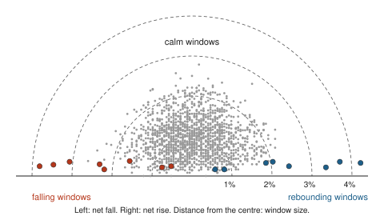
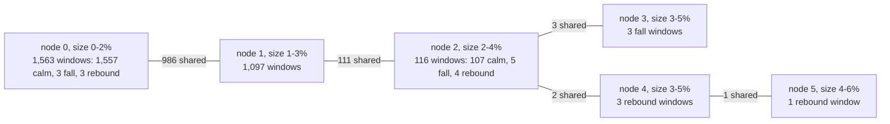

# Mapper and Reeb graphs: a network summary of a dataset along a chosen lens

[Syllabus](../../../SYLLABUS.md) → [Topology](../README.md) → [Topological Data Analysis](../README.md#s06) → Mapper and Reeb graphs

---

## General Overview

Take twenty years of a stock index: 5,040 trading days. Cut them into three-day windows, side by side and not overlapping, which gives 1,680 windows. Each day sits in exactly one window, so every window is wholly calm or wholly crisis. Each window is three daily returns, such as (−2.4%, −2.1%, −2.1%). Read as coordinates, each window is a point in three-dimensional space, and the 1,680 windows form a cloud of points.

The returns on this card are simulated, not real. Calm days move by a typical 0.75% either way. One crisis is built in: on days 2400 to 2447, 24 days of falls add up to −30.6%, then 24 days of rebound add up to 32.8%. The question is whether a method that is not told about the crisis can find it, and say how it joins the ordinary days.

Nobody can read a cloud of 1,680 points by eye, and real data often has dozens of coordinates, not three. **Mapper** draws a small network instead, in four moves:

1. Pick a **lens**: one number for each point. Here it is the window's **size**: its straight-line distance from a window of three zero returns, so a big move up and a big move down both count as large.
2. Cut the range of the lens into **bands** that overlap, such as 0–2%, 1–3%, 2–4%.
3. Inside each band, group windows that sit close together. Each group becomes a dot, called a **node**.
4. Join two nodes by a line, an **edge**, when they share a window.

On this cloud Mapper draws 6 nodes and 5 edges in the shape of a Y. The trunk is the calm windows. At a size of about 3% it forks into two thin branches: one holds only falling windows, the other only rebounding windows. The crisis is a **flare**: a thin branch of the network that leaves the main cluster.

**Mapper slices a cloud of points by a lens into overlapping bands, clusters each band, and draws a node for each cluster and an edge for each shared point; the network it draws is a coarse, computable version of the Reeb graph, which collapses each connected piece of each level of the lens to a single point.**

**What kind of fact this is:** a method. One lemma is proved on this card in Why it works: with enough overlap, Mapper has exactly as many separate pieces as the cloud itself. That Mapper approaches the Reeb graph as the bands shrink is a theorem stated with its source, not proved here.

### The picture: the cloud, seen side-on

<p align="center"></p>

The horizontal position is the window's net move: left is a fall, right is a rise. The height is how far the window sits from the line of windows whose three days moved equally. With these two coordinates, a window's distance from the centre point is exactly its size, so the dashed half-rings are the band edges. The drawing is to scale, 50 pixels to 1%. The grey calm windows stop at 2.79%; the falling flare reaches 3.82% and the rebounding flare 4.23%.

### The picture: the Mapper graph



Each box is a cluster of windows in one band. Each line carries the number of windows the two clusters share. Positions on the page mean nothing.

---

## The formula

A window is $`x = (x_1, x_2, x_3)`$, its three daily returns in percent. The distance between two windows is $`|x - y|`$, the straight-line distance between the points. On this shelf $`|x - y|`$ is the data distance, because d stands for a death. The lens is the window's size, and the bands are half-open intervals of width L that overlap by O:

```math
f(x) = |x| = \sqrt{x_1^2 + x_2^2 + x_3^2}, \qquad I_j = \big[\, j(L - O),\; j(L - O) + L \,\big), \quad j = 0, 1, 2, \dots
```

**Read it aloud:** the lens of a window is its distance from the zero window, and band j starts at j steps of width minus overlap and runs for one width.

Inside a band, two windows join the same **cluster** if a chain of windows in that band links them, each step no longer than the **link distance** ε. The Mapper graph is then:

```math
M: \quad \text{one node per cluster } C \text{ of } f^{-1}(I_j) \text{ at link } \varepsilon, \qquad \text{an edge joins } C \text{ and } C' \text{ whenever } C \cap C' \neq \varnothing
```

**Read it aloud:** every cluster of every band is a node, and two nodes are joined when some window belongs to both.

The **Reeb graph** is the same idea with infinitely thin bands, applied to a whole shape rather than a finite cloud. Write $`f^{-1}(c)`$ for the **level set** at c: every point where the lens equals c.

```math
R_f = X / {\sim}, \qquad x \sim y \iff f(x) = f(y) \text{ and } x, y \text{ lie in one connected piece of } f^{-1}\big(f(x)\big)
```

**Read it aloud:** glue together two points when they have the same lens value and lie in the same piece of that level set; what is left is a graph.

The lemma that keeps Mapper honest about pieces needs one more number, K: how fast the lens can change, in the sense that $`|f(x) - f(y)| \le K\,|x - y|`$ for every pair. For the size lens K = 1.

```math
O \ge K\varepsilon \quad \Longrightarrow \quad \beta_0(M) = \beta_0(X \text{ linked at } \varepsilon)
```

**Read it aloud:** if neighbouring bands overlap by at least K times the link distance, the Mapper graph has exactly as many separate pieces as the whole cloud, linked at that distance.

| Symbol | Plain meaning | In our example | Push it up and the answer… |
| --- | --- | --- | --- |
| $`x = (x_1, x_2, x_3)`$ | a window: three daily returns, in % | window 807 is (−2.4, −2.1, −2.1) | — |
| $`X`$ | the cloud of windows; for the Reeb graph, the solid shape the cloud samples | 1,680 windows | more points fill in thin features |
| $`\lvert x \rvert`$, $`\lvert x - y \rvert`$ | a window's size; the distance between two windows | 3.82%; 0.51% from window 806 to 807 | — |
| $`f`$ | the lens: one number per window | the size, $`f(x) = \lvert x \rvert`$ | — |
| $`K`$ | the most the lens can change per unit of distance | 1 for the size; √3 for the net move | more overlap is needed |
| $`I_j`$, $`L`$, $`O`$ | the j-th band; its width; the overlap of neighbouring bands | [3.00, 5.00); 2.00%; 1.00% | wider L: fewer, coarser nodes; more O: more edges |
| $`\varepsilon`$ | link distance: windows this close join one cluster | 1.00% | clusters merge; too small and they shatter |
| $`f^{-1}(I_j)`$, $`f^{-1}(c)`$ | the windows whose lens lands in band j; the level set at lens value c | 3 fall and 3 rebound windows in [3.00, 5.00) | — |
| $`C`$ | a cluster in one band, drawn as one node | node 3 is windows 805, 806, 807 | — |
| $`M`$ | the Mapper graph | 6 nodes, 5 edges, a Y | — |
| $`\beta_0`$ | the number of separate connected pieces | 1 | — |
| $`R_f`$, $`\sim`$ | the Reeb graph; "same lens value and same piece" | a Y that forks at 2.79% | — |

### When it holds

- **Overlap at least K times the link distance.** Two close windows on either side of a band edge must share some band. Cut the overlap to 0.20% with a 1.00% link and Mapper shows 6 pieces, though the cloud is one piece.
- **A link distance that suits the density.** The rim of the calm cloud is thin. At a 0.60% link it shatters, and Mapper shows 40 nodes with 39 ends.
- **A lens that separates what matters.** The size lens folds falls and rises onto the same side, so they fork. The net-move lens sends them to opposite ends of a path, and no branch appears.
- **Enough points along each feature.** A flare whose windows sit further apart than the link distance breaks off. Over twenty other simulated histories, both flares keep a crisis-only node on the main piece in only 17 of 20.
- **A well-behaved shape, for the Reeb reading.** The convergence theorem needs a continuous lens whose level sets have finitely many pieces. A finite cloud only samples such a shape.

---

## Why it works

### Step 0: track the pieces of each slice

Cut a shape into thin slices by the lens. In each slice, count the connected pieces. As the lens value rises, pieces appear, merge, split and end. Draw each piece as a point and let it trace a line as the lens moves: the lines and their meeting points form the Reeb graph. A fork means one piece became two.

A finite cloud has no thin slices to count: one exact lens value holds at most a few windows. Mapper makes the slices thick, so each holds many windows, and makes them overlap, so neighbouring slices can be matched. Clustering inside a slice stands in for "connected piece".

### Step 1: the Reeb graph of the ideal shape

Picture the shape the cloud samples: a solid ball of calm windows of radius 2.79%, with two thin arms leaving it along the line of equal moves. The falling arm reaches size 3.82%; the rebounding arm reaches 4.23%.

The lens is the size, so a level set is the part of the shape at one distance c from the centre:

| Lens value c | Level set | Pieces |
| --- | --- | --- |
| 0 | the centre point | 1 |
| up to 2.79% | a sphere of radius c inside the ball | 1 |
| 2.79% to 3.82% | one point on each arm | 2 |
| 3.82% to 4.23% | one point on the rebounding arm | 1 |
| above 4.23% | nothing | 0 |

Collapse each piece to a point. The result is a segment from 0 to 2.79%, which forks into two branches ending at 3.82% and 4.23%. That is the Y.

### Step 2: clusters are the connected pieces of a band

Join every two windows of a band that lie within ε. The clusters are the connected pieces of that network, found by flooding outward from each window as on [Connected or not](../../04-Combinatorics%20and%20graphs/09-Graphs%20-%20Dots%20and%20Lines/04-connectivity-and-breadth-first-search.md). This grouping is called **single linkage**.

It is also the piece count of persistence at one scale. In the shelf's convention, a complex at radius r joins points within 2r. So a link of ε gives the pieces of the Rips complex at r = ε/2, the $`H_0`$ of [Filtration and persistent homology](01-filtrations-and-persistent-homology.md).

### Step 3: shared windows build the edges

In cover A every window lies in one or two bands, because the bands overlap. A window in two bands sits in one cluster of each. Those two clusters touch, and Mapper joins them.

This is the **nerve** of the clusters: one vertex per set, and an edge wherever two sets meet ([Vietoris-Rips, Cech and alpha complexes](02-vietoris-rips-and-cech-complexes.md)). The Mapper graph is the vertices and edges of the nerve of all the clusters of all the bands.

### Step 4: enough overlap keeps every piece together

Mapper should not cut the cloud apart. The lemma in The formula guarantees it. The size lens has K = 1, because of the triangle inequality: $`\lvert\, |x| - |y| \,\rvert \le |x - y|`$. So two windows within 1.00% of each other differ in size by at most 1.00%, and a band overlap of 1.00% puts them in a common band.

<details>
<summary>Detailed proof: with overlap at least Kε, Mapper's pieces match the cloud's pieces</summary>

Write G for the network on all windows, with an edge wherever two windows lie within ε. The claim is that M and G have the same number of connected pieces.

First, any interval of lens values no longer than O lies inside one band. Take values a ≤ b with b − a ≤ O. Let j be the band whose start $`s = j(L - O)`$ satisfies $`s \le a < s + (L - O)`$. Then

$`\displaystyle b \le a + O < s + (L - O) + O = s + L,`$

so both a and b lie in $`[s, s + L)`$.

From the cloud to Mapper. Let u and v be joined in G. Then $`|f(u) - f(v)| \le K|u - v| \le K\varepsilon \le O`$, so some band holds both. They are within ε, so they sit in one cluster of that band. Now follow any path in G. Each step lies inside a single cluster, and two consecutive steps share a window. So consecutive clusters along the path are the same node or are joined by an edge. Windows in one piece of G therefore lead to nodes in one piece of M.

From Mapper to the cloud. A cluster is connected inside G by definition. An edge of M means two clusters share a window, so their union is connected in G. Nodes in one piece of M therefore hold windows in one piece of G.

Each window lies in at least one node, so the two maps between pieces are inverse to each other, and the counts agree.

</details>

The overlap rule is enough, not necessary. Cover B below overlaps by only 0.50% with a 1.20% link, and still keeps the cloud in one piece; there is just no guarantee.

### Step 5: from Mapper to the Reeb graph

As the bands narrow, with the overlap kept in proportion, the Mapper of the ideal shape converges to its Reeb graph. A 2018 paper on the one-dimensional Mapper (in Sources) proves this and more. It shows which branches and loops of the Reeb graph a given cover keeps and which it loses, depending on where the band edges fall relative to the lens values at which pieces split or join.

The practical reading is that Mapper places a feature only to within a band. Here the true fork is at 2.79%. Mapper puts it in node 2, the band from 2% to 4%. A branch shorter than about one band can vanish altogether.

---

## Worked numbers, by hand

The fork comes from windows 805, 806 and 807, the last three of the falling flare. Their returns and sizes are printed by both checks.

| Step | Arithmetic | Value |
| --- | --- | --- |
| size of window 807 | √((−2.4)² + (−2.1)² + (−2.1)²) = √(5.76 + 4.41 + 4.41) = √14.58 | 3.82% |
| size of window 806 | √((−2.0)² + (−2.2)² + (−1.8)²) = √12.08 | 3.48% |
| size of window 805 | √((−1.5)² + (−1.8)² + (−2.0)²) = √9.49 | 3.08% |
| bands of cover A holding them | each size lies in [2.00, 4.00) and in [3.00, 5.00) | bands 2 and 3 |
| distance 805 to 806 | √(0.5² + 0.4² + 0.2²) = √0.45 | 0.67% |
| distance 806 to 807 | √(0.4² + 0.1² + 0.3²) = √0.26 | 0.51% |
| calm windows in [3.00, 5.00) | the largest calm window is 2.79%, below 3.00% | none |
| node 3 | the one cluster of falling windows in band [3.00, 5.00) | windows 805, 806, 807 |
| node 2 | band [2.00, 4.00) also holds 803, 804 (0.94% from 805) and 107 calm windows, all chained into one cluster | 116 windows |
| edge 2–3 | windows in both nodes | 805, 806, 807: 3 shared |
| rebound side, same steps | node 4 in [3.00, 5.00), node 5 in [4.00, 6.00) | edges 2–4: 2 shared, 4–5: 1 |
| whole graph | 6 nodes, 5 edges, 1 piece; loops = edges − nodes + pieces = 5 − 6 + 1 | 0 loops |
| shape | ends: nodes 0, 3 and 5; one node, node 2, with three edges | **a Y** |

The calm windows form one trunk, and at about 3% the crisis windows leave it in two branches that hold no calm windows at all: the fall and the rebound are each a flare.

### What breaks if you drop a piece

| Mistake | Comes out at | What went wrong |
| --- | --- | --- |
| Overlap 0.20%, below the 1.00% link | 14 nodes in 6 pieces | the cloud is one piece; close windows on either side of a band edge share no band |
| Link 0.60% | 40 nodes in 10 pieces, with 39 ends | the thin rim of the calm cloud shatters into specks |
| Lens changed to the net move | a path of 16 nodes: 2 ends, no branch point | falls and rebounds go to opposite ends; true, but it answers "up or down", not "how violent" |

The code prints all three.

---

## Code, from first principles, and it actually runs

The script simulates the 5,040 days with a small generator, SplitMix64, so both languages draw the same numbers. All returns are whole numbers of tenths of a percent, and sizes are compared through their exact squares. It builds Mapper with its own union-find (a structure that merges groups by pointing each to a representative) and reaches the answer by five roads:

1. Mapper itself: clusters by union-find in each band, edges by shared windows.
2. The pieces of the whole linked cloud, by breadth-first search, matched against Mapper's pieces as the lemma requires.
3. Loops two ways: edges minus nodes plus pieces, against a union-find count of edges that close a cycle. Every Mapper graph here has no loops, so the count is first tested on a small graph with one known loop.
4. The simulation's own labels: every node beyond the largest calm window must hold one kind of crisis window only.
5. A second cover, and the same recipe on twenty other simulated histories.

These are checks on one simulated cloud and twenty more: they illustrate the method and prove nothing about real markets. The script also finds the first principal component by power iteration (repeated multiplication by the covariance matrix).

### Python

```python
# Mapper on twenty simulated years of three-day windows: build it, read it as a Reeb graph.
from collections import deque
from math import sqrt
M64 = (1 << 64) - 1
class SplitMix64:
    def __init__(self, seed): self.s = seed
    def next(self):
        self.s = (self.s + 0x9E3779B97F4A7C15) & M64
        z = self.s
        z = ((z ^ (z >> 30)) * 0xBF58476D1CE4E5B9) & M64
        z = ((z ^ (z >> 27)) * 0x94D049BB133111EB) & M64
        return z ^ (z >> 31)
    def draw(self, a): return self.next() % (2 * a + 1) - a   # whole number in [-a, a]

# Daily returns in tenths of a percent. Calm days: sum of three draws in [-7, 7].
# Days 2400-2447: selling builds for 24 days, then a rebound starts at full strength and fades.
DRIFT = [-3, -6, -9, -12, -15, -18, -21, -24, 24, 21, 18, 15, 12, 9, 6, 3]
N = 1680
KIND = ["fall" if 800 <= w < 808 else "rebound" if 808 <= w < 816 else "calm" for w in range(N)]
def cloud(seed):
    rng, days = SplitMix64(seed), []
    for t in range(5040):
        days.append(DRIFT[(t - 2400) // 3] + rng.draw(3) if 2400 <= t < 2448 else rng.draw(7) + rng.draw(7) + rng.draw(7))
    W = [tuple(days[3 * w:3 * w + 3]) for w in range(N)]
    return days, W, [x * x + y * y + z * z for x, y, z in W], [x + y + z for x, y, z in W]   # squared size, net move
def D2(W, a, b): return (W[a][0] - W[b][0]) ** 2 + (W[a][1] - W[b][1]) ** 2 + (W[a][2] - W[b][2]) ** 2
def near_pairs(W, eps):  # every pair of windows within eps tenths of a percent
    return [(a, b) for a in range(N) for b in range(a + 1, N) if D2(W, a, b) <= eps * eps]

def find(parent, x):
    while parent[x] != x: parent[x] = parent[parent[x]]; x = parent[x]
    return x

def mapper(inband, bands, pairs):
    nodes = []
    for lo, hi in bands:                                # cluster each band's windows
        parent = {w: w for w in range(N) if inband(w, lo, hi)}
        for a, b in pairs:
            if a in parent and b in parent: parent[find(parent, a)] = find(parent, b)
        groups = {}
        for w in parent: groups.setdefault(find(parent, w), []).append(w)
        nodes += [((lo, hi), g) for g in sorted(groups.values())]
    edges = [(i, j, len(set(nodes[i][1]) & set(nodes[j][1]))) for i in range(len(nodes)) for j in range(i + 1, len(nodes))]
    return nodes, [e for e in edges if e[2] > 0]       # an edge wherever two clusters share windows

def pieces(n, links):  # breadth-first search: a piece label for every vertex
    adj, label = [[] for _ in range(n)], [-1] * n
    for e in links: adj[e[0]].append(e[1]); adj[e[1]].append(e[0])
    for s in range(n):
        if label[s] >= 0: continue
        label[s] = max(label) + 1; q = deque([s])
        while q:
            for v in adj[q.popleft()]:
                if label[v] < 0: label[v] = label[s]; q.append(v)
    return label

def loops_by_union_find(n, edges):  # count edges that close a cycle
    parent, extra = list(range(n)), 0
    for i, j, _ in edges:
        if find(parent, i) == find(parent, j): extra += 1
        else: parent[find(parent, i)] = find(parent, j)
    return extra

cover = lambda L, O, lo=0, top=60: [(a, a + L) for a in range(lo, top, L - O)]   # half-open bands [a, a + L)
mix = lambda g: {k: sum(1 for w in g if KIND[w] == k) for k in ("calm", "fall", "rebound")}
pct = lambda v: f"{v / 10:.2f}"

def report(name, inband, bands, pairs, show=False):
    nodes, edges = mapper(inband, bands, pairs)
    deg = [0] * len(nodes)
    for i, j, _ in edges: deg[i] += 1; deg[j] += 1
    for i, ((lo, hi), g) in enumerate(nodes if show else []):
        c = mix(g)
        print(f"  node {i}: band [{pct(lo)}, {pct(hi)}), {len(g)} windows: {c['calm']} calm, {c['fall']} fall, {c['rebound']} rebound")
    if show: print("  edges, with shared windows: " + ", ".join(f"{i}-{j}: {s}" for i, j, s in edges))
    p = max(pieces(len(nodes), edges)) + 1
    print(f"{name}: {len(nodes)} nodes, {len(edges)} edges, {p} piece(s), loops {len(edges) - len(nodes) + p}, "
          f"ends {deg.count(1)}, branch points {sum(1 for d in deg if d >= 3)}")
    assert len(edges) - len(nodes) + p == loops_by_union_find(len(nodes), edges)
    return nodes, edges, p, deg

assert loops_by_union_find(4, [(0, 1, 1), (1, 2, 1), (0, 2, 1), (2, 3, 1)]) == 1   # road 3 can see a loop: a triangle with a tail
days, W, S2, NET = cloud(2026)
by_size = lambda w, lo, hi: lo * lo <= S2[w] < hi * hi
by_net = lambda w, lo, hi: lo <= NET[w] < hi
size = lambda w: pct(sqrt(S2[w]))
calm_max = max(S2[w] for w in range(N) if KIND[w] == "calm")
tip = {k: max((S2[w], w) for w in range(N) if KIND[w] == k)[1] for k in ("fall", "rebound")}
print(f"cloud: 5040 days, {N} windows; calm daily spread {pct(sqrt(56))}% (model)")
print(f"crisis: days 2400-2447, windows 800-815; 24 days of falls add to {sum(days[2400:2424]) / 10:.1f}%, 24 of rebound to {sum(days[2424:2448]) / 10:.1f}%")
print(f"largest calm window {pct(sqrt(calm_max))}%; fall tip {size(tip['fall'])}%; rebound tip {size(tip['rebound'])}%")
assert all(abs(sqrt(S2[a]) - sqrt(S2[b])) <= sqrt(D2(W, a, b)) + 1e-9 for a in range(0, N, 7) for b in range(0, N, 11))  # 1-Lipschitz
P10, P12, P6 = near_pairs(W, 10), near_pairs(W, 12), near_pairs(W, 6)
cloud_pieces = max(pieces(N, P10)) + 1
print(f"link 1.00%: {len(P10)} close pairs; whole cloud in {cloud_pieces} piece(s) by breadth-first search")
print("fall windows by hand: returns in %, squared size, size, distance to the window before")
for w in range(800, 808):
    print(f"  window {w}: ({', '.join(f'{v / 10:.1f}' for v in W[w])}), {S2[w]}, {size(w)}%, {pct(sqrt(D2(W, w, w - 1)))}%")
nodes, edges, pA, degA = report("cover A, bands 2.00% wide, overlap 1.00%, link 1.00%", by_size, cover(20, 10), P10, True)
assert pA == cloud_pieces == 1                       # overlap >= link: Mapper's pieces = the cloud's pieces
assert degA.count(1) == 3 and sum(1 for d in degA if d >= 3) == 1     # a Y: one branch point, three ends
for (lo, hi), g in nodes:                            # beyond the calm windows, each node is pure crisis
    if lo * lo > calm_max: assert len({KIND[w] for w in g}) == 1 and KIND[g[0]] != "calm"
print(f"  windows on edge 2-3: {sorted(set(nodes[2][1]) & set(nodes[3][1]))}")
_, _, pB, degB = report("cover B, bands 1.50% wide, overlap 0.50%, link 1.20%", by_size, cover(15, 5), P12)
assert pB == 1 and degB.count(1) == 3 and sum(1 for d in degB if d >= 3) == 1
print(f"Reeb graph of the ideal shape: trunk 0.00% to {pct(sqrt(calm_max))}%, branches to {size(tip['fall'])}% and {size(tip['rebound'])}%")
mean = [sum(p[i] for p in W) / N for i in range(3)]
C = [[sum((p[i] - mean[i]) * (p[j] - mean[j]) for p in W) / N for j in range(3)] for i in range(3)]
v = [1.0, 0.0, 0.0]
for _ in range(500):                                 # power iteration for the first principal component
    u = [sum(C[i][j] * v[j] for j in range(3)) for i in range(3)]
    v = [x / sqrt(sum(y * y for y in u)) for x in u]
print(f"first principal component vs the all-equal diagonal: cosine {abs(sum(v)) / sqrt(3):.3f}")
print("what breaks:")
_, _, pT, _ = report("  overlap 0.20% < link 1.00%", by_size, cover(10, 2), P10)
assert pT > cloud_pieces
_, _, _, degS = report("  link 0.60%", by_size, cover(20, 10), P6)
assert degS.count(1) > 3
nN, eN, _, degN = report("  lens = net move, bands 2.00% wide, overlap 1.00%", by_net, cover(20, 10, -100, 100), P10)
assert sum(1 for d in degN if d >= 3) == 0 and degN.count(1) == 2
ends = [mix(nN[i][1]) for i in range(len(nN)) if degN[i] == 1]
print(f"  net-move path ends: {ends[0]['fall']} fall + {ends[0]['calm']} calm, {ends[1]['rebound']} rebound + {ends[1]['calm']} calm")
both = specky = 0
for seed in range(1, 21):                            # the same recipe on twenty other simulated histories
    _, W2, S, _ = cloud(seed)
    nd, ed = mapper(lambda w, lo, hi: lo * lo <= S[w] < hi * hi, cover(20, 10), near_pairs(W2, 10))
    lab = pieces(len(nd), ed); main = lab[max(range(len(nd)), key=lambda i: len(nd[i][1]))]
    both += all(any(lab[i] == main and {KIND[w] for w in nd[i][1]} == {k} for i in range(len(nd))) for k in ("fall", "rebound"))
    specky += any({KIND[w] for w in g} == {"calm"} and len(g) <= 2 for _, g in nd)
print(f"seeds 1-20, cover A: both flares hang off the main piece in {both} of 20; specks of 1-2 calm windows in {specky} of 20")
assert (both, specky) == (17, 12)                    # as found by an earlier, separate sweep script
fx = lambda w: 240 + 50 * NET[w] / 10 / sqrt(3)
fy = lambda w: 220 - 50 * sqrt(max(S2[w] - NET[w] ** 2 / 3, 0)) / 10
print(f"figure, 50 px per 1%, centre (240,220); fall tip ({fx(tip['fall']):.1f},{fy(tip['fall']):.1f}); "
      f"rebound tip ({fx(tip['rebound']):.1f},{fy(tip['rebound']):.1f})")
print("ALL CHECKS PASS")
```

**Ran 2026-11-15 on macOS, Python 3.14.10, standard library only. All checks passed. Output, pasted from the run:**

```
cloud: 5040 days, 1680 windows; calm daily spread 0.75% (model)
crisis: days 2400-2447, windows 800-815; 24 days of falls add to -30.6%, 24 of rebound to 32.8%
largest calm window 2.79%; fall tip 3.82%; rebound tip 4.23%
link 1.00%: 223688 close pairs; whole cloud in 1 piece(s) by breadth-first search
fall windows by hand: returns in %, squared size, size, distance to the window before
  window 800: (-0.1, -0.4, -0.4), 33, 0.57%, 1.81%
  window 801: (-0.4, -0.3, -0.6), 61, 0.78%, 0.37%
  window 802: (-0.7, -0.8, -1.2), 257, 1.60%, 0.84%
  window 803: (-1.1, -1.5, -1.4), 542, 2.33%, 0.83%
  window 804: (-1.2, -1.4, -1.2), 484, 2.20%, 0.24%
  window 805: (-1.5, -1.8, -2.0), 949, 3.08%, 0.94%
  window 806: (-2.0, -2.2, -1.8), 1208, 3.48%, 0.67%
  window 807: (-2.4, -2.1, -2.1), 1458, 3.82%, 0.51%
  node 0: band [0.00, 2.00), 1563 windows: 1557 calm, 3 fall, 3 rebound
  node 1: band [1.00, 3.00), 1097 windows: 1091 calm, 3 fall, 3 rebound
  node 2: band [2.00, 4.00), 116 windows: 107 calm, 5 fall, 4 rebound
  node 3: band [3.00, 5.00), 3 windows: 0 calm, 3 fall, 0 rebound
  node 4: band [3.00, 5.00), 3 windows: 0 calm, 0 fall, 3 rebound
  node 5: band [4.00, 6.00), 1 windows: 0 calm, 0 fall, 1 rebound
  edges, with shared windows: 0-1: 986, 1-2: 111, 2-3: 3, 2-4: 2, 4-5: 1
cover A, bands 2.00% wide, overlap 1.00%, link 1.00%: 6 nodes, 5 edges, 1 piece(s), loops 0, ends 3, branch points 1
  windows on edge 2-3: [805, 806, 807]
cover B, bands 1.50% wide, overlap 0.50%, link 1.20%: 6 nodes, 5 edges, 1 piece(s), loops 0, ends 3, branch points 1
Reeb graph of the ideal shape: trunk 0.00% to 2.79%, branches to 3.82% and 4.23%
first principal component vs the all-equal diagonal: cosine 0.983
what breaks:
  overlap 0.20% < link 1.00%: 14 nodes, 8 edges, 6 piece(s), loops 0, ends 6, branch points 1
  link 0.60%: 40 nodes, 30 edges, 10 piece(s), loops 0, ends 39, branch points 1
  lens = net move, bands 2.00% wide, overlap 1.00%: 16 nodes, 15 edges, 1 piece(s), loops 0, ends 2, branch points 0
  net-move path ends: 1 fall + 0 calm, 1 rebound + 0 calm
seeds 1-20, cover A: both flares hang off the main piece in 17 of 20; specks of 1-2 calm windows in 12 of 20
figure, 50 px per 1%, centre (240,220); fall tip (49.5,207.8); rebound tip (450.7,203.7)
ALL CHECKS PASS
```

### Rust

Same numbers, same labels, built with `rustc --edition 2021 -O`.

```rust
// Mapper on twenty simulated years of three-day windows: build it, read it as a Reeb graph.
use std::collections::VecDeque;
struct SplitMix64 { s: u64 }
impl SplitMix64 {
    fn next(&mut self) -> u64 {
        self.s = self.s.wrapping_add(0x9E3779B97F4A7C15);
        let mut z = self.s;
        z = (z ^ (z >> 30)).wrapping_mul(0xBF58476D1CE4E5B9);
        z = (z ^ (z >> 27)).wrapping_mul(0x94D049BB133111EB);
        z ^ (z >> 31)
    }
    fn draw(&mut self, a: i64) -> i64 { (self.next() % (2 * a as u64 + 1)) as i64 - a } // whole number in [-a, a]
}

// Daily returns in tenths of a percent. Calm days: sum of three draws in [-7, 7].
// Days 2400-2447: selling builds for 24 days, then a rebound starts at full strength and fades.
const DRIFT: [i64; 16] = [-3, -6, -9, -12, -15, -18, -21, -24, 24, 21, 18, 15, 12, 9, 6, 3];
const N: usize = 1680;
fn kind(w: usize) -> usize { if (800..808).contains(&w) { 1 } else if (808..816).contains(&w) { 2 } else { 0 } } // calm, fall, rebound
struct Cloud { days: Vec<i64>, w: Vec<[i64; 3]>, s2: Vec<i64>, net: Vec<i64> } // squared size, net move
fn cloud(seed: u64) -> Cloud {
    let mut rng = SplitMix64 { s: seed };
    let days: Vec<i64> = (0..5040usize).map(|t| if (2400..2448).contains(&t) { DRIFT[(t - 2400) / 3] + rng.draw(3) }
        else { rng.draw(7) + rng.draw(7) + rng.draw(7) }).collect();
    let w: Vec<[i64; 3]> = (0..N).map(|i| [days[3 * i], days[3 * i + 1], days[3 * i + 2]]).collect();
    let s2 = w.iter().map(|p| p[0] * p[0] + p[1] * p[1] + p[2] * p[2]).collect();
    let net = w.iter().map(|p| p[0] + p[1] + p[2]).collect();
    Cloud { days, w, s2, net }
}
fn pct(v: f64) -> String { format!("{:.2}", v / 10.0) }
fn d2(w: &[[i64; 3]], a: usize, b: usize) -> i64 { (0..3).map(|i| (w[a][i] - w[b][i]).pow(2)).sum() }
fn near_pairs(w: &[[i64; 3]], eps: i64) -> Vec<(usize, usize)> { // every pair of windows within eps tenths of a percent
    (0..N).flat_map(|a| (a + 1..N).map(move |b| (a, b))).filter(|&(a, b)| d2(w, a, b) <= eps * eps).collect()
}
fn find(parent: &mut Vec<usize>, mut x: usize) -> usize { while parent[x] != x { parent[x] = parent[parent[x]]; x = parent[x]; } x }
type Node = ((i64, i64), Vec<usize>);
type Edge = (usize, usize, usize);
fn mapper(inband: &dyn Fn(usize, i64, i64) -> bool, bands: &[(i64, i64)], pairs: &[(usize, usize)]) -> (Vec<Node>, Vec<Edge>) {
    let mut nodes: Vec<Node> = Vec::new();
    for &(lo, hi) in bands { // cluster each band's windows
        let inb: Vec<bool> = (0..N).map(|w| inband(w, lo, hi)).collect();
        let mut parent: Vec<usize> = (0..N).collect();
        for &(a, b) in pairs { if inb[a] && inb[b] { let (ra, rb) = (find(&mut parent, a), find(&mut parent, b)); parent[ra] = rb; } }
        let mut groups: Vec<(usize, Vec<usize>)> = Vec::new();
        for w in (0..N).filter(|&w| inb[w]) {
            let r = find(&mut parent, w);
            match groups.iter_mut().find(|g| g.0 == r) { Some(g) => g.1.push(w), None => groups.push((r, vec![w])) }
        }
        groups.sort_by_key(|g| g.1[0]);
        for g in groups { nodes.push(((lo, hi), g.1)); }
    }
    let mut edges = Vec::new(); // an edge wherever two clusters share windows
    for i in 0..nodes.len() { for j in i + 1..nodes.len() {
        let s = nodes[i].1.iter().filter(|w| nodes[j].1.contains(w)).count(); if s > 0 { edges.push((i, j, s)); }
    } }
    (nodes, edges)
}
fn pieces(n: usize, links: &[(usize, usize)]) -> Vec<usize> { // breadth-first search: a piece label for every vertex
    let mut adj = vec![Vec::new(); n];
    for &(a, b) in links { adj[a].push(b); adj[b].push(a); }
    let (mut label, mut count) = (vec![usize::MAX; n], 0);
    for s in 0..n {
        if label[s] != usize::MAX { continue; }
        label[s] = count; count += 1; let mut q = VecDeque::from(vec![s]);
        while let Some(u) = q.pop_front() { for &v in &adj[u] { if label[v] == usize::MAX { label[v] = label[s]; q.push_back(v); } } }
    }
    label
}
fn npieces(n: usize, links: &[(usize, usize)]) -> usize { pieces(n, links).iter().max().map_or(0, |m| m + 1) }
fn loops_by_union_find(n: usize, edges: &[Edge]) -> usize { // count edges that close a cycle
    let mut parent: Vec<usize> = (0..n).collect();
    edges.iter().filter(|&&(i, j, _)| { let (ri, rj) = (find(&mut parent, i), find(&mut parent, j)); if ri != rj { parent[ri] = rj; } ri == rj }).count()
}
fn cover(l: i64, o: i64, lo: i64, top: i64) -> Vec<(i64, i64)> { (lo..top).step_by((l - o) as usize).map(|a| (a, a + l)).collect() } // [a, a + L)
fn mix(g: &[usize]) -> [usize; 3] { let mut c = [0; 3]; for &w in g { c[kind(w)] += 1; } c }
fn links(edges: &[Edge]) -> Vec<(usize, usize)> { edges.iter().map(|e| (e.0, e.1)).collect() }
fn ends_and_branches(deg: &[usize]) -> (usize, usize) { (deg.iter().filter(|&&x| x == 1).count(), deg.iter().filter(|&&x| x >= 3).count()) }

fn report(name: &str, inband: &dyn Fn(usize, i64, i64) -> bool, bands: &[(i64, i64)], pairs: &[(usize, usize)], show: bool) -> (Vec<Node>, usize, Vec<usize>) {
    let (nodes, edges) = mapper(inband, bands, pairs);
    let mut deg = vec![0; nodes.len()];
    for &(i, j, _) in &edges { deg[i] += 1; deg[j] += 1; }
    if show {
        for (i, ((lo, hi), g)) in nodes.iter().enumerate() {
            let c = mix(g);
            println!("  node {}: band [{}, {}), {} windows: {} calm, {} fall, {} rebound", i, pct(*lo as f64), pct(*hi as f64), g.len(), c[0], c[1], c[2]);
        }
        let e: Vec<String> = edges.iter().map(|(i, j, s)| format!("{}-{}: {}", i, j, s)).collect();
        println!("  edges, with shared windows: {}", e.join(", "));
    }
    let p = npieces(nodes.len(), &links(&edges));
    let (ends, branches) = ends_and_branches(&deg);
    println!("{}: {} nodes, {} edges, {} piece(s), loops {}, ends {}, branch points {}", name, nodes.len(), edges.len(), p, edges.len() + p - nodes.len(), ends, branches);
    assert_eq!(edges.len() + p - nodes.len(), loops_by_union_find(nodes.len(), &edges));
    (nodes, p, deg)
}

fn main() {
    assert_eq!(loops_by_union_find(4, &[(0, 1, 1), (1, 2, 1), (0, 2, 1), (2, 3, 1)]), 1); // road 3 can see a loop: a triangle with a tail
    let c = cloud(2026);
    let size = |i: usize| pct((c.s2[i] as f64).sqrt());
    let calm_max = (0..N).filter(|&i| kind(i) == 0).map(|i| c.s2[i]).max().unwrap();
    let tip = |k: usize| (0..N).filter(|&i| kind(i) == k).max_by_key(|&i| (c.s2[i], i)).unwrap();
    let (tf, tr) = (tip(1), tip(2));
    println!("cloud: 5040 days, {} windows; calm daily spread {}% (model)", N, pct(56f64.sqrt()));
    println!("crisis: days 2400-2447, windows 800-815; 24 days of falls add to {:.1}%, 24 of rebound to {:.1}%",
             c.days[2400..2424].iter().sum::<i64>() as f64 / 10.0, c.days[2424..2448].iter().sum::<i64>() as f64 / 10.0);
    println!("largest calm window {}%; fall tip {}%; rebound tip {}%", pct((calm_max as f64).sqrt()), size(tf), size(tr));
    for a in (0..N).step_by(7) { for b in (0..N).step_by(11) { // the size lens is 1-Lipschitz
        assert!(((c.s2[a] as f64).sqrt() - (c.s2[b] as f64).sqrt()).abs() <= (d2(&c.w, a, b) as f64).sqrt() + 1e-9);
    } }
    let (p10, p12, p6) = (near_pairs(&c.w, 10), near_pairs(&c.w, 12), near_pairs(&c.w, 6));
    let cloud_pieces = npieces(N, &p10);
    println!("link 1.00%: {} close pairs; whole cloud in {} piece(s) by breadth-first search", p10.len(), cloud_pieces);
    println!("fall windows by hand: returns in %, squared size, size, distance to the window before");
    for i in 800..808 {
        let r: Vec<String> = c.w[i].iter().map(|v| format!("{:.1}", *v as f64 / 10.0)).collect();
        println!("  window {}: ({}), {}, {}%, {}%", i, r.join(", "), c.s2[i], size(i), pct((d2(&c.w, i, i - 1) as f64).sqrt()));
    }
    let by_size = |i: usize, lo: i64, hi: i64| lo * lo <= c.s2[i] && c.s2[i] < hi * hi;
    let by_net = |i: usize, lo: i64, hi: i64| lo <= c.net[i] && c.net[i] < hi;
    let (nodes, pa, dega) = report("cover A, bands 2.00% wide, overlap 1.00%, link 1.00%", &by_size, &cover(20, 10, 0, 60), &p10, true);
    assert!(pa == cloud_pieces && pa == 1); // overlap >= link: Mapper's pieces = the cloud's pieces
    assert_eq!(ends_and_branches(&dega), (3, 1)); // a Y: one branch point, three ends
    for ((lo, _), g) in &nodes { // beyond the calm windows, each node is pure crisis
        if lo * lo > calm_max { assert!(g.iter().all(|&i| kind(i) == kind(g[0])) && kind(g[0]) != 0); }
    }
    let shared: Vec<String> = nodes[2].1.iter().filter(|i| nodes[3].1.contains(i)).map(|i| i.to_string()).collect();
    println!("  windows on edge 2-3: [{}]", shared.join(", "));
    let (_, pb, degb) = report("cover B, bands 1.50% wide, overlap 0.50%, link 1.20%", &by_size, &cover(15, 5, 0, 60), &p12, false);
    assert!(pb == 1 && ends_and_branches(&degb) == (3, 1));
    println!("Reeb graph of the ideal shape: trunk 0.00% to {}%, branches to {}% and {}%", pct((calm_max as f64).sqrt()), size(tf), size(tr));
    let mean: Vec<f64> = (0..3).map(|i| c.w.iter().map(|p| p[i]).sum::<i64>() as f64 / N as f64).collect();
    let mut cv = [[0.0f64; 3]; 3];
    for i in 0..3 { for j in 0..3 { let mut s = 0.0; for p in &c.w { s += (p[i] as f64 - mean[i]) * (p[j] as f64 - mean[j]); } cv[i][j] = s / N as f64; } }
    let mut v = [1.0f64, 0.0, 0.0];
    for _ in 0..500 { // power iteration for the first principal component
        let mut u = [0.0f64; 3];
        for i in 0..3 { let mut s = 0.0; for j in 0..3 { s += cv[i][j] * v[j]; } u[i] = s; }
        let mut n2 = 0.0; for y in u { n2 += y * y; } for i in 0..3 { v[i] = u[i] / n2.sqrt(); }
    }
    println!("first principal component vs the all-equal diagonal: cosine {:.3}", (v[0] + v[1] + v[2]).abs() / 3f64.sqrt());
    println!("what breaks:");
    let (_, pt, _) = report("  overlap 0.20% < link 1.00%", &by_size, &cover(10, 2, 0, 60), &p10, false);
    assert!(pt > cloud_pieces);
    let (_, _, degs) = report("  link 0.60%", &by_size, &cover(20, 10, 0, 60), &p6, false);
    assert!(ends_and_branches(&degs).0 > 3);
    let (nn, _, degn) = report("  lens = net move, bands 2.00% wide, overlap 1.00%", &by_net, &cover(20, 10, -100, 100), &p10, false);
    assert_eq!(ends_and_branches(&degn), (2, 0));
    let ends: Vec<[usize; 3]> = (0..nn.len()).filter(|&i| degn[i] == 1).map(|i| mix(&nn[i].1)).collect();
    println!("  net-move path ends: {} fall + {} calm, {} rebound + {} calm", ends[0][1], ends[0][0], ends[1][2], ends[1][0]);
    let (mut both, mut specky) = (0, 0);
    for seed in 1..=20u64 { // the same recipe on twenty other simulated histories
        let c2 = cloud(seed);
        let (nd, ed) = mapper(&|w, lo, hi| lo * lo <= c2.s2[w] && c2.s2[w] < hi * hi, &cover(20, 10, 0, 60), &near_pairs(&c2.w, 10));
        let lab = pieces(nd.len(), &links(&ed));
        let main = lab[(0..nd.len()).rev().max_by_key(|&i| nd[i].1.len()).unwrap()];
        let pure = |i: usize, k: usize| nd[i].1.iter().all(|&w| kind(w) == k);
        if (1..3).all(|k| (0..nd.len()).any(|i| lab[i] == main && pure(i, k))) { both += 1; }
        if (0..nd.len()).any(|i| pure(i, 0) && nd[i].1.len() <= 2) { specky += 1; }
    }
    println!("seeds 1-20, cover A: both flares hang off the main piece in {} of 20; specks of 1-2 calm windows in {} of 20", both, specky);
    assert_eq!((both, specky), (17, 12)); // as found by an earlier, separate sweep script
    let fx = |i: usize| 240.0 + 50.0 * c.net[i] as f64 / 10.0 / 3f64.sqrt();
    let fy = |i: usize| 220.0 - 50.0 * (c.s2[i] as f64 - (c.net[i] * c.net[i]) as f64 / 3.0).max(0.0).sqrt() / 10.0;
    println!("figure, 50 px per 1%, centre (240,220); fall tip ({:.1},{:.1}); rebound tip ({:.1},{:.1})", fx(tf), fy(tf), fx(tr), fy(tr));
    println!("ALL CHECKS PASS");
}
```

**Ran 2026-11-15 on macOS, rustc 1.98.1, no crates. All checks passed. Output, pasted from the run:**

```
cloud: 5040 days, 1680 windows; calm daily spread 0.75% (model)
crisis: days 2400-2447, windows 800-815; 24 days of falls add to -30.6%, 24 of rebound to 32.8%
largest calm window 2.79%; fall tip 3.82%; rebound tip 4.23%
link 1.00%: 223688 close pairs; whole cloud in 1 piece(s) by breadth-first search
fall windows by hand: returns in %, squared size, size, distance to the window before
  window 800: (-0.1, -0.4, -0.4), 33, 0.57%, 1.81%
  window 801: (-0.4, -0.3, -0.6), 61, 0.78%, 0.37%
  window 802: (-0.7, -0.8, -1.2), 257, 1.60%, 0.84%
  window 803: (-1.1, -1.5, -1.4), 542, 2.33%, 0.83%
  window 804: (-1.2, -1.4, -1.2), 484, 2.20%, 0.24%
  window 805: (-1.5, -1.8, -2.0), 949, 3.08%, 0.94%
  window 806: (-2.0, -2.2, -1.8), 1208, 3.48%, 0.67%
  window 807: (-2.4, -2.1, -2.1), 1458, 3.82%, 0.51%
  node 0: band [0.00, 2.00), 1563 windows: 1557 calm, 3 fall, 3 rebound
  node 1: band [1.00, 3.00), 1097 windows: 1091 calm, 3 fall, 3 rebound
  node 2: band [2.00, 4.00), 116 windows: 107 calm, 5 fall, 4 rebound
  node 3: band [3.00, 5.00), 3 windows: 0 calm, 3 fall, 0 rebound
  node 4: band [3.00, 5.00), 3 windows: 0 calm, 0 fall, 3 rebound
  node 5: band [4.00, 6.00), 1 windows: 0 calm, 0 fall, 1 rebound
  edges, with shared windows: 0-1: 986, 1-2: 111, 2-3: 3, 2-4: 2, 4-5: 1
cover A, bands 2.00% wide, overlap 1.00%, link 1.00%: 6 nodes, 5 edges, 1 piece(s), loops 0, ends 3, branch points 1
  windows on edge 2-3: [805, 806, 807]
cover B, bands 1.50% wide, overlap 0.50%, link 1.20%: 6 nodes, 5 edges, 1 piece(s), loops 0, ends 3, branch points 1
Reeb graph of the ideal shape: trunk 0.00% to 2.79%, branches to 3.82% and 4.23%
first principal component vs the all-equal diagonal: cosine 0.983
what breaks:
  overlap 0.20% < link 1.00%: 14 nodes, 8 edges, 6 piece(s), loops 0, ends 6, branch points 1
  link 0.60%: 40 nodes, 30 edges, 10 piece(s), loops 0, ends 39, branch points 1
  lens = net move, bands 2.00% wide, overlap 1.00%: 16 nodes, 15 edges, 1 piece(s), loops 0, ends 2, branch points 0
  net-move path ends: 1 fall + 0 calm, 1 rebound + 0 calm
seeds 1-20, cover A: both flares hang off the main piece in 17 of 20; specks of 1-2 calm windows in 12 of 20
figure, 50 px per 1%, centre (240,220); fall tip (49.5,207.8); rebound tip (450.7,203.7)
ALL CHECKS PASS
```

The two outputs match line for line.

### Lean

Lean proves the lemma of Step 4 for every finite cloud and every lens, and checks the worked numbers.

- Take a finite cloud and a lens that changes by at most K times the distance, with $`K\varepsilon \le O < L`$. Then the Mapper graph has exactly as many pieces as the whole cloud linked at ε.
- Take lens values $`a \le b`$ with $`b - a \le O < L`$. Then one band holds both.
- Take windows with any number of coordinates. Then the size lens has K = 1: $`\lvert\, |x| - |y| \,\rvert \le |x - y|`$.
- In tenths of a percent, windows 805, 806 and 807 have squared sizes 949, 1208 and 1458.
- The squared distances are 45 from window 805 to 806, and 26 from 806 to 807.
- All three sizes lie in band [2.00, 4.00) and in band [3.00, 5.00) of cover A.
- Take edges 0–1, 1–2, 2–3, 2–4 and 4–5 on 6 nodes. Then there are 0 loops, ends 0, 3 and 5, and one branch point: a Y.

The simulation, the clusters themselves, cover B, the failing cases and the twenty-history sweep are left to the Python and Rust checks.

```lean
-- Mapper and Reeb graphs: when neighbouring bands overlap by at least K times the link distance, the Mapper graph has exactly as many connected pieces as the cloud linked at that distance.
import Mathlib.Combinatorics.SimpleGraph.Connectivity.Connected
import Mathlib.Analysis.Normed.Group.Uniform
import Mathlib.Analysis.InnerProductSpace.PiL2
import Mathlib.Data.Real.Basic

open SimpleGraph

namespace MapperReeb

variable {ι E : Type*} [PseudoMetricSpace E]


/-- The link network G on the windows: two windows are joined when they lie within ε. -/
def linkGraph (p : ι → E) (ε : ℝ) : SimpleGraph ι :=
  SimpleGraph.fromRel fun a b => dist (p a) (p b) ≤ ε

/-- Band j of width L and overlap O: the half-open interval [j(L - O), j(L - O) + L). -/
def band (L O : ℝ) (j : ℤ) : Set ℝ :=
  Set.Ico ((j : ℝ) * (L - O)) ((j : ℝ) * (L - O) + L)

/-- The windows whose lens value lands in band j, that is f⁻¹(I_j). -/
def inBand (p : ι → E) (f : E → ℝ) (L O : ℝ) (j : ℤ) : Set ι :=
  {i | f (p i) ∈ band L O j}

/-- A node of the Mapper graph: a band j together with one cluster of that band, a connected
piece of the link network restricted to the band's windows. -/
abbrev MapperNode (p : ι → E) (f : E → ℝ) (ε L O : ℝ) : Type _ :=
  Σ j : ℤ, ((linkGraph p ε).induce (inBand p f L O j)).ConnectedComponent

/-- The windows that make up a node. -/
def members (p : ι → E) (f : E → ℝ) (ε L O : ℝ) (u : MapperNode p f ε L O) : Set ι :=
  Subtype.val '' u.2.supp

/-- The Mapper graph M: one node per cluster of every band, and an edge between two different
nodes whenever they share a window. -/
def mapperGraph (p : ι → E) (f : E → ℝ) (ε L O : ℝ) : SimpleGraph (MapperNode p f ε L O) :=
  SimpleGraph.fromRel fun u v => (members p f ε L O u ∩ members p f ε L O v).Nonempty

/-- Helper: a function that agrees on linked vertices agrees on reachable vertices. -/
theorem eq_of_reachable_aux {V β : Type*} {G : SimpleGraph V} (g : V → β)
    (h : ∀ a b, G.Adj a b → g a = g b) {a b : V} (hr : G.Reachable a b) : g a = g b := by
  obtain ⟨w⟩ := hr
  induction w with
  | nil => rfl
  | cons hadj _ ih => exact (h _ _ hadj).trans ih

/-- Helper: a stretch of lens values no longer than the overlap lies inside one band. -/
theorem common_band_aux (L O a b : ℝ) (hOL : O < L) (hab : a ≤ b)
    (hba : b - a ≤ O) : ∃ j : ℤ, a ∈ band L O j ∧ b ∈ band L O j := by
  have hs : 0 < L - O := by linarith
  have hO : 0 ≤ O := by linarith
  refine ⟨⌊a / (L - O)⌋, ⟨?_, ?_⟩, ?_, ?_⟩
  · have := (le_div_iff₀ hs).mp (Int.floor_le (a / (L - O)))
    linarith
  · have := (div_lt_iff₀ hs).mp (Int.lt_floor_add_one (a / (L - O)))
    nlinarith
  · have := (le_div_iff₀ hs).mp (Int.floor_le (a / (L - O)))
    linarith
  · have := (div_lt_iff₀ hs).mp (Int.lt_floor_add_one (a / (L - O)))
    nlinarith

/-- Helper: every real number lies in some band when 0 ≤ O < L. -/
theorem exists_band_aux (L O x : ℝ) (hO : 0 ≤ O) (hOL : O < L) : ∃ j : ℤ, x ∈ band L O j := by
  obtain ⟨j, hj, -⟩ := common_band_aux L O x x hOL le_rfl (by linarith)
  exact ⟨j, hj⟩

/-- **Mapper keeps the pieces.** Take a finite cloud of windows in a metric space, a lens f that
changes by at most K times the distance, a link distance ε, and bands of width L that overlap
by O. If the overlap is at least K times the link distance, then the Mapper graph has exactly
as many separate pieces as the whole cloud linked at ε: β₀(M) = β₀(X linked at ε). -/
theorem mapper_pieces_eq_cloud_pieces [Finite ι] (p : ι → E) (f : E → ℝ) (K : NNReal)
    (hf : LipschitzWith K f) (ε L O : ℝ) (hε : 0 ≤ ε) (hOL : O < L)
    (hO : (K : ℝ) * ε ≤ O) :
    Nat.card (mapperGraph p f ε L O).ConnectedComponent =
      Nat.card (linkGraph p ε).ConnectedComponent := by
  classical
  set G := linkGraph p ε
  set M := mapperGraph p f ε L O
  have hO0 : 0 ≤ O := le_trans (mul_nonneg K.2 hε) hO
  -- every window lies in some band
  have hband : ∀ i : ι, ∃ j : ℤ, i ∈ inBand p f L O j := fun i =>
    exists_band_aux L O (f (p i)) hO0 hOL
  -- a chosen node containing each window
  let nodeOf : ι → MapperNode p f ε L O := fun i =>
    ⟨Classical.choose (hband i),
      ((G.induce (inBand p f L O (Classical.choose (hband i))))).connectedComponentMk
        ⟨i, Classical.choose_spec (hband i)⟩⟩
  have mem_iff : ∀ (u : MapperNode p f ε L O) (i : ι), i ∈ members p f ε L O u ↔
      ∃ h : i ∈ inBand p f L O u.1,
        (G.induce (inBand p f L O u.1)).connectedComponentMk ⟨i, h⟩ = u.2 := by
    intro u i
    constructor
    · rintro ⟨x, hx, rfl⟩
      exact ⟨x.2, hx⟩
    · rintro ⟨h, hx⟩
      exact ⟨⟨i, h⟩, hx, rfl⟩
  have mem_nodeOf : ∀ i, i ∈ members p f ε L O (nodeOf i) := fun i =>
    (mem_iff _ i).2 ⟨Classical.choose_spec (hband i), rfl⟩
  let ψ : ι → M.ConnectedComponent := fun i => M.connectedComponentMk (nodeOf i)
  have key : ∀ u i, i ∈ members p f ε L O u → M.connectedComponentMk u = ψ i := by
    intro u i hi
    by_cases huv : u = nodeOf i
    · rw [huv]
    · apply ConnectedComponent.connectedComponentMk_eq_of_adj
      show (SimpleGraph.fromRel _).Adj _ _
      rw [SimpleGraph.fromRel_adj]
      exact ⟨huv, Or.inl ⟨i, hi, mem_nodeOf i⟩⟩
  have ψadj : ∀ a b, G.Adj a b → ψ a = ψ b := by
    intro a b hab
    have hab' : a ≠ b ∧ (dist (p a) (p b) ≤ ε ∨ dist (p b) (p a) ≤ ε) := by
      simpa [G, linkGraph, SimpleGraph.fromRel_adj] using hab
    have hd : dist (p a) (p b) ≤ ε := by
      rcases hab'.2 with h | h
      · exact h
      · rwa [dist_comm] at h
    have hfd : |f (p a) - f (p b)| ≤ O := by
      have := hf.dist_le_mul (p a) (p b)
      rw [Real.dist_eq] at this
      calc |f (p a) - f (p b)| ≤ K * dist (p a) (p b) := this
        _ ≤ K * ε := mul_le_mul_of_nonneg_left hd K.2
        _ ≤ O := hO
    obtain ⟨j, hja, hjb⟩ : ∃ j : ℤ, a ∈ inBand p f L O j ∧ b ∈ inBand p f L O j := by
      rcases le_total (f (p a)) (f (p b)) with h | h
      · obtain ⟨j, h1, h2⟩ := common_band_aux L O _ _ hOL h
          (by rw [abs_sub_comm, abs_of_nonneg (by linarith)] at hfd; exact hfd)
        exact ⟨j, h1, h2⟩
      · obtain ⟨j, h1, h2⟩ := common_band_aux L O _ _ hOL h
          (by rw [abs_of_nonneg (by linarith)] at hfd; exact hfd)
        exact ⟨j, h2, h1⟩
    let w : MapperNode p f ε L O :=
      ⟨j, (G.induce (inBand p f L O j)).connectedComponentMk ⟨a, hja⟩⟩
    have ha : a ∈ members p f ε L O w := (mem_iff w a).2 ⟨hja, rfl⟩
    have hb : b ∈ members p f ε L O w := by
      refine (mem_iff w b).2 ⟨hjb, ?_⟩
      apply ConnectedComponent.connectedComponentMk_eq_of_adj
      rw [SimpleGraph.induce_adj]
      exact hab.symm
    rw [← key w a ha, ← key w b hb]
  -- the map from Mapper nodes to pieces of the cloud
  let φ : MapperNode p f ε L O → G.ConnectedComponent := fun u =>
    ConnectedComponent.lift (fun x : inBand p f L O u.1 => G.connectedComponentMk x.val)
      (fun v w q _ => eq_of_reachable_aux (G := G.induce (inBand p f L O u.1))
        (fun x : inBand p f L O u.1 => G.connectedComponentMk x.val)
        (fun a b hab => ConnectedComponent.connectedComponentMk_eq_of_adj hab) ⟨q⟩) u.2
  have φmem : ∀ u i, i ∈ members p f ε L O u → φ u = G.connectedComponentMk i := by
    intro u i hi
    obtain ⟨h, hx⟩ := (mem_iff u i).1 hi
    simp only [φ]
    rw [← hx]
    rfl
  have φadj : ∀ u v, M.Adj u v → φ u = φ v := by
    intro u v huv
    have : u ≠ v ∧ ((members p f ε L O u ∩ members p f ε L O v).Nonempty ∨
        (members p f ε L O v ∩ members p f ε L O u).Nonempty) := by
      simpa [M, mapperGraph, SimpleGraph.fromRel_adj] using huv
    rcases this.2 with ⟨i, hu, hv⟩ | ⟨i, hv, hu⟩
    · rw [φmem u i hu, φmem v i hv]
    · rw [φmem u i hu, φmem v i hv]
  let Φ : M.ConnectedComponent → G.ConnectedComponent :=
    ConnectedComponent.lift φ (fun v w q _ => eq_of_reachable_aux φ φadj ⟨q⟩)
  let Ψ : G.ConnectedComponent → M.ConnectedComponent :=
    ConnectedComponent.lift ψ (fun v w q _ => eq_of_reachable_aux ψ ψadj ⟨q⟩)
  have e : M.ConnectedComponent ≃ G.ConnectedComponent :=
    { toFun := Φ
      invFun := Ψ
      left_inv := by
        intro U
        induction U using ConnectedComponent.ind with
        | h u =>
          obtain ⟨x, hx⟩ := u.2.nonempty_supp
          have hxm : x.val ∈ members p f ε L O u := ⟨x, hx, rfl⟩
          show Ψ (φ u) = M.connectedComponentMk u
          rw [φmem u x.val hxm]
          exact (key u x.val hxm).symm
      right_inv := by
        intro C
        induction C using ConnectedComponent.ind with
        | h i =>
          show φ (nodeOf i) = G.connectedComponentMk i
          exact φmem _ i (mem_nodeOf i) }
  exact Nat.card_congr e

/-- **Any stretch of lens values no longer than the overlap lies inside one band.** -/
theorem interval_le_overlap_in_one_band (L O a b : ℝ) (hOL : O < L) (hab : a ≤ b)
    (hba : b - a ≤ O) : ∃ j : ℤ, a ∈ band L O j ∧ b ∈ band L O j := by
  exact common_band_aux L O a b hOL hab hba

/-- **The size lens has K = 1.** Two windows differ in size by at most their distance:
| |x| - |y| | ≤ |x - y|, for windows with any number of coordinates. -/
theorem size_lens_lipschitz_one (n : ℕ) :
    LipschitzWith 1 (fun x : EuclideanSpace ℝ (Fin n) => ‖x‖) := by
  exact lipschitzWith_one_norm

-- Worked numbers, in tenths of a percent. Window 807 = (-24, -21, -21): squared size 1458.
example : (-24 : ℤ) ^ 2 + (-21) ^ 2 + (-21) ^ 2 = 1458 := by norm_num
-- Window 806 = (-20, -22, -18): squared size 1208. Window 805 = (-15, -18, -20): squared size 949.
example : (-20 : ℤ) ^ 2 + (-22) ^ 2 + (-18) ^ 2 = 1208 := by norm_num
example : (-15 : ℤ) ^ 2 + (-18) ^ 2 + (-20) ^ 2 = 949 := by norm_num
-- Squared distances: 805 to 806 is 45 (0.67%), 806 to 807 is 26 (0.51%).
example : (-15 - -20 : ℤ) ^ 2 + (-18 - -22) ^ 2 + (-20 - -18) ^ 2 = 45 := by norm_num
example : (-20 - -24 : ℤ) ^ 2 + (-22 - -21) ^ 2 + (-18 - -21) ^ 2 = 26 := by norm_num
-- Cover A (L = 20, O = 10): band 2 is [20, 40) and band 3 is [30, 50); compared through squares,
-- all three sizes lie in both, [400, 1600) and [900, 2500).
example : ∀ s ∈ ([949, 1208, 1458] : List ℕ), 20 ^ 2 ≤ s ∧ s < 40 ^ 2 ∧ 30 ^ 2 ≤ s ∧ s < 50 ^ 2 := by
  decide
-- The Mapper graph of cover A: edges 0-1, 1-2, 2-3, 2-4, 4-5 on 6 nodes, so
-- loops = edges - nodes + pieces = 5 - 6 + 1 = 0; ends are nodes 0, 3, 5; node 2 has three edges: a Y.
example : let es : List (ℕ × ℕ) := [(0, 1), (1, 2), (2, 3), (2, 4), (4, 5)]
    let deg := fun v => es.countP (fun e => e.1 = v ∨ e.2 = v)
    (es.length : ℤ) - 6 + 1 = 0 ∧ (List.range 6).filter (fun v => deg v = 1) = [0, 3, 5] ∧
      (List.range 6).filter (fun v => 3 ≤ deg v) = [2] := by
  decide

#print axioms eq_of_reachable_aux
#print axioms common_band_aux
#print axioms exists_band_aux
#print axioms mapper_pieces_eq_cloud_pieces
#print axioms interval_le_overlap_in_one_band
#print axioms size_lens_lipschitz_one

end MapperReeb
```

**Checked 2026-11-15 on macOS, Lean 4.36.0-rc2, Mathlib v4.36.0-rc2. Every proof is complete and uses only Lean's standard axioms. Output, pasted from the run:**

```
'MapperReeb.eq_of_reachable_aux' does not depend on any axioms
'MapperReeb.common_band_aux' depends on axioms: [propext, Classical.choice, Quot.sound]
'MapperReeb.exists_band_aux' depends on axioms: [propext, Classical.choice, Quot.sound]
'MapperReeb.mapper_pieces_eq_cloud_pieces' depends on axioms: [propext, Classical.choice, Quot.sound]
'MapperReeb.interval_le_overlap_in_one_band' depends on axioms: [propext, Classical.choice, Quot.sound]
'MapperReeb.size_lens_lipschitz_one' depends on axioms: [propext, Classical.choice, Quot.sound]
```

> [!TIP]
> **Try changing**
> Guess first, then run the Python. The asserts are pinned to the history shown, so some edits stop the run.
> - **Another history.** Change `cloud(2026)` to `cloud(7)`. Guess whether the Y survives. The rebound flare survives, but the fall tip (windows 806 and 807, 1.02% from window 805) breaks off as a second piece, and specks of calm windows appear. Mapper and the cloud both count 2 pieces, so the lemma still holds, but the one-piece assert stops the run.
> - **A crash with no rebound.** Set the last eight entries of `DRIFT` to 0. Guess the shape. It is a path, with no branch point: under the size lens a single flare extends the trunk instead of forking off it.
> - **A finer link.** In cover A, replace `P10` by `P6`. Guess the number of ends. The output's own "link 0.60%" line gives it: 39.

---

## The usual mistake

> [!warning]
> **Reading the Mapper graph as the shape of the data.** It is the shape seen through one lens, one cover and one link distance. The same 1,680 windows give a Y under the size lens, a path of 16 nodes under the net move, and 40 nodes in 10 pieces with a 0.60% link. Before trusting a branch, rebuild the graph with a second cover and a second link, as cover B does here.
>
> - **Reading every end as a flare.** A lone calm window at the rim of the cloud becomes an end too. Over twenty other histories, specks of one or two calm windows appear in 12 of 20.
> - **Ignoring node sizes.** Node 0 holds 1,563 windows and node 5 holds 1. An end of one window is a hint, not a finding.
> - **Reading the layout.** An edge means the two clusters share windows: 986 for edge 0–1, 1 for edge 4–5. Lengths and positions on the page mean nothing.
> - **Too little overlap.** With bands overlapping by 0.20% and a 1.00% link, the one-piece cloud is drawn as 6 pieces.

---

## Where you meet it in real life

- **Cancer genomics.** Applied to gene-expression profiles of breast tumours, a Mapper-type analysis found a flare: a subgroup of tumours with a distinct mutational profile and excellent survival.
- **Sport and politics.** The same method split basketball players, and voting records of the United States House of Representatives, into finer groups than standard clustering found.
- **Shapes and scientific pictures.** Reeb graphs, and contour trees (their special case on simply connected domains), summarise height maps, scanned 3D shapes and simulation fields, so software can find peaks, passes and branches.
- **Watching markets.** Mapper on windows of returns shows when recent days leave the calm core and which way they go. It describes the past; nothing on this card predicts a crisis.

> **Say it back**
> Mapper turns a cloud of points into a small network along a chosen lens. It cuts the lens into overlapping bands, groups close points inside each band, makes each group a node, and joins two nodes when they share a point. With overlap at least K times the link distance, the network has exactly as many pieces as the cloud. As the bands shrink it approaches the Reeb graph, which records how the pieces of each level of the lens split and join. On 1,680 simulated three-day windows, the size lens gives a Y: a calm trunk that forks at about 3% into a falling flare and a rebounding flare.

---

## What this builds on

- [Comparing diagrams](05-comparing-diagrams-and-vectorising-them.md): the shelf's other summary, which turns persistence diagrams into numbers for statistics; Mapper gives a network to look at instead.
- [Principal components](../../09-Probability%20and%20statistics/09-Regression/07-principal-components.md): the most common lens in practice. Here the first component has cosine 0.983 with the line of equal moves, so it sorts windows much as the net move does.
- [Connected or not](../../04-Combinatorics%20and%20graphs/09-Graphs%20-%20Dots%20and%20Lines/04-connectivity-and-breadth-first-search.md): breadth-first search and connected pieces, which make the clusters and count the pieces of the graph.

## Where this goes next

- [Persistence in practice](07-persistence-in-practice.md): sliding windows on a simulated crash, noise bands and the corrections that decide when a feature is real.

This card judged its flares by eye, by the simulation's labels and by a twenty-history sweep; how to put a confidence level on one branch of one Mapper graph built from real data is the question it leaves open.

---

## Sources

Verified 2026-11-15: every link below resolves to the publisher's page, and every DOI was checked against Crossref. The PNAS and AMS pages refuse automated requests, so those two records were confirmed through Crossref only.

- Lum, P. Y., G. Singh, A. Lehman, T. Ishkanov, M. Vejdemo-Johansson, M. Alagappan, J. Carlsson, and G. Carlsson. "Extracting Insights from the Shape of Complex Data Using Topology." *Scientific Reports* 3 (2013): 1236. [doi:10.1038/srep01236](https://doi.org/10.1038/srep01236). Mapper explained for practitioners, with flares in tumour, voting and basketball data.
- Nicolau, Monica, Arnold J. Levine, and Gunnar Carlsson. "Topology Based Data Analysis Identifies a Subgroup of Breast Cancers with a Unique Mutational Profile and Excellent Survival." *Proceedings of the National Academy of Sciences* 108, no. 17 (2011): 7265–7270. [doi:10.1073/pnas.1102826108](https://doi.org/10.1073/pnas.1102826108). The breast-cancer flare named in Where you meet it.
- Carrière, Mathieu, and Steve Oudot. "Structure and Stability of the One-Dimensional Mapper." *Foundations of Computational Mathematics* 18, no. 6 (2018): 1333–1396. [doi:10.1007/s10208-017-9370-z](https://doi.org/10.1007/s10208-017-9370-z). Which Reeb-graph features a cover keeps, how stable they are, and convergence to the Reeb graph as the cover is refined.
- Edelsbrunner, Herbert, and John Harer. *Computational Topology: An Introduction*. American Mathematical Society, 2010. [doi:10.1090/mbk/069](https://doi.org/10.1090/mbk/069). Reeb graphs and their computation, alongside the persistence used on the rest of this shelf.
