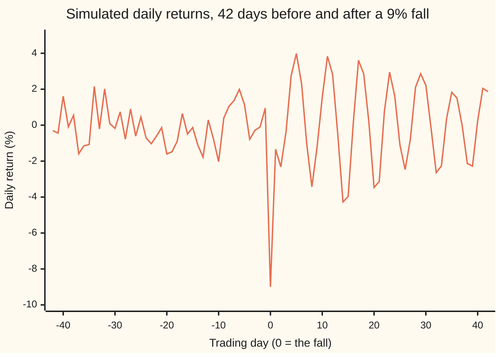

# Persistence in practice: the shape of a time series, and what that shape is worth

[Syllabus](../../../SYLLABUS.md) → [Topology](../README.md) → [Topological Data Analysis](../README.md#s06) → Persistence in practice

---

## General Overview

A stock index falls 9 percent in one day. Before the fall, its daily returns wandered about 1 percent either way, with no pattern. After the fall they swing about 2.3 percent, and in turns: two or three days up, then two or three days down, again and again. Is that pattern real, or is it what any wild stretch of returns looks like?

The data on this card are simulated, and the card says so throughout. The 42 days before the fall are random returns with no memory. The 42 days after it carry a planted rebound cycle 6.09 trading days long, buried in noise. Planting the answer is the point: it shows whether the method finds a shape that is there, and whether it stays quiet when none is.

The method has three moves.

1. **Embed.** Cut the returns into three-day windows. Each window is three numbers, so it is a point in space. A rhythm in time becomes a loop of points.
2. **Measure.** Compute the persistence barcode of the window cloud, and read off its longest loop bar.
3. **Judge.** Shuffle the days many times and recompute. The loop counts only if it beats every shuffle, after a correction for the number of tests run.

The answer here: after the fall, the longest loop bar is 1.24 percent, against 1.01 for the best of 99 shuffles, so the loop is real. Before the fall it is 0.18 against 0.41: nothing. Realised volatility, the root of the mean squared daily return and the usual turbulence gauge, rose 2.19 times; the loop bar rose 6.87 times.

**Cut a series into overlapping windows and a rhythm in time becomes a loop in space; persistence measures that loop, and the loop is worth something only if it beats shuffled copies of the same returns, which keep the volatility and destroy the order.**

**What kind of fact this is:** a method, built on three theorems. The shuffle test's false-alarm guarantee and the Bonferroni correction are proved on this card in Why it works. The stability bound for noise is stated here; [Persistence diagram and stability](04-persistence-diagrams-and-stability.md) proves its counting half and quotes the Rips version used here from its source. The returns are simulated; the code illustrates on one series plus 10 fresh ones, and nothing here predicts a market.

### The picture: 85 days around the fall



One line, 85 daily returns. On the left, small moves with no pattern. In the middle, the fall: −9 percent on day 0. On the right, bigger swings that rise and fall roughly every six days. Both checks print every value, in basis points (1 basis point is 0.01 percent). Day 0 belongs to neither stretch, so no window contains it.

---

## The formula

Some words first, each in one line from earlier cards on this shelf.

- A **bar** $`[b, d)`$ is one hole's life: born at scale $`b`$, dead at scale $`d`$ ([Filtration and persistent homology](01-filtrations-and-persistent-homology.md)). $`H_0`$ bars track pieces; $`H_1`$ bars track loops. Bars here are computed with coefficients in ℤ mod 2, which means counting with 1 + 1 = 0.
- The scale $`r`$ is a **ball radius**: two windows are joined when they lie within $`2r`$ of each other, and a triangle fills when all three pairs are joined. That is the Vietoris–Rips complex $`\mathrm{VR}_r`$ ([Vietoris-Rips, Cech and alpha complexes](02-vietoris-rips-and-cech-complexes.md)). Software such as ripser indexes by diameter instead, which doubles every number.
- The distance between two windows $`u`$ and $`v`$ is the ordinary straight-line distance $`|u - v|`$, in percent.

This card adds the **sliding-window embedding**. It turns a series into a cloud of points, one point per window:

```math
\mathrm{SW}_m x(t) = \big(x_t,\ x_{t+h},\ \ldots,\ x_{t+(m-1)h}\big), \qquad p = \frac{1 + \#\{\, j \le N : L_j \ge L \,\}}{N + 1}
```

**Read it aloud:** the window at day t lists m returns spaced h days apart; the p-value is one plus the number of shuffled copies whose longest loop bar is at least as long as the real one, divided by the number of shuffles plus one.

A loop counts as a **feature** when $`p \le \alpha / k`$: the chosen false-alarm rate, split evenly across all the tests run.

| Symbol | Plain meaning | In our example | Push it up and the answer… |
| --- | --- | --- | --- |
| $`x_t`$ | the return on day t, in percent | −1.34 on the first day after the fall | — |
| $`h`$ | the delay: days between entries of a window (wing 09's lag) | 1 day | a window spans more of the cycle |
| $`m`$ | the window length: entries per window | 3, and 4 as the second choice | points live in more dimensions; the loop held at m = 4 |
| $`\mathrm{SW}_m x(t)`$ | the sliding-window embedding: the window starting on day t, as a point | 42 days give 40 points | — |
| $`\lvert u - v \rvert`$, $`d_H`$ | straight-line distance between two windows; Hausdorff distance between two clouds, used in Step 5 | in percent | — |
| $`r`$ | ball radius: windows within $`2r`$ are joined | the after loop is born at 1.20 | — |
| $`[b, d)`$ | a bar: born at radius b, dead at radius d | longest loop after the fall: [1.20, 2.44) | a longer bar is a sturdier hole |
| $`L`$, $`L_j`$ | the longest loop bar's length; the same for shuffle j | L = 1.24 after, 0.18 before | — |
| $`N`$ | the number of shuffled copies | 99 | the smallest possible p falls to 1/(N + 1) |
| $`p`$, $`R`$ | the shuffle p-value; R counts the values at least L, the real one included, so p = R/(N + 1) | p = 0.01 after, 0.70 before | — |
| $`\alpha`$, $`k`$ | the false-alarm rate allowed in all; the number of tests | 0.05 and 4 | larger k makes each test stricter |
| $`\sigma`$ | realised daily volatility: the root of the mean squared return | 1.06 before, 2.32 after | every bar grows in proportion |

### When it holds

- **Each stretch keeps its character.** The stretch is roughly stationary: same spread, same memory throughout. A stretch that straddles the fall mixes two clouds, and the shape describes the change, not either regime.
- **The windows cover the rhythm.** With h = 1 and a cycle of 6.09 days, three entries span about a third of a turn, enough to open a loop. With h equal to the period, the entries of each window are all the same, and the windows lie on a line.
- **Enough turns of the cycle.** Forty-two days cover the cycle about seven times. With fewer, the loop has gaps and the bar is short and unstable.
- **Shuffles are fair copies.** The test assumes that, with no cycle, every ordering of the days is equally likely. Volatility that clusters in time also breaks that assumption, so a pass means "time order matters", which is not the same as "a cycle".
- **One question, fixed in advance.** The stretches, window lengths and statistic are chosen before looking. Every extra choice tried is one more test for the correction to count.

---

## Why it works

### Step 0: a rhythm in time is a loop in window space

If the series repeats every six days, the window at day t + 6 equals the window at day t. So as t runs forward, the windows travel and come back: a closed curve. Returns with no memory make no such curve, only a cloud.

The cleanest case is a pure six-day cycle of returns 2, 1, −1, −2, −1, 1 percent. Its six windows sit at the corners of a flat hexagon: neighbours have squared distance 6, windows two days apart 18, opposite windows 24. Its one loop bar is $`[1.2247, 2.1213)`$, as worked on [Filtration and persistent homology](01-filtrations-and-persistent-homology.md). The checks recompute it and assert it equals $`[\sqrt{6}/2, \sqrt{18}/2)`$.

Why a plane: this cycle obeys $`x_{t+2} = x_{t+1} - x_t`$, so the third entry of every window is the second minus the first. Every window lies on the one plane where that holds.

### Step 1: size is not shape

Multiply every return by the same number, say 2. Every window, and every distance between windows, doubles. So every birth, every death and every bar doubles.

That is why raw bars cannot be compared across stretches. A crash raises volatility, and raised volatility lengthens every bar with no change of shape. The benchmark is [Realised variance](../../12-Financial%20mathematics/19-Variance%20swaps%2C%20the%20log%20contract%20and%20VIX/01-realised-variance-from-daily-prices.md): here it rose 2.19 times. A topological summary is worth having only if it says something that number does not.

The checks test the scaling exactly: doubling the calm returns doubles the longest loop bar, 0.18 to 0.36, and leaves the shuffle p-value unchanged at 0.64. These two runs share a fresh set of 99 shuffles; the main test's own shuffles gave 0.70.

### Step 2: shuffles keep the size and destroy the order

A shuffle reorders the 42 returns of a stretch. It keeps every return, so the realised volatility is identical to the digit. It breaks every rhythm, because day-to-day order is what a rhythm is.

So the shuffled copies show how long a loop bar gets from size and chance alone. If the real L beats nearly all of them, the order carried the loop.

The guarantee: suppose that, with no cycle, all orderings of the days are equally likely. Then the real series is just one of N + 1 equally likely draws, and the chance that p comes out at most α is at most α.

<details>
<summary>Detailed proof: the shuffle p-value never overstates the evidence</summary>

Under the assumption, the real series and the N shuffles are N + 1 draws that are exchangeable: any reordering of the list has the same chance. So the real L is equally likely to sit at any rank among the N + 1 values of the statistic.

Write $`R`$ for the number of values among all N + 1 that are at least L, the real one included. Then $`p = R/(N + 1)`$, because the real one contributes the 1 in the numerator.

$`\displaystyle \Pr(p \le \alpha) = \Pr\big(R \le \alpha (N+1)\big) \le \frac{\lfloor \alpha (N+1) \rfloor}{N+1} \le \alpha`$

With no ties, R is equally likely to be any of 1, 2, …, N + 1, so the chance that R is at most a whole number c is exactly c/(N + 1). Ties can only raise R, which lowers that chance. The brackets ⌊ ⌋ round down to a whole number. This is the exact permutation p-value of Phipson and Smyth, and it can never be zero.

</details>

### Step 3: many tests, one false-alarm budget

This card runs k = 4 tests: before and after, each with windows of 3 and of 4 days. Each test at level α has chance α of a false alarm. Run four at 0.05 and the chance that at least one fires falsely, if they were independent, is $`1 - 0.95^4 = 0.1855`$. These four are not independent: the 3-day and 4-day tests on one stretch use the same returns, and their p-values move together, 0.70 and 0.68 before the fall, 0.01 and 0.01 after. Whatever the dependence, the chance is at most 4 × 0.05 = 0.20, by the union bound below.

The **Bonferroni correction** tests each at α/k. The chance that any fires falsely is at most the sum of the separate chances: $`k \cdot \alpha/k = \alpha`$. That is the union bound, which holds whether or not the tests are independent. Here the threshold is 0.05/4 = 0.0125.

With 99 shuffles the smallest possible p is 1/100 = 0.01. So a loop passes only if it beats all 99 shuffles. The **noise band** on this card is therefore the longest $`L_j`$ among the 99. It is a bar length, compared with L directly. The band on [Comparing diagrams](05-comparing-diagrams-and-vectorising-them.md) is a bottleneck distance, which charges half a lifetime to retire a bar, so a bar there must beat twice its band. Shuffles, not resampled windows, give the null here: a resampled window keeps its days in their original order, so resampling cannot show what the cloud looks like when time order is gone.

Testing the longest bar, not each bar, needs no further correction. One statistic per diagram covers all its bars at once.

### Step 4: noise moves the bar only a little

The stability theorem says: move every point of a cloud by at most some distance, and each bar's ends move by at most that distance, in radius units. So the longest bar's length moves by at most twice that distance. [Persistence diagram and stability](04-persistence-diagrams-and-stability.md) proves the theorem's counting half, states the matching steps without full proof, and quotes this version for Rips complexes from its source.

Change each return by at most 0.1 percent. A three-day window moves by at most $`\sqrt{3} \times 0.1`$ percent, so L moves by at most twice that: 0.3464. The checks jitter every return by up to 10 basis points and assert the bound: L goes from 1.24 to 1.18.

### Step 5: resampling has only a weak bound, so measure it

Dropping windows is not a small move of every point. A dropped window can open a gap in the loop and kill it early.

The stability theorem still gives a bound, but a weak one. Use the Hausdorff distance $`d_H`$: here, the farthest any dropped window lies from its nearest kept window. Each bar's ends move by at most $`d_H`$, so L moves by at most $`2 d_H`$. That bound is only as small as the widest gap a drop leaves, so it promises nothing in advance. The checks measure instead: they draw 20 random subsets of 32 of the 40 windows and count how often the loop stays above the band.

---

## Worked numbers, by hand

| Step | Arithmetic | Value |
| --- | --- | --- |
| realised volatility | root of mean squared return, each stretch | 1.06% before, 2.32% after |
| the benchmark's jump | 2.32 / 1.06 | 2.19 times |
| annualised | multiply by √252 | 16.8% before, 36.8% after |
| windows | 42 days, three-day windows | 40 points per stretch |
| longest loop bar after | [1.20, 2.44): 2.44 − 1.20 | 1.24 |
| longest loop bar before | [0.59, 0.77): 0.77 − 0.59 | 0.18 |
| the loop's jump | 1.24 / 0.18 | 6.87 times |
| noise band after | longest bar in 99 shuffles | 1.01 |
| p after | (1 + 0) / (99 + 1): no shuffle reached 1.24 | 0.01 |
| threshold | 0.05 / 4 tests | 0.0125 |
| verdict after | 0.01 ≤ 0.0125 | **a feature** |
| verdict before | p = 0.70, band 0.41 | **no feature** |

The jumps in the table come from unrounded bar lengths. After the fall, the windows trace a loop that no amount of reshuffling the same returns produces, and it holds with four-day windows too: 1.43 against a band of 1.05, p = 0.01.

- **Noise.** Every return jittered by up to 0.1 percent: L moves from 1.24 to 1.18, inside the bound 0.3464, and still above the band.
- **Resampling.** Twenty subsets of 32 windows: L ranges from 0.91 to 1.24, and stays above the band in 12 of 20.

The loop survives noise easily and resampling only about half the time. It is real but thin, which is what 40 noisy points around one loop can support.

### What breaks if you drop a piece

| Mistake | Comes out at | What went wrong |
| --- | --- | --- |
| Reading bar size as shape | calm returns doubled: L = 0.36 against 0.18, p = 0.64 both times, on a fresh set of 99 shuffles | Bigger returns stretch every bar; only the shuffle test sees order |
| Summarising by pieces | total $`H_0`$ persistence rose 1.42 times while realised volatility rose 2.19 | Pieces track spread, and here less sharply than realised variance |
| No correction for 4 tests | chance of a false alarm up to 0.20 (0.1855 if the tests were independent), not at most 0.05 | Each extra test is another chance to be fooled |
| Diameter read as radius | L after reads 2.48, not 1.24 | ripser's diameter convention doubles every number |

The code prints all four.

---

## Code, from first principles, and it actually runs

The scripts simulate the returns with their own random numbers: SplitMix64 integers, summed twelve at a time into bell-shaped draws in whole basis points. They cut windows, build the Vietoris–Rips filtration on exact integer squared distances, and pair births with deaths by column reduction over ℤ mod 2. Four independent roads check the results:

- the pure six-day cycle's bar, against the hand value $`[\sqrt{6}/2, \sqrt{18}/2)`$;
- the bars alive at a radius inside the longest bar, against Betti numbers from a fresh rank count (4 pieces and 1 loop before the fall, 1 and 1 after);
- the scaling law: doubled returns give exactly doubled bars and the same p;
- the stability bound under jitter.

Both languages draw the same random numbers, so the two outputs agree to the digit. The Python run takes about 20 seconds.

### Python

```python
# Persistence in practice: sliding windows on daily returns, before and after a simulated crash.
# Standard library only. Returns are whole basis points (1 bp = 0.01%); squared distances are integers.
# Bars are Vietoris-Rips bars over Z mod 2, in ball radius r (an edge joins windows within 2r), in percent.
from math import sqrt, acos, pi
M64 = (1 << 64) - 1

class Rng:  # SplitMix64, written out so Rust draws the same numbers
    def __init__(s, seed): s.x = seed
    def next(s):
        s.x = (s.x + 0x9E3779B97F4A7C15) & M64
        z = ((s.x ^ (s.x >> 30)) * 0xBF58476D1CE4E5B9) & M64
        z = ((z ^ (z >> 27)) * 0x94D049BB133111EB) & M64
        return z ^ (z >> 31)
    def gauss(s, sd):  # sum of 12 uniforms minus 6: close to a bell curve, in whole bp
        tot = sum(s.next() >> 40 for _ in range(12)) - 6 * (1 << 24)
        return (sd * tot * 2 + (1 << 24)) // (1 << 25)
    def shuffle(s, v):
        for i in range(len(v) - 1, 0, -1):
            j = s.next() % (i + 1)
            v[i], v[j] = v[j], v[i]

def simulate(seed):  # calm: 1% a day, no memory; after: a damped six-day rebound cycle
    g = Rng(seed)
    before = [g.gauss(100) for _ in range(42)]
    a = b = 0
    after = []
    for _ in range(72):
        a, b = a - (95 * b) // 100 + g.gauss(60), a
        after.append(a)
    return g, before, after[30:]

def windows(x, m): return [x[i:i + m] for i in range(len(x) - m + 1)]
def d2(p, q): return sum((u - v) ** 2 for u, v in zip(p, q))
def rad(w): return sqrt(w) / 200  # squared distance in bp^2 -> ball radius in percent

def bars(P):  # H0 deaths by union-find; H1 bars [b, d) by column reduction of the triangles
    n = len(P)
    D = [[d2(p, q) for q in P] for p in P]
    enc = min(max(row) for row in D)  # past this scale the complex is a cone: every loop is dead
    E = sorted((D[i][j], i, j) for i in range(n) for j in range(i + 1, n))
    idx = {(i, j): k for k, (_, i, j) in enumerate(E)}
    par = list(range(n))
    def find(a):
        while par[a] != a: a = par[a]
        return a
    h0 = []
    for w, i, j in E:
        if find(i) != find(j): par[find(i)] = find(j); h0.append(w)
    T = sorted((max(D[i][j], D[i][k], D[j][k]), i, j, k) for i in range(n) for j in range(i + 1, n)
               for k in range(j + 1, n) if max(D[i][j], D[i][k], D[j][k]) <= enc)
    low, h1 = {}, []
    for w, i, j, k in T:
        col = {idx[(i, j)], idx[(i, k)], idx[(j, k)]}
        while col and max(col) in low: col ^= low[max(col)]
        if col:
            low[max(col)] = col
            if E[max(col)][0] < w: h1.append((E[max(col)][0], w))
    return h0, h1, D

def longest(h1): return max([rad(d) - rad(b) for b, d in h1] + [0.0])

def betti_at(D, w):  # second road: beta_0, beta_1 of the complex at squared diameter w, by fresh mod-2 ranks
    n = len(D)
    ed = [(i, j) for i in range(n) for j in range(i + 1, n) if D[i][j] <= w]
    ei = {e: k for k, e in enumerate(ed)}
    tr = [(ei[(i, j)], ei[(i, k)], ei[(j, k)]) for i, j in ed for k in range(j + 1, n)
          if (i, k) in ei and (j, k) in ei]
    def rank(cols):
        piv, r = {}, 0
        for c in cols:
            c = set(c)
            while c and min(c) in piv: c ^= piv[min(c)]
            if c: piv[min(c)] = c; r += 1
        return r
    r1, r2 = rank([{i, j} for i, j in ed]), rank([set(t) for t in tr])
    return n - r1, len(ed) - r1 - r2

def test(g, x, m, N):  # shuffle test: the longest loop bar against N reshuffled copies of the same returns
    L = longest(bars(windows(x, m))[1])
    null = []
    for _ in range(N):
        y = x[:]; g.shuffle(y); null.append(longest(bars(windows(y, m))[1]))
    return L, max(null), (1 + sum(v >= L for v in null)) / (N + 1)

f, yn = (lambda v: f"{v:.2f}"), (lambda b: "yes" if b else "no")
hexa = windows([200, 100, -100, -200, -100, 100, 200, 100], 3)  # a pure six-day cycle, in bp
_, hb, _ = bars(hexa)
print("hexagon windows (%):", " ".join("(" + ",".join(str(v // 100) for v in p) + ")" for p in hexa[:6]))
print("hexagon squared distances (%^2):", sorted({d2(hexa[0], q) // 10000 for q in hexa[1:6]}))
print(f"hexagon loop bar: [{rad(hb[0][0]):.4f}, {rad(hb[0][1]):.4f}), {len(hb)} loop")
assert len(hb) == 1 and abs(rad(hb[0][0]) - sqrt(6) / 2) < 1e-12 and abs(rad(hb[0][1]) - sqrt(18) / 2) < 1e-12

g, before, after = simulate(2000)
print("before (bp):", *before); print("crash day (bp): -900"); print("after (bp):", *after)
print(f"planted cycle after the fall: x_t = x_(t-1) - 0.95 x_(t-2) + noise, period {2 * pi / acos(0.5 / sqrt(0.95)):.2f} days")
vol = [sqrt(sum(v * v for v in x) / len(x)) / 100 for x in (before, after)]
print(f"realised daily vol (%): before {f(vol[0])}, after {f(vol[1])}, ratio {f(vol[1] / vol[0])}")
print(f"annualised vol (%): before {sqrt(252) * vol[0]:.1f}, after {sqrt(252) * vol[1]:.1f}")
res = {}
for name, x in (("before", before), ("after", after)):
    h0, h1, D = bars(windows(x, 3))
    top = sorted(h1, key=lambda q: rad(q[0]) - rad(q[1]))[:3]
    res[name] = (sum(rad(w) for w in h0), longest(h1))
    print(f"{name} m=3: {len(h0)} H0 deaths, total {f(res[name][0])}; {len(h1)} H1 bars, longest three:",
          ", ".join(f"[{f(rad(b))}, {f(rad(d))})" for b, d in top))
    mid = (top[0][0] + top[0][1]) // 2  # inside the longest bar: count bars alive, then recount by ranks
    alive = (sum(w > mid for w in h0) + 1, sum(b <= mid < d for b, d in h1))
    print(f"  at r = {rad(mid):.4f}: bars alive (H0, H1) = {alive}; fresh ranks give {betti_at(D, mid)}")
    assert alive == betti_at(D, mid)
print(f"ratio after/before: H0 total {f(res['after'][0] / res['before'][0])}, longest H1 bar {f(res['after'][1] / res['before'][1])}")

k, alpha = 4, 0.05
print(f"tests k = {k}, threshold alpha/k = {alpha / k}; chance of a false alarm uncorrected: {1 - (1 - alpha) ** k:.4f} if independent, at most {k * alpha:.2f} in any case")
band = {}
for name, x in (("before", before), ("after", after)):
    for m in (3, 4):
        L, band[(name, m)], p = test(g, x, m, 99)
        print(f"{name} m={m}: longest {f(L)}, band (max of 99 shuffles) {f(band[(name, m)])}, p = {p:.2f}, feature: {yn(p <= alpha / k)}")
        assert (p <= alpha / k) == (name == "after") and (name == "before" or (p == 0.01 and band[(name, m)] < L))  # after: (1 + 0) / (99 + 1)
L0, jit = res["after"][1], [v + g.next() % 21 - 10 for v in after]  # each return moves at most 10 bp
Lj = longest(bars(windows(jit, 3))[1])
print(f"noise: jitter 10 bp moves the longest bar {f(L0)} -> {f(Lj)}, bound {2 * sqrt(3) * 0.1:.4f}, above band: {yn(Lj > band[('after', 3)])}")
assert abs(Lj - L0) <= 2 * sqrt(3) * 0.1 + 1e-12
W, sub = windows(after, 3), []
for _ in range(20):
    ix = list(range(len(W))); g.shuffle(ix)
    sub.append(longest(bars([W[i] for i in sorted(ix[:32])])[1]))
print(f"resample: 20 draws of 32 of 40 windows: longest bar {f(min(sub))} to {f(max(sub))}, above band in {sum(v > band[('after', 3)] for v in sub)}/20")
found = [0, 0]
for seed in range(2001, 2011):
    g2, b2, a2 = simulate(seed)
    found[0] += test(g2, b2, 3, 19)[2] <= 0.05
    found[1] += test(g2, a2, 3, 19)[2] <= 0.05
print(f"10 fresh seeds, 19 shuffles each, at 0.05: calm stretches flagged {found[0]}/10, rebound stretches found {found[1]}/10")
dbl = [2 * v for v in before]
Ld, _, pd = test(Rng(7), dbl, 3, 99); Lb, _, pb = test(Rng(7), before, 3, 99)
print(f"breaks: calm returns doubled: longest bar {f(Ld)} vs {f(Lb)}, p = {pd:.2f} vs {pb:.2f}")
assert abs(Ld - 2 * Lb) < 1e-12 and pd == pb
print(f"breaks: diameter instead of radius: longest bar after reads {f(2 * L0)}")
print("ALL CHECKS PASS")
```

**Ran 2026-11-15 on macOS, Python 3.14.10, standard library only. All checks passed. Output, pasted from the run:**

```
hexagon windows (%): (2,1,-1) (1,-1,-2) (-1,-2,-1) (-2,-1,1) (-1,1,2) (1,2,1)
hexagon squared distances (%^2): [6, 18, 24]
hexagon loop bar: [1.2247, 2.1213), 1 loop
before (bp): -30 -44 161 -9 55 -159 -115 -108 215 -21 202 8 -18 74 -78 90 -61 45 -71 -103 -61 -14 -160 -148 -90 65 -49 -13 -112 -178 29 -76 -203 40 105 138 199 113 -79 -29 -10 95
crash day (bp): -900
after (bp): -134 -232 -40 275 398 234 -102 -343 -122 154 383 283 -52 -427 -397 16 361 286 17 -347 -313 78 295 161 -111 -247 -80 211 286 222 -16 -264 -227 37 183 151 -1 -213 -228 24 205 187
planted cycle after the fall: x_t = x_(t-1) - 0.95 x_(t-2) + noise, period 6.09 days
realised daily vol (%): before 1.06, after 2.32, ratio 2.19
annualised vol (%): before 16.8, after 36.8
before m=3: 39 H0 deaths, total 15.91; 10 H1 bars, longest three: [0.59, 0.77), [0.87, 1.00), [0.97, 1.07)
  at r = 0.6856: bars alive (H0, H1) = (4, 1); fresh ranks give (4, 1)
after m=3: 39 H0 deaths, total 22.63; 7 H1 bars, longest three: [1.20, 2.44), [0.76, 0.92), [0.63, 0.71)
  at r = 1.9214: bars alive (H0, H1) = (1, 1); fresh ranks give (1, 1)
ratio after/before: H0 total 1.42, longest H1 bar 6.87
tests k = 4, threshold alpha/k = 0.0125; chance of a false alarm uncorrected: 0.1855 if independent, at most 0.20 in any case
before m=3: longest 0.18, band (max of 99 shuffles) 0.41, p = 0.70, feature: no
before m=4: longest 0.21, band (max of 99 shuffles) 0.39, p = 0.68, feature: no
after m=3: longest 1.24, band (max of 99 shuffles) 1.01, p = 0.01, feature: yes
after m=4: longest 1.43, band (max of 99 shuffles) 1.05, p = 0.01, feature: yes
noise: jitter 10 bp moves the longest bar 1.24 -> 1.18, bound 0.3464, above band: yes
resample: 20 draws of 32 of 40 windows: longest bar 0.91 to 1.24, above band in 12/20
10 fresh seeds, 19 shuffles each, at 0.05: calm stretches flagged 0/10, rebound stretches found 5/10
breaks: calm returns doubled: longest bar 0.36 vs 0.18, p = 0.64 vs 0.64
breaks: diameter instead of radius: longest bar after reads 2.48
ALL CHECKS PASS
```

### Rust

```rust
// Persistence in practice: sliding windows on daily returns, before and after a simulated crash.
// std only. Returns are whole basis points (1 bp = 0.01%); squared distances are integers.
// Bars are Vietoris-Rips bars over Z mod 2, in ball radius r (an edge joins windows within 2r), in percent.
use std::collections::{BTreeSet, HashMap};
type Set = BTreeSet<usize>;

struct Rng(u64); // SplitMix64, the same numbers as the Python check
impl Rng {
    fn next(&mut self) -> u64 {
        self.0 = self.0.wrapping_add(0x9E3779B97F4A7C15);
        let mut z = (self.0 ^ (self.0 >> 30)).wrapping_mul(0xBF58476D1CE4E5B9);
        z = (z ^ (z >> 27)).wrapping_mul(0x94D049BB133111EB);
        z ^ (z >> 31)
    }
    fn gauss(&mut self, sd: i64) -> i64 {
        let tot: i64 = (0..12).map(|_| (self.next() >> 40) as i64).sum::<i64>() - 6 * (1 << 24);
        (sd * tot * 2 + (1 << 24)).div_euclid(1 << 25)
    }
    fn shuffle<T>(&mut self, v: &mut [T]) {
        for i in (1..v.len()).rev() { let j = (self.next() % (i as u64 + 1)) as usize; v.swap(i, j); }
    }
}

fn simulate(seed: u64) -> (Rng, Vec<i64>, Vec<i64>) {
    let mut g = Rng(seed);
    let before: Vec<i64> = (0..42).map(|_| g.gauss(100)).collect();
    let (mut a, mut b, mut after) = (0i64, 0i64, vec![]);
    for _ in 0..72 { let x = a - (95 * b).div_euclid(100) + g.gauss(60); b = a; a = x; after.push(a); }
    (g, before, after[30..].to_vec())
}

fn windows(x: &[i64], m: usize) -> Vec<Vec<i64>> { (0..=x.len() - m).map(|i| x[i..i + m].to_vec()).collect() }
fn d2(p: &[i64], q: &[i64]) -> i64 { p.iter().zip(q).map(|(u, v)| (u - v) * (u - v)).sum() }
fn rad(w: i64) -> f64 { (w as f64).sqrt() / 200.0 }
fn xor(a: &mut Set, b: &Set) { for &e in b { if !a.remove(&e) { a.insert(e); } } }

type Bars = (Vec<i64>, Vec<(i64, i64)>, Vec<Vec<i64>>);
fn bars(p: &[Vec<i64>]) -> Bars {
    let n = p.len(); let d: Vec<Vec<i64>> = p.iter().map(|a| p.iter().map(|b| d2(a, b)).collect()).collect();
    let enc = d.iter().map(|r| *r.iter().max().unwrap()).min().unwrap();
    let mut e = vec![];
    for i in 0..n { for j in i + 1..n { e.push((d[i][j], i, j)); } }
    e.sort();
    let idx: HashMap<(usize, usize), usize> = e.iter().enumerate().map(|(k, &(_, i, j))| ((i, j), k)).collect();
    let mut par: Vec<usize> = (0..n).collect();
    fn find(par: &[usize], mut a: usize) -> usize { while par[a] != a { a = par[a]; } a }
    let mut h0 = vec![];
    for &(w, i, j) in &e {
        let (a, b) = (find(&par, i), find(&par, j)); if a != b { par[a] = b; h0.push(w); }
    }
    let mut t = vec![];
    for i in 0..n { for j in i + 1..n { for k in j + 1..n {
        let w = d[i][j].max(d[i][k]).max(d[j][k]); if w <= enc { t.push((w, i, j, k)); }
    } } }
    t.sort();
    let (mut low, mut h1): (HashMap<usize, Set>, Vec<(i64, i64)>) = (HashMap::new(), vec![]);
    for &(w, i, j, k) in &t {
        let mut col: Set = [idx[&(i, j)], idx[&(i, k)], idx[&(j, k)]].into_iter().collect();
        while let Some(&p) = col.last() { if let Some(c) = low.get(&p) { xor(&mut col, c); } else { break; } }
        if let Some(&p) = col.last() { if e[p].0 < w { h1.push((e[p].0, w)); } low.insert(p, col); }
    }
    (h0, h1, d)
}

fn longest(h1: &[(i64, i64)]) -> f64 { h1.iter().map(|&(b, d)| rad(d) - rad(b)).fold(0.0, f64::max) }

fn betti_at(d: &[Vec<i64>], w: i64) -> (usize, usize) {
    let (n, mut ed) = (d.len(), vec![]);
    for i in 0..n { for j in i + 1..n { if d[i][j] <= w { ed.push((i, j)); } } }
    let ei: HashMap<(usize, usize), usize> = ed.iter().enumerate().map(|(k, &e)| (e, k)).collect();
    let mut tr: Vec<Set> = vec![];
    for &(i, j) in &ed { for k in j + 1..n {
        if let (Some(&a), Some(&b)) = (ei.get(&(i, k)), ei.get(&(j, k))) { tr.push([ei[&(i, j)], a, b].into_iter().collect()); }
    } }
    let rank = |cols: Vec<Set>| {
        let (mut piv, mut r): (HashMap<usize, Set>, usize) = (HashMap::new(), 0);
        for mut c in cols {
            while let Some(&p) = c.first() { if let Some(q) = piv.get(&p) { xor(&mut c, q); } else { break; } }
            if let Some(&p) = c.first() { piv.insert(p, c); r += 1; }
        }
        r
    };
    let (r1, r2) = (rank(ed.iter().map(|&(i, j)| [i, j].into_iter().collect()).collect()), rank(tr));
    (n - r1, ed.len() - r1 - r2)
}

fn test(g: &mut Rng, x: &[i64], m: usize, n: usize) -> (f64, f64, f64) {
    let l = longest(&bars(&windows(x, m)).1);
    let null: Vec<f64> = (0..n).map(|_| { let mut y = x.to_vec(); g.shuffle(&mut y); longest(&bars(&windows(&y, m)).1) }).collect();
    let band = null.iter().cloned().fold(f64::MIN, f64::max);
    (l, band, (1 + null.iter().filter(|&&v| v >= l).count()) as f64 / (n + 1) as f64)
}

fn yn(b: bool) -> &'static str { if b { "yes" } else { "no" } }
fn join(v: &[i64]) -> String { v.iter().map(|x| x.to_string()).collect::<Vec<_>>().join(" ") }

fn main() {
    let hexa = windows(&[200, 100, -100, -200, -100, 100, 200, 100], 3);
    let hb = bars(&hexa).1;
    let hw: Vec<String> = hexa.iter().map(|p| format!("({})", p.iter().map(|v| (v / 100).to_string()).collect::<Vec<_>>().join(","))).collect();
    println!("hexagon windows (%): {}", hw.join(" "));
    let sq: BTreeSet<i64> = hexa[1..6].iter().map(|q| d2(&hexa[0], q) / 10000).collect();
    println!("hexagon squared distances (%^2): {:?}", sq.into_iter().collect::<Vec<_>>());
    println!("hexagon loop bar: [{:.4}, {:.4}), {} loop", rad(hb[0].0), rad(hb[0].1), hb.len());
    assert!(hb.len() == 1 && (rad(hb[0].0) - 6f64.sqrt() / 2.0).abs() < 1e-12 && (rad(hb[0].1) - 18f64.sqrt() / 2.0).abs() < 1e-12);
    let (mut g, before, after) = simulate(2000);
    println!("before (bp): {}\ncrash day (bp): -900\nafter (bp): {}", join(&before), join(&after));
    println!("planted cycle after the fall: x_t = x_(t-1) - 0.95 x_(t-2) + noise, period {:.2} days", 2.0 * std::f64::consts::PI / (0.5 / 0.95f64.sqrt()).acos());
    let vol: Vec<f64> = [&before, &after].iter().map(|x| (x.iter().map(|v| v * v).sum::<i64>() as f64 / x.len() as f64).sqrt() / 100.0).collect();
    println!("realised daily vol (%): before {:.2}, after {:.2}, ratio {:.2}", vol[0], vol[1], vol[1] / vol[0]);
    println!("annualised vol (%): before {:.1}, after {:.1}", 252f64.sqrt() * vol[0], 252f64.sqrt() * vol[1]);
    let mut res = vec![];
    for (name, x) in [("before", &before), ("after", &after)] {
        let (h0, mut h1, d) = bars(&windows(x, 3));
        let (tot, l) = (h0.iter().map(|&w| rad(w)).sum::<f64>(), longest(&h1));
        h1.sort_by(|p, q| (rad(p.0) - rad(p.1)).partial_cmp(&(rad(q.0) - rad(q.1))).unwrap());
        let top: Vec<String> = h1[..3].iter().map(|&(b, d)| format!("[{:.2}, {:.2})", rad(b), rad(d))).collect();
        println!("{} m=3: {} H0 deaths, total {:.2}; {} H1 bars, longest three: {}", name, h0.len(), tot, h1.len(), top.join(", "));
        let mid = (h1[0].0 + h1[0].1).div_euclid(2);
        let alive = (h0.iter().filter(|&&w| w > mid).count() + 1, h1.iter().filter(|&&(b, d)| b <= mid && mid < d).count());
        let fresh = betti_at(&d, mid); res.push((tot, l));
        println!("  at r = {:.4}: bars alive (H0, H1) = {:?}; fresh ranks give {:?}", rad(mid), alive, fresh);
        assert_eq!(alive, fresh);
    }
    println!("ratio after/before: H0 total {:.2}, longest H1 bar {:.2}", res[1].0 / res[0].0, res[1].1 / res[0].1);
    let (k, alpha) = (4, 0.05f64);
    println!("tests k = {}, threshold alpha/k = {}; chance of a false alarm uncorrected: {:.4} if independent, at most {:.2} in any case", k, alpha / k as f64, 1.0 - (1.0 - alpha).powi(k), k as f64 * alpha);
    let mut band = HashMap::new();
    for (name, x) in [("before", &before), ("after", &after)] {
        for m in [3, 4] {
            let (l, b, p) = test(&mut g, x, m, 99); band.insert((name, m), b);
            println!("{} m={}: longest {:.2}, band (max of 99 shuffles) {:.2}, p = {:.2}, feature: {}", name, m, l, b, p, yn(p <= alpha / k as f64));
            assert_eq!(p <= alpha / k as f64, name == "after");
            assert!(name == "before" || (p == 0.01 && b < l)); // after: no shuffle reached L, so p = (1 + 0) / (99 + 1)
        }
    }
    let (l0, ba) = (res[1].1, band[&("after", 3)]);
    let jit: Vec<i64> = after.iter().map(|v| v + (g.next() % 21) as i64 - 10).collect();
    let lj = longest(&bars(&windows(&jit, 3)).1);
    println!("noise: jitter 10 bp moves the longest bar {:.2} -> {:.2}, bound {:.4}, above band: {}", l0, lj, 2.0 * 3f64.sqrt() * 0.1, yn(lj > ba));
    assert!((lj - l0).abs() <= 2.0 * 3f64.sqrt() * 0.1 + 1e-12);
    let w = windows(&after, 3);
    let mut sub = vec![];
    for _ in 0..20 {
        let mut ix: Vec<usize> = (0..w.len()).collect(); g.shuffle(&mut ix);
        let mut keep = ix[..32].to_vec(); keep.sort();
        sub.push(longest(&bars(&keep.iter().map(|&i| w[i].clone()).collect::<Vec<_>>()).1));
    }
    let (lo, hi) = (sub.iter().cloned().fold(f64::MAX, f64::min), sub.iter().cloned().fold(f64::MIN, f64::max));
    println!("resample: 20 draws of 32 of 40 windows: longest bar {:.2} to {:.2}, above band in {}/20", lo, hi, sub.iter().filter(|&&v| v > ba).count());
    let mut found = [0, 0];
    for seed in 2001..2011 {
        let (mut g2, b2, a2) = simulate(seed);
        if test(&mut g2, &b2, 3, 19).2 <= 0.05 { found[0] += 1; }
        if test(&mut g2, &a2, 3, 19).2 <= 0.05 { found[1] += 1; }
    }
    println!("10 fresh seeds, 19 shuffles each, at 0.05: calm stretches flagged {}/10, rebound stretches found {}/10", found[0], found[1]);
    let dbl: Vec<i64> = before.iter().map(|v| 2 * v).collect();
    let (ld, _, pd) = test(&mut Rng(7), &dbl, 3, 99);
    let (lb, _, pb) = test(&mut Rng(7), &before, 3, 99);
    println!("breaks: calm returns doubled: longest bar {:.2} vs {:.2}, p = {:.2} vs {:.2}", ld, lb, pd, pb);
    assert!((ld - 2.0 * lb).abs() < 1e-12 && pd == pb);
    println!("breaks: diameter instead of radius: longest bar after reads {:.2}", 2.0 * l0);
    println!("ALL CHECKS PASS");
}
```

**Ran 2026-11-15 on macOS, rustc 1.98.1, no crates. All checks passed. Output, pasted from the run:**

```
hexagon windows (%): (2,1,-1) (1,-1,-2) (-1,-2,-1) (-2,-1,1) (-1,1,2) (1,2,1)
hexagon squared distances (%^2): [6, 18, 24]
hexagon loop bar: [1.2247, 2.1213), 1 loop
before (bp): -30 -44 161 -9 55 -159 -115 -108 215 -21 202 8 -18 74 -78 90 -61 45 -71 -103 -61 -14 -160 -148 -90 65 -49 -13 -112 -178 29 -76 -203 40 105 138 199 113 -79 -29 -10 95
crash day (bp): -900
after (bp): -134 -232 -40 275 398 234 -102 -343 -122 154 383 283 -52 -427 -397 16 361 286 17 -347 -313 78 295 161 -111 -247 -80 211 286 222 -16 -264 -227 37 183 151 -1 -213 -228 24 205 187
planted cycle after the fall: x_t = x_(t-1) - 0.95 x_(t-2) + noise, period 6.09 days
realised daily vol (%): before 1.06, after 2.32, ratio 2.19
annualised vol (%): before 16.8, after 36.8
before m=3: 39 H0 deaths, total 15.91; 10 H1 bars, longest three: [0.59, 0.77), [0.87, 1.00), [0.97, 1.07)
  at r = 0.6856: bars alive (H0, H1) = (4, 1); fresh ranks give (4, 1)
after m=3: 39 H0 deaths, total 22.63; 7 H1 bars, longest three: [1.20, 2.44), [0.76, 0.92), [0.63, 0.71)
  at r = 1.9214: bars alive (H0, H1) = (1, 1); fresh ranks give (1, 1)
ratio after/before: H0 total 1.42, longest H1 bar 6.87
tests k = 4, threshold alpha/k = 0.0125; chance of a false alarm uncorrected: 0.1855 if independent, at most 0.20 in any case
before m=3: longest 0.18, band (max of 99 shuffles) 0.41, p = 0.70, feature: no
before m=4: longest 0.21, band (max of 99 shuffles) 0.39, p = 0.68, feature: no
after m=3: longest 1.24, band (max of 99 shuffles) 1.01, p = 0.01, feature: yes
after m=4: longest 1.43, band (max of 99 shuffles) 1.05, p = 0.01, feature: yes
noise: jitter 10 bp moves the longest bar 1.24 -> 1.18, bound 0.3464, above band: yes
resample: 20 draws of 32 of 40 windows: longest bar 0.91 to 1.24, above band in 12/20
10 fresh seeds, 19 shuffles each, at 0.05: calm stretches flagged 0/10, rebound stretches found 5/10
breaks: calm returns doubled: longest bar 0.36 vs 0.18, p = 0.64 vs 0.64
breaks: diameter instead of radius: longest bar after reads 2.48
ALL CHECKS PASS
```

### Lean

Lean proves the shuffle guarantee and the Bonferroni correction for any statistic, how far noise moves a window, and the hexagon's distances.

- Suppose every ordering of the days is equally likely, for the real series and each shuffle, and $`\alpha`$ is at least 0. Then, ties included, the chance that $`p \le \alpha`$ is at most $`\alpha`$.
- Suppose each of $`k`$ tests has false-alarm chance at most $`\alpha / k`$, with any dependence between them. Then the chance that at least one fires falsely is at most $`\alpha`$.
- Suppose every return changes by at most some amount, the same bound on every day. Then every window of $`m`$ returns moves by at most $`\sqrt{m}`$ times that amount.
- The pure six-day cycle gives the six windows listed above, and they repeat every six days.
- Its neighbouring windows have squared distance 6, windows two days apart 18, and opposite windows 24.
- Every window's third entry is its second minus its first, so all six lie on one plane.
- 42 days give 40 three-day windows, and with 99 shuffles the smallest possible p is 1/100.

The bars, the simulated returns and every number they give are left to the Python and Rust checks; the stability theorem is quoted.

```lean
-- Persistence in practice: the shuffle p-value never overstates the evidence, the Bonferroni correction keeps the total false-alarm chance within alpha, and moving each return by at most delta moves an m-day window by at most sqrt(m) times delta.
import Mathlib.Analysis.InnerProductSpace.PiL2
import Mathlib.MeasureTheory.Measure.Typeclasses.Probability
import Mathlib.GroupTheory.Perm.Fin
import Mathlib.Tactic

open MeasureTheory

/-- The sliding-window embedding: the window starting on day `t` lists the `m` returns
`x t, x (t + h), ..., x (t + (m - 1) h)`, as a point of `m`-dimensional space with the
ordinary straight-line distance. -/
noncomputable def slidingWindow (m h : ℕ) (x : ℕ → ℝ) (t : ℕ) : EuclideanSpace ℝ (Fin m) :=
  WithLp.toLp 2 (fun i : Fin m => x (t + (i : ℕ) * h))

/-- Among any real scores, at most `K` of them have at most `K` scores at or above them. -/
theorem card_low_rank_le {ι : Type*} [Fintype ι] [DecidableEq ι] (L : ι → ℝ) (K : ℝ) (hK : 0 ≤ K) :
    ((Finset.univ.filter fun i =>
        ((Finset.univ.filter fun j => L i ≤ L j).card : ℝ) ≤ K).card : ℝ) ≤ K := by
  set S := Finset.univ.filter fun i => ((Finset.univ.filter fun j => L i ≤ L j).card : ℝ) ≤ K
  rcases S.eq_empty_or_nonempty with hS | hS
  · simp [hS, hK]
  obtain ⟨i, hi, hmin⟩ := S.exists_min_image L hS
  have hsub : S ⊆ Finset.univ.filter fun j => L i ≤ L j := by
    intro s hs; simp [hmin s hs]
  have hi' := (Finset.mem_filter.1 hi).2
  exact le_trans (by exact_mod_cast Finset.card_le_card hsub) hi'

#print axioms card_low_rank_le

/-- The shuffle p-value never overstates the evidence. Fix the returns `d` of a stretch of
`n` days and any statistic `T` of a series (such as the longest loop bar). Under the null
hypothesis every ordering of the days is equally likely: the real series is `d` read in a
uniformly random order `τ 0`, and the `N` shuffled copies are `d` read in further uniformly
random orders `τ 1, ..., τ N`. With `p = (1 + #{j ≥ 1 : L_j ≥ L}) / (N + 1)`, which is
`#{j : L_j ≥ L} / (N + 1)` counting the real one, the chance that `p ≤ α` is at most `α`. -/
theorem shuffle_p_value_le_alpha (n N : ℕ) (d : Fin n → ℝ) (T : (Fin n → ℝ) → ℝ) (α : ℝ)
    (hα : 0 ≤ α) :
    ((Finset.univ.filter fun τ : Fin (N + 1) → Equiv.Perm (Fin n) =>
        ((Finset.univ.filter fun j : Fin (N + 1) =>
            T (d ∘ τ 0) ≤ T (d ∘ τ j)).card : ℝ) / (N + 1) ≤ α).card : ℝ)
      / (Fintype.card (Fin (N + 1) → Equiv.Perm (Fin n)) : ℝ) ≤ α := by
  classical
  set Ω := Fin (N + 1) → Equiv.Perm (Fin n)
  have hM : (0 : ℝ) < N + 1 := by positivity
  -- event that index i looks extreme
  let A : Fin (N + 1) → Finset Ω := fun i => Finset.univ.filter fun τ =>
    ((Finset.univ.filter fun j : Fin (N + 1) => T (d ∘ τ i) ≤ T (d ∘ τ j)).card : ℝ) / (N + 1) ≤ α
  -- each index is equally likely to look extreme
  have hswap : ∀ i, (A 0).card = (A i).card := by
    intro i
    let σ := Equiv.swap (0 : Fin (N + 1)) i
    refine Finset.card_bij' (fun τ _ => fun j => τ (σ j)) (fun τ _ => fun j => τ (σ j)) ?_ ?_ ?_ ?_
    · intro τ hτ
      simp only [A, Finset.mem_filter, Finset.mem_univ, true_and] at hτ ⊢
      have : (Finset.univ.filter fun j : Fin (N + 1) => T (d ∘ τ (σ i)) ≤ T (d ∘ τ (σ j))).card
          = (Finset.univ.filter fun j : Fin (N + 1) => T (d ∘ τ 0) ≤ T (d ∘ τ j)).card := by
        have hσi : σ i = 0 := Equiv.swap_apply_right _ _
        rw [hσi]
        exact Finset.card_bij' (fun j _ => σ j) (fun j _ => σ j)
          (by intro a ha; simpa [σ, Equiv.swap_apply_self] using ha)
          (by intro a ha; simpa [σ, Equiv.swap_apply_self] using ha)
          (by intro a _; simp [σ, Equiv.swap_apply_self])
          (by intro a _; simp [σ, Equiv.swap_apply_self])
      rw [this]; exact hτ
    · intro τ hτ
      simp only [A, Finset.mem_filter, Finset.mem_univ, true_and] at hτ ⊢
      have : (Finset.univ.filter fun j : Fin (N + 1) => T (d ∘ τ (σ 0)) ≤ T (d ∘ τ (σ j))).card
          = (Finset.univ.filter fun j : Fin (N + 1) => T (d ∘ τ i) ≤ T (d ∘ τ j)).card := by
        have hσ0 : σ 0 = i := Equiv.swap_apply_left _ _
        rw [hσ0]
        exact Finset.card_bij' (fun j _ => σ j) (fun j _ => σ j)
          (by intro a ha; simpa [σ, Equiv.swap_apply_self] using ha)
          (by intro a ha; simpa [σ, Equiv.swap_apply_self] using ha)
          (by intro a _; simp [σ, Equiv.swap_apply_self])
          (by intro a _; simp [σ, Equiv.swap_apply_self])
      rw [this]; exact hτ
    · intro τ _; funext j; simp [σ]
    · intro τ _; funext j; simp [σ]
  -- double counting
  have hdouble : ∑ i, ((A i).card : ℝ) = ∑ τ : Ω, ((Finset.univ.filter fun i =>
      ((Finset.univ.filter fun j : Fin (N + 1) => T (d ∘ τ i) ≤ T (d ∘ τ j)).card : ℝ)
        ≤ α * (N + 1)).card : ℝ) := by
    simp only [A, Finset.card_filter, Nat.cast_sum]
    rw [Finset.sum_comm]
    refine Finset.sum_congr rfl fun τ _ => Finset.sum_congr rfl fun i _ => ?_
    split_ifs with h1 h2 h2
    · rfl
    · exact absurd ((div_le_iff₀ hM).1 h1) h2
    · exact absurd ((div_le_iff₀ hM).2 h2) h1
    · rfl
  have hbound : ∀ τ : Ω, ((Finset.univ.filter fun i =>
      ((Finset.univ.filter fun j : Fin (N + 1) => T (d ∘ τ i) ≤ T (d ∘ τ j)).card : ℝ)
        ≤ α * (N + 1)).card : ℝ) ≤ α * (N + 1) := fun τ =>
    card_low_rank_le (fun j => T (d ∘ τ j)) _ (by positivity)
  have hsum : ((N : ℝ) + 1) * (A 0).card ≤ (Fintype.card Ω : ℝ) * (α * (N + 1)) := by
    have h1 : ∑ _i : Fin (N + 1), ((A 0).card : ℝ) = ((N : ℝ) + 1) * (A 0).card := by
      simp
    rw [← h1]
    calc ∑ _i : Fin (N + 1), ((A 0).card : ℝ) = ∑ i, ((A i).card : ℝ) := 
          Finset.sum_congr rfl fun i _ => by rw [hswap i]
      _ = _ := hdouble
      _ ≤ ∑ _τ : Ω, α * (N + 1) := Finset.sum_le_sum fun τ _ => hbound τ
      _ = _ := by simp
  have hΩ : (0 : ℝ) < Fintype.card Ω := by exact_mod_cast Fintype.card_pos
  rw [div_le_iff₀ hΩ]
  nlinarith

/-- The Bonferroni correction: run `k` tests, each with false-alarm chance at most `α / k`.
Whether or not the tests are independent, the chance that at least one fires falsely is at
most `α` (the union bound). -/
theorem bonferroni_union_bound {Ω : Type*} [MeasurableSpace Ω] (P : Measure Ω)
    [IsProbabilityMeasure P] (k : ℕ) (α : ℝ) (E : Fin k → Set Ω)
    (hE : ∀ i, P (E i) ≤ ENNReal.ofReal (α / k)) :
    P (⋃ i, E i) ≤ ENNReal.ofReal α := by
  have hsum : P (⋃ i, E i) ≤ ∑ i, P (E i) := measure_iUnion_fintype_le P E
  refine hsum.trans ?_
  refine (Finset.sum_le_sum fun i _ => hE i).trans ?_
  rw [Finset.sum_const, Finset.card_univ, Fintype.card_fin, nsmul_eq_mul]
  rcases Nat.eq_zero_or_pos k with rfl | hk
  · simp
  · have hk' : (0 : ℝ) < k := by exact_mod_cast hk
    rw [show ((k : ℕ) : ENNReal) = ENNReal.ofReal (k : ℝ) by simp,
      ← ENNReal.ofReal_mul hk'.le, mul_div_cancel₀ _ hk'.ne']

/-- Noise moves a window only a little: if every return changes by at most `δ`, then every
`m`-day window moves by at most `√m · δ` in straight-line distance (for three-day windows and
`δ = 0.1` percent, at most `√3 × 0.1` percent). -/
theorem slidingWindow_dist_le (m h : ℕ) (x y : ℕ → ℝ) (δ : ℝ)
    (hxy : ∀ t, |x t - y t| ≤ δ) (t : ℕ) :
    dist (slidingWindow m h x t) (slidingWindow m h y t) ≤ √(m : ℝ) * δ := by
  have hδ : 0 ≤ δ := (abs_nonneg _).trans (hxy 0)
  rw [EuclideanSpace.dist_eq]
  have hle : ∑ i : Fin m, dist ((slidingWindow m h x t) i) ((slidingWindow m h y t) i) ^ 2
      ≤ ∑ _i : Fin m, δ ^ 2 := by
    refine Finset.sum_le_sum fun i _ => ?_
    simp only [slidingWindow, Real.dist_eq]
    exact pow_le_pow_left₀ (abs_nonneg _) (hxy _) 2
  calc √(∑ i : Fin m, dist ((slidingWindow m h x t) i) ((slidingWindow m h y t) i) ^ 2)
      ≤ √(∑ _i : Fin m, δ ^ 2) := Real.sqrt_le_sqrt hle
    _ = √(m : ℝ) * δ := by
      rw [Finset.sum_const, Finset.card_univ, Fintype.card_fin, nsmul_eq_mul,
        Real.sqrt_mul (Nat.cast_nonneg _), Real.sqrt_sq hδ]

/-- The card's pure six-day cycle of returns, in percent: 2, 1, -1, -2, -1, 1, repeating. -/
def hexCycle (t : ℕ) : ℤ := [2, 1, -1, -2, -1, 1].getD (t % 6) 0

/-- Squared distance between the three-day windows (delay 1) starting on days `s` and `t`. -/
def hexD2 (s t : ℕ) : ℤ := ∑ i : Fin 3, (hexCycle (s + i) - hexCycle (t + i)) ^ 2

-- The six windows: (2,1,-1) (1,-1,-2) (-1,-2,-1) (-2,-1,1) (-1,1,2) (1,2,1).
example : (List.range 6).map (fun t => (hexCycle t, hexCycle (t + 1), hexCycle (t + 2))) =
    [(2, 1, -1), (1, -1, -2), (-1, -2, -1), (-2, -1, 1), (-1, 1, 2), (1, 2, 1)] := by decide
-- Neighbours have squared distance 6, windows two days apart 18, opposite windows 24.
example : ∀ t : Fin 6, hexD2 t (t + 1) = 6 := by decide
example : ∀ t : Fin 6, hexD2 t (t + 2) = 18 := by decide
example : ∀ t : Fin 6, hexD2 t (t + 3) = 24 := by decide
-- Every window lies on one plane: the third entry is the second minus the first.
example : ∀ t : Fin 6, hexCycle (t + 2) = hexCycle (t + 1) - hexCycle t := by decide
-- The series repeats every six days, so the window at day t + 6 equals the window at day t.
example : ∀ t : Fin 6, ∀ i : Fin 3, hexCycle (t + 6 + i) = hexCycle (t + i) := by decide
-- 42 days give 40 three-day windows.
example : 42 - 3 + 1 = 40 := by norm_num
-- With 99 shuffles the smallest possible p is 1/100.
example : (1 + 0 : ℚ) / (99 + 1) = 1 / 100 := by norm_num

#print axioms shuffle_p_value_le_alpha
#print axioms bonferroni_union_bound
#print axioms slidingWindow_dist_le
```

**Checked 2026-11-15 on macOS, Lean 4.36.0-rc2, Mathlib v4.36.0-rc2. Every proof is complete and uses only Lean's standard axioms. Output, pasted from the run:**

```
'card_low_rank_le' depends on axioms: [propext, Classical.choice, Quot.sound]
'shuffle_p_value_le_alpha' depends on axioms: [propext, Classical.choice, Quot.sound]
'bonferroni_union_bound' depends on axioms: [propext, Classical.choice, Quot.sound]
'slidingWindow_dist_le' depends on axioms: [propext, Classical.choice, Quot.sound]
```

> [!TIP]
> **Try changing**
> Guess first, then run it. The asserts are pinned to the planted cycle, so expect some to stop the program.
> - **A fresh crash.** Change the seed 2000 to 2002. Guess first: same cycle, new noise. The after loop reads 0.48 against a band of 0.55, p = 0.09: missed. The assert stops it. One miss in two is the rate the 10 fresh seeds predict.
> - **A weaker rebound.** Change 95 to 80 in the simulation. Guess first: the cycle dies out in a few days. After-volatility falls to 1.13 percent and the after p is 0.97: no loop. The assert stops it.
> - **Rougher noise.** Change the jitter `% 21 - 10` to `% 101 - 50`, up to 0.5 percent a day. Guess first: L reads 1.14, still above the band of 1.01. The bound grows fivefold, loose but true; the printed label still says 10 bp.
> - **Fewer shuffles.** Change 99 to 19 in the main tests. Guess first: the smallest possible p is now 0.05, above 0.0125. The after p is 0.05, so nothing can pass, and the assert stops it.

---

## The usual mistake

> [!warning]
> **Reading a bigger diagram as a new shape.** A crash raises volatility, and volatility stretches every bar. Comparing raw bars before and after a fall mostly re-measures realised variance. Compare against shuffles of the same stretch, which have the same volatility, or the "signal" is just the size.
>
> - **Trying choices until one works.** Several window lengths, two stretches and a few radii make many tests. Uncorrected, even four tests at 0.05 can give a false alarm up to 20 percent of the time, and 18.55 percent if they were independent.
> - **Too few shuffles for the correction.** With 19 shuffles the smallest p is 0.05, above the 0.0125 threshold. The real loop after the fall cannot pass.
> - **Trusting one run.** On 10 fresh simulated crashes with the same planted cycle, the loop was found in 5. On their 10 calm stretches it fired falsely in 0. One success is not a detector.
> - **Calling a pass a cycle.** Shuffling breaks every kind of time order, including volatility clustering, so a pass says only that the order matters. Here the planted cycle is that order. On real data, look for a wave in the correlogram before calling it a cycle.

---

## Where you meet it in real life

- **Crash studies.** Gidea and Katz read each day's returns on four US stock indices as one point in four dimensions, and slid a window of days along the record to get one cloud per window. They tracked persistence landscapes ([Comparing diagrams](05-comparing-diagrams-and-vectorising-them.md)) through 2000 and 2008, and report the landscape norms growing ahead of both crashes. Whether that growth says anything beyond volatility is exactly the question this card's test asks.
- **Periodicity in signals.** Perea and Harer prove that a periodic signal's windows trace a loop, and use the longest bar to score how periodic a signal is. Their bounds say how the window length changes the score.
- **Machine monitoring.** A rotating machine's vibration is close to periodic, so its windows trace a loop. A fault that adds a second rhythm changes the diagram.
- **Confidence bands for diagrams.** Fasy and coauthors build confidence bands, some from subsamples of the data, so that bars shorter than the band are read as noise. The shuffle band here is the time-series version.

> **Say it back**
> Cut a series into overlapping windows of m returns, and each window becomes a point; a rhythm in time becomes a loop. Persistence measures that loop by its longest bar. Raw bars grow with volatility, so the benchmark is realised variance, and the test is against shuffled copies of the same returns, which keep the volatility and destroy the order. Split the false-alarm budget over every test run, then check that the loop survives jitter and resampling. After the simulated fall, the loop beat all 99 shuffles at both window lengths; it survived noise easily and resampling 12 times in 20.

---

## What this builds on

- [Mapper and Reeb graphs](06-mapper-and-reeb-graphs.md): the same discipline of a shape built from data with a chosen setting, and showing the answer under a second choice.
- [Stationarity and autocorrelation](../../09-Probability%20and%20statistics/12-Time%20Series/01-stationarity-and-autocorrelation.md): the lag h, and why a stretch must keep its character for one record to stand for many. A correlogram would also see a six-day cycle, as a wave in the autocorrelations.
- [Realised variance](../../12-Financial%20mathematics/19-Variance%20swaps%2C%20the%20log%20contract%20and%20VIX/01-realised-variance-from-daily-prices.md): the turbulence gauge any topological summary must beat around the crash.
- [Overfitting](../../09-Probability%20and%20statistics/09-Regression/08-cross-validation-and-overfitting.md): a result chosen by looking scores too well on the data that chose it. The 10 fresh seeds play the part of held-out data.
- [Filtration and persistent homology](01-filtrations-and-persistent-homology.md): the barcode itself, worked on the pure cycle.
- [Vietoris-Rips, Cech and alpha complexes](02-vietoris-rips-and-cech-complexes.md): other ways to build the shape, which give smaller complexes on larger clouds.
- [The persistence algorithm](03-the-persistence-algorithm.md): the column reduction both checks run, explained step by step.
- [Persistence diagram and stability](04-persistence-diagrams-and-stability.md): the noise bound used in Step 4, with its counting half proved and the Rips version quoted from its source.
- [Comparing diagrams](05-comparing-diagrams-and-vectorising-them.md): landscapes and distances, for tracking a diagram through time instead of testing one stretch.

## Where this goes next

This is the last card on the shelf. Three tools beyond this wing take the method further:

- Distance to a measure: a filtration that outliers cannot drag.
- Zigzag persistence: for windows that slide in and out.
- Multiparameter persistence: for scale and time together.

The question this card leaves open: on real returns, where volatility clusters and no cycle is planted, does any topological summary flag a crash earlier than realised variance does, once the test is corrected for every choice made?

---

## Sources

Verified 2026-11-15: every link below resolves to the publisher's page.

- Perea, Jose A., and John Harer. "Sliding Windows and Persistence: An Application of Topological Methods to Signal Analysis." *Foundations of Computational Mathematics* 15, no. 3 (2015): 799–838. [doi:10.1007/s10208-014-9206-z](https://doi.org/10.1007/s10208-014-9206-z). Why a periodic signal's windows trace a loop, and how window length and delay shape it.
- Gidea, Marian, and Yuri Katz. "Topological Data Analysis of Financial Time Series: Landscapes of Crashes." *Physica A* 491 (2018): 820–834. [doi:10.1016/j.physa.2017.09.028](https://doi.org/10.1016/j.physa.2017.09.028). Sliding windows of daily index returns around the 2000 and 2008 crashes.
- Cohen-Steiner, David, Herbert Edelsbrunner, and John Harer. "Stability of Persistence Diagrams." *Discrete & Computational Geometry* 37, no. 1 (2007): 103–120. [doi:10.1007/s00454-006-1276-5](https://doi.org/10.1007/s00454-006-1276-5). The stability theorem behind the noise bound.
- Fasy, Brittany Terese, Fabrizio Lecci, Alessandro Rinaldo, Larry Wasserman, Sivaraman Balakrishnan, and Aarti Singh. "Confidence Sets for Persistence Diagrams." *Annals of Statistics* 42, no. 6 (2014): 2301–2339. [doi:10.1214/14-AOS1252](https://doi.org/10.1214/14-AOS1252). Noise bands that separate real bars from sampling noise.
- Phipson, Belinda, and Gordon K. Smyth. "Permutation P-values Should Never Be Zero." *Statistical Applications in Genetics and Molecular Biology* 9, no. 1 (2010). [doi:10.2202/1544-6115.1585](https://doi.org/10.2202/1544-6115.1585). The (1 + count)/(N + 1) p-value and its exact guarantee.
