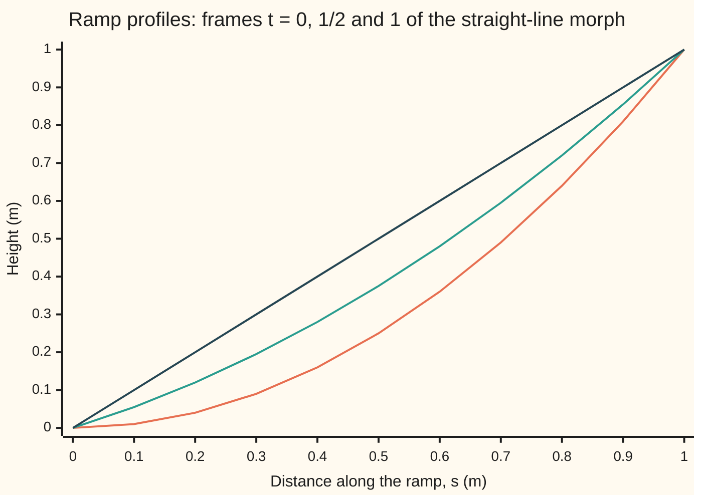

# Mapping spaces: the continuous maps between two spaces form a space of their own

[Syllabus](../../../SYLLABUS.md) → [Topology](../README.md) → [Higher Homotopy and Mapping Spaces](../README.md#s07) → Mapping spaces

---

## General Overview

A designer draws the side profile of a skate ramp 1 metre long and 1 metre high. Draft one curves: at distance $`s`$ metres along the ramp, its height is $`s^2`$ metres. Draft two is straight: its height is $`s`$ metres. The two drafts differ most at the middle, $`s = 1/2`$, where the curve sits at 0.25 m and the straight line at 0.5 m: a gap of 1/4 m.

An animation morphs one draft into the other. Frame $`t`$, for $`t`$ from 0 to 1, blends them: $`(1 - t)\,s^2 + t\,s`$. Does this film run continuously, or does it jump? To answer, the set of all profiles needs its own idea of "near". Then the film is a path through that set, and "no jumps" means the path is continuous. Here the answer is clean: two frames at times $`t`$ and $`t'`$ are at most $`\lvert t - t' \rvert / 4`$ metres apart, anywhere along the ramp.

The same move works for loops. On [Homotopy](../04-Homotopy/01-homotopy-and-homotopy-equivalence.md), a dog's lead wound round a lamp post could not slide free. Gather every loop round the post into one space. That space falls into separate pieces, one for each whole number of turns.

This card puts the right "near" on a set of maps, the **compact-open topology**: a map is near $`f`$ when, on each of finitely many compact stretches, it lands in a chosen open window round $`f`$. On a compact domain this is the familiar worst-gap distance. With it, a homotopy becomes a path of maps, and a loop of loops becomes a map of a square.

**The continuous maps from X to Y form a space, the mapping space, whose open sets are built from finitely many "this compact piece lands in that open window" conditions; on a compact metric domain this is the worst-gap distance, and when X is locally compact a map of two variables is the same thing as a continuous family of maps of one, so a homotopy is a path in the mapping space.**

**What kind of fact this is:** four definitions (the compact-open topology, the mapping space, the loop space, the suspension) and four theorems. Three are proved on this card in Why it works: the compact-open topology is the worst-gap topology on a compact metric domain, evaluation is continuous on a locally compact Hausdorff domain, and the exponential law. The fourth, the loop–suspension correspondence, is given in outline with its source. The code checks finitely many cases; it illustrates and does not prove.

### The picture: three frames of the morph



Orange: frame 0, the curve $`s^2`$. Green: frame 1/2, halfway. Dark blue: frame 1, the straight line $`s`$. At $`s = 1/2`$ the three heights are 0.25, 0.375 and 0.5 m. Each frame is one point of the mapping space; the whole morph is a path through it.

---

## The formula

Notation first, in words. This card introduces five marks.

- $`C(X, Y)`$: the set of all continuous maps from a space $`X`$ to a space $`Y`$. With the topology below it is the **mapping space**.
- $`V(K, U)`$: for a compact set $`K`$ in $`X`$ and an open set $`U`$ in $`Y`$, every continuous map that sends all of $`K`$ into $`U`$. Think of $`U`$ as an inspection window and $`K`$ as the stretch of ramp that must pass through it.
- $`\mathrm{ev}`$: **evaluation**, the map that takes a map $`f`$ and a point $`x`$ and returns $`f(x)`$.
- $`\Omega Y`$ (capital omega): the **loop space**, every loop in $`Y`$ that starts and ends at a chosen base point $`y_0`$.
- $`\Sigma X`$ (capital sigma): the **suspension** of $`X`$, defined in Step 7.

The **compact-open topology** on $`C(X, Y)`$ takes the sets $`V(K, U)`$ as its building blocks:

```math
V(K, U) = \{\, f \in C(X, Y) : f(K) \subseteq U \,\}, \qquad K \subseteq X \text{ compact}, \quad U \subseteq Y \text{ open}
```

**Read it aloud:** the maps that carry the compact stretch K inside the open window U; finite overlaps of such sets form a basis, and unions of those are the open sets.

A family whose finite overlaps form a basis is a **subbasis**. Any family covering the set is one: the overlap of two finite overlaps is again a finite overlap, so the basis test of [Topological space](../02-Topological%20Spaces/01-topological-spaces-and-bases.md) passes.

Three results make the space useful. Here $`d_\infty(f, g)`$ is the **worst-gap distance** of [The distance menu](../01-Metric%20Spaces/02-distances-on-vectors-and-functions.md): the largest gap $`\lvert f(x) - g(x) \rvert`$ over all $`x`$. A space is **locally compact** when every point has a compact set round it containing an open set round it; the line and the interval are, the rationals are not.

```math
X \text{ compact metric},\ Y \text{ metric}: \quad \text{compact-open topology on } C(X, Y) = \text{topology of } d_\infty
```

```math
Y \text{ locally compact Hausdorff}: \quad C(X \times Y, Z) \;\longleftrightarrow\; C\big(X, C(Y, Z)\big), \qquad F \mapsto \hat F, \quad \hat F(x)(y) = F(x, y)
```

**Read it aloud:** on a compact domain, "near in the compact-open topology" means "a small worst gap"; and when Y is locally compact, a continuous map of two variables is exactly a continuous family, indexed by x, of continuous maps of y.

For any domain $`X`$ and metric $`Y`$, Step 2 run on one compact stretch at a time gives more: the compact-open topology is **uniform convergence on compact sets**, a small worst gap on each.

The second result is the **exponential law**. The name comes from writing $`C(Y, Z)`$ as $`Z^Y`$: then it reads $`Z^{X \times Y} = (Z^Y)^X`$, like the rule for powers. Passing from $`F`$ to $`\hat F`$ is called **currying**.

Applied to the ramp: the morph $`H(s, t) = (1 - t)\,s^2 + t\,s`$ is one continuous map of two variables. Its curry is the path $`t \mapsto H_t`$ in $`C([0, 1], \mathbb{R})`$, where $`H_t`$ is frame $`t`$.

| Symbol | Plain meaning | In our example | Push it up and the answer… |
| --- | --- | --- | --- |
| $`X`$, $`Y`$, $`Z`$; $`x`$, $`y`$ | spaces: a domain, a target, a third space; points of $`X`$ and $`Y`$ | $`[0, 1]`$ (ramp), $`\mathbb{R}`$ (heights) | — |
| $`C(X, Y)`$ | the mapping space: continuous maps $`X \to Y`$ with the compact-open topology | all ramp profiles | — |
| $`K`$, $`U`$, $`V(K, U)`$; $`K_i`$, $`U_i`$, $`O`$, $`W`$, $`A_k`$, $`B_k`$ | a compact stretch, an open window, the maps carrying $`K`$ into $`U`$; numbered pieces and windows; $`O`$, $`W`$, $`A_k`$, $`B_k`$ open sets in proofs | $`K = [0, 1/2]`$, $`U = (-1/10, 3/10)`$ | larger $`K`$: fewer maps pass |
| $`f`$, $`g`$ | the two drafts, $`f(s) = s^2`$ and $`g(s) = s`$ | gap 1/4 m at $`s = 1/2`$ | — |
| $`s`$, $`t`$ | distance along the ramp (m); time in the morph | $`s = 1/2`$, $`t = 1/2`$ | — |
| $`H`$, $`H_t`$ | the morph as a map of two variables; its frame at time $`t`$ | $`H_{1/2}(1/2) = 3/8`$ m | — |
| $`d_\infty`$, $`d`$ | worst-gap distance between two maps; the metric on $`Y`$ | $`d_\infty(H_t, H_{t'}) = \lvert t - t' \rvert / 4`$ m | — |
| $`\varepsilon`$, $`\delta`$, $`r`$, $`P`$ | a tolerance, a closeness in the domain, the room round $`f(K)`$ inside $`U`$, the number of compact pieces | $`\varepsilon = 1/10`$ m; $`\delta = 1/40`$ m, piece width; $`r = 1/20`$ m; $`P = 40`$ | smaller $`\varepsilon`$: more pieces |
| $`\mathrm{ev}`$ | evaluation, $`(f, x) \mapsto f(x)`$ | $`\mathrm{ev}(H_{1/2}, 1/2) = 3/8`$ | — |
| $`F`$, $`\hat F`$ | a map of two variables and its curry | $`H`$ and $`t \mapsto H_t`$ | — |
| $`\Omega Y`$, $`y_0`$, $`S^n`$ | loops at the base point $`y_0`$; the base point; the n-sphere ($`S^1`$ circle, $`S^2`$ sphere) | $`\Omega S^1`$, $`(1, 0)`$ | — |
| $`\Sigma X`$, $`x_0`$, $`[A, B]_*`$, $`\pi_n`$ | suspension; base point of $`X`$; homotopy classes of maps keeping base points; homotopy groups | $`\Sigma S^1 = S^2`$ | — |

### When it holds

- **A compact domain, for the worst-gap match.** On the whole line, $`s/n`$ tends to 0 on every compact stretch, so it tends to 0 in the compact-open topology. Its worst gap from 0 over $`[0, n]`$ is still 1, and over the whole line it is infinite.
- **Compact stretches, not single points.** Using only one-point stretches $`K = \{x\}`$ gives the **pointwise** topology. A tent of height 1 that narrows towards $`s = 0`$ tends to 0 pointwise, but its worst gap stays 1.
- **A locally compact Hausdorff domain, for evaluation and the exponential law.** On the rationals, evaluation is not continuous. Every compact set of rationals has no room round any of its points, so a map can satisfy finitely many window conditions and still jump to 1 at a nearby point.
- **Maps must be continuous.** $`C(X, Y)`$ holds continuous maps only. A "film" that switches from the curve to the straight line at $`t = 1/2`$ is a jump in the mapping space, not a path.
- **Base points, for loop spaces.** $`\Omega Y`$ uses loops at one fixed point $`y_0`$. Paths in $`\Omega Y`$ keep both ends at $`y_0`$ in every frame.

---

## Why it works

### Step 0: finitely many windows, because the pieces are compact

The worst gap asks about every point at once. The compact-open topology asks finitely many questions, each about a whole compact stretch: "does this stretch land in that window?"

On a compact domain the two agree. Compactness cuts the domain into finitely many small stretches, on each of which $`f`$ barely moves, so one window per stretch pins a nearby map within any tolerance. The other two theorems use the same trade: on a compact set, finitely many local checks stand for all of them.

### Step 1: the building blocks make a topology

The sets $`V(K, U)`$ cover $`C(X, Y)`$: take $`K`$ empty, or $`U = Y`$. So their finite overlaps form a basis, whose unions are the open sets of a topology.

No distance is needed: only compact sets of $`X`$, as in [Compactness with no distances, and Tychonoff](../02-Topological%20Spaces/06-compactness-and-tychonoff.md), and open sets of $`Y`$. Without a distance, sequences may not detect closeness; [Nets and filters](../02-Topological%20Spaces/11-nets-and-filters.md) do.

### Step 2: on a compact metric domain, it is the worst-gap topology

Two inclusions, one in each direction.

**Every window set is open for the worst gap.** Take $`f`$ in $`V(K, U)`$. The image $`f(K)`$ is compact and sits inside the open set $`U`$, so it keeps some room $`r > 0`$ from everything outside $`U`$. Any $`g`$ with worst gap below $`r`$ moves each point of $`f(K)`$ by less than $`r`$, so $`g(K)`$ stays inside $`U`$.

On the ramp: $`K = [0, 1/2]`$ and $`U = (-1/10, 3/10)`$. Then $`f(K) = [0, 1/4]`$, with room 1/10 below and $`3/10 - 1/4 = 1/20`$ above. So $`r = 1/20`$ m.

**Every worst-gap ball contains a window neighbourhood.** Take a tolerance $`\varepsilon`$. Cut the domain into $`P`$ compact pieces $`K_i`$ on which $`f`$ moves by less than $`\varepsilon/2`$. Widen $`f(K_i)`$ by $`\varepsilon/2`$ on each side to get the window $`U_i`$. Suppose $`g`$ passes all $`P`$ window tests, and $`x`$ lies in $`K_i`$. Then $`g(x)`$ is within $`\varepsilon/2`$ of the range $`f(K_i)`$. That range is less than $`\varepsilon/2`$ wide and contains $`f(x)`$. So $`g(x)`$ is within $`\varepsilon`$ of $`f(x)`$, and the worst gap is below $`\varepsilon`$.

On the ramp, $`\varepsilon = 1/10`$ m. On a piece of width 1/40 the curve $`s^2`$ rises by at most $`2 \times 1/40 = 1/20`$, which is $`\varepsilon/2`$. So $`P = 40`$ pieces do the job.

<details>
<summary>Detailed proof: the two topologies on C(X, Y) agree when X is compact and Y is metric</summary>

Write $`d`$ for the metric on $`Y`$ and $`d_\infty(f, g) = \max_x d(f(x), g(x))`$, a maximum because $`X`$ is compact.

**Window sets are open.** Let $`f \in V(K, U)`$. If $`U = Y`$ there is nothing to prove. Otherwise the function $`y \mapsto d(y, Y \setminus U)`$ is continuous and positive on the compact set $`f(K)`$, so it has a positive minimum $`r`$. If $`d_\infty(f, g) < r`$, then for every $`k`$ in $`K`$,

$`\displaystyle d(g(k), f(k)) < r \le d(f(k), Y \setminus U),`$

so $`g(k)`$ is not outside $`U`$. Hence the ball of radius $`r`$ round $`f`$ lies in $`V(K, U)`$.

**Balls contain window neighbourhoods.** Let $`\varepsilon > 0`$. By [Uniform continuity](../01-Metric%20Spaces/07-uniform-continuity-and-heine-cantor.md), $`f`$ is uniformly continuous on the compact $`X`$: some $`\delta`$ has $`d(f(x), f(x')) < \varepsilon/4`$ whenever $`x`$ and $`x'`$ are within $`\delta`$. Cover $`X`$ by finitely many closed balls $`K_1, \dots, K_P`$ of radius $`\delta/2`$ round points $`x_1, \dots, x_P`$; each is closed in a compact space, so compact. Let $`U_i`$ be the open ball of radius $`\varepsilon/2`$ round $`f(x_i)`$. Then $`f(K_i) \subseteq U_i`$, so $`f`$ lies in the finite overlap $`W`$ of the $`V(K_i, U_i)`$. For $`g`$ in $`W`$ and $`x`$ in $`K_i`$,

$`\displaystyle d(g(x), f(x)) \le d(g(x), f(x_i)) + d(f(x_i), f(x)) < \tfrac{\varepsilon}{2} + \tfrac{\varepsilon}{4}.`$

The maximum over the compact $`X`$ is therefore at most $`3\varepsilon/4 < \varepsilon`$, so $`W`$ lies in the ball of radius $`\varepsilon`$ round $`f`$.

</details>

### Step 3: the morph is a continuous path

Frames $`t`$ and $`t'`$ differ by $`H_t(s) - H_{t'}(s) = (t - t')\,(s - s^2)`$. The factor $`s - s^2 = s(1 - s)`$ is largest at $`s = 1/2`$, where it is 1/4. So

```math
d_\infty(H_t, H_{t'}) = \lvert t - t' \rvert \cdot \max_{s}(s - s^2) = \frac{\lvert t - t' \rvert}{4}\ \text{m}
```

**Read it aloud:** two frames of the morph are a quarter of their time gap apart, at worst, and the worst is at the middle of the ramp.

To keep frames within $`\varepsilon`$ of each other, keep their times within $`4\varepsilon`$. By Step 2 this is continuity in the compact-open topology. Frames 0.3 and 0.7 are 1/10 m apart; frames 0 and 1 are 1/4 m apart.

### Step 4: evaluation is continuous when the domain is locally compact

Evaluation $`\mathrm{ev}(f, x) = f(x)`$ is the bridge between "a family of maps" and "one map of two variables", so it must be continuous.

Suppose $`X`$ is locally compact Hausdorff, and $`f(x)`$ lies in an open set $`W`$ of $`Y`$. Since $`f`$ is continuous, $`x`$ has an open set $`O`$ with $`f(O) \subseteq W`$. Local compactness, with the Hausdorff property, fits a compact $`K`$ containing an open set $`O'`$ round $`x`$, inside $`O`$. Now every $`(g, x')`$ in $`V(K, W) \times O'`$ has $`g(x') \in g(K) \subseteq W`$. So the neighbourhood $`V(K, W) \times O'`$ of $`(f, x)`$ lands in $`W`$, and evaluation is continuous there.

### Step 5: the exponential law, so a homotopy is a path of maps

The law has two directions.

- **From a map of two variables to a path of maps.** If $`F : X \times Y \to Z`$ is continuous, then $`\hat F : X \to C(Y, Z)`$ is continuous, for every $`Y`$. The tube lemma of Compactness with no distances, and Tychonoff does the work.
- **Back again.** If $`\hat F`$ is continuous and $`Y`$ is locally compact Hausdorff, then $`F(x, y) = \mathrm{ev}(\hat F(x), y)`$ is continuous, as a composite of continuous maps by Step 4.

<details>
<summary>Detailed proof: currying a continuous map gives a continuous path of maps</summary>

Let $`F : X \times Y \to Z`$ be continuous, fix $`x`$, and suppose $`\hat F(x) \in V(K, U)`$, so $`F(x, k) \in U`$ for each $`k`$ in $`K`$.

For each $`k`$ in $`K`$, continuity of $`F`$ gives open sets $`A_k \ni x`$ and $`B_k \ni k`$ with $`F(A_k \times B_k) \subseteq U`$. The sets $`B_k`$ cover the compact $`K`$, so finitely many $`B_{k_1}, \dots, B_{k_m}`$ do. Let $`A = A_{k_1} \cap \dots \cap A_{k_m}`$, an open set round $`x`$. Then $`F(A \times K) \subseteq U`$: for $`x'`$ in $`A`$, $`\hat F(x')`$ lies in $`V(K, U)`$.

So the preimage under $`\hat F`$ of each building block is open, and preimages respect finite overlaps and unions. Hence $`\hat F`$ is continuous.

For the converse, $`F`$ is the composite

$`\displaystyle X \times Y \xrightarrow{\ \hat F \times \mathrm{id}\ } C(Y, Z) \times Y \xrightarrow{\ \mathrm{ev}\ } Z,`$

continuous by Step 4 when $`Y`$ is locally compact Hausdorff. Currying and uncurrying undo each other, so the two sets of maps correspond one for one.

</details>

With time $`[0, 1]`$ in the role of $`X`$ and a compact Hausdorff domain $`Y`$, a homotopy $`H : Y \times [0, 1] \to Z`$, read as a map of (time, point), is exactly a path $`t \mapsto H_t`$ in $`C(Y, Z)`$. So "homotopic" means "in the same path component of the mapping space".

### Step 6: loops of loops, and the loop space of the circle

The loop space $`\Omega Y`$ is the part of $`C([0, 1], Y)`$ whose maps send both 0 and 1 to $`y_0`$. Apply Step 5 twice.

- **A path in $`\Omega Y`$** is a map of the square $`[0, 1] \times [0, 1]`$ into $`Y`$ whose edges $`s = 0`$ and $`s = 1`$ sit at $`y_0`$. That is a homotopy of loops keeping the base point. So the path components of $`\Omega Y`$ are the homotopy classes of loops: the fundamental group $`\pi_1(Y, y_0)`$ as a set.
- **A loop in $`\Omega Y`$**, starting and ending at the constant loop, is a map of the square whose whole boundary sits at $`y_0`$.

For the circle $`S^1`$, [The circle's fundamental group is the integers](../04-Homotopy/04-fundamental-group-of-the-circle.md) proves that loops are classified by their winding number. So $`\Omega S^1`$ has exactly one path component for each integer: a whole $`\mathbb{Z}`$'s worth of pieces. The loop wound once and the loop wound twice lie in different pieces. The loop that goes round and back lies in the same piece as the loop that stays put.

The code builds one loop of loops on the circle: frame $`t`$ is the round-and-back loop scaled by $`4t(1 - t)`$, so the full loop appears at $`t = 1/2`$ and nothing at $`t = 0`$ or 1. Every frame winds 0 times, and the whole edge of the square sits at the base point $`(1, 0)`$.

### Step 7: suspension and loops, in outline

The **suspension** $`\Sigma X`$ is the cylinder $`X \times [0, 1]`$ with its top, its bottom and the line over the base point $`x_0`$ all squashed to one point. The suspension of the circle is the sphere: $`\Sigma S^1 = S^2`$, and in general $`\Sigma S^{n-1} = S^n`$.

A base-point-keeping map $`\Sigma X \to Y`$ sends the squashed set to $`y_0`$. So for each $`x`$, the line over $`x`$ traces a loop at $`y_0`$. By the exponential law, this is the same as a base-point-keeping map $`X \to \Omega Y`$. Passing to homotopy classes gives

```math
[\Sigma X, Y]_* \;=\; [X, \Omega Y]_*
```

**Read it aloud:** maps out of a suspension, up to homotopy, are the same as maps into a loop space.

Here $`[A, B]_*`$ is the set of base-point-keeping maps from $`A`$ to $`B`$, up to homotopies that keep base points. Making this exact needs the exponential law on a squashed copy of $`X \times [0, 1]`$. Hatcher's Appendix (Proposition A.14) supplies that step, so this card states the correspondence in outline. [Cofibrations](../04-Homotopy/11-cofibrations-mapping-cylinders-and-mapping-cones.md) builds the same cylinder-and-squash shapes from the other side.

---

## Worked numbers, by hand

| Step | Arithmetic | Value |
| --- | --- | --- |
| worst gap between the drafts | $`\max_s (s - s^2)`$, at $`s = 1/2`$: $`1/2 - 1/4`$ | 1/4 m |
| frame 1/2 at the middle | $`\tfrac12 \times \tfrac14 + \tfrac12 \times \tfrac12`$ | 3/8 m |
| frames 0.3 and 0.7 | $`\lvert 0.3 - 0.7 \rvert / 4`$ | 1/10 m |
| frames 0 and 1 | $`1/4`$ | 1/4 m |
| room round $`f([0, 1/2])`$ in $`(-1/10, 3/10)`$ | $`\min(0 + 1/10,\ 3/10 - 1/4)`$ | 1/20 m |
| rise of $`s^2`$ on a piece of width 1/40 | at most $`2 \times 1/40`$; the code finds the worst piece's real rise | 1/20 m bound; 79/1600 m actual |
| pieces for tolerance 1/10 m | width 1/40 over a 1 m ramp | 40 |
| loops round the post, by winding | once, twice, other way, round and back, stay put, twice and back once | 1, 2, −1, 0, 0, 1 |
| **pieces of the loop space of the circle** | **one per winding number** | **one for each integer** |

The morph is a continuous path in the space of ramp profiles, with frames a quarter of their time gap apart. The loop space of the circle splits into separate pieces, one for each integer.

### What breaks if you drop a piece

| Mistake | Comes out at | What went wrong |
| --- | --- | --- |
| Use a domain that is not compact | $`s/n`$: worst gap 1/100 on $`[0, 1]`$ at $`n = 100`$, but 1 on $`[0, n]`$, for every $`n`$ | Compact-open closeness is closeness on each compact stretch; the worst gap over the line is a stricter test |
| Test single points only | tent at $`s = 1/10`$: 1, 0, 0 for $`n = 10, 100, 1000`$; worst gap 1 each time | That is the pointwise topology: the tent tends to 0 pointwise, never in the worst gap |
| Take the worst gap on a coarse grid | grid $`s = 0, 1/3, 2/3, 1`$ gives 2/9 m | The grid misses $`s = 1/2`$, where the true worst gap 1/4 m sits |
| Count laps instead of net turns | twice round, back once: 3 laps, winding 1 | Pieces of $`\Omega S^1`$ follow the winding number; a lap back cancels a lap forward |

The code prints all four.

---

## Code, from first principles, and it actually runs

The code takes three pairs of independent roads. First, brute force over 1681 grid points, in exact integers, against the formula $`\lvert t - t' \rvert / 4`$, for all 66 pairs of frames on tenths. Second, the 40 window tests of Step 2 against the worst gap, on 345 candidate profiles: the curve plus a tooth wave (height up to 1/5 m, 1 to 8 teeth) or a constant shift. Third, each loop's winding number by adding the small turns between 360 samples and by counting signed crossings of a ray. These are checks on finitely many cases; the proofs are in Why it works.

### Python

```python
# Mapping spaces and the compact-open topology -- the check behind the card.  Standard library only.
# Two ramp profiles on [0, 1], heights in metres: f(s) = s^2 and g(s) = s.  Ramp heights are exact
# integers on the grid s = j/N; the loops use floats only for turn counts, which are rounded to integers.
from math import gcd, atan2, cos, sin, pi

N = 1680                                    # grid s = j/N; N is divisible by 2k for k = 1..8
GRID = range(N + 1)
def frac(p, q):                             # an exact fraction, printed in lowest terms
    d = gcd(p, q); p, q = p // d, q // d
    return str(p) if q == 1 else f"{p}/{q}"
def H(j, i):                                # frame t = i/10 of the slide, at s = j/N, in units 1/(10 N^2)
    return (10 - i) * j * j + i * j * N
def dec(v, den):                            # an exact 3-place decimal
    m = v * 1000 // den
    return f"{m // 1000}.{m % 1000:03d}"

# ---- the straight-line slide from f to g, as a path of maps ----
gap = max(j * N - j * j for j in GRID)      # worst gap g - f on the grid, units 1/N^2
assert frac(gap, N * N) == "1/4" and (N // 2) * N - (N // 2) ** 2 == gap   # brute force = vertex s = 1/2
print(f"worst gap between the ramps: {frac(gap, N * N)} m, at s = {frac(N // 2, N)}")
pairs = 0
for i in range(11):
    for k in range(i, 11):
        d = max(abs(H(j, i) - H(j, k)) for j in GRID)
        assert d * 4 == (k - i) * N * N     # sup distance = |t - t'| / 4, checked independently
        pairs += 1
d37 = max(abs(H(j, 3) - H(j, 7)) for j in GRID)
print(f"sup distance between frames 0 and 1: {frac(max(abs(H(j, 0) - H(j, 10)) for j in GRID), 10 * N * N)} m; frames 0.3 and 0.7: {frac(d37, 10 * N * N)} m")
print(f"all {pairs} pairs of frames on tenths: distance = |t - t'| x 1/4: yes")
print(f"frame 1/2 at s = 1/2: {frac(H(N // 2, 5), 10 * N * N)} m")
for name, i in (("H_0", 0), ("H_1/2", 5), ("H_1", 10)):
    print(f"chart {name}: [{', '.join(dec(H(j * N // 10, i), 10 * N * N) for j in range(11))}]")

# ---- a sup ball round f against a compact-open neighbourhood built from 40 pieces ----
def cands():                                # candidate maps: f plus a tooth wave of height m/100, or a shift
    for m in range(-20, 21):
        for k in range(1, 9):
            if m:
                yield [100 * j * j + m * N * (N - abs(2 * (k * j % N) - N)) for j in GRID]
    for m in range(-12, 13):
        yield [100 * j * j + m * N * N for j in GRID]
P, W = 40, N // 40                          # 40 compact pieces [i/40, (i+1)/40]; U_i widens f(K_i) by 1/20
def in_nbhd(c):
    return all(100 * (i * W) ** 2 - 5 * N * N < c[j] < 100 * ((i + 1) * W) ** 2 + 5 * N * N
               for i in range(P) for j in range(i * W, (i + 1) * W + 1))
def sup(c):
    return max(abs(c[j] - 100 * j * j) for j in GRID)
C = list(cands())
inside = [c for c in C if in_nbhd(c)]
assert inside and all(sup(c) < 10 * N * N for c in inside)          # every one within 1/10 of f
far = [c for c in C if sup(c) >= 10 * N * N]
assert far and not any(in_nbhd(c) for c in far)
print(f"candidates {len(C)}: {len(inside)} pass all {P} piece tests, worst sup distance among them {frac(max(map(sup, inside)), 100 * N * N)} m < 1/10")
print(f"  {len(far)} candidates at sup distance >= 1/10 m: none passes")
rise = max(100 * ((i + 1) * W) ** 2 - 100 * (i * W) ** 2 for i in range(P))   # f's rise on its worst piece
assert rise <= 200 * W * N                  # s^2 rises by at most 2 x the width on [0, 1]
print(f"grid {len(GRID)} points; teeth up to {frac(20, 100)} m high; largest rise of f on one piece: {frac(rise, 100 * N * N)} m, bound 2 x {frac(W, N)} = {frac(2 * W, N)} m")
# one subbasic set V(K, U), K = [0, 1/2], U = (-1/10, 3/10): f(K) = [0, 1/4], room r = 1/20
r = min(0 + 10 * N * N, 30 * N * N - 100 * (N // 2) ** 2)
near = [c for c in C if sup(c) < r]
assert frac(r, 100 * N * N) == "1/20" and all(-10 * N * N < c[j] < 30 * N * N for c in near for j in range(N // 2 + 1))
print(f"V([0, 1/2], (-1/10, 3/10)) round f: room r = {frac(r, 100 * N * N)} m; {len(near)} candidates within r, all inside V: yes")

# ---- what breaks ----
print("mistake, domain not compact: s/n has max on [0, 1] and on [0, n]: " +
      "; ".join(f"n={n}: {frac(max(j for j in GRID), n * N)}, {frac(max(j * n for j in GRID), n * N)}" for n in (1, 10, 100)))
tent = lambda n, p, q: frac(max(0, q - abs(n * p - q)), q)   # max(0, 1 - |n s - 1|) at s = p/q
print("mistake, pointwise only: tent peaked at 1/n, value at s = 1/10 and at the peak: " +
      "; ".join(f"n={n}: {tent(n, 1, 10)}, {tent(n, 1, n)}" for n in (10, 100, 1000)))
coarse = frac(max(3 * k - k * k for k in range(4)), 9)   # s - s^2 at s = k/3, in ninths
assert coarse == "2/9" and frac(gap, N * N) != coarse
print(f"mistake, worst gap on the grid s = 0, 1/3, 2/3, 1: {coarse} m, not 1/4")

# ---- loops on the circle: winding number by two roads ----
M = 360
def wind_turns(th):                         # road 1: add the small turns between neighbours
    pts = [(cos(2 * pi * th(n / M)), sin(2 * pi * th(n / M))) for n in range(M + 1)]
    tot = 0.0
    for (x0, y0), (x1, y1) in zip(pts, pts[1:]):
        tot += atan2(x0 * y1 - y0 * x1, x0 * x1 + y0 * y1)
    return round(tot / (2 * pi)), pts
def wind_ray(pts):                          # road 2: signed crossings of the ray at angle 1 radian
    ux, uy, w = cos(1.0), sin(1.0), 0
    for (x0, y0), (x1, y1) in zip(pts, pts[1:]):
        a, b = ux * y0 - uy * x0, ux * y1 - uy * x1
        if (a < 0 <= b or b < 0 <= a) and ux * (x0 + x1) + uy * (y0 + y1) > 0:
            w += 1 if b >= 0 else -1
    return w
phi = lambda s: 1 - abs(2 * s - 1)          # out and back
loops = [("wound once", lambda s: s), ("wound twice", lambda s: 2 * s), ("other way", lambda s: -s),
         ("round then back", phi), ("stay put", lambda s: 0.0),
         ("twice, back once", lambda s: 3 * s if s <= 2 / 3 else 4 - 3 * s)]
print(f"winding numbers from {M} samples per loop, by two roads")
found = set()
for name, th in loops:
    w, pts = wind_turns(th)
    assert w == wind_ray(pts)
    found.add(w)
    print(f"loop {name}: winding {w} (ray count {wind_ray(pts)})")
assert sorted(found) == [-1, 0, 1, 2]
print("mistake, counting laps: twice, back once runs 3 laps, but its winding is 1")
# a loop of loops: frame t of Theta(s, t) = 4 t (1 - t) phi(s); the square's edges sit at the base point
fr = [wind_turns(lambda s, t=t / 10: 4 * t * (1 - t) * phi(s)) for t in range(11)]
assert all(w == 0 == wind_ray(p) for w, p in fr)
edge = [p for w, p in (fr[0], fr[10])] + [[p[0], p[-1]] for w, p in fr]
assert all(x == 1.0 and y == 0.0 for e in edge for x, y in e)
print(f"loop of loops: frame windings {[w for w, p in fr]}; every edge point of the square at (1, 0): yes")
print("ALL CHECKS PASS")
```

**Ran 2026-11-24 on macOS, Python 3.14.10, standard library only. All checks passed. Output, pasted from the run:**

```
worst gap between the ramps: 1/4 m, at s = 1/2
sup distance between frames 0 and 1: 1/4 m; frames 0.3 and 0.7: 1/10 m
all 66 pairs of frames on tenths: distance = |t - t'| x 1/4: yes
frame 1/2 at s = 1/2: 3/8 m
chart H_0: [0.000, 0.010, 0.040, 0.090, 0.160, 0.250, 0.360, 0.490, 0.640, 0.810, 1.000]
chart H_1/2: [0.000, 0.055, 0.120, 0.195, 0.280, 0.375, 0.480, 0.595, 0.720, 0.855, 1.000]
chart H_1: [0.000, 0.100, 0.200, 0.300, 0.400, 0.500, 0.600, 0.700, 0.800, 0.900, 1.000]
candidates 345: 75 pass all 40 piece tests, worst sup distance among them 1/20 m < 1/10
  182 candidates at sup distance >= 1/10 m: none passes
grid 1681 points; teeth up to 1/5 m high; largest rise of f on one piece: 79/1600 m, bound 2 x 1/40 = 1/20 m
V([0, 1/2], (-1/10, 3/10)) round f: room r = 1/20 m; 73 candidates within r, all inside V: yes
mistake, domain not compact: s/n has max on [0, 1] and on [0, n]: n=1: 1, 1; n=10: 1/10, 1; n=100: 1/100, 1
mistake, pointwise only: tent peaked at 1/n, value at s = 1/10 and at the peak: n=10: 1, 1; n=100: 0, 1; n=1000: 0, 1
mistake, worst gap on the grid s = 0, 1/3, 2/3, 1: 2/9 m, not 1/4
winding numbers from 360 samples per loop, by two roads
loop wound once: winding 1 (ray count 1)
loop wound twice: winding 2 (ray count 2)
loop other way: winding -1 (ray count -1)
loop round then back: winding 0 (ray count 0)
loop stay put: winding 0 (ray count 0)
loop twice, back once: winding 1 (ray count 1)
mistake, counting laps: twice, back once runs 3 laps, but its winding is 1
loop of loops: frame windings [0, 0, 0, 0, 0, 0, 0, 0, 0, 0, 0]; every edge point of the square at (1, 0): yes
ALL CHECKS PASS
```

### Rust

Same numbers, same labels, built with `rustc --edition 2021 -O`.

```rust
// Mapping spaces and the compact-open topology -- the check behind the card.  Rust std only.
// Two ramp profiles on [0, 1], heights in metres: f(s) = s^2 and g(s) = s.  Ramp heights are exact
// integers on the grid s = j/N; the loops use floats only for turn counts, which are rounded to integers.
use std::f64::consts::PI;

const N: i128 = 1680; // grid s = j/N; N is divisible by 2k for k = 1..8
const M: usize = 360; // samples per loop

fn gcd(a: i128, b: i128) -> i128 { if b == 0 { a.abs() } else { gcd(b, a % b) } }
fn frac(p: i128, q: i128) -> String { // an exact fraction, printed in lowest terms
    let d = gcd(p, q);
    let (p, q) = (p / d, q / d);
    if q == 1 { format!("{}", p) } else { format!("{}/{}", p, q) }
}
fn h(j: i128, i: i128) -> i128 { (10 - i) * j * j + i * j * N } // frame t = i/10 at s = j/N, units 1/(10 N^2)
fn dec(v: i128, den: i128) -> String { let m = v * 1000 / den; format!("{}.{:03}", m / 1000, m % 1000) }
fn grid() -> std::ops::RangeInclusive<i128> { 0..=N }

fn in_nbhd(c: &[i128], p: i128, w: i128) -> bool {
    (0..p).all(|i| (i * w..=(i + 1) * w).all(|j| {
        let v = c[j as usize];
        100 * (i * w) * (i * w) - 5 * N * N < v && v < 100 * ((i + 1) * w) * ((i + 1) * w) + 5 * N * N
    }))
}
fn sup(c: &[i128]) -> i128 { grid().map(|j| (c[j as usize] - 100 * j * j).abs()).max().unwrap() }

fn wind_turns(th: &dyn Fn(f64) -> f64) -> (i64, Vec<(f64, f64)>) { // road 1: add the small turns
    let m = M;
    let pts: Vec<(f64, f64)> = (0..=m).map(|n| {
        let a = 2.0 * PI * th(n as f64 / m as f64);
        (a.cos(), a.sin())
    }).collect();
    let mut tot = 0.0;
    for k in 0..m {
        let ((x0, y0), (x1, y1)) = (pts[k], pts[k + 1]);
        tot += (x0 * y1 - y0 * x1).atan2(x0 * x1 + y0 * y1);
    }
    ((tot / (2.0 * PI)).round() as i64, pts)
}
fn wind_ray(pts: &[(f64, f64)]) -> i64 { // road 2: signed crossings of the ray at angle 1 radian
    let (ux, uy) = (1.0f64.cos(), 1.0f64.sin());
    let mut w = 0;
    for k in 0..pts.len() - 1 {
        let ((x0, y0), (x1, y1)) = (pts[k], pts[k + 1]);
        let (a, b) = (ux * y0 - uy * x0, ux * y1 - uy * x1);
        if ((a < 0.0 && 0.0 <= b) || (b < 0.0 && 0.0 <= a)) && ux * (x0 + x1) + uy * (y0 + y1) > 0.0 {
            w += if b >= 0.0 { 1 } else { -1 };
        }
    }
    w
}
fn phi(s: f64) -> f64 { 1.0 - (2.0 * s - 1.0).abs() } // out and back

fn main() {
    // ---- the straight-line slide from f to g, as a path of maps ----
    let gap = grid().map(|j| j * N - j * j).max().unwrap();
    assert!(frac(gap, N * N) == "1/4" && (N / 2) * N - (N / 2) * (N / 2) == gap);
    println!("worst gap between the ramps: {} m, at s = {}", frac(gap, N * N), frac(N / 2, N));
    let dist = |i: i128, k: i128| grid().map(|j| (h(j, i) - h(j, k)).abs()).max().unwrap();
    let mut pairs = 0;
    for i in 0..=10 {
        for k in i..=10 {
            assert!(dist(i, k) * 4 == (k - i) * N * N);
            pairs += 1;
        }
    }
    println!("sup distance between frames 0 and 1: {} m; frames 0.3 and 0.7: {} m",
             frac(dist(0, 10), 10 * N * N), frac(dist(3, 7), 10 * N * N));
    println!("all {} pairs of frames on tenths: distance = |t - t'| x 1/4: yes", pairs);
    println!("frame 1/2 at s = 1/2: {} m", frac(h(N / 2, 5), 10 * N * N));
    for (name, i) in [("H_0", 0), ("H_1/2", 5), ("H_1", 10)] {
        let v: Vec<String> = (0..=10).map(|j| dec(h(j * N / 10, i), 10 * N * N)).collect();
        println!("chart {}: [{}]", name, v.join(", "));
    }

    // ---- a sup ball round f against a compact-open neighbourhood built from 40 pieces ----
    let mut c: Vec<Vec<i128>> = Vec::new();
    for m in -20..=20i128 {
        for k in 1..=8i128 {
            if m != 0 {
                c.push(grid().map(|j| 100 * j * j + m * N * (N - (2 * (k * j % N) - N).abs())).collect());
            }
        }
    }
    for m in -12..=12i128 { c.push(grid().map(|j| 100 * j * j + m * N * N).collect()); }
    let (p, w) = (40, N / 40);
    let inside: Vec<&Vec<i128>> = c.iter().filter(|x| in_nbhd(x, p, w)).collect();
    assert!(!inside.is_empty() && inside.iter().all(|x| sup(x) < 10 * N * N));
    let far: Vec<&Vec<i128>> = c.iter().filter(|x| sup(x) >= 10 * N * N).collect();
    assert!(!far.is_empty() && !far.iter().any(|x| in_nbhd(x, p, w)));
    let worst = inside.iter().map(|x| sup(x)).max().unwrap();
    println!("candidates {}: {} pass all {} piece tests, worst sup distance among them {} m < 1/10",
             c.len(), inside.len(), p, frac(worst, 100 * N * N));
    println!("  {} candidates at sup distance >= 1/10 m: none passes", far.len());
    let rise = (0..p).map(|i| 100 * ((i + 1) * w) * ((i + 1) * w) - 100 * (i * w) * (i * w)).max().unwrap();
    assert!(rise <= 200 * w * N); // s^2 rises by at most 2 x the width on [0, 1]
    println!("grid {} points; teeth up to {} m high; largest rise of f on one piece: {} m, bound 2 x {} = {} m",
             N + 1, frac(20, 100), frac(rise, 100 * N * N), frac(w, N), frac(2 * w, N));
    let r = (10 * N * N).min(30 * N * N - 100 * (N / 2) * (N / 2));
    let near: Vec<&Vec<i128>> = c.iter().filter(|x| sup(x) < r).collect();
    assert!(frac(r, 100 * N * N) == "1/20"
        && near.iter().all(|x| (0..=N / 2).all(|j| -10 * N * N < x[j as usize] && x[j as usize] < 30 * N * N)));
    println!("V([0, 1/2], (-1/10, 3/10)) round f: room r = {} m; {} candidates within r, all inside V: yes",
             frac(r, 100 * N * N), near.len());

    // ---- what breaks ----
    let nc: Vec<String> = [1i128, 10, 100].iter().map(|&n| format!("n={}: {}, {}", n,
        frac(grid().max().unwrap(), n * N), frac(grid().map(|j| j * n).max().unwrap(), n * N))).collect();
    println!("mistake, domain not compact: s/n has max on [0, 1] and on [0, n]: {}", nc.join("; "));
    let tent = |n: i128, a: i128, q: i128| frac((q - (n * a - q).abs()).max(0), q);
    let pw: Vec<String> = [10i128, 100, 1000].iter()
        .map(|&n| format!("n={}: {}, {}", n, tent(n, 1, 10), tent(n, 1, n))).collect();
    println!("mistake, pointwise only: tent peaked at 1/n, value at s = 1/10 and at the peak: {}", pw.join("; "));
    let coarse = frac((0..4i128).map(|k| 3 * k - k * k).max().unwrap(), 9);
    assert!(coarse == "2/9" && frac(gap, N * N) != coarse);
    println!("mistake, worst gap on the grid s = 0, 1/3, 2/3, 1: {} m, not 1/4", coarse);

    // ---- loops on the circle: winding number by two roads ----
    let loops: Vec<(&str, Box<dyn Fn(f64) -> f64>)> = vec![
        ("wound once", Box::new(|s| s)), ("wound twice", Box::new(|s| 2.0 * s)),
        ("other way", Box::new(|s: f64| -s)), ("round then back", Box::new(phi)),
        ("stay put", Box::new(|_| 0.0)),
        ("twice, back once", Box::new(|s| if s <= 2.0 / 3.0 { 3.0 * s } else { 4.0 - 3.0 * s }))];
    println!("winding numbers from {} samples per loop, by two roads", M);
    let mut found: Vec<i64> = Vec::new();
    for (name, th) in &loops {
        let (w, pts) = wind_turns(th.as_ref());
        assert!(w == wind_ray(&pts));
        if !found.contains(&w) { found.push(w); }
        println!("loop {}: winding {} (ray count {})", name, w, wind_ray(&pts));
    }
    found.sort();
    assert!(found == vec![-1, 0, 1, 2]);
    println!("mistake, counting laps: twice, back once runs 3 laps, but its winding is 1");
    let fr: Vec<(i64, Vec<(f64, f64)>)> = (0..=10).map(|t| {
        let t = t as f64 / 10.0;
        wind_turns(&move |s| 4.0 * t * (1.0 - t) * phi(s))
    }).collect();
    assert!(fr.iter().all(|(w, p)| *w == 0 && wind_ray(p) == 0));
    let mut edge: Vec<(f64, f64)> = Vec::new();
    edge.extend(fr[0].1.iter().cloned());
    edge.extend(fr[10].1.iter().cloned());
    for (_, p) in &fr { edge.push(p[0]); edge.push(*p.last().unwrap()); }
    assert!(edge.iter().all(|&(x, y)| x == 1.0 && y == 0.0));
    let ws: Vec<String> = fr.iter().map(|(w, _)| w.to_string()).collect();
    println!("loop of loops: frame windings [{}]; every edge point of the square at (1, 0): yes", ws.join(", "));
    println!("ALL CHECKS PASS");
}
```

**Ran 2026-11-24 on macOS, rustc 1.98.1, no crates. All checks passed. Output, pasted from the run:**

```
worst gap between the ramps: 1/4 m, at s = 1/2
sup distance between frames 0 and 1: 1/4 m; frames 0.3 and 0.7: 1/10 m
all 66 pairs of frames on tenths: distance = |t - t'| x 1/4: yes
frame 1/2 at s = 1/2: 3/8 m
chart H_0: [0.000, 0.010, 0.040, 0.090, 0.160, 0.250, 0.360, 0.490, 0.640, 0.810, 1.000]
chart H_1/2: [0.000, 0.055, 0.120, 0.195, 0.280, 0.375, 0.480, 0.595, 0.720, 0.855, 1.000]
chart H_1: [0.000, 0.100, 0.200, 0.300, 0.400, 0.500, 0.600, 0.700, 0.800, 0.900, 1.000]
candidates 345: 75 pass all 40 piece tests, worst sup distance among them 1/20 m < 1/10
  182 candidates at sup distance >= 1/10 m: none passes
grid 1681 points; teeth up to 1/5 m high; largest rise of f on one piece: 79/1600 m, bound 2 x 1/40 = 1/20 m
V([0, 1/2], (-1/10, 3/10)) round f: room r = 1/20 m; 73 candidates within r, all inside V: yes
mistake, domain not compact: s/n has max on [0, 1] and on [0, n]: n=1: 1, 1; n=10: 1/10, 1; n=100: 1/100, 1
mistake, pointwise only: tent peaked at 1/n, value at s = 1/10 and at the peak: n=10: 1, 1; n=100: 0, 1; n=1000: 0, 1
mistake, worst gap on the grid s = 0, 1/3, 2/3, 1: 2/9 m, not 1/4
winding numbers from 360 samples per loop, by two roads
loop wound once: winding 1 (ray count 1)
loop wound twice: winding 2 (ray count 2)
loop other way: winding -1 (ray count -1)
loop round then back: winding 0 (ray count 0)
loop stay put: winding 0 (ray count 0)
loop twice, back once: winding 1 (ray count 1)
mistake, counting laps: twice, back once runs 3 laps, but its winding is 1
loop of loops: frame windings [0, 0, 0, 0, 0, 0, 0, 0, 0, 0, 0]; every edge point of the square at (1, 0): yes
ALL CHECKS PASS
```

### Lean

Lean proves the three theorems of Why it works, for all the spaces they allow, and checks the ramp's numbers exactly.

- Suppose the domain is compact metric and the target is metric. Then a set of maps is open in the compact-open topology exactly when it is open for the worst-gap distance.
- Suppose the domain is locally compact Hausdorff. Then evaluation, $`(f, x) \mapsto f(x)`$, is continuous for every target.
- Suppose $`Y`$ is locally compact Hausdorff. Then currying matches continuous maps $`X \times Y \to Z`$ one for one with continuous maps $`X \to C(Y, Z)`$.
- Take the drafts $`s^2`$ and $`s`$. Then their worst gap is 1/4 m, at $`s = 1/2`$, where frame 1/2 sits at 3/8 m.
- Take frames 0.3 and 0.7, then frames 0 and 1. Then they are 1/10 m and 1/4 m apart.
- Take $`K = [0, 1/2]`$ and $`U = (-1/10, 3/10)`$. Then the room round $`f(K)`$ inside $`U`$ is 1/20 m.
- Take pieces of width 1/40. Then $`s^2`$ rises at most 1/20 m on each, and 79/1600 m on the steepest one.
- Take the coarse grid 0, 1/3, 2/3, 1. Then the worst gap it sees is 2/9 m, not 1/4 m.

The 66 frame pairs, the 40 window tests, the winding numbers and the loop of loops stay with the Python and Rust checks.

```lean
-- Mapping spaces: on a compact metric domain the compact-open topology on continuous maps is the worst-gap (sup distance) topology, evaluation is continuous on a locally compact Hausdorff domain, and maps of two variables correspond exactly to continuous families of maps of one.
import Mathlib.Topology.CompactOpen
import Mathlib.Topology.MetricSpace.Basic
import Mathlib.Tactic.NormNum
import Mathlib.Topology.ContinuousMap.Compact

open ContinuousMap Topology

/-- On a compact metric domain `X` with a metric target `Y`, a set of continuous maps is open in
the compact-open topology exactly when it is open for the worst-gap distance: round each of its
maps `f` there is a tolerance `ε > 0` such that every map `g` within `ε` of `f` at every point
also lies in the set. -/
theorem compactOpen_eq_worst_gap_topology {X Y : Type*} [MetricSpace X] [CompactSpace X]
    [MetricSpace Y] (S : Set C(X, Y)) :
    IsOpen[ContinuousMap.compactOpen] S ↔
      ∀ f ∈ S, ∃ ε > 0, ∀ g : C(X, Y), (∀ x, dist (g x) (f x) < ε) → g ∈ S := by
  rw [Metric.isOpen_iff]
  refine forall₂_congr fun f _ => exists_congr fun ε => and_congr_right fun hε => ?_
  constructor
  · intro h g hg
    exact h (Metric.mem_ball.mpr ((ContinuousMap.dist_lt_iff hε).mpr hg))
  · intro h g hg
    exact h g ((ContinuousMap.dist_lt_iff hε).mp (Metric.mem_ball.mp hg))

/-- On a locally compact Hausdorff domain `X`, evaluation `(f, x) ↦ f(x)` is a continuous map
from (mapping space) × (domain) to the target, for any target space `Y`. -/
theorem evaluation_continuous_of_locally_compact {X Y : Type*} [TopologicalSpace X]
    [LocallyCompactSpace X] [T2Space X] [TopologicalSpace Y] :
    Continuous (fun p : C(X, Y) × X => p.1 p.2) := by
  exact continuous_eval

/-- The exponential law: when `Y` is locally compact Hausdorff, continuous maps
`F : X × Y → Z` of two variables correspond one for one with continuous families
`x ↦ F(x, ·)`, that is with continuous maps `X → C(Y, Z)` into the mapping space. -/
theorem exponential_law {X Y Z : Type*} [TopologicalSpace X] [TopologicalSpace Y]
    [TopologicalSpace Z] [LocallyCompactSpace Y] [T2Space Y] :
    ∃ e : C(X × Y, Z) ≃ C(X, C(Y, Z)), ∀ (F : C(X × Y, Z)) (x : X) (y : Y), e F x y = F (x, y) := by
  refine ⟨⟨ContinuousMap.curry, ContinuousMap.uncurry, fun F => ?_, fun G => ?_⟩,
    fun F x y => rfl⟩
  · ext ⟨x, y⟩; rfl
  · ext x y; rfl

-- The card's worked numbers, exactly, as fractions (heights in metres).
-- worst gap between the drafts s and s^2, at s = 1/2
example : (1 / 2 : ℚ) - (1 / 2) ^ 2 = 1 / 4 := by norm_num
-- frame 1/2 of the morph at s = 1/2
example : (1 - 1 / 2 : ℚ) * (1 / 2) ^ 2 + (1 / 2) * (1 / 2) = 3 / 8 := by norm_num
-- frames 0.3 and 0.7 are |t - t'| / 4 apart; frames 0 and 1 are 1/4 apart
example : |(3 / 10 : ℚ) - 7 / 10| / 4 = 1 / 10 := by norm_num
example : |(0 : ℚ) - 1| / 4 = 1 / 4 := by norm_num
-- room round f([0, 1/2]) = [0, 1/4] inside the window (-1/10, 3/10)
example : min ((0 : ℚ) + 1 / 10) (3 / 10 - 1 / 4) = 1 / 20 := by norm_num
-- rise of s^2 on a piece of width 1/40: bound 2 x 1/40, worst actual rise on [39/40, 1]
example : (2 : ℚ) * (1 / 40) = 1 / 20 := by norm_num
example : (1 : ℚ) ^ 2 - (39 / 40) ^ 2 = 79 / 1600 := by norm_num
-- the coarse grid s = 0, 1/3, 2/3, 1 sees a worst gap s - s^2 of only 2/9, not 1/4
example : (1 / 3 : ℚ) - (1 / 3) ^ 2 = 2 / 9 ∧ (2 / 3 : ℚ) - (2 / 3) ^ 2 = 2 / 9 := by norm_num

#print axioms compactOpen_eq_worst_gap_topology
#print axioms evaluation_continuous_of_locally_compact
#print axioms exponential_law
```

**Checked 2026-11-24 on macOS, Lean 4.36.0-rc2, Mathlib v4.36.0-rc2. Every proof is complete and uses only Lean's standard axioms. Output, pasted from the run:**

```
'compactOpen_eq_worst_gap_topology' depends on axioms: [propext, Classical.choice, Quot.sound]
'evaluation_continuous_of_locally_compact' depends on axioms: [propext, Classical.choice, Quot.sound]
'exponential_law' depends on axioms: [propext, Classical.choice, Quot.sound]
```

> [!TIP]
> **Try changing**
> Guess first, then run it. The asserts are pinned to the card's numbers, so expect some changes to stop the run.
> - **Guess first: do fewer, wider windows still hold the tolerance?** Change `P, W = 40, N // 40` to `P, W = 10, N // 10`. 84 candidates now pass, the worst at 3/50 m, and none at 1/10 m or more passes. The run still passes, but Step 2's guarantee no longer covers it: on a piece of width 1/10 the curve rises by up to 19/100 m.
> - **Guess first: do more windows let fewer through?** Change it to `P, W = 80, N // 80`. 73 candidates pass, the worst at 1/25 m.
> - **Guess first: what happens to the pieces of the loop space?** Change `2 * s` in the "wound twice" loop to `3 * s`. Both roads print winding 3, and the assert on the set of windings stops the run.
> - **Guess first: does a coarser grid miss the worst gap?** Change `N = 1680` to `N = 1000`. The worst gap is still 1/4 m, since $`s = 1/2`$ is on the grid, but the tooth peaks are not, and the worst passing candidate reads 31/625 m.

---

## The usual mistake

> [!warning]
> **Treating the compact-open topology as the worst-gap distance on every domain.** The two agree only when the domain is compact. On the whole line, $`s/n`$ tends to 0 in the compact-open topology, because on $`[0, 1]`$ its worst gap is $`1/n`$. Yet over $`[0, n]`$ its worst gap is 1 for every $`n`$. Compact-open means "uniformly close on each compact stretch", not "uniformly close everywhere".
>
> - **Testing points instead of stretches.** A tent squeezed towards 0 is 0 at $`s = 1/10`$ for $`n = 100`$ and $`n = 1000`$, yet its worst gap stays 1.
> - **Reading the worst gap off a coarse grid.** The grid $`0, 1/3, 2/3, 1`$ reports 2/9 m, not 1/4 m.
> - **Uncurrying without local compactness.** On the rationals, a continuous family of maps need not give a continuous map of two variables. The family indexed by $`C(\mathbb{Q}, \mathbb{R})`$ itself, each map standing for itself, uncurries to evaluation, which is not continuous there.
> - **Counting laps.** Twice round and back once is 3 laps but lies in the winding-1 piece of $`\Omega S^1`$.

---

## Where you meet it in real life

- **Tolerance bands in manufacturing.** A machined profile passes inspection when, on each measured stretch, it stays inside a tolerance window. That is a finite overlap of sets $`V(K_i, U_i)`$, and Step 2 says enough windows guarantee a worst-gap tolerance, as the 40 pieces guarantee 1/10 m for the ramp.
- **Robot motion planning.** A motion planner chooses, for each start and goal, a path between them. Farber measured how hard this is with the space of paths, a mapping space with the compact-open topology: a single continuous planner exists only when the robot's space of positions is contractible (Farber 2003, in Sources).
- **Animation and shape morphing.** A morph between two keyframe shapes is a path in a mapping space, and its continuity in the worst gap is the "no frame jumps" requirement.
- **Approximating functions in software.** A maths library replaces a function such as sine by a polynomial on a compact interval, and judges it by the worst gap. By Step 2, "close in the worst gap" and "close on every window" are then the same promise.

> **Say it back**
> The continuous maps from X to Y form a space, with open sets built from conditions "this compact stretch lands in that open window". On a compact metric domain this is the worst-gap distance, so the ramp morph is a continuous path, with frames $`\lvert t - t' \rvert / 4`$ m apart. When the domain is locally compact, evaluation is continuous and a map of two variables is the same as a continuous family of maps. So a homotopy is a path in the mapping space, and a loop of loops is a map of a square. The loop space of the circle has one piece for each integer, sorted by winding number.

---

## What this builds on

- [Nets and filters](../02-Topological%20Spaces/11-nets-and-filters.md): the general way to test convergence in a space with no distance, such as a mapping space on a non-compact domain.
- [Compactness with no distances, and Tychonoff](../02-Topological%20Spaces/06-compactness-and-tychonoff.md): compact sets by open covers, and the tube lemma behind the exponential law.
- [Homotopy](../04-Homotopy/01-homotopy-and-homotopy-equivalence.md): the film of maps that this card turns into a path in a mapping space.
- [The circle's fundamental group is the integers](../04-Homotopy/04-fundamental-group-of-the-circle.md): loops on the circle are classified by winding number, which gives the pieces of $`\Omega S^1`$.
- [The distance menu](../01-Metric%20Spaces/02-distances-on-vectors-and-functions.md): the worst-gap distance $`d_\infty`$ on $`C[0, 1]`$, which the compact-open topology matches on a compact domain.
- [Cofibrations](../04-Homotopy/11-cofibrations-mapping-cylinders-and-mapping-cones.md): cylinders and cones built by squashing, the same constructions that give the suspension.

## Where this goes next

- [Higher homotopy groups](02-higher-homotopy-groups-and-fibrations.md): the next card defines $`\pi_n(Y)`$ as $`\pi_{n-1}`$ of the loop space, using the loop of loops as a map of a square, and meets the Hopf map from the 3-sphere to the ordinary sphere.
- [Hurewicz and Whitehead](03-hurewicz-and-whitehead-theorems.md): how those groups tie back to homology.
- [Spectral sequences in outline](04-spectral-sequences-and-eilenberg-maclane-spaces-in-outline.md): the bookkeeping machine for loop spaces and fibrations.

The question this card leaves open: the loop space of the circle has $`\mathbb{Z}`$ worth of pieces, but what do the loops of loops on the sphere $`S^2`$, maps of a square with the whole boundary at one point, count?

---

## Sources

Verified 2026-11-24: every link below resolves to the publisher's page, except Hatcher's, which goes to the author's page carrying the full text, and each DOI was checked against its Crossref record.

- Hatcher, Allen. *Algebraic Topology*. Cambridge University Press, 2002. [Author's page, with the full text](https://pi.math.cornell.edu/~hatcher/AT/ATpage.html). The Appendix section on the compact-open topology: Proposition A.14 proves evaluation continuous on a locally compact domain and the exponential law, and notes that this justifies the suspension–loop correspondence of section 4.3.
- Bredon, Glen E. *Topology and Geometry*. Springer, Graduate Texts in Mathematics 139, 1993. [doi:10.1007/978-1-4757-6848-0](https://doi.org/10.1007/978-1-4757-6848-0). Chapter VII, Homotopy Theory (pages 430–517): a graduate-level treatment of homotopy groups, loop spaces and suspension.
- Fox, Ralph H. "On topologies for function spaces." *Bulletin of the American Mathematical Society* 51 (1945): 429–432. [doi:10.1090/S0002-9904-1945-08370-0](https://doi.org/10.1090/S0002-9904-1945-08370-0). The paper that introduced the compact-open topology, asking which topologies on a space of maps let a map of two variables and a family of maps correspond.
- Farber, Michael. "Topological complexity of motion planning." *Discrete and Computational Geometry* 29 (2003): 211–221. [doi:10.1007/s00454-002-0760-9](https://doi.org/10.1007/s00454-002-0760-9). Motion planning measured through the space of paths in the compact-open topology.
