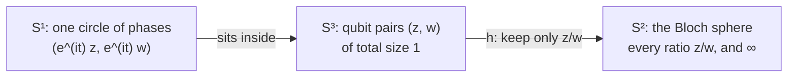

# Higher homotopy groups: wrap a sphere around a space, and the Hopf fibration that wraps S^3 around S^2

[Syllabus](../../../SYLLABUS.md) → [Topology](../README.md) → [Higher Homotopy and Mapping Spaces](../README.md#s07) → Higher homotopy groups

---

## General Overview

A qubit, the memory cell of a quantum computer, is stored as two complex numbers $`(z, w)`$ with $`|z|^2 + |w|^2 = 1`$. A reading gives 0 with chance $`|z|^2`$ and 1 with chance $`|w|^2`$. The state $`(1/\sqrt 2,\ 1/\sqrt 2)`$ reads 0 half the time: chance 0.5.

Multiply both numbers by the same phase $`e^{it}`$, a complex number of size 1. No experiment can see the change. At $`t = 90^\circ`$ the pair becomes $`(0.707107i,\ 0.707107i)`$, and it is still the same physical state. What a measurement can see is only the ratio $`z/w`$, here 1.

So the pairs, which fill the three-dimensional sphere $`S^3`$, fall onto the ratios, which fill an ordinary sphere $`S^2`$: physicists call it the Bloch sphere. Above each point of $`S^2`$ sits one whole circle of pairs. This map is the **Hopf map** $`h`$. Its circles never meet, yet any two of them are linked once, like two rings of a chain.

The Hopf map wraps a sphere around a smaller sphere so that it cannot be unwrapped. **Higher homotopy groups** count such wrappings: they draw spheres of dimension 2, 3 and up in a space, as the fundamental group draws loops, and ask which can be shrunk to a point.

**The n-th homotopy group collects the ways an n-dimensional sphere can be drawn in a space, up to sliding; from dimension 2 up it is commutative, and a fibration ties the groups of its fibre, its total space and its base into one exact sequence, which turns the Hopf map's circle of phases into π₂(S²) = ℤ and π₃(S²) = ℤ.**

**What kind of fact this is:** $`\pi_n`$ is a definition. Commutativity for $`n \ge 2`$ and $`\pi_n(S^1) = 0`$ for $`n \ge 2`$ are theorems proved on this card; the two Hopf results are theorems read off the exact sequence. The exact sequence is a theorem proved here in outline, with the full proof in Hatcher (Theorem 4.41). Five inputs are stated with a source: a bundle lifts homotopies, maps of a lower sphere into $`S^3`$ shrink, $`\pi_3(S^3) = \mathbb{Z}`$ (Hatcher, Corollary 4.25), linking number as the invariant of $`\pi_3(S^2)`$ (Hopf, 1931), and the table of larger groups. The code checks finitely many cases: it illustrates and proves nothing in general.

### The picture: the qubit's circle of phases over the Bloch sphere



Read left to right: one circle of phases sits inside the sphere of pairs, and the Hopf map crushes each such circle to one point of the Bloch sphere.

---

## The formula

Notation first, in words. The **n-cube** $`I^n`$ is $`[0, 1]^n`$: an interval for $`n = 1`$, a square for $`n = 2`$. Its **boundary** $`\partial I^n`$ is its outer faces. Pick a **base point** $`x_0`$ in a space $`X`$.

```math
\pi_n(X, x_0) = \big\{\, f : I^n \to X \text{ continuous},\ f(\partial I^n) = x_0 \,\big\} \big/ \simeq
```

**Read it aloud:** the n-th homotopy group is the set of maps of the n-cube into the space that send every outer face to the base point, with two maps counted as one when one slides into the other, faces held at the base point.

Crushing the cube's faces to one point gives the sphere $`S^n`$, so an element is a sphere drawn in $`X`$ through $`x_0`$. For $`n = 1`$ this is [The fundamental group](../04-Homotopy/03-the-fundamental-group.md). Two maps are added by placing them side by side along the first coordinate $`s_1`$:

```math
(f + g)(s_1, s_2, \ldots, s_n) = \begin{cases} f(2s_1, s_2, \ldots, s_n) & s_1 \le \tfrac12 \\ g(2s_1 - 1, s_2, \ldots, s_n) & s_1 \ge \tfrac12 \end{cases}
```

**Read it aloud:** squeeze f into the left half of the cube and g into the right half; they agree on the middle wall, which both send to the base point.

A **fibration** is a map $`p : E \to B`$ along which every homotopy of a cube in $`B`$ lifts to $`E`$ from any lifted start: the **homotopy lifting property**. $`E`$ is the **total space**, $`B`$ the **base**, and $`F = p^{-1}(b_0)`$ the **fibre** over the base point. Its groups sit in one **exact** row: at every spot, what arrives is exactly what the next map sends to zero ([Mayer-Vietoris and exact sequences](../05-Homology/06-mayer-vietoris-and-long-exact-sequences.md)).

```math
\cdots \to \pi_n(F) \xrightarrow{\ i_*\ } \pi_n(E) \xrightarrow{\ p_*\ } \pi_n(B) \xrightarrow{\ \partial\ } \pi_{n-1}(F) \xrightarrow{\ i_*\ } \pi_{n-1}(E) \to \cdots \to \pi_0(E)
```

**Read it aloud:** spheres in the fibre go into the total space, then down to the base, and a sphere in the base comes back to the fibre one dimension lower, through the boundary map $`\partial`$; the row is exact everywhere.

The Hopf map is the example. A pair $`(z, w)`$ on $`S^3`$ goes to its ratio on the Riemann sphere, the plane with one point $`\infty`$ added ([Mobius transformations](../../07-Complex%20analysis/07-Conformal%20Maps%20and%20Harmonic%20Functions/02-mobius-transformations-and-the-point-at-infinity.md)):

```math
h(z, w) = \frac{z}{w}, \qquad h^{-1}\big(h(z, w)\big) = \big\{\, (e^{it} z,\ e^{it} w) : 0 \le t < 2\pi \,\big\}
```

**Read it aloud:** the Hopf map keeps only the ratio, and the pairs with that ratio are one circle, the pair turned through every phase.

As a point of $`S^2`$, this card draws the ratio as $`(2 z \bar w,\ \lvert z\rvert^2 - \lvert w\rvert^2)`$, where $`\bar w`$ is the complex conjugate of $`w`$ and the complex number $`2 z \bar w`$ gives the first two coordinates. That is the mirror image, $`y`$ to $`-y`$, of the Bloch vector in physics texts; topologically the two are the same.

| Symbol | Plain meaning | In our example | Push it up and the answer… |
| --- | --- | --- | --- |
| $`X`$, $`x_0`$, $`\simeq`$ | a space; its base point; "slides into" (is homotopic to) | the Bloch sphere; the south pole | — |
| $`I^n`$, $`\partial I^n`$, $`s_1, \ldots, s_n`$ | the n-cube; its outer faces; its coordinates | a square, for $`\pi_2`$ | — |
| $`S^n`$ | the n-dimensional sphere: points at distance 1 from 0 in $`n + 1`$ dimensions | $`S^1`$ phases, $`S^2`$ ratios, $`S^3`$ pairs | — |
| $`\pi_n(X, x_0)`$, $`f + g`$, $`+_1`$, $`+_2`$, $`c_0`$, $`f_1, \ldots, f_4`$ | spheres in $`X`$ up to sliding; side-by-side sum; sums along $`s_1`$ and along $`s_2`$; the constant map; four maps in the four quarters of a square | $`\pi_2(S^2) = \mathbb{Z}`$ | higher n: groups no rule predicts |
| $`\Omega X`$ | the space of loops at $`x_0`$ | — | — |
| $`p`$, $`E`$, $`B`$, $`F`$, $`b_0`$, $`e_0`$ | a fibration; total space, base, fibre, base points | $`h`$; $`S^3`$, $`S^2`$, $`S^1`$ | — |
| $`i_*`$, $`p_*`$, $`h_*`$, $`\partial`$ | what inclusion, projection and Hopf map do to spheres; the boundary map | $`\partial`$ sends degree $`d`$ to winding $`-d`$ | — |
| $`z`$, $`w`$, $`t`$ | the qubit's two amplitudes; a phase angle | $`1/\sqrt 2`$ each; 90° | $`t`$: the pair turns, the ratio stays |
| $`h`$, $`q`$, $`u`$ | the Hopf map, $`z/w`$; a ratio and a phase that rebuild a pair | $`h(1/\sqrt 2, 1/\sqrt 2) = 1`$ | — |
| $`\theta`$, $`\varphi`$, $`d`$, $`D`$ | polar angle and longitude on $`S^2`$; a whole number of turns; a disc bounded by one fibre | $`d`$ from −2 to 2 | $`d`$: degree and winding both follow it |
| $`\mathbb{Z}`$, $`\mathbb{Z}_2`$, $`\mathbb{Z}_{12}`$ | the integers; integers mod 2 and mod 12 (printed Z2, Z12) | $`\pi_4(S^2) = \mathbb{Z}_2`$ | — |
| $`\deg`$, $`\mathrm{lk}`$, $`H_3`$ | degree of a sphere map; linking number of two loops; third homology group | lk = 1; $`H_3(S^2) = 0`$ | — |

The loop space $`\Omega X`$, a space whose points are loops, comes from [Mapping spaces](01-mapping-spaces-and-the-compact-open-topology.md). Read an n-cube as a family of loops along $`s_1`$, one for each point of the other $`n - 1`$ coordinates: then $`\pi_n(X) \cong \pi_{n-1}(\Omega X)`$, and every higher group is a fundamental group or $`\pi_0`$ of some iterated loop space.

### When it holds

- **$`n \ge 2`$ for commutativity.** With only one direction there is no room to slide one map past another. In the figure eight, going round loop a then loop b is not homotopic to b then a ([Van Kampen's theorem](../04-Homotopy/06-van-kampens-theorem.md)). A **monoid** is a set with one associative operation and a unit. The checks find 2 non-commutative monoids among the 11 on three elements with unit 0: one operation alone forces nothing.
- **A path-connected space.** Then the groups at different base points are isomorphic, by carrying the sphere along a path. In a space of two pieces they are unrelated.
- **The homotopy lifting property.** The map from $`[0, 1)`$ onto the circle, $`t \mapsto e^{2\pi i t}`$, is one for one and onto, so every fibre is a single point. If it were a fibration, exactness would force $`\pi_1(S^1) = \pi_1([0, 1)) = 0`$. The loop winds 1.000000 times, so it is not.
- **A path-connected base.** Then all fibres have the same homotopy groups, and the fibre over $`b_0`$ speaks for all of them.
- **The low end of the row.** $`\pi_1`$ may not be commutative and $`\pi_0`$ is only a set with a marked point. There, "exact" means that the things sent to the marked point are exactly the image of the previous map.

---

## Why it works

### Step 0: two directions let one sphere slide past another

Adding along $`s_1`$ is the only move a loop has. A square has a second direction, $`s_2`$. Shrink $`f`$ and $`g`$ into small boxes in their halves, with the base point all round them. Slide $`f`$'s box up and $`g`$'s box down, move them past each other, and slide them back. The sum $`f + g`$ has become $`g + f`$.

### Step 1: the Eckmann-Hilton argument

The sliding has an algebraic form. Write $`+_1`$ for side by side along $`s_1`$ and $`+_2`$ for one above the other along $`s_2`$. Both have the constant map $`c_0`$ as a unit, up to sliding. Four maps $`f_1, f_2, f_3, f_4`$ in the four quarters of the square can be read either way:

```math
(f_1 +_1 f_2) +_2 (f_3 +_1 f_4) = (f_1 +_2 f_3) +_1 (f_2 +_2 f_4)
```

**Read it aloud:** f₁ and f₂ side by side, below f₃ and f₄ side by side, is the same map of the square as f₁ below f₃, beside f₂ below f₄.

This is the **interchange law**. Put $`c_0`$ in two of the four places, with $`f`$ and $`g`$ in the other two, and two lines of algebra follow:

```math
f +_1 g = (f +_2 c_0) +_1 (c_0 +_2 g) = (f +_1 c_0) +_2 (c_0 +_1 g) = f +_2 g, \qquad f +_1 g = (c_0 +_2 f) +_1 (g +_2 c_0) = (c_0 +_1 g) +_2 (f +_1 c_0) = g +_2 f = g +_1 f
```

**Read it aloud:** the two sums are one and the same operation, and it does not care about order.

So $`\pi_n`$ is commutative for $`n \ge 2`$. The argument uses only a shared unit and the interchange law. The checks try every pair of operations on a three-element set with unit 0: of 6,561 pairs, 9 obey the interchange law, and in all 9 the two operations are equal and commutative. That exhaustive check proves the three-element case and nothing more.

### Step 2: spheres in the circle all shrink

Take $`f : S^n \to S^1`$ with $`n \ge 2`$. The sphere $`S^n`$ is simply connected (every loop on it shrinks; Hatcher, Proposition 1.14). So by the lifting criterion of [Covering spaces](../04-Homotopy/05-covering-spaces.md), $`f`$ lifts to a map $`\tilde f`$ into the line $`\mathbb{R}`$ with $`\tilde f(x_0) = 0`$.

The line has no holes: $`(1 - t)\tilde f`$ slides $`\tilde f`$ to the constant 0, keeping the base point at 0. Push that sliding down to the circle. It slides $`f`$ to the constant map. So

```math
\pi_n(S^1) = 0 \quad \text{for } n \ge 2
```

**Read it aloud:** no sphere of dimension 2 or more can be caught on a circle.

The grid argument of the covering card lifts cubes as well as squares, so a cover is a fibration with a discrete fibre.

### Step 3: the Hopf map is a fibration

Away from the ratio $`\infty`$ (that is, where $`w \ne 0`$), the pairs above an open patch of the Riemann sphere form a product of the patch and a circle:

```math
(z, w) \mapsto \Big(\frac{z}{w},\ \frac{w}{|w|}\Big), \qquad (q, u) \mapsto \frac{(qu,\ u)}{\sqrt{1 + |q|^2}}
```

**Read it aloud:** a pair is the same as its ratio together with the phase of its second number, and the second map rebuilds the pair from those two.

The same holds away from the ratio 0, with $`z`$ and $`w`$ swapped. A map that is a product over each small patch is a **fibre bundle**, and every fibre bundle has the homotopy lifting property (Hatcher, Proposition 4.48; stated here, not proved). So $`h : S^3 \to S^2`$ is a fibration with fibre $`S^1`$.

### Step 4: the exact sequence

The boundary map $`\partial`$ is the heart of it. Read $`f : I^n \to B`$ as a homotopy of $`(n-1)`$-cubes, with $`s_n`$ as time. At time 0 it is the base point, so lift it as the constant $`e_0`$. Lift the whole homotopy, keeping the side faces at $`e_0`$. The top face of the lift lies over $`b_0`$, so it lies in the fibre $`F`$, with its faces at $`e_0`$. That top face is $`\partial[f]`$ in $`\pi_{n-1}(F)`$.

The three "two steps give zero" facts are short:

- **$`p_* i_* = 0`$:** a sphere in the fibre, pushed down, is the constant $`b_0`$.
- **$`\partial p_* = 0`$:** a sphere already in $`E`$ is its own lift, and its top face is the constant $`e_0`$.
- **$`i_* \partial = 0`$:** the lift itself slides the top face to a constant inside $`E`$.

<details>
<summary>Detailed proof: the three "only these give zero" facts</summary>

Each uses one lift.

At $`\pi_n(E)`$. Suppose $`g`$ is a sphere in $`E`$ and $`p \circ g`$ slides to the constant by a homotopy $`G`$. Lift $`G`$ starting from $`g`$. The end of the lift lies over $`b_0`$, so in $`F`$. The lift itself slides $`g`$ into the fibre, so $`[g]`$ is in the image of $`i_*`$.

At $`\pi_n(B)`$. Suppose $`\partial[f] = 0`$: the top face of the lift $`\tilde f`$ slides to the constant inside $`F`$ by a homotopy $`K`$. Stack $`K`$ on top of $`\tilde f`$. The result is an n-cube in $`E`$ with all faces at $`e_0`$. Pushed down by $`p`$, it is $`f`$ followed by a homotopy that stays at $`b_0`$, so it slides to $`f`$. Hence $`[f]`$ is in the image of $`p_*`$.

At $`\pi_{n-1}(F)`$. Suppose $`g`$ is a sphere in $`F`$ and $`i \circ g`$ slides to the constant in $`E`$ by a homotopy $`G`$. Read $`G`$ as an n-cube in $`E`$ with top face $`g`$ and other faces at $`e_0`$. Then $`p \circ G`$ is an n-cube in $`B`$ with all faces at $`b_0`$, and $`G`$ is its lift. So $`\partial[p \circ G] = [g]`$.

The lift that keeps the side faces at $`e_0`$ comes from the plain lifting property: the cube with its bottom and side faces is homeomorphic to the cube with its bottom face alone (Hatcher, Section 4.2). That $`\partial`$ is well defined and a homomorphism follows by lifting homotopies of $`f`$ the same way.

</details>

### Step 5: read π₂(S²) and π₃(S²) off the Hopf sequence

Two facts about $`S^3`$ go in. A sphere of lower dimension in $`S^3`$ can be pushed off one point, and $`S^3`$ minus a point is all of space, which shrinks: so $`\pi_1(S^3) = \pi_2(S^3) = 0`$ (Hatcher, Corollary 4.9). And $`\pi_3(S^3) = \mathbb{Z}`$, counted by degree ([Homology of spheres, and degree](../05-Homology/07-homology-of-spheres-and-degree.md)): Hatcher proves $`\pi_n(S^n) = \mathbb{Z}`$ for every $`n`$ (Corollary 4.25), and it agrees with the Hurewicz theorem on [Hurewicz and Whitehead](03-hurewicz-and-whitehead-theorems.md).

Now cut two pieces out of the exact row of $`S^1 \to S^3 \to S^2`$:

```math
0 = \pi_2(S^3) \to \pi_2(S^2) \xrightarrow{\ \partial\ } \pi_1(S^1) \to \pi_1(S^3) = 0, \qquad 0 = \pi_3(S^1) \to \pi_3(S^3) \xrightarrow{\ h_*\ } \pi_3(S^2) \to \pi_2(S^1) = 0
```

**Read it aloud:** in each piece the middle map sits between two zeros, so it is one for one and onto: $`\pi_2(S^2) \cong \pi_1(S^1) = \mathbb{Z}`$, and $`\pi_3(S^2) \cong \pi_3(S^3) = \mathbb{Z}`$.

Exactness at the left zero makes the middle map one for one; at the right zero, onto. For every $`n \ge 3`$ the same cut gives $`\pi_n(S^2) \cong \pi_n(S^3)`$, because $`\pi_n(S^1)`$ and $`\pi_{n-1}(S^1)`$ are 0 by Step 2.

The checks watch $`\partial`$ work. The map that keeps the polar angle $`\theta`$ and multiplies the longitude $`\varphi`$ by $`d`$ has degree $`d`$. It lifts to $`S^3`$ as

```math
(\theta, \varphi) \mapsto \big(\cos(\theta/2),\ \sin(\theta/2)\, e^{-id\varphi}\big)
```

**Read it aloud:** at the top pole the lift is the fixed pair (1, 0); going down, the second number grows and turns d times backwards.

Read the sphere as a disc centred on the top pole whose rim, $`\theta = \pi`$, is crushed to the bottom pole, the base point. The lift sends that rim into the fibre over the bottom pole, as the loop $`(0, e^{-id\varphi})`$, which winds $`-d`$ times. So $`\partial`$ sends degree $`d`$ to winding $`-d`$: one for one, as exactness said. The sign belongs to the orientation conventions.

### Step 6: why any two fibres link once

The generator of $`\pi_3(S^2)`$ is $`h`$ itself: $`h_*`$ sends the identity of $`S^3`$ to $`h`$. The whole number that measures a map $`S^3 \to S^2`$ is the **linking number** of two of its fibres, the signed count of how often one loop winds round the other ([Reidemeister moves and the three-colour test](../03-Surfaces%20and%20Manifolds/07-reidemeister-moves-and-tricolourability.md)). Hopf proved in 1931 that this number is the same for every pair of fibres and does not change under sliding; it is stated here with his paper as the source.

For $`h`$ the count is short. The fibre over $`\infty`$ is the circle $`\{(e^{it}, 0)\}`$. It is the rim of the half-sphere $`D = \{(z, r) : r \ge 0 \text{ real}\}`$, a disc in $`S^3`$. Any other fibre $`\{(e^{is} z_0,\ e^{is} w_0)\}`$ has $`w_0 \ne 0`$, and it meets $`D`$ exactly when $`e^{is} w_0`$ is real and positive: once. So it crosses a disc bounded by the first fibre once, and the linking number is 1. A rotation of $`\mathbb{C}^2`$ that keeps lengths carries fibres to fibres and any fibre to the one over $`\infty`$, so every pair links once.

---

## Worked numbers, by hand

| Step | Arithmetic | Value |
| --- | --- | --- |
| the qubit lies on $`S^3`$ | $`\lvert z\rvert^2 + \lvert w\rvert^2 = 1/2 + 1/2`$ | 1 |
| its ratio | $`(1/\sqrt 2) / (1/\sqrt 2)`$ | 1 |
| its point of $`S^2`$ | $`2 z \bar w = 2 \cdot \tfrac{1}{\sqrt 2} \cdot \tfrac{1}{\sqrt 2}`$; $`\lvert z\rvert^2 - \lvert w\rvert^2 = 0`$ | (1, 0, 0) |
| turn the phase by 90° | multiply both by $`i`$ | $`(0.707107i,\ 0.707107i)`$, ratio still 1 |
| second qubit $`(3/5,\ 4i/5)`$ | $`(3/5) / (4i/5) = 3/(4i)`$ | $`-0.75i`$ |
| its point of $`S^2`$ | $`2 \cdot \tfrac35 \cdot (-\tfrac{4i}{5})`$; $`(3/5)^2 - (4/5)^2`$ | (0, −0.96, −0.28) |
| flatten that point | $`(-0.96i) / (1 + 0.28)`$ | $`-0.75i`$, the ratio again |
| the fibre over −1 meets the disc bounded by the fibre over 1 | one crossing | linking number 1 |
| exact row at $`\pi_2(S^2)`$ | $`0 \to \pi_2(S^2) \to \mathbb{Z} \to 0`$ | **π₂(S²) = ℤ** |
| exact row at $`\pi_3(S^2)`$ | $`0 \to \mathbb{Z} \to \pi_3(S^2) \to 0`$ | **π₃(S²) = ℤ** |

The qubit's invisible circle of phases is what makes $`\pi_2`$ and $`\pi_3`$ of the Bloch sphere the integers.

The same sequences fill in the start of the table of homotopy groups of spheres. The $`S^1`$ row comes from Step 2, the $`S^2`$ row from the $`S^3`$ row by Step 5; the $`S^3`$ entries past $`\pi_3`$ and the $`S^4`$ row are stated from Hatcher's table (Section 4.1):

| | $`\pi_1`$ | $`\pi_2`$ | $`\pi_3`$ | $`\pi_4`$ | $`\pi_5`$ | $`\pi_6`$ |
| --- | --- | --- | --- | --- | --- | --- |
| $`S^1`$ | ℤ | 0 | 0 | 0 | 0 | 0 |
| $`S^2`$ | 0 | ℤ | ℤ | ℤ₂ | ℤ₂ | ℤ₁₂ |
| $`S^3`$ | 0 | 0 | ℤ | ℤ₂ | ℤ₂ | ℤ₁₂ |
| $`S^4`$ | 0 | 0 | 0 | ℤ | ℤ₂ | ℤ₂ |

Below the diagonal every entry is 0, and on it every entry is ℤ. Above it the entries stop depending on $`n`$ once $`n`$ is large enough: $`\pi_{n+1}(S^n) = \mathbb{Z}_2`$ for $`n \ge 3`$. This is the **stable range** (Freudenthal's theorem, stated). Homology of $`S^2`$ stops at dimension 2; its homotopy groups do not.

### What breaks if you drop a piece

| Mistake | Comes out at | What went wrong |
| --- | --- | --- |
| One operation, no second direction ($`n = 1`$) | 2 of 11 monoids on three elements not commutative | Eckmann-Hilton needs two operations with the interchange law |
| $`[0, 1) \to S^1`$ used as a fibration | exactness says $`\pi_1(S^1) = 0`$; the loop winds 1 | a one-for-one onto map without homotopy lifting |
| The Hopf map judged by homology | 0, since $`H_3(S^2) = 0`$; the fibres link 1 | homology cannot see a sphere wrapped round a lower sphere |

---

## Code, from first principles, and it actually runs

The code tests four claims, each by two independent roads. The Hopf map: as a point of $`S^2`$ and as the ratio $`z/w`$, matched by stereographic projection on 1,000 random pairs. The linking number: Gauss's double sum (his integral for the linking number, summed over the edges of two polygons) after flattening $`S^3`$ into space, and crossings of a spanning disc on 500 random pairs. The boundary map: degree as signed area, against the winding of the lifted rim. Eckmann-Hilton: every pair of operations on three elements, against a direct count of commutative monoids. Random points come from SplitMix64, a small published random-number generator, with seed 2026. Apart from the exhaustive Eckmann-Hilton count, these are checks on finitely many cases.

### Python

```python
# Higher homotopy groups and the Hopf fibration -- the check behind the card.  Standard library only.
# A point of S^3 is a pair of complex numbers (z, w) with |z|^2 + |w|^2 = 1.  The Hopf map h sends
# it to the ratio z/w on the Riemann sphere, drawn as the point (2 z conj(w), |z|^2 - |w|^2) of S^2.
from math import sqrt, pi, cos, sin, atan2
from itertools import product

def f6(x):                                  # six decimals, with no "-0.000000"
    return f"{0.0 if abs(x) < 5e-7 else x:.6f}"

def cf(c):                                  # a complex number as "a + bi"
    return f"{f6(c.real)} {'-' if c.imag < -5e-7 else '+'} {f6(abs(c.imag))}i"

def yes(ok): return "yes" if ok else "no"

def bloch(z, w):                            # road one to h: the point of S^2
    q = 2 * z * w.conjugate()
    return (q.real, q.imag, abs(z) ** 2 - abs(w) ** 2)

def stereo(p):                              # S^2 minus its top pole -> the plane, as a complex number
    return complex(p[0], p[1]) / (1 - p[2])

def phase(t):
    return complex(cos(t), sin(t))

def winding(seq):                           # turns of a closed walk round 0, adding short angle steps
    return sum(atan2((b1 / b0).imag, (b1 / b0).real) for b0, b1 in zip(seq, seq[1:])) / (2 * pi)

M = 0xFFFFFFFFFFFFFFFF
def splitmix(s):                            # SplitMix64, seed 2026: the same points in Python and Rust
    while True:
        s = (s + 0x9E3779B97F4A7C15) & M
        x = ((s ^ (s >> 30)) * 0xBF58476D1CE4E5B9) & M
        x = ((x ^ (x >> 27)) * 0x94D049BB133111EB) & M
        yield ((x ^ (x >> 31)) >> 11) / 2.0 ** 53 * 2 - 1

def random_s3(g):
    v = [next(g) for _ in range(4)]
    r = sqrt(sum(c * c for c in v))
    return complex(v[0], v[1]) / r, complex(v[2], v[3]) / r

r2 = 1 / sqrt(2)
z, w = complex(r2, 0), complex(r2, 0)       # the example qubit
b = bloch(z, w)
print(f"example (z, w) = ({f6(r2)}, {f6(r2)}): |z|^2 + |w|^2 = {f6(abs(z)**2 + abs(w)**2)}, chance of 0 = {f6(abs(z)**2)}")
print(f"  ratio z/w = {cf(z / w)}; point of S^2 = ({f6(b[0])}, {f6(b[1])}, {f6(b[2])})")
fib = [(phase(2 * pi * k / 12) * z, phase(2 * pi * k / 12) * w) for k in range(12)]
dev = max(abs(a / c - 1) for a, c in fib)
print(f"  12 points (e^(it) z, e^(it) w), t = 0, 30, ..., 330 deg: every ratio within 1e-12 of 1: {yes(dev < 1e-12)}")
print(f"  t = 90 deg: ({cf(fib[3][0])}, {cf(fib[3][1])})")
z2, w2 = complex(0.6, 0), complex(0, 0.8)
b2, q2 = bloch(z2, w2), z2 / w2
print(f"second qubit (3/5, 4i/5): ratio = {cf(q2)}; point = ({f6(b2[0])}, {f6(b2[1])}, {f6(b2[2])});"
      f" stereographic = {cf(stereo(b2))}")
g = splitmix(2026)
pts = [random_s3(g) for _ in range(1000)]
e1 = max(abs(stereo(bloch(a, c)) - a / c) for a, c in pts)
e2 = max(max(abs(x - y) for x, y in zip(bloch(a, c), bloch(phase(t) * a, phase(t) * c))) for a, c in pts for t in (1, 2, 3))
print(f"1000 random points: two roads to h agree within 1e-9: {yes(e1 < 1e-9)}; a phase moves h under 1e-12: {yes(e2 < 1e-12)}")

def s3_to_r3(a, c):                         # stereographic projection of S^3 from the point (0, i) into space
    return (a.real / (1 - c.imag), a.imag / (1 - c.imag), c.real / (1 - c.imag))

def gauss_link(p, q, n=200):                # road one to linking: Gauss's double sum over two polygons
    P = [s3_to_r3(phase(2 * pi * k / n) * p[0], phase(2 * pi * k / n) * p[1]) for k in range(n)]
    Q = [s3_to_r3(phase(2 * pi * k / n) * q[0], phase(2 * pi * k / n) * q[1]) for k in range(n)]
    tot = 0.0
    for i in range(n):
        a0, a1 = P[i], P[(i + 1) % n]
        for j in range(n):
            c0, c1 = Q[j], Q[(j + 1) % n]
            r = [(a0[k] + a1[k] - c0[k] - c1[k]) / 2 for k in range(3)]
            u = [a1[k] - a0[k] for k in range(3)]
            v = [c1[k] - c0[k] for k in range(3)]
            cr = (u[1] * v[2] - u[2] * v[1], u[2] * v[0] - u[0] * v[2], u[0] * v[1] - u[1] * v[0])
            tot += sum(r[k] * cr[k] for k in range(3)) / sqrt(sum(x * x for x in r)) ** 3
    return tot / (4 * pi)

def disc_crossings(p, q, n=360):            # road two: fibre q crossing the disc {x : p0 x1 - p1 x0 real, >= 0}
    d = p[0] * q[1] - p[1] * q[0]           # that fibre p bounds, counted with sign
    vals = [phase(2 * pi * k / n) * d for k in range(n + 1)]
    return sum((v1.imag > 0) - (v0.imag > 0) for v0, v1 in zip(vals, vals[1:]) if v0.real > 0 and v1.real > 0)

others = {"-1": (complex(r2), complex(-r2)), "infinity": (complex(1), complex(0)), "i": (complex(r2), complex(0, -r2))}
links = {k: gauss_link((z, w), v) for k, v in others.items()}
for k, v in others.items():
    print(f"fibre over 1 and fibre over {k}: Gauss sum {links[k]:.3f}, disc crossings {disc_crossings((z, w), v)}")
cross = [disc_crossings(pts[2 * i], pts[2 * i + 1]) for i in range(500)]
print(f"500 random pairs of fibres: disc crossings {sorted(set(cross))}")

def tri_angle(a, b, c):                     # signed solid angle of a small spherical triangle
    det = a[0] * (b[1] * c[2] - b[2] * c[1]) - a[1] * (b[0] * c[2] - b[2] * c[0]) + a[2] * (b[0] * c[1] - b[1] * c[0])
    return 2 * atan2(det, 1 + sum(a[k] * b[k] + b[k] * c[k] + c[k] * a[k] for k in range(3)))

print("boundary map: the map (theta, phi) -> (theta, d phi) of S^2, lifted to S^3")
bmap, T, F = {}, 24, 48
for d in range(-2, 3):
    pt = lambda i, j: (sin(pi * i / T) * cos(d * 2 * pi * j / F), sin(pi * i / T) * sin(d * 2 * pi * j / F), cos(pi * i / T))
    deg = sum(tri_angle(pt(i, j), pt(i + 1, j), pt(i + 1, j + 1)) + tri_angle(pt(i, j), pt(i + 1, j + 1), pt(i, j + 1))
              for i in range(T) for j in range(F)) / (4 * pi)
    lift = lambda i, j: (complex(cos(pi * i / T / 2), 0), sin(pi * i / T / 2) * phase(-d * 2 * pi * j / F))
    err = max(abs(x - y) for i in range(T + 1) for j in range(F) for x, y in zip(bloch(*lift(i, j)), pt(i, j)))
    wind = winding([lift(T, j)[1] for j in range(F + 1)])
    bmap[d] = (deg, wind, err)
    print(f"  d = {d:2d}: degree by area {f6(deg)}; lift within 1e-12: {yes(err < 1e-12)}; rim in the fibre winds {f6(wind)}")

E = range(3)                                # Eckmann-Hilton: every operation on {0, 1, 2} with unit 0
ops = []
for v in product(E, repeat=4):
    t = {(0, a): a for a in E} | {(a, 0): a for a in E}
    t[1, 1], t[1, 2], t[2, 1], t[2, 2] = v
    ops.append(t)
quads = list(product(E, repeat=4))
inter = [(o, s) for o in ops for s in ops if all(s[o[a, b], o[c, d]] == o[s[a, c], s[b, d]] for a, b, c, d in quads)]
same = sum(1 for o, s in inter if o == s and all(o[a, c] == o[c, a] for a in E for c in E))
mon = [o for o in ops if all(o[o[a, c], e] == o[a, o[c, e]] for a in E for c in E for e in E)]
comm = [o for o in mon if all(o[a, c] == o[c, a] for a in E for c in E)]
print(f"Eckmann-Hilton on 3 elements: {len(ops)} operations, {len(ops) ** 2} pairs; {len(inter)} pairs obey the"
      f" interchange law, {same} of them equal and commutative")
print(f"  monoids with unit 0: {len(mon)}; commutative {len(comm)}; not commutative {len(mon) - len(comm)}")
pi_s1 = lambda k: "Z" if k == 1 else "0"                              # from the cover R -> S^1
pi_s3 = lambda k: {3: "Z", 4: "Z2", 5: "Z2", 6: "Z12"}.get(k, "0")    # stated: Hatcher's table
pi_s2 = lambda k: pi_s1(k - 1) if k <= 2 else pi_s3(k)                # exactness, neighbours 0
for k in (1, 2, 3):
    print(f"Hopf sequence, k = {k}: pi_{k}(S^3) = {pi_s3(k)}, pi_{k - 1}(S^1) = {pi_s1(k - 1) if k > 1 else 'point'}"
          f" -> pi_{k}(S^2) = {pi_s2(k)}")
rows = {1: [pi_s1(k) for k in range(1, 7)], 2: [pi_s2(k) for k in range(1, 7)], 3: [pi_s3(k) for k in range(1, 7)],
        4: ["0", "0", "0", "Z", "Z2", "Z2"]}                           # S^4: stated, Hatcher's table
for n, r in rows.items():
    print(f"pi_1..pi_6 of S^{n}: {' '.join(f'{x:>3}' for x in r)}")
loop1 = winding([phase(2 * pi * k / 360) for k in range(361)])
print(f"mistake, [0, 1) -> S^1 as a fibration: fibres are points, so exactness says pi_1(S^1) = 0;"
      f" the loop e^(2 pi i t) winds {f6(loop1)}")
print(f"mistake, judge h by homology: H_3(S^2) = 0, so h gives 0 there; fibres still link {round(links['-1'])}")
assert abs(b[0] - 1) < 1e-12 and dev < 1e-12 and e1 < 1e-9 and e2 < 1e-12  # two roads to h; phases invisible
assert all(abs(x - 1) < 0.01 for x in links.values())                # Gauss sum near 1 ...
assert set(cross) == {1} and all(disc_crossings((z, w), v) == 1 for v in others.values())  # ... crossings 1
assert all(abs(dg - d) < 1e-9 and abs(wd + d) < 1e-9 and er < 1e-12 for d, (dg, wd, er) in bmap.items())
assert len(inter) == same == len(comm) == 9 and len(mon) - len(comm) == 2  # Eckmann-Hilton, exhaustively
assert abs(q2 - stereo(b2)) < 1e-12 and abs(q2 + 0.75j) < 1e-12 and abs(loop1 - 1) < 1e-9
print("ALL CHECKS PASS")
```

**Ran 2026-11-24 on macOS, Python 3.14.10, standard library only. All checks passed. Output, pasted from the run:**

```
example (z, w) = (0.707107, 0.707107): |z|^2 + |w|^2 = 1.000000, chance of 0 = 0.500000
  ratio z/w = 1.000000 + 0.000000i; point of S^2 = (1.000000, 0.000000, 0.000000)
  12 points (e^(it) z, e^(it) w), t = 0, 30, ..., 330 deg: every ratio within 1e-12 of 1: yes
  t = 90 deg: (0.000000 + 0.707107i, 0.000000 + 0.707107i)
second qubit (3/5, 4i/5): ratio = 0.000000 - 0.750000i; point = (0.000000, -0.960000, -0.280000); stereographic = 0.000000 - 0.750000i
1000 random points: two roads to h agree within 1e-9: yes; a phase moves h under 1e-12: yes
fibre over 1 and fibre over -1: Gauss sum 1.000, disc crossings 1
fibre over 1 and fibre over infinity: Gauss sum 1.000, disc crossings 1
fibre over 1 and fibre over i: Gauss sum 1.000, disc crossings 1
500 random pairs of fibres: disc crossings [1]
boundary map: the map (theta, phi) -> (theta, d phi) of S^2, lifted to S^3
  d = -2: degree by area -2.000000; lift within 1e-12: yes; rim in the fibre winds 2.000000
  d = -1: degree by area -1.000000; lift within 1e-12: yes; rim in the fibre winds 1.000000
  d =  0: degree by area 0.000000; lift within 1e-12: yes; rim in the fibre winds 0.000000
  d =  1: degree by area 1.000000; lift within 1e-12: yes; rim in the fibre winds -1.000000
  d =  2: degree by area 2.000000; lift within 1e-12: yes; rim in the fibre winds -2.000000
Eckmann-Hilton on 3 elements: 81 operations, 6561 pairs; 9 pairs obey the interchange law, 9 of them equal and commutative
  monoids with unit 0: 11; commutative 9; not commutative 2
Hopf sequence, k = 1: pi_1(S^3) = 0, pi_0(S^1) = point -> pi_1(S^2) = 0
Hopf sequence, k = 2: pi_2(S^3) = 0, pi_1(S^1) = Z -> pi_2(S^2) = Z
Hopf sequence, k = 3: pi_3(S^3) = Z, pi_2(S^1) = 0 -> pi_3(S^2) = Z
pi_1..pi_6 of S^1:   Z   0   0   0   0   0
pi_1..pi_6 of S^2:   0   Z   Z  Z2  Z2 Z12
pi_1..pi_6 of S^3:   0   0   Z  Z2  Z2 Z12
pi_1..pi_6 of S^4:   0   0   0   Z  Z2  Z2
mistake, [0, 1) -> S^1 as a fibration: fibres are points, so exactness says pi_1(S^1) = 0; the loop e^(2 pi i t) winds 1.000000
mistake, judge h by homology: H_3(S^2) = 0, so h gives 0 there; fibres still link 1
ALL CHECKS PASS
```

### Rust

Same numbers, same labels, built with `rustc --edition 2021 -O`.

```rust
// Higher homotopy groups and the Hopf fibration -- the same check as the Python, in Rust.  No crates.
// A point of S^3 is a pair of complex numbers (z, w) with |z|^2 + |w|^2 = 1.  The Hopf map h sends
// it to the ratio z/w on the Riemann sphere, drawn as the point (2 z conj(w), |z|^2 - |w|^2) of S^2.
use std::f64::consts::PI;

#[derive(Clone, Copy, PartialEq)]
struct C { re: f64, im: f64 }
fn c(re: f64, im: f64) -> C { C { re, im } }
fn mul(a: C, b: C) -> C { c(a.re * b.re - a.im * b.im, a.re * b.im + a.im * b.re) }
fn sub(a: C, b: C) -> C { c(a.re - b.re, a.im - b.im) }
fn abs(a: C) -> f64 { a.re.hypot(a.im) }
fn div(a: C, b: C) -> C { let n = b.re * b.re + b.im * b.im; let t = mul(a, c(b.re, -b.im)); c(t.re / n, t.im / n) }
fn phase(t: f64) -> C { c(t.cos(), t.sin()) }
fn scale(s: f64, a: C) -> C { mul(c(s, 0.0), a) }

fn f6(x: f64) -> String { format!("{:.6}", if x.abs() < 5e-7 { 0.0 } else { x }) } // no "-0.000000"
fn cf(a: C) -> String { format!("{} {} {}i", f6(a.re), if a.im < -5e-7 { "-" } else { "+" }, f6(a.im.abs())) }
fn yes(ok: bool) -> &'static str { if ok { "yes" } else { "no" } }

fn bloch(z: C, w: C) -> [f64; 3] {           // road one to h: the point of S^2
    let q = mul(scale(2.0, z), c(w.re, -w.im));
    [q.re, q.im, abs(z).powi(2) - abs(w).powi(2)]
}
fn stereo(p: [f64; 3]) -> C { div(c(p[0], p[1]), c(1.0 - p[2], 0.0)) } // S^2 minus its top pole -> plane
fn winding(s: &[C]) -> f64 {                 // turns of a closed walk round 0, adding short angle steps
    s.windows(2).map(|v| { let q = div(v[1], v[0]); q.im.atan2(q.re) }).sum::<f64>() / (2.0 * PI)
}

struct Mix(u64);                             // SplitMix64, seed 2026: the same points in Python and Rust
impl Mix {
    fn next(&mut self) -> f64 {
        self.0 = self.0.wrapping_add(0x9E3779B97F4A7C15);
        let mut x = (self.0 ^ (self.0 >> 30)).wrapping_mul(0xBF58476D1CE4E5B9);
        x = (x ^ (x >> 27)).wrapping_mul(0x94D049BB133111EB);
        ((x ^ (x >> 31)) >> 11) as f64 / 2f64.powi(53) * 2.0 - 1.0
    }
}
fn random_s3(g: &mut Mix) -> (C, C) {
    let v: Vec<f64> = (0..4).map(|_| g.next()).collect();
    let r = v.iter().map(|x| x * x).sum::<f64>().sqrt();
    (div(c(v[0], v[1]), c(r, 0.0)), div(c(v[2], v[3]), c(r, 0.0)))
}
fn s3_to_r3(a: C, b: C) -> [f64; 3] { [a.re / (1.0 - b.im), a.im / (1.0 - b.im), b.re / (1.0 - b.im)] }

fn gauss_link(p: (C, C), q: (C, C), n: usize) -> f64 { // road one to linking: Gauss's double sum
    let ring = |x: (C, C)| -> Vec<[f64; 3]> { (0..n).map(|k| { let e = phase(2.0 * PI * k as f64 / n as f64);
        s3_to_r3(mul(e, x.0), mul(e, x.1)) }).collect() };
    let (pp, qq) = (ring(p), ring(q));
    let mut tot = 0.0;
    for i in 0..n {
        let (a0, a1) = (pp[i], pp[(i + 1) % n]);
        for j in 0..n {
            let (c0, c1) = (qq[j], qq[(j + 1) % n]);
            let r: Vec<f64> = (0..3).map(|k| (a0[k] + a1[k] - c0[k] - c1[k]) / 2.0).collect();
            let u: Vec<f64> = (0..3).map(|k| a1[k] - a0[k]).collect();
            let v: Vec<f64> = (0..3).map(|k| c1[k] - c0[k]).collect();
            let cr = [u[1] * v[2] - u[2] * v[1], u[2] * v[0] - u[0] * v[2], u[0] * v[1] - u[1] * v[0]];
            tot += (0..3).map(|k| r[k] * cr[k]).sum::<f64>() / r.iter().map(|x| x * x).sum::<f64>().sqrt().powi(3);
        }
    }
    tot / (4.0 * PI)
}
fn disc_crossings(p: (C, C), q: (C, C)) -> i64 { // road two: crossings of the disc that fibre p bounds
    let d = sub(mul(p.0, q.1), mul(p.1, q.0));
    let vals: Vec<C> = (0..=360).map(|k| mul(phase(2.0 * PI * k as f64 / 360.0), d)).collect();
    vals.windows(2).filter(|v| v[0].re > 0.0 && v[1].re > 0.0)
        .map(|v| (v[1].im > 0.0) as i64 - (v[0].im > 0.0) as i64).sum()
}
fn tri_angle(a: [f64; 3], b: [f64; 3], d: [f64; 3]) -> f64 { // signed solid angle of a small spherical triangle
    let det = a[0] * (b[1] * d[2] - b[2] * d[1]) - a[1] * (b[0] * d[2] - b[2] * d[0]) + a[2] * (b[0] * d[1] - b[1] * d[0]);
    2.0 * det.atan2(1.0 + (0..3).map(|k| a[k] * b[k] + b[k] * d[k] + d[k] * a[k]).sum::<f64>())
}

fn main() {
    let r2 = 1.0 / 2f64.sqrt();
    let (z, w) = (c(r2, 0.0), c(r2, 0.0));   // the example qubit
    let b = bloch(z, w);
    println!("example (z, w) = ({}, {}): |z|^2 + |w|^2 = {}, chance of 0 = {}", f6(r2), f6(r2),
             f6(abs(z).powi(2) + abs(w).powi(2)), f6(abs(z).powi(2)));
    println!("  ratio z/w = {}; point of S^2 = ({}, {}, {})", cf(div(z, w)), f6(b[0]), f6(b[1]), f6(b[2]));
    let fib: Vec<(C, C)> = (0..12).map(|k| { let e = phase(2.0 * PI * k as f64 / 12.0); (mul(e, z), mul(e, w)) }).collect();
    let dev = fib.iter().map(|&(a, d)| abs(sub(div(a, d), c(1.0, 0.0)))).fold(0.0, f64::max);
    println!("  12 points (e^(it) z, e^(it) w), t = 0, 30, ..., 330 deg: every ratio within 1e-12 of 1: {}", yes(dev < 1e-12));
    println!("  t = 90 deg: ({}, {})", cf(fib[3].0), cf(fib[3].1));
    let (z2, w2) = (c(0.6, 0.0), c(0.0, 0.8));
    let (b2, q2) = (bloch(z2, w2), div(z2, w2));
    println!("second qubit (3/5, 4i/5): ratio = {}; point = ({}, {}, {}); stereographic = {}",
             cf(q2), f6(b2[0]), f6(b2[1]), f6(b2[2]), cf(stereo(b2)));
    let mut g = Mix(2026);
    let pts: Vec<(C, C)> = (0..1000).map(|_| random_s3(&mut g)).collect();
    let e1 = pts.iter().map(|&(a, d)| abs(sub(stereo(bloch(a, d)), div(a, d)))).fold(0.0, f64::max);
    let mut e2: f64 = 0.0;
    for &(a, d) in &pts { for t in [1.0, 2.0, 3.0] {
        let (x, y) = (bloch(a, d), bloch(mul(phase(t), a), mul(phase(t), d)));
        for k in 0..3 { e2 = e2.max((x[k] - y[k]).abs()) }
    } }
    println!("1000 random points: two roads to h agree within 1e-9: {}; a phase moves h under 1e-12: {}", yes(e1 < 1e-9), yes(e2 < 1e-12));
    let others = [("-1", (c(r2, 0.0), c(-r2, 0.0))), ("infinity", (c(1.0, 0.0), c(0.0, 0.0))), ("i", (c(r2, 0.0), c(0.0, -r2)))];
    let mut links = Vec::new();
    for (name, v) in others.iter() {
        let l = gauss_link((z, w), *v, 200); links.push(l);
        println!("fibre over 1 and fibre over {}: Gauss sum {:.3}, disc crossings {}", name, l, disc_crossings((z, w), *v));
    }
    let cross: Vec<i64> = (0..500).map(|i| disc_crossings(pts[2 * i], pts[2 * i + 1])).collect();
    let mut set = cross.clone(); set.sort(); set.dedup();
    println!("500 random pairs of fibres: disc crossings {:?}", set);
    println!("boundary map: the map (theta, phi) -> (theta, d phi) of S^2, lifted to S^3");
    let (tt, ff) = (24, 48);
    let mut bmap = Vec::new();
    for d in -2i64..3 {
        let df = d as f64;
        let pt = |i: usize, j: usize| { let (th, ph) = (PI * i as f64 / tt as f64, df * 2.0 * PI * j as f64 / ff as f64);
            [th.sin() * ph.cos(), th.sin() * ph.sin(), th.cos()] };
        let lift = |i: usize, j: usize| (c((PI * i as f64 / tt as f64 / 2.0).cos(), 0.0),
            scale((PI * i as f64 / tt as f64 / 2.0).sin(), phase(-df * 2.0 * PI * j as f64 / ff as f64)));
        let (mut deg, mut err) = (0.0, 0.0f64);
        for i in 0..tt { for j in 0..ff {
            deg += tri_angle(pt(i, j), pt(i + 1, j), pt(i + 1, j + 1)) + tri_angle(pt(i, j), pt(i + 1, j + 1), pt(i, j + 1));
        } }
        deg /= 4.0 * PI;
        for i in 0..=tt { for j in 0..ff {
            let (l, p) = (lift(i, j), pt(i, j));
            let x = bloch(l.0, l.1);
            for k in 0..3 { err = err.max((x[k] - p[k]).abs()) }
        } }
        let wind = winding(&(0..=ff).map(|j| lift(tt, j).1).collect::<Vec<C>>());
        bmap.push((d, deg, wind, err));
        println!("  d = {:2}: degree by area {}; lift within 1e-12: {}; rim in the fibre winds {}", d, f6(deg), yes(err < 1e-12), f6(wind));
    }
    let mut ops: Vec<[[usize; 3]; 3]> = Vec::new(); // Eckmann-Hilton: every operation on {0, 1, 2} with unit 0
    for v in 0..81 {
        let (a, b, d, e) = (v / 27 % 3, v / 9 % 3, v / 3 % 3, v % 3);
        ops.push([[0, 1, 2], [1, a, b], [2, d, e]]);
    }
    let r3 = 0..3usize;
    let comm_ok = |o: &[[usize; 3]; 3]| r3.clone().all(|a| r3.clone().all(|b| o[a][b] == o[b][a]));
    let (mut inter, mut same) = (0, 0);
    for o in &ops { for s in &ops {
        let ok = (0..81).all(|q| { let (a, b, c2, d) = (q / 27, q / 9 % 3, q / 3 % 3, q % 3); s[o[a][b]][o[c2][d]] == o[s[a][c2]][s[b][d]] });
        if ok { inter += 1; if o == s && comm_ok(o) { same += 1 } }
    } }
    let mon: Vec<&[[usize; 3]; 3]> = ops.iter().filter(|o| (0..27).all(|q| { let (a, b, e) = (q / 9, q / 3 % 3, q % 3); o[o[a][b]][e] == o[a][o[b][e]] })).collect();
    let comm = mon.iter().filter(|o| comm_ok(o)).count();
    println!("Eckmann-Hilton on 3 elements: {} operations, {} pairs; {} pairs obey the interchange law, {} of them equal and commutative",
             ops.len(), ops.len() * ops.len(), inter, same);
    println!("  monoids with unit 0: {}; commutative {}; not commutative {}", mon.len(), comm, mon.len() - comm);
    let pi_s1 = |k: usize| if k == 1 { "Z" } else { "0" };            // from the cover R -> S^1
    let pi_s3 = |k: usize| match k { 3 => "Z", 4 | 5 => "Z2", 6 => "Z12", _ => "0" }; // stated: Hatcher's table
    let pi_s2 = |k: usize| if k <= 2 { pi_s1(k - 1) } else { pi_s3(k) };  // exactness, neighbours 0
    for k in 1..4 {
        println!("Hopf sequence, k = {}: pi_{}(S^3) = {}, pi_{}(S^1) = {} -> pi_{}(S^2) = {}", k, k, pi_s3(k), k - 1,
                 if k > 1 { pi_s1(k - 1) } else { "point" }, k, pi_s2(k));
    }
    let s4 = ["0", "0", "0", "Z", "Z2", "Z2"];                         // S^4: stated, Hatcher's table
    for n in 1..5 {
        let row: Vec<String> = (1..7).map(|k| format!("{:>3}", match n { 1 => pi_s1(k), 2 => pi_s2(k), 3 => pi_s3(k), _ => s4[k - 1] })).collect();
        println!("pi_1..pi_6 of S^{}: {}", n, row.join(" "));
    }
    let loop1 = winding(&(0..361).map(|k| phase(2.0 * PI * k as f64 / 360.0)).collect::<Vec<C>>());
    println!("mistake, [0, 1) -> S^1 as a fibration: fibres are points, so exactness says pi_1(S^1) = 0; the loop e^(2 pi i t) winds {}", f6(loop1));
    println!("mistake, judge h by homology: H_3(S^2) = 0, so h gives 0 there; fibres still link {}", links[0].round());
    assert!((b[0] - 1.0).abs() < 1e-12 && dev < 1e-12 && e1 < 1e-9 && e2 < 1e-12); // two roads to h; phases invisible
    assert!(links.iter().all(|x| (x - 1.0).abs() < 0.01));            // Gauss sum near 1 ...
    assert!(set == vec![1] && others.iter().all(|(_, v)| disc_crossings((z, w), *v) == 1)); // ... crossings 1
    assert!(bmap.iter().all(|&(d, dg, wd, er)| (dg - d as f64).abs() < 1e-9 && (wd + d as f64).abs() < 1e-9 && er < 1e-12));
    assert!(inter == 9 && same == 9 && comm == 9 && mon.len() - comm == 2); // Eckmann-Hilton, exhaustively
    assert!(abs(sub(q2, stereo(b2))) < 1e-12 && abs(sub(q2, c(0.0, -0.75))) < 1e-12 && (loop1 - 1.0).abs() < 1e-9);
    println!("ALL CHECKS PASS");
}
```

**Ran 2026-11-24 on macOS, rustc 1.98.1, no crates. All checks passed. Output, pasted from the run:**

```
example (z, w) = (0.707107, 0.707107): |z|^2 + |w|^2 = 1.000000, chance of 0 = 0.500000
  ratio z/w = 1.000000 + 0.000000i; point of S^2 = (1.000000, 0.000000, 0.000000)
  12 points (e^(it) z, e^(it) w), t = 0, 30, ..., 330 deg: every ratio within 1e-12 of 1: yes
  t = 90 deg: (0.000000 + 0.707107i, 0.000000 + 0.707107i)
second qubit (3/5, 4i/5): ratio = 0.000000 - 0.750000i; point = (0.000000, -0.960000, -0.280000); stereographic = 0.000000 - 0.750000i
1000 random points: two roads to h agree within 1e-9: yes; a phase moves h under 1e-12: yes
fibre over 1 and fibre over -1: Gauss sum 1.000, disc crossings 1
fibre over 1 and fibre over infinity: Gauss sum 1.000, disc crossings 1
fibre over 1 and fibre over i: Gauss sum 1.000, disc crossings 1
500 random pairs of fibres: disc crossings [1]
boundary map: the map (theta, phi) -> (theta, d phi) of S^2, lifted to S^3
  d = -2: degree by area -2.000000; lift within 1e-12: yes; rim in the fibre winds 2.000000
  d = -1: degree by area -1.000000; lift within 1e-12: yes; rim in the fibre winds 1.000000
  d =  0: degree by area 0.000000; lift within 1e-12: yes; rim in the fibre winds 0.000000
  d =  1: degree by area 1.000000; lift within 1e-12: yes; rim in the fibre winds -1.000000
  d =  2: degree by area 2.000000; lift within 1e-12: yes; rim in the fibre winds -2.000000
Eckmann-Hilton on 3 elements: 81 operations, 6561 pairs; 9 pairs obey the interchange law, 9 of them equal and commutative
  monoids with unit 0: 11; commutative 9; not commutative 2
Hopf sequence, k = 1: pi_1(S^3) = 0, pi_0(S^1) = point -> pi_1(S^2) = 0
Hopf sequence, k = 2: pi_2(S^3) = 0, pi_1(S^1) = Z -> pi_2(S^2) = Z
Hopf sequence, k = 3: pi_3(S^3) = Z, pi_2(S^1) = 0 -> pi_3(S^2) = Z
pi_1..pi_6 of S^1:   Z   0   0   0   0   0
pi_1..pi_6 of S^2:   0   Z   Z  Z2  Z2 Z12
pi_1..pi_6 of S^3:   0   0   Z  Z2  Z2 Z12
pi_1..pi_6 of S^4:   0   0   0   Z  Z2  Z2
mistake, [0, 1) -> S^1 as a fibration: fibres are points, so exactness says pi_1(S^1) = 0; the loop e^(2 pi i t) winds 1.000000
mistake, judge h by homology: H_3(S^2) = 0, so h gives 0 there; fibres still link 1
ALL CHECKS PASS
```

The two outputs match line for line.

### Lean

Lean proves both theorems about $`\pi_n`$ for every $`n \ge 2`$, and the Hopf map's fibres at every point of $`S^3`$.

- Take $`n \ge 2`$, two maps $`f`$, $`g`$ and any two coordinates $`s_i`$, $`s_j`$ of the cube. Then $`f`$ beside $`g`$ along $`s_i`$ slides into $`g`$ beside $`f`$ along $`s_j`$.
- Take $`n \ge 2`$, any space $`X`$ and any base point $`x_0`$. Then $`\pi_n(X, x_0)`$ is commutative.
- Take $`n \ge 2`$ and any base point on the circle. Then every element of $`\pi_n(S^1)`$ is 0: every sphere in the circle shrinks.
- Take a pair $`(z, w)`$ with $`|z|^2 + |w|^2 = 1`$. Then its point $`(2 z \bar w,\ |z|^2 - |w|^2)`$ lies on $`S^2`$.
- Take two such pairs. Then they have the same point of $`S^2`$ exactly when one is the other times a phase.
- Lean also checks the worked numbers. The qubit $`(1/\sqrt 2,\ 1/\sqrt 2)`$ lies on $`S^3`$ and goes to $`(1, 0, 0)`$.
- Turning that qubit's phase by 90° keeps its ratio 1.
- The second qubit $`(3/5,\ 4i/5)`$ lies on $`S^3`$, with ratio $`-0.75i`$ and point $`(0, -0.96, -0.28)`$.

The linking number and the boundary map are left to the Python and Rust checks; the exact sequence stays stated from Hatcher.

```lean
-- Higher homotopy groups: from dimension 2 up, adding two spheres along any two directions gives the same commutative sum, every sphere of dimension 2 or more on the circle shrinks to a point, and the Hopf map sends the 3-sphere onto the 2-sphere with each fibre one circle of phases.
import Mathlib.Topology.Homotopy.HomotopyGroup
import Mathlib.Analysis.Complex.Circle
import Mathlib.Analysis.SpecialFunctions.Pow.Real
import Mathlib.Analysis.SpecialFunctions.Complex.Circle
import Mathlib.Topology.Homotopy.Lifting
import Mathlib.Analysis.Convex.Contractible
import Mathlib.Topology.Algebra.Module.LocallyConvex

open Topology Topology.Homotopy ComplexConjugate Complex

/-! The n-th homotopy group `π_n(X, x₀)` is Mathlib's `π_ n X x₀`, the quotient of the maps of
the n-cube `I^n` that send its boundary to `x₀` (Mathlib's `Ω^ (Fin n) X x₀`) by sliding with
the boundary held at `x₀`. `⟦f⟧` is the class of such a map `f`.
`GenLoop.transAt i f g` is the card's sum along coordinate `s_i`: `f` squeezed into the half
`s_i ≤ 1/2` and `g` into the half `s_i ≥ 1/2`. Writing `n + 2` for the dimension says `n ≥ 2`.
The circle `S¹` is Mathlib's unit circle `Circle` in the complex plane.
A point of `S³` is a pair `(z, w)` of complex numbers with `|z|² + |w|² = 1`; `normSq z` is
`|z|²`. The Hopf map sends it to the point `(2 z conj(w), |z|² − |w|²)` of `S² ⊆ ℂ × ℝ`. -/

open unitInterval in
theorem cube_contractibleSpace (N : Type*) : ContractibleSpace (I^N) := by
  refine (contractible_iff_id_nullhomotopic _).2 ⟨fun _ => 0, ⟨{
    toFun := fun p i => ⟨(1 - (p.1 : ℝ)) * (p.2 i : ℝ),
      unitInterval.mul_mem (unitInterval.symm p.1).2 (p.2 i).2⟩
    continuous_toFun := by fun_prop
    map_zero_left := fun y => by ext i; simp
    map_one_left := fun y => by ext i; simp }⟩⟩

#print axioms cube_contractibleSpace

open unitInterval in
theorem cube_locallyPathConnectedSpace (N : Type*) [Finite N] :
    LocallyPathConnectedSpace (I^N) := by
  have : LocallyPathConnectedSpace I := (convex_Icc (0 : ℝ) 1).locallyPathConnectedSpace
  infer_instance

#print axioms cube_locallyPathConnectedSpace

open unitInterval in
theorem cube_lift_const_on_boundary (n : ℕ) (x₀ : Circle) (F : C(I^(Fin (n + 2)), ℝ))
    (hF : ∀ y ∈ Cube.boundary (Fin (n + 2)), Circle.exp (F y) = x₀) :
    ∀ y ∈ Cube.boundary (Fin (n + 2)), F y = F (fun _ => 0) := by
  classical
  rintro y ⟨i, hi⟩
  obtain ⟨j, hj⟩ := exists_ne i
  let S (k : Fin (n + 2)) (c : I) : Set (I^(Fin (n + 2))) :=
    Set.pi Set.univ (fun l => if l = k then {c} else Set.univ)
  have hpre : ∀ k c, IsPreconnected (S k c) := fun k c =>
    isPreconnected_univ_pi fun l => by
      split_ifs
      · exact isPreconnected_singleton
      · exact isPreconnected_univ
  have hmem : ∀ k c z, z ∈ S k c ↔ z k = c := fun k c z => by
    simp only [S, Set.mem_pi, Set.mem_univ, true_implies]
    constructor
    · intro h; simpa using h k
    · intro h l; split_ifs with hl
      · subst hl; simpa using h
      · trivial
  have hsub : ∀ k (c : I), (c = 0 ∨ c = 1) → S k c ⊆ Cube.boundary (Fin (n + 2)) :=
    fun k c hc z hz => ⟨k, (hmem k c z).1 hz ▸ hc⟩
  have hconst : ∀ k (c : I), (c = 0 ∨ c = 1) → ∀ a ∈ S k c, ∀ b ∈ S k c, F a = F b :=
    fun k c hc a ha b hb =>
      Circle.isCoveringMap_exp.constOn_of_comp (hpre k c) F.continuous.continuousOn
        (fun a ha b hb => by rw [hF a (hsub k c hc ha), hF b (hsub k c hc hb)]) ha hb
  let y' : I^(Fin (n + 2)) := fun l => if l = i then y i else 0
  have h1 : F y = F y' := hconst i (y i) hi y ((hmem _ _ _).2 rfl) y' ((hmem _ _ _).2 (by simp [y']))
  have h2 : F y' = F (fun _ => 0) := hconst j 0 (Or.inl rfl) y' ((hmem _ _ _).2 (by simp [y', hj]))
    _ ((hmem _ _ _).2 rfl)
  exact h1.trans h2

#print axioms cube_lift_const_on_boundary

/-- **Eckmann-Hilton: from dimension 2 up, the sum of spheres does not care about direction
or order.** For `n ≥ 2`, any space `X` and base point `x₀`: adding `f` and `g` side by side along
coordinate `i` gives the same class in `π_n(X, x₀)` as adding `g` and `f` along coordinate `j`,
for any two coordinates `i`, `j`; so the group `π_n(X, x₀)` is commutative. -/
theorem homotopy_group_sum_independent_of_direction_and_commutative (n : ℕ) {X : Type*}
    [TopologicalSpace X] (x₀ : X) :
    (∀ (i j : Fin (n + 2)) (f g : Ω^ (Fin (n + 2)) X x₀),
      (⟦GenLoop.transAt i f g⟧ : HomotopyGroup (Fin (n + 2)) X x₀) = ⟦GenLoop.transAt j g f⟧) ∧
    ∀ a b : π_ (n + 2) X x₀, a * b = b * a := by
  refine ⟨fun i j f g => ?_, fun a b => mul_comm a b⟩
  have h1 := HomotopyGroup.mul_spec (N := Fin (n + 2)) (X := X) (x := x₀) (i := i) (p := g) (q := f)
  have h2 := HomotopyGroup.mul_spec (N := Fin (n + 2)) (X := X) (x := x₀) (i := j) (p := f) (q := g)
  rw [← h1, ← h2]
  exact mul_comm (G := HomotopyGroup (Fin (n + 2)) X x₀) _ _

/-- **No sphere of dimension 2 or more is caught on a circle.** For `n ≥ 2` and every base
point `x₀` of the circle, every element of `π_n(S¹, x₀)` is the identity: `π_n(S¹) = 0`. -/
theorem circle_higher_homotopy_groups_trivial (n : ℕ) (x₀ : Circle) (a : π_ (n + 2) Circle x₀) :
    a = 1 := by
  have := cube_contractibleSpace (Fin (n + 2))
  have := cube_locallyPathConnectedSpace (Fin (n + 2))
  induction a using Quotient.inductionOn' with
  | h f =>
  rw [HomotopyGroup.one_def]
  apply Quotient.sound
  obtain ⟨θ, hθ⟩ := Circle.exp_surjective x₀
  have h0 : (fun _ => 0 : Fin (n + 2) → unitInterval) ∈ Cube.boundary (Fin (n + 2)) := ⟨0, Or.inl rfl⟩
  obtain ⟨F, ⟨hF0, hFl⟩, -⟩ := Circle.isCoveringMap_exp.existsUnique_continuousMap_lifts
    (f : C(Fin (n + 2) → unitInterval, Circle)) (fun _ => 0) θ (by rw [hθ]; exact (GenLoop.boundary f _ h0).symm)
  have hb : ∀ y ∈ Cube.boundary (Fin (n + 2)), F y = θ := by
    intro y hy
    rw [cube_lift_const_on_boundary n x₀ F (fun y hy => by
      rw [show Circle.exp (F y) = (Circle.exp ∘ F) y from rfl, hFl]; exact GenLoop.boundary f y hy) y hy, hF0]
  refine ⟨{
    toFun := fun p => Circle.exp ((1 - (p.1 : ℝ)) * F p.2 + (p.1 : ℝ) * θ)
    continuous_toFun := by fun_prop
    map_zero_left := fun y => by
      simp only [Set.Icc.coe_zero, sub_zero, one_mul, zero_mul, add_zero]
      exact congr_fun hFl y
    map_one_left := fun y => by simpa using hθ
    prop' := fun t y hy => by
      simp only [ContinuousMap.coe_mk]
      rw [hb y hy, ← add_mul, sub_add_cancel, one_mul]
      rw [← (GenLoop.boundary f y hy)] at hθ
      exact hθ }⟩

/-- **The Hopf map, and its fibres are circles of phases.** For every point `(z, w)` of `S³`,
its image `(2 z conj(w), |z|² − |w|²)` lies on the unit sphere `S²`; and two points `(z, w)`
and `(z', w')` of `S³` have the same image exactly when one is the other times a phase:
`(z', w') = (u z, u w)` for some complex `u` with `|u| = 1`. -/
theorem hopf_map_lands_on_sphere_and_fibres_are_phase_circles (z w z' w' : ℂ)
    (h : normSq z + normSq w = 1) (h' : normSq z' + normSq w' = 1) :
    normSq (2 * z * conj w) + (normSq z - normSq w) ^ 2 = 1 ∧
    ((2 * z * conj w = 2 * z' * conj w' ∧ normSq z - normSq w = normSq z' - normSq w') ↔
      ∃ u : ℂ, ‖u‖ = 1 ∧ z' = u * z ∧ w' = u * w) := by
  have hnorm : ∀ a b : ℂ, normSq a = normSq b → ‖a‖ = ‖b‖ := fun a b hab => by
    rw [normSq_eq_norm_sq, normSq_eq_norm_sq] at hab
    exact (pow_left_inj₀ (norm_nonneg _) (norm_nonneg _) two_ne_zero).1 hab
  refine ⟨?_, ⟨fun ⟨hc, hd⟩ => ?_, fun ⟨u, hu, hz, hw⟩ => ?_⟩⟩
  · have h4 : normSq (2 : ℂ) = 4 := by norm_num [normSq_apply]
    rw [normSq_mul, normSq_mul, normSq_conj, h4]
    nlinarith [h]
  · have ha : normSq z = normSq z' := by linarith
    have hb : normSq w = normSq w' := by linarith
    have hc1 : z * conj w = z' * conj w' := by
      have := hc; rw [mul_assoc, mul_assoc] at this
      exact mul_left_cancel₀ two_ne_zero this
    have hc' : conj z * w = conj z' * w' := by
      have := congrArg conj hc1; simpa using this
    by_cases hz0 : z = 0
    · have hz'0 : z' = 0 := by
        rw [← normSq_eq_zero, ← ha, hz0, map_zero]
      have hw0 : w ≠ 0 := by
        intro hw; rw [hz0, hw, map_zero, add_zero] at h; norm_num at h
      refine ⟨w' / w, ?_, ?_, ?_⟩
      · rw [norm_div, ← hnorm w w' hb, div_self (norm_ne_zero_iff.2 hw0)]
      · rw [hz0, hz'0, mul_zero]
      · rw [div_mul_cancel₀ _ hw0]
    · refine ⟨z' / z, ?_, ?_, ?_⟩
      · rw [norm_div, ← hnorm z z' ha, div_self (norm_ne_zero_iff.2 hz0)]
      · rw [div_mul_cancel₀ _ hz0]
      · have hcz : conj z ≠ 0 := (map_ne_zero _).2 hz0
        have hm := mul_conj z
        have hm' := mul_conj z'
        have hn : (normSq z : ℂ) = normSq z' := by rw [ha]
        rw [div_mul_eq_mul_div, eq_div_iff hz0]
        apply mul_right_cancel₀ hcz
        linear_combination (-z') * hc' - w' * hm' + w' * hm + w' * hn
  · subst hz hw
    have hu2 : normSq u = 1 := by rw [normSq_eq_norm_sq, hu, one_pow]
    have hu3 : u * conj u = 1 := by rw [mul_conj, hu2, ofReal_one]
    refine ⟨?_, ?_⟩
    · rw [map_mul]
      linear_combination (-(2 * z * conj w)) * hu3
    · rw [normSq_mul, normSq_mul, hu2, one_mul, one_mul]

/-! Worked numbers from the card. -/

-- The example qubit (1/√2, 1/√2) lies on S³ and goes to the point (1, 0, 0) of S², ratio 1.
example : normSq ((Real.sqrt 2)⁻¹ : ℂ) + normSq ((Real.sqrt 2)⁻¹ : ℂ) = 1 := by
  rw [map_inv₀, normSq_ofReal, Real.mul_self_sqrt (by norm_num)]
  norm_num
example : 2 * ((Real.sqrt 2)⁻¹ : ℂ) * conj ((Real.sqrt 2)⁻¹ : ℂ) = 1 ∧
    normSq ((Real.sqrt 2)⁻¹ : ℂ) - normSq ((Real.sqrt 2)⁻¹ : ℂ) = 0 := by
  refine ⟨?_, sub_self _⟩
  have hs : ((Real.sqrt 2 : ℝ) : ℂ) * (Real.sqrt 2 : ℝ) = 2 := by
    rw [← ofReal_mul, Real.mul_self_sqrt (by norm_num)]; norm_num
  have hs0 : ((Real.sqrt 2 : ℝ) : ℂ) ≠ 0 :=
    ofReal_ne_zero.2 (Real.sqrt_ne_zero'.2 (by norm_num))
  rw [map_inv₀, conj_ofReal]
  field_simp
  rw [sq, hs]

-- Turning the phase by 90 degrees multiplies both numbers by i; the ratio stays 1.
example : (I * (Real.sqrt 2)⁻¹) / (I * (Real.sqrt 2)⁻¹) = (1 : ℂ) := by
  apply div_self
  exact mul_ne_zero I_ne_zero (by norm_num)

-- The second qubit (3/5, 4i/5): on S³, ratio −(3/4) i, point (−(24/25) i, −7/25) of S²,
-- that is (0, −0.96, −0.28).
example : normSq (3 / 5 : ℂ) + normSq (4 / 5 * I) = 1 := by
  simp [normSq_apply]; norm_num
example : (3 / 5 : ℂ) / (4 / 5 * I) = -(3 / 4) * I := by
  rw [div_eq_iff (mul_ne_zero (by norm_num) I_ne_zero)]
  ring_nf; rw [I_sq]; ring
example : 2 * (3 / 5 : ℂ) * conj (4 / 5 * I) = -(24 / 25) * I ∧
    normSq (3 / 5 : ℂ) - normSq (4 / 5 * I) = -7 / 25 := by
  refine ⟨?_, ?_⟩
  · rw [map_mul, conj_I]
    have : conj (4 / 5 : ℂ) = 4 / 5 := by
      rw [map_div₀, map_ofNat, map_ofNat]
    rw [this]; ring
  · simp [normSq_apply]; norm_num

#print axioms homotopy_group_sum_independent_of_direction_and_commutative
#print axioms circle_higher_homotopy_groups_trivial
#print axioms hopf_map_lands_on_sphere_and_fibres_are_phase_circles
```

**Checked 2026-11-24 on macOS, Lean 4.36.0-rc2, Mathlib v4.36.0-rc2. Every proof is complete and uses only Lean's standard axioms. Output, pasted from the run:**

```
'cube_contractibleSpace' depends on axioms: [propext, Classical.choice, Quot.sound]
'cube_locallyPathConnectedSpace' depends on axioms: [propext, Classical.choice, Quot.sound]
'cube_lift_const_on_boundary' depends on axioms: [propext, Classical.choice, Quot.sound]
'homotopy_group_sum_independent_of_direction_and_commutative' depends on axioms: [propext, Classical.choice, Quot.sound]
'circle_higher_homotopy_groups_trivial' depends on axioms: [propext, Classical.choice, Quot.sound]
'hopf_map_lands_on_sphere_and_fibres_are_phase_circles' depends on axioms: [propext, Classical.choice, Quot.sound]
```

> [!TIP]
> **Try changing**
> - Guess first: in `gauss_link`, change `n=200` to `n=20`. The polygons get coarse and the Gauss sums drift to 1.008, 1.020 and 1.011; the second assert stops the run, since it allows 0.01. The crossing count still says 1.
> - Guess first: in `disc_crossings`, change `n=360` to `n=3`. Steps of 120° jump over the crossing: the fibre over i now shows 0 crossings, the random pairs show `[0, 1]`, and the third assert stops the run.
> - Guess first: run the boundary map for `d` up to 3, with `range(-2, 4)`. The new row reads degree 3.000000 and winding −3.000000, and every check still passes.

---

## The usual mistake

> [!warning]
> **Expecting homotopy groups to stop at the space's dimension, as homology does.** The Bloch sphere is two-dimensional, and $`H_3(S^2) = 0`$. Yet $`\pi_3(S^2) = \mathbb{Z}`$, and the Hopf map is not homotopic to a constant: its fibres link 1. The table shows $`\pi_4`$, $`\pi_5`$ and $`\pi_6`$ of $`S^2`$ are not zero either.
>
> - **Treating $`\pi_1`$ as commutative too.** Commutativity needs a second direction: 2 of the 11 monoids on three elements are not commutative.
> - **Calling any onto map with equal fibres a fibration.** $`[0, 1) \to S^1`$ has one-point fibres, and exactness would wrongly give $`\pi_1(S^1) = 0`$.
> - **Reading $`S^3`$ as $`S^2 \times S^1`$.** Then the circle factor would give $`\pi_1 = \mathbb{Z}`$, but $`\pi_1(S^3) = 0`$. The fibres twist round each other; they do not sit side by side.
> - **Worrying about the sign of $`\partial`$.** The lifted rim winds $`-d`$ for degree $`d`$. A change of orientation flips the sign; $`\partial`$ is an isomorphism either way.

---

## Where you meet it in real life

- **Quantum computing.** A qubit's state is a pair on $`S^3`$; what can be measured is its point on the Bloch sphere $`S^2`$. The invisible global phase is the Hopf fibre (Urbantke, 2003).
- **Polarised light.** The two complex amplitudes of a light wave, scaled to unit intensity, lie on $`S^3`$. Optics records a polarisation as a point on the Poincaré sphere, which is the Hopf map again.
- **Robot motion planning.** Rotations of a rigid body are described by unit quaternions, points of $`S^3`$. Yershova and co-authors (2010) build even grids of rotations from Hopf coordinates: a grid on $`S^2`$ for the axis direction, and a grid on each fibre circle for the twist.
- **Knotted field patterns.** A field giving a direction (a point of $`S^2`$) to every point of space, the same far away, is a map $`S^3 \to S^2`$. Its class in $`\pi_3(S^2) = \mathbb{Z}`$ is a whole number no smooth change can alter; physicists call such patterns hopfions.

> **Say it back**
> The n-th homotopy group collects the n-dimensional spheres drawn in a space through a base point, up to sliding, added side by side. From dimension 2 on there is room to slide one sphere past another, so the group is commutative. A fibration lifts homotopies, and that puts the groups of fibre, total space and base into one exact row. For the Hopf map, which sends a qubit pair to its ratio and has a circle of phases as each fibre, the row gives π₂(S²) = ℤ and π₃(S²) = ℤ. The Hopf map generates π₃(S²), and the number it carries is the linking number 1 of any two of its fibres.

---

## What this builds on

- [Mapping spaces](01-mapping-spaces-and-the-compact-open-topology.md): the loop space $`\Omega X`$, which turns $`\pi_n(X)`$ into $`\pi_{n-1}(\Omega X)`$.
- [The fundamental group](../04-Homotopy/03-the-fundamental-group.md): the case $`n = 1`$, whose sum and group proofs this card reuses along the first coordinate.
- [Covering spaces](../04-Homotopy/05-covering-spaces.md): homotopy lifting and the lifting criterion, which make a cover the first fibration and give $`\pi_n(S^1) = 0`$.
- [Homology of spheres, and degree](../05-Homology/07-homology-of-spheres-and-degree.md): degree, which labels the elements of $`\pi_2(S^2)`$ and $`\pi_3(S^3)`$, and the homology that misses the Hopf map.
- [Mobius transformations](../../07-Complex%20analysis/07-Conformal%20Maps%20and%20Harmonic%20Functions/02-mobius-transformations-and-the-point-at-infinity.md): the Riemann sphere, where the ratio $`z/w`$ lives, and stereographic projection.
- [Mayer-Vietoris and exact sequences](../05-Homology/06-mayer-vietoris-and-long-exact-sequences.md): what "exact" means, and how a row of groups with zeros at both ends forces an isomorphism.
- [Reidemeister moves and the three-colour test](../03-Surfaces%20and%20Manifolds/07-reidemeister-moves-and-tricolourability.md): the linking number, 1 for the Hopf link.

## Where this goes next

- [Hurewicz and Whitehead](03-hurewicz-and-whitehead-theorems.md): the first non-zero homotopy group equals the first non-zero homology group, matching $`\pi_n(S^n) = H_n(S^n) = \mathbb{Z}`$; and a map that matches all homotopy groups is a homotopy equivalence.
- [Spectral sequences in outline](04-spectral-sequences-and-eilenberg-maclane-spaces-in-outline.md): the bookkeeping that computes homology of a fibration's total space from its fibre and base, and the spaces with a single non-zero homotopy group.

The exact row computes $`\pi_3(S^2)`$ but not $`\pi_4(S^2) = \mathbb{Z}_2`$: why the homotopy groups of spheres, simple below the diagonal, become so irregular above it is the question this card leaves open.

---

## Sources

Verified 2026-11-24: every link below resolves to the publisher's page, except Hatcher's author page, which carries the full text.

- Hatcher, Allen. *Algebraic Topology*. Cambridge University Press, 2002. [Author's page for the book, with full text](https://pi.math.cornell.edu/~hatcher/AT/ATpage.html). Section 4.1: homotopy groups, their commutativity, $`\pi_i(S^n) = 0`$ for $`i < n`$ and the table of $`\pi_i(S^n)`$; Section 4.2: $`\pi_n(S^n) = \mathbb{Z}`$ (Corollary 4.25), fibrations, the long exact sequence (Theorem 4.41), bundles lift homotopies (Proposition 4.48) and the Hopf bundle.
- Hopf, Heinz. "Über die Abbildungen der dreidimensionalen Sphäre auf die Kugelfläche." *Mathematische Annalen* 104 (1931), 637–665. [doi:10.1007/BF01457962](https://doi.org/10.1007/BF01457962). The Hopf map, and the linking of preimages that shows it cannot be shrunk.
- Eckmann, Beno, and Peter J. Hilton. "Group-like structures in general categories I: multiplications and comultiplications." *Mathematische Annalen* 145 (1962), 227–255. [doi:10.1007/BF01451367](https://doi.org/10.1007/BF01451367). Two operations sharing a unit and the interchange law are one commutative operation.
- Urbantke, H. K. "The Hopf fibration—seven times in physics." *Journal of Geometry and Physics* 46 (2003), 125–150. [doi:10.1016/S0393-0440(02)00121-3](https://doi.org/10.1016/S0393-0440%2802%2900121-3). The Hopf map in qubits, polarised light and other physics.
- Yershova, Anna, Swati Jain, Steven M. LaValle and Julie C. Mitchell. "Generating uniform incremental grids on SO(3) using the Hopf fibration." *The International Journal of Robotics Research* 29 (2010), 801–812. [doi:10.1177/0278364909352700](https://doi.org/10.1177/0278364909352700). Hopf coordinates for even grids of rotations in motion planning.
