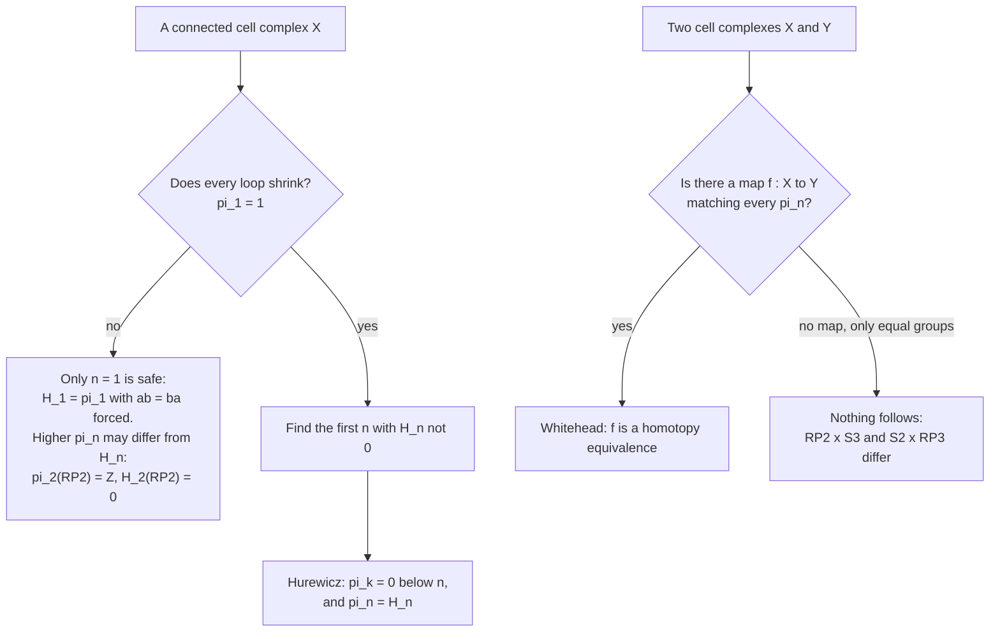

# Hurewicz and Whitehead: the first hole that homotopy sees, homology sees too

[Syllabus](../../../SYLLABUS.md) → [Topology](../README.md) → [Higher Homotopy and Mapping Spaces](../README.md#s07) → Hurewicz and Whitehead

---

## General Overview

Tie two party balloons together at their necks, so they touch at one point. A topologist calls this shape the **wedge** of two spheres, written $`S^2 \vee S^2`$: two spheres glued at a single point.

Now wrap a sphere-shaped rubber sheet round the pair. It can cover balloon one several times, and balloon two the other way round, or both at once. How many essentially different wrappings are there, if two wrappings count as the same when one slides into the other? That count is the second **homotopy group** $`\pi_2`$, met on [Higher homotopy groups](02-higher-homotopy-groups-and-fibrations.md). Homotopy groups are hard: even the ordinary sphere has $`\pi_3(S^2) = \mathbb{Z}`$, because of the Hopf map, the shelf's house example of linked circles filling the 3-sphere.

Homology asks an easier question: how many sealed cavities are there? Two, one inside each balloon. [Cellular homology](../05-Homology/05-cellular-homology.md) reads this off a recipe of one point and two discs in a few seconds: $`H_2 = \mathbb{Z}^2`$.

The **Hurewicz theorem** says that here the hard answer equals the easy one. Every loop on the balloons shrinks to a point, so a wrapping is recorded exactly by two whole numbers, its net wraps round each balloon, and every pair of whole numbers occurs: $`\pi_2(S^2 \vee S^2) = \mathbb{Z}^2`$.

The **Whitehead theorem** answers a second question: when are two spaces the same up to deformation? For spaces glued from cells, it is enough to find one map between them that matches every homotopy group. Matching groups with no map are not enough. The spaces $`\mathbb{RP}^2 \times S^3`$ and $`S^2 \times \mathbb{RP}^3`$ have the same homotopy groups, yet the first has $`H_5 = 0`$ and the second $`H_5 = \mathbb{Z}`$, so they are different.

**For a space in which every loop shrinks, the first homotopy group that is not zero equals the first homology group that is not zero, through the map that sends a wrapped sphere to the cavity it covers; and a map of cell complexes that matches every homotopy group is a homotopy equivalence, though equal groups with no map prove nothing.**

**What kind of fact this is:** two theorems. Half of the case $`n = 1`$ of Hurewicz (commutators go to zero) and the way both sides are built from the same cells are argued on this card; the rest of $`n = 1`$ is Hatcher's Theorem 2A.1, and the full proofs of Hurewicz for $`n \ge 2`$ and of Whitehead are given as key steps with a named source (Hatcher, Theorems 4.32 and 4.5). The code computes integer homology exactly on finite cell complexes and checks loop words up to a fixed length: it illustrates the theorems and does not prove them.

### The picture: the two decisions



The top chain reads off homotopy from homology. The bottom chain decides sameness, and only a map can do that.

---

## The formula

Notation first, in words.

- $`\pi_n(X)`$ is the n-th homotopy group: maps of the sphere $`S^n`$ into $`X`$ that keep a base point, counted up to sliding ([Higher homotopy groups](02-higher-homotopy-groups-and-fibrations.md)). For $`n = 1`$ it is [The fundamental group](../04-Homotopy/03-the-fundamental-group.md).
- $`H_n(X)`$ is integer homology, the n-dimensional hole count ([Singular homology](../05-Homology/09-singular-homology-and-excision.md)). The **reduced** group $`\tilde H_n`$ is the same except $`\tilde H_0`$ drops one $`\mathbb{Z}`$, so a point has all reduced groups zero.
- A space is **(n−1)-connected** when $`\pi_k(X) = 0`$ for every $`k`$ up to $`n - 1`$: it is in one piece, every loop shrinks, and so on up to dimension $`n - 1`$. **Simply connected** means 1-connected.
- $`[S^n]`$ is the **fundamental class**: the generator of $`H_n(S^n) = \mathbb{Z}`$, the sphere's own cavity counted once.
- A map $`f`$ pushes homology forward; the pushed map is $`f_*`$. The integer $`f_*[S^n]`$ for a map of spheres is the degree ([Homology of spheres, and degree](../05-Homology/07-homology-of-spheres-and-degree.md)).

The **Hurewicz map** sends a wrapped sphere to the cavity it covers:

```math
h : \pi_n(X) \to H_n(X), \qquad h([f]) = f_*[S^n]
```

**Read it aloud:** take a sphere mapped into X, push the sphere's own cavity forward along the map, and read off which n-dimensional holes of X it covers, and how many times.

On the figure eight, two circles glued at a point, the loop $`ab`$ goes to $`(1, 1)`$: once round each circle. On the balloons, a sheet goes to its pair of net wrap counts in $`H_2 = \mathbb{Z}^2`$.

The **Hurewicz theorem**, for $`n \ge 2`$:

```math
X \text{ is } (n-1)\text{-connected},\ n \ge 2 \quad \Longrightarrow \quad \tilde H_k(X) = 0 \text{ for } k < n \quad \text{and} \quad h : \pi_n(X) \xrightarrow{\ \cong\ } H_n(X)
```

**Read it aloud:** if every sphere of dimension below n shrinks, then homology also has nothing below n, and the n-th homotopy group is the n-th homology group.

For $`n = 1`$ the map is onto, and what it forgets is exactly the order of the loops:

```math
h : \pi_1(X) \to H_1(X) \text{ is onto, with kernel } [\pi_1, \pi_1], \qquad \text{so} \qquad H_1(X) \cong \pi_1(X)^{\mathrm{ab}}
```

**Read it aloud:** the first homology group is the fundamental group with every pair of loops allowed to commute.

Here a **commutator** is a loop of the form $`a\,b\,a^{-1}b^{-1}`$: go round $`a`$, round $`b`$, back round $`a`$, back round $`b`$. The **commutator subgroup** $`[\pi_1, \pi_1]`$ is everything built from commutators, and the **abelianisation** $`\pi_1^{\mathrm{ab}}`$ is $`\pi_1`$ with all of them set to 1, which forces $`ab = ba`$.

The **Whitehead theorem**, for connected CW complexes (spaces built by gluing cells, [CW complexes](../04-Homotopy/07-cw-complexes-and-gluing-cells.md)):

```math
f : X \to Y, \quad f_* : \pi_n(X) \xrightarrow{\ \cong\ } \pi_n(Y) \text{ for every } n \quad \Longrightarrow \quad f \text{ is a homotopy equivalence, } X \simeq Y
```

**Read it aloud:** a map between cell complexes that matches every homotopy group has an inverse up to deformation.

A **homotopy equivalence** is a map with a map back such that both round trips slide to the identity ([Homotopy](../04-Homotopy/01-homotopy-and-homotopy-equivalence.md)); $`\simeq`$ means "homotopy equivalent". Combined with Hurewicz, a homology form follows: a map of simply connected CW complexes matching every $`H_n`$ is a homotopy equivalence (Hatcher, Corollary 4.33).

| Symbol | Plain meaning | In our example | Push it up and the answer… |
| --- | --- | --- | --- |
| $`X`$, $`Y`$ | connected spaces built from cells | the two balloons, $`S^2 \vee S^2`$ | — |
| $`S^n`$, $`\vee`$, $`\times`$ | the n-sphere; gluing at one point; product | $`S^2 \vee S^2`$, $`S^2 \times S^3`$ | — |
| $`\mathbb{RP}^n`$ | real projective space: the n-sphere with opposite points glued, one cell per dimension 0 to n | $`\mathbb{RP}^2`$, $`\mathbb{RP}^3`$ | — |
| $`\pi_n(X)`$ | n-th homotopy group: wrapped n-spheres up to sliding | $`\pi_2 = \mathbb{Z}^2`$ | — |
| $`H_n(X)`$, $`\tilde H_n(X)`$, $`\chi`$ | n-th integer homology; reduced version; Euler characteristic, cells counted with alternating signs | $`H_2 = \mathbb{Z}^2`$; $`\chi = 3`$ | more cavities, larger rank |
| $`n`$, $`k`$, $`m`$ | dimensions, $`n`$ the first one with a hole; $`m`$ the number of n-cells | $`n = 2`$, $`m = 2`$ | — |
| $`f`$, $`f_*`$, $`[S^n]`$ | a map; what it does to homology or homotopy; the sphere's own cavity | a sheet wrapped round the balloons | — |
| $`h`$ | the Hurewicz map | $`h(ab) = (1, 1)`$ on the figure eight | — |
| $`a`$, $`b`$, $`A`$, $`B`$, $`\alpha`$, $`\beta`$ | the figure eight's two loops; a capital runs a loop backwards; $`\alpha`$, $`\beta`$ any two loops | $`abAB`$, a commutator | — |
| $`[\pi_1, \pi_1]`$, $`\pi_1^{\mathrm{ab}}`$ | the commutator subgroup; $`\pi_1`$ with $`ab = ba`$ forced | $`\mathbb{Z}^2`$ for the figure eight | — |
| $`\simeq`$ | homotopy equivalent | the dunce hat $`\simeq`$ a point | — |
| $`\mathbb{Z}/2`$, $`\otimes`$, Tor | the integers mod 2; Kunneth's pairing of a class from each factor; Kunneth's extra term | $`\pi_1(\mathbb{RP}^2) = \mathbb{Z}/2`$ | — |

### When it holds

- **Every loop must shrink, for $`n \ge 2`$.** The projective plane $`\mathbb{RP}^2`$ has $`\pi_1 = \mathbb{Z}/2`$. Its double cover is $`S^2`$, so $`\pi_2(\mathbb{RP}^2) = \pi_2(S^2) = \mathbb{Z}`$, yet $`H_2(\mathbb{RP}^2) = 0`$. The torus goes the other way: $`\pi_2 = 0`$, since its cover is the flat plane, but $`H_2 = \mathbb{Z}`$.
- **Only the first group that is not zero.** The sphere $`S^2`$ has $`H_3 = 0`$, but $`\pi_3(S^2) = \mathbb{Z}`$, generated by the Hopf map. Hurewicz says nothing past the first hole.
- **For $`n = 1`$, homology forgets order.** On the figure eight, $`ab`$ and $`ba`$ are different loops but have the same homology class $`(1, 1)`$.
- **Whitehead needs a map.** $`\mathbb{RP}^2 \times S^3`$ and $`S^2 \times \mathbb{RP}^3`$ have isomorphic homotopy groups in every dimension, but $`H_5`$ is $`0`$ for one and $`\mathbb{Z}`$ for the other.
- **Whitehead needs cell complexes.** The Warsaw circle, a closed curve whose last stretch wiggles like $`\sin(1/x)`$, has every homotopy group zero but is not contractible: the map to a point matches every group and is still no homotopy equivalence.

---

## Why it works

### Step 0: push every sphere into the cells, then count the same cells twice

The key tool is **cellular approximation**: every map of a cell complex into another can be slid until it lands in the cells of the same dimension or lower (Hatcher, Theorem 4.8). So an n-sphere in X can be slid into the n-dimensional skeleton, the part built from cells of dimension at most n.

If X has no cells between dimension 1 and $`n - 1`$, its n-skeleton is a bunch of n-spheres glued at one point. On such a bunch, both $`\pi_n`$ and $`H_n`$ are counted by degrees, one whole number per sphere. The $`(n+1)`$-cells then impose the same relations on both. That is the whole theorem in one sentence.

### Step 1: n = 1, loops are cycles with the order forgotten

A loop is a path that returns to its start, so it is also a 1-cycle: a chain with no boundary ([Homology groups](../05-Homology/02-homology-groups.md)). Running loop $`\alpha`$ then loop $`\beta`$ gives a chain homologous to $`\alpha + \beta`$: the two differ by the boundary of one triangle. So $`h(\alpha\beta) = h(\alpha) + h(\beta)`$, and $`h`$ is a homomorphism: it turns loop multiplication into addition.

Addition does not care about order, so $`h(ab) = h(ba)`$ and every commutator $`abAB`$ goes to zero. Theorem 2A.1 of Hatcher shows nothing else goes to zero, and that $`h`$ is onto.

On the figure eight $`S^1 \vee S^1`$, the fundamental group is the **free group** on $`a`$ and $`b`$: every loop is one **reduced word**, a word in $`a, A, b, B`$ with no $`aA`$, $`Aa`$, $`bB`$ or $`Bb`$ side by side ([Van Kampen's theorem](../04-Homotopy/06-van-kampens-theorem.md)). The map $`h`$ sends a word to its **exponent sums**: the number of $`a`$ minus the number of $`A`$, and the same for $`b`$.

- There are 4, 12, 36 and 108 reduced words of length 1, 2, 3 and 4: four choices first, then three each time, since only the letter that cancels the last one is banned.
- Of the 108 words of length 4, exactly 8 have both sums zero: $`abAB`$ and its seven relatives. All 8 are non-trivial loops that $`h`$ sends to 0.
- Cellular homology of the figure eight (one point, two edges, zero boundaries) gives $`H_1 = \mathbb{Z}^2`$, which matches the exponent-sum pairs.

### Step 2: n ≥ 2, both groups are the same quotient of the same cells

<details>
<summary>Detailed outline: why the first homotopy group is the first homology group</summary>

The outline follows Hatcher, section 4.2, Theorem 4.32.

**(a) Clean up the cells.** An $`(n-1)`$-connected CW complex is homotopy equivalent to one with a single 0-cell and no cells of dimension 1 to $`n - 1`$ (Hatcher, section 4.1, the results on CW approximation). Both groups are unchanged by homotopy equivalence, so assume X has this form.

**(b) Low homology vanishes.** With no cells in dimensions 1 to $`n - 1`$, cellular homology has nothing to count there: $`\tilde H_k(X) = 0`$ for $`k < n`$.

**(c) The n-skeleton.** It is a wedge of $`m`$ copies of $`S^n`$, one per n-cell. For $`n \ge 2`$, its $`\pi_n`$ is $`\mathbb{Z}^m`$, a wrap count per sphere (Hatcher, Example 4.26, built on $`\pi_n(S^n) = \mathbb{Z}`$, his Corollary 4.25). Its $`H_n`$ is also $`\mathbb{Z}^m`$. The map $`h`$ sends a wrap to its vector of degrees, so it is the identity on $`\mathbb{Z}^m`$.

**(d) The (n+1)-cells.** Each one is glued along a map of its rim $`S^n`$ into the wedge. In $`\pi_n`$, gluing it kills the rim's class (Hatcher, Example 4.29). In $`H_n`$, gluing it kills its cellular boundary, which is the column of degrees of the same rim. By (c), $`h`$ sends one to the other, so the same vectors are killed on both sides.

**(e) Higher cells.** By cellular approximation, cells of dimension $`n + 2`$ and up change neither $`\pi_n`$ nor $`H_n`$.

So both groups are $`\mathbb{Z}^m`$ divided by the span of the same columns, and $`h`$ is an isomorphism.

The sphere itself agrees with the theorem: $`S^n`$ is $`(n-1)`$-connected with $`H_n = \mathbb{Z}`$, and $`\pi_n(S^n) = \mathbb{Z}`$. The outline uses that fact in (c); it does not prove it.

</details>

On the balloons: one 0-cell, no 1-cells, two 2-cells and no 3-cells. So $`m = 2`$, nothing is killed, and $`\pi_2 = H_2 = \mathbb{Z}^2`$. A triangulation as two hollow tetrahedra sharing a corner (7 vertices, 12 edges, 8 triangles) gives the same $`H_2`$, rank 2.

### Step 3: Whitehead, by pushing cells back

<details>
<summary>Key steps of Whitehead's theorem</summary>

The outline follows Hatcher, section 4.1, Theorem 4.5.

**(a) Make the map an inclusion.** Replace Y by the **mapping cylinder** of f: the cylinder $`X \times [0, 1]`$ with its end $`X \times \{1\}`$ glued to Y along f. It deforms onto Y and contains X, so f becomes the inclusion of a subcomplex.

**(b) No relative spheres.** The long exact sequence of homotopy groups of the pair, with every $`f_*`$ an isomorphism, makes every relative group $`\pi_n(Y, X)`$ zero. In words: any disc in Y whose rim lies in X can be slid, rim and all, into X.

**(c) Push the cells in.** Take the cells of Y outside X in order of dimension. Each one is a disc with its rim already in X, so by (b) it can be slid into X, keeping its rim fixed. Doing this for all dimensions in turn gives a deformation of Y onto X (the **compression lemma**, Hatcher, Lemma 4.6).

So X is a deformation retract of Y, and f is a homotopy equivalence. The map is used in every step: (b) needs a single pair $`(Y, X)`$, and only f supplies one.

</details>

### Step 4: why the map matters, by Kunneth

Both $`\mathbb{RP}^2 \times S^3`$ and $`S^2 \times \mathbb{RP}^3`$ have fundamental group $`\mathbb{Z}/2`$. Both are double covered by the same space, $`S^2 \times S^3`$, and a covering map keeps every $`\pi_n`$ with $`n \ge 2`$ ([Covering spaces](../04-Homotopy/05-covering-spaces.md); Hatcher, Proposition 4.1). So their homotopy groups agree in every dimension. Hurewicz on the cover, which is simply connected with first hole in dimension 2, gives $`\pi_2 = H_2(S^2 \times S^3) = \mathbb{Z}`$ for all three.

Homology tells them apart. [Universal coefficients and Kunneth](../05-Homology/11-universal-coefficients-and-kunneth.md) computes the homology of a product from its factors:

- $`H(\mathbb{RP}^2) = \mathbb{Z},\ \mathbb{Z}/2,\ 0`$ and $`H(S^3) = \mathbb{Z}, 0, 0, \mathbb{Z}`$. Degree 5 could only come from $`H_2(\mathbb{RP}^2) \otimes H_3(S^3) = 0`$ or from the Tor term $`\mathrm{Tor}(\mathbb{Z}/2, \mathbb{Z}) = 0`$, so $`H_5(\mathbb{RP}^2 \times S^3) = 0`$.
- $`H(S^2) = \mathbb{Z}, 0, \mathbb{Z}`$ and $`H(\mathbb{RP}^3) = \mathbb{Z},\ \mathbb{Z}/2,\ 0,\ \mathbb{Z}`$. The two top classes multiply: $`H_5(S^2 \times \mathbb{RP}^3) = \mathbb{Z}`$.

Homotopy equivalent spaces have equal homology, so the two are not homotopy equivalent. By Whitehead, no map between them can match all the homotopy groups, even though the groups are isomorphic.

### Step 5: both theorems together, the dunce hat is contractible

The **dunce hat** is a triangle whose three edges are glued as $`a`$, $`a`$, $`a^{-1}`$: one point, one edge $`a`$, one 2-cell with rim word $`aaA`$.

1. **Loops.** The fundamental group is $`\langle a \mid aaA \rangle`$. The word $`aaA`$ reduces to $`a`$, so the relation says $`a = 1`$, and every loop shrinks.
2. **Homology.** The rim runs along $`a`$ twice forwards and once back, net 1. So the boundary matrix is $`[1]`$ and $`H_1 = H_2 = 0`$. No cells above dimension 2 means every higher $`H_k`$ is 0 too.
3. **Hurewicz, repeatedly.** Simply connected with $`H_2 = 0`$ gives $`\pi_2 = 0`$. Now X is 2-connected with $`H_3 = 0`$, so $`\pi_3 = 0`$, and so on: every $`\pi_n`$ is 0.
4. **Whitehead.** The map to a point matches every homotopy group, so the dunce hat is **contractible**: it deforms to a point, although no obvious squashing shows it.

---

## Worked numbers, by hand

| Step | Arithmetic | Value |
| --- | --- | --- |
| figure eight, reduced words of length 4 | $`4 \times 3 \times 3 \times 3`$ | 108 |
| of those, exponent sums $`(0, 0)`$ | one each of $`a, A, b, B`$, no cancelling pair side by side | 8 |
| $`h(ab)`$ and $`h(ba)`$ | one $`a`$, one $`b`$ each | $`(1, 1)`$ both |
| balloons: cells | one point, no edges, two discs | $`[1, 0, 2]`$ |
| balloons triangulated | $`\chi = 7 - 12 + 8`$ | 3 = 1 + 2 |
| **balloons: $`\pi_2`$** | **simply connected, so $`\pi_2 = H_2`$** | **$`\mathbb{Z}^2`$, rank 2** |
| $`H_5(\mathbb{RP}^2 \times S^3)`$ | $`\mathbb{RP}^2`$ has no top class | rank 0 |
| $`H_5(S^2 \times \mathbb{RP}^3)`$ | $`\mathbb{Z} \otimes \mathbb{Z}`$ from the two top classes | rank 1 |
| dunce hat: rim $`aaA`$ | $`1 + 1 - 1`$ | incidence 1, so $`H_1 = H_2 = 0`$ |

The pair of balloons carries exactly a $`\mathbb{Z}^2`$ of essentially different wrapped spheres; the two products share every homotopy group and still differ.

### What breaks if you drop a piece

| Mistake | Comes out at | What went wrong |
| --- | --- | --- |
| Hurewicz on $`\mathbb{RP}^2`$, where loops do not shrink | $`H_2`$ rank 0, but $`\pi_2 = H_2(S^2)`$ rank 1 | $`\pi_1 = \mathbb{Z}/2`$; the theorem needs simply connected |
| Hurewicz on the torus | $`H_2`$ rank 1, but $`\pi_2 = 0`$ | $`\pi_1 = \mathbb{Z}^2`$; the cover is the plane |
| Hurewicz past the first group | $`H_3(S^2)`$ rank 0, but $`\pi_3(S^2) = \mathbb{Z}`$ | only the first hole is promised |
| $`\pi_1`$ read as $`H_1`$ on the figure eight | 8 loops of length 4 read as 0 | homology forgets the order of loops |
| Kunneth without its Tor term, on $`\mathbb{RP}^2 \times \mathbb{RP}^2`$ | $`H_3`$ torsion [], truly [2] | two torsion classes give an extra $`\mathbb{Z}/2`$ one dimension up |
| Whitehead with no map | $`\pi_n`$ all equal, $`H_5`$ rank 0 against 1 | equal invariants prove nothing |

The code prints all six.

---

## Code, from first principles, and it actually runs

Both programs compute integer homology by Smith normal form, written out from scratch. The roads are independent in pairs. The wedge of two spheres is computed from its three cells and from a triangulation as two hollow tetrahedra. The two products are computed from their product cells and from Kunneth's formula applied to the factors, which never builds the product. The figure eight's $`H_1`$ from cells is set against exponent sums of reduced words, and $`h(uv) = h(u) + h(v)`$ is checked on all 289 pairs of words up to length 2. These are checks on finitely many cases, plus exact computations of finite complexes; the theorems themselves are argued in Why it works.

### Python

```python
# Hurewicz and Whitehead -- the check behind the card.  Standard library only.  Integer homology by
# Smith normal form, written out here; figure-eight loops as reduced words; Kunneth from the factors.
from itertools import combinations, product

def gcd(a, b):                       # Euclid's algorithm
    return abs(a) if b == 0 else gcd(b, a % b)

def diagonal(M):                     # Smith normal form: the invariant factors
    A, out = [row[:] for row in M], []
    while nz := [(abs(A[i][j]), i, j) for i in range(len(A)) for j in range(len(A[0])) if A[i][j]]:
        _, p, q = min(nz)
        clean = True
        for i in range(len(A)):      # clear column q with row operations
            if i != p and A[i][q]:
                f = A[i][q] // A[p][q]
                A[i] = [x - f * y for x, y in zip(A[i], A[p])]
                clean = clean and A[i][q] == 0
        for j in range(len(A[0])):   # clear row p with column operations
            if j != q and A[p][j]:
                f = A[p][j] // A[p][q]
                for row in A:
                    row[j] -= f * row[q]
                clean = clean and A[p][j] == 0
        if clean:
            out.append(abs(A[p][q]))
            A = [r[:q] + r[q + 1:] for i, r in enumerate(A) if i != p]
    for i in range(len(out)):        # make each factor divide the next
        for j in range(i + 1, len(out)):
            g = gcd(out[i], out[j])
            out[i], out[j] = g, out[i] * out[j] // g
    return out

def homology(cells, d):              # cells[k] = number of k-cells; d[k]: C_k -> C_(k-1)
    fac = {k: diagonal(d[k]) if k in d else [] for k in range(len(cells) + 1)}
    return [(cells[k] - len(fac[k]) - len(fac[k + 1]), [t for t in fac[k + 1] if t > 1]) for k in range(len(cells))]

def zero_dd(d):                      # the boundary of a boundary is zero: d[k-1] d[k] = 0
    return all(sum(d[k - 1][i][m] * d[k][m][j] for m in range(len(d[k]))) == 0
               for k in d if k - 1 in d for i in range(len(d[k - 1])) for j in range(len(d[k][0])))

def show(H):
    return "; ".join(f"H{k}: rank {r}, torsion {t}" for k, (r, t) in enumerate(H))

def sphere(n):
    return [1] + [0] * (n - 1) + [1], {}

def rp(n):                           # one cell per dimension, boundary 1 + (-1)^k
    return [1] * (n + 1), {k: [[1 + (-1) ** k]] for k in range(1, n + 1)}

def times(X, Y):                     # product cells: d(a x b) = da x b + (-1)^|a| a x db
    (cx, dx), (cy, dy) = X, Y
    cells = {}
    for p, q in product(range(len(cx)), range(len(cy))):
        cells.setdefault(p + q, []).extend((p, i, q, j) for i in range(cx[p]) for j in range(cy[q]))
    top = max(cells)
    idx = {k: {c: n for n, c in enumerate(cells.get(k, []))} for k in range(top + 1)}
    d = {}
    for k in range(1, top + 1):
        M = [[0] * len(cells.get(k, [])) for _ in cells.get(k - 1, [])]
        for col, (p, i, q, j) in enumerate(cells.get(k, [])):
            for r in range(cx[p - 1] if p in dx else 0):
                M[idx[k - 1][(p - 1, r, q, j)]][col] += dx[p][r][i]
            for r in range(cy[q - 1] if q in dy else 0):
                M[idx[k - 1][(p, i, q - 1, r)]][col] += (-1) ** p * dy[q][r][j]
        d[k] = M
    return [len(cells.get(k, [])) for k in range(top + 1)], d

def kunneth(HX, HY, tor=True):                 # second road: tensor plus Tor, from the factors
    out = []
    for k in range(len(HX) + len(HY) - 1):
        rank, tors = 0, []
        for i, (r1, t1) in enumerate(HX):
            for j, (r2, t2) in enumerate(HY):
                if i + j == k:
                    rank += r1 * r2
                    tors += t1 * r2 + t2 * r1 + [gcd(a, b) for a in t1 for b in t2]
                if tor and i + j == k - 1:
                    tors += [gcd(a, b) for a in t1 for b in t2]
        out.append((rank, sorted(t for t in tors if t > 1)))
    return out

def reduce(w):                       # free reduction: cancel a A, A a, b B, B b
    out = []
    for x in w:
        if out and out[-1] == x.swapcase():
            out.pop()
        else:
            out.append(x)
    return "".join(out)

def h(w):                            # the Hurewicz map on the figure eight: exponent sums
    return (w.count("a") - w.count("A"), w.count("b") - w.count("B"))

words = {k: ["".join(t) for t in product("aAbB", repeat=k) if reduce("".join(t)) == "".join(t)] for k in range(5)}
eight = homology([1, 2], {})
print("figure eight, cells [1, 2]:", show(eight))
print("reduced words of length 1 to 4:", [len(words[k]) for k in range(1, 5)])
dead = [w for w in words[4] if h(w) == (0, 0)]
print(f"length-4 loops that h sends to (0, 0): {len(dead)}: {' '.join(dead)}")
print(f"h(ab) = {h('ab')}, h(ba) = {h('ba')}; ab and ba the same loop: {'yes' if reduce('ab' + 'AB') == '' else 'no'}")
short = [w for k in range(3) for w in words[k]]
hom = all(h(reduce(u + v)) == tuple(x + y for x, y in zip(h(u), h(v))) for u in short for v in short)
print(f"h(uv) = h(u) + h(v) on all {len(short) ** 2} pairs up to length 2: {'yes' if hom else 'no'}")
wedge = homology([1, 0, 2], {})
print("S2 v S2, cells [1, 0, 2]:", show(wedge))
tris = [t for s in ((0, 1, 2, 3), (0, 4, 5, 6)) for t in combinations(s, 3)]
edges = sorted({e for t in tris for e in combinations(t, 2)})
bd = lambda faces, cells: [[sum((-1) ** i for i in range(len(c)) if c[:i] + c[i + 1:] == f) for c in cells] for f in faces]
tri = homology([7, len(edges), len(tris)], {1: bd([(v,) for v in range(7)], edges), 2: bd(edges, tris)})
print(f"S2 v S2, two hollow tetrahedra, V E F = 7 {len(edges)} {len(tris)}, chi {7 - len(edges) + len(tris)}:", show(tri))
print(f"pi1 = 1 (no 1-cells), so Hurewicz: pi2(S2 v S2) = H2: rank {wedge[2][0]}")
P, Q = times(rp(2), sphere(3)), times(sphere(2), rp(3))
HP, HQ = homology(*P), homology(*Q)
print(f"RP2 x S3, product cells {P[0]}: {show(HP)}")
print("RP2 x S3, by Kunneth:", show(kunneth(homology(*rp(2)), homology(*sphere(3)))))
print(f"S2 x RP3, product cells {Q[0]}: {show(HQ)}")
print("S2 x RP3, by Kunneth:", show(kunneth(homology(*sphere(2)), homology(*rp(3)))))
cover = homology(*times(sphere(2), sphere(3)))
print("common universal cover S2 x S3:", show(cover))
print(f"pi1 of both: Z/{HP[1][1][0]}; pi2 of both = H2(S2 x S3): rank {cover[2][0]}")
print(f"H5: RP2 x S3 rank {HP[5][0]}, S2 x RP3 rank {HQ[5][0]}: not homotopy equivalent")
dunce = homology([1, 1, 1], {2: [[h("aaA")[0]]]})
print(f"dunce hat, rim aaA, incidence {h('aaA')[0]}: {show(dunce)}; chi {1 - 1 + 1}")
print(f"rim aaA freely reduced: {reduce('aaA')}, so the relation reads a = 1 and pi1 = 1")
print(f"mistake, Hurewicz with pi1 = Z/2: RP2 {show(homology(*rp(2)))}; pi2(RP2) = pi2(S2) = H2(S2): rank {homology(*sphere(2))[2][0]}")
print(f"mistake, Hurewicz with pi1 = Z^2: torus {show(homology([1, 2, 1], {}))}; pi2 = 0 (cover R2)")
print(f"mistake, past the first group: H3(S2): rank {homology([1, 0, 1, 0], {})[3][0]}, but pi3(S2) = Z (Hopf)")
HR, no_tor = homology(*(RR := times(rp(2), rp(2)))), kunneth(homology(*rp(2)), homology(*rp(2)), tor=False)
print(f"mistake, Kunneth without Tor: RP2 x RP2 reads {show(no_tor).split('; ')[3]}; truly {show(HR).split('; ')[3]}")
print(f"mistake, no abelianising: {len(dead)} loops of length 4 are not trivial in pi1 yet read 0 in H1")
assert eight == [(1, []), (2, [])] and len(dead) == 8 and hom
assert [len(words[k]) for k in range(1, 5)] == [4 * 3 ** (k - 1) for k in range(1, 5)]
assert wedge == tri and wedge[2] == (2, [])
assert HP == kunneth(homology(*rp(2)), homology(*sphere(3))) and HQ == kunneth(homology(*sphere(2)), homology(*rp(3)))
assert HR == kunneth(homology(*rp(2)), homology(*rp(2))) and HR[3] == (0, [2]) and zero_dd(RR[1])
assert HP[5] == (0, []) and HQ[5] == (1, []) and cover[2] == (1, [])
assert dunce == [(1, []), (0, []), (0, [])] and reduce("aaA") == "a"
print("ALL CHECKS PASS")
```

**Ran 2026-11-24 on macOS, Python 3.14.10, standard library only. All checks passed. Output, pasted from the run:**

```
figure eight, cells [1, 2]: H0: rank 1, torsion []; H1: rank 2, torsion []
reduced words of length 1 to 4: [4, 12, 36, 108]
length-4 loops that h sends to (0, 0): 8: abAB aBAb AbaB ABab baBA bABa BabA BAba
h(ab) = (1, 1), h(ba) = (1, 1); ab and ba the same loop: no
h(uv) = h(u) + h(v) on all 289 pairs up to length 2: yes
S2 v S2, cells [1, 0, 2]: H0: rank 1, torsion []; H1: rank 0, torsion []; H2: rank 2, torsion []
S2 v S2, two hollow tetrahedra, V E F = 7 12 8, chi 3: H0: rank 1, torsion []; H1: rank 0, torsion []; H2: rank 2, torsion []
pi1 = 1 (no 1-cells), so Hurewicz: pi2(S2 v S2) = H2: rank 2
RP2 x S3, product cells [1, 1, 1, 1, 1, 1]: H0: rank 1, torsion []; H1: rank 0, torsion [2]; H2: rank 0, torsion []; H3: rank 1, torsion []; H4: rank 0, torsion [2]; H5: rank 0, torsion []
RP2 x S3, by Kunneth: H0: rank 1, torsion []; H1: rank 0, torsion [2]; H2: rank 0, torsion []; H3: rank 1, torsion []; H4: rank 0, torsion [2]; H5: rank 0, torsion []
S2 x RP3, product cells [1, 1, 2, 2, 1, 1]: H0: rank 1, torsion []; H1: rank 0, torsion [2]; H2: rank 1, torsion []; H3: rank 1, torsion [2]; H4: rank 0, torsion []; H5: rank 1, torsion []
S2 x RP3, by Kunneth: H0: rank 1, torsion []; H1: rank 0, torsion [2]; H2: rank 1, torsion []; H3: rank 1, torsion [2]; H4: rank 0, torsion []; H5: rank 1, torsion []
common universal cover S2 x S3: H0: rank 1, torsion []; H1: rank 0, torsion []; H2: rank 1, torsion []; H3: rank 1, torsion []; H4: rank 0, torsion []; H5: rank 1, torsion []
pi1 of both: Z/2; pi2 of both = H2(S2 x S3): rank 1
H5: RP2 x S3 rank 0, S2 x RP3 rank 1: not homotopy equivalent
dunce hat, rim aaA, incidence 1: H0: rank 1, torsion []; H1: rank 0, torsion []; H2: rank 0, torsion []; chi 1
rim aaA freely reduced: a, so the relation reads a = 1 and pi1 = 1
mistake, Hurewicz with pi1 = Z/2: RP2 H0: rank 1, torsion []; H1: rank 0, torsion [2]; H2: rank 0, torsion []; pi2(RP2) = pi2(S2) = H2(S2): rank 1
mistake, Hurewicz with pi1 = Z^2: torus H0: rank 1, torsion []; H1: rank 2, torsion []; H2: rank 1, torsion []; pi2 = 0 (cover R2)
mistake, past the first group: H3(S2): rank 0, but pi3(S2) = Z (Hopf)
mistake, Kunneth without Tor: RP2 x RP2 reads H3: rank 0, torsion []; truly H3: rank 0, torsion [2]
mistake, no abelianising: 8 loops of length 4 are not trivial in pi1 yet read 0 in H1
ALL CHECKS PASS
```

### Rust

Same numbers, same labels, built with `rustc --edition 2021 -O`.

```rust
// Hurewicz and Whitehead -- the same check as the Python, in Rust.  No crates.  Integer homology by
// Smith normal form, written out here; figure-eight loops as reduced words; Kunneth from the factors.
use std::collections::BTreeMap;

type Mat = Vec<Vec<i64>>;
type Cx = (Vec<usize>, BTreeMap<usize, Mat>);
type Hom = Vec<(i64, Vec<i64>)>;

fn gcd(a: i64, b: i64) -> i64 { if b == 0 { a.abs() } else { gcd(b, a % b) } } // Euclid
fn diagonal(m: &Mat) -> Vec<i64> {                 // Smith normal form: the invariant factors
    let (mut a, mut out) = (m.clone(), Vec::new());
    loop {
        let mut nz: Vec<(i64, usize, usize)> = Vec::new();
        for i in 0..a.len() { for j in 0..a[0].len() { if a[i][j] != 0 { nz.push((a[i][j].abs(), i, j)) } } }
        let Some(&(_, p, q)) = nz.iter().min() else { break };
        let mut clean = true;
        for i in 0..a.len() { if i != p && a[i][q] != 0 {   // clear column q with row operations
            let f = a[i][q].div_euclid(a[p][q]);
            for j in 0..a[0].len() { a[i][j] -= f * a[p][j] }
            clean = clean && a[i][q] == 0;
        } }
        for j in 0..a[0].len() { if j != q && a[p][j] != 0 {   // clear row p with column operations
            let f = a[p][j].div_euclid(a[p][q]);
            for i in 0..a.len() { a[i][j] -= f * a[i][q] }
            clean = clean && a[p][j] == 0;
        } }
        if clean {
            out.push(a[p][q].abs());
            a = a.iter().enumerate().filter(|(i, _)| *i != p)
                .map(|(_, r)| r.iter().enumerate().filter(|(j, _)| *j != q).map(|(_, x)| *x).collect()).collect();
        }
    }
    for i in 0..out.len() { for j in i + 1..out.len() {   // make each factor divide the next
        let g = gcd(out[i], out[j]);
        (out[i], out[j]) = (g, out[i] * out[j] / g);
    } }
    out
}

fn homology(c: &Cx) -> Hom {                       // cells[k] = number of k-cells; d[k]: C_k -> C_(k-1)
    let (cells, d) = c;
    let fac: Vec<Vec<i64>> = (0..=cells.len()).map(|k| d.get(&k).map(diagonal).unwrap_or_default()).collect();
    (0..cells.len()).map(|k| (cells[k] as i64 - fac[k].len() as i64 - fac[k + 1].len() as i64,
                              fac[k + 1].iter().copied().filter(|&t| t > 1).collect())).collect()
}

fn zero_dd(d: &BTreeMap<usize, Mat>) -> bool {     // the boundary of a boundary is zero
    d.iter().filter(|(k, _)| d.contains_key(&(*k - 1))).all(|(k, b)| {
        let a = &d[&(k - 1)];
        (0..a.len()).all(|i| (0..b[0].len()).all(|j| (0..b.len()).map(|m| a[i][m] * b[m][j]).sum::<i64>() == 0))
    })
}
fn show(h: &Hom) -> String { h.iter().enumerate().map(|(k, (r, t))| format!("H{}: rank {}, torsion {:?}", k, r, t)).collect::<Vec<_>>().join("; ") }
fn cx(cells: Vec<usize>, d: Vec<(usize, Mat)>) -> Cx { (cells, d.into_iter().collect()) }
fn sphere(n: usize) -> Cx { let mut c = vec![0; n + 1]; c[0] = 1; c[n] = 1; cx(c, vec![]) }
fn rp(n: usize) -> Cx {                            // one cell per dimension, boundary 1 + (-1)^k
    cx(vec![1; n + 1], (1..=n).map(|k| (k, vec![vec![if k % 2 == 0 { 2 } else { 0 }]])).collect())
}

fn times(x: &Cx, y: &Cx) -> Cx {                   // product cells: d(a x b) = da x b + (-1)^|a| a x db
    let ((cx_, dx), (cy, dy)) = (x, y);
    let mut cells: BTreeMap<usize, Vec<(usize, usize, usize, usize)>> = BTreeMap::new();
    for p in 0..cx_.len() { for q in 0..cy.len() {
        let e = cells.entry(p + q).or_default();
        for i in 0..cx_[p] { for j in 0..cy[q] { e.push((p, i, q, j)) } }
    } }
    let top = *cells.keys().max().unwrap();
    let get = |k: usize| cells.get(&k).cloned().unwrap_or_default();
    let pos = |k: usize, c: (usize, usize, usize, usize)| get(k).iter().position(|&x| x == c).unwrap();
    let mut d = BTreeMap::new();
    for k in 1..=top {
        let mut m = vec![vec![0i64; get(k).len()]; get(k - 1).len()];
        for (col, &(p, i, q, j)) in get(k).iter().enumerate() {
            if let Some(b) = dx.get(&p) { for r in 0..cx_[p - 1] { m[pos(k - 1, (p - 1, r, q, j))][col] += b[r][i] } }
            let s = if p % 2 == 0 { 1 } else { -1 };
            if let Some(b) = dy.get(&q) { for r in 0..cy[q - 1] { m[pos(k - 1, (p, i, q - 1, r))][col] += s * b[r][j] } }
        }
        d.insert(k, m);
    }
    ((0..=top).map(|k| get(k).len()).collect(), d)
}

fn kunneth(hx: &Hom, hy: &Hom, tor: bool) -> Hom {  // second road: tensor plus Tor, from the factors
    (0..hx.len() + hy.len() - 1).map(|k| {
        let (mut rank, mut tors) = (0i64, Vec::new());
        for (i, (r1, t1)) in hx.iter().enumerate() { for (j, (r2, t2)) in hy.iter().enumerate() {
            let pairs: Vec<i64> = t1.iter().flat_map(|&a| t2.iter().map(move |&b| gcd(a, b))).collect();
            if i + j == k {
                rank += r1 * r2;
                for _ in 0..*r2 { tors.extend(t1) } for _ in 0..*r1 { tors.extend(t2) } tors.extend(&pairs);
            }
            if tor && i + j + 1 == k { tors.extend(&pairs) }
        } }
        tors.retain(|&t| t > 1); tors.sort();
        (rank, tors)
    }).collect()
}
fn reduce(w: &str) -> String {                     // free reduction: cancel a A, A a, b B, B b
    let mut out: Vec<char> = Vec::new();
    for x in w.chars() {
        let inv = if x.is_lowercase() { x.to_ascii_uppercase() } else { x.to_ascii_lowercase() };
        if out.last() == Some(&inv) { out.pop(); } else { out.push(x) }
    }
    out.into_iter().collect()
}
fn h(w: &str) -> (i64, i64) {                      // the Hurewicz map on the figure eight: exponent sums
    let n = |c: char| w.chars().filter(|&x| x == c).count() as i64;
    (n('a') - n('A'), n('b') - n('B'))
}

fn main() {
    let words: Vec<Vec<String>> = (0..5u32).map(|k| (0..4usize.pow(k)).map(|mut n| {
        let mut s = vec!['a'; k as usize];
        for p in (0..k as usize).rev() { s[p] = ['a', 'A', 'b', 'B'][n % 4]; n /= 4 }
        s.into_iter().collect::<String>()
    }).filter(|w| reduce(w) == *w).collect()).collect();
    let eight = homology(&cx(vec![1, 2], vec![]));
    println!("figure eight, cells [1, 2]: {}", show(&eight));
    let counts: Vec<usize> = (1..5).map(|k| words[k].len()).collect();
    println!("reduced words of length 1 to 4: {:?}", counts);
    let dead: Vec<String> = words[4].iter().filter(|w| h(w) == (0, 0)).cloned().collect();
    println!("length-4 loops that h sends to (0, 0): {}: {}", dead.len(), dead.join(" "));
    println!("h(ab) = {:?}, h(ba) = {:?}; ab and ba the same loop: {}", h("ab"), h("ba"), if reduce("abAB").is_empty() { "yes" } else { "no" });
    let short: Vec<String> = (0..3).flat_map(|k| words[k].clone()).collect();
    let hom = short.iter().all(|u| short.iter().all(|v| h(&reduce(&format!("{}{}", u, v))) == (h(u).0 + h(v).0, h(u).1 + h(v).1)));
    println!("h(uv) = h(u) + h(v) on all {} pairs up to length 2: {}", short.len() * short.len(), if hom { "yes" } else { "no" });
    let wedge = homology(&cx(vec![1, 0, 2], vec![]));
    println!("S2 v S2, cells [1, 0, 2]: {}", show(&wedge));
    let mut tris: Vec<Vec<usize>> = Vec::new();
    for s in [[0, 1, 2, 3], [0, 4, 5, 6]] { for a in 0..4 { for b in a + 1..4 { for c in b + 1..4 { tris.push(vec![s[a], s[b], s[c]]) } } } }
    let mut edges: Vec<Vec<usize>> = tris.iter().flat_map(|t| vec![vec![t[0], t[1]], vec![t[0], t[2]], vec![t[1], t[2]]]).collect();
    edges.sort(); edges.dedup();
    let bd = |faces: &Vec<Vec<usize>>, cells: &Vec<Vec<usize>>| -> Mat { faces.iter().map(|f| cells.iter().map(|c| (0..c.len())
        .filter(|&i| { let mut g = c.clone(); g.remove(i); g == *f }).map(|i| if i % 2 == 0 { 1 } else { -1 }).sum()).collect()).collect() };
    let verts: Vec<Vec<usize>> = (0..7).map(|v| vec![v]).collect();
    let tri = homology(&cx(vec![7, edges.len(), tris.len()], vec![(1, bd(&verts, &edges)), (2, bd(&edges, &tris))]));
    println!("S2 v S2, two hollow tetrahedra, V E F = 7 {} {}, chi {}: {}", edges.len(), tris.len(), 7 - edges.len() as i64 + tris.len() as i64, show(&tri));
    println!("pi1 = 1 (no 1-cells), so Hurewicz: pi2(S2 v S2) = H2: rank {}", wedge[2].0);
    let (p, q) = (times(&rp(2), &sphere(3)), times(&sphere(2), &rp(3)));
    let (hp, hq) = (homology(&p), homology(&q));
    let (kp, kq) = (kunneth(&homology(&rp(2)), &homology(&sphere(3)), true), kunneth(&homology(&sphere(2)), &homology(&rp(3)), true));
    println!("RP2 x S3, product cells {:?}: {}", p.0, show(&hp));
    println!("RP2 x S3, by Kunneth: {}", show(&kp));
    println!("S2 x RP3, product cells {:?}: {}", q.0, show(&hq));
    println!("S2 x RP3, by Kunneth: {}", show(&kq));
    let cover = homology(&times(&sphere(2), &sphere(3)));
    println!("common universal cover S2 x S3: {}", show(&cover));
    println!("pi1 of both: Z/{}; pi2 of both = H2(S2 x S3): rank {}", hp[1].1[0], cover[2].0);
    println!("H5: RP2 x S3 rank {}, S2 x RP3 rank {}: not homotopy equivalent", hp[5].0, hq[5].0);
    let dunce = homology(&cx(vec![1, 1, 1], vec![(2, vec![vec![h("aaA").0]])]));
    println!("dunce hat, rim aaA, incidence {}: {}; chi {}", h("aaA").0, show(&dunce), 1 - 1 + 1);
    println!("rim aaA freely reduced: {}, so the relation reads a = 1 and pi1 = 1", reduce("aaA"));
    println!("mistake, Hurewicz with pi1 = Z/2: RP2 {}; pi2(RP2) = pi2(S2) = H2(S2): rank {}", show(&homology(&rp(2))), homology(&sphere(2))[2].0);
    println!("mistake, Hurewicz with pi1 = Z^2: torus {}; pi2 = 0 (cover R2)", show(&homology(&cx(vec![1, 2, 1], vec![]))));
    println!("mistake, past the first group: H3(S2): rank {}, but pi3(S2) = Z (Hopf)", homology(&cx(vec![1, 0, 1, 0], vec![]))[3].0);
    let rr = times(&rp(2), &rp(2));
    let (hr, no_tor) = (homology(&rr), kunneth(&homology(&rp(2)), &homology(&rp(2)), false));
    let third = |s: String| s.split("; ").nth(3).unwrap().to_string();
    println!("mistake, Kunneth without Tor: RP2 x RP2 reads {}; truly {}", third(show(&no_tor)), third(show(&hr)));
    println!("mistake, no abelianising: {} loops of length 4 are not trivial in pi1 yet read 0 in H1", dead.len());
    assert!(eight == vec![(1, vec![]), (2, vec![])] && dead.len() == 8 && hom);
    assert!(counts == (1..5).map(|k| 4 * 3usize.pow(k - 1)).collect::<Vec<_>>());
    assert!(wedge == tri && wedge[2] == (2, vec![]));
    assert!(hp == kp && hq == kq);
    assert!(hr == kunneth(&homology(&rp(2)), &homology(&rp(2)), true) && hr[3] == (0, vec![2]) && zero_dd(&rr.1));
    assert!(hp[5] == (0, vec![]) && hq[5] == (1, vec![]) && cover[2] == (1, vec![]));
    assert!(dunce == vec![(1, vec![]), (0, vec![]), (0, vec![])] && reduce("aaA") == "a");
    println!("ALL CHECKS PASS");
}
```

**Ran 2026-11-24 on macOS, rustc 1.98.1, no crates. All checks passed. Output, pasted from the run:**

```
figure eight, cells [1, 2]: H0: rank 1, torsion []; H1: rank 2, torsion []
reduced words of length 1 to 4: [4, 12, 36, 108]
length-4 loops that h sends to (0, 0): 8: abAB aBAb AbaB ABab baBA bABa BabA BAba
h(ab) = (1, 1), h(ba) = (1, 1); ab and ba the same loop: no
h(uv) = h(u) + h(v) on all 289 pairs up to length 2: yes
S2 v S2, cells [1, 0, 2]: H0: rank 1, torsion []; H1: rank 0, torsion []; H2: rank 2, torsion []
S2 v S2, two hollow tetrahedra, V E F = 7 12 8, chi 3: H0: rank 1, torsion []; H1: rank 0, torsion []; H2: rank 2, torsion []
pi1 = 1 (no 1-cells), so Hurewicz: pi2(S2 v S2) = H2: rank 2
RP2 x S3, product cells [1, 1, 1, 1, 1, 1]: H0: rank 1, torsion []; H1: rank 0, torsion [2]; H2: rank 0, torsion []; H3: rank 1, torsion []; H4: rank 0, torsion [2]; H5: rank 0, torsion []
RP2 x S3, by Kunneth: H0: rank 1, torsion []; H1: rank 0, torsion [2]; H2: rank 0, torsion []; H3: rank 1, torsion []; H4: rank 0, torsion [2]; H5: rank 0, torsion []
S2 x RP3, product cells [1, 1, 2, 2, 1, 1]: H0: rank 1, torsion []; H1: rank 0, torsion [2]; H2: rank 1, torsion []; H3: rank 1, torsion [2]; H4: rank 0, torsion []; H5: rank 1, torsion []
S2 x RP3, by Kunneth: H0: rank 1, torsion []; H1: rank 0, torsion [2]; H2: rank 1, torsion []; H3: rank 1, torsion [2]; H4: rank 0, torsion []; H5: rank 1, torsion []
common universal cover S2 x S3: H0: rank 1, torsion []; H1: rank 0, torsion []; H2: rank 1, torsion []; H3: rank 1, torsion []; H4: rank 0, torsion []; H5: rank 1, torsion []
pi1 of both: Z/2; pi2 of both = H2(S2 x S3): rank 1
H5: RP2 x S3 rank 0, S2 x RP3 rank 1: not homotopy equivalent
dunce hat, rim aaA, incidence 1: H0: rank 1, torsion []; H1: rank 0, torsion []; H2: rank 0, torsion []; chi 1
rim aaA freely reduced: a, so the relation reads a = 1 and pi1 = 1
mistake, Hurewicz with pi1 = Z/2: RP2 H0: rank 1, torsion []; H1: rank 0, torsion [2]; H2: rank 0, torsion []; pi2(RP2) = pi2(S2) = H2(S2): rank 1
mistake, Hurewicz with pi1 = Z^2: torus H0: rank 1, torsion []; H1: rank 2, torsion []; H2: rank 1, torsion []; pi2 = 0 (cover R2)
mistake, past the first group: H3(S2): rank 0, but pi3(S2) = Z (Hopf)
mistake, Kunneth without Tor: RP2 x RP2 reads H3: rank 0, torsion []; truly H3: rank 0, torsion [2]
mistake, no abelianising: 8 loops of length 4 are not trivial in pi1 yet read 0 in H1
ALL CHECKS PASS
```

The two outputs match line for line.

### Lean

Lean proves the case $`n = 1`$ of Hurewicz on the figure eight, and that every loop on the dunce hat shrinks.

- Take the figure eight, whose loops are reduced words in $`a, A, b, B`$. Then $`h`$, sending a word to its exponent sums, is onto $`\mathbb{Z}^2`$.
- Take the loops that $`h`$ sends to zero. Then they are exactly the commutator subgroup $`[\pi_1, \pi_1]`$, so $`H_1 \cong \pi_1^{\mathrm{ab}}`$.
- Take the loops $`ab`$ and $`ba`$, which are different. Then both have the same homology class: $`h(ab) = h(ba) = (1, 1)`$.
- Take the dunce hat, whose fundamental group is $`\langle a \mid aaA \rangle`$. Then every element of that group is 1, so every loop shrinks.
- Lean also checks the word counts: 4, 12, 36 and 108 reduced words of length 1 to 4. Of the 108, exactly 8 have both exponent sums zero.

Every homology group, including the $`H_5`$ that separates the two products, is left to the Python and Rust checks.

```lean
-- Hurewicz and Whitehead: on the figure eight the Hurewicz map, sending a loop word to its exponent sums, is onto with kernel the commutator subgroup, so H_1 = Z^2 is the abelianised fundamental group; it forgets the order of ab and ba; and the dunce hat's fundamental group is trivial.
import Mathlib.GroupTheory.FreeGroup.Reduce
import Mathlib.GroupTheory.PresentedGroup
import Mathlib.GroupTheory.Commutator.Basic
import Mathlib.Algebra.Group.Pi.Lemmas
import Mathlib.GroupTheory.Abelianization.Defs
import Mathlib.Tactic.FinCases

open FreeGroup

/-- The Hurewicz map `h : π₁ → H₁` of the figure eight `S¹ ∨ S¹`. Its fundamental group is the
free group on the two loops `a = of 0` and `b = of 1`, its first homology is `ℤ²`, and `h` sends
a loop word to its exponent sums: the number of `a` minus the number of `A = a⁻¹`, and the same
for `b`. The group `ℤ²` is written multiplicatively, so its zero is `1`. -/
def exponentSum : FreeGroup (Fin 2) →* Multiplicative (Fin 2 → ℤ) :=
  FreeGroup.lift fun i => Multiplicative.ofAdd (Pi.single i 1)

/-- A homomorphism back from `ℤ²` to the abelianised free group on two letters. -/
def expSumInv : Multiplicative (Fin 2 → ℤ) →* Abelianization (FreeGroup (Fin 2)) where
  toFun x := Abelianization.of (of 0) ^ (Multiplicative.toAdd x 0) *
    Abelianization.of (of 1) ^ (Multiplicative.toAdd x 1)
  map_one' := by simp
  map_mul' x y := by
    simp only [toAdd_mul, Pi.add_apply, zpow_add]
    exact mul_mul_mul_comm _ _ _ _

/-- Going to `ℤ²` and back is the abelianisation map. -/
theorem expSumInv_comp : expSumInv.comp exponentSum = Abelianization.of := by
  apply FreeGroup.ext_hom
  intro i
  fin_cases i <;> simp [expSumInv, exponentSum]

/-- **Hurewicz for n = 1, on the figure eight.** The Hurewicz map from loops to first homology
is onto, and the loops it sends to zero are exactly the commutator subgroup `[π₁, π₁]`, the
subgroup built from commutators `α β α⁻¹ β⁻¹`. So `H₁ = ℤ²` is `π₁` with every pair of loops
allowed to commute: `H₁ ≅ π₁ᵃᵇ`. -/
theorem figure_eight_h1_is_abelianised_pi1 :
    Function.Surjective exponentSum ∧ exponentSum.ker = commutator (FreeGroup (Fin 2)) := by
  constructor
  · intro x
    refine ⟨of 0 ^ (Multiplicative.toAdd x 0) * of 1 ^ (Multiplicative.toAdd x 1), ?_⟩
    apply Multiplicative.toAdd.injective
    funext i
    fin_cases i <;> simp [exponentSum]
  · apply le_antisymm
    · intro g hg
      rw [← Abelianization.ker_of, MonoidHom.mem_ker, ← expSumInv_comp, MonoidHom.comp_apply,
        MonoidHom.mem_ker.mp hg, _root_.map_one]
    · exact Abelianization.commutator_le_ker exponentSum

/-- **Homology forgets order.** On the figure eight, `ab` and `ba` are different loops, but the
Hurewicz map sends both to the same class `(1, 1)`: once round each circle. -/
theorem ab_ne_ba_same_homology_class :
    of (0 : Fin 2) * of 1 ≠ of 1 * of 0 ∧
    exponentSum (of 0 * of 1) = Multiplicative.ofAdd (fun _ => (1 : ℤ)) ∧
    exponentSum (of 1 * of 0) = Multiplicative.ofAdd (fun _ => (1 : ℤ)) := by
  refine ⟨by decide, ?_, ?_⟩ <;>
  · apply Multiplicative.toAdd.injective
    funext i
    fin_cases i <;> simp [exponentSum]

/-- **The dunce hat's loops all shrink.** The dunce hat has one point, one edge `a` and one
2-cell with rim word `a a a⁻¹`, so its fundamental group is `⟨a | a a a⁻¹⟩`. That word reduces
to `a`, the relation says `a = 1`, and every element of the group is trivial. -/
theorem dunce_hat_pi1_trivial :
    ∀ g : PresentedGroup ({of () * of () * (of ())⁻¹} : Set (FreeGroup Unit)), g = 1 := by
  intro g
  have hof : (PresentedGroup.of () : PresentedGroup
      ({of () * of () * (of ())⁻¹} : Set (FreeGroup Unit))) = 1 := by
    have h := PresentedGroup.mk_eq_mk_of_mul_inv_mem
      (rels := ({of () * of () * (of ())⁻¹} : Set (FreeGroup Unit)))
      (x := of () * of ()) (y := of ()) rfl
    rw [_root_.map_mul] at h
    exact mul_eq_right.mp h
  have := PresentedGroup.generated_by _ ⊥ (fun _ => by rw [hof]; exact one_mem _) g
  exact (Subgroup.mem_bot).mp this

/-- The four letters `a, A, b, B` as Mathlib's free-group letters: `(i, true)` is a generator,
`(i, false)` its inverse. -/
def letters : List (Fin 2 × Bool) := [(0, true), (0, false), (1, true), (1, false)]

/-- All reduced words of length `k`: no letter stands next to its own inverse. -/
def reducedWords (k : ℕ) : List (List (Fin 2 × Bool)) :=
  (List.replicate k letters).sections.filter fun L => FreeGroup.reduce L = L

-- There are 4, 12, 36 and 108 reduced words of length 1, 2, 3 and 4.
example : (List.range 4).map (fun k => (reducedWords (k + 1)).length) = [4, 12, 36, 108] := by
  decide

-- Of the 108 reduced words of length 4, exactly 8 have both exponent sums zero.
example : ((reducedWords 4).filter fun L => exponentSum (FreeGroup.mk L) = 1).length = 8 := by
  decide

#print axioms expSumInv
#print axioms expSumInv_comp
#print axioms figure_eight_h1_is_abelianised_pi1
#print axioms ab_ne_ba_same_homology_class
#print axioms dunce_hat_pi1_trivial
```

**Checked 2026-11-24 on macOS, Lean 4.36.0-rc2, Mathlib v4.36.0-rc2. Every proof is complete and uses only Lean's standard axioms. Output, pasted from the run:**

```
'expSumInv' depends on axioms: [propext, Classical.choice, Quot.sound]
'expSumInv_comp' depends on axioms: [propext, Classical.choice, Quot.sound]
'figure_eight_h1_is_abelianised_pi1' depends on axioms: [propext, Classical.choice, Quot.sound]
'ab_ne_ba_same_homology_class' depends on axioms: [propext, Classical.choice, Quot.sound]
'dunce_hat_pi1_trivial' depends on axioms: [propext, Classical.choice, Quot.sound]
```

> [!TIP]
> **Try changing**
> Guess first, then run it. The asserts are pinned to the card's numbers, so expect each change to stop the run.
> - **Guess first: what if the dunce hat's rim ran round its edge three times forwards?** Change `{2: [[h("aaA")[0]]]}` to `{2: [[3]]}`. The run prints `H1: rank 0, torsion [3]`: loops no longer all shrink, Hurewicz and Whitehead no longer apply, and the last assert stops it.
> - **Guess first: how many loops of length 6 does homology miss?** Change `range(5)` to `range(7)` in the line that builds `words`, and `words[4]` to `words[6]` in the line that builds `dead`. The count rises from 8 to 40, and the first assert stops the run.
> - **Guess first: what does a third balloon do?** Change `[1, 0, 2]` to `[1, 0, 3]` in the line that builds `wedge`. $`H_2`$ becomes rank 3, so $`\pi_2 = \mathbb{Z}^3`$, and the triangulation of two balloons no longer matches.

---

## The usual mistake

> [!warning]
> **Reading equal homotopy groups as "the same space".** $`\mathbb{RP}^2 \times S^3`$ and $`S^2 \times \mathbb{RP}^3`$ have isomorphic $`\pi_n`$ in every dimension, yet $`H_5`$ is rank 0 for one and rank 1 for the other. Whitehead's theorem needs one map that produces all the isomorphisms; isomorphic groups found separately prove nothing.
>
> - **Hurewicz without simple connectivity.** $`\mathbb{RP}^2`$ has $`H_2`$ rank 0 but $`\pi_2 = \mathbb{Z}`$, rank 1.
> - **Hurewicz past the first hole.** $`H_3(S^2)`$ is rank 0, but the Hopf map gives $`\pi_3(S^2) = \mathbb{Z}`$.
> - **Treating $`H_1`$ as $`\pi_1`$.** On the figure eight, 8 different loops of length 4 all read 0 in $`H_1`$.
> - **Dropping Kunneth's Tor term.** $`H_3(\mathbb{RP}^2 \times \mathbb{RP}^2)`$ comes out with no torsion, but it is $`\mathbb{Z}/2`$.

---

## Where you meet it in real life

- **Defects in magnets and liquid crystals.** A point defect in a 3-dimensional material, such as a hedgehog where all the arrows point outwards, is classified by $`\pi_2`$ of the space of local states (Mermin 1979, in Sources). For a magnet that space is $`S^2`$, simply connected, so Hurewicz gives $`\pi_2 = H_2 = \mathbb{Z}`$: each hedgehog carries a whole-number charge, its degree. For a nematic liquid crystal the space is $`\mathbb{RP}^2`$, where $`H_2 = 0`$ but $`\pi_2 = \mathbb{Z}`$: homology alone would miss the hedgehogs.
- **Skyrmions in magnetic films.** A skyrmion is a whirl of spins counted by how many times the spins cover the sphere $`S^2`$. The count is the degree, an element of $`\pi_2(S^2) = H_2(S^2) = \mathbb{Z}`$, which is why it is a whole number that small disturbances cannot change.
- **Robot motion planning.** A single continuous rule that plans a path between any two positions exists only when the space of positions is contractible (Farber 2003, in Sources). Hurewicz and Whitehead turn that into a computation, as for the dunce hat: check that loops shrink and that every homology group is zero.

> **Say it back**
> The Hurewicz map sends a sphere wrapped into a space to the cavity it covers. For loops it forgets their order, so the first homology group is the fundamental group with every pair of loops commuting. When every loop shrinks, the first homotopy group that is not zero equals the first homology group that is not zero; two balloons tied together give $`\pi_2 = H_2 = \mathbb{Z}^2`$. Whitehead's theorem says a map of cell complexes matching every homotopy group is a homotopy equivalence. Without such a map, equal groups prove nothing: $`\mathbb{RP}^2 \times S^3`$ and $`S^2 \times \mathbb{RP}^3`$ differ in $`H_5`$.

---

## What this builds on

- [Higher homotopy groups](02-higher-homotopy-groups-and-fibrations.md): defines $`\pi_n`$ and computes the Hopf map's $`\pi_3(S^2) = \mathbb{Z}`$, the first case Hurewicz cannot reach.
- [Singular homology](../05-Homology/09-singular-homology-and-excision.md): homology for any space, so that a map of a sphere can push its cavity forward.
- [Universal coefficients and Kunneth](../05-Homology/11-universal-coefficients-and-kunneth.md): the homology of a product from its factors, which separates $`\mathbb{RP}^2 \times S^3`$ from $`S^2 \times \mathbb{RP}^3`$.
- [CW complexes](../04-Homotopy/07-cw-complexes-and-gluing-cells.md): spaces glued from cells, the setting of both theorems and of cellular approximation.
- [Cellular homology](../05-Homology/05-cellular-homology.md): hole counts read off the gluing recipe, used for every homology group on this card.

## Where this goes next

- [Spectral sequences in outline](04-spectral-sequences-and-eilenberg-maclane-spaces-in-outline.md): the next card, on the bookkeeping that carries homology through a fibration and builds spaces with a single homotopy group, where Hurewicz is the first entry in every calculation.

The question this card leaves open: Hurewicz gives the first homotopy group that is not zero, so how are the later ones, such as $`\pi_3(S^2)`$ and beyond, computed?

---

## Sources

Verified 2026-11-24: every link below resolves to the publisher's page, except Hatcher's, which goes to the author's page carrying the full text, and each DOI was checked against its Crossref record.

- Hatcher, Allen. *Algebraic Topology*. Cambridge University Press, 2002. [Author's page, with the full text](https://pi.math.cornell.edu/~hatcher/AT/ATpage.html). Theorem 2A.1 (the case $`n = 1`$), Theorem 4.5 (Whitehead), Theorem 4.8 (cellular approximation), Corollary 4.25 and Examples 4.26 and 4.29 ($`\pi_n`$ of a wedge of spheres, and of cells glued to it), Theorem 4.32 (Hurewicz) and Corollary 4.33 (the homology form), with the remark that isomorphic homotopy groups without a map are not enough.
- Bredon, Glen E. *Topology and Geometry*. Springer, Graduate Texts in Mathematics 139, 1993. [doi:10.1007/978-1-4757-6848-0](https://doi.org/10.1007/978-1-4757-6848-0). Chapter VII, Homotopy Theory: a second graduate treatment of the Hurewicz and Whitehead theorems.
- Whitehead, J. H. C. "Combinatorial homotopy. I." *Bulletin of the American Mathematical Society* 55 (1949): 213–245. [doi:10.1090/S0002-9904-1949-09175-9](https://doi.org/10.1090/S0002-9904-1949-09175-9). The paper that introduced CW complexes and proved that a map matching all homotopy groups is a homotopy equivalence.
- Mermin, N. David. "The topological theory of defects in ordered media." *Reviews of Modern Physics* 51 (1979): 591–648. [doi:10.1103/RevModPhys.51.591](https://doi.org/10.1103/RevModPhys.51.591). Point defects classified by $`\pi_2`$ of the space of local states, including magnets and nematic liquid crystals.
- Farber, Michael. "Topological complexity of motion planning." *Discrete and Computational Geometry* 29 (2003): 211–221. [doi:10.1007/s00454-002-0760-9](https://doi.org/10.1007/s00454-002-0760-9). A continuous motion planner exists exactly when the space of positions is contractible.
