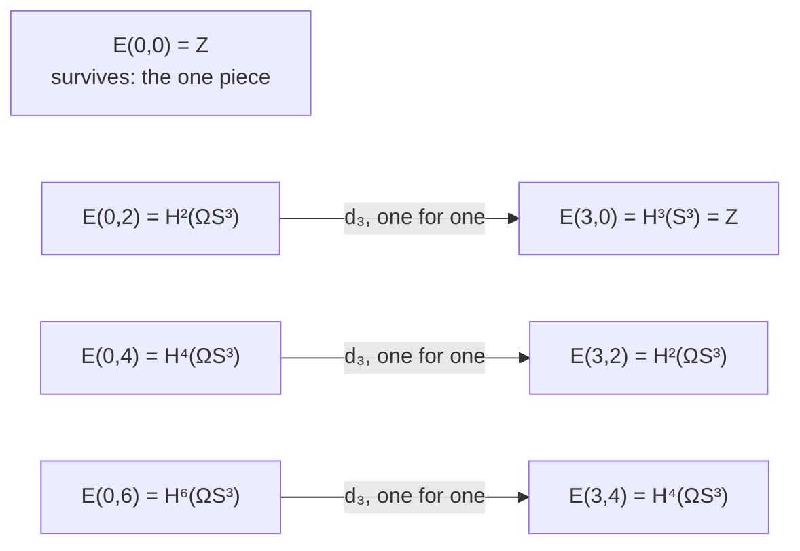

# Spectral sequences in outline: compute the homology of a fibration page by page

[Syllabus](../../../SYLLABUS.md) → [Topology](../README.md) → [Higher Homotopy and Mapping Spaces](../README.md#s07) → Spectral sequences in outline

---

## General Overview

The Hopf map fills the 3-sphere $`S^3`$ with circles, one over each point of the ordinary sphere $`S^2`$, and any two of those circles are linked once ([Higher homotopy groups](02-higher-homotopy-groups-and-fibrations.md)).

Count holes in each piece. The sphere $`S^2`$ has one piece and one sealed cavity: counts 1, 0, 1 in dimensions 0, 1, 2. The circle has one piece and one loop: 1, 1. If $`S^3`$ were the plain product "sphere times circle", its counts in dimensions 0 to 3 would be 1, 1, 1, 1. The real $`S^3`$ has 1, 0, 0, 1. The circle's loop and the sphere's cavity cancel, and the linking is the reason.

A **spectral sequence** is the bookkeeping for that cancellation. It lays the product guess out on a grid, a **page** (page 2, in the usual numbering). A correction map then acts on the page, and what survives forms the next page. Page by page the grid stops changing, and what is left is the answer.

Run backwards, the same bookkeeping finds unknowns. The loops in $`S^3`$ that start and end at one base point form the **loop space** $`\Omega S^3`$ ([Mapping spaces](01-mapping-spaces-and-the-compact-open-topology.md)). The pages force its holes: one in each even dimension 0, 2, 4, 6 and on without end, and none in the odd ones.

Homology has the same machine with the arrows reversed; this card works in cohomology.

**A spectral sequence computes the cohomology of a fibration from its base and its fibre: the second page is the product guess, each later page is what survives a correction map on the page before, and the last page holds the answer; on the path fibration of the 3-sphere, whose total space shrinks to a point, it forces the loop space to have one class in every even degree and none in odd degrees.**

**What kind of fact this is:** definitions (filtered complex, page, differential, Eilenberg–MacLane space) and theorems. Serre's theorem (what the second page is, and that the pages converge), the cell structure of circle bundles, and the representation of cohomology by Eilenberg–MacLane spaces are stated with sources, not proved. From them, this card proves the cohomology of $`\Omega S^3`$ in every degree, the ranks of the cohomology of $`K(\mathbb{Z}, 2)`$, and the cohomology of the circle bundles over $`S^2`$. The code searches every list of ranks 0, 1 or 2 through degree 8: an exhaustive check of that finite range, given Serre's theorem.

### The picture: the page of the path fibration



Schematic. The left column is the fibre's cohomology over the base point. The right column is the same list again, sitting over the 3-dimensional class of $`S^3`$. The correction map $`d_3`$ pairs each left entry with the right entry two rows lower. The total space is a point, so every pair must cancel exactly, and the chain starts from $`H^3(S^3) = \mathbb{Z}`$.

---

## The formula

Carried over, each in one line:

- A **fibration** $`F \to E \to B`$ is a map from a **total space** $`E`$ onto a **base** $`B`$ that lifts homotopies; $`F`$ is the **fibre** over the base point ([Higher homotopy groups](02-higher-homotopy-groups-and-fibrations.md)).
- $`H^k(X; G)`$ is cohomology in degree $`k`$ with coefficients in the group $`G`$; $`H^k(X)`$ means integer coefficients ([Cohomology and the cup product in outline](../05-Homology/08-cohomology-and-cup-product-in-outline.md)).
- $`\Omega X`$ is the space of loops at a base point ([Mapping spaces](01-mapping-spaces-and-the-compact-open-topology.md)).

New notation, in words first. A **filtered complex** is a cochain complex cut into layers numbered $`p = 0, 1, 2, \ldots`$, where a coboundary may move a cochain to a higher layer but never to a lower one. For a fibration, layer $`p`$ is everything over the $`p`$-dimensional cells of the base.

Page $`r`$ is a grid of groups $`E_r^{p,q}`$. The **column** $`p`$ is the base degree, the **row** $`q`$ is the fibre degree, and $`p + q`$ is the **total degree**. Each page carries a **differential** $`d_r`$, a map that jumps $`r`$ columns right and $`r - 1`$ rows down:

```math
d_r : E_r^{p,q} \to E_r^{p+r,\; q-r+1}, \qquad d_r \circ d_r = 0, \qquad E_{r+1}^{p,q} = \frac{\ker\, (d_r \text{ out of } (p,q))}{\mathrm{im}\, (d_r \text{ into } (p,q))}
```

**Read it aloud:** the page-r differential moves an entry r columns right and r − 1 rows down, two steps of it give zero, and the next page keeps what the differential sends to zero, counting what it hits as zero.

A jump lowers the row by one less than it raises the column, so it always raises the total degree by exactly 1, like a coboundary. When no differential can act any more, the page is the last one, $`E_\infty`$.

**Serre's theorem**, for a fibration whose base $`B`$ is simply connected (every loop in it shrinks) and path-connected:

```math
E_2^{p,q} = H^p\big(B;\ H^q(F)\big) \quad \Longrightarrow \quad H^{p+q}(E)
```

**Read it aloud:** the second page holds, at column p and row q, the p-th cohomology of the base with coefficients in the q-th cohomology of the fibre; the double arrow says the pages converge to the cohomology of the total space.

Converge means this: the entries of $`E_\infty`$ on the diagonal $`p + q = k`$ are the layers of $`H^k(E)`$. When a diagonal holds one nonzero entry, that entry is $`H^k(E)`$. When the base and fibre have no torsion in the right places, the second page is the product guess $`H^p(B) \otimes H^q(F)`$, where $`\otimes`$ is the tensor product of groups, which pairs a class of the base with a class of the fibre ([Universal coefficients and Kunneth](../05-Homology/11-universal-coefficients-and-kunneth.md)).

An **Eilenberg–MacLane space** $`K(G, n)`$ is a space with exactly one nonzero homotopy group, $`G`$, in dimension $`n`$. Cohomology is maps into it:

```math
\pi_k\big(K(G, n)\big) = \begin{cases} G & k = n \\ 0 & k \ne n \end{cases}, \qquad H^n(X; G) = [X,\ K(G, n)]
```

**Read it aloud:** K(G, n) has the group G in dimension n and nothing else; the degree-n cohomology of a cell complex X with coefficients in G is the set of maps from X into K(G, n), counted up to homotopy.

| Symbol | Plain meaning | In our example | Push it up and the answer… |
| --- | --- | --- | --- |
| $`F \to E \to B`$ | fibre, total space, base of a fibration | $`\Omega S^3 \to PS^3 \to S^3`$ | — |
| $`H^k(X; G)`$, $`H^k(X)`$ | cohomology in degree $`k`$, coefficients $`G`$; integers when $`G`$ is left out | $`H^2(\Omega S^3) = \mathbb{Z}`$ | — |
| $`p`$, $`q`$, $`p + q`$ | column (base degree), row (fibre degree), total degree | entry (3, 2): total degree 5 | — |
| $`E_r^{p,q}`$, $`E_\infty`$ | the entry of page $`r`$; the last page | $`E_2^{3,0} = \mathbb{Z}`$; $`E_\infty`$ is $`\mathbb{Z}`$ at (0, 0) only | later pages: fewer nonzero entries |
| $`d_r`$ | the differential on page $`r`$ | $`d_3`$, from column 0 to column 3 | larger $`r`$: a longer jump |
| $`PX`$ | the path space: paths that start at the base point and end anywhere | $`PS^3`$, which shrinks to a point | — |
| $`c`$ | the Euler number of a circle bundle over $`S^2`$: the factor $`d_2`$ multiplies by | 1 for Hopf, 2 for $`\mathbb{RP}^3`$ | $`H^2(E)`$ becomes $`\mathbb{Z}/c`$ |
| $`\Omega X`$, $`S^m`$, $`m`$ | the loops at a base point of $`X`$; the sphere of dimension $`m`$ | $`\Omega S^3`$, $`m = 3`$ | larger $`m`$: classes $`m - 1`$ degrees apart |
| $`K(G, n)`$ | a space with one nonzero homotopy group, $`G`$ in dimension $`n`$ | $`K(\mathbb{Z}, 2) = \mathbb{CP}^\infty`$ | — |
| $`[X, Y]`$ | maps from $`X`$ to $`Y`$, counted up to homotopy | $`[X, S^1] = H^1(X)`$ | — |
| $`\mathbb{Z}/c`$, $`\mathbb{Q}`$ | the integers mod $`c`$; the rationals | $`H^2(\mathbb{RP}^3) = \mathbb{Z}/2`$ | — |
| $`\mathbb{RP}^k`$, $`\mathbb{CP}^\infty`$, $`S^\infty`$ | lines through 0 in $`\mathbb{R}^{k+1}`$; complex lines in infinitely many complex dimensions; the sphere in infinitely many dimensions | $`\mathbb{RP}^3`$, the rotations of a solid body | — |

### When it holds

- **A simply connected base.** Going round a loop in the base may flip the fibre, and then the second page needs twisted coefficients. The Klein bottle is a circle over a circle whose fibre flips. The untwisted page predicts ranks 1, 2, 1; the truth over $`\mathbb{Q}`$ is 1, 1, 0. With coefficients mod 2 a flip changes nothing, and 1, 2, 1 is right.
- **The differentials must be found.** The page rules do not say what $`d_r`$ is. Here a known total space forces it. Stopping at the second page gives $`S^3`$ the ranks 1, 1, 1, 1, and leaves the point $`PS^3`$ with $`E_2^{3,0} = \mathbb{Z}`$.
- **Integer coefficients, for torsion.** Over $`\mathbb{Q}`$ the space $`\mathbb{RP}^3`$ has ranks 1, 0, 0, 1, the same as $`S^3`$. Over the integers, $`H^2(\mathbb{RP}^3) = \mathbb{Z}/2`$ tells them apart.
- **One entry per diagonal, for a direct read.** $`E_\infty`$ gives the layers of $`H^k(E)`$. Two nonzero entries on one diagonal can assemble into more than one group. Every example on this card has at most one nonzero entry per diagonal.

---

## Why it works

### Step 0: compute in layers, then correct

Cut a space into layers and compute each layer's cohomology as if the layers did not talk. That is the first guess. Then add the ways a coboundary leaks from one layer to a higher one, sorted by how far it jumps: one layer up on page 1, two on page 2, and so on.

Over the rationals, each correction can only cancel classes in pairs: a class that maps one for one onto another removes both. So each page is smaller than or equal to the page before, and the total degree of every cancelled pair differs by 1. That last fact is why the Euler characteristic, the alternating sum of ranks, never changes from page to page.

### Step 1: a two-row page, worked to the end

Over $`S^2`$ sit many circle bundles, one for each whole number $`c`$, the **Euler number**. The Hopf bundle has $`c = 1`$. The product $`S^2 \times S^1`$ has $`c = 0`$. For $`c = 2`$ the total space is the set of pairs "a point of the sphere and a direction to face along it", which is $`\mathbb{RP}^3`$, the space of rotations of a solid body.

Each total space is built from 4 cells, as in Hatcher's Example 2.43 on lens spaces (spaces glued from $`S^3`$ by a rotation of order $`c`$) for $`c \ge 2`$; $`c = 0`$ and 1 follow the same pattern, and the grouping over base point and 2-cell is this card's own:

- $`e^0`$ and $`e^1`$ lie over the base point: they make up one fibre circle. Column $`p = 0`$, rows $`q = 0`$ and 1.
- $`e^2`$ and $`e^3`$ lie over the rest of the sphere, a 2-cell. Column $`p = 2`$, rows 0 and 1.
- The only nonzero coboundary is $`\delta e^1 = c\, e^2`$: it jumps from column 0 to column 2, so it is $`d_2`$.

So the second page has four copies of $`\mathbb{Z}`$, and $`d_2 : E_2^{0,1} \to E_2^{2,0}`$ multiplies by $`c`$. On page 3 the entry (0, 1) keeps the kernel, which is 0 unless $`c = 0`$. The entry (2, 0) keeps the cokernel $`\mathbb{Z}/c`$. Nothing else can move, so page 3 is $`E_\infty`$.

| $`c`$ | total space | $`H^0, H^1, H^2, H^3`$ over $`\mathbb{Z}`$ | ranks over $`\mathbb{Q}`$ |
| --- | --- | --- | --- |
| 0 | $`S^2 \times S^1`$ | Z, Z, Z, Z | 1, 1, 1, 1 |
| 1 | $`S^3`$, Hopf | Z, 0, 0, Z | 1, 0, 0, 1 |
| 2 | $`\mathbb{RP}^3`$, rotations | Z, 0, Z/2, Z | 1, 0, 0, 1 |
| 3 | lens space L(3,1) | Z, 0, Z/3, Z | 1, 0, 0, 1 |

The check reaches every row twice: once through the page, once from the whole cochain complex with no layers. The Euler characteristic is 0 on page 2 and on $`E_\infty`$, as Step 0 says, and equals the Euler characteristic of the sphere times that of the circle, which is 0.

For the Hopf bundle, $`c`$ is the linking number of two fibres, 1, computed on [Higher homotopy groups](02-higher-homotopy-groups-and-fibrations.md). The link is what cancels the loop against the cavity.

**The Gysin sequence.** For every circle bundle the two-row page unrolls into one long exact row ([Mayer-Vietoris and exact sequences](../05-Homology/06-mayer-vietoris-and-long-exact-sequences.md)). Its middle map is $`d_2`$: cup product with the **Euler class**, the class that $`c`$ counts on $`S^2`$. The row is named here; McCleary's and Hatcher's texts in the sources derive it.

### Step 2: Serre's theorem, stated

Serre proved the general page in 1951. The key steps, in outline:

1. Give the base a cell structure, and let layer $`p`$ of $`E`$ be everything over the $`p`$-dimensional cells.
2. Over one $`p`$-cell the fibration is a product: the cell times $`F`$. So that layer contributes one copy of $`H^q(F)`$ per $`p`$-cell.
3. Page 1 is therefore the cellular cochains of $`B`$ with coefficients $`H^q(F)`$, and $`d_1`$ is the cellular coboundary ([Cellular homology](../05-Homology/05-cellular-homology.md)). Its cohomology, page 2, is $`H^p(B; H^q(F))`$.
4. Item 2 identifies the fibres over different cells with each other. A simply connected base makes that identification independent of the path chosen, so no flip occurs.

Serre built the theorem for singular homology, where cells are not needed. The proof is in Serre's paper and in Chapter 1 of Hatcher's spectral sequence notes; this card uses it without proof.

### Step 3: the path fibration, and why its total space is a point

$`PS^3`$ is every path in $`S^3`$ that starts at the base point $`x_0`$, with its end free. Sending a path to its end point maps $`PS^3`$ onto $`S^3`$. The paths that end at $`x_0`$ are the loops, so the fibre is $`\Omega S^3`$. That the end-point map lifts homotopies is stated with Hatcher as the source.

The total space shrinks to a point: at time $`t`$, replace the path $`\gamma`$ by its first part, $`s \mapsto \gamma(ts)`$. At $`t = 0`$ every path is the constant path at $`x_0`$. The exponential law of [Mapping spaces](01-mapping-spaces-and-the-compact-open-topology.md) makes this a continuous homotopy. So $`H^0(PS^3) = \mathbb{Z}`$ and every other degree is 0.

### Step 4: read the page of the path fibration

$`S^3`$ has cohomology $`\mathbb{Z}`$ in degrees 0 and 3 only, so $`E_2^{p,q} = H^p(S^3; H^q(\Omega S^3))`$ is zero outside columns 0 and 3. Each of those columns is a copy of the unknown list $`H^q(\Omega S^3)`$.

- $`d_2`$ from column 0 lands in column 2, and from column 3 in column 5; both are zero. So page 3 equals page 2.
- $`d_3`$ goes from column 0 to column 3, two rows down. It is the only differential that can act.
- $`d_4`$ and later jump past column 3. So page 4 is $`E_\infty`$.

$`E_\infty`$ must be $`\mathbb{Z}`$ at (0, 0) and zero elsewhere. Every other entry must die: either $`d_3`$ out of it is one for one, or $`d_3`$ into it is onto. Hence:

- Entry (0, 1) can only map to (3, −1), which is zero. So $`H^1(\Omega S^3) = 0`$.
- Entry (3, 0) is $`H^3(S^3) = \mathbb{Z}`$. Only $`d_3`$ from (0, 2) reaches it, and it must be one for one and onto. So $`H^2(\Omega S^3) \cong \mathbb{Z}`$.
- In general $`d_3 : E_3^{0,q} \to E_3^{3,q-2}`$ is an isomorphism for every $`q \ge 2`$, so $`H^q(\Omega S^3) \cong H^{q-2}(\Omega S^3)`$.

Induction from $`H^0 = \mathbb{Z}`$ and $`H^1 = 0`$ gives $`\mathbb{Z}`$ in every even degree and 0 in every odd degree, for all degrees. That is a complete proof, given Serre's theorem.

The same reading works for any sphere $`S^m`$: the differential is $`d_m`$, it lowers the row by $`m - 1`$, and $`\Omega S^m`$ has one class in each degree divisible by $`m - 1`$. The check prints $`S^2`$, $`S^3`$ and $`S^4`$. As a second road, it tries every list of ranks 0, 1 or 2 in degrees 1 to 8, all 6,561 of them, and keeps those the page can empty. One survives: 1, 0, 1, 0, 1, 0, 1, 0, 1.

### Step 5: Eilenberg–MacLane spaces

A space with one homotopy group is the simplest possible building block. Three examples:

- **$`S^1 = K(\mathbb{Z}, 1)`$.** Its fundamental group is $`\mathbb{Z}`$, and every higher group is 0, because the line covering the circle shrinks to a point ([Higher homotopy groups](02-higher-homotopy-groups-and-fibrations.md)).
- **$`\mathbb{RP}^\infty = K(\mathbb{Z}/2, 1)`$.** It is the union of all the $`\mathbb{RP}^k`$. Its double cover is $`S^\infty`$, which shrinks to a point, so only $`\pi_1 = \mathbb{Z}/2`$ survives.
- **$`\mathbb{CP}^\infty = K(\mathbb{Z}, 2)`$.** The fibration $`S^1 \to S^\infty \to \mathbb{CP}^\infty`$ has a total space that shrinks, so its exact row gives $`\pi_2(\mathbb{CP}^\infty) = \pi_1(S^1) = \mathbb{Z}`$ and every other group 0.

For each group $`G`$ and each $`n \ge 1`$ (with $`G`$ commutative when $`n \ge 2`$) there is a $`K(G, n)`$ built from cells, and it is unique up to homotopy equivalence. That is stated from Hatcher's Section 4.2. A loop lowers every homotopy group by one dimension, so $`\Omega K(G, n) \simeq K(G, n - 1)`$.

### Step 6: two rows the other way: the cohomology of K(Z, 2)

Take the path fibration of $`K(\mathbb{Z}, 2)`$. Its fibre is $`\Omega K(\mathbb{Z}, 2) \simeq K(\mathbb{Z}, 1) = S^1`$, and its total space shrinks. Now the base is the unknown.

The second page has two rows, $`q = 0`$ and $`q = 1`$, each a copy of the unknown list $`H^p(K(\mathbb{Z}, 2))`$. Only $`d_2`$ can act, from (p, 1) to (p + 2, 0). Everything except (0, 0) must die:

- (1, 0) is hit by nothing, so $`H^1 = 0`$.
- $`d_2 : E_2^{p,1} \to E_2^{p+2,0}`$ is an isomorphism, so $`H^{p+2} \cong H^p`$.

So $`H^p(K(\mathbb{Z}, 2))`$ is $`\mathbb{Z}`$ for even $`p`$ and 0 for odd $`p`$. The check's search over 6,561 lists finds that one survivor, and it matches the cell count of $`\mathbb{CP}^\infty`$: one cell in each even dimension. [Cohomology of projective space](../../22-Algebraic%20geometry/05-Cohomology%20and%20the%20Hodge%20Conjecture/03-cohomology-of-projective-space.md) computes the same answer from cells, with no fibration.

### Step 7: cohomology is maps into K(G, n), stated

For a cell complex $`X`$, $`H^n(X; G) = [X, K(G, n)]`$ (Hatcher's Theorem 4.57). Two cases show what it means:

- **$`H^1(X) = [X, S^1]`$.** A degree-1 class is a map to the circle, read by how many times each loop winds round it.
- **$`H^2(X) = [X, \mathbb{CP}^\infty]`$.** A degree-2 class is a map to $`\mathbb{CP}^\infty`$. Such maps classify bundles of complex lines over $`X`$, and the class is the bundle's Chern class.

This is how Serre and others attacked the homotopy groups of spheres: replace a space by a tower of fibrations whose fibres are Eilenberg–MacLane spaces, then run a spectral sequence at each floor.

### Step 8: what this outline leaves out

- The homology version: the same pages with arrows reversed, $`d_r`$ moving left and up.
- The product on each page, which turns $`d_r`$ into a rule obeying a product law and fixes the ring structure of $`H^*(\Omega S^3)`$.
- Extension problems, local coefficients in full, and the convergence proof.
- Later spectral sequences built the same way: Atiyah–Hirzebruch, Adams, Eilenberg–Moore.

---

## Worked numbers, by hand

The path fibration $`\Omega S^3 \to PS^3 \to S^3`$, read degree by degree.

| Step | Arithmetic | Value |
| --- | --- | --- |
| $`E_2^{3,0}`$ | $`H^3(S^3) \otimes H^0(\Omega S^3) = \mathbb{Z} \otimes \mathbb{Z}`$ | Z |
| it must die | $`H^3(PS^3) = 0`$; only $`d_3`$ from (0, 2) reaches it | one for one and onto |
| $`H^2(\Omega S^3)`$ | $`E_2^{0,2} \cong E_2^{3,0}`$ | Z |
| $`H^1(\Omega S^3)`$ | (0, 1) maps to (3, −1) = 0, and must die | 0 |
| $`H^3`$, $`H^4`$ | $`\cong H^1`$, $`\cong H^2`$ | 0, Z |
| ranks of $`H^0, \ldots, H^8`$ | repeat every 2 | **1, 0, 1, 0, 1, 0, 1, 0, 1** |
| rank lists tried | $`3^8`$ | 6,561, one survives |

The loop space of $`S^3`$ has one independent class in each even degree and none in odd ones: the first, in degree 2, matches Hurewicz, since $`\Omega S^3`$ is simply connected with $`\pi_2(\Omega S^3) = \pi_3(S^3) = \mathbb{Z}`$, and the page finds the later ones, which Hurewicz cannot reach.

### What breaks if you drop a piece

| Mistake | Comes out at | What went wrong |
| --- | --- | --- |
| Stop at page 2 for the loop space | $`E_2^{3,0} = \mathbb{Z}`$ stays; the point $`PS^3`$ gets ranks 1, 0, 1, 1, 1, 1, 1, 1, 1 in degrees 0 to 8 | $`d_3`$ was skipped, and a point cannot have $`H^3 = \mathbb{Z}`$ |
| Stop at page 2 for the Hopf bundle | ranks 1, 1, 1, 1; truth 1, 0, 0, 1 | $`d_2`$, multiplication by the linking number 1, was skipped |
| Ignore the flip on the Klein bottle | untwisted page 1, 2, 1; truth over $`\mathbb{Q}`$ 1, 1, 0 | the base circle is not simply connected; mod 2 the page 1, 2, 1 is right |
| Use rational ranks for $`c = 2`$ | 1, 0, 0, 1, the same as $`S^3`$ | $`H^2(\mathbb{RP}^3) = \mathbb{Z}/2`$ is torsion, invisible over $`\mathbb{Q}`$ |

The code prints all four.

---

## Code, from first principles, and it actually runs

The code is page arithmetic only: entries are $`\mathbb{Z}`$, $`\mathbb{Z}/c`$ or 0, or ranks over $`\mathbb{Q}`$. It takes three independent roads. The circle bundles are computed through the page and again from the whole cochain complex, with the Euler characteristic compared on page 2 and on the last page. The loop space of $`S^3`$ and the cohomology of $`K(\mathbb{Z}, 2)`$ are solved degree by degree, and again by trying all 6,561 rank lists through degree 8, the second against the cell count of $`\mathbb{CP}^\infty`$. A general page with any one differential finds the same single list with $`d_3`$, and none with $`d_2`$. Serre's theorem is an input, not a check.

### Python

```python
# Spectral sequences in outline -- the check behind the card.  Standard library only.
# Page arithmetic only: entries of a page are groups Z, Z/n or 0 (or ranks over Q), and a
# differential d_r kills what it maps one for one.  Every list stops at degree N = 8.
from itertools import product
N = 8

def cyc(m):                                   # the group Z/m, with Z/0 = Z and Z/1 = 0
    m = abs(m)
    return "Z" if m == 0 else "0" if m == 1 else f"Z/{m}"

def rk(g):                                    # rank over Q: only Z survives
    return 1 if g == "Z" else 0

# Part 1. Circle bundles over S^2, Euler number c (n here).  Cells e0, e1 over the base point,
# e2, e3 over the rest; the one coboundary that jumps columns is delta(e1) = n e2.
NAMES = {0: "S2 x S1", 1: "S3, Hopf", 2: "RP3, rotations", 3: "lens space L(3,1)"}

def by_page(n):                               # road one: E2 page, then d2 = n
    e2 = {(0, 0): "Z", (0, 1): "Z", (2, 0): "Z", (2, 1): "Z"}
    einf = dict(e2)
    einf[(0, 1)] = "Z" if n == 0 else "0"     # kernel of d2 out of (0,1)
    einf[(2, 0)] = cyc(n)                     # cokernel of d2 into (2,0)
    return [next((g for (p, q), g in einf.items() if p + q == k), "0") for k in range(4)], e2, einf

def by_cochains(n):                           # road two: the whole cochain complex, no pages
    delta = [0, n, 0]                         # C^0 -> C^1 -> C^2 -> C^3, each a copy of Z
    out = []
    for k in range(4):
        d_out = delta[k] if k < 3 else 0
        d_in = delta[k - 1] if k > 0 else 0
        out.append("0" if d_out != 0 else cyc(d_in))
    return out

def chi(page):                                # Euler characteristic of a page, ranks over Q
    return sum((-1) ** (p + q) * rk(g) for (p, q), g in page.items())

print("Circle bundles over S2, Euler number c: cohomology H0..H3 over Z")
for n in range(4):
    h, e2, einf = by_page(n)
    assert h == by_cochains(n)
    assert chi(e2) == chi(einf) == 2 * 0      # chi(base) x chi(fibre) = 2 x 0
    print(f"  c = {n}  {NAMES[n]:<18} page {', '.join(h):<13} cochains {', '.join(by_cochains(n)):<13}"
          f" ranks over Q {[rk(g) for g in h]}  chi E2 {chi(e2)}, E-infinity {chi(einf)}")

# Part 2. Pages that must end empty.  A list s[0..N] of ranks survives when a differential
# of reach `gap` can kill everything except s[0] = 1:
#   each entry dies by going out:   s[k] <= s[k - gap]  (k >= 1; nothing below 0)
#   each entry dies by being hit:   s[k] <= s[k + gap]  (k + gap <= N)
def survives(s, gap):
    out = all(s[k] <= (s[k - gap] if k >= gap else 0) for k in range(1, N + 1))
    hit = all(s[k] <= s[k + gap] for k in range(0, N + 1 - gap))
    return out and hit

def by_recursion(gap):                        # road one: solve the page degree by degree
    s = [1]
    for k in range(1, N + 1):
        s.append(s[k - gap] if k >= gap else 0)
    return s

def by_search(gap, rule=survives):            # road two: every list of ranks 0, 1, 2
    return [[1, *t] for t in product(range(3), repeat=N) if rule([1, *t], gap)]

for m in (2, 3, 4):                           # path fibration of S^m: d_m, reach m - 1
    print(f"Loop space of S{m}: ranks of H0..H{N} = {by_recursion(m - 1)}")
loop = by_search(2)
print(f"Loop space of S3, exhaustive: {3 ** N} lists tried, {len(loop)} survives: {loop[0]}")
for q in range(2, 7, 2):
    print(f"  d3 : E3(0,{q}) = Z  ->  E3(3,{q - 2}) = Z, one for one")

def rows_survive(b, gap):                     # K(Z,2): rows q = 0 and 1, both copies of b
    row1 = all(b[p] <= b[p + gap] for p in range(0, N + 1 - gap))      # (p,1) goes out to (p+2,0)
    row0 = all(b[p] <= (b[p - gap] if p >= gap else 0) for p in range(1, N + 1))  # (p,0) is hit
    return row1 and row0
kz2 = by_search(2, rows_survive)
cells = [1 if p % 2 == 0 else 0 for p in range(N + 1)]   # CP-infinity: one cell per even dimension
print(f"K(Z,2) from fibre S1, exhaustive: {len(kz2)} survives: {kz2[0]}; cells of CP-infinity {cells}")
assert loop == [by_recursion(2)] and kz2 == [cells]
assert by_recursion(1) == [1] * (N + 1) and by_recursion(3) == [1, 0, 0, 1, 0, 0, 1, 0, 0]

# What breaks.  Stop at E2: both columns keep the true list, and each diagonal is read as an answer.
e2_loop = [loop[0][k] + (loop[0][k - 3] if k >= 3 else 0) for k in range(N + 1)]
print(f"Stop at E2 for the loop space: E2(3,0) = Z stays; the point PS3 would get ranks {e2_loop} in H0..H{N}")

# A page with columns 0 and 3, both holding s, and one differential d_r: r columns right, r - 1 rows
# down.  Every nonzero entry but (0,0) must die, going out or hit; a partner past degree N is not tested.
def emptied_by(s, r):
    for p in (0, 3):
        for q in range(1 if p == 0 else 0, N + 1):
            out = p + r in (0, 3) and q - r + 1 >= 0 and s[q] <= s[q - r + 1]
            hit = p - r in (0, 3) and (q + r - 1 > N or s[q] <= s[q + r - 1])
            if s[q] and not (out or hit):
                return False
    return True
by_d3, by_d2 = by_search(3, emptied_by), by_search(2, emptied_by)
print(f"One differential on columns 0 and 3, every rank list: emptied by d3: {len(by_d3)}, {by_d3[0]}; by d2: {len(by_d2)}")
e2_hopf = by_page(1)[1]
naive = [sum(rk(g) for (p, q), g in e2_hopf.items() if p + q == k) for k in range(4)]
print(f"Stop at E2 for the Hopf bundle: H0..H3 ranks {naive}, true {[rk(g) for g in by_page(1)[0]]}")

def rank1(col, mod):                          # rank of a one-column matrix, over Q (mod 0) or mod p
    return 1 if any((x % mod if mod else x) != 0 for x in col) else 0
bd2 = [2, 0]                                  # Klein bottle: cell c has boundary 2a + 0b; bd1 = 0
klein = {mod: [1, 2 - rank1(bd2, mod), 1 - rank1(bd2, mod)] for mod in (0, 2)}
untwisted = [1, 2, 1]                         # H(S1) x H(S1), as if the fibre were never flipped
print(f"Klein bottle as a circle over a circle: untwisted page {untwisted}, true over Q {klein[0]},"
      f" true mod 2 {klein[2]}")
print(f"RP3 over Q {[rk(g) for g in by_page(2)[0]]}, the same as S3; over Z H2 = {by_page(2)[0][2]}")
assert by_d3 == loop and by_d2 == [] and e2_loop == [1, 0, 1, 1, 1, 1, 1, 1, 1]
assert naive == [1, 1, 1, 1] and klein[0] == [1, 1, 0] and klein[2] == untwisted
assert by_page(2)[0][2] == "Z/2" and [rk(g) for g in by_page(2)[0]] == [rk(g) for g in by_page(1)[0]]
print("ALL CHECKS PASS")
```

**Ran 2026-11-24 on macOS, Python 3.14.10, standard library only. All checks passed. Output, pasted from the run:**

```
Circle bundles over S2, Euler number c: cohomology H0..H3 over Z
  c = 0  S2 x S1            page Z, Z, Z, Z    cochains Z, Z, Z, Z    ranks over Q [1, 1, 1, 1]  chi E2 0, E-infinity 0
  c = 1  S3, Hopf           page Z, 0, 0, Z    cochains Z, 0, 0, Z    ranks over Q [1, 0, 0, 1]  chi E2 0, E-infinity 0
  c = 2  RP3, rotations     page Z, 0, Z/2, Z  cochains Z, 0, Z/2, Z  ranks over Q [1, 0, 0, 1]  chi E2 0, E-infinity 0
  c = 3  lens space L(3,1)  page Z, 0, Z/3, Z  cochains Z, 0, Z/3, Z  ranks over Q [1, 0, 0, 1]  chi E2 0, E-infinity 0
Loop space of S2: ranks of H0..H8 = [1, 1, 1, 1, 1, 1, 1, 1, 1]
Loop space of S3: ranks of H0..H8 = [1, 0, 1, 0, 1, 0, 1, 0, 1]
Loop space of S4: ranks of H0..H8 = [1, 0, 0, 1, 0, 0, 1, 0, 0]
Loop space of S3, exhaustive: 6561 lists tried, 1 survives: [1, 0, 1, 0, 1, 0, 1, 0, 1]
  d3 : E3(0,2) = Z  ->  E3(3,0) = Z, one for one
  d3 : E3(0,4) = Z  ->  E3(3,2) = Z, one for one
  d3 : E3(0,6) = Z  ->  E3(3,4) = Z, one for one
K(Z,2) from fibre S1, exhaustive: 1 survives: [1, 0, 1, 0, 1, 0, 1, 0, 1]; cells of CP-infinity [1, 0, 1, 0, 1, 0, 1, 0, 1]
Stop at E2 for the loop space: E2(3,0) = Z stays; the point PS3 would get ranks [1, 0, 1, 1, 1, 1, 1, 1, 1] in H0..H8
One differential on columns 0 and 3, every rank list: emptied by d3: 1, [1, 0, 1, 0, 1, 0, 1, 0, 1]; by d2: 0
Stop at E2 for the Hopf bundle: H0..H3 ranks [1, 1, 1, 1], true [1, 0, 0, 1]
Klein bottle as a circle over a circle: untwisted page [1, 2, 1], true over Q [1, 1, 0], true mod 2 [1, 2, 1]
RP3 over Q [1, 0, 0, 1], the same as S3; over Z H2 = Z/2
ALL CHECKS PASS
```

### Rust

Same numbers, same labels, built with `rustc --edition 2021 -O`.

```rust
// Spectral sequences in outline -- the same check as the Python, in Rust.  No crates.
// Page arithmetic only: entries of a page are groups Z, Z/n or 0 (or ranks over Q), and a
// differential d_r kills what it maps one for one.  Every list stops at degree N = 8.
const N: usize = 8;

fn cyc(m: i64) -> String {                    // the group Z/m, with Z/0 = Z and Z/1 = 0
    match m.abs() { 0 => "Z".to_string(), 1 => "0".to_string(), a => format!("Z/{}", a) }
}

fn rk(g: &str) -> i64 { if g == "Z" { 1 } else { 0 } }   // rank over Q: only Z survives

// Part 1. Circle bundles over S^2, Euler number c (n here).  Cells e0, e1 over the base point,
// e2, e3 over the rest; the one coboundary that jumps columns is delta(e1) = n e2.
type Page = Vec<((usize, usize), String)>;

fn by_page(n: i64) -> (Vec<String>, Page, Page) {  // road one: E2 page, then d2 = n
    let e2: Page = vec![((0, 0), "Z".into()), ((0, 1), "Z".into()), ((2, 0), "Z".into()), ((2, 1), "Z".into())];
    let mut einf = e2.clone();
    einf[1].1 = if n == 0 { "Z".into() } else { "0".into() };  // kernel of d2 out of (0,1)
    einf[2].1 = cyc(n);                                         // cokernel of d2 into (2,0)
    let h = (0..4).map(|k| einf.iter().find(|((p, q), _)| p + q == k)
        .map(|(_, g)| g.clone()).unwrap_or("0".into())).collect();
    (h, e2, einf)
}

fn by_cochains(n: i64) -> Vec<String> {      // road two: the whole cochain complex, no pages
    let delta = [0, n, 0];                    // C^0 -> C^1 -> C^2 -> C^3, each a copy of Z
    (0..4).map(|k| {
        let d_out = if k < 3 { delta[k] } else { 0 };
        let d_in = if k > 0 { delta[k - 1] } else { 0 };
        if d_out != 0 { "0".to_string() } else { cyc(d_in) }
    }).collect()
}

fn chi(page: &Page) -> i64 {                  // Euler characteristic of a page, ranks over Q
    page.iter().map(|((p, q), g)| if (p + q) % 2 == 0 { rk(g) } else { -rk(g) }).sum()
}

fn ranks(h: &[String]) -> Vec<i64> { h.iter().map(|g| rk(g)).collect() }

// Part 2. Pages that must end empty: see the Python for the two rules.
fn survives(s: &[i64], gap: usize) -> bool {
    let out = (1..=N).all(|k| s[k] <= if k >= gap { s[k - gap] } else { 0 });
    let hit = (0..=N - gap).all(|k| s[k] <= s[k + gap]);
    out && hit
}

fn rows_survive(b: &[i64], gap: usize) -> bool {   // K(Z,2): rows q = 0 and 1, both copies of b
    let row1 = (0..=N - gap).all(|p| b[p] <= b[p + gap]);                       // (p,1) goes out
    let row0 = (1..=N).all(|p| b[p] <= if p >= gap { b[p - gap] } else { 0 });  // (p,0) is hit
    row1 && row0
}

// Columns 0 and 3 both hold s; one differential d_r.  See the Python for the rule.
fn emptied_by(s: &[i64], r: usize) -> bool {
    let (r, n, col) = (r as i64, N as i64, |p: i64| p == 0 || p == 3);
    for p in [0i64, 3] {
        for q in (if p == 0 { 1 } else { 0 })..=n {
            let v = s[q as usize];
            let out = col(p + r) && q - r + 1 >= 0 && v <= s[(q - r + 1) as usize];
            let hit = col(p - r) && (q + r - 1 > n || v <= s[(q + r - 1) as usize]);
            if v != 0 && !(out || hit) { return false; }
        }
    }
    true
}

fn by_recursion(gap: usize) -> Vec<i64> {    // road one: solve the page degree by degree
    let mut s = vec![1];
    for k in 1..=N { let v = if k >= gap { s[k - gap] } else { 0 }; s.push(v); }
    s
}

fn by_search(gap: usize, rule: fn(&[i64], usize) -> bool) -> Vec<Vec<i64>> {  // road two
    let mut found = Vec::new();
    for code in 0..3usize.pow(N as u32) {     // every list of ranks 0, 1, 2, in Python's order
        let mut s = vec![1i64];
        for i in (0..N).rev() { s.push(((code / 3usize.pow(i as u32)) % 3) as i64); }
        if rule(&s, gap) { found.push(s); }
    }
    found
}

fn main() {
    let names = ["S2 x S1", "S3, Hopf", "RP3, rotations", "lens space L(3,1)"];
    println!("Circle bundles over S2, Euler number c: cohomology H0..H3 over Z");
    for n in 0..4i64 {
        let (h, e2, einf) = by_page(n);
        let c = by_cochains(n);
        assert!(h == c);
        assert!(chi(&e2) == chi(&einf) && chi(&einf) == 2 * 0);   // chi(base) x chi(fibre)
        println!("  c = {}  {:<18} page {:<13} cochains {:<13} ranks over Q {:?}  chi E2 {}, E-infinity {}",
                 n, names[n as usize], h.join(", "), c.join(", "), ranks(&h), chi(&e2), chi(&einf));
    }
    for m in 2..=4 { println!("Loop space of S{}: ranks of H0..H{} = {:?}", m, N, by_recursion(m - 1)); }
    let lp = by_search(2, survives);
    println!("Loop space of S3, exhaustive: {} lists tried, {} survives: {:?}", 3usize.pow(N as u32), lp.len(), lp[0]);
    for q in (2..7).step_by(2) { println!("  d3 : E3(0,{}) = Z  ->  E3(3,{}) = Z, one for one", q, q - 2); }
    let kz2 = by_search(2, rows_survive);
    let cells: Vec<i64> = (0..=N).map(|p| if p % 2 == 0 { 1 } else { 0 }).collect();
    println!("K(Z,2) from fibre S1, exhaustive: {} survives: {:?}; cells of CP-infinity {:?}", kz2.len(), kz2[0], cells);
    assert!(lp == vec![by_recursion(2)] && kz2 == vec![cells]);
    assert!(by_recursion(1) == vec![1; N + 1] && by_recursion(3) == vec![1, 0, 0, 1, 0, 0, 1, 0, 0]);

    // What breaks.  Stop at E2: both columns keep the true list, and each diagonal is read as an answer.
    let e2_loop: Vec<i64> = (0..=N).map(|k| lp[0][k] + if k >= 3 { lp[0][k - 3] } else { 0 }).collect();
    println!("Stop at E2 for the loop space: E2(3,0) = Z stays; the point PS3 would get ranks {:?} in H0..H{}", e2_loop, N);
    let (by_d3, by_d2) = (by_search(3, emptied_by), by_search(2, emptied_by));
    println!("One differential on columns 0 and 3, every rank list: emptied by d3: {}, {:?}; by d2: {}",
             by_d3.len(), by_d3[0], by_d2.len());
    let (h1, e2_hopf, _) = by_page(1);
    let naive: Vec<i64> = (0..4).map(|k| e2_hopf.iter().filter(|((p, q), _)| p + q == k).map(|(_, g)| rk(g)).sum()).collect();
    println!("Stop at E2 for the Hopf bundle: H0..H3 ranks {:?}, true {:?}", naive, ranks(&h1));
    let rank1 = |col: &[i64], m: i64| -> i64 { if col.iter().any(|&x| (if m != 0 { x % m } else { x }) != 0) { 1 } else { 0 } };
    let bd2 = [2i64, 0];                      // Klein bottle: cell c has boundary 2a + 0b; bd1 = 0
    let klein_q = vec![1, 2 - rank1(&bd2, 0), 1 - rank1(&bd2, 0)];
    let klein_2 = vec![1, 2 - rank1(&bd2, 2), 1 - rank1(&bd2, 2)];
    let untwisted = vec![1i64, 2, 1];         // H(S1) x H(S1), as if the fibre were never flipped
    println!("Klein bottle as a circle over a circle: untwisted page {:?}, true over Q {:?}, true mod 2 {:?}",
             untwisted, klein_q, klein_2);
    let (h2, _, _) = by_page(2);
    println!("RP3 over Q {:?}, the same as S3; over Z H2 = {}", ranks(&h2), h2[2]);
    assert!(by_d3 == lp && by_d2.is_empty() && e2_loop == vec![1, 0, 1, 1, 1, 1, 1, 1, 1]);
    assert!(naive == vec![1, 1, 1, 1] && klein_q == vec![1, 1, 0] && klein_2 == untwisted);
    assert!(h2[2] == "Z/2" && ranks(&h2) == ranks(&h1));
    println!("ALL CHECKS PASS");
}
```

**Ran 2026-11-24 on macOS, rustc 1.98.1, no crates. All checks passed. Output, pasted from the run:**

```
Circle bundles over S2, Euler number c: cohomology H0..H3 over Z
  c = 0  S2 x S1            page Z, Z, Z, Z    cochains Z, Z, Z, Z    ranks over Q [1, 1, 1, 1]  chi E2 0, E-infinity 0
  c = 1  S3, Hopf           page Z, 0, 0, Z    cochains Z, 0, 0, Z    ranks over Q [1, 0, 0, 1]  chi E2 0, E-infinity 0
  c = 2  RP3, rotations     page Z, 0, Z/2, Z  cochains Z, 0, Z/2, Z  ranks over Q [1, 0, 0, 1]  chi E2 0, E-infinity 0
  c = 3  lens space L(3,1)  page Z, 0, Z/3, Z  cochains Z, 0, Z/3, Z  ranks over Q [1, 0, 0, 1]  chi E2 0, E-infinity 0
Loop space of S2: ranks of H0..H8 = [1, 1, 1, 1, 1, 1, 1, 1, 1]
Loop space of S3: ranks of H0..H8 = [1, 0, 1, 0, 1, 0, 1, 0, 1]
Loop space of S4: ranks of H0..H8 = [1, 0, 0, 1, 0, 0, 1, 0, 0]
Loop space of S3, exhaustive: 6561 lists tried, 1 survives: [1, 0, 1, 0, 1, 0, 1, 0, 1]
  d3 : E3(0,2) = Z  ->  E3(3,0) = Z, one for one
  d3 : E3(0,4) = Z  ->  E3(3,2) = Z, one for one
  d3 : E3(0,6) = Z  ->  E3(3,4) = Z, one for one
K(Z,2) from fibre S1, exhaustive: 1 survives: [1, 0, 1, 0, 1, 0, 1, 0, 1]; cells of CP-infinity [1, 0, 1, 0, 1, 0, 1, 0, 1]
Stop at E2 for the loop space: E2(3,0) = Z stays; the point PS3 would get ranks [1, 0, 1, 1, 1, 1, 1, 1, 1] in H0..H8
One differential on columns 0 and 3, every rank list: emptied by d3: 1, [1, 0, 1, 0, 1, 0, 1, 0, 1]; by d2: 0
Stop at E2 for the Hopf bundle: H0..H3 ranks [1, 1, 1, 1], true [1, 0, 0, 1]
Klein bottle as a circle over a circle: untwisted page [1, 2, 1], true over Q [1, 1, 0], true mod 2 [1, 2, 1]
RP3 over Q [1, 0, 0, 1], the same as S3; over Z H2 = Z/2
ALL CHECKS PASS
```

The two outputs match line for line.

### Lean

Lean proves the page arithmetic of Steps 1, 4 and 6, with Serre's theorem and the page rules taken as given.

- Suppose the loop space has $`H^0 \cong \mathbb{Z}`$ and $`H^1 = 0`$, and every $`d_3`$ is one for one and onto. Then it has $`\mathbb{Z}`$ in every even degree and 0 in every odd degree.
- Suppose $`K(\mathbb{Z}, 2)`$ has $`H^0 \cong \mathbb{Z}`$ and $`H^1 = 0`$, and every $`d_2`$ is one for one and onto. Then it has $`\mathbb{Z}`$ in every even degree and 0 in every odd degree.
- Take a circle bundle over $`S^2`$ with Euler number $`c`$, so $`d_2`$ multiplies by $`c`$. Then the cokernel at (2, 0) is $`\mathbb{Z}/c`$, and the kernel at (0, 1) is 0 exactly when $`c \ne 0`$.
- Lean also runs the search over all 6,561 rank lists through degree 8. Exactly one survives: 1, 0, 1, 0, 1, 0, 1, 0, 1.
- Lean checks that stopping at page 2 gives the point $`PS^3`$ the ranks 1, 0, 1, 1, 1, 1, 1, 1, 1.
- It checks that a circle bundle's Euler characteristic is 0 on page 2 and on the last page.

The cochain road, the spheres $`S^2`$ and $`S^4`$, and the Klein bottle are left to the Python and Rust checks.

```lean
-- Spectral sequences in outline: once Serre's theorem gives the page, the page arithmetic alone forces the loop space of the 3-sphere and K(Z, 2) to have Z in every even degree and 0 in every odd degree, and gives a circle bundle over the 2-sphere the group Z/c in degree 2.
import Mathlib.Data.ZMod.QuotientGroup
import Mathlib.Algebra.Ring.Basic

/-! Serre's theorem, the path fibrations and the cell structures are stated on the card, not
proved; Mathlib has no Serre spectral sequence and no Eilenberg–MacLane spaces. What is stated
here is the page arithmetic the card proves from them, with each page entry an abelian group and
each differential a group homomorphism. -/

/-- The path fibration `ΩS³ → PS³ → S³`. Let `H q` stand for the unknown cohomology group
`H^q(ΩS³)`. The page has two columns: column 0 holds `H q` at row `q`, and column 3 holds
`H^3(S³; H q) ≅ H q` at row `q`. The only differential that can act is
`d₃ : E₃^{0, q+2} → E₃^{3, q}`, written `d₃ q : H (q + 2) →+ H q`.
The total space `PS³` shrinks to a point, so the last page is `ℤ` at (0, 0) and zero elsewhere:
`H 0 ≅ ℤ`; the entry (0, 1) has no differential in or out, so `H 1 = 0`; every `d₃` is one for
one (nothing survives in column 0 above row 1) and onto (nothing survives in column 3).
Then the loop space has `ℤ` in every even degree and `0` in every odd degree. -/
theorem loop_space_of_three_sphere_cohomology
    (H : ℕ → Type) [∀ q, AddCommGroup (H q)]
    (d₃ : ∀ q, H (q + 2) →+ H q)
    (h_zero : Nonempty (H 0 ≃+ ℤ))
    (h_one : Subsingleton (H 1))
    (h_out : ∀ q, Function.Injective (d₃ q))
    (h_hit : ∀ q, Function.Surjective (d₃ q)) :
    ∀ n : ℕ, Nonempty (H (2 * n) ≃+ ℤ) ∧ Subsingleton (H (2 * n + 1)) := by
  intro n
  induction n with
  | zero => exact ⟨h_zero, h_one⟩
  | succ n ih =>
    obtain ⟨⟨e⟩, hs⟩ := ih
    refine ⟨⟨(AddEquiv.ofBijective (d₃ (2 * n)) ⟨h_out _, h_hit _⟩).trans e⟩, ?_⟩
    exact (h_out (2 * n + 1)).subsingleton

/-- The path fibration `S¹ → P K(ℤ,2) → K(ℤ,2)`, read the other way: the fibre
`ΩK(ℤ,2) ≃ K(ℤ,1) = S¹` is known and the base is the unknown. Let `A p` stand for
`H^p(K(ℤ,2))`. The page has two rows, `q = 0` and `q = 1`, each holding `A p` at column `p`.
The only differential is `d₂ : E₂^{p,1} → E₂^{p+2,0}`, written `d₂ p : A p →+ A (p + 2)`.
The total space shrinks to a point, so: `A 0 ≅ ℤ`; the entry (1, 0) is hit by nothing, so
`A 1 = 0`; every `d₂` is one for one and onto. Then `K(ℤ,2)` has `ℤ` in every even degree and
`0` in every odd degree. -/
theorem eilenberg_maclane_K_Z_two_cohomology
    (A : ℕ → Type) [∀ p, AddCommGroup (A p)]
    (d₂ : ∀ p, A p →+ A (p + 2))
    (h_zero : Nonempty (A 0 ≃+ ℤ))
    (h_one : Subsingleton (A 1))
    (h_out : ∀ p, Function.Injective (d₂ p))
    (h_hit : ∀ p, Function.Surjective (d₂ p)) :
    ∀ n : ℕ, Nonempty (A (2 * n) ≃+ ℤ) ∧ Subsingleton (A (2 * n + 1)) := by
  intro n
  induction n with
  | zero => exact ⟨h_zero, h_one⟩
  | succ n ih =>
    obtain ⟨⟨e⟩, hs⟩ := ih
    refine ⟨⟨(AddEquiv.ofBijective (d₂ (2 * n)) ⟨h_out _, h_hit _⟩).symm.trans e⟩, ?_⟩
    exact ⟨fun x y => (h_hit (2 * n + 1)).forall₂.2 (fun a b => by
      rw [Subsingleton.elim a b]) x y⟩

/-- A circle bundle over `S²` with Euler number `c`: its two-row page has `ℤ` at (0, 0), (0, 1),
(2, 0) and (2, 1), and the one differential `d₂ : E₂^{0,1} → E₂^{2,0}` multiplies by `c`.
The last page keeps the cokernel at (2, 0), which is `ℤ/c`, so `H²` of the total space is
`ℤ/c`; it keeps the kernel at (0, 1), which is zero exactly when `c ≠ 0`, so `H¹` of the total
space is `0` unless `c = 0`. -/
theorem circle_bundle_page_differential (c : ℤ) :
    Nonempty (ℤ ⧸ (AddMonoidHom.mulLeft c).range ≃+ ZMod c.natAbs) ∧
      ((AddMonoidHom.mulLeft c).ker = ⊥ ↔ c ≠ 0) := by
  have hr : (AddMonoidHom.mulLeft c).range = AddSubgroup.zmultiples c := by
    ext x
    simp only [AddMonoidHom.mem_range, AddMonoidHom.coe_mulLeft, AddSubgroup.mem_zmultiples_iff,
      zsmul_eq_mul]
    constructor
    · rintro ⟨y, rfl⟩; exact ⟨y, mul_comm _ _⟩
    · rintro ⟨y, rfl⟩; exact ⟨y, mul_comm _ _⟩
  refine ⟨⟨(QuotientAddGroup.quotientAddEquivOfEq hr).trans (Int.quotientZMultiplesEquivZMod c)⟩, ?_⟩
  rw [AddMonoidHom.ker_eq_bot_iff]
  constructor
  · intro h hc
    subst hc
    have := @h 0 1 (by simp)
    exact zero_ne_one this
  · intro hc a b hab
    exact mul_left_cancel₀ hc hab

/-! The card's whole-number examples. -/

/-- All lists of ranks 0, 1 or 2 of length `n`. -/
def rankLists : ℕ → List (List ℕ)
  | 0 => [[]]
  | n + 1 => (rankLists n).flatMap fun l => [0 :: l, 1 :: l, 2 :: l]

/-- Columns 0 and 3 of the path fibration page, both holding the rank list `s` in rows 0 to 8,
with `d₃` jumping 3 columns right and 2 rows down: every nonzero entry but (0, 0) dies, either
going out one for one or being hit; a partner past row 8 is not tested, as on the card. -/
def emptiedByD3 (s : List ℕ) : Bool :=
  (List.range 9).all fun q =>
    (q == 0 || s.getD q 0 == 0 || (q ≥ 2 && decide (s.getD q 0 ≤ s.getD (q - 2) 0))) &&
    (s.getD q 0 == 0 || q + 2 > 8 || decide (s.getD q 0 ≤ s.getD (q + 2) 0))

-- The exhaustive search: of the 3 ^ 8 = 6561 rank lists for degrees 1 to 8, exactly one survives.
example : (rankLists 8).length = 6561 := by decide +kernel
example : ((rankLists 8).map (1 :: ·)).filter emptiedByD3 = [[1, 0, 1, 0, 1, 0, 1, 0, 1]] := by
  decide +kernel

-- Stopping at page 2 for the loop space: the point PS³ would get ranks 1, 0, 1, 1, 1, 1, 1, 1, 1.
example : (List.range 9).map (fun k => (if k % 2 = 0 then 1 else 0) +
    (if 3 ≤ k ∧ (k - 3) % 2 = 0 then 1 else 0)) = [1, 0, 1, 1, 1, 1, 1, 1, 1] := by decide

-- Circle bundles over S²: the Euler characteristic is 0 on page 2 (ranks 1, 1, 1, 1) and on the
-- last page (ranks 1, 0, 0, 1 for c ≠ 0), and equals χ(S²) · χ(S¹) = 2 · 0.
example : (1 : ℤ) - 1 + 1 - 1 = 0 ∧ (1 : ℤ) - 0 + 0 - 1 = 0 ∧ (1 - 0 + 1 : ℤ) * (1 - 1) = 0 := by
  norm_num

#print axioms loop_space_of_three_sphere_cohomology
#print axioms eilenberg_maclane_K_Z_two_cohomology
#print axioms circle_bundle_page_differential
```

**Checked 2026-11-24 on macOS, Lean 4.36.0-rc2, Mathlib v4.36.0-rc2. Every proof is complete and uses only Lean's standard axioms. Output, pasted from the run:**

```
'loop_space_of_three_sphere_cohomology' depends on axioms: [Classical.choice, Quot.sound]
'eilenberg_maclane_K_Z_two_cohomology' depends on axioms: [Classical.choice, Quot.sound]
'circle_bundle_page_differential' depends on axioms: [propext, Classical.choice, Quot.sound]
```

> [!TIP]
> **Try changing**
> Guess first, then run it.
> - **A bigger sphere.** Change `for m in (2, 3, 4)` to `(2, 3, 4, 5)`. The new line for $`S^5`$ reads 1, 0, 0, 0, 1, 0, 0, 0, 1: one class every 4 degrees.
> - **Allow bigger ranks.** In `by_search`, use `range(4)` instead of `range(3)`. Now 65,536 lists are tried (the printed 6561 still counts the old range), and still exactly one survives.
> - **Drop the "hit" rule.** Make `survives` return `out` alone. Then 5 lists survive, and the assert stops the run: a class can also die by being hit.
> - **Forget $`d_2`$.** In `by_page`, set `einf[(0, 1)] = "Z"` for every $`c`$. The page disagrees with the cochains for $`c = 1`$, and the assert stops the run.

---

## The usual mistake

> [!warning]
> **Reading the second page as the answer.** Page 2 is only the product guess. For the Hopf bundle it gives ranks 1, 1, 1, 1, but $`S^3`$ has 1, 0, 0, 1. For the path fibration it leaves $`E_2^{3,0} = \mathbb{Z}`$ on a space that shrinks to a point. The differentials carry the information, and something outside the page, here the known total space, has to pin them down.
>
> - **Assuming a twisted fibration is untwisted.** The Klein bottle's untwisted page gives 1, 2, 1; over $`\mathbb{Q}`$ the truth is 1, 1, 0.
> - **Counting only ranks.** Over $`\mathbb{Q}`$, $`\mathbb{RP}^3`$ looks like $`S^3`$: 1, 0, 0, 1 for both. Over the integers its $`H^2`$ is $`\mathbb{Z}/2`$.
> - **Using the wrong differential.** On a page with columns 0 and 3, $`d_2`$ lands in an empty column, so nothing reaches $`E_2^{3,0}`$. Over all 6,561 rank lists, $`d_3`$ empties the page for 1 and $`d_2`$ for 0.

---

## Where you meet it in real life

- **The quantum Hall effect.** In a thin conductor in a strong magnetic field, the Hall conductance sits on flat steps that are whole-number multiples of a constant. Thouless, Kohmoto, Nightingale and den Nijs (Sources) showed that the multiple is a whole number. It was soon read as a Chern number: a class in $`H^2`$ of a torus, which is a map into $`K(\mathbb{Z}, 2)`$.
- **Magnetic monopoles.** A monopole of charge $`c`$ comes with a circle bundle over a sphere round it, and its Euler number is $`c`$. The Hopf bundle is charge 1; this card's table is the charge-$`c`$ family.
- **Turning a solid body.** The rotations of a solid body form $`\mathbb{RP}^3`$, the $`c = 2`$ row. The same $`\mathbb{Z}/2`$ twist appears as its fundamental group, $`\pi_1(\mathbb{RP}^3) = \mathbb{Z}/2`$: one full turn cannot be undone by continuous wiggling, while two full turns can.
- **Homotopy groups of spheres.** Serre's 1951 paper introduced this spectral sequence and used it to compute the homology of loop spaces of spheres, the route to many homotopy groups of spheres.

> **Say it back**
> A spectral sequence computes a fibration's cohomology in layers. Page 2 is the product guess, the base's cohomology with the fibre's cohomology as coefficients. Over the rationals, each differential cancels classes in pairs, one total degree apart, and what survives on the last page is the answer. For the Hopf bundle, $`d_2`$ is multiplication by the linking number 1, which cancels the circle's loop against the sphere's cavity. For the path fibration of $`S^3`$ everything must cancel, which forces the loop space to have $`\mathbb{Z}`$ in every even degree. Eilenberg–MacLane spaces hold one homotopy group each, and maps into them are cohomology.

---

## What this builds on

- [Hurewicz and Whitehead](03-hurewicz-and-whitehead-theorems.md): the bridge between homotopy groups and homology that Eilenberg–MacLane spaces make sharp, since $`K(G, n)`$ has $`H_n = G`$ for $`n \ge 2`$.
- [Higher homotopy groups](02-higher-homotopy-groups-and-fibrations.md): fibrations, the Hopf bundle and its linking number, and the exact row that computes the homotopy groups of $`K(G, n)`$.
- [Cohomology and the cup product in outline](../05-Homology/08-cohomology-and-cup-product-in-outline.md): the cohomology groups every page entry is made of.
- [Universal coefficients and Kunneth](../05-Homology/11-universal-coefficients-and-kunneth.md): why page 2 is the plain product when nothing is torsion, and what torsion changes.
- [Mapping spaces](01-mapping-spaces-and-the-compact-open-topology.md): the loop space and the exponential law that shrinks the path space.
- [Cellular homology](../05-Homology/05-cellular-homology.md): the cell-by-cell computation that page 1 of Serre's construction repeats with coefficients.
- [Mayer-Vietoris and exact sequences](../05-Homology/06-mayer-vietoris-and-long-exact-sequences.md): the long exact rows that a two-row page unrolls into, such as the Gysin sequence.

## Where this goes next

- [Cohomology of projective space](../../22-Algebraic%20geometry/05-Cohomology%20and%20the%20Hodge%20Conjecture/03-cohomology-of-projective-space.md): the same even-degree pattern for $`\mathbb{CP}^n`$, built from cells, with the cup product as powers of one class.

This card leaves open how far the pages reach: running them up a tower of Eilenberg–MacLane fibres computes homotopy groups of spheres, but no one knows all of them.

---

## Sources

Verified 2026-11-24: every link below resolves to the publisher's page, except Hatcher's author pages, which carry the full texts, and every DOI was checked against Crossref.

- Hatcher, Allen. *Spectral Sequences in Algebraic Topology*, unfinished book. [Author's page](https://pi.math.cornell.edu/~hatcher/SSAT/SSATpage.html). Chapter 1: the Serre spectral sequence, its cohomology version, and Eilenberg–MacLane spaces.
- Hatcher, Allen. *Algebraic Topology*. Cambridge University Press, 2002. [Author's page, with the free edition](https://pi.math.cornell.edu/~hatcher/AT/ATpage.html). Lens space cells (Example 2.43), Eilenberg–MacLane spaces (Section 4.2), cohomology as maps into them (Theorem 4.57).
- McCleary, John. *A User's Guide to Spectral Sequences*, 2nd ed. Cambridge University Press, 2000. [doi:10.1017/CBO9780511626289](https://doi.org/10.1017/CBO9780511626289). Filtered complexes, pages and the Gysin sequence.
- Serre, Jean-Pierre. "Homologie singulière des espaces fibrés." *Annals of Mathematics* 54 (1951). [doi:10.2307/1969485](https://doi.org/10.2307/1969485). The spectral sequence of a fibration, and the homology of loop spaces.
- Thouless, D. J., M. Kohmoto, M. P. Nightingale, and M. den Nijs. "Quantized Hall Conductance in a Two-Dimensional Periodic Potential." *Physical Review Letters* 49 (1982): 405–408. [doi:10.1103/PhysRevLett.49.405](https://doi.org/10.1103/PhysRevLett.49.405). The Hall conductance as a whole number, through the Kubo formula.
