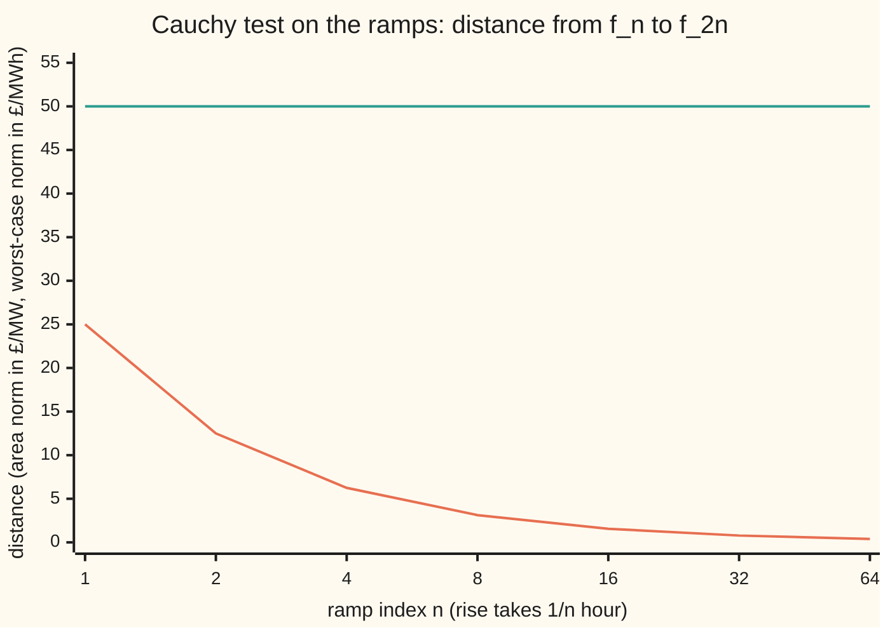

# Normed and Banach spaces: giving a length to functions so limits cannot escape

[Syllabus](../../../SYLLABUS.md) → [Functional analysis](../README.md) → [Normed and Banach Spaces](../README.md#s01) → Normed and Banach spaces

---

## General Overview

A power trader forecasts next week's electricity price for each of its 168 hours, in pounds per megawatt-hour (£/MWh). The forecast repeats one daily shape: £55 at night, £120 in the evening peak. The week then happens. A wind lull pushes Tuesday evening £60, £80 and £40 above the forecast for three hours. Sunshine pulls Saturday midday £20 below it for four hours. Every other hour is exact. (All prices on this card are illustrative.)

How big was the forecast error? Three people give three honest answers:

- **The risk manager** asks for the worst hour: **£80/MWh**.
- **The accountant** prices a steady 1 megawatt (MW) load bought all week, counting each hour's miss at its size, whichever way it went, times one hour: 60 + 80 + 40 + 4 × 20 = **£260 per MW** of mispricing. The bill itself moved less, from £13720 to £13820 per MW, because Saturday's misses ran the other way.
- **The forecaster** reports the root-mean-square (RMS) error: square each hour's miss, average over 168 hours, take the square root. That gives **£8.86/MWh**.

Each answer is a **norm**: a rule that gives every price week a length. A norm must obey three rules. Only the zero week has length zero. Doubling a week doubles its length. The length of a sum is at most the sum of the lengths. This card checks those rules on the error week.

Then it asks what changes when prices become a curve in continuous time. A curve has infinitely many values, and a new danger appears. A sequence of curves can close in on a target that is not a curve of the kind allowed. A normed space where that never happens is called a **Banach space**, after Stefan Banach, who set out the definition in 1922.

**A norm is a length on a vector space that is zero only for zero, scales with its vector and obeys the triangle inequality; a Banach space is a normed space with no holes, and that is exactly what makes every series of finite total length add up to something inside the space.**

**What kind of fact this is:** two definitions (a norm, a Banach space) and four theorems, proved on this card in Why it works. The three week norms obey the rules. Continuous price curves are complete under the worst-case norm and incomplete under the area norm. A normed space is complete exactly when every series of finite total length converges. Every normed space has a completion that is a Banach space, proved in outline.

### The picture: one error week, three sizes

Each size is put in £/MWh: the worst hour as it stands, the area norm divided by 168 hours (the mean absolute miss), the square-root norm divided by the square root of 168 hours (the RMS miss).

```
worst hour     ████████████████████████████████████████  80.00 £/MWh
RMS miss       ████▍                                      8.86 £/MWh
mean miss      ▊                                          1.55 £/MWh
```

The same error week is large, middling or small depending on the norm. None of the three is wrong. Each answers a different question.

---

## The formula

A **vector space** is a collection you can add and scale by the usual rules ([Vector spaces and subspaces](../../03-Algebra/03-Vectors/02-vector-spaces-and-subspaces.md)). Price weeks form one: add two weeks hour by hour, or scale a week by a number. A **norm** on a vector space $`X`$ gives each vector $`x`$ a length $`\lVert x \rVert`$, read "the norm of x", obeying three rules:

```math
\lVert x \rVert = 0 \text{ only when } x = 0, \qquad \lVert c\,x \rVert = \lvert c\rvert\,\lVert x \rVert, \qquad \lVert x + y \rVert \le \lVert x \rVert + \lVert y \rVert
```

**Read it aloud:** only the zero vector has zero length; scaling a vector by c scales its length by the size of c; going along x and then along y is never shorter than the direct route x + y.

No length is negative: the rules give $`0 = \lVert x - x \rVert \le \lVert x \rVert + \lVert -x \rVert = 2\lVert x \rVert`$. A vector space with a chosen norm is a **normed space**.

Write a price week as a function $`f(t)`$: the price at time $`t`$, in hours from Monday 00:00, constant within each hour. Its three norms are

```math
\lVert f \rVert_\infty = \max_{0 \le t \le 168} \lvert f(t)\rvert, \qquad \lVert f \rVert_1 = \int_0^{168} \lvert f(t)\rvert\,dt, \qquad \lVert f \rVert_2 = \Big(\int_0^{168} \lvert f(t)\rvert^2\,dt\Big)^{1/2}
```

**Read it aloud:** the worst-case norm is the largest price in size; the area norm is the area under the size of the curve; the square-root norm is the root of the area under its square.

The area norm of a week of hourly prices is the sum of the 168 prices' sizes times one hour. Its unit is (£/MWh) × h = £/MW. When no price is negative, it is the cost of a steady 1 MW load.

A sequence $`x_1, x_2, \dots`$ is **Cauchy** when its late terms all lie close together: for every tolerance, past some point every two terms are within it ([Complete space](../../17-Topology/01-Metric%20Spaces/05-completeness-and-completion.md)). A normed space is **complete** when every Cauchy sequence converges to a vector in the space. A complete normed space is a **Banach space**. The test this card proves:

```math
X \text{ is complete} \iff \text{every series with } \sum_k \lVert x_k \rVert < \infty \text{ converges in } X
```

**Read it aloud:** a normed space has no holes exactly when every series whose term lengths add to a finite total has a sum inside the space.

| Symbol | Plain meaning | In our example | Push it up and the answer… |
| --- | --- | --- | --- |
| $`X`$; $`x`$, $`y`$, $`z`$ | a vector space; vectors in it | price weeks; the wind-lull and sunshine errors | — |
| $`\lVert x \rVert`$; $`d(x, y)`$ | a norm: the length of $`x`$; the distance it gives, $`\lVert x - y \rVert`$ | forecast to actual: 80, 260 or 114.891 | — |
| $`c`$ | a number that scales a vector | 0.1 turns £/MWh into pence per kilowatt-hour | the length scales by $`\lvert c\rvert`$ |
| $`t`$; $`s`$ | time in hours from Monday 00:00; a second instant, in a proof | 0 to 168; Tuesday 17:00 is $`t = 41`$ | — |
| $`f`$ | a price week or price curve, £/MWh | forecast: £55 to £120 each day | every norm grows |
| $`e`$ | the error: actual week minus forecast | seven non-zero hours | every norm grows |
| $`\lVert f \rVert_\infty`$; $`\lVert f \rVert_1`$; $`\lVert f \rVert_2`$ | worst-case norm (£/MWh); area norm (£/MW); square-root norm ((£/MWh) × √h) | for $`e`$: 80; 260; 114.891, which is £8.86/MWh after dividing by √168 | — |
| $`f_n`$; $`n`$, $`m`$ | a continuous curve whose £100 jump takes $`1/n`$ hour; ramp numbers | $`\lVert f_1 - f_2 \rVert_1 = 25`$ | a shorter ramp, closer to a sudden jump |
| $`x_k`$; $`k`$; $`\sum`$; $`s_n`$ | terms of a sequence or series; their position; their sum; the sum of the first $`n`$ | corrections $`f_{2^k} - f_{2^{k-1}}`$ | — |
| $`g_n \to g`$; $`y_n \to y`$; $`n_j`$, $`j`$ | Cauchy sequences in the proofs and their limits; positions picked from a sequence | — | — |
| $`\varepsilon`$; $`\delta`$; $`N`$ | a tolerance; a time window; a cutoff in the sequence | — | — |
| $`L^1`$, $`L^p`$ | the integrable functions; those whose $`p`$-th power is integrable | the completion of continuous curves under the area norm | — |

### When it holds

- **Rule 1 needs care with functions.** For general functions, a curve that is non-zero at one instant has area norm 0. The [Lp spaces](../../10-Measure%20and%20integration/07-Sizes%20of%20Functions/01-lp-spaces.md) card fixes this by treating functions equal almost everywhere (except on a set of size zero) as one. Hourly step functions and continuous curves need no fix.
- **The exponent must be at least 1.** With exponent 1/2 the triangle rule fails: the error week comes out at 1673.08, more than its two parts' 529.68 + 320.00 = 849.68.
- **The square root is part of the norm.** The sum of squares alone fails rule 2: doubling the error takes it from 13200 to 52800, not 26400.
- **Completeness belongs to a norm, not to a set.** Continuous price curves are complete under the worst-case norm and have holes under the area norm (Why it works, Steps 4 and 5).
- **The series test needs completeness.** In continuous curves under the area norm, a series whose term lengths add to 50 has no sum in the space.

---

## Why it works

### Step 0: a norm is a length that respects adding and scaling

A metric (a distance rule) says only how far apart two points are. A norm measures the move from one vector to another, $`x - y`$, and that move is itself a vector you can add and scale.

So the space looks the same around every point and at every scale. Closeness anywhere becomes a question about short vectors near zero. That is why one test, on series, decides completeness for the whole space.

### Step 1: the three rules hold for the three week norms

Take the error week $`e`$, split into the wind lull (Tuesday) and the sunshine (Saturday).

1. **Zero only for zero.** Each norm adds or maximises sizes $`\lvert e(t)\rvert`$, none negative. A total of zero forces every hour to be zero.
2. **Scaling.** Each hour's size scales by $`\lvert c\rvert`$, so the maximum, the area and the root of the squared area all scale by $`\lvert c\rvert`$. In pence per kilowatt-hour ($`c = 0.1`$) the error is 8, 26 and 11.4891. Its negative, forecast minus actual ($`c = -1`$), has the same three sizes.
3. **Triangle.** For the worst-case and area norms, apply $`\lvert a + b\rvert \le \lvert a\rvert + \lvert b\rvert`$ hour by hour, then take the maximum or the area. For the square-root norm, [Minkowski's inequality](../../10-Measure%20and%20integration/07-Sizes%20of%20Functions/03-minkowskis-inequality.md) proves the rule for every exponent from 1 up.

On the error: worst case 80 ≤ 80 + 20 = 100; area 260 ≤ 180 + 80 = 260; square root 114.891 ≤ 107.703 + 40.000 = 147.703. The area norm meets equality here because the two parts never share an hour. The checks also test all three rules on 1000 pairs of random weeks, with prices from −£50 to £300 (negative prices happen when wind is plentiful).

### Step 2: what a norm adds to a distance

Every norm gives a distance $`d(x, y) = \lVert x - y \rVert`$; [The distance menu](../../17-Topology/01-Metric%20Spaces/02-distances-on-vectors-and-functions.md) shows it obeys the metric rules. The norm makes the distance obey two more:

- **Shifting changes nothing:** $`d(x + z, y + z) = d(x, y)`$. Add the same network charge to both forecast and actual, and the error stays 80, 260 and 114.891.
- **Scaling scales it:** $`d(c\,x, c\,y) = \lvert c\rvert\, d(x, y)`$. A load twice as big is mis-costed twice as much.

Some distances fail these. The all-or-nothing distance puts any two different weeks at distance 1. Double both weeks and they stay 1 apart, where a norm would double the distance. No norm produces that distance.

### Step 3: in 168 hours, every norm is complete

A week of hourly prices is a list of 168 numbers. The worst-case and area norms sandwich each other with fixed factors:

```math
\lVert e \rVert_\infty \times 1\,\text{h} \;\le\; \lVert e \rVert_1 \;\le\; 168\,\text{h} \times \lVert e \rVert_\infty
```

On the error: 80 ≤ 260 ≤ 13440. The square-root norm is sandwiched the same way, between the worst-case norm times √(1 h) and times √(168 h). So a sequence of weeks that is Cauchy in one norm is Cauchy in the other two.

Under the worst-case norm, each hour's price forms a Cauchy sequence of real numbers. The real numbers have no gaps ([No gaps](../../06-Calculus%20and%20analysis/01-Limits%20and%20Continuity/02-supremum-and-completeness.md)), so each hour's price converges, and the limit week is in the space. So the 168-hour space is complete under all three norms. [Equivalent norms](04-equivalence-of-norms-in-finite-dimensions.md) proves that any two norms on any finite list are sandwiched like this.

### Step 4: continuous curves under the worst-case norm are complete

Now let the price be a continuous curve over the week, with a value at every instant. The space now has infinitely many independent directions, and no sandwich is guaranteed.

Under the worst-case norm the space is still complete. A Cauchy sequence of curves is Cauchy at each instant, so each instant's price has a limit. The worst-case norm makes the closeness the same at every instant at once (called **uniform** closeness). A uniform limit of continuous curves has no room to tear, so the limit curve is continuous. Continuous curves with the worst-case norm form a Banach space; [Function spaces C and Lp](03-function-spaces-c-and-lp.md) uses it as a model.

<details>
<summary>Detailed proof: a Cauchy sequence of continuous curves, under the worst-case norm, converges to a continuous curve</summary>

Let $`(g_n)`$ be Cauchy in the worst-case norm. For each instant $`t`$, $`\lvert g_m(t) - g_n(t)\rvert \le \lVert g_m - g_n \rVert_\infty`$, so the numbers $`g_n(t)`$ form a Cauchy sequence of reals. Call its limit $`g(t)`$.

Given a tolerance $`\varepsilon > 0`$, pick $`N`$ with $`\lVert g_m - g_n \rVert_\infty < \varepsilon`$ for $`m, n > N`$. Let $`m`$ grow with $`t`$ fixed: $`\lvert g(t) - g_n(t)\rvert \le \varepsilon`$ for every $`t`$ and every $`n > N`$. So $`\lVert g - g_n \rVert_\infty \le \varepsilon`$.

Continuity of $`g`$ at an instant $`s`$: fix one $`n > N`$. Since $`g_n`$ is continuous, there is a $`\delta`$ with $`\lvert g_n(t) - g_n(s)\rvert < \varepsilon`$ whenever $`\lvert t - s\rvert < \delta`$. For those $`t`$,

$`\displaystyle \lvert g(t) - g(s)\rvert \le \lvert g(t) - g_n(t)\rvert + \lvert g_n(t) - g_n(s)\rvert + \lvert g_n(s) - g(s)\rvert < 3\varepsilon.`$

So $`g`$ is continuous, lies in the space, and $`g_n \to g`$ in the worst-case norm.

</details>

### Step 5: continuous curves under the area norm have a hole

Markets settle in fixed periods, so the price can jump at a period boundary. Say it jumps by £100/MWh at Tuesday 17:00 ($`t = 41`$). A continuous curve cannot jump, so model the jump by a ramp: $`f_n`$ rises the £100 in a straight line over $`1/n`$ hour and agrees with every other ramp outside that time.

Two ramps differ only on the first $`1/n`$ hour after 17:00. The area between them is a thin sliver:

```math
\lVert f_n - f_m \rVert_1 = 50\,\Big\lvert \frac{1}{n} - \frac{1}{m} \Big\rvert \ \text{£/MW}
```

So $`\lVert f_n - f_{2n} \rVert_1 = 25/n`$: 25, 12.5, 6.25, falling to 0.390625 at $`n = 64`$. The ramps are Cauchy in the area norm. Their target is the sudden step, at area distance $`50/n`$ from $`f_n`$: 0.8333 for a one-minute ramp. A step is not continuous, so the target is outside the space. The sequence escapes through a hole. [Riesz-Fischer](../../10-Measure%20and%20integration/07-Sizes%20of%20Functions/05-completeness-of-lp.md) runs the same ramps on [0, 1].

No continuous curve can stand in for the step. Its area distance to the step would be 0. Then it would equal the step at every instant except 17:00 itself, so its values just before and just after 17:00 would differ by £100. A continuous curve has no jump.

Under the worst-case norm the same ramps are not Cauchy: $`\lVert f_n - f_{2n} \rVert_\infty = 50`$ at every $`n`$, the gap at the instant $`f_{2n}`$ finishes rising. The worst-case norm sees the jump; the area norm sees only its shrinking area.



Orange: the area-norm distance, halving with each doubling of $`n`$ (Cauchy). Green: the worst-case distance, stuck at 50 (not Cauchy). Both lines are computed on a grid of 3840 points per hour, for $`n`$ up to 64.

**What the grid hides.** On a grid of finitely many instants, every curve is a finite list, and Step 3 makes that space complete. A ramp shorter than one grid step looks exactly like the step. So no computation can show the hole directly. It shows only a trend that does not close: the area distance falls by half at each doubling while the worst-case gap stays at 50. The proof above is what covers the infinite case.

### Step 6: what completeness buys: series of finite length add up

In a complete space, take vectors $`x_1, x_2, \dots`$ whose lengths add to a finite total. The partial sums $`s_n = x_1 + \dots + x_n`$ are Cauchy, because the triangle rule gives

```math
\lVert s_m - s_n \rVert \le \lVert x_{n+1} \rVert + \dots + \lVert x_m \rVert \quad \text{for } m > n
```

and the right side is a tail of a convergent sum of numbers. Completeness then supplies the sum. The reverse also holds: if every such series converges, the space is complete. The proof picks a fast subsequence (some of the terms, kept in order) of a Cauchy sequence and writes it as a series, the same route [Riesz-Fischer](../../10-Measure%20and%20integration/07-Sizes%20of%20Functions/05-completeness-of-lp.md) takes for $`L^p`$.

On the ramps, write the sudden step as the first ramp plus corrections $`x_k = f_{2^k} - f_{2^{k-1}}`$. Their area lengths are 25, 12.5, 6.25, and so on: after 7 terms they total 49.609375, heading to 50. The lengths add to a finite total, yet the series has no continuous sum. That is the hole of Step 5 seen as a series. Under the worst-case norm each correction has length 50, the total is infinite, and the test makes no promise.

This is why analysts work in Banach spaces. An answer built as a series of shrinking corrections exists as soon as the correction sizes add to a finite total. [Neumann series](../03-Bounded%20Operators/06-neumann-series-and-inverting-close-to-the-identity.md) uses this to invert an operator by a series.

<details>
<summary>Detailed proof: complete exactly when every series of finite total length converges</summary>

**Complete, so the series converge.** Shown above: the partial sums are Cauchy, and completeness gives a limit.

**The series converge, so complete.** Let $`(y_n)`$ be Cauchy. Choose $`n_1 < n_2 < \dots`$ with $`\lVert y_m - y_{n_j} \rVert < 2^{-j}`$ for all $`m \ge n_j`$. Set $`x_1 = y_{n_1}`$ and $`x_{j+1} = y_{n_{j+1}} - y_{n_j}`$. Then

$`\displaystyle \sum_j \lVert x_j \rVert \le \lVert y_{n_1} \rVert + \sum_j 2^{-j} < \infty,`$

so the series converges to some $`y`$. Its partial sums are $`y_{n_j}`$, so $`y_{n_j} \to y`$.

A Cauchy sequence with a convergent subsequence converges to the same limit. Given $`\varepsilon`$, pick $`N`$ from the Cauchy test and $`j`$ with $`n_j > N`$ and $`\lVert y_{n_j} - y \rVert < \varepsilon`$. For $`m > N`$, $`\lVert y_m - y \rVert \le \lVert y_m - y_{n_j} \rVert + \lVert y_{n_j} - y \rVert < 2\varepsilon`$.

</details>

### Step 7: filling the hole: the completion is a Banach space

[Complete space](../../17-Topology/01-Metric%20Spaces/05-completeness-and-completion.md) builds the completion of any metric space: each Cauchy sequence becomes a point, and two sequences whose terms close in on each other become the same point. With a norm, three more things carry over:

1. **Adding and scaling.** Add two Cauchy sequences term by term, or scale one; the results are Cauchy, by the triangle and scaling rules.
2. **The norm.** The length of a new point is the limit of $`\lVert x_n \rVert`$. It exists because $`\big\lvert \lVert x_m \rVert - \lVert x_n \rVert \big\rvert \le \lVert x_m - x_n \rVert`$.
3. **The rules.** All three norm rules survive the limit.

So the completion of a normed space is a Banach space, holding the old space densely (every new point has old vectors as close as you like). For continuous price curves under the area norm, the ramps become a single new point: the sudden step. The completion is $`L^1`$, the integrable functions, which [Riesz-Fischer](../../10-Measure%20and%20integration/07-Sizes%20of%20Functions/05-completeness-of-lp.md) proves complete.

---

## Worked numbers, by hand

The forecast is the daily shape £55, £70, £90, £75, £120, £80 per MWh for the six 4-hour blocks from midnight, every day. The error is +60, +80, +40 at Tuesday 17:00 to 20:00 and −20 at Saturday 11:00 to 15:00.

| Step | Arithmetic | Value |
| --- | --- | --- |
| forecast, 1 MW all week | 7 days × 4 h × (55 + 70 + 90 + 75 + 120 + 80) | £13720 per MW |
| actual, 1 MW all week | 13720 + 180 − 80 | £13820 per MW |
| worst-case error | largest of 60, 80, 40, 20 | £80/MWh |
| area error | (60 + 80 + 40 + 4 × 20) × 1 h | £260 per MW |
| square-root error | √(60² + 80² + 40² + 4 × 20²) | 114.891 |
| RMS error | 114.891 ÷ √168 | £8.86/MWh |
| scaling to pence per kWh | 0.1 × 80; 0.1 × 260; 0.1 × 114.891 | 8; 26; 11.4891 |
| triangle, square-root norm | 114.891 ≤ √(60² + 80² + 40²) + √(4 × 20²) | 114.891 ≤ 107.703 + 40.000 = 147.703 |
| sandwich | 80 × 1 h ≤ 260 ≤ 168 h × 80 | 80 ≤ 260 ≤ 13440 |
| ramps, area norm | $`\lVert f_n - f_{2n} \rVert_1 = 25/n`$ | 25, 12.5, …, 0.390625 at $`n = 64`$ |
| ramps, worst-case norm | gap where $`f_{2n}`$ tops out | **50 at every n** |

The three norms agree that the forecast missed, but disagree on how badly. On continuous curves, the area norm calls the ramps a converging sequence with no limit in the space, while the worst-case norm never calls them close.

### What breaks if you drop a piece

| Mistake | Comes out at | What went wrong |
| --- | --- | --- |
| Using the price range (highest minus lowest) as a size | a flat £10/MWh error all week has range 0, yet area norm 1680 | Rule 1 fails: a non-zero error gets length 0 |
| Dropping the square root | sum of squares 13200 for $`e`$, 52800 for $`2e`$, not 26400 | Rule 2 fails: doubling quadruples |
| Exponent 1/2 instead of at least 1 | 1673.08 for $`e`$, more than 529.68 + 320.00 = 849.68 for its parts | Rule 3 fails: two errors together look bigger than apart |
| Trusting a Cauchy sequence of continuous curves under the area norm | ramps 0.390625 apart at $`n = 64`$, the step 0.8333 away at a one-minute ramp; worst-case gap to the step 98.4375 one grid step after 17:00, heading to 100 | The limit is a step, outside the space: incomplete |

---

## Code, from first principles, and it actually runs

The code builds the forecast and error weeks as lists of 168 hourly prices and computes the three norms directly. It takes two roads to each error norm: the full 168-hour list, and the hand formula from the seven non-zero hours. It checks the three rules on the error and on 1000 pairs of random weeks drawn by a SplitMix64 generator written out in both languages. For the ramps it takes two roads: the closed form $`25/n`$ against the midpoint rule on a grid of 3840 points per hour, which is exact here because every ramp end lands on a grid point. The series of corrections is checked against $`50(1 - 2^{-7})`$. All of this is truncation: finite lists and a finite grid. The infinite-dimensional claims rest on the proofs above.

### Python

```python
# Normed and Banach spaces -- the check behind the card.  Standard library only.
# A week is 168 hourly prices in GBP/MWh (illustrative), read as a step function of time t in hours.
from math import sqrt

BLOCKS = [55, 70, 90, 75, 120, 80]            # one day, six 4-hour blocks
DAY = [BLOCKS[h // 4] for h in range(24)]
FORECAST = DAY * 7                            # hour 0 = Monday 00:00
SPIKES = {41: 60, 42: 80, 43: 40,             # Tuesday 17:00-20:00, a wind lull
          131: -20, 132: -20, 133: -20, 134: -20}   # Saturday 11:00-15:00, sunshine
ERR = [SPIKES.get(h, 0) for h in range(168)]
ACTUAL = [f + e for f, e in zip(FORECAST, ERR)]
WIND = [e if h < 100 else 0 for h, e in enumerate(ERR)]
SUN = [e if h >= 100 else 0 for h, e in enumerate(ERR)]

def sup(x): return max(abs(v) for v in x)                 # worst hour, GBP/MWh
def one(x): return sum(abs(v) for v in x) * 1.0           # each hour lasts 1 h: GBP/MW
def two(x): return sqrt(sum(v * v for v in x) * 1.0)      # (GBP/MWh) sqrt(h)
NORMS = [("sup", sup), ("1", one), ("2", two)]
def add(x, y): return [a + b for a, b in zip(x, y)]
def scale(c, x): return [c * a for a in x]

print("the week (illustrative): forecast blocks", BLOCKS, "GBP/MWh, every day")
print(f"forecast: peak {sup(FORECAST)}  ||f||_1 = {one(FORECAST):.0f} GBP/MW  RMS {two(FORECAST) / sqrt(168):.2f} GBP/MWh")
print(f"actual:   peak {sup(ACTUAL)}  ||f||_1 = {one(ACTUAL):.0f} GBP/MW  RMS {two(ACTUAL) / sqrt(168):.2f} GBP/MWh")
s, a, r = sup(ERR), one(ERR), two(ERR)
print(f"error e:  ||e||_sup = {s} GBP/MWh  ||e||_1 = {a:.0f} GBP/MW  ||e||_2 = {r:.3f}")
# second road: the hand formula, from the seven non-zero hours only
assert s == max(60, 80, 40, 20) and a == 60 + 80 + 40 + 4 * 20
assert abs(r - sqrt(60**2 + 80**2 + 40**2 + 4 * 20**2)) < 1e-12
assert abs(two(ACTUAL) ** 2 - (7 * 4 * sum(b * b for b in BLOCKS) + 54800 - 11000)) < 1e-6
print(f"bars: worst hour {s:.2f}, RMS {r / sqrt(168):.2f}, mean absolute {a / 168:.2f} GBP/MWh")

print("rule 2, scale by c = 0.1 (to p/kWh) and c = -1:")
for name, n in NORMS:
    for c in (0.1, -1):
        assert abs(n(scale(c, ERR)) - abs(c) * n(ERR)) < 1e-9
    print(f"  ||0.1 e||_{name} = {n(scale(0.1, ERR)):.4f}   ||-e||_{name} = {n(scale(-1, ERR)):.4f}")
print("rule 3, e = wind lull + sunshine:")
for name, n in NORMS:
    lhs, rhs = n(add(WIND, SUN)), n(WIND) + n(SUN)
    assert lhs <= rhs + 1e-12
    print(f"  ||e||_{name} = {lhs:.3f} <= {n(WIND):.3f} + {n(SUN):.3f} = {rhs:.3f}")

# rules 1 to 3 on 2000 random weeks, prices -50..300 (negative prices do happen)
state = 20261115
def rng():                                    # SplitMix64
    global state
    state = (state + 0x9E3779B97F4A7C15) & (2**64 - 1)
    z = state
    z = ((z ^ (z >> 30)) * 0xBF58476D1CE4E5B9) & (2**64 - 1)
    z = ((z ^ (z >> 27)) * 0x94D049BB133111EB) & (2**64 - 1)
    return z ^ (z >> 31)
for trial in range(1000):
    x = [rng() % 351 - 50 for _ in range(168)]
    y = [rng() % 351 - 50 for _ in range(168)]
    c = (rng() % 41 - 20) / 4
    for name, n in NORMS:
        assert n(x) > 0 and n([0] * 168) == 0
        assert abs(n(scale(c, x)) - abs(c) * n(x)) < 1e-6 * (1 + n(x))
        assert n(add(x, y)) <= n(x) + n(y) + 1e-9
    assert sup(x) <= one(x) <= 168 * sup(x)
print("random weeks: 1000 pairs, rules 1-3 hold for all three norms")
print(f"sandwich: ||e||_sup x 1 h = {s} <= ||e||_1 = {a:.0f} <= 168 h x ||e||_sup = {168 * s}")

print("what breaks:")
const = [10] * 168
print(f"  range max-min of a flat +10 error: {max(const) - min(const)} (rule 1 fails, yet ||.||_1 = {one(const):.0f})")
sq = lambda x: sum(v * v for v in x)
print(f"  no square root: sum of squares of e = {sq(ERR)}, of 2e = {sq(scale(2, ERR))} (rule 2 wants {2 * sq(ERR)})")
half = lambda x: sum(sqrt(abs(v)) for v in x) ** 2
hw, hs, he = half(WIND), half(SUN), half(ERR)
assert he > hw + hs
print(f"  p = 1/2: size(e) = {he:.2f} > size(wind) + size(sun) = {hw:.2f} + {hs:.2f} = {hw + hs:.2f}")

# continuous curves: a 100 GBP/MWh jump at Tuesday 17:00 (t0 = 41 h) spread over a ramp of 1/n hour
T0, H, GRID = 41, 100, 3840                   # grid: 3840 cells per hour, all ramp ends land on it
def ramp(n, t): return H * min(1.0, max(0.0, (t - T0) * n))
def dist1(n, m):                              # midpoint rule on [t0, t0 + 1]
    return sum(abs(ramp(n, T0 + (k + 0.5) / GRID) - ramp(m, T0 + (k + 0.5) / GRID)) for k in range(GRID)) / GRID
def distsup(n, m): return max(abs(ramp(n, T0 + k / GRID) - ramp(m, T0 + k / GRID)) for k in range(GRID + 1))
print("ramps f_n (rise over 1/n h): Cauchy test ||f_n - f_2n||")
pts1, ptss = [], []
for n in (1, 2, 4, 8, 16, 32, 64):
    d1, ds = dist1(n, 2 * n), distsup(n, 2 * n)
    assert abs(d1 - 50 * (1 / n - 1 / (2 * n))) < 1e-9 and abs(ds - H / 2) < 1e-9
    pts1.append(f"{d1:.6f}"); ptss.append(f"{ds:.1f}")
    print(f"  n = {n:2d}: L1 {d1:9.6f} GBP/MW (closed form 25/n)   sup {ds:.1f} GBP/MWh")
print("chart, L1:", ", ".join(pts1)); print("chart, sup:", ", ".join(ptss))
gap = H - ramp(60, T0 + 1 / GRID)
print(f"  1-minute ramp to the step: L1 distance 50/60 = {50 / 60:.4f} GBP/MW; sup gap at t0 + 1/{GRID} h = {gap:.4f}, heading to {H}")
total = 0.0
for k in range(1, 8):                        # corrections x_k = f_(2^k) - f_(2^(k-1))
    total += dist1(2 ** (k - 1), 2 ** k)
print(f"series of corrections: sum of L1 sizes over 7 terms = {total:.6f} = 50(1 - 2^-7), limit 50; sup sizes 50 each, sum grows without bound")
assert abs(total - 50 * (1 - 2 ** -7)) < 1e-9
print("ALL CHECKS PASS")
```

**Ran 2026-11-15 on macOS, Python 3.14.10, standard library only. All checks passed. Output, pasted from the run:**

```
the week (illustrative): forecast blocks [55, 70, 90, 75, 120, 80] GBP/MWh, every day
forecast: peak 120  ||f||_1 = 13720 GBP/MW  RMS 84.11 GBP/MWh
actual:   peak 200  ||f||_1 = 13820 GBP/MW  RMS 85.65 GBP/MWh
error e:  ||e||_sup = 80 GBP/MWh  ||e||_1 = 260 GBP/MW  ||e||_2 = 114.891
bars: worst hour 80.00, RMS 8.86, mean absolute 1.55 GBP/MWh
rule 2, scale by c = 0.1 (to p/kWh) and c = -1:
  ||0.1 e||_sup = 8.0000   ||-e||_sup = 80.0000
  ||0.1 e||_1 = 26.0000   ||-e||_1 = 260.0000
  ||0.1 e||_2 = 11.4891   ||-e||_2 = 114.8913
rule 3, e = wind lull + sunshine:
  ||e||_sup = 80.000 <= 80.000 + 20.000 = 100.000
  ||e||_1 = 260.000 <= 180.000 + 80.000 = 260.000
  ||e||_2 = 114.891 <= 107.703 + 40.000 = 147.703
random weeks: 1000 pairs, rules 1-3 hold for all three norms
sandwich: ||e||_sup x 1 h = 80 <= ||e||_1 = 260 <= 168 h x ||e||_sup = 13440
what breaks:
  range max-min of a flat +10 error: 0 (rule 1 fails, yet ||.||_1 = 1680)
  no square root: sum of squares of e = 13200, of 2e = 52800 (rule 2 wants 26400)
  p = 1/2: size(e) = 1673.08 > size(wind) + size(sun) = 529.68 + 320.00 = 849.68
ramps f_n (rise over 1/n h): Cauchy test ||f_n - f_2n||
  n =  1: L1 25.000000 GBP/MW (closed form 25/n)   sup 50.0 GBP/MWh
  n =  2: L1 12.500000 GBP/MW (closed form 25/n)   sup 50.0 GBP/MWh
  n =  4: L1  6.250000 GBP/MW (closed form 25/n)   sup 50.0 GBP/MWh
  n =  8: L1  3.125000 GBP/MW (closed form 25/n)   sup 50.0 GBP/MWh
  n = 16: L1  1.562500 GBP/MW (closed form 25/n)   sup 50.0 GBP/MWh
  n = 32: L1  0.781250 GBP/MW (closed form 25/n)   sup 50.0 GBP/MWh
  n = 64: L1  0.390625 GBP/MW (closed form 25/n)   sup 50.0 GBP/MWh
chart, L1: 25.000000, 12.500000, 6.250000, 3.125000, 1.562500, 0.781250, 0.390625
chart, sup: 50.0, 50.0, 50.0, 50.0, 50.0, 50.0, 50.0
  1-minute ramp to the step: L1 distance 50/60 = 0.8333 GBP/MW; sup gap at t0 + 1/3840 h = 98.4375, heading to 100
series of corrections: sum of L1 sizes over 7 terms = 49.609375 = 50(1 - 2^-7), limit 50; sup sizes 50 each, sum grows without bound
ALL CHECKS PASS
```

### Rust

Same numbers, same labels, built with `rustc --edition 2021 -O`.

```rust
// Normed and Banach spaces -- the check behind the card.  Rust std only.
// A week is 168 hourly prices in GBP/MWh (illustrative), read as a step function of time t in hours.

fn sup(x: &[f64]) -> f64 { x.iter().fold(0.0, |m, v| m.max(v.abs())) } // worst hour, GBP/MWh
fn one(x: &[f64]) -> f64 { x.iter().map(|v| v.abs()).sum::<f64>() * 1.0 } // GBP/MW
fn two(x: &[f64]) -> f64 { (x.iter().map(|v| v * v).sum::<f64>() * 1.0).sqrt() }
fn add(x: &[f64], y: &[f64]) -> Vec<f64> { x.iter().zip(y).map(|(a, b)| a + b).collect() }
fn scale(c: f64, x: &[f64]) -> Vec<f64> { x.iter().map(|a| c * a).collect() }
fn sq(x: &[f64]) -> f64 { x.iter().map(|v| v * v).sum() }
fn half(x: &[f64]) -> f64 { x.iter().map(|v| v.abs().sqrt()).sum::<f64>().powi(2) }

struct SplitMix(u64);
impl SplitMix {
    fn next(&mut self) -> u64 {
        self.0 = self.0.wrapping_add(0x9E3779B97F4A7C15);
        let mut z = self.0;
        z = (z ^ (z >> 30)).wrapping_mul(0xBF58476D1CE4E5B9);
        z = (z ^ (z >> 27)).wrapping_mul(0x94D049BB133111EB);
        z ^ (z >> 31)
    }
}

const T0: f64 = 41.0;
const H: f64 = 100.0;
const GRID: usize = 3840; // cells per hour, all ramp ends land on it
fn ramp(n: f64, t: f64) -> f64 { H * 1.0f64.min(0.0f64.max((t - T0) * n)) }
fn dist1(n: f64, m: f64) -> f64 {
    let g = GRID as f64;
    (0..GRID).map(|k| (ramp(n, T0 + (k as f64 + 0.5) / g) - ramp(m, T0 + (k as f64 + 0.5) / g)).abs()).sum::<f64>() / g
}
fn distsup(n: f64, m: f64) -> f64 {
    let g = GRID as f64;
    (0..=GRID).map(|k| (ramp(n, T0 + k as f64 / g) - ramp(m, T0 + k as f64 / g)).abs()).fold(0.0, f64::max)
}

fn main() {
    let blocks = [55.0, 70.0, 90.0, 75.0, 120.0, 80.0];
    let forecast: Vec<f64> = (0..168).map(|h| blocks[(h % 24) / 4]).collect();
    let spikes = [(41, 60.0), (42, 80.0), (43, 40.0), (131, -20.0), (132, -20.0), (133, -20.0), (134, -20.0)];
    let mut err = vec![0.0; 168];
    for &(h, v) in spikes.iter() { err[h] = v; }
    let actual = add(&forecast, &err);
    let wind: Vec<f64> = (0..168).map(|h| if h < 100 { err[h] } else { 0.0 }).collect();
    let sun: Vec<f64> = (0..168).map(|h| if h >= 100 { err[h] } else { 0.0 }).collect();
    let norms: [(&str, fn(&[f64]) -> f64); 3] = [("sup", sup), ("1", one), ("2", two)];
    let r168 = 168f64.sqrt();

    println!("the week (illustrative): forecast blocks [55, 70, 90, 75, 120, 80] GBP/MWh, every day");
    println!("forecast: peak {}  ||f||_1 = {:.0} GBP/MW  RMS {:.2} GBP/MWh", sup(&forecast), one(&forecast), two(&forecast) / r168);
    println!("actual:   peak {}  ||f||_1 = {:.0} GBP/MW  RMS {:.2} GBP/MWh", sup(&actual), one(&actual), two(&actual) / r168);
    let (s, a, r) = (sup(&err), one(&err), two(&err));
    println!("error e:  ||e||_sup = {} GBP/MWh  ||e||_1 = {:.0} GBP/MW  ||e||_2 = {:.3}", s, a, r);
    // second road: the hand formula, from the seven non-zero hours only
    assert!(s == 80.0 && a == 60.0 + 80.0 + 40.0 + 4.0 * 20.0);
    assert!((r - (3600.0f64 + 6400.0 + 1600.0 + 4.0 * 400.0).sqrt()).abs() < 1e-12);
    let bsq: f64 = blocks.iter().map(|b| b * b).sum();
    assert!((two(&actual).powi(2) - (28.0 * bsq + 54800.0 - 11000.0)).abs() < 1e-6);
    println!("bars: worst hour {:.2}, RMS {:.2}, mean absolute {:.2} GBP/MWh", s, r / r168, a / 168.0);

    println!("rule 2, scale by c = 0.1 (to p/kWh) and c = -1:");
    for (name, n) in norms.iter() {
        for c in [0.1, -1.0] { assert!((n(&scale(c, &err)) - c.abs() * n(&err)).abs() < 1e-9); }
        println!("  ||0.1 e||_{} = {:.4}   ||-e||_{} = {:.4}", name, n(&scale(0.1, &err)), name, n(&scale(-1.0, &err)));
    }
    println!("rule 3, e = wind lull + sunshine:");
    for (name, n) in norms.iter() {
        let (lhs, rhs) = (n(&add(&wind, &sun)), n(&wind) + n(&sun));
        assert!(lhs <= rhs + 1e-12);
        println!("  ||e||_{} = {:.3} <= {:.3} + {:.3} = {:.3}", name, lhs, n(&wind), n(&sun), rhs);
    }

    // rules 1 to 3 on 2000 random weeks, prices -50..300 (negative prices do happen)
    let mut g = SplitMix(20261115);
    let zero = vec![0.0; 168];
    for _ in 0..1000 {
        let x: Vec<f64> = (0..168).map(|_| (g.next() % 351) as f64 - 50.0).collect();
        let y: Vec<f64> = (0..168).map(|_| (g.next() % 351) as f64 - 50.0).collect();
        let c = ((g.next() % 41) as f64 - 20.0) / 4.0;
        for (_, n) in norms.iter() {
            assert!(n(&x) > 0.0 && n(&zero) == 0.0);
            assert!((n(&scale(c, &x)) - c.abs() * n(&x)).abs() < 1e-6 * (1.0 + n(&x)));
            assert!(n(&add(&x, &y)) <= n(&x) + n(&y) + 1e-9);
        }
        assert!(sup(&x) <= one(&x) && one(&x) <= 168.0 * sup(&x));
    }
    println!("random weeks: 1000 pairs, rules 1-3 hold for all three norms");
    println!("sandwich: ||e||_sup x 1 h = {} <= ||e||_1 = {:.0} <= 168 h x ||e||_sup = {}", s, a, 168.0 * s);

    println!("what breaks:");
    let flat = vec![10.0; 168];
    let range = flat.iter().cloned().fold(f64::MIN, f64::max) - flat.iter().cloned().fold(f64::MAX, f64::min);
    println!("  range max-min of a flat +10 error: {} (rule 1 fails, yet ||.||_1 = {:.0})", range, one(&flat));
    println!("  no square root: sum of squares of e = {}, of 2e = {} (rule 2 wants {})", sq(&err), sq(&scale(2.0, &err)), 2.0 * sq(&err));
    let (hw, hs, he) = (half(&wind), half(&sun), half(&err));
    assert!(he > hw + hs);
    println!("  p = 1/2: size(e) = {:.2} > size(wind) + size(sun) = {:.2} + {:.2} = {:.2}", he, hw, hs, hw + hs);

    println!("ramps f_n (rise over 1/n h): Cauchy test ||f_n - f_2n||");
    let (mut pts1, mut ptss) = (Vec::new(), Vec::new());
    for n in [1.0f64, 2.0, 4.0, 8.0, 16.0, 32.0, 64.0] {
        let (d1, ds) = (dist1(n, 2.0 * n), distsup(n, 2.0 * n));
        assert!((d1 - 50.0 * (1.0 / n - 1.0 / (2.0 * n))).abs() < 1e-9 && (ds - H / 2.0).abs() < 1e-9);
        pts1.push(format!("{:.6}", d1));
        ptss.push(format!("{:.1}", ds));
        println!("  n = {:2}: L1 {:9.6} GBP/MW (closed form 25/n)   sup {:.1} GBP/MWh", n as i64, d1, ds);
    }
    println!("chart, L1: {}", pts1.join(", "));
    println!("chart, sup: {}", ptss.join(", "));
    let gap = H - ramp(60.0, T0 + 1.0 / GRID as f64);
    println!("  1-minute ramp to the step: L1 distance 50/60 = {:.4} GBP/MW; sup gap at t0 + 1/{} h = {:.4}, heading to {}", 50.0 / 60.0, GRID, gap, H);
    let mut total = 0.0;
    for k in 1..8 { total += dist1(2f64.powi(k - 1), 2f64.powi(k)); } // corrections x_k = f_(2^k) - f_(2^(k-1))
    println!("series of corrections: sum of L1 sizes over 7 terms = {:.6} = 50(1 - 2^-7), limit 50; sup sizes 50 each, sum grows without bound", total);
    assert!((total - 50.0 * (1.0 - 2f64.powi(-7))).abs() < 1e-9);
    println!("ALL CHECKS PASS");
}
```

**Ran 2026-11-15 on macOS, rustc 1.98.1, no crates. All checks passed. Output, pasted from the run:**

```
the week (illustrative): forecast blocks [55, 70, 90, 75, 120, 80] GBP/MWh, every day
forecast: peak 120  ||f||_1 = 13720 GBP/MW  RMS 84.11 GBP/MWh
actual:   peak 200  ||f||_1 = 13820 GBP/MW  RMS 85.65 GBP/MWh
error e:  ||e||_sup = 80 GBP/MWh  ||e||_1 = 260 GBP/MW  ||e||_2 = 114.891
bars: worst hour 80.00, RMS 8.86, mean absolute 1.55 GBP/MWh
rule 2, scale by c = 0.1 (to p/kWh) and c = -1:
  ||0.1 e||_sup = 8.0000   ||-e||_sup = 80.0000
  ||0.1 e||_1 = 26.0000   ||-e||_1 = 260.0000
  ||0.1 e||_2 = 11.4891   ||-e||_2 = 114.8913
rule 3, e = wind lull + sunshine:
  ||e||_sup = 80.000 <= 80.000 + 20.000 = 100.000
  ||e||_1 = 260.000 <= 180.000 + 80.000 = 260.000
  ||e||_2 = 114.891 <= 107.703 + 40.000 = 147.703
random weeks: 1000 pairs, rules 1-3 hold for all three norms
sandwich: ||e||_sup x 1 h = 80 <= ||e||_1 = 260 <= 168 h x ||e||_sup = 13440
what breaks:
  range max-min of a flat +10 error: 0 (rule 1 fails, yet ||.||_1 = 1680)
  no square root: sum of squares of e = 13200, of 2e = 52800 (rule 2 wants 26400)
  p = 1/2: size(e) = 1673.08 > size(wind) + size(sun) = 529.68 + 320.00 = 849.68
ramps f_n (rise over 1/n h): Cauchy test ||f_n - f_2n||
  n =  1: L1 25.000000 GBP/MW (closed form 25/n)   sup 50.0 GBP/MWh
  n =  2: L1 12.500000 GBP/MW (closed form 25/n)   sup 50.0 GBP/MWh
  n =  4: L1  6.250000 GBP/MW (closed form 25/n)   sup 50.0 GBP/MWh
  n =  8: L1  3.125000 GBP/MW (closed form 25/n)   sup 50.0 GBP/MWh
  n = 16: L1  1.562500 GBP/MW (closed form 25/n)   sup 50.0 GBP/MWh
  n = 32: L1  0.781250 GBP/MW (closed form 25/n)   sup 50.0 GBP/MWh
  n = 64: L1  0.390625 GBP/MW (closed form 25/n)   sup 50.0 GBP/MWh
chart, L1: 25.000000, 12.500000, 6.250000, 3.125000, 1.562500, 0.781250, 0.390625
chart, sup: 50.0, 50.0, 50.0, 50.0, 50.0, 50.0, 50.0
  1-minute ramp to the step: L1 distance 50/60 = 0.8333 GBP/MW; sup gap at t0 + 1/3840 h = 98.4375, heading to 100
series of corrections: sum of L1 sizes over 7 terms = 49.609375 = 50(1 - 2^-7), limit 50; sup sizes 50 each, sum grows without bound
ALL CHECKS PASS
```

The two outputs match line for line.

### Lean

Lean proves the series test for every normed space, and that continuous curves are complete under the worst-case norm but not the area norm.

- Take any normed space. Then it is complete exactly when every series whose term lengths add to a finite total converges in the space.
- Continuous curves on any closed time window, under the worst-case norm, form a Banach space.
- Some sequence of continuous curves is Cauchy in the area norm over the week, 0 to 168 hours. Yet no continuous curve is its limit in that norm.
- The error week's sizes hold exactly: worst hour 80, area norm 260 and sum of squares 13200.
- The forecast and actual bills, £13720 and £13820 per MW, hold, as do the sandwich 80 ≤ 260 ≤ 13440 and the triangle 260 ≤ 180 + 80.
- A flat £10/MWh error has area norm 1680. Without the square root, doubling the error takes 13200 to 52800, not 26400.
- The ramp gap $`25/64`$ at $`n = 64`$ and the seven corrections' total $`50(1 - 2^{-7})`$ hold as exact fractions.

The square-root sizes, the random weeks and the ramp grid are left to the Python and Rust checks.

```lean
-- Normed and Banach spaces: this file proves that a normed space is complete exactly when every series whose term lengths add to a finite total converges, and that continuous curves are complete under the worst-case norm but not under the area norm.
import Mathlib.Analysis.Normed.Group.Completeness
import Mathlib.Analysis.Normed.Module.Basic
import Mathlib.Topology.ContinuousMap.Compact
import Mathlib.MeasureTheory.Integral.IntervalIntegral.Basic
import Mathlib.Tactic.NormNum
import Mathlib.Algebra.BigOperators.Intervals

open Filter Topology Finset

/-- The series test. A normed space has no holes (every Cauchy sequence converges in it) exactly
when every series whose term lengths add to a finite total, `∑ ‖x k‖ < ∞`, has its partial sums
converging to a vector inside the space. -/
theorem complete_iff_series_of_finite_length_converge
    (X : Type*) [NormedAddCommGroup X] [NormedSpace ℝ X] :
    CompleteSpace X ↔
      ∀ x : ℕ → X, Summable (fun k => ‖x k‖) →
        ∃ s : X, Tendsto (fun n => ∑ k ∈ range n, x k) atTop (𝓝 s) := by
  exact ⟨fun _ u hu => NormedAddCommGroup.summable_imp_tendsto_of_complete u hu,
    fun h => NormedAddCommGroup.completeSpace_of_summable_imp_tendsto h⟩

/-- Continuous curves on a closed time window `[a, b]`, measured by the worst-case norm
`‖f‖ = max |f(t)|`, form a Banach space: every Cauchy sequence converges to a continuous curve. -/
theorem continuous_curves_complete_under_worst_case_norm (a b : ℝ) :
    CompleteSpace C(Set.Icc a b, ℝ) := by
  infer_instance

/-- Continuous price curves over the week `[0, 168]`, measured by the area norm
`‖f‖₁ = ∫ |f(t)| dt`, have a hole: some sequence of continuous curves is Cauchy in the area norm
(the ramps closing in on a sudden jump) yet no continuous curve is its limit in that norm. -/
theorem continuous_curves_incomplete_under_area_norm :
    ∃ f : ℕ → ℝ → ℝ, (∀ n, Continuous (f n)) ∧
      (∀ ε > 0, ∃ N : ℕ, ∀ m ≥ N, ∀ n ≥ N, ∫ t in (0 : ℝ)..168, |f m t - f n t| < ε) ∧
      ¬ ∃ g : ℝ → ℝ, ContinuousOn g (Set.Icc 0 168) ∧
        Tendsto (fun n => ∫ t in (0 : ℝ)..168, |f n t - g t|) atTop (𝓝 0) := by
  set f : ℕ → ℝ → ℝ := fun n t => max 0 (min 1 (((n : ℝ) + 1) * (t - 84))) with hf
  have hcont : ∀ n, Continuous (f n) := fun n => by
    simp only [hf]; fun_prop
  have h0 : ∀ n t, t ≤ 84 → f n t = 0 := by
    intro n t ht
    have : ((n : ℝ) + 1) * (t - 84) ≤ 0 :=
      mul_nonpos_of_nonneg_of_nonpos (by positivity) (by linarith)
    simp only [hf]
    exact max_eq_left (le_trans (min_le_right _ _) this)
  have h1 : ∀ (n : ℕ) (t : ℝ), 84 + 1 / ((n : ℝ) + 1) ≤ t → f n t = 1 := by
    intro n t ht
    have hn : (0 : ℝ) < (n : ℝ) + 1 := by positivity
    have : 1 ≤ ((n : ℝ) + 1) * (t - 84) := by
      have h' : 1 / ((n : ℝ) + 1) ≤ t - 84 := by linarith
      rw [div_le_iff₀ hn] at h'
      linarith
    simp only [hf]
    rw [min_eq_left this]
    exact max_eq_right zero_le_one
  have hb : ∀ n t, 0 ≤ f n t ∧ f n t ≤ 1 := by
    intro n t
    simp only [hf]
    exact ⟨le_max_left _ _, max_le zero_le_one (min_le_left _ _)⟩
  have h1' : ∀ (N n : ℕ) (t : ℝ), N ≤ n → 84 + 1 / ((N : ℝ) + 1) ≤ t → f n t = 1 := by
    intro N n t hNn ht
    apply h1
    have : 1 / ((n : ℝ) + 1) ≤ 1 / ((N : ℝ) + 1) := by
      apply one_div_le_one_div_of_le (by positivity)
      have : (N : ℝ) ≤ n := by exact_mod_cast hNn
      linarith
    linarith
  refine ⟨f, hcont, ?_, ?_⟩
  · intro ε hε
    obtain ⟨N, hN⟩ := exists_nat_one_div_lt hε
    refine ⟨N, fun m hm n hn => ?_⟩
    set c : ℝ := 84 + 1 / ((N : ℝ) + 1) with hc
    have hcpos : 0 < 1 / ((N : ℝ) + 1) := by positivity
    have hcle : 1 / ((N : ℝ) + 1) ≤ 1 := by
      rw [div_le_one (by positivity)]; have : (0 : ℝ) ≤ N := N.cast_nonneg; linarith
    have hint : ∀ a b : ℝ, IntervalIntegrable (fun t => |f m t - f n t|) MeasureTheory.volume a b :=
      fun a b => ((hcont m).sub (hcont n)).abs.intervalIntegrable a b
    rw [← intervalIntegral.integral_add_adjacent_intervals (hint 0 84) (hint 84 168),
      ← intervalIntegral.integral_add_adjacent_intervals (hint 84 c) (hint c 168)]
    have e1 : ∫ t in (0 : ℝ)..84, |f m t - f n t| = 0 := by
      rw [intervalIntegral.integral_congr (g := fun _ => (0 : ℝ))]
      · simp
      intro t ht
      rw [Set.uIcc_of_le (by norm_num)] at ht
      simp [h0 m t ht.2, h0 n t ht.2]
    have e3 : ∫ t in c..168, |f m t - f n t| = 0 := by
      rw [intervalIntegral.integral_congr (g := fun _ => (0 : ℝ))]
      · simp
      intro t ht
      rw [Set.uIcc_of_le (by linarith)] at ht
      simp [h1' N m t hm ht.1, h1' N n t hn ht.1]
    have e2 : ∫ t in (84 : ℝ)..c, |f m t - f n t| ≤ 1 * |c - 84| := by
      refine le_trans (le_abs_self _) ?_
      rw [← Real.norm_eq_abs]
      apply intervalIntegral.norm_integral_le_of_norm_le_const
      intro t _
      rw [Real.norm_eq_abs, abs_abs, abs_le]
      have := hb m t; have := hb n t
      constructor <;> linarith
    have : |c - 84| = 1 / ((N : ℝ) + 1) := by
      rw [hc, add_sub_cancel_left, abs_of_pos hcpos]
    rw [e1, e3]
    rw [this] at e2
    linarith
  · rintro ⟨g, hg, ht⟩
    have hgc : ContinuousWithinAt g (Set.Icc 0 168) 84 := hg 84 ⟨by norm_num, by norm_num⟩
    rw [Metric.continuousWithinAt_iff] at hgc
    obtain ⟨δ₀, hδ₀, hδ⟩ := hgc (1 / 4) (by norm_num)
    set δ := min δ₀ 1 with hδdef
    have hδpos : 0 < δ := lt_min hδ₀ one_pos
    have hδle : δ ≤ 1 := min_le_right _ _
    have hδle0 : δ ≤ δ₀ := min_le_left _ _
    set c := g 84
    have hnear : ∀ t, 84 - δ / 2 ≤ t → t ≤ 84 + 3 * δ / 4 → |g t - c| < 1 / 4 := by
      intro t h1 h2
      have := hδ (x := t) ⟨by linarith, by linarith⟩ (by
        rw [Real.dist_eq, abs_lt]; constructor <;> linarith)
      rwa [Real.dist_eq] at this
    have hint : ∀ n, IntervalIntegrable (fun t => |f n t - g t|) MeasureTheory.volume 0 168 := by
      intro n
      apply ContinuousOn.intervalIntegrable
      rw [Set.uIcc_of_le (by norm_num)]
      exact ((hcont n).continuousOn.sub hg).abs
    have hsmall : ∀ᶠ n in atTop, ∫ t in (0 : ℝ)..168, |f n t - g t| < δ / 16 :=
      ht.eventually (gt_mem_nhds (by positivity))
    obtain ⟨M, hM⟩ := exists_nat_one_div_lt (show 0 < δ / 2 by positivity)
    obtain ⟨n, hn, hnM⟩ := (hsmall.and (eventually_ge_atTop M)).exists
    have hsub : ∀ a b, 0 ≤ a → a ≤ b → b ≤ 168 →
        ∫ t in a..b, |f n t - g t| ≤ ∫ t in (0 : ℝ)..168, |f n t - g t| := by
      intro a b ha hab hb
      apply intervalIntegral.integral_mono_interval ha hab hb
      · exact Filter.Eventually.of_forall (fun t => abs_nonneg _)
      · exact hint n
    have hsubint : ∀ a b, 0 ≤ a → a ≤ b → b ≤ 168 →
        IntervalIntegrable (fun t => |f n t - g t|) MeasureTheory.volume a b := by
      intro a b ha hab hb
      apply ContinuousOn.intervalIntegrable
      rw [Set.uIcc_of_le hab]
      exact (((hcont n).continuousOn.sub hg).abs).mono (Set.Icc_subset_Icc ha hb)
    by_cases hc : 1 / 2 ≤ |c|
    · have hlow : ∫ t in (84 - δ / 2)..84, (1 / 4 : ℝ) ≤ ∫ t in (84 - δ / 2)..84, |f n t - g t| := by
        apply intervalIntegral.integral_mono_on (by linarith) intervalIntegrable_const
          (hsubint _ _ (by linarith) (by linarith) (by norm_num))
        intro t htt
        rw [h0 n t htt.2, zero_sub, abs_neg]
        have := hnear t htt.1 (by linarith [htt.2])
        have := abs_sub_abs_le_abs_sub c (g t)
        rw [abs_sub_comm c] at this
        linarith
      rw [intervalIntegral.integral_const, smul_eq_mul] at hlow
      have := hsub (84 - δ / 2) 84 (by linarith) (by linarith) (by norm_num)
      nlinarith
    · have hc' : 1 / 2 ≤ |1 - c| := by
        replace hc := not_le.mp hc
        have := abs_sub_abs_le_abs_sub 1 (1 - c)
        rw [sub_sub_cancel, abs_one] at this
        linarith
      have hlow : ∫ t in (84 + δ / 2)..(84 + 3 * δ / 4), (1 / 4 : ℝ) ≤
          ∫ t in (84 + δ / 2)..(84 + 3 * δ / 4), |f n t - g t| := by
        apply intervalIntegral.integral_mono_on (by linarith) intervalIntegrable_const
          (hsubint _ _ (by linarith) (by linarith) (by linarith))
        intro t htt
        have hMn : 1 / ((n : ℝ) + 1) ≤ 1 / ((M : ℝ) + 1) := by
          apply one_div_le_one_div_of_le (by positivity)
          have : (M : ℝ) ≤ n := by exact_mod_cast hnM
          linarith
        rw [h1 n t (by linarith [htt.1])]
        have := hnear t (by linarith [htt.1]) htt.2
        have := abs_sub_abs_le_abs_sub (1 - c) (1 - g t)
        rw [sub_sub_sub_cancel_left] at this
        linarith
      rw [intervalIntegral.integral_const, smul_eq_mul] at hlow
      have := hsub (84 + δ / 2) (84 + 3 * δ / 4) (by linarith) (by linarith) (by linarith)
      nlinarith

-- The error week: +60, +80, +40 at Tuesday 17:00-20:00 (hours 41-43), -20 at Saturday 11:00-15:00
-- (hours 131-134), zero in every other of the 168 hours.
-- Worst hour: 80 GBP/MWh.
example : ((List.range 168).map (fun h : ℕ =>
    (if h = 41 then (60 : ℤ) else if h = 42 then 80 else if h = 43 then 40
     else if 131 ≤ h ∧ h ≤ 134 then -20 else 0).natAbs)).foldr max 0 = 80 := by decide +kernel
-- Area norm: 260 GBP/MW.
example : ((List.range 168).map (fun h : ℕ =>
    (if h = 41 then (60 : ℤ) else if h = 42 then 80 else if h = 43 then 40
     else if 131 ≤ h ∧ h ≤ 134 then -20 else 0).natAbs)).sum = 260 := by decide +kernel
-- Sum of squares under the square-root norm: 13200, so the norm is √13200 = 114.891...
example : ((List.range 168).map (fun h : ℕ =>
    (if h = 41 then (60 : ℤ) else if h = 42 then 80 else if h = 43 then 40
     else if 131 ≤ h ∧ h ≤ 134 then -20 else 0) ^ 2)).sum = 13200 := by decide +kernel
-- Hand formulas for the three error sizes, and the area-norm triangle 260 ≤ 180 + 80 (equality).
example : max (max 60 80) (max 40 20) = (80 : ℕ) := by norm_num
example : (60 + 80 + 40 + 4 * 20 : ℕ) = 260 ∧ (60 + 80 + 40 : ℕ) + 4 * 20 = 180 + 80 := by norm_num
example : (60 ^ 2 + 80 ^ 2 + 40 ^ 2 + 4 * 20 ^ 2 : ℕ) = 13200 := by norm_num
-- The forecast bill and the actual bill for a steady 1 MW load.
example : 7 * 4 * (55 + 70 + 90 + 75 + 120 + 80 : ℕ) = 13720 := by norm_num
example : (13720 + 180 - 80 : ℕ) = 13820 := by norm_num
-- The sandwich 80 × 1 h ≤ 260 ≤ 168 h × 80 = 13440.
example : (80 : ℕ) ≤ 260 ∧ 260 ≤ 168 * 80 ∧ 168 * 80 = 13440 := by norm_num
-- What breaks: a flat 10 GBP/MWh error has range 0 but area 1680; dropping the square root,
-- doubling e takes the sum of squares from 13200 to 52800, not 26400.
example : (168 * 10 : ℕ) = 1680 := by norm_num
example : (2 * 60) ^ 2 + (2 * 80) ^ 2 + (2 * 40) ^ 2 + 4 * (2 * 20) ^ 2 = (52800 : ℕ) ∧
    (52800 : ℕ) ≠ 2 * 13200 := by norm_num
-- Ramps: ‖f_n - f_2n‖₁ = 50 (1/n - 1/(2n)) = 25/n, and 25/64 at n = 64.
example : (50 : ℚ) * (1 / 64 - 1 / 128) = 25 / 64 := by norm_num
-- The series of corrections: lengths 25, 25/2, ..., 25/2^6 total 50 (1 - 2^-7) after 7 terms.
example : ∑ k ∈ range 7, (25 : ℚ) / 2 ^ k = 50 * (1 - 1 / 2 ^ 7) := by
  norm_num [Finset.sum_range_succ]

#print axioms complete_iff_series_of_finite_length_converge
#print axioms continuous_curves_complete_under_worst_case_norm
#print axioms continuous_curves_incomplete_under_area_norm
```

**Checked 2026-11-15 on macOS, Lean 4.36.0-rc2, Mathlib v4.36.0-rc2. Every proof is complete and uses only Lean's standard axioms. Output, pasted from the run:**

```
'complete_iff_series_of_finite_length_converge' depends on axioms: [propext, Classical.choice, Quot.sound]
'continuous_curves_complete_under_worst_case_norm' depends on axioms: [propext, Classical.choice, Quot.sound]
'continuous_curves_incomplete_under_area_norm' depends on axioms: [propext, Classical.choice, Quot.sound]
```

> [!TIP]
> **Try changing**
> Guess first, then run the Python.
> - **Add a network charge to both ramps.** Change `def ramp(n, t): return H * min(` to `def ramp(n, t): return 15 + H * min(`. Guess first: do the ramp distances change? They do not: the same £15 sits in both curves and cancels in $`f_n - f_{2n}`$, Step 2's shift rule. Only the one-minute line moves, to 83.4375, because it measures a ramp against the bare jump height, which got no charge.
> - **Use exponent 1 in the broken size.** In `half`, change `sum(sqrt(abs(v)) for v in x) ** 2` to `sum(abs(v) for v in x)`. Guess first: does the triangle rule still fail? It holds, with equality: 260 = 180 + 80, so the assert that expects a failure stops the run.
> - **Sum more corrections.** Change `range(1, 8)` to `range(1, 11)` and `2 ** -7` to `2 ** -10`. Guess first: does the total reach 49.951172? The run prints 49.951389 and stops: the ramp of 1/1024 hour ends between grid points, so the midpoint rule is no longer exact. Raise `GRID` to 30720 and it passes with 49.951172 (the label still says 7 terms).
> - **Change the random seed.** Set `state = 7`. Guess first: can any random week break a rule? None does; the run still ends `ALL CHECKS PASS`.

---

## The usual mistake

> [!warning]
> **Thinking a space of functions is complete because the real numbers are.** Each instant's price lives in the complete real line, but the space of curves is complete only under a suitable norm. Continuous curves under the area norm have a hole: the ramps come within 0.390625 of each other at $`n = 64`$, and their target is a sudden step, which no continuous curve equals.
>
> - **Calling one norm "the" size.** The same error week is £80/MWh at its worst hour, £8.86/MWh RMS and £1.55/MWh on average. Name the norm before quoting a size.
> - **Dropping the square root from the square-root norm.** Doubling the error then takes 13200 to 52800, four times, not two.
> - **Using an exponent below 1.** With exponent 1/2, the error week measures 1673.08 while its parts measure 529.68 and 320.00: the triangle rule fails.
> - **Expecting finite-dimensional behaviour in infinite dimensions.** In 168 hours the sandwich 80 ≤ 260 ≤ 13440 holds for every week. For continuous curves, the ramps sit 50 apart in the worst-case norm and as close as you like in the area norm: no sandwich holds.

---

## Where you meet it in real life

- **Forecast scoring.** Energy forecasters report mean absolute error, RMS error and worst-hour error. These are the area, square-root and worst-case norms divided by a fixed time. Choosing one is choosing which misses matter.
- **Engineering tolerances.** A power-electronics spec that bounds the voltage error at every instant uses the worst-case norm. Under it, continuous signals form a Banach space, so a design improved step by step converges to a continuous signal.
- **Signal processing.** Audio and images are measured in the square-root norm, as energy. Its space of functions is complete (Riesz-Fischer), so a signal built from a series of finite-energy pieces is itself a finite-energy signal.
- **Numerical solvers.** Iterative methods for equations, from load-flow studies on power grids to finite-element codes, build answers as series of corrections. The convergence proofs work in Banach spaces, where finite total size guarantees an answer exists.

> **Say it back**
> A norm gives each vector a length: zero only for zero, scaling with the vector, and obeying the triangle inequality. The worst-case, area and square-root norms all qualify, and they give the same error week three different sizes. In finitely many dimensions every norm makes a complete space. With infinitely many, completeness depends on the norm: continuous curves are complete under the worst-case norm but not under the area norm, where ramps close in on a step. A Banach space is a complete normed space, and that is exactly the condition for every series of finite total length to have a sum.

---

## What this builds on

- [Vector spaces and subspaces](../../03-Algebra/03-Vectors/02-vector-spaces-and-subspaces.md): adding and scaling by the usual rules, the structure a norm measures.
- [Complete space](../../17-Topology/01-Metric%20Spaces/05-completeness-and-completion.md): Cauchy sequences, completeness and the completion for any distance, which Step 7 extends to norms.
- [No gaps](../../06-Calculus%20and%20analysis/01-Limits%20and%20Continuity/02-supremum-and-completeness.md): the completeness of the real numbers, which makes each hour's and each instant's limit exist.
- [Minkowski's inequality](../../10-Measure%20and%20integration/07-Sizes%20of%20Functions/03-minkowskis-inequality.md): the triangle rule for the square-root norm and every exponent from 1 up.
- [Riesz-Fischer](../../10-Measure%20and%20integration/07-Sizes%20of%20Functions/05-completeness-of-lp.md): $`L^p`$ is complete, the model Banach space and the completion in Step 7.
- [The distance menu](../../17-Topology/01-Metric%20Spaces/02-distances-on-vectors-and-functions.md): the worst-case, straight-line and taxicab distances that a norm turns into a metric.

## Where this goes next

- [Sequence spaces](02-sequence-spaces-lp-and-c0.md): the same three norms on endless lists, and which lists each one admits.
- [Function spaces C and Lp](03-function-spaces-c-and-lp.md): continuous functions and the $`L^p`$ spaces side by side as Banach spaces.
- [Hahn-Banach](06-hahn-banach-theorem.md): extending a bounded linear measurement from a subspace to the whole normed space.
- [Three Banach theorems](08-open-mapping-closed-graph-and-uniform-boundedness.md): the open mapping, closed graph and uniform boundedness theorems, which need completeness.
- [Inner products](../02-Hilbert%20Spaces/01-inner-products-and-hilbert-spaces.md): norms that come from an angle, like the square-root norm, and the Hilbert spaces they make.
- [Bounded operators](../03-Bounded%20Operators/01-bounded-operators-and-the-operator-norm.md): maps between normed spaces, and a norm on the maps themselves.

The 168-hour space treated all three norms as interchangeable up to a fixed factor; which norms on an infinite-dimensional space can still be compared like that, and what is lost when none can?

---

## Sources

Verified 2026-11-15: every link below resolves to the publisher's page.

- Banach, Stefan. "Sur les opérations dans les ensembles abstraits et leur application aux équations intégrales." *Fundamenta Mathematicae* 3 (1922). [DOI 10.4064/fm-3-1-133-181](https://doi.org/10.4064/fm-3-1-133-181). Sets out the axioms of a complete normed space.
- Rynne, Bryan P., and Martin A. Youngson. *Linear Functional Analysis*, 2nd ed. Springer Undergraduate Mathematics Series, Springer, 2008. [DOI 10.1007/978-1-84800-005-6](https://doi.org/10.1007/978-1-84800-005-6). Chapter 2: normed spaces, Banach spaces, and the worst-case norm on continuous functions.
- Axler, Sheldon. *Measure, Integration & Real Analysis*. Graduate Texts in Mathematics, Springer, 2020. [DOI 10.1007/978-3-030-33143-6](https://doi.org/10.1007/978-3-030-33143-6). Chapter 6: normed spaces and the test that a space is complete exactly when series of finite total length converge.
