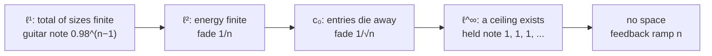
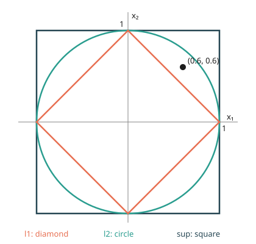
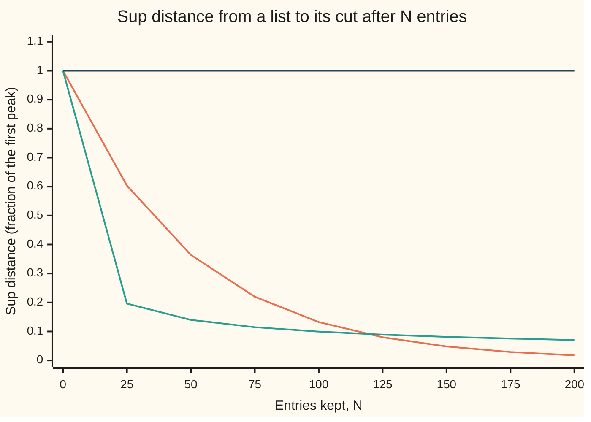

# Sequence spaces: infinite lists of numbers with a size rule

[Syllabus](../../../SYLLABUS.md) → [Functional analysis](../README.md) → [Normed and Banach Spaces](../README.md#s01) → Sequence spaces

---

## General Overview

Pluck the open A string of a guitar. It vibrates 110 times a second, and each swing is a little smaller than the one before. Write down the height of each swing's peak, with the first peak set to 1. If each peak keeps 98% of the one before, the list reads 1, 0.98, 0.9604, 0.941192, and so on (illustrative numbers). After 342 cycles, 3.11 seconds, the peak is down to a thousandth: 60 decibels quieter, the usual mark for "the note has died".

In principle the list never ends. The peaks only get smaller; they never reach zero. Three plain questions about such an endless list each have a number for an answer:

- **How loud is the loudest moment?** The largest peak: 1. This is the **sup norm**.
- **How much energy does the note carry?** Energy grows with the square of the swing, so add the squared peaks: 25.2525, and take the square root: 5.0252. This is the **2-norm**.
- **How big are all the swings together?** Add the peak sizes: 50. This is the **1-norm**. (The string's actual travel is about four times this, since each cycle covers four peak heights.)

For a list that never ends, a question may have no finite answer. A list of peaks 1, 1/2, 1/3, ... has finite energy but an endless total. A held organ note, 1, 1, 1, ..., has a loudest moment but no finite energy, and it never fades. Each question sorts the endless lists into those it can answer and those it cannot. Each such collection, with its question as its size rule, is a **sequence space**.

The shelf's house example, a week of hourly electricity prices, is a finite list. Every question has a finite answer for it, so it belongs to every space below. Membership becomes a real question only when a list never ends.

**A sequence space is a collection of endless lists of numbers on which one size rule always gives a finite answer; the four standard ones nest as ℓ¹ ⊂ ℓ² ⊂ c₀ ⊂ ℓ^∞, each strictly bigger than the one before, and the size rules nest the other way, sup ≤ 2-norm ≤ 1-norm.**

**What kind of fact this is:** definitions (the four spaces and their norms), with theorems proved on this card in Why it works: the nesting and the norm inequalities, that each inclusion is strict, that ℓ¹, ℓ^∞ and c₀ are complete, that c₀ is exactly what finite lists can approach in the sup norm, and that c₀ is separable while ℓ^∞ is not. Completeness of ℓ² is proved on [Riesz-Fischer](../../10-Measure%20and%20integration/07-Sizes%20of%20Functions/05-completeness-of-lp.md).

### The picture: which list lives where



Each of the four spaces is inside the next one. The list named in each box belongs to that box but not to the box before it: the strict inclusions. The last box is not a space: the ramp 1, 2, 3, ..., an amplifier's runaway feedback, has no ceiling and lies outside all four.

---

## The formula

A **sequence** is an endless list of real numbers, $`x = (x_1, x_2, x_3, \dots)`$; $`x_n`$ is its entry in place $`n`$. The note is $`x_n = r^{\,n-1}`$ with $`r = 0.98`$. Here are the three size rules ([Lp spaces](../../10-Measure%20and%20integration/07-Sizes%20of%20Functions/01-lp-spaces.md) defines them for any measure; with each place weighing 1, its integrals become these sums):

```math
\lVert x\rVert_1 = \sum_{n=1}^{\infty} \lvert x_n\rvert, \qquad \lVert x\rVert_2 = \Big(\sum_{n=1}^{\infty} x_n^2\Big)^{1/2}, \qquad \lVert x\rVert_\infty = \sup_n \lvert x_n\rvert .
```

**Read it aloud:** the 1-norm adds the sizes of all the entries; the 2-norm adds their squares and takes the square root; the sup norm is the smallest ceiling that no entry's size goes above.

An endless sum means the limit of its running totals ([Infinite series](../../06-Calculus%20and%20analysis/06-Series/01-series-convergence.md)). Each norm may come out infinite. The four spaces collect the lists where the answer is finite, or, for $`c_0`$, where the entries die away:

```math
\ell^1 = \{x : \lVert x\rVert_1 < \infty\}, \quad \ell^2 = \{x : \lVert x\rVert_2 < \infty\}, \quad \ell^\infty = \{x : \lVert x\rVert_\infty < \infty\}, \quad c_0 = \{x : x_n \to 0\}.
```

Read $`\ell^1`$ as "little ell one". The space $`c_0`$, "c nought", is sized by the sup norm. The theorem of this card is the chain

```math
\ell^1 \subsetneq \ell^2 \subsetneq c_0 \subsetneq \ell^\infty, \qquad \lVert x\rVert_\infty \le \lVert x\rVert_2 \le \lVert x\rVert_1 .
```

The same recipe with $`p`$-th powers gives $`\ell^p`$ for any $`p \ge 1`$, and $`\ell^p \subsetneq \ell^q`$ whenever $`p < q`$, for Step 0's reason: below 1, a higher power is smaller. This card works with $`p = 1`$ and $`2`$.

The **unit list** $`e_n`$ is 1 in place $`n`$ and 0 everywhere else. Every finite list is built from them: $`(x_1, \dots, x_N, 0, 0, \dots) = x_1 e_1 + \dots + x_N e_N`$. This cut is written $`x^{(N)}`$: keep the first $`N`$ entries, set the rest to 0.

| Symbol | Plain meaning | In our example | Push it up and the answer… |
| --- | --- | --- | --- |
| $`x`$, $`x_n`$, $`n`$ | an endless list; its entry in place $`n`$; the place | the note's peaks, $`x_n = 0.98^{\,n-1}`$ | — |
| $`r`$ | the share of a peak kept each cycle | 0.98 | the note rings longer; the 1-norm and 2-norm grow, the 1-norm fastest; the sup stays 1 |
| $`\lVert x\rVert_1`$ | 1-norm: total of the entry sizes | 50 | — |
| $`\lVert x\rVert_2`$ | 2-norm: square root of the sum of squares (energy) | 5.0252 | — |
| $`\lVert x\rVert_\infty`$, sup | sup norm: the least upper bound, the smallest ceiling on the sizes | 1 | — |
| $`\ell^1`$, $`\ell^2`$, $`\ell^\infty`$ | the lists with finite 1-norm, 2-norm, sup norm | the note is in all three | — |
| $`\ell^p`$, $`p`$, $`q`$ | the same rule with $`p`$-th powers; two exponents | $`p = 1, 2`$ | larger $`p`$, bigger space |
| $`c_0`$ | lists whose entries tend to 0, sized by the sup norm | the note and 1/√n; not the held note | — |
| $`e_n`$ | the unit list: 1 in place $`n`$, 0 elsewhere | $`\lVert e_3 - e_7\rVert`$ = 2, 1.4142, 1 | — |
| $`N`$, $`x^{(N)}`$ | how many entries are kept; the cut list | $`N = 100`$: sup gap 0.1326 | larger $`N`$, smaller gap if $`x \in c_0`$ |
| $`\varepsilon`$, $`z`$, $`z_k`$, $`k`$, $`m`$, $`K`$, $`M`$, $`y`$ | proof helpers: a tolerance; a finite list near $`x`$; the $`k`$-th list in a sequence of lists; list numbers; a cut-off place; the limit list | — | — |
| $`\pi`$, ln | the circle constant 3.14159...; the natural logarithm | $`\pi^2/6`$ = 1.644934067 | — |

### When it holds

- **The entries are real (later, complex) numbers.** Every rule uses only sizes $`\lvert x_n\rvert`$, so complex entries work the same way.
- **The sum is of sizes, not signed entries.** The list $`(-1)^{n+1}/n`$ has a plain sum, 0.693147, but its sizes add without limit, so it is not in $`\ell^1`$.
- **Membership depends on the tail only.** Changing finitely many entries changes the norms but never which space a list is in.
- **c₀ uses the sup norm.** With the 2-norm, $`c_0`$ would not even be a space of finite-size lists: 1/√n has infinite energy.

---

## Why it works

### Step 0: small numbers shrink when squared

In $`\ell^1`$, $`\ell^2`$ and $`c_0`$ the entries eventually sit below 1 in size. A number below 1 gets smaller when squared: 0.1 becomes 0.01. So adding squares is easier to keep finite than adding sizes, and having a ceiling is easier still. Each question is more lenient than the last. That is the whole chain.

### Step 1: the norm inequalities

**One entry is at most the total.** Each $`x_n^2`$ is one term of the sum of squares, so $`x_n^2 \le \lVert x\rVert_2^2`$. Take the largest entry: $`\lVert x\rVert_\infty \le \lVert x\rVert_2`$.

**A square of a sum beats the sum of squares.** Multiply out $`(\lvert x_1\rvert + \lvert x_2\rvert + \dots)^2`$. It holds every $`x_n^2`$, plus cross terms $`2\lvert x_m\rvert\lvert x_n\rvert`$ that are never negative. So $`\lVert x\rVert_2^2 \le \lVert x\rVert_1^2`$ for every cut list, and letting the cut grow keeps the inequality. For the note: 1 ≤ 5.0252 ≤ 50.

<p align="center"></p>

Drawn to scale, 150 units to 1. Each shape holds the two-entry lists of size at most 1 under one rule. The point (0.6, 0.6) has sup norm 0.6000, 2-norm 0.8485 and 1-norm 1.2000, so it is inside the square and the circle but outside the diamond. The smaller the norm, the bigger its ball: the two inequalities above, drawn.

### Step 2: the chain of spaces

- **ℓ¹ ⊂ ℓ².** If the 1-norm is finite, Step 1 bounds the 2-norm by it.
- **ℓ² ⊂ c₀.** If the squares add to a finite total, the terms of that series must tend to 0 (the term test on [Infinite series](../../06-Calculus%20and%20analysis/06-Series/01-series-convergence.md)). So $`x_n^2 \to 0`$, and so $`x_n \to 0`$.
- **c₀ ⊂ ℓ^∞.** A list that tends to 0 has only finitely many entries above size 1. The largest of those, or 1, is a ceiling.

### Step 3: every inclusion is strict

One witness list for each gap:

| Witness | In | Not in | Why |
| --- | --- | --- | --- |
| $`1/n`$ | $`\ell^2`$: squares add to $`\pi^2/6`$, norm 1.282550 | $`\ell^1`$ | the harmonic sum passes ln N, so grows without limit |
| $`1/\sqrt n`$ | $`c_0`$: entries tend to 0 | $`\ell^2`$ | its squares are $`1/n`$, the harmonic series again |
| $`1, 1, 1, \dots`$ | $`\ell^\infty`$: ceiling 1 | $`c_0`$ | the entries never shrink |

The harmonic sum is squeezed between areas under the curve $`1/t`$: $`\ln(N+1) \le 1 + \tfrac12 + \dots + \tfrac1N \le 1 + \ln N`$. The code checks the squeeze at three sizes N.

### Step 4: cuts converge in the sup norm exactly on c₀

Cut a list after $`N`$ entries. The sup distance to the whole list is the largest entry left over:

```math
\lVert x - x^{(N)}\rVert_\infty = \sup_{n > N} \lvert x_n\rvert .
```

This tends to 0 exactly when $`x_n \to 0`$, that is, when $`x \in c_0`$. For the note the gap is $`0.98^N`$: 0.1326 at $`N = 100`$. For the held note it is 1 at every $`N`$. Other finite lists do no better. If a finite list $`z`$ is within $`\varepsilon`$ of $`x`$ in the sup norm, every entry of $`x`$ past $`z`$'s last nonzero entry is at most $`\varepsilon`$ in size. So $`c_0`$ is precisely what finite lists can approach in the sup norm. In $`\ell^1`$ and $`\ell^2`$ the gap is the tail of a convergent sum, so cuts converge there too.



Orange: the guitar note, gap $`0.98^N`$. Green: the fade $`1/\sqrt n`$, gap $`1/\sqrt{N+1}`$, slower but still falling. Dark: the held note, stuck at 1 for every $`N`$. The first two are in $`c_0`$; the held note is not.

### Step 5: ℓ¹, ℓ^∞ and c₀ are complete

A space is **complete** when every sequence of members whose terms crowd together has a limit in the space ([Normed and Banach spaces](01-normed-spaces-and-banach-spaces.md)). A complete normed space is a **Banach space**. The proof for $`\ell^\infty`$ goes entry by entry: each entry settles, because the real line is complete; then the settled list is shown to be the limit. Then $`c_0`$ inherits completeness, because a sup-norm limit of fading lists also fades. The folded proof has the details.

<details>
<summary>Detailed proof: ℓ^∞ and ℓ¹ are complete, and c₀ is closed in ℓ^∞</summary>

**ℓ^∞.** Let $`z_1, z_2, \dots`$ be lists in $`\ell^\infty`$, and write $`z_{k,n}`$ for entry $`n`$ of list $`z_k`$. Suppose that for each $`\varepsilon > 0`$ there is a $`K`$ with $`\lVert z_k - z_m\rVert_\infty \le \varepsilon`$ whenever $`k, m \ge K`$. Then for every place $`n`$,

$`\displaystyle \lvert z_{k,n} - z_{m,n}\rvert \le \varepsilon \quad (k, m \ge K).`$

So each entry sequence is Cauchy in the real numbers and has a limit $`y_n`$. Let $`m \to \infty`$ above: $`\lvert z_{k,n} - y_n\rvert \le \varepsilon`$ for every $`n`$ and every $`k \ge K`$. Hence $`\lVert z_k - y\rVert_\infty \le \varepsilon`$, and $`y`$ is bounded by $`\lVert z_K\rVert_\infty + \varepsilon`$. So $`y \in \ell^\infty`$ and the lists converge to it.

**ℓ¹.** The same, with a finite cut-off $`M`$. For $`k, m \ge K`$,

$`\displaystyle \sum_{n=1}^{M} \lvert z_{k,n} - z_{m,n}\rvert \le \varepsilon .`$

Let $`m \to \infty`$ (finitely many terms, so the limit passes inside), then let $`M \to \infty`$: $`\lVert z_k - y\rVert_1 \le \varepsilon`$, and $`\lVert y\rVert_1 \le \lVert z_K\rVert_1 + \varepsilon`$.

**c₀ is closed.** Let $`y \in \ell^\infty`$ be a sup-norm limit of lists in $`c_0`$. Given $`\varepsilon`$, pick one of them, $`x`$, with $`\lVert x - y\rVert_\infty \le \varepsilon/2`$. Beyond some place, $`\lvert x_n\rvert < \varepsilon/2`$, so there $`\lvert y_n\rvert < \varepsilon`$. So $`y_n \to 0`$ and $`y \in c_0`$. A closed part of a complete space is complete, so $`c_0`$ is a Banach space.

</details>

### Step 6: c₀ is separable, ℓ^∞ is not

A set is **countable** when its members can be listed first, second, third, and so on. A space is **separable** when some countable set comes within any tolerance of every member.

**c₀ is separable.** Take the finite lists with rational entries; for each length there are countably many, so all of them together are countable. To come within $`\varepsilon`$ of $`x \in c_0`$, cut it where the leftover entries are below $`\varepsilon`$ (Step 4), then round the kept entries. For the note with $`\varepsilon = 0.001`$: keep 342 peaks, round each to 4 decimals. The sup distance is 0.0009984. The same idea works in $`\ell^1`$ and $`\ell^2`$.

**ℓ^∞ is not.** Take the **on/off patterns**: lists of 0s and 1s, like a gate that lets each cycle through or not. Two different patterns differ in some place, so their sup distance is exactly 1. There are uncountably many patterns. Given any list of patterns, flip the $`k`$-th entry of the $`k`$-th pattern: the result differs from every listed pattern, so no list holds them all. This is Cantor's diagonal argument. Open balls of radius 1/2 around the patterns (the lists closer than 1/2 to a pattern) never overlap, so a set that comes closer than 1/2 to each pattern needs a different point in each ball. That is uncountably many points.

---

## Worked numbers, by hand

The finite rehearsal first: the first five peaks, then the whole note by the geometric series $`1 + r + r^2 + \dots = 1/(1 - r)`$.

| Step | Arithmetic | Value |
| --- | --- | --- |
| first five peaks | 1, 0.98, 0.98 × 0.98, ... | 1, 0.98, 0.9604, 0.941192, 0.92236816 |
| five: 1-norm | add them | 4.8040 |
| five: 2-norm | square root of the sum of the five squares | 2.1493 |
| five: sup | the largest | 1 |
| whole note: 1-norm | 1 / (1 − 0.98) | 50 |
| whole note: sum of squares | squares are 0.9604^(n−1), so 1 / (1 − 0.9604) | 25.2525 |
| whole note: 2-norm | square root of 25.2525 | 5.0252 |
| cut after 100: gaps | 50 × 0.98^100; 5.0252 × 0.98^100; 0.98^100 | 6.6310, 0.6664, 0.1326 |
| fades to 0.001 | first N with 0.98^N ≤ 0.001 | 342 cycles, 3.11 s |
| **verdict** | all three norms finite, entries tend to 0 | **in ℓ¹, ℓ², c₀ and ℓ^∞** |

The note's energy is 25.2525 times that of its first peak alone, and the cut after 100 cycles misses 0.1326 at its loudest leftover moment.

### What breaks if you drop a piece

| Mistake | Comes out at | What went wrong |
| --- | --- | --- |
| "The entries of 1/n shrink to 0, so it is in ℓ¹" | sum of sizes 5.1874, 9.7876, 14.3927 after 10², 10⁴, 10⁶ entries, gaining 4.605121 from 10⁴ to 10⁶, close to 2 ln 10 = 4.605170 per hundredfold | the sum grows like ln N; shrinking entries only give c₀ |
| "The plain sum of $`(-1)^{n+1}/n`$ settles, so it is in ℓ¹" | plain sum 0.693147, but sum of sizes 14.3927 and growing | the norms add sizes, not signed entries |
| "The held note has a finite peak, so it fades" | sup gap to every cut: 1.0000 | bounded is ℓ^∞; fading is c₀ |
| "1/n has the smaller 2-norm, so ℓ² is the smaller space" | 2-norm 1.282550, 1-norm infinite | smaller norms mean a bigger space |

---

## Code, from first principles, and it actually runs

The code holds only the rehearsal: every list is cut at $`N`$ = 100, 10,000 and 1,000,000 entries, and an infinite failure shows as a trend that does not close. It takes three independent roads. Closed forms (the geometric series, $`\pi^2/6`$ with an Euler-Maclaurin tail, ln 2 by its own series) are matched against long running totals. Integral bounds squeeze the sums that never settle. Brute force over all 256 on/off patterns of 8 slots checks the separability argument, and a search of all 256 finds the diagonal pattern as the only one that differs from each of a listed eight in its own slot. What the cuts hide: every cut list lies in every space, so membership itself is only ever shown by the proofs.

### Python

```python
# Sequence spaces: the check behind the card.  Standard library only.
# A fading guitar note, one peak per cycle, x_n = 0.98^(n-1), and five test
# lists are sized in l1, l2 and the sup norm.  Nothing imported knows a norm:
# every sum is a plain loop and every power of 0.98 a repeated multiply.
# Roads: closed forms (geometric series, pi^2/6, ln 2 by its own series)
# against long partial sums; integral bounds for the sums that never settle;
# brute force over on/off patterns for separability.
import math

R, HZ = 0.98, 110                       # 2% peak loss per cycle; A string at 110 Hz (illustrative)
NS = (100, 10000, 1000000)              # where the partial sums are read

def norms(xs):                          # (l1, l2, sup) of a finite list, by loops
    s1 = s2 = top = 0.0
    for v in xs:
        s1 += abs(v); s2 += v * v; top = max(top, abs(v))
    return s1, math.sqrt(s2), top

def partial(term):                      # plain sum, sum |x_n|, sum x_n^2 at each N in NS
    s = s1 = s2 = 0.0; out = []
    for n in range(1, NS[-1] + 1):
        v = term(n); s += v; s1 += abs(v); s2 += v * v
        if n in NS: out.append((s, s1, s2))
    return out

def note_term():                        # 1, R, R^2, ... by repeated multiply
    st = [1.0 / R]
    def t(n):
        st[0] *= R; return st[0]
    return t

def row(label, vals):
    print(f"   {label:<20}" + "".join(f"{v:13.4f}" for v in vals))

print("1. the note: x_n = 0.98^(n-1), one peak per cycle")
five = [1.0]
for _ in range(4): five.append(five[-1] * R)
print("   first five peaks " + " ".join(f"{v:.8f}" for v in five))
print("   first five: l1 {:.4f}  l2 {:.4f}  sup {:.4f}".format(*norms(five)))
L1, E, L2 = 1 / (1 - R), 1 / (1 - R * R), 1 / math.sqrt(1 - R * R)
print(f"   whole note, closed form: l1 {L1:.4f}  sum of squares {E:.4f}  l2 {L2:.4f}  sup 1")

print("2. partial sums after N = 100, 10000, 1000000 entries")
lists = [("note", note_term()), ("1/n", lambda n: 1 / n),
         ("signed", lambda n: (1 if n % 2 else -1) / n),
         ("1/sqrt(n)", lambda n: 1 / math.sqrt(n)), ("held", lambda n: 1.0)]
P = {name: partial(t) for name, t in lists}
for name, _ in lists:
    if name == "signed":
        row("(-1)^(n+1)/n  sum x", [p[0] for p in P[name]])
        continue
    row(name + "  sum|x|", [p[1] for p in P[name]])
    row(name + "  sum x^2", [p[2] for p in P[name]])
print("   ramp x_n = n: largest entry " + ", ".join(str(n) for n in NS) + ": no ceiling")

print("3. second roads")
note, h, alt, rt, held = (P[k] for k, _ in lists)
assert abs(note[2][1] - L1) < 1e-9 and abs(note[2][2] - E) < 1e-9          # geometric series
basel = math.pi ** 2 / 6
N = NS[1]
em = h[1][2] + 1 / N - 1 / (2 * N * N) + 1 / (6 * N ** 3)                     # Euler-Maclaurin tail
print(f"   sum 1/n^2: to 10000 plus tail {em:.9f}; pi^2/6 {basel:.9f}; l2 norm of 1/n {math.sqrt(basel):.6f}")
assert abs(em - basel) < 1e-10
for (k, Nk) in enumerate(NS):
    assert math.log(Nk + 1) <= h[k][1] <= 1 + math.log(Nk)                    # harmonic squeeze
    assert 2 * math.sqrt(Nk + 1) - 2 <= rt[k][1] <= 2 * math.sqrt(Nk) - 1     # sum 1/sqrt(n) squeeze
    assert abs(rt[k][2] - h[k][1]) < 1e-9 and held[k][1] == Nk                 # squares of 1/sqrt(n) are 1/n
print(f"   harmonic minus ln N at 10^6: {h[2][1] - math.log(NS[2]):.6f} (Euler's constant plus 1/(2N))")
print(f"   gain from 10^4 to 10^6: {h[2][1] - h[1][1]:.6f}; 2 ln 10 = {2 * math.log(10):.6f}")
assert abs(h[2][1] - h[1][1] - 2 * math.log(10)) < 1e-4
ln2 = 0.0
for k in range(1, 61): ln2 += 1 / (k * 2.0 ** k)                            # ln 2 = sum 1/(k 2^k)
print(f"   signed sum at 10^6 {alt[2][0]:.6f}; ln 2 by its own series {ln2:.6f}")
assert abs(alt[2][0] - ln2) <= 1 / (NS[2] + 1) and abs(ln2 - math.log(2)) < 1e-15
assert abs(alt[2][1] - h[2][1]) < 1e-9                                    # signed list: sizes are 1/n

print("4. sup distance from each list to its cut after N entries")
cuts = list(range(0, 201, 25))
a, tails = 1.0, []
for n in range(201):
    if n in cuts: tails.append(a)
    a *= R
for n, t in zip(cuts, tails):
    assert abs(t - math.exp(n * math.log(R))) < 1e-12                          # two roads to R^N
print("   N      " + " ".join(f"{n:6d}" for n in cuts))
print("   note   " + " ".join(f"{t:6.4f}" for t in tails))
print("   1/sqrt " + " ".join(f"{1 / math.sqrt(n + 1):6.4f}" for n in cuts))
print("   held   " + " ".join(f"{1.0:6.4f}" for n in cuts))
x = [1.0]
while len(x) < 3000: x.append(x[-1] * R)
db60 = next(n for n in range(len(x)) if x[n] <= 0.001)                         # peak number db60+1
assert db60 == math.ceil(math.log(0.001) / math.log(R))
print(f"   -60 dB after {db60} cycles = {db60 / HZ:.2f} s")
t1, t2, _ = norms(x[100:])
assert abs(t1 - L1 * R ** 100) < 1e-9 and abs(t2 - L2 * R ** 100) < 1e-9
print(f"   cut at 100: l1 gap {t1:.4f}  l2 gap {t2:.4f}  sup gap {x[100]:.4f}")
approx = [round(v * 10000) / 10000 for v in x[:db60]]
gap = max(max(abs(v - q) for v, q in zip(x, approx)), max(x[db60:]))
print(f"   {db60} peaks rounded to 4 decimals, rest 0: sup distance {gap:.7f}")
assert gap <= 0.001

print("5. unit lists and on/off patterns")
e3 = [1.0 if n == 3 else 0.0 for n in range(1, 9)]
e7 = [1.0 if n == 7 else 0.0 for n in range(1, 9)]
d = norms([u - v for u, v in zip(e3, e7)])
print("   e_3 - e_7: l1 {:.4f}  l2 {:.4f}  sup {:.4f}".format(*d))
assert abs(d[0] - 2) < 1e-15 and abs(d[1] - math.sqrt(2)) < 1e-15 and d[2] == 1
S = 8
pats = [[(k >> (S - 1 - j)) & 1 for j in range(S)] for k in range(2 ** S)]
far = sum(1 for i in range(len(pats)) for j in range(i)
          if max(abs(u - v) for u, v in zip(pats[i], pats[j])) == 1)
print(f"   {S} slots: {len(pats)} patterns, {far} pairs, all at sup distance 1")
assert far == len(pats) * (len(pats) - 1) // 2
listed = [pats[(37 * k + 11) % 256] for k in range(S)]
diag = [1 - listed[k][k] for k in range(S)]
print("   listed " + " ".join("".join(map(str, p)) for p in listed) + "  diagonal " + "".join(map(str, diag)))
assert diag not in listed and [p for p in pats if all(p[k] != q[k] for k, q in enumerate(listed))] == [diag]  # brute force

print("6. try changing")
R2 = 0.99
print(f"   R = 0.99: l1 {1 / (1 - R2):.4f}  l2 {1 / math.sqrt(1 - R2 * R2):.4f}  -60 dB after "
      f"{math.ceil(math.log(0.001) / math.log(R2))} cycles = {math.ceil(math.log(0.001) / math.log(R2)) / HZ:.2f} s")
s1 = s2 = 0.0; got = []
for n in range(1, NS[-1] + 1):
    q = math.sqrt(n); v = 1 / (q * math.sqrt(q)); s1 += v; s2 += v * v
    if n in NS[1:]: got.append((s1, s2))
print(f"   fade n^(-3/4): sum|x| {got[0][0]:.4f} -> {got[1][0]:.4f}; sum x^2 {got[0][1]:.4f} -> {got[1][1]:.4f}")
print(f"   10 slots: {2 ** 10} patterns, {2 ** 10 * (2 ** 10 - 1) // 2} pairs")
pt = (0.6, 0.6)
print("figure, unit balls: diamond (+-1,0),(0,+-1); circle r 1; square (+-1,+-1); point (0.6, 0.6) "
      "l1 {:.4f} l2 {:.4f} sup {:.4f}; svg centre (210, 200), 150 px per unit".format(*norms(pt)))
print("ALL CHECKS PASS")
```

**Ran 2026-11-15 on macOS, Python 3.14.10, standard library only. All checks passed. Output, pasted from the run:**

```
1. the note: x_n = 0.98^(n-1), one peak per cycle
   first five peaks 1.00000000 0.98000000 0.96040000 0.94119200 0.92236816
   first five: l1 4.8040  l2 2.1493  sup 1.0000
   whole note, closed form: l1 50.0000  sum of squares 25.2525  l2 5.0252  sup 1
2. partial sums after N = 100, 10000, 1000000 entries
   note  sum|x|              43.3690      50.0000      50.0000
   note  sum x^2             24.8084      25.2525      25.2525
   1/n  sum|x|                5.1874       9.7876      14.3927
   1/n  sum x^2               1.6350       1.6448       1.6449
   (-1)^(n+1)/n  sum x        0.6882       0.6931       0.6931
   1/sqrt(n)  sum|x|         18.5896     198.5446    1998.5401
   1/sqrt(n)  sum x^2         5.1874       9.7876      14.3927
   held  sum|x|             100.0000   10000.0000 1000000.0000
   held  sum x^2            100.0000   10000.0000 1000000.0000
   ramp x_n = n: largest entry 100, 10000, 1000000: no ceiling
3. second roads
   sum 1/n^2: to 10000 plus tail 1.644934067; pi^2/6 1.644934067; l2 norm of 1/n 1.282550
   harmonic minus ln N at 10^6: 0.577216 (Euler's constant plus 1/(2N))
   gain from 10^4 to 10^6: 4.605121; 2 ln 10 = 4.605170
   signed sum at 10^6 0.693147; ln 2 by its own series 0.693147
4. sup distance from each list to its cut after N entries
   N           0     25     50     75    100    125    150    175    200
   note   1.0000 0.6035 0.3642 0.2198 0.1326 0.0800 0.0483 0.0291 0.0176
   1/sqrt 1.0000 0.1961 0.1400 0.1147 0.0995 0.0891 0.0814 0.0754 0.0705
   held   1.0000 1.0000 1.0000 1.0000 1.0000 1.0000 1.0000 1.0000 1.0000
   -60 dB after 342 cycles = 3.11 s
   cut at 100: l1 gap 6.6310  l2 gap 0.6664  sup gap 0.1326
   342 peaks rounded to 4 decimals, rest 0: sup distance 0.0009984
5. unit lists and on/off patterns
   e_3 - e_7: l1 2.0000  l2 1.4142  sup 1.0000
   8 slots: 256 patterns, 32640 pairs, all at sup distance 1
   listed 00001011 00110000 01010101 01111010 10011111 11000100 11101001 00001110  diagonal 11100011
6. try changing
   R = 0.99: l1 100.0000  l2 7.0888  -60 dB after 688 cycles = 6.25 s
   fade n^(-3/4): sum|x| 36.5592 -> 123.0498; sum x^2 2.5924 -> 2.6104
   10 slots: 1024 patterns, 523776 pairs
figure, unit balls: diamond (+-1,0),(0,+-1); circle r 1; square (+-1,+-1); point (0.6, 0.6) l1 1.2000 l2 0.8485 sup 0.6000; svg centre (210, 200), 150 px per unit
ALL CHECKS PASS
```

### Rust

```rust
// Sequence spaces: the check behind the card.  Rust std only, no crates.
// A fading guitar note, one peak per cycle, x_n = 0.98^(n-1), and five test
// lists are sized in l1, l2 and the sup norm.  Nothing imported knows a norm:
// every sum is a plain loop and every power of 0.98 a repeated multiply.
// Roads: closed forms (geometric series, pi^2/6, ln 2 by its own series)
// against long partial sums; integral bounds for the sums that never settle;
// brute force over on/off patterns for separability.  Same output as Python.
const R: f64 = 0.98; // 2% peak loss per cycle
const HZ: f64 = 110.0; // A string at 110 Hz (illustrative)
const NS: [usize; 3] = [100, 10000, 1000000]; // where the partial sums are read

fn norms(xs: &[f64]) -> (f64, f64, f64) {
    let (mut s1, mut s2, mut top) = (0.0f64, 0.0f64, 0.0f64);
    for &v in xs {
        (s1, s2, top) = (s1 + v.abs(), s2 + v * v, top.max(v.abs()));
    }
    (s1, s2.sqrt(), top)
}

fn partial(mut term: impl FnMut(usize) -> f64) -> Vec<(f64, f64, f64)> {
    let (mut s, mut s1, mut s2) = (0.0f64, 0.0f64, 0.0f64);
    let mut out = vec![];
    for n in 1..=NS[2] {
        let v = term(n);
        (s, s1, s2) = (s + v, s1 + v.abs(), s2 + v * v);
        if NS.contains(&n) { out.push((s, s1, s2)); }
    }
    out
}

fn row(label: &str, vals: &[f64]) {
    let body: String = vals.iter().map(|v| format!("{:13.4}", v)).collect();
    println!("   {:<20}{}", label, body);
}

fn sup_dist(a: &[u8], b: &[u8]) -> u8 {
    a.iter().zip(b).map(|(u, v)| if u > v { u - v } else { v - u }).max().unwrap()
}

fn bits(p: &[u8]) -> String {
    p.iter().map(|b| b.to_string()).collect()
}

fn main() {
    println!("1. the note: x_n = 0.98^(n-1), one peak per cycle");
    let mut five = vec![1.0f64];
    for _ in 0..4 { five.push(five[five.len() - 1] * R); }
    let f: Vec<String> = five.iter().map(|v| format!("{:.8}", v)).collect();
    println!("   first five peaks {}", f.join(" "));
    let (a1, a2, a3) = norms(&five);
    println!("   first five: l1 {:.4}  l2 {:.4}  sup {:.4}", a1, a2, a3);
    let (l1, e, l2) = (1.0 / (1.0 - R), 1.0 / (1.0 - R * R), 1.0 / (1.0 - R * R).sqrt());
    println!("   whole note, closed form: l1 {:.4}  sum of squares {:.4}  l2 {:.4}  sup 1", l1, e, l2);

    println!("2. partial sums after N = 100, 10000, 1000000 entries");
    let mut st = 1.0 / R;
    let note = partial(|_| { st *= R; st });
    let h = partial(|n| 1.0 / n as f64);
    let alt = partial(|n| (if n % 2 == 1 { 1.0 } else { -1.0 }) / n as f64);
    let rt = partial(|n| 1.0 / (n as f64).sqrt());
    let held = partial(|_| 1.0);
    for (name, p) in [("note", &note), ("1/n", &h), ("signed", &alt), ("1/sqrt(n)", &rt), ("held", &held)] {
        if name == "signed" {
            row("(-1)^(n+1)/n  sum x", &p.iter().map(|q| q.0).collect::<Vec<_>>());
            continue;
        }
        row(&format!("{}  sum|x|", name), &p.iter().map(|q| q.1).collect::<Vec<_>>());
        row(&format!("{}  sum x^2", name), &p.iter().map(|q| q.2).collect::<Vec<_>>());
    }
    println!("   ramp x_n = n: largest entry 100, 10000, 1000000: no ceiling");

    println!("3. second roads");
    assert!((note[2].1 - l1).abs() < 1e-9 && (note[2].2 - e).abs() < 1e-9); // geometric series
    let basel = std::f64::consts::PI.powi(2) / 6.0;
    let n = NS[1] as f64;
    let em = h[1].2 + 1.0 / n - 1.0 / (2.0 * n * n) + 1.0 / (6.0 * n * n * n); // Euler-Maclaurin tail
    println!("   sum 1/n^2: to 10000 plus tail {:.9}; pi^2/6 {:.9}; l2 norm of 1/n {:.6}", em, basel, basel.sqrt());
    assert!((em - basel).abs() < 1e-10);
    for (k, &nk) in NS.iter().enumerate() {
        let x = nk as f64;
        assert!((x + 1.0).ln() <= h[k].1 && h[k].1 <= 1.0 + x.ln()); // harmonic squeeze
        assert!(2.0 * (x + 1.0).sqrt() - 2.0 <= rt[k].1 && rt[k].1 <= 2.0 * x.sqrt() - 1.0);
        assert!((rt[k].2 - h[k].1).abs() < 1e-9 && held[k].1 == x); // squares of 1/sqrt(n) are 1/n
    }
    println!("   harmonic minus ln N at 10^6: {:.6} (Euler's constant plus 1/(2N))", h[2].1 - (NS[2] as f64).ln());
    println!("   gain from 10^4 to 10^6: {:.6}; 2 ln 10 = {:.6}", h[2].1 - h[1].1, 2.0 * 10f64.ln());
    assert!((h[2].1 - h[1].1 - 2.0 * 10f64.ln()).abs() < 1e-4);
    let mut ln2 = 0.0f64;
    for k in 1..=60 {
        ln2 += 1.0 / (k as f64 * 2f64.powi(k)); // ln 2 = sum 1/(k 2^k)
    }
    println!("   signed sum at 10^6 {:.6}; ln 2 by its own series {:.6}", alt[2].0, ln2);
    assert!((alt[2].0 - ln2).abs() <= 1.0 / (NS[2] as f64 + 1.0) && (ln2 - 2f64.ln()).abs() < 1e-15);
    assert!((alt[2].1 - h[2].1).abs() < 1e-9); // signed list: sizes are 1/n

    println!("4. sup distance from each list to its cut after N entries");
    let cuts: Vec<usize> = (0..=200).step_by(25).collect();
    let (mut a, mut tails) = (1.0f64, vec![]);
    for n in 0..=200 {
        if cuts.contains(&n) { tails.push(a); }
        a *= R;
    }
    for (n, t) in cuts.iter().zip(&tails) {
        assert!((t - (*n as f64 * R.ln()).exp()).abs() < 1e-12); // two roads to R^N
    }
    let line = |v: Vec<String>| v.join(" ");
    println!("   N      {}", line(cuts.iter().map(|n| format!("{:6}", n)).collect()));
    println!("   note   {}", line(tails.iter().map(|t| format!("{:6.4}", t)).collect()));
    println!("   1/sqrt {}", line(cuts.iter().map(|n| format!("{:6.4}", 1.0 / ((n + 1) as f64).sqrt())).collect()));
    println!("   held   {}", line(cuts.iter().map(|_| format!("{:6.4}", 1.0)).collect()));
    let mut x = vec![1.0f64];
    while x.len() < 3000 { x.push(x[x.len() - 1] * R); }
    let db60 = (0..x.len()).find(|&n| x[n] <= 0.001).unwrap();
    assert!(db60 as f64 == (0.001f64.ln() / R.ln()).ceil());
    println!("   -60 dB after {} cycles = {:.2} s", db60, db60 as f64 / HZ);
    let (t1, t2, _) = norms(&x[100..]);
    assert!((t1 - l1 * R.powf(100.0)).abs() < 1e-9 && (t2 - l2 * R.powf(100.0)).abs() < 1e-9);
    println!("   cut at 100: l1 gap {:.4}  l2 gap {:.4}  sup gap {:.4}", t1, t2, x[100]);
    let mut gap = 0.0f64;
    for (i, &v) in x.iter().enumerate() {
        let q = if i < db60 { (v * 10000.0).round() / 10000.0 } else { 0.0 };
        gap = gap.max((v - q).abs());
    }
    println!("   {} peaks rounded to 4 decimals, rest 0: sup distance {:.7}", db60, gap);
    assert!(gap <= 0.001);

    println!("5. unit lists and on/off patterns");
    let d: Vec<f64> = (1..=8).map(|n| if n == 3 { 1.0 } else if n == 7 { -1.0 } else { 0.0 }).collect();
    let (d1, d2, d3) = norms(&d);
    println!("   e_3 - e_7: l1 {:.4}  l2 {:.4}  sup {:.4}", d1, d2, d3);
    assert!((d1 - 2.0).abs() < 1e-15 && (d2 - 2f64.sqrt()).abs() < 1e-15 && d3 == 1.0);
    let s = 8usize;
    let pats: Vec<Vec<u8>> = (0..1usize << s).map(|k| (0..s).map(|j| ((k >> (s - 1 - j)) & 1) as u8).collect()).collect();
    let mut far = 0usize;
    for i in 0..pats.len() {
        for j in 0..i {
            if sup_dist(&pats[i], &pats[j]) == 1 { far += 1; }
        }
    }
    println!("   {} slots: {} patterns, {} pairs, all at sup distance 1", s, pats.len(), far);
    assert!(far == pats.len() * (pats.len() - 1) / 2);
    let listed: Vec<Vec<u8>> = (0..s).map(|k| pats[(37 * k + 11) % 256].clone()).collect();
    let diag: Vec<u8> = (0..s).map(|k| 1 - listed[k][k]).collect();
    let ls: Vec<String> = listed.iter().map(|p| bits(p)).collect();
    println!("   listed {}  diagonal {}", ls.join(" "), bits(&diag));
    assert!(!listed.contains(&diag) && pats.iter().filter(|p| (0..s).all(|k| p[k] != listed[k][k])).collect::<Vec<_>>() == vec![&diag]); // brute force

    println!("6. try changing");
    let r2 = 0.99f64;
    let c2 = (0.001f64.ln() / r2.ln()).ceil();
    println!("   R = 0.99: l1 {:.4}  l2 {:.4}  -60 dB after {} cycles = {:.2} s", 1.0 / (1.0 - r2), 1.0 / (1.0 - r2 * r2).sqrt(), c2, c2 / HZ);
    let (mut s1, mut s2, mut got) = (0.0f64, 0.0f64, vec![]);
    for n in 1..=NS[2] {
        let q = (n as f64).sqrt();
        let v = 1.0 / (q * q.sqrt());
        (s1, s2) = (s1 + v, s2 + v * v);
        if n == NS[1] || n == NS[2] { got.push((s1, s2)); }
    }
    println!("   fade n^(-3/4): sum|x| {:.4} -> {:.4}; sum x^2 {:.4} -> {:.4}", got[0].0, got[1].0, got[0].1, got[1].1);
    println!("   10 slots: {} patterns, {} pairs", 1u64 << 10, (1u64 << 10) * ((1u64 << 10) - 1) / 2);
    let (p1, p2, p3) = norms(&[0.6, 0.6]);
    println!("figure, unit balls: diamond (+-1,0),(0,+-1); circle r 1; square (+-1,+-1); point (0.6, 0.6) l1 {:.4} l2 {:.4} sup {:.4}; svg centre (210, 200), 150 px per unit", p1, p2, p3);
    println!("ALL CHECKS PASS");
}
```

**Ran 2026-11-15 on macOS, rustc 1.98.1, no crates. All checks passed. Output, pasted from the run:**

```
1. the note: x_n = 0.98^(n-1), one peak per cycle
   first five peaks 1.00000000 0.98000000 0.96040000 0.94119200 0.92236816
   first five: l1 4.8040  l2 2.1493  sup 1.0000
   whole note, closed form: l1 50.0000  sum of squares 25.2525  l2 5.0252  sup 1
2. partial sums after N = 100, 10000, 1000000 entries
   note  sum|x|              43.3690      50.0000      50.0000
   note  sum x^2             24.8084      25.2525      25.2525
   1/n  sum|x|                5.1874       9.7876      14.3927
   1/n  sum x^2               1.6350       1.6448       1.6449
   (-1)^(n+1)/n  sum x        0.6882       0.6931       0.6931
   1/sqrt(n)  sum|x|         18.5896     198.5446    1998.5401
   1/sqrt(n)  sum x^2         5.1874       9.7876      14.3927
   held  sum|x|             100.0000   10000.0000 1000000.0000
   held  sum x^2            100.0000   10000.0000 1000000.0000
   ramp x_n = n: largest entry 100, 10000, 1000000: no ceiling
3. second roads
   sum 1/n^2: to 10000 plus tail 1.644934067; pi^2/6 1.644934067; l2 norm of 1/n 1.282550
   harmonic minus ln N at 10^6: 0.577216 (Euler's constant plus 1/(2N))
   gain from 10^4 to 10^6: 4.605121; 2 ln 10 = 4.605170
   signed sum at 10^6 0.693147; ln 2 by its own series 0.693147
4. sup distance from each list to its cut after N entries
   N           0     25     50     75    100    125    150    175    200
   note   1.0000 0.6035 0.3642 0.2198 0.1326 0.0800 0.0483 0.0291 0.0176
   1/sqrt 1.0000 0.1961 0.1400 0.1147 0.0995 0.0891 0.0814 0.0754 0.0705
   held   1.0000 1.0000 1.0000 1.0000 1.0000 1.0000 1.0000 1.0000 1.0000
   -60 dB after 342 cycles = 3.11 s
   cut at 100: l1 gap 6.6310  l2 gap 0.6664  sup gap 0.1326
   342 peaks rounded to 4 decimals, rest 0: sup distance 0.0009984
5. unit lists and on/off patterns
   e_3 - e_7: l1 2.0000  l2 1.4142  sup 1.0000
   8 slots: 256 patterns, 32640 pairs, all at sup distance 1
   listed 00001011 00110000 01010101 01111010 10011111 11000100 11101001 00001110  diagonal 11100011
6. try changing
   R = 0.99: l1 100.0000  l2 7.0888  -60 dB after 688 cycles = 6.25 s
   fade n^(-3/4): sum|x| 36.5592 -> 123.0498; sum x^2 2.5924 -> 2.6104
   10 slots: 1024 patterns, 523776 pairs
figure, unit balls: diamond (+-1,0),(0,+-1); circle r 1; square (+-1,+-1); point (0.6, 0.6) l1 1.2000 l2 0.8485 sup 0.6000; svg centre (210, 200), 150 px per unit
ALL CHECKS PASS
```

### Lean

Lean proves the chain of spaces, both norm inequalities and the separability facts for every real list, and checks the note's numbers exactly.

- Each space sits inside the next, ℓ¹ ⊂ ℓ² ⊂ c₀ ⊂ ℓ^∞. Each inclusion is strict, with Step 3's witnesses 1/n, 1/√n and the held note.
- Take any list in ℓ². Then its sup norm is at most its 2-norm.
- Take any list in ℓ¹. Then its 2-norm is at most its 1-norm.
- c₀, sized by the sup norm, is separable. ℓ^∞ is not separable.
- The note's 1-norm is exactly 50, and its sum of squares exactly 2500/99, which is 25.2525 to four decimals.
- The first five peaks hold exactly, and the note first drops to a thousandth after 342 cycles.
- 8 slots give 256 on/off patterns and 32640 pairs; 10 slots give 1024 and 523776.
- The list e₃ − e₇ has 1-norm 2 and sup norm 1.

The running totals, the cut distances, the square roots and the pattern searches are left to the Python and Rust checks.

```lean
-- Sequence spaces: the four sequence spaces nest strictly as ℓ¹ ⊂ ℓ² ⊂ c₀ ⊂ ℓ^∞, the norms nest the other way, and c₀ is separable while ℓ^∞ is not.
import Mathlib.Analysis.Normed.Lp.lpSpace
import Mathlib.Analysis.PSeries
import Mathlib.Analysis.SpecialFunctions.Pow.Real
import Mathlib.Topology.Order.LiminfLimsup
import Mathlib.Tactic.NormNum

open Filter Topology
open scoped ENNReal

/-- The chain of sequence spaces: every real sequence with finite 1-norm has finite 2-norm,
every sequence with finite 2-norm tends to 0, and every sequence tending to 0 is bounded;
each inclusion is strict (witnesses `1/n`, `1/√n` and the constant sequence `1`).
Here `ℓ^p` is Mathlib's `Memℓp` and `c₀` is the set of sequences tending to 0. -/
theorem lp_one_ssubset_lp_two_ssubset_c0_ssubset_lp_infty :
    {x : ℕ → ℝ | Memℓp x 1} ⊂ {x : ℕ → ℝ | Memℓp x 2} ∧
    {x : ℕ → ℝ | Memℓp x 2} ⊂ {x : ℕ → ℝ | Tendsto x atTop (𝓝 0)} ∧
    {x : ℕ → ℝ | Tendsto x atTop (𝓝 0)} ⊂ {x : ℕ → ℝ | Memℓp x ∞} := by
  have h1 : (1 : ℝ≥0∞).toReal = 1 := by norm_num
  have h2 : (2 : ℝ≥0∞).toReal = 2 := by norm_num
  have hp1 : (0 : ℝ) < (1 : ℝ≥0∞).toReal := by norm_num
  have hp2 : (0 : ℝ) < (2 : ℝ≥0∞).toReal := by norm_num
  refine ⟨⟨fun x hx => Memℓp.of_exponent_ge hx (by norm_num), fun h => ?_⟩,
    ⟨fun x hx => ?_, fun h => ?_⟩, ⟨fun x hx => ?_, fun h => ?_⟩⟩
  · -- witness 1/n: in ℓ², not in ℓ¹
    have hmem : Memℓp (fun n : ℕ => ((n : ℝ))⁻¹) 2 := by
      rw [memℓp_gen_iff hp2, h2]
      refine (Real.summable_nat_pow_inv (p := 2)).2 (by norm_num) |>.congr (fun n => ?_)
      simp [inv_pow]
    have := h hmem
    simp only [Set.mem_ofPred_eq] at this
    rw [memℓp_gen_iff hp1, h1] at this
    exact Real.not_summable_natCast_inv (this.congr (fun n => by simp))
  · -- ℓ² ⊆ c₀
    simp only [Set.mem_ofPred_eq] at hx ⊢
    have ht := (hx.summable hp2).tendsto_atTop_zero
    rw [h2] at ht
    have hs := (Real.continuous_sqrt.tendsto 0).comp ht
    rw [Real.sqrt_zero] at hs
    rw [tendsto_zero_iff_norm_tendsto_zero]
    refine hs.congr (fun i => ?_)
    rw [Function.comp_apply, Real.rpow_two, Real.sqrt_sq (norm_nonneg _)]
  · -- witness 1/√n: in c₀, not in ℓ²
    have ht : Tendsto (fun n : ℕ => (Real.sqrt n)⁻¹) atTop (𝓝 0) :=
      tendsto_inv_atTop_zero.comp (Real.tendsto_sqrt_atTop.comp tendsto_natCast_atTop_atTop)
    have := h ht
    simp only [Set.mem_ofPred_eq] at this
    rw [memℓp_gen_iff hp2, h2] at this
    refine Real.not_summable_natCast_inv (this.congr (fun n => ?_))
    rw [Real.rpow_two, norm_inv, Real.norm_eq_abs, abs_of_nonneg (Real.sqrt_nonneg _), inv_pow,
      Real.sq_sqrt (Nat.cast_nonneg _)]
  · -- c₀ ⊆ ℓ^∞
    simp only [Set.mem_ofPred_eq] at hx ⊢
    rw [memℓp_infty_iff]
    exact hx.norm.bddAbove_range
  · -- witness: the constant 1
    have hmem : Memℓp (fun _ : ℕ => (1 : ℝ)) ∞ := by
      rw [memℓp_infty_iff]
      exact ⟨1, by rintro _ ⟨n, rfl⟩; simp⟩
    have := h hmem
    simp only [Set.mem_ofPred_eq, tendsto_const_nhds_iff] at this
    norm_num at this

/-- The norms nest the other way: the sup norm of a sequence in `ℓ²` is at most its 2-norm,
and the 2-norm of a sequence in `ℓ¹` is at most its 1-norm. -/
theorem sup_norm_le_two_norm_le_one_norm :
    (∀ x : lp (fun _ : ℕ => ℝ) 2,
      ‖lp.linearMapOfLE ℝ (fun _ : ℕ => ℝ) (le_top : (2 : ℝ≥0∞) ≤ ∞) x‖ ≤ ‖x‖) ∧
    (∀ x : lp (fun _ : ℕ => ℝ) 1,
      ‖lp.linearMapOfLE ℝ (fun _ : ℕ => ℝ) (one_le_two : (1 : ℝ≥0∞) ≤ 2) x‖ ≤ ‖x‖) := by
  refine ⟨fun x => ?_, fun x => ?_⟩
  · refine lp.norm_le_of_forall_le (norm_nonneg x) (fun i => ?_)
    simpa using lp.norm_apply_le_norm (by norm_num : (2 : ℝ≥0∞) ≠ 0) x i
  · have hp : (0 : ℝ) < (2 : ℝ≥0∞).toReal := by norm_num
    refine lp.norm_le_of_forall_sum_le hp (norm_nonneg x) (fun s => ?_)
    have h1 := lp.sum_rpow_le_norm_rpow (by norm_num : (0 : ℝ) < (1 : ℝ≥0∞).toReal) x s
    have h2 : (2 : ℝ≥0∞).toReal = 2 := by norm_num
    simp only [lp.coe_linearMapOfLE_apply, ENNReal.toReal_one, Real.rpow_one] at h1 ⊢
    rw [h2]
    simp only [Real.rpow_two]
    calc ∑ i ∈ s, ‖x i‖ ^ 2 ≤ (∑ i ∈ s, ‖x i‖) ^ 2 :=
          Finset.sum_sq_le_sq_sum_of_nonneg (fun _ _ => norm_nonneg _)
      _ ≤ ‖x‖ ^ 2 := pow_le_pow_left₀ (Finset.sum_nonneg (fun _ _ => norm_nonneg _)) h1 2

/-- `c₀`, the sequences tending to 0 with the sup norm, is separable: some countable set comes
within any tolerance of every member. `ℓ^∞` is not separable. -/
theorem c0_separable_and_lp_infty_not_separable :
    TopologicalSpace.IsSeparable
      {x : lp (fun _ : ℕ => ℝ) ∞ | Tendsto (fun n => x n) atTop (𝓝 0)} ∧
    ¬ TopologicalSpace.SeparableSpace (lp (fun _ : ℕ => ℝ) ∞) := by
  constructor
  · -- finitely supported rational sequences form a countable set whose closure contains c₀
    let g : (Σ N : ℕ, Fin N → ℚ) → ℕ → ℝ :=
      fun q n => if h : n < q.1 then ((q.2 ⟨n, h⟩ : ℚ) : ℝ) else 0
    have hg : ∀ q, Memℓp (g q) ∞ := by
      intro q
      refine (memℓp_zero ?_).of_exponent_ge (by simp)
      refine (Set.finite_lt_nat q.1).subset ?_
      intro n hn
      by_contra h
      simp only [Set.mem_ofPred_eq] at hn h
      exact hn (by simp [g, h])
    let G : (Σ N : ℕ, Fin N → ℚ) → lp (fun _ : ℕ => ℝ) ∞ := fun q => ⟨g q, hg q⟩
    refine ⟨Set.range G, Set.countable_range G, ?_⟩
    intro x hx
    rw [Metric.mem_closure_iff]
    intro ε hε
    obtain ⟨N, hN⟩ := (Metric.tendsto_atTop.1 hx) (ε / 2) (by positivity)
    have hq : ∀ n : ℕ, ∃ r : ℚ, |x n - r| < ε / 2 := by
      intro n
      obtain ⟨r, hr1, hr2⟩ := exists_rat_btwn (show x n - ε / 2 < x n by linarith)
      exact ⟨r, by rw [abs_lt]; constructor <;> linarith⟩
    choose r hr using hq
    refine ⟨G ⟨N, fun i => r i⟩, ⟨_, rfl⟩, ?_⟩
    rw [dist_eq_norm]
    refine lt_of_le_of_lt (lp.norm_le_of_forall_le (by positivity : (0 : ℝ) ≤ ε / 2)
      (fun n => ?_)) (by linarith)
    rw [lp.coeFn_sub, Pi.sub_apply, Real.norm_eq_abs]
    show |x n - g ⟨N, fun i => r i⟩ n| ≤ ε / 2
    simp only [g]
    split_ifs with h
    · exact (hr n).le
    · have := hN n (not_lt.1 h)
      rw [Real.dist_eq, sub_zero] at this
      rw [sub_zero]
      exact this.le
  · -- the 0-1 sequences are uncountably many, pairwise at distance 1
    classical
    intro hsep
    obtain ⟨D, hDc, hDd⟩ := TopologicalSpace.exists_countable_dense (lp (fun _ : ℕ => ℝ) ∞)
    have hmem : ∀ A : Set ℕ, Memℓp (fun n => if n ∈ A then (1 : ℝ) else 0) ∞ := by
      intro A
      rw [memℓp_infty_iff]
      refine ⟨1, ?_⟩
      rintro _ ⟨n, rfl⟩
      dsimp only
      split_ifs <;> simp
    let f : Set ℕ → lp (fun _ : ℕ => ℝ) ∞ := fun A => ⟨_, hmem A⟩
    have hf : ∀ A B : Set ℕ, A ≠ B → 1 ≤ dist (f A) (f B) := by
      intro A B hAB
      obtain ⟨n, hn⟩ : ∃ n, ¬ (n ∈ A ↔ n ∈ B) := by
        by_contra h
        push Not at h
        exact hAB (Set.ext h)
      rw [dist_eq_norm]
      refine le_trans ?_ (lp.norm_apply_le_norm ENNReal.top_ne_zero _ n)
      rw [lp.coeFn_sub, Pi.sub_apply]
      show 1 ≤ ‖(if n ∈ A then (1 : ℝ) else 0) - (if n ∈ B then (1 : ℝ) else 0)‖
      by_cases hA : n ∈ A <;> by_cases hB : n ∈ B <;> simp_all
    have hpick : ∀ A : Set ℕ, ∃ d ∈ D, dist (f A) d < 1 / 2 :=
      fun A => hDd.exists_dist_lt (f A) (by norm_num)
    choose φ hφD hφ using hpick
    have hinj : Function.Injective (fun A : Set ℕ => (⟨φ A, hφD A⟩ : D)) := by
      intro A B hAB
      simp only [Subtype.mk.injEq] at hAB
      by_contra hne
      have h1 := hf A B hne
      have h2 := dist_triangle (f A) (φ A) (f B)
      have h4 : dist (φ A) (f B) < 1 / 2 := by rw [hAB, dist_comm]; exact hφ B
      linarith [hφ A]
    have : Countable D := hDc.to_subtype
    obtain ⟨e, he⟩ := Countable.exists_injective_nat D
    exact Function.cantor_injective _ (he.comp hinj)

-- The guitar note `x_n = r^(n-1)` with `r = 0.98 = 49/50`: 1-norm `1/(1 - r) = 50`.
example : (1 : ℚ) / (1 - 49 / 50) = 50 := by norm_num
-- Its sum of squares is `1/(1 - r²) = 2500/99 = 25.2525...`.
example : (1 : ℚ) / (1 - (49 / 50) ^ 2) = 2500 / 99 := by norm_num
-- The first five peaks: `0.98² = 0.9604`, `0.98³ = 0.941192`, `0.98⁴ = 0.92236816`.
example : ((49 : ℚ) / 50) ^ 2 = 9604 / 10000 := by norm_num
example : ((49 : ℚ) / 50) ^ 3 = 941192 / 1000000 := by norm_num
example : ((49 : ℚ) / 50) ^ 4 = 92236816 / 100000000 := by norm_num
-- The note is down to a thousandth (-60 dB) first after 342 cycles: `0.98^342 ≤ 0.001 < 0.98^341`.
set_option exponentiation.threshold 400 in
example : ((49 : ℚ) / 50) ^ 342 ≤ 1 / 1000 ∧ 1 / 1000 < ((49 : ℚ) / 50) ^ 341 := by norm_num
-- On/off patterns: 8 slots give 256 patterns and 32640 pairs; 10 slots give 1024 and 523776.
example : 2 ^ 8 = 256 ∧ 256 * 255 / 2 = 32640 := by norm_num
example : 2 ^ 10 = 1024 ∧ 1024 * 1023 / 2 = 523776 := by norm_num
-- The unit lists: `e₃ - e₇` has 1-norm 2 and sup norm 1.
example : |(1 : ℤ)| + |(-1 : ℤ)| = 2 ∧ max |(1 : ℤ)| |(-1 : ℤ)| = 1 := by norm_num

#print axioms lp_one_ssubset_lp_two_ssubset_c0_ssubset_lp_infty
#print axioms sup_norm_le_two_norm_le_one_norm
#print axioms c0_separable_and_lp_infty_not_separable
```

**Checked 2026-11-15 on macOS, Lean 4.36.0-rc2, Mathlib v4.36.0-rc2. Every proof is complete and uses only Lean's standard axioms. Output, pasted from the run:**

```
'lp_one_ssubset_lp_two_ssubset_c0_ssubset_lp_infty' depends on axioms: [propext, Classical.choice, Quot.sound]
'sup_norm_le_two_norm_le_one_norm' depends on axioms: [propext, Classical.choice, Quot.sound]
'c0_separable_and_lp_infty_not_separable' depends on axioms: [propext, Classical.choice, Quot.sound]
```

> [!TIP]
> **Try changing**
> - Guess first: how much longer does the note ring if each peak keeps 99%? Set `R = 0.99`. The 1-norm doubles to 100, the 2-norm becomes 7.0888, and the −60 dB mark moves to 688 cycles, 6.25 s.
> - Guess first: section 6 shows the fade $`n^{-3/4}`$ is in ℓ² but not ℓ¹: between 10⁴ and 10⁶ entries its sizes go 36.5592 → 123.0498, its squares 2.5924 → 2.6104. Does the slower fade $`n^{-1/2}`$ keep finite energy? In section 6, change `v = 1 / (q * math.sqrt(q))` to `v = 1 / q`. The squares now go 9.7876 → 14.3927 and keep growing, the numbers of the 1/sqrt(n) rows in section 2: not in ℓ². (The label still says n^(-3/4).)
> - Guess first: with 10 slots, do some on/off patterns sit closer than 1? Set `S = 10`. There are 1024 patterns and 523776 pairs, and every pair is still at sup distance 1.

---

## The usual mistake

> [!warning]
> **Thinking that entries shrinking to 0 puts a list in every space.** It puts the list in c₀, nothing more. The fade 1/n shrinks to 0, yet its sum of sizes is 14.3927 after a million entries and still climbing by about 2 ln 10 = 4.605170 for every hundredfold. The fade 1/√n shrinks too, and even its energy is unbounded.
>
> Smaller traps:
> - **Reading the inclusions backwards.** The 1-norm is the biggest number, 50 for the note against 1 for the sup, so ℓ¹ is the *smallest* space. Bigger norms make membership harder.
> - **Dropping the absolute values.** $`(-1)^{n+1}/n`$ sums to 0.693147, but it is not in ℓ¹: its sizes add to 14.3927 after a million entries and keep growing.
> - **Confusing bounded with fading.** The held note has sup 1 and is in ℓ^∞, but its cuts stay at sup distance 1.0000 forever, so it is not in c₀.
> - **Trusting a cut.** Every cut list is in every space. The cut of 1/n after 10⁶ entries has 1-norm 14.3927, a finite number; only the trend over N shows the infinite answer.

---

## Where you meet it in real life

- **Digital audio levels.** The sup norm is the peak level that must stay below clipping. The sum of squares is the signal's energy, the quantity a root-mean-square (RMS) level meter tracks.
- **Stable filters.** A linear, time-invariant digital filter (one that treats every moment alike) answers every bounded input with a bounded output exactly when its impulse response (its output to a single click) is in ℓ¹.
- **Fourier coefficients.** A sound with finite energy has Fourier coefficients in ℓ², and the energy is the same on both sides.
- **Sparse recovery.** Compressed sensing and the lasso in statistics penalise the 1-norm of a coefficient list, because the diamond's corners in the figure push many coefficients to exactly 0.
- **Probability.** A list of probabilities over 1, 2, 3, ... outcomes is a non-negative list in ℓ¹ with 1-norm exactly 1.

> **Say it back**
> An endless list of numbers can be sized by its total, its energy or its loudest entry. Each size rule picks out the lists for which it is finite: ℓ¹, ℓ² and ℓ^∞; the lists that fade to 0 form c₀. Because small numbers shrink when squared, ℓ¹ ⊂ ℓ² ⊂ c₀ ⊂ ℓ^∞, and the lists 1/n, 1/√n and 1, 1, 1, ... show each step is strict. The guitar note, 0.98^(n−1), is in all four, with norms 50, 5.0252 and 1. c₀ is exactly what finite lists can approach in the sup norm, which makes it separable; ℓ^∞ holds uncountably many on/off patterns all 1 apart, so it is not.

---

## What this builds on

- [Normed and Banach spaces](01-normed-spaces-and-banach-spaces.md): the three rules a size must obey and what completeness buys. This card supplies four of the standard examples.
- [Lp spaces](../../10-Measure%20and%20integration/07-Sizes%20of%20Functions/01-lp-spaces.md): the p-norms and the essential supremum for any measure. Counting measure, each place weighing 1, turns them into this card's sums.
- [Infinite series](../../06-Calculus%20and%20analysis/06-Series/01-series-convergence.md): an endless sum is the limit of its running totals, the geometric series, the term test and the harmonic series, all used in Steps 2 and 3.
- [Riesz-Fischer](../../10-Measure%20and%20integration/07-Sizes%20of%20Functions/05-completeness-of-lp.md): ℓ² is complete, shown with the cuts of 1/n. This card proves the matching facts for ℓ¹, ℓ^∞ and c₀.

## Where this goes next

- [Function spaces C and Lp](03-function-spaces-c-and-lp.md): the same size rules on functions instead of lists, where sup-norm and averaged closeness become different spaces.

Other cards on this shelf return to these spaces: [Infinite dimensions](05-why-infinite-dimensions-are-different.md) uses the unit lists $`e_n`$, always √2 apart in ℓ², and [Dual spaces](09-dual-spaces-and-lp-duality.md) shows that the measurements on c₀ are the lists in ℓ¹.

The question this card leaves open: the cuts of a c₀ list converge to it, but the cuts of the held note do not, so what can serve as a "basis" in a space like ℓ^∞, where finite lists cannot reach every member?

---

## Sources

Verified 2026-11-15: every link below resolves to the publisher's page.

- Kreyszig, Erwin. *Introductory Functional Analysis with Applications*. Wiley, 1978 (paperback 1991). [Publisher page](https://www.wiley.com/en-us/Introductory+Functional+Analysis+with+Applications-p-9780471504597). The sequence spaces as first examples of normed spaces, with completeness of ℓ^∞ done entry by entry.
- Brezis, Haim. *Functional Analysis, Sobolev Spaces and Partial Differential Equations*. Springer, 2011. [doi:10.1007/978-0-387-70914-7](https://doi.org/10.1007/978-0-387-70914-7). ℓ^p as L^p of counting measure, and separability of ℓ^p for finite p against its failure for ℓ^∞.
- Conway, John B. *A Course in Functional Analysis*, 2nd ed. Springer, 1990. [doi:10.1007/978-1-4757-4383-8](https://doi.org/10.1007/978-1-4757-4383-8). c₀ and ℓ^∞ as Banach spaces, and the duals that the shelf's later cards use.
- Megginson, Robert E. *An Introduction to Banach Space Theory*. Springer, 1998. [doi:10.1007/978-1-4612-0603-3](https://doi.org/10.1007/978-1-4612-0603-3). The inclusions between sequence spaces, and c₀ as the sup-norm closure of the finite lists.
- Albiac, Fernando, and Nigel J. Kalton. *Topics in Banach Space Theory*, 2nd ed. Springer, 2016. [doi:10.1007/978-3-319-31557-7](https://doi.org/10.1007/978-3-319-31557-7). The unit lists e_n as a basis of c₀ and ℓ^p, and why ℓ^∞ has none.
