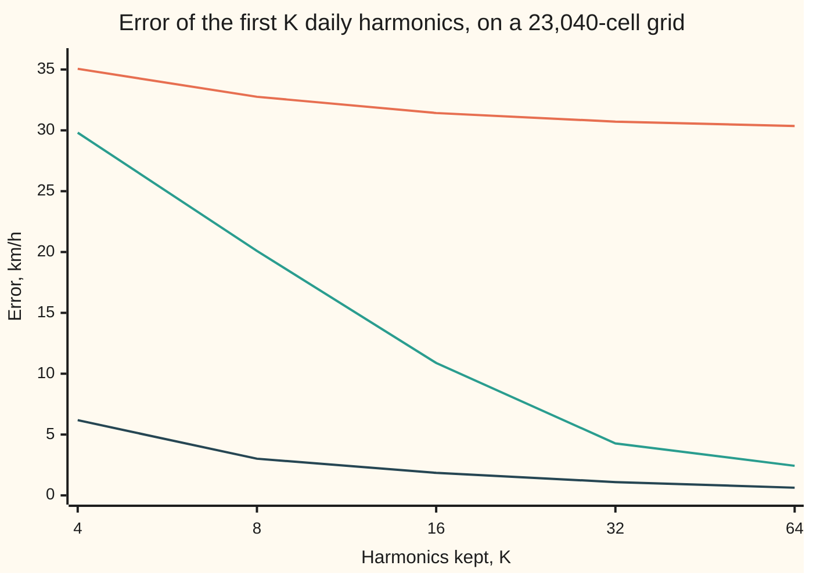

# Function spaces C and Lp: two ways to size a function, two different worlds

[Syllabus](../../../SYLLABUS.md) → [Functional analysis](../README.md) → [Normed and Banach Spaces](../README.md#s01) → Function spaces C and Lp

---

## General Overview

A sensor on a motorway logs the speed of the traffic passing it, every moment of the day. The road's free-flow speed is 100 km/h. What matters is the **shortfall**: how far below 100 km/h the traffic runs at each moment.

Two days, both illustrative:

- **Tuesday, a jam.** From 07:00 to 10:00 traffic crawls at 40 km/h, a shortfall of 60 km/h. The rest of the day runs free.
- **Thursday, a crash.** At 15:00 traffic falls to 10 km/h for six minutes, a shortfall of 90 km/h. The rest of the day runs free.

Which day was worse? At its worst moment, Thursday: 90 km/h short against 60. On average over the day, Tuesday: 7.5 km/h short against 0.375, twenty times more. Both answers are correct. They size the same records with two different rules.

Each rule is a **norm**: a size for a whole function, obeying the rules of a length (zero only for the zero record, doubling when the record doubles, and the triangle rule). The two rules do more than give different numbers. A sequence of records can settle down under one rule and not under the other. So the same records form two different spaces, and the right one depends on the question.

**Under the worst-moment norm the continuous records form a complete space, C[0, 24]; under an average norm they have holes, and filling them gives L^p: single moments belong in C, totals and averages in L^p.**

**What kind of fact this is:** theorems. Completeness of C under the worst moment is proved on [Normed and Banach spaces](01-normed-spaces-and-banach-spaces.md) and recalled here; its failure under every average is proved on this card in Why it works. "The completion of C under the p-norm is L^p" is proved here from two results proved on [Riesz-Fischer](../../10-Measure%20and%20integration/07-Sizes%20of%20Functions/05-completeness-of-lp.md). The Stone-Weierstrass theorem is stated with a named source; its polynomial case is proved on [Weierstrass and the minimax fit](../../16-Numerical%20analysis/04-Interpolation%20and%20Approximation/08-weierstrass-and-best-approximation.md). The traffic numbers are illustrative.

### The picture: two days, three sizes

```
                      0         30        60        90 km/h
Tuesday   average     ##                               7.5000
Tuesday   RMS         #######                         21.2132
Tuesday   worst       ####################            60.0000
Thursday  average                                      0.3750
Thursday  RMS         ##                               5.8095
Thursday  worst       ##############################  90.0000
```

One `#` is 3 km/h. RMS is the root mean square: square each shortfall, average, take the square root. Tuesday is worse on both averages; Thursday is worse at its worst moment.

---

## The formula

Notation first, in words. The time of day is $`t`$, in hours after midnight, from 0 to 24. A record is a function $`f`$: it gives the shortfall $`f(t)`$, in km/h, at each time $`t`$. $`C[0,24]`$ is the set of continuous records, the ones with no jumps. Two vertical bars around a record mean its size under a norm, and the small letter after them names the norm.

```math
\|f\|_\infty = \sup_{0 \le t \le 24} |f(t)|, \qquad \|f\|_p = \Big(\frac{1}{24}\int_0^{24} |f(t)|^p \, dt\Big)^{1/p} \quad (1 \le p < \infty)
```

**Read it aloud:** the worst-moment size is the largest shortfall at any moment; the p-size raises each shortfall to the power p, averages over the day, and takes the p-th root.

Here sup is the least upper bound: the largest value, when there is one. The factor 1/24 keeps every size in km/h. Without it these are the unweighted p-norms of [Lp spaces](../../10-Measure%20and%20integration/07-Sizes%20of%20Functions/01-lp-spaces.md), which [Normed and Banach spaces](01-normed-spaces-and-banach-spaces.md) also uses; they are larger by the fixed factor $`24^{1/p}`$. With p = 1 the p-size is the mean shortfall; with p = 2 it is the RMS.

The two kinds of size compare in one direction only:

```math
\|f\|_1 \;\le\; \|f\|_2 \;\le\; \|f\|_\infty, \qquad \text{but} \qquad \sup_{f \ne 0} \frac{\|f\|_\infty}{\|f\|_1} = \infty
```

**Read it aloud:** an average never exceeds the worst moment, but the worst moment can be any number of times the average.

That gap decides the two worlds:

```math
\big(C[0,24],\ \|\cdot\|_\infty\big) \text{ is complete}, \qquad \text{the completion of } \big(C[0,24],\ \|\cdot\|_p\big) \text{ is } L^p[0,24]
```

**Read it aloud:** under the worst moment, the continuous records already contain all their limits; under an average, their missing limits are exactly the other members of $`L^p`$.

A space is **complete** when every sequence whose terms crowd together (a **Cauchy** sequence) has a limit inside the space. A complete normed space is a **Banach space** ([Normed and Banach spaces](01-normed-spaces-and-banach-spaces.md)). The **completion** of a space is what you get by adding every missing limit. $`L^p[0,24]`$ is the space of records with finite p-size, where two records that differ only on a set of total length zero count as one member: they agree **almost everywhere**, or a.e.


On a single day, $`L^\infty \subset L^2 \subset L^1`$, because of the one-way comparison above. That is the reverse of the chain $`\ell^1 \subset \ell^2 \subset \ell^\infty`$ on [Sequence spaces](02-sequence-spaces-lp-and-c0.md). A day has finite length, so a record can lack a finite average only by being too tall. Each entry of an endless list weighs 1, so a list fails through its endless tail of small entries, and squaring shrinks small entries.

| Symbol | Plain meaning | In our example | Push it up and the answer… |
| --- | --- | --- | --- |
| $`t`$ | time of day, hours after midnight | 0 to 24 | — |
| $`f`$, $`f(t)`$ | a record: the shortfall below 100 km/h at time $`t`$; on Tuesday, the jam record | 60 km/h from 07:00 to 10:00, else 0 | every size grows |
| $`g`$, $`g_n`$, $`g_m`$ | any record, and members of a sequence of records, in the proofs | — | — |
| $`C[0,24]`$ | the continuous records: no jumps | the ramps $`f_w`$ | — |
| $`\lVert f \rVert_\infty`$ | worst-moment size: the largest shortfall | 60 km/h Tuesday, 90 Thursday | — |
| $`\lVert f \rVert_p`$, $`p`$ | p-size: p-th root of the day's average p-th power; p = 1 is the mean, p = 2 the RMS | 7.5 and 21.2132 km/h Tuesday | a larger p weighs the worst stretch more |
| $`L^p[0,24]`$, $`L^\infty`$ | records with finite p-size, or bounded, counted as one when equal a.e. | the jam record | — |
| $`N`$, $`x_i`$ | number of equal time bins; the average shortfall in bin i | 24 hourly bins; $`x_{16}`$ = 9 km/h Thursday | the worst bin climbs toward 90 |
| $`w`$, $`f_w`$ | onset width in hours; the jam with its start and end spread over $`w`$ hours | $`w`$ = 0.25 h | the average distance to the jam, $`2.5w`$, grows |
| $`\omega`$, $`k`$, $`K`$ | one cycle per day, $`2\pi/24`$ per hour; a harmonic's number; how many harmonics are kept | $`K`$ = 64 | the average error falls |
| $`a_0`$, $`a_k`$, $`b_k`$, $`S_K f`$ | Fourier coefficients of $`f`$, and its sum of the first $`K`$ harmonics | $`a_0`$ = 7.5 km/h for the jam | — |
| $`X`$, $`A`$ | in Stone-Weierstrass: a closed, bounded set, and a family of continuous functions on it | the day as a circle; the daily harmonics | — |

### When it holds

- **A closed, bounded time interval.** On the whole time line, $`\lVert f \rVert_1 \le \lVert f \rVert_\infty`$ fails: a 1 km/h shortfall forever has worst moment 1 and no finite average size.
- **The worst moment taken over every moment.** A worst moment found on a grid is only a lower estimate. A spike narrower than the grid spacing is invisible.
- **p at least 1.** Below 1 the p-size breaks the triangle rule, so it is not a norm ([Lp spaces](../../10-Measure%20and%20integration/07-Sizes%20of%20Functions/01-lp-spaces.md)).
- **p finite, for the completion.** Under $`\lVert \cdot \rVert_\infty`$ nothing is added: the completion of C is C itself. $`L^\infty`$ holds bounded records, such as the jam record, that stay at least 30 km/h from every continuous record.

---

## Why it works

### Step 0: one narrow spike separates the two sizes

Two records close at the worst moment are close at every moment, so a limit keeps the records' shape, including the lack of jumps.

An average cannot see a narrow spike. A spike of fixed height and shrinking width has a shrinking average and a fixed worst moment. So a sequence can settle on average while it builds a cliff at one instant, and the limit has a jump.

### Step 1: the finite rehearsal, a day cut into bins

Cut the day into $`N`$ equal bins and keep the average shortfall $`x_i`$ in each. The record is now a list of $`N`$ numbers, with the two sizes

```math
\|x\|_1 = \frac{1}{N}\sum_{i=1}^{N} |x_i|, \qquad \|x\|_\infty = \max_i |x_i|, \qquad \|x\|_1 \le \|x\|_\infty \le N\,\|x\|_1 .
```

**Read it aloud:** the average bin never beats the worst bin, and the worst bin is at most N times the average.

A one-bin spike reaches the factor $`N`$ exactly: the check prints 24, 96, 288 and 1440 for hourly, 15-minute, 5-minute and 1-minute bins. So for a fixed $`N`$ the two sizes agree on which lists are close, within the factor $`N`$, as [Equivalent norms](04-equivalence-of-norms-in-finite-dimensions.md) proves for every pair of norms on a finite list.

Now let $`N`$ grow. The factor has no ceiling, and for a record over every moment no factor works at all. That is the one thing that changes in infinite dimensions; [Infinite dimensions](05-why-infinite-dimensions-are-different.md) collects the others.

Binning also shows which question each size answers. Thursday's crash, seen through bin averages:

| Bins | Worst bin | Average |
| --- | --- | --- |
| 24 (hourly) | 9 km/h | 0.375 km/h |
| 96 (15 minutes) | 36 km/h | 0.375 km/h |
| 288 (5 minutes) | 90 km/h | 0.375 km/h |

Averaging over bins keeps the average exactly and flattens the worst moment, from 90 to 9 at hourly bins.

### Step 2: under the worst moment, C[0, 24] is complete

[Normed and Banach spaces](01-normed-spaces-and-banach-spaces.md) proves this in full; the argument in brief:

1. **Each moment settles.** At a fixed $`t`$, $`|g_n(t) - g_m(t)| \le \lVert g_n - g_m \rVert_\infty`$. So a worst-moment Cauchy sequence of records is Cauchy at each moment, and converges there, because the real line is complete. Call the limit $`g(t)`$.
2. **All moments settle together.** The same stage serves every $`t`$, so $`\lVert g_n - g \rVert_\infty \to 0`$: convergence in the worst-moment norm is uniform convergence.
3. **The limit has no jumps.** A uniform limit of continuous functions is continuous ([Uniform convergence](../../06-Calculus%20and%20analysis/06-Series/07-uniform-convergence.md)). So $`g`$ is in $`C[0,24]`$, and $`C[0,24]`$ with $`\lVert \cdot \rVert_\infty`$ is a Banach space.

### Step 3: under an average, C[0, 24] has holes

Build continuous versions of Tuesday's jam. In the record $`f_w`$, the shortfall climbs in a straight line from 0 at 07:00 to 60 km/h over $`w`$ hours, and falls back the same way to 0 at 10:00. Halve $`w`$ again and again: 1 hour, 30 minutes, 15 minutes, and so on.

Between $`f_w`$ and $`f_{w/2}`$ the gap is two triangles, one at each end. Each has base $`w`$ and height 30 km/h, so area $`15w`$ km. Divide the total by 24 hours:

```math
\|f_w - f_{w/2}\|_1 = \frac{2 \times 15w}{24} = 1.25\,w \ \text{km/h}, \qquad \|f_w - f_{w/2}\|_\infty = 30 \ \text{km/h}.
```

**Read it aloud:** halving the onset width moves the record by 1.25 w km/h on average, but always by 30 km/h at its worst moment.

The averages shrink like a halving series, so the ramps are Cauchy under $`\lVert \cdot \rVert_1`$. Their limit is the jam record $`f`$ itself, at distance $`2.5w`$ km/h. At the worst moment they are not Cauchy at all: each step moves 30 km/h, and each ramp sits 60 km/h from the jam just after 07:00.

No continuous record can be their average limit. If $`g`$ were, then $`g`$ and $`f`$ are limits of the same sequence, so $`\lVert g - f \rVert_1 = 0`$ and $`g = f`$ a.e. A continuous $`g`$ that is 60 almost everywhere just after 07:00 is 60 everywhere there, and likewise 0 just before. It would have to jump at 07:00. So the limit is missing from $`C[0,24]`$, and the space is not complete under $`\lVert \cdot \rVert_1`$, nor, by the same ramps, under any $`\lVert \cdot \rVert_p`$ with p finite.

[Normed and Banach spaces](01-normed-spaces-and-banach-spaces.md) runs this argument on a price jump, and [Riesz-Fischer](../../10-Measure%20and%20integration/07-Sizes%20of%20Functions/05-completeness-of-lp.md) on [0, 1]. [Modes of convergence](../../10-Measure%20and%20integration/05-Swapping%20Limits%20and%20Integrals/04-modes-of-convergence.md) compares uniform and in-mean convergence as modes; here they are two norms, so two spaces.

### Step 4: the holes are filled by exactly L^p

Two results from [Riesz-Fischer](../../10-Measure%20and%20integration/07-Sizes%20of%20Functions/05-completeness-of-lp.md) settle what the missing limits are:

1. **$`L^p[0,24]`$ is complete** for every finite p of 1 or more.
2. **Continuous records are dense in $`L^p[0,24]`$.** Every member of $`L^p`$ has continuous records as close to it as wanted, in p-size.

So every average-Cauchy sequence of continuous records has its limit in $`L^p`$ (fact 1), and every member of $`L^p`$ is such a limit (fact 2). That is the definition of a completion: $`L^p[0,24]`$ is $`C[0,24]`$ with its holes filled, and nothing more.

At $`p = \infty`$ the story reverses. The jam record is bounded, so it is in $`L^\infty`$. No continuous $`g`$ comes within 30 km/h of it. If $`g(7) \ge 30`$, then just before 07:00 continuity keeps $`g`$ near or above 30, where the jam record is 0. If $`g(7) \le 30`$, then just after 07:00 $`g`$ stays near or below 30, where the jam record is 60. Either way, for any small margin, the gap exceeds 30 km/h minus that margin on a stretch of positive length. So the worst-moment distance is at least 30 km/h, and $`C[0,24]`$ is not dense in $`L^\infty`$. The closing remarks of [Riesz-Fischer](../../10-Measure%20and%20integration/07-Sizes%20of%20Functions/05-completeness-of-lp.md) make the same argument for a step of height 1. It is closed there instead: by Step 2, worst-moment limits of continuous records stay continuous.

### Step 5: Stone-Weierstrass, and what "dense" means in each space

A set of records is **dense** in a space when every member of the space has members of the set as close as wanted, in that space's norm. Dense under the worst moment is a strong promise; dense under an average is a weak one.

The general tool for C is the **Stone-Weierstrass theorem**. Let $`X`$ be a closed, bounded set, and let $`A`$ be a set of continuous functions on $`X`$ such that:

- sums, multiples and products of members of $`A`$ are again in $`A`$;
- $`A`$ contains the constant functions;
- $`A`$ separates points: for two different points of $`X`$, some member of $`A`$ takes different values there.

Then every continuous function on $`X`$ is a worst-moment limit of members of $`A`$. The polynomials on an interval are one such $`A`$: that is the Weierstrass theorem, proved on [Weierstrass and the minimax fit](../../16-Numerical%20analysis/04-Interpolation%20and%20Approximation/08-weierstrass-and-best-approximation.md).

For a daily record, glue midnight to midnight, so the day becomes a circle. The **daily harmonics**, sums of $`\cos(k\omega t)`$ and $`\sin(k\omega t)`$ with $`\omega = 2\pi/24`$ per hour, form such an $`A`$. A product of two harmonics is a sum of harmonics, constants are harmonic number 0, and $`\cos(\omega t)`$ and $`\sin(\omega t)`$ together tell any two times of day apart. So any continuous record that ends the day at its starting value, as every record here does, is within any tolerance of a finite sum of harmonics, at every moment.

The jam record has jumps, so this promise does not reach it under the worst moment: Step 4 keeps every continuous record at least 30 km/h away. Under an average it does reach it. Since $`\lVert \cdot \rVert_p \le \lVert \cdot \rVert_\infty`$, worst-moment closeness gives average closeness. And continuous records that are 0 at midnight are dense in $`L^p`$: the trapezoids of [Riesz-Fischer](../../10-Measure%20and%20integration/07-Sizes%20of%20Functions/05-completeness-of-lp.md) are 0 at both ends. So harmonics are dense in $`L^p`$.

The check tests both promises with the Fourier partial sum $`S_K f`$, the sum of the first $`K`$ harmonics with the Fourier coefficients of $`f`$:

```math
S_K f(t) = a_0 + \sum_{k=1}^{K} \big(a_k \cos(k\omega t) + b_k \sin(k\omega t)\big), \qquad a_k = \frac{2}{24}\int_0^{24} f(t)\cos(k\omega t)\,dt .
```

**Read it aloud:** the day's mean, plus K waves, the k-th one fitting k cycles into the day, each weighted by how much the record looks like it; $`b_k`$ uses sine in place of cosine.



Orange: the jam record's worst-moment error, which stays above 30 km/h. Green: the worst-moment error for the ramp $`f_{0.5}`$, a continuous record, which falls toward 0. Dark blue: the jam record's average error, which falls toward 0.

For the continuous ramp the partial sums themselves converge at every moment. Harmonic number k of $`f_{0.5}`$ has size at most $`5760/(\pi^2 k^2)`$ km/h: the jam's $`120/(\pi k)`$ times the ramp's smoothing factor, at most $`48/(\pi k)`$. The Weierstrass M-test of [Uniform convergence](../../06-Calculus%20and%20analysis/06-Series/07-uniform-convergence.md) applies: when every term has a cap that holds at every moment, and the caps add to a finite total, the series converges uniformly. Its limit is $`f_{0.5}`$ itself, because the partial sums also converge to $`f_{0.5}`$ on average. So the error at $`K`$ is at most the tail of the caps, below $`5760/(\pi^2 K)`$: 9.1189 km/h at $`K`$ = 64, against a measured 2.4318.

### Step 6: choosing the space

The choice follows the question.

| Question about the day | What it needs | Space |
| --- | --- | --- |
| Was traffic ever below 30 km/h? | the worst moment | $`C[0,24]`$ with $`\lVert \cdot \rVert_\infty`$ |
| What was the speed at 08:30? | the value at one moment | $`C[0,24]`$ with $`\lVert \cdot \rVert_\infty`$ |
| How far behind free flow does a car driving all day fall? | the total, 24 h times the mean | $`L^1`$ |
| How large is a forecast's typical error? | RMS or mean | $`L^2`$ or $`L^1`$ |
| Data come as bin averages, with jumps | an average | $`L^p`$, p finite |

The reason is how much the answer can move. The value at one moment obeys $`|g(t)| \le \lVert g \rVert_\infty`$. Under an average there is no such bound: Step 1's spike is $`N`$ times its average at worst, for every $`N`$. In $`L^p`$ the value at one moment is not even defined, because records that differ at that one moment are one member. The day's mean obeys $`|\text{mean of } g| \le \lVert g \rVert_1 \le \lVert g \rVert_\infty`$, so it is safe in both spaces.

The rehearsal hides one thing: every list of $`N`$ bins, and every grid in the code, has a worst-to-average factor of at most $`N`$. Only the proofs of Steps 3 and 4 cover the record over every moment.

---

## Worked numbers, by hand

| Step | Arithmetic | Value |
| --- | --- | --- |
| Tuesday, worst moment | 100 − 40 | 60 km/h |
| Tuesday, mean | 60 × 3 h / 24 h | 7.5 km/h |
| Tuesday, RMS | square root of 3600 × 3 / 24 = 450 | 21.2132 km/h |
| Thursday, worst moment | 100 − 10 | 90 km/h |
| Thursday, mean | 90 × 0.1 h / 24 h | 0.375 km/h |
| Thursday, RMS | square root of 8100 × 0.1 / 24 = 33.75 | 5.8095 km/h |
| Thursday through hourly bins | 90 × 6 min / 60 min | worst bin 9 km/h |
| ramp $`f_{0.25}`$ to the jam, mean | 2 triangles of 60 × 0.25 / 2, divided by 24 | 0.625 km/h |
| ramp $`f_{0.25}`$ to $`f_{0.125}`$, mean and worst | 1.25 × 0.25; half of 60 | 0.3125 and 30 km/h |
| **which day was worse** | 7.5 / 0.375 and 90 / 60 | **Tuesday 20 times on average; Thursday 1.5 times at worst** |

The two sizes rank the days in opposite orders, and neither is wrong: one answers "how bad was the worst moment", the other "how much speed was lost over the day".

### What breaks if you drop a piece

| Mistake | Comes out at | What went wrong |
| --- | --- | --- |
| Size the day by totals, without the 1/24 | Tuesday 180 km, beside a worst moment of 60 km/h | the total is in km, so it cannot be set beside a speed |
| Judge Thursday's worst moment from hourly averages | 9 km/h, against 90 | averaging keeps the mean (0.375) and flattens the peak |
| Treat continuous records under the mean as complete | ramps Cauchy (step 0.078125 km/h at $`w`$ = 1/16 h), yet 60 km/h from their limit at worst | the limit jumps, so it is not in $`C[0,24]`$ |
| Fit the jam with harmonics and judge by the worst moment | 30.3599 km/h at $`K`$ = 64, while the mean error is 0.6311 | no continuous record gets within 30 km/h of a jump |

---

## Code, from first principles, and it actually runs

The code holds a truncation: the day as 23,040 cells of 3.75 seconds, and at most 64 harmonics. It sizes both days, bins the crash, measures the ramps, and measures the Fourier partial sums of the jam and of $`f_{0.5}`$. Four pairs of independent roads must agree: triangle geometry against grid sums for the ramps; grid RMS against Parseval's identity (the mean square of a record is $`a_0^2`$ plus half the sum of all $`a_k^2 + b_k^2`$), which uses the coefficients alone; the ramp's worst error against the M-test bound; the binned mean against the exact $`90 \times 0.1/24`$. The grid cannot see anything narrower than one cell, so the infinite case rests on the proofs.

### Python

```python
# Function spaces C and Lp -- the check behind the card.  Standard library only.
# One day of traffic on a 100 km/h road, as the shortfall below 100 km/h.
# Tuesday: a jam, 60 km/h short from 07:00 to 10:00.  Thursday: a crash,
# 90 km/h short from 15:00 to 15:06.  Sizes use the day as a probability
# (each hour weighs 1/24), so every size is in km/h.  Code holds a truncation:
# a grid of 23,040 cells (3.75 s each) and at most 64 daily harmonics.
from math import cos, sin, pi, sqrt

CELLS = 24 * 960                        # cell width 1/960 h
DT = 24 / CELLS
MID = [(i + 0.5) * DT for i in range(CELLS)]    # midpoints: for averages
NODE = [i * DT for i in range(CELLS + 1)]       # nodes: for the worst moment

def jam(t):                             # Tuesday, with sudden onset and clearing
    return 60.0 if 7 <= t < 10 else 0.0

def crash(t):
    return 90.0 if 15 <= t < 15.1 else 0.0

def ramp(w):                            # the jam with onset and clearing over w hours
    return lambda t: 60.0 * max(0.0, min(1.0, (t - 7) / w, (10 - t) / w))

def total(vals):                        # plain left-to-right sum, as in the Rust
    s = 0.0
    for v in vals:
        s += v
    return s

def avg_p(vals, p):                     # the p-norm, day weighted as a probability
    return (total([abs(v) ** p for v in vals]) / len(vals)) ** (1 / p)

def sizes(f):                           # average, RMS (root mean square), worst moment
    m = [f(t) for t in MID]
    return avg_p(m, 1), avg_p(m, 2), max(abs(f(t)) for t in NODE)

print("bars, the two days under three sizes, km/h")
jt, ct = sizes(jam), sizes(crash)
for name, s in (("jam", jt), ("crash", ct)):
    print(f"{name}: average {s[0]:.4f}  RMS {s[1]:.4f}  worst {s[2]:.4f}")
assert abs(jt[0] - 60 * 3 / 24) < 1e-9 and abs(ct[0] - 90 * 0.1 / 24) < 1e-9
assert abs(jt[1] - sqrt(3600 * 3 / 24)) < 1e-9 and abs(ct[1] - sqrt(8100 * 0.1 / 24)) < 1e-9
print(f"average ratio jam/crash {jt[0] / ct[0]:.4f}, worst ratio crash/jam {ct[2] / jt[2]:.4f}")
print(f"totals without the 1/24: jam {24 * jt[0]:.4f} km, crash {24 * ct[0]:.4f} km")

print("rehearsal: N bins, largest ratio worst/average is N (one-bin spike)")
for N in (24, 96, 288, 1440):
    spike = [90.0] + [0.0] * (N - 1)
    print(f"N {N}: worst/average {max(spike) / avg_p(spike, 1):.1f}")
    assert abs(max(spike) / avg_p(spike, 1) - N) < 1e-9
print("crash seen through bin averages")
for N in (24, 96, 288):
    per = CELLS // N
    m = [crash(t) for t in MID]
    bins = [total(m[i * per:(i + 1) * per]) / per for i in range(N)]
    print(f"N {N}: worst bin {max(bins):.4f}  average {avg_p(bins, 1):.4f}")
    assert abs(avg_p(bins, 1) - ct[0]) < 1e-9    # averaging keeps the average
assert abs(max(bins) - 90) < 1e-9

print("ramps f_w: distances, by geometry and by the grid")
for w in (1, 1 / 2, 1 / 4, 1 / 8, 1 / 16):
    f, h = ramp(w), ramp(w / 2)
    to_jam = avg_p([f(t) - jam(t) for t in MID], 1)
    step = avg_p([f(t) - h(t) for t in MID], 1)
    sup_step = max(abs(f(t) - h(t)) for t in NODE)
    sup_jam = max(abs(f(t) - jam(t)) for t in NODE)
    print(f"w {w:.4f} h: avg to jam {to_jam:.6f}  avg to next {step:.6f}"
          f"  worst to next {sup_step:.4f}  worst to jam {sup_jam:.4f}")
    assert abs(to_jam - 2.5 * w) < 1e-9 and abs(step - 1.25 * w) < 1e-9
    assert abs(sup_step - 30) < 1e-9 and abs(sup_jam - 60) < 1e-9

W = 2 * pi / 24                         # one cycle per day
def coeffs(w, K):                       # Fourier coefficients of the ramped jam (w = 0: jam)
    a0 = 60 * (3 - w) / 24
    lo, hi = 7 + w / 2, 10 - w / 2
    out = []
    for k in range(1, K + 1):
        s = 1.0 if w == 0 else sin(k * W * w / 2) / (k * W * w / 2)
        out.append((60 * (sin(k * W * hi) - sin(k * W * lo)) / (pi * k) * s,
                    60 * (cos(k * W * lo) - cos(k * W * hi)) / (pi * k) * s))
    return a0, out

def fourier_errors(f, w, energy, Ks):
    a0, ab = coeffs(w, max(Ks))
    sm, sn = [a0] * CELLS, [a0] * (CELLS + 1)
    rows, done, par = [], 0, energy - a0 * a0
    for K in Ks:
        for k in range(done + 1, K + 1):
            a, b = ab[k - 1]
            par -= (a * a + b * b) / 2  # Parseval: what the first K harmonics carry
            for i, t in enumerate(MID):
                sm[i] += a * cos(k * W * t) + b * sin(k * W * t)
            for i, t in enumerate(NODE):
                sn[i] += a * cos(k * W * t) + b * sin(k * W * t)
        done = K
        e = [f(t) - s for t, s in zip(MID, sm)]
        rows.append((K, avg_p(e, 1), avg_p(e, 2), sqrt(par),
                     max(abs(f(t) - s) for t, s in zip(NODE, sn))))
    return rows

Ks = (4, 8, 16, 32, 64)
print("daily harmonics S_K: average, RMS (grid), RMS (Parseval), worst")
jr = fourier_errors(jam, 0, 450.0, Ks)
rr = fourier_errors(ramp(0.5), 0.5, 3600 * (3 - 4 * 0.5 / 3) / 24, Ks)
for tag, rows in (("jam", jr), ("ramp 0.5", rr)):
    for K, l1, l2, l2p, sup in rows:
        print(f"{tag} K {K}: {l1:.4f}  {l2:.4f}  {l2p:.4f}  {sup:.4f}")
        assert abs(l2 - l2p) < 1e-3     # grid against Parseval
for K, l1, l2, l2p, sup in jr:
    assert sup > 29.5                   # a jump keeps every continuous curve 30 away
for K, l1, l2, l2p, sup in rr:
    assert sup <= 5760 / (pi * pi * K)  # M-test bound for the ramped jam
assert jr[-1][1] < jr[0][1] / 4 and rr[-1][4] < rr[0][4] / 8
print(f"M-test bound at K 64: {5760 / (pi * pi * 64):.4f}")
print("ALL CHECKS PASS")
```

**Ran 2026-11-15 on macOS, Python 3.14.10, standard library only. All checks passed. Output, pasted from the run:**

```
bars, the two days under three sizes, km/h
jam: average 7.5000  RMS 21.2132  worst 60.0000
crash: average 0.3750  RMS 5.8095  worst 90.0000
average ratio jam/crash 20.0000, worst ratio crash/jam 1.5000
totals without the 1/24: jam 180.0000 km, crash 9.0000 km
rehearsal: N bins, largest ratio worst/average is N (one-bin spike)
N 24: worst/average 24.0
N 96: worst/average 96.0
N 288: worst/average 288.0
N 1440: worst/average 1440.0
crash seen through bin averages
N 24: worst bin 9.0000  average 0.3750
N 96: worst bin 36.0000  average 0.3750
N 288: worst bin 90.0000  average 0.3750
ramps f_w: distances, by geometry and by the grid
w 1.0000 h: avg to jam 2.500000  avg to next 1.250000  worst to next 30.0000  worst to jam 60.0000
w 0.5000 h: avg to jam 1.250000  avg to next 0.625000  worst to next 30.0000  worst to jam 60.0000
w 0.2500 h: avg to jam 0.625000  avg to next 0.312500  worst to next 30.0000  worst to jam 60.0000
w 0.1250 h: avg to jam 0.312500  avg to next 0.156250  worst to next 30.0000  worst to jam 60.0000
w 0.0625 h: avg to jam 0.156250  avg to next 0.078125  worst to next 30.0000  worst to jam 60.0000
daily harmonics S_K: average, RMS (grid), RMS (Parseval), worst
jam K 4: 6.1820  8.9970  8.9970  35.0556
jam K 8: 3.0135  6.6125  6.6125  32.7577
jam K 16: 1.8491  4.7462  4.7462  31.4229
jam K 32: 1.0939  3.3709  3.3709  30.7181
jam K 64: 0.6311  2.3864  2.3864  30.3599
ramp 0.5 K 4: 6.1212  8.4598  8.4598  29.8084
ramp 0.5 K 8: 2.1247  4.0826  4.0826  20.0883
ramp 0.5 K 16: 1.2557  2.0150  2.0150  10.8848
ramp 0.5 K 32: 0.3807  0.6254  0.6254  4.2714
ramp 0.5 K 64: 0.1198  0.2515  0.2515  2.4318
M-test bound at K 64: 9.1189
ALL CHECKS PASS
```

### Rust

```rust
// Function spaces C and Lp -- the check behind the card.  Rust std only.
// One day of traffic on a 100 km/h road, as the shortfall below 100 km/h.
// Tuesday: a jam, 60 km/h short from 07:00 to 10:00.  Thursday: a crash,
// 90 km/h short from 15:00 to 15:06.  Sizes use the day as a probability
// (each hour weighs 1/24), so every size is in km/h.  Code holds a truncation:
// a grid of 23,040 cells (3.75 s each) and at most 64 daily harmonics.
use std::f64::consts::PI;

const CELLS: usize = 24 * 960; // cell width 1/960 h
const DT: f64 = 24.0 / CELLS as f64;

fn jam(t: f64) -> f64 { if (7.0..10.0).contains(&t) { 60.0 } else { 0.0 } }
fn crash(t: f64) -> f64 { if (15.0..15.1).contains(&t) { 90.0 } else { 0.0 } }
// the jam with onset and clearing over w hours
fn ramp(w: f64, t: f64) -> f64 { 60.0 * 0.0f64.max(1.0f64.min(((t - 7.0) / w).min((10.0 - t) / w))) }

fn total(v: &[f64]) -> f64 { let mut s = 0.0; for x in v { s += x; } s }
// the p-norm, day weighted as a probability
fn avg_p(v: &[f64], p: f64) -> f64 {
    let a: Vec<f64> = v.iter().map(|x| x.abs().powf(p)).collect();
    (total(&a) / v.len() as f64).powf(1.0 / p)
}
fn worst(f: &dyn Fn(f64) -> f64, node: &[f64]) -> f64 { node.iter().map(|&t| f(t).abs()).fold(0.0, f64::max) }
fn sizes(f: &dyn Fn(f64) -> f64, mid: &[f64], node: &[f64]) -> (f64, f64, f64) {
    let m: Vec<f64> = mid.iter().map(|&t| f(t)).collect();
    (avg_p(&m, 1.0), avg_p(&m, 2.0), worst(f, node))
}

const W: f64 = 2.0 * PI / 24.0; // one cycle per day
// Fourier coefficients of the ramped jam (w = 0: jam)
fn coeffs(w: f64, kmax: usize) -> (f64, Vec<(f64, f64)>) {
    let a0 = 60.0 * (3.0 - w) / 24.0;
    let (lo, hi) = (7.0 + w / 2.0, 10.0 - w / 2.0);
    let mut out = vec![];
    for k in 1..=kmax {
        let kf = k as f64;
        let s = if w == 0.0 { 1.0 } else { (kf * W * w / 2.0).sin() / (kf * W * w / 2.0) };
        out.push((60.0 * ((kf * W * hi).sin() - (kf * W * lo).sin()) / (PI * kf) * s,
                  60.0 * ((kf * W * lo).cos() - (kf * W * hi).cos()) / (PI * kf) * s));
    }
    (a0, out)
}

fn fourier_errors(f: &dyn Fn(f64) -> f64, w: f64, energy: f64, ks: &[usize], mid: &[f64], node: &[f64])
    -> Vec<(usize, f64, f64, f64, f64)> {
    let (a0, ab) = coeffs(w, *ks.last().unwrap());
    let (mut sm, mut sn) = (vec![a0; CELLS], vec![a0; CELLS + 1]);
    let (mut rows, mut done, mut par) = (vec![], 0, energy - a0 * a0);
    for &kk in ks {
        for k in done + 1..=kk {
            let (a, b) = ab[k - 1];
            par -= (a * a + b * b) / 2.0; // Parseval: what the first K harmonics carry
            let kf = k as f64;
            for (i, &t) in mid.iter().enumerate() { sm[i] += a * (kf * W * t).cos() + b * (kf * W * t).sin(); }
            for (i, &t) in node.iter().enumerate() { sn[i] += a * (kf * W * t).cos() + b * (kf * W * t).sin(); }
        }
        done = kk;
        let e: Vec<f64> = mid.iter().zip(&sm).map(|(&t, s)| f(t) - s).collect();
        let sup = node.iter().zip(&sn).map(|(&t, s)| (f(t) - s).abs()).fold(0.0, f64::max);
        rows.push((kk, avg_p(&e, 1.0), avg_p(&e, 2.0), par.sqrt(), sup));
    }
    rows
}

fn main() {
    let mid: Vec<f64> = (0..CELLS).map(|i| (i as f64 + 0.5) * DT).collect(); // for averages
    let node: Vec<f64> = (0..=CELLS).map(|i| i as f64 * DT).collect(); // for the worst moment

    println!("bars, the two days under three sizes, km/h");
    let (jt, ct) = (sizes(&jam, &mid, &node), sizes(&crash, &mid, &node));
    for (name, s) in [("jam", jt), ("crash", ct)] {
        println!("{}: average {:.4}  RMS {:.4}  worst {:.4}", name, s.0, s.1, s.2);
    }
    assert!((jt.0 - 60.0 * 3.0 / 24.0).abs() < 1e-9 && (ct.0 - 90.0 * 0.1 / 24.0).abs() < 1e-9);
    assert!((jt.1 - (3600.0f64 * 3.0 / 24.0).sqrt()).abs() < 1e-9 && (ct.1 - (8100.0f64 * 0.1 / 24.0).sqrt()).abs() < 1e-9);
    println!("average ratio jam/crash {:.4}, worst ratio crash/jam {:.4}", jt.0 / ct.0, ct.2 / jt.2);
    println!("totals without the 1/24: jam {:.4} km, crash {:.4} km", 24.0 * jt.0, 24.0 * ct.0);

    println!("rehearsal: N bins, largest ratio worst/average is N (one-bin spike)");
    for n in [24usize, 96, 288, 1440] {
        let mut spike = vec![0.0; n];
        spike[0] = 90.0;
        let r = 90.0 / avg_p(&spike, 1.0);
        println!("N {}: worst/average {:.1}", n, r);
        assert!((r - n as f64).abs() < 1e-9);
    }
    println!("crash seen through bin averages");
    let m: Vec<f64> = mid.iter().map(|&t| crash(t)).collect();
    let mut last = 0.0;
    for n in [24usize, 96, 288] {
        let per = CELLS / n;
        let bins: Vec<f64> = (0..n).map(|i| total(&m[i * per..(i + 1) * per]) / per as f64).collect();
        last = bins.iter().cloned().fold(0.0, f64::max);
        println!("N {}: worst bin {:.4}  average {:.4}", n, last, avg_p(&bins, 1.0));
        assert!((avg_p(&bins, 1.0) - ct.0).abs() < 1e-9); // averaging keeps the average
    }
    assert!((last - 90.0).abs() < 1e-9);

    println!("ramps f_w: distances, by geometry and by the grid");
    for w in [1.0, 0.5, 0.25, 0.125, 0.0625] {
        let d1: Vec<f64> = mid.iter().map(|&t| ramp(w, t) - jam(t)).collect();
        let d2: Vec<f64> = mid.iter().map(|&t| ramp(w, t) - ramp(w / 2.0, t)).collect();
        let (to_jam, step) = (avg_p(&d1, 1.0), avg_p(&d2, 1.0));
        let sup_step = worst(&|t| ramp(w, t) - ramp(w / 2.0, t), &node);
        let sup_jam = worst(&|t| ramp(w, t) - jam(t), &node);
        println!("w {:.4} h: avg to jam {:.6}  avg to next {:.6}  worst to next {:.4}  worst to jam {:.4}",
                 w, to_jam, step, sup_step, sup_jam);
        assert!((to_jam - 2.5 * w).abs() < 1e-9 && (step - 1.25 * w).abs() < 1e-9);
        assert!((sup_step - 30.0).abs() < 1e-9 && (sup_jam - 60.0).abs() < 1e-9);
    }

    let ks = [4usize, 8, 16, 32, 64];
    println!("daily harmonics S_K: average, RMS (grid), RMS (Parseval), worst");
    let jr = fourier_errors(&jam, 0.0, 450.0, &ks, &mid, &node);
    let rr = fourier_errors(&|t| ramp(0.5, t), 0.5, 3600.0 * (3.0 - 4.0 * 0.5 / 3.0) / 24.0, &ks, &mid, &node);
    for (tag, rows) in [("jam", &jr), ("ramp 0.5", &rr)] {
        for &(k, l1, l2, l2p, sup) in rows.iter() {
            println!("{} K {}: {:.4}  {:.4}  {:.4}  {:.4}", tag, k, l1, l2, l2p, sup);
            assert!((l2 - l2p).abs() < 1e-3); // grid against Parseval
        }
    }
    for r in &jr { assert!(r.4 > 29.5); } // a jump keeps every continuous curve 30 away
    for r in &rr { assert!(r.4 <= 5760.0 / (PI * PI * r.0 as f64)); } // M-test bound for the ramped jam
    assert!(jr[4].1 < jr[0].1 / 4.0 && rr[4].4 < rr[0].4 / 8.0);
    println!("M-test bound at K 64: {:.4}", 5760.0 / (PI * PI * 64.0));
    println!("ALL CHECKS PASS");
}
```

**Ran 2026-11-15 on macOS, rustc 1.98.1, no crates. All checks passed. Output, pasted from the run:**

```
bars, the two days under three sizes, km/h
jam: average 7.5000  RMS 21.2132  worst 60.0000
crash: average 0.3750  RMS 5.8095  worst 90.0000
average ratio jam/crash 20.0000, worst ratio crash/jam 1.5000
totals without the 1/24: jam 180.0000 km, crash 9.0000 km
rehearsal: N bins, largest ratio worst/average is N (one-bin spike)
N 24: worst/average 24.0
N 96: worst/average 96.0
N 288: worst/average 288.0
N 1440: worst/average 1440.0
crash seen through bin averages
N 24: worst bin 9.0000  average 0.3750
N 96: worst bin 36.0000  average 0.3750
N 288: worst bin 90.0000  average 0.3750
ramps f_w: distances, by geometry and by the grid
w 1.0000 h: avg to jam 2.500000  avg to next 1.250000  worst to next 30.0000  worst to jam 60.0000
w 0.5000 h: avg to jam 1.250000  avg to next 0.625000  worst to next 30.0000  worst to jam 60.0000
w 0.2500 h: avg to jam 0.625000  avg to next 0.312500  worst to next 30.0000  worst to jam 60.0000
w 0.1250 h: avg to jam 0.312500  avg to next 0.156250  worst to next 30.0000  worst to jam 60.0000
w 0.0625 h: avg to jam 0.156250  avg to next 0.078125  worst to next 30.0000  worst to jam 60.0000
daily harmonics S_K: average, RMS (grid), RMS (Parseval), worst
jam K 4: 6.1820  8.9970  8.9970  35.0556
jam K 8: 3.0135  6.6125  6.6125  32.7577
jam K 16: 1.8491  4.7462  4.7462  31.4229
jam K 32: 1.0939  3.3709  3.3709  30.7181
jam K 64: 0.6311  2.3864  2.3864  30.3599
ramp 0.5 K 4: 6.1212  8.4598  8.4598  29.8084
ramp 0.5 K 8: 2.1247  4.0826  4.0826  20.0883
ramp 0.5 K 16: 1.2557  2.0150  2.0150  10.8848
ramp 0.5 K 32: 0.3807  0.6254  0.6254  4.2714
ramp 0.5 K 64: 0.1198  0.2515  0.2515  2.4318
M-test bound at K 64: 9.1189
ALL CHECKS PASS
```

### Lean

Lean proves the card's size comparisons and its completeness facts for records over every moment of the day, and checks the worked numbers.

- Take p at least 1 and q at least p. Then $`\lVert f \rVert_p \le \lVert f \rVert_q \le \lVert f \rVert_\infty`$ for every continuous record $`f`$.
- Take any number $`M`$. Then some nonzero continuous record has a worst-moment size above $`M`$ times its mean.
- $`C[0,24]`$ with the worst-moment size is complete.
- Take p finite, at least 1. Then $`C[0,24]`$ under the p-size is not complete: some p-size Cauchy sequence of continuous records has no continuous limit.
- Take p finite, at least 1. Then different continuous records stay different in $`L^p[0,24]`$, which is complete and has the continuous records dense in it.
- So $`L^p[0,24]`$ is the completion of $`C[0,24]`$ under the p-size.
- The worked numbers check exactly: Tuesday's mean 7.5 and mean square 450; Thursday's 0.375 and 33.75; the ratios 20 and 1.5.
- So do the bin, spike and ramp numbers: worst bins 9 and 36, factor N for one-bin spikes, and ramp distances 0.625 and 0.3125.
- The totals without the 1/24 check too: 180 km Tuesday, 9 km Thursday.

The 23,040-cell grid, the Fourier partial sums and the M-test bound are left to the Python and Rust checks.

```lean
-- Function spaces C and Lp: continuous records on [0, 24] are complete under the worst-moment norm, have holes under every average p-norm, and those holes are filled by exactly Lp.
import Mathlib.MeasureTheory.Function.ContinuousMapDense
import Mathlib.MeasureTheory.Measure.Lebesgue.Basic
import Mathlib.Topology.ContinuousMap.Compact
import Mathlib.Tactic.NormNum

open MeasureTheory
open scoped ENNReal

/-- The day: times `t` from 0 to 24 hours. -/
abbrev Day : Type := Set.Icc (0 : ℝ) 24

/-- The day's averaging measure: length in hours divided by 24, so that every size is an
average over the day (each hour weighs 1/24). -/
noncomputable def dayMeasure : Measure Day :=
  (24⁻¹ : ℝ≥0∞) • (volume : Measure ℝ).comap ((↑) : Day → ℝ)

/-- The whole day has weight 1. -/
instance : IsProbabilityMeasure dayMeasure := by
  constructor
  rw [dayMeasure, Measure.smul_apply, smul_eq_mul,
    Measure.comap_apply _ Subtype.val_injective
      (fun s hs => (MeasurableEmbedding.subtype_coe measurableSet_Icc).measurableSet_image' hs)
      _ MeasurableSet.univ]
  rw [Set.image_univ, Subtype.range_coe_subtype, Set.ofPred_mem_eq, Real.volume_Icc]
  norm_num [ENNReal.inv_mul_cancel]

/-- Measures of sets of times: the hours they cover, divided by 24. -/
theorem dayMeasure_apply (s : Set Day) :
    dayMeasure s = 24⁻¹ * volume (((↑) : Day → ℝ) '' s) := by
  rw [dayMeasure, Measure.smul_apply, smul_eq_mul,
    (MeasurableEmbedding.subtype_coe measurableSet_Icc).comap_apply]

/-- Every nonempty open set of times has positive weight. -/
instance dayMeasure_isOpenPosMeasure : dayMeasure.IsOpenPosMeasure := by
  refine ⟨fun U hU ⟨x, hx⟩ => ?_⟩
  rw [dayMeasure_apply]
  obtain ⟨ε, hε, hball⟩ := Metric.isOpen_iff.mp hU x hx
  have hxc : (x : ℝ) ∈ closure (Set.Ioo (0 : ℝ) 24) := by
    rw [closure_Ioo (by norm_num)]; exact x.2
  obtain ⟨y, hy, hxy⟩ := Metric.mem_closure_iff.mp hxc ε hε
  have hsub : Set.Ioo (0 : ℝ) 24 ∩ Metric.ball (x : ℝ) ε ⊆ ((↑) : Day → ℝ) '' U := by
    intro z ⟨hz, hzb⟩
    refine ⟨⟨z, Set.Ioo_subset_Icc_self hz⟩, hball ?_, rfl⟩
    simpa [Metric.mem_ball, Subtype.dist_eq] using hzb
  have hpos : 0 < volume (Set.Ioo (0 : ℝ) 24 ∩ Metric.ball (x : ℝ) ε) :=
    (isOpen_Ioo.inter Metric.isOpen_ball).measure_pos _
      ⟨y, hy, by rw [Metric.mem_ball, dist_comm]; exact hxy⟩
  refine mul_ne_zero (by simp) ?_
  exact (hpos.trans_le (measure_mono hsub)).ne'

/-- A narrow spike: worst moment at least 1, average p-norm below any `ε > 0`. -/
theorem exists_spike (p : ℝ≥0∞) [Fact (1 ≤ p)] (hp : p ≠ ∞) {ε : ℝ} (hε : 0 < ε) :
    ∃ g : C(Day, ℝ), 1 ≤ ‖g‖ ∧ ‖ContinuousMap.toLp (E := ℝ) p dayMeasure ℝ g‖ < ε := by
  have hp1 : (1 : ℝ≥0∞) ≤ p := Fact.out
  set r := p.toReal with hr
  have hr1 : 1 ≤ r := by
    rw [hr]; exact ENNReal.toReal_mono hp hp1 |>.trans_eq' (by simp)
  have hr0 : 0 < r := by linarith
  set δ : ℝ := 24 * (ε / 2) ^ r with hδ
  have hδpos : 0 < δ := by positivity
  let g : C(Day, ℝ) := ⟨fun t => max 0 (1 - (t : ℝ) / δ), by fun_prop⟩
  refine ⟨g, ?_, ?_⟩
  · have h0 : (0 : ℝ) ∈ Set.Icc (0 : ℝ) 24 := ⟨le_rfl, by norm_num⟩
    have := ContinuousMap.norm_coe_le_norm g ⟨0, h0⟩
    simpa [g] using this
  · set S : Set Day := {t | (t : ℝ) < δ} with hS
    have hSm : MeasurableSet S := measurableSet_lt (by fun_prop) measurable_const
    have hbound : ∀ t, ‖g t‖ ≤ ‖S.indicator (fun _ => (1 : ℝ)) t‖ := by
      intro t
      by_cases ht : t ∈ S
      · rw [Set.indicator_of_mem ht]
        simp only [g, ContinuousMap.coe_mk, Real.norm_eq_abs, norm_one]
        have t0 : (0 : ℝ) ≤ t := t.2.1
        rw [abs_of_nonneg (le_max_left _ _)]
        refine max_le (by norm_num) ?_
        have : 0 ≤ (t : ℝ) / δ := div_nonneg t0 hδpos.le
        linarith
      · rw [Set.indicator_of_notMem ht]
        simp only [S, Set.mem_ofPred_eq, not_lt] at ht
        simp only [g, ContinuousMap.coe_mk, norm_zero, Real.norm_eq_abs]
        have : 1 ≤ (t : ℝ) / δ := by rw [le_div_iff₀ hδpos]; linarith
        rw [abs_of_nonneg (le_max_left _ _)]
        exact max_le le_rfl (by linarith)
    have hμS : dayMeasure S ≤ ENNReal.ofReal ((ε / 2) ^ r) := by
      rw [dayMeasure_apply]
      have himg : ((↑) : Day → ℝ) '' S ⊆ Set.Ico 0 δ := by
        rintro _ ⟨t, ht, rfl⟩; exact ⟨t.2.1, ht⟩
      calc 24⁻¹ * volume (((↑) : Day → ℝ) '' S) ≤ 24⁻¹ * volume (Set.Ico 0 δ) := by
            gcongr
        _ = ENNReal.ofReal ((ε / 2) ^ r) := by
            rw [Real.volume_Ico, sub_zero, hδ, ENNReal.ofReal_mul (by norm_num),
              ← mul_assoc]
            simp [ENNReal.inv_mul_cancel]
    have hE : eLpNorm (fun t => g t) p dayMeasure ≤ ENNReal.ofReal (ε / 2) := by
      calc eLpNorm (fun t => g t) p dayMeasure
          ≤ eLpNorm (S.indicator fun _ => (1 : ℝ)) p dayMeasure :=
            eLpNorm_mono g.continuous.aestronglyMeasurable hbound
        _ ≤ ‖(1 : ℝ)‖ₑ * dayMeasure S ^ (1 / r) :=
            eLpNorm_indicator_const_le _ p hSm.nullMeasurableSet
        _ ≤ 1 * ENNReal.ofReal ((ε / 2) ^ r) ^ (1 / r) := by
            simp only [enorm_one]
            gcongr
        _ = ENNReal.ofReal (ε / 2) := by
            rw [one_mul, ENNReal.ofReal_rpow_of_nonneg (by positivity) (by positivity), one_div,
              Real.rpow_rpow_inv (by positivity) hr0.ne']
    have hnorm : ‖ContinuousMap.toLp (E := ℝ) p dayMeasure ℝ g‖
        = (eLpNorm (fun t => g t) p dayMeasure).toReal := by
      rw [Lp.norm_def, eLpNorm_congr_ae (ContinuousMap.coeFn_toLp (E := ℝ) dayMeasure g)]
    rw [hnorm]
    calc (eLpNorm (fun t => g t) p dayMeasure).toReal ≤ (ENNReal.ofReal (ε / 2)).toReal :=
          ENNReal.toReal_mono ENNReal.ofReal_ne_top hE
      _ = ε / 2 := ENNReal.toReal_ofReal (by positivity)
      _ < ε := by linarith

/-- Under the worst-moment norm `‖f‖_∞ = sup |f(t)|` (Mathlib's norm on `C(Day, ℝ)`), the
continuous records form a complete space. Under the average p-norm, for `1 ≤ p < ∞`, they sit
inside `L^p[0, 24]` with no two records merged (`toLp` is injective, and its norm is the
p-norm); there they have holes: an average-Cauchy sequence of continuous records can miss its
limit, so `C[0, 24]` under the p-norm is not complete. `L^p[0, 24]` is complete and the
continuous records are dense in it, so `L^p[0, 24]` is the completion of `C[0, 24]` under the
p-norm. -/
theorem completion_of_continuous_records_is_lp (p : ℝ≥0∞) [Fact (1 ≤ p)] (hp : p ≠ ∞) :
    CompleteSpace C(Day, ℝ) ∧
    Function.Injective (ContinuousMap.toLp (E := ℝ) p dayMeasure ℝ) ∧
    ¬ IsComplete (Set.range (ContinuousMap.toLp (E := ℝ) p dayMeasure ℝ)) ∧
    DenseRange (ContinuousMap.toLp (E := ℝ) p dayMeasure ℝ) ∧
    CompleteSpace (Lp ℝ p dayMeasure) := by
  have hinj : Function.Injective (ContinuousMap.toLp (E := ℝ) p dayMeasure ℝ) :=
    ContinuousMap.toLp_injective dayMeasure
  refine ⟨inferInstance, hinj, ?_, ContinuousMap.toLp_denseRange ℝ dayMeasure ℝ hp,
    inferInstance⟩
  intro hc
  obtain ⟨K, hK⟩ := (ContinuousMap.toLp (E := ℝ) p dayMeasure ℝ).antilipschitz_of_injective_of_isClosed_range
    hinj hc.isClosed
  obtain ⟨g, hg1, hg⟩ := exists_spike p hp (ε := 1 / ((K : ℝ) + 1)) (by positivity)
  have h1 := hK.le_mul_dist g 0
  rw [map_zero, dist_zero_right, dist_zero_right] at h1
  have hK0 : (0 : ℝ) ≤ K := K.2
  have h2 : (K : ℝ) * ‖ContinuousMap.toLp (E := ℝ) p dayMeasure ℝ g‖ ≤ K * (1 / ((K : ℝ) + 1)) :=
    mul_le_mul_of_nonneg_left hg.le hK0
  have h3 : (K : ℝ) * (1 / ((K : ℝ) + 1)) < 1 := by
    rw [mul_one_div, div_lt_one (by positivity)]; linarith
  linarith

/-- An average never exceeds the worst moment, and a larger `p` never gives a smaller average:
for `1 ≤ p ≤ q`, `‖f‖_p ≤ ‖f‖_q ≤ ‖f‖_∞` for every continuous record `f` (with `p = 1, q = 2`
this is mean ≤ RMS ≤ worst moment). -/
theorem average_le_higher_average_le_worst_moment (p q : ℝ≥0∞) [Fact (1 ≤ p)] [Fact (1 ≤ q)]
    (hpq : p ≤ q) (f : C(Day, ℝ)) :
    ‖ContinuousMap.toLp (E := ℝ) p dayMeasure ℝ f‖ ≤
        ‖ContinuousMap.toLp (E := ℝ) q dayMeasure ℝ f‖ ∧
      ‖ContinuousMap.toLp (E := ℝ) q dayMeasure ℝ f‖ ≤ ‖f‖ := by
  constructor
  · rw [Lp.norm_def, Lp.norm_def,
      eLpNorm_congr_ae (ContinuousMap.coeFn_toLp (E := ℝ) (p := p) dayMeasure f),
      eLpNorm_congr_ae (ContinuousMap.coeFn_toLp (E := ℝ) (p := q) dayMeasure f)]
    exact ENNReal.toReal_mono (Lp.eLpNorm_ne_top (ContinuousMap.toLp (E := ℝ) q dayMeasure ℝ f) |>
      fun h => by rwa [eLpNorm_congr_ae (ContinuousMap.coeFn_toLp (E := ℝ) (p := q) dayMeasure f)] at h)
      (eLpNorm_le_eLpNorm_of_exponent_le hpq)
  · calc ‖ContinuousMap.toLp (E := ℝ) q dayMeasure ℝ f‖
        ≤ ‖(ContinuousMap.toLp (E := ℝ) q dayMeasure ℝ : C(Day, ℝ) →L[ℝ] Lp ℝ q dayMeasure)‖ * ‖f‖ :=
          ContinuousLinearMap.le_opNorm _ _
      _ ≤ 1 * ‖f‖ := by
          gcongr
          refine (ContinuousMap.toLp_norm_le dayMeasure).trans ?_
          simp [measureUnivNNReal]
      _ = ‖f‖ := one_mul _

/-- The comparison runs one way only: the worst moment can be any number of times the mean.
For every bound `M` there is a nonzero continuous record whose worst moment exceeds `M` times
its mean, so `sup_{f ≠ 0} ‖f‖_∞ / ‖f‖_1 = ∞`. -/
theorem worst_moment_not_bounded_by_mean (M : ℝ) :
    ∃ f : C(Day, ℝ), f ≠ 0 ∧ M * ‖ContinuousMap.toLp (E := ℝ) 1 dayMeasure ℝ f‖ < ‖f‖ := by
  obtain ⟨g, hg1, hg⟩ := exists_spike 1 ENNReal.one_ne_top (ε := 1 / (|M| + 1)) (by positivity)
  refine ⟨g, fun h => by rw [h, norm_zero] at hg1; norm_num at hg1, ?_⟩
  have hn := norm_nonneg (ContinuousMap.toLp (E := ℝ) 1 dayMeasure ℝ g)
  have hM : M ≤ |M| + 1 := by linarith [le_abs_self M]
  have h1 : M * ‖ContinuousMap.toLp (E := ℝ) 1 dayMeasure ℝ g‖
      ≤ (|M| + 1) * ‖ContinuousMap.toLp (E := ℝ) 1 dayMeasure ℝ g‖ :=
    mul_le_mul_of_nonneg_right hM hn
  have h2 : (|M| + 1) * ‖ContinuousMap.toLp (E := ℝ) 1 dayMeasure ℝ g‖ < (|M| + 1) * (1 / (|M| + 1)) :=
    mul_lt_mul_of_pos_left hg (by positivity)
  have h3 : (|M| + 1) * (1 / (|M| + 1)) = 1 := by field_simp
  linarith

-- Worked numbers, by hand (km/h, hours; 6 minutes = 1/10 h).
-- Tuesday's jam: mean 60 × 3 / 24 = 7.5, mean square 3600 × 3 / 24 = 450.
example : (60 * 3 / 24 : ℚ) = 15 / 2 := by norm_num
example : (3600 * 3 / 24 : ℚ) = 450 := by norm_num
-- Thursday's crash: mean 90 × 0.1 / 24 = 0.375, mean square 8100 × 0.1 / 24 = 33.75.
example : (90 * (1 / 10) / 24 : ℚ) = 3 / 8 := by norm_num
example : (8100 * (1 / 10) / 24 : ℚ) = 135 / 4 := by norm_num
-- Which day was worse: 7.5 / 0.375 = 20 on average; 90 / 60 = 1.5 at worst.
example : ((15 / 2) / (3 / 8) : ℚ) = 20 := by norm_num
example : (90 / 60 : ℚ) = 3 / 2 := by norm_num
-- Totals without the 1/24: 24 × 7.5 = 180 km and 24 × 0.375 = 9 km.
example : (24 * (15 / 2) : ℚ) = 180 ∧ (24 * (3 / 8) : ℚ) = 9 := by norm_num
-- Thursday through bins: 90 × 6 min over a 60-minute bin is 9; over a 15-minute bin, 36.
example : (90 * 6 / 60 : ℚ) = 9 ∧ (90 * 6 / 15 : ℚ) = 36 := by norm_num
-- A one-bin spike of 90 among N bins: worst / average = 90 / (90 / N) = N.
example : ∀ N ∈ ({24, 96, 288, 1440} : Finset ℚ), (90 : ℚ) / (90 / N) = N := by
  intro N hN
  simp only [Finset.mem_insert, Finset.mem_singleton] at hN
  rcases hN with rfl | rfl | rfl | rfl <;> norm_num
-- Ramp f_{1/4}: to the jam, 2 triangles of 60 × (1/4) / 2, over 24 h, is 0.625;
-- to f_{1/8}, 2 triangles of 30 × (1/4) / 2, over 24 h, is 1.25 × (1/4) = 0.3125.
example : (2 * (60 * (1 / 4) / 2) / 24 : ℚ) = 5 / 8 := by norm_num
example : (2 * (30 * (1 / 4) / 2) / 24 : ℚ) = 5 / 4 * (1 / 4) ∧ (5 / 4 * (1 / 4) : ℚ) = 5 / 16 := by
  norm_num

#print axioms dayMeasure_apply
#print axioms dayMeasure_isOpenPosMeasure
#print axioms exists_spike
#print axioms completion_of_continuous_records_is_lp
#print axioms average_le_higher_average_le_worst_moment
#print axioms worst_moment_not_bounded_by_mean
```

**Checked 2026-11-15 on macOS, Lean 4.36.0-rc2, Mathlib v4.36.0-rc2. Every proof is complete and uses only Lean's standard axioms. Output, pasted from the run:**

```
'dayMeasure_apply' depends on axioms: [propext, Classical.choice, Quot.sound]
'dayMeasure_isOpenPosMeasure' depends on axioms: [propext, Classical.choice, Quot.sound]
'exists_spike' depends on axioms: [propext, Classical.choice, Quot.sound]
'completion_of_continuous_records_is_lp' depends on axioms: [propext, Classical.choice, Quot.sound]
'average_le_higher_average_le_worst_moment' depends on axioms: [propext, Classical.choice, Quot.sound]
'worst_moment_not_bounded_by_mean' depends on axioms: [propext, Classical.choice, Quot.sound]
```

> [!TIP]
> **Try changing**
> - Guess first: how bad does Thursday's crash look through 30-minute bins? Change `for N in (24, 96, 288):` to `for N in (24, 48, 96, 288):`. Answer: a new line reads a worst bin of 18 km/h, with the average still 0.375.
> - Guess first: move the crash so it straddles 16:00. Change `15 <= t < 15.1` to `15.95 <= t < 16.05`. Answer: the worst bins fall to 4.5, 18 and 54 km/h, the averages stay 0.375, and the run stops at the assert that expects 90 at 5-minute bins: no bin now holds the whole crash.
> - Guess first: add a ramp of 1/32 h. Change `1 / 16):` to `1 / 16, 1 / 32):`. Answer: its mean distance to the next ramp halves again, to 0.039062 km/h; the worst stays 30 km/h.
> - Guess first: change `Ks = (4, 8, 16, 32, 64)` to `Ks = (4, 8, 16, 32, 64, 128)`. Does the jam's worst error finally drop below 30 km/h? Answer: no, it is 30.1801, while the jam's mean error falls to 0.3575 and the ramp's worst error to 1.1051.

---

## The usual mistake

> [!warning]
> **Saying "converges" without naming the norm.** The harmonics of Tuesday's jam converge to it in mean: the error is 0.6311 km/h at 64 harmonics. They do not converge at the worst moment: the error is still 30.3599 km/h and never goes below 30. Same functions; only the norm decides which statement is true.
>
> - **Reading a peak from averaged data.** Hourly averages put Thursday's crash at 9 km/h short; the true worst moment is 90.
> - **Asking an L^p record for its value at one moment.** Records that differ at one moment are one member of $`L^p`$, so "the speed at 08:30" has no answer there. No average bounds a single value either: with 1-minute bins, a one-bin spike is 1440 times its mean.
> - **Taking L^∞ as the completion of C.** Worst-moment limits of continuous records stay continuous, so C is closed in $`L^\infty`$. The jam record is in $`L^\infty`$ and stays at least 30 km/h from all of C.
> - **Comparing sizes in different units.** Without the 1/24, Tuesday's "mean" is 180 km, which looks three times its worst moment of 60 km/h.

---

## Where you meet it in real life

- **Traffic forecasting.** Speed forecasts are usually scored by mean absolute error and RMS error, both average sizes. A queue-warning system needs the worst moment instead: one missed queue is the failure that matters.
- **Choosing a forecast score.** Mean absolute error ($`L^1`$) against RMS error ($`L^2`$) is a choice of norm. RMS weighs large misses more, as a larger p always does.
- **Function approximation in chips.** A library routine for $`e^x`$ promises a worst error, a $`\lVert \cdot \rVert_\infty`$ bound, because any single input may be the one a user asks for ([Weierstrass and the minimax fit](../../16-Numerical%20analysis/04-Interpolation%20and%20Approximation/08-weierstrass-and-best-approximation.md)).
- **Signals with jumps.** Sampled audio and sensor data are bin averages with jumps. They live in $`L^2`$, where Fourier series converge in RMS, and not in C, where the worst-moment error at a jump never falls.

> **Say it back**
> The worst-moment size and an average size measure the same records but rank them differently: the jam is worse on average, the crash at its worst. On a list of N bins the two sizes agree within a factor N, and over every moment no factor works. Under the worst moment the continuous records are complete, because uniform limits keep continuity. Under an average, continuous ramps close in on a jump, so C has holes, and filling them gives exactly $`L^p`$. Pick C when single moments matter and $`L^p`$ when totals and averages matter.

---

## What this builds on

- [Normed and Banach spaces](01-normed-spaces-and-banach-spaces.md): the norm as a size rule, completeness, and the proof that C is complete under the worst moment.
- [Sequence spaces](02-sequence-spaces-lp-and-c0.md): the same p-sizes on infinite lists, the discrete version of this card's records.
- [Lp spaces](../../10-Measure%20and%20integration/07-Sizes%20of%20Functions/01-lp-spaces.md): the p-norm of a function, the essential supremum, and the a.e. rule that makes $`L^p`$ a space.
- [Riesz-Fischer](../../10-Measure%20and%20integration/07-Sizes%20of%20Functions/05-completeness-of-lp.md): $`L^p`$ is complete and continuous functions are dense in it, the two facts behind Step 4.
- [Uniform convergence](../../06-Calculus%20and%20analysis/06-Series/07-uniform-convergence.md): a uniform limit of continuous functions is continuous, the last move of Step 2, and the M-test.
- [Modes of convergence](../../10-Measure%20and%20integration/05-Swapping%20Limits%20and%20Integrals/04-modes-of-convergence.md): uniform, almost-everywhere and in-mean convergence compared, with the growing spike and the typewriter.
- [The distance menu](../../17-Topology/01-Metric%20Spaces/02-distances-on-vectors-and-functions.md): the worst-gap and average-gap distances between functions, and the tents that show they disagree.
- [Weierstrass and the minimax fit](../../16-Numerical%20analysis/04-Interpolation%20and%20Approximation/08-weierstrass-and-best-approximation.md): polynomials are dense in C, proved with Bernstein polynomials; Stone-Weierstrass generalizes it.

## Where this goes next

- [Equivalent norms](04-equivalence-of-norms-in-finite-dimensions.md): the next card, proving that on a finite list every pair of norms agrees within a fixed factor, as in Step 1.
- [Hahn-Banach](06-hahn-banach-theorem.md): bounded measurements, such as the day's mean, extended from part of a space to all of it.
- [Bounded operators](../03-Bounded%20Operators/01-bounded-operators-and-the-operator-norm.md): maps between these spaces, such as the binning average, and their size, which depends on the norms chosen.
- [Distributions](../04-Distributions%20and%20Sobolev%20Spaces/01-test-functions-and-distributions.md): the value at one moment, which no average can bound, becomes a proper measurement once only very smooth records are measured.

The question this card leaves open: in finitely many bins the worst moment and the average always agree within a factor N, so is every pair of norms on a finite list tied together like this?

---

## Sources

Verified 2026-11-15: every link below resolves to the publisher's page.

- Stone, Marshall H. "The Generalized Weierstrass Approximation Theorem." *Mathematics Magazine* 21, no. 4 (1948): 167–184, and no. 5 (1948): 237–254. [doi:10.2307/3029750](https://doi.org/10.2307/3029750), [doi:10.2307/3029337](https://doi.org/10.2307/3029337). The Stone-Weierstrass theorem, stated and proved in Step 5's general form.
- Brezis, Haim. *Functional Analysis, Sobolev Spaces and Partial Differential Equations*. Springer, 2011. [doi:10.1007/978-0-387-70914-7](https://doi.org/10.1007/978-0-387-70914-7). Chapter 4: $`L^p`$ as a Banach space and the density of continuous functions in it.
- Hodson, Timothy O. "Root-mean-square error (RMSE) or mean absolute error (MAE): when to use them or not." *Geoscientific Model Development* 15, no. 14 (2022): 5481–5487. [doi:10.5194/gmd-15-5481-2022](https://doi.org/10.5194/gmd-15-5481-2022). Choosing between the $`L^1`$ and $`L^2`$ error sizes for a forecast.
- Vlahogianni, Eleni I., Matthew G. Karlaftis, and John C. Golias. "Short-term traffic forecasting: Where we are and where we're going." *Transportation Research Part C* 43 (2014): 3–19. [doi:10.1016/j.trc.2014.01.005](https://doi.org/10.1016/j.trc.2014.01.005). A review of short-term traffic speed and flow forecasting, the setting of this card's example.
