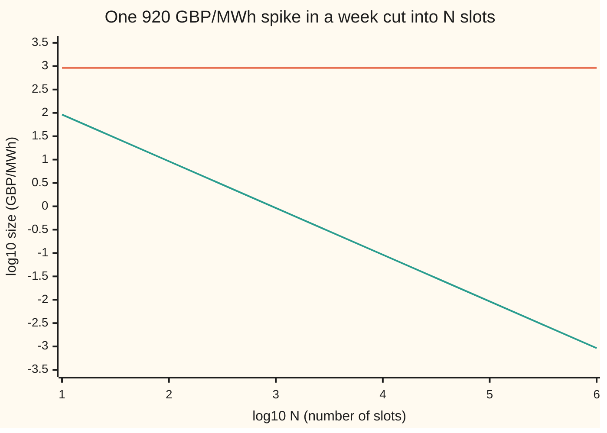

# Equivalent norms: in finitely many dimensions every length rule agrees

[Syllabus](../../../SYLLABUS.md) → [Functional analysis](../README.md) → [Normed and Banach Spaces](../README.md#s01) → Equivalent norms

---

## General Overview

A baker makes shortbread from 300 g of flour, 200 g of butter and 100 g of sugar. Today the scale was off: 6 g too much flour, 4 g too little butter, 3 g too much sugar. The batch's error is a list of three numbers, (6, −4, 3) grams.

How big is that error? Three people give three honest answers:

- **The check-weigher**, which weighs each ingredient as it goes in, adds up the grams off, whichever way each went: 6 + 4 + 3 = **13 g**.
- **The recipe writer** asks which ingredient missed by the largest share of its own amount. Sugar is 3 g off out of 100 g: **3%**.
- **The accountant** prices each ingredient's miss at its size, whichever way it went, at illustrative prices of 0.09 p a gram for flour, 0.8 p for butter and 0.1 p for sugar: 0.54 + 3.2 + 0.3 = **4.04 p** of mis-weighed ingredient.

Each answer is a **norm**: a size rule for lists that gives 0 only to the zero list, doubles when the list doubles, and never makes two errors added together bigger than their two sizes added ([Normed and Banach spaces](01-normed-spaces-and-banach-spaces.md)).

The three numbers differ, and so do their units. Yet they never disagree about limits. If a baker's errors shrink towards nothing under one rule, they shrink under every rule. The reason is a pin: the percent error is always between 1/6 and 1 percent per gram of total error. Each rule is pinned between two fixed multiples of each other rule.

The pin holds because the error list has three entries. Replace the three ingredients by a week of electricity prices cut into N time slots. The worst-hour rule and the average rule are still pinned, but the pin is N. It grows without limit as the slots get shorter, and for a price curve over continuous time there is no pin at all.

**On a list of finitely many numbers, any two norms sit within fixed multiples of each other, so they agree on which sequences converge and where; for functions the multiple can grow without limit, and the agreement fails.**

**What kind of fact this is:** a theorem, proved on this card in Why it works from the compactness of the unit sphere. The failure for functions is proved on this card with an explicit price spike.

### The picture: the batch's percent error, pinned by its gram error

```
percent rule on the batch (6, -4, 3) g, which is 13 g off in total
lower pin  13 g x 1/6 %/g  |#####                           2.1667 %
the batch                  |#######                         3.0000 %
upper pin  13 g x 1   %/g  |##############################  13.0000 %
```

The bars are to scale. The pins come from the 13 g total alone, without knowing which ingredient was off; the true 3% sits between them.

---

## The formula

Notation first, in words. The error is a list $`x = (x_1, x_2, x_3)`$: grams off on flour, butter and sugar. The small number written low says which ingredient. Here $`n = 3`$ is the number of entries. The recipe amounts are $`a_1, a_2, a_3 = 300, 200, 100`$ grams, and the prices are $`w_1, w_2, w_3 = 0.09, 0.8, 0.1`$ pence a gram. The bars $`\lvert x_i \rvert`$ mean the size of a number with its sign dropped.

The three rules, each a norm written $`\lVert x \rVert`$ with a label low on the right:

```math
\lVert x \rVert_g = \lvert x_1 \rvert + \lvert x_2 \rvert + \lvert x_3 \rvert, \qquad \lVert x \rVert_\% = \max_i \frac{100\,\lvert x_i \rvert}{a_i}, \qquad \lVert x \rVert_{\text{pence}} = w_1 \lvert x_1 \rvert + w_2 \lvert x_2 \rvert + w_3 \lvert x_3 \rvert
```

Two norms $`\lVert \cdot \rVert_a`$ and $`\lVert \cdot \rVert_b`$ on the same lists are **equivalent** when two fixed positive numbers $`c`$ and $`C`$ pin one to the other:

```math
c\,\lVert x \rVert_a \;\le\; \lVert x \rVert_b \;\le\; C\,\lVert x \rVert_a \qquad \text{for every list } x
```

**Read it aloud:** the second size of any list is at least c times its first size and at most C times its first size, with the same c and C for every list.

The theorem: **on lists of n real numbers, every two norms are equivalent.** For the baker, the best pins are:

| Pair | Best c | Best C | The batch |
| --- | ---: | ---: | ---: |
| percent per gram | 0.1667 | 1.0000 | 0.2308 |
| pence per gram | 0.0900 | 0.8000 | 0.3108 |
| pence per percent | 0.1000 | 1.9700 | 1.3467 |

The pin is what makes limits agree. Suppose a sequence of lists $`x_k`$ (the error on day k) heads for a list $`x`$ under rule a, so $`\lVert x_k - x \rVert_a`$ falls to 0. Then $`\lVert x_k - x \rVert_b \le C\,\lVert x_k - x \rVert_a`$ falls to 0 as well.

For functions, take a week of prices cut into N equal slots, with $`f_j`$ the price in slot j, in £/MWh above a flat level. The **sup norm** is the worst slot and the **average norm** is the mean size over the week:

```math
\lVert f \rVert_{avg} = \frac{1}{N}\sum_{j=1}^{N} \lvert f_j \rvert \;\le\; \lVert f \rVert_\infty = \max_j \lvert f_j \rvert \;\le\; N \lVert f \rVert_{avg}
```

**Read it aloud:** the average of the slot sizes is at most the worst slot, and the worst slot is at most N times the average. The right-hand pin N is the best possible, and it grows with N.

| Symbol | Plain meaning | In our example | Push it up and the answer… |
| --- | --- | --- | --- |
| $`x`$, $`x_i`$, $`y`$, $`n`$ | an error list, its entry for ingredient i, a second list, and the number of entries | (6, −4, 3) g; $`n = 3`$ | larger n loosens the pins |
| $`a_i`$, $`w_i`$ | recipe amount and price of ingredient i | 300, 200, 100 g; 0.09, 0.8, 0.1 p/g | a smaller amount makes its percent error count more |
| $`\lVert x \rVert`$, $`\lVert x \rVert_a`$, $`\lVert x \rVert_b`$, $`t`$ | a norm, and two norms being compared; t is a number scaling a list | any two of the three rules | — |
| $`\lVert x \rVert_g`$ | grams off in total | 13 g | — |
| $`\lVert x \rVert_\%`$ | worst miss as a percent of its ingredient | 3% (the sugar) | — |
| $`\lVert x \rVert_{\text{pence}}`$ | the miss priced at its size, ingredient by ingredient | 4.04 p | — |
| $`c`$, $`C`$, $`m_{\text{pence}}`$ | lower and upper pins; $`m_{\text{pence}}`$ is the pence rule's lower pin against grams | 1/6 and 1 %/g; $`m_{\text{pence}}`$ = 0.09 p/g | — |
| $`u_i`$, $`B`$ | one gram of ingredient i alone, and the largest size of the three | $`u_3 = (0, 0, 1)`$; B = 1 %/g | — |
| $`S`$, $`m`$, $`x^*`$, $`K`$ | the **unit sphere** (all lists 1 g off in total), the smallest size on it, the list that gives it, and the walk's total grams in the code | m = 1/6 %/g at $`x^* = (3, 2, 1)/6`$ g; K = 60 g | — |
| $`x_k`$, $`k`$ | a sequence of lists and its counter | errors on day k | — |
| $`f`$, $`f_j`$, $`j`$, $`N`$ | a price list over a week, its slot j, the slot's number, the number of slots | one spike of 920 £/MWh; N = 168 hourly slots | the spike's average shrinks like 920/N |
| $`\lVert f \rVert_\infty`$, $`\lVert f \rVert_{avg}`$ | worst slot, and mean slot size | 920 and 5.4762 £/MWh at N = 168 | — |

### When it holds

- **Finitely many entries.** The pin between sup and average is N. With no last slot, as for a price curve over continuous time, no pin exists.
- **A true norm, zero only for the zero list.** Price sugar at 0 p and the error (0, 0, 3) g costs 0.0000 p while it is 3% off. The lower pin fails: no c > 0 works.
- **Real numbers underneath, with no gaps.** The proof uses compactness, which needs the real line complete. Allow only fractions, and $`\lvert x_1 + \sqrt{2}\,x_2 \rvert`$ is zero only at (0, 0), so it is a norm on pairs of fractions. It is not equivalent to the grams rule: at (−239, 169) it gives 0.002092 while grams gives 408, a ratio of 0.0000051, and the ratio keeps falling along the fractions near −√2.
- **Pins depend on the pair and on n.** Equivalence gives some c and C, never one universal pair. The proof's pins are honest but not always the best.

---

## Why it works

### Step 0: compare one norm on the sphere of another

A norm scales: $`\lVert t x \rVert = \lvert t \rvert \lVert x \rVert`$. So the ratio of two norms depends only on the direction of a list, not its size. It is enough to study one norm on the unit sphere of the other: every list exactly 1 g off in total.

On three entries that sphere is a closed, bounded set, so it is **compact**: every sequence on it has a subsequence that converges to a point of it. A continuous size on a compact set takes a smallest and a largest value. The smallest value is the lower pin, and it is not zero, because no list on the sphere is the zero list.

Grams is the reference norm here. The distance menu already pins grams, straight-line and worst-case distances to each other with the factor n ([The distance menu](../../17-Topology/01-Metric%20Spaces/02-distances-on-vectors-and-functions.md)). The steps below prove it for every norm.

### Step 1: the upper pin is the triangle rule

Let $`\lVert \cdot \rVert_b`$ be any norm on lists of three numbers. A list is a sum of single-ingredient lists: $`x = x_1 u_1 + x_2 u_2 + x_3 u_3`$, where $`u_1 = (1, 0, 0)`$ is one gram of flour alone. The triangle rule and scaling give

```math
\lVert x \rVert_b \le \lvert x_1 \rvert \lVert u_1 \rVert_b + \lvert x_2 \rvert \lVert u_2 \rVert_b + \lvert x_3 \rvert \lVert u_3 \rVert_b \le B \lVert x \rVert_g, \qquad B = \max_i \lVert u_i \rVert_b
```

For the percent rule, one gram of each ingredient is 1/3%, 1/2% and 1%. So B = 1 %/g, and the batch's 13 g gives an upper pin of 13%.

### Step 2: the norm is continuous

The triangle rule, used twice, gives $`\lvert \lVert x \rVert_b - \lVert y \rVert_b \rvert \le \lVert x - y \rVert_b`$. With Step 1:

```math
\lvert \lVert x \rVert_b - \lVert y \rVert_b \rvert \le B \lVert x - y \rVert_g
```

Lists close in grams have close sizes, so $`\lVert \cdot \rVert_b`$ is continuous. The code tests this from the batch to all 14,402 sphere points. The worst ratio is 1.0000, exactly B.

### Step 3: the sphere is compact, so the lower pin exists

Take the unit sphere $`S`$: every list with $`\lVert x \rVert_g = 1`$.

1. $`S`$ is closed and bounded in three dimensions. By Heine–Borel, proved on [Compactness three ways](../../17-Topology/01-Metric%20Spaces/06-compactness-in-metric-spaces.md), it is compact.
2. $`\lVert \cdot \rVert_b`$ is continuous on $`S`$ (Step 2). By the [Extreme value theorem](../../06-Calculus%20and%20analysis/01-Limits%20and%20Continuity/07-extreme-value-theorem.md), whose argument works on any compact set (a sequence heading for the lowest value has a convergent subsequence), the norm takes a smallest value m at some list $`x^*`$ on $`S`$.
3. $`x^*`$ is not the zero list, since its grams add to 1. A norm is zero only at the zero list, so $`m = \lVert x^* \rVert_b > 0`$.
4. Any nonzero list is its size times a list on $`S`$: $`x = \lVert x \rVert_g \, (x / \lVert x \rVert_g)`$. So $`\lVert x \rVert_b \ge m \lVert x \rVert_g`$.

Together with Step 1:

```math
m \lVert x \rVert_g \;\le\; \lVert x \rVert_b \;\le\; B \lVert x \rVert_g
```

For the percent rule, the smallest value sits where all three ingredients miss by the same share, in proportion to the recipe: $`x^* = (3, 2, 1)/6`$ g, each 1/6% off. So m = 1/6 %/g. The batch's 13 g pins its percent error between 2.1667% and 13%.

Nothing in Steps 1 to 3 depends on there being three entries. With n entries, use the n single-entry lists $`u_1, \dots, u_n`$; the sphere is still closed and bounded, now in n dimensions.

### Step 4: any two norms, through grams

Each norm is pinned to grams, so any two are pinned to each other. For percent against pence, with $`m_{\text{pence}} = 0.09`$ p/g the pence rule's lower pin:

```math
\lVert x \rVert_\% \le B \lVert x \rVert_g \le \frac{B}{m_{\text{pence}}} \lVert x \rVert_{\text{pence}} = 11.1111 \, \lVert x \rVert_{\text{pence}}
```

That pin is valid but loose. The best pin is 10 %/p, reached by an error in sugar alone: the code's walk finds the smallest pence per percent at (0, 0, 60) g. Passing through grams loses a little; the proof only promises some pin.

### Step 5: same limits, same Cauchy sequences, every space complete

Because each norm is within a fixed multiple of every other:

1. **Same limits.** $`\lVert x_k - x \rVert_a \to 0`$ forces $`\lVert x_k - x \rVert_b \to 0`$ (the formula section).
2. **Same Cauchy sequences.** A sequence whose terms bunch together under one norm bunches under every norm, by the same pin.
3. **Every norm is complete.** Lists of real numbers are complete in grams, one entry at a time ([Complete space](../../17-Topology/01-Metric%20Spaces/05-completeness-and-completion.md)). So they are complete in every norm.

Any space of dimension n becomes lists of n numbers once a basis is chosen ([Basis and dimension](../../03-Algebra/03-Vectors/05-basis-and-dimension.md)). So every normed space of finite dimension is complete, and every finite-dimensional subspace of a normed space is closed. Even inside a space of functions, the price curves built from three fixed shapes form such a subspace, and sup and average agree there.

### Step 6: for functions the pin runs away

Return to the week of prices in N slots. A price list with worst slot 1 has some slot of size 1, so its average is at least 1/N. A single spike gives exactly 1/N. So on the sup norm's unit sphere, the smallest average is m = 1/N.

The code confirms m = 1/7 for N = 7 by trying all 75,938 lists with entries from −1 to 1 in halves and worst slot 1.

Put one spike of 920 £/MWh above a flat price in a single slot (illustrative):

| Slots N | Slot length | Sup norm | Average norm | Sup / average |
| ---: | ---: | ---: | ---: | ---: |
| 7 | 24 h | 920 | 131.4285714 | 7 |
| 168 | 1 h | 920 | 5.4761905 | 168 |
| 1,008 | 10 min | 920 | 0.9126984 | 1,008 |
| 10,080 | 1 min | 920 | 0.0912698 | 10,080 |
| 604,800 | 1 s | 920 | 0.0015212 | 604,800 |



The chart uses N = 10, 100, ..., 1,000,000 slots, so its points sit evenly in log10 N. The flat line is the sup norm: 920 at every N. The falling line is the average norm, 920/N, dropping one unit of log10 for every tenfold rise in N. The gap between them is log10 N, and nothing closes it.

Read as functions of time, the spikes of shorter and shorter width head for the flat price under the average norm and stay 920 away under the sup norm. One sequence converges under one norm and not under the other. The same happens for continuous price curves, with a thin tent in place of a step ([The distance menu](../../17-Topology/01-Metric%20Spaces/02-distances-on-vectors-and-functions.md) shows the tent).

What broke is Step 3. The sup norm's unit sphere of functions is not compact, and the average norm has no smallest value on it: the spikes push the average towards 0, and no function with worst slot 1 has average 0. [Infinite dimensions](05-why-infinite-dimensions-are-different.md) proves that this always happens once the dimension is infinite.

---

## Worked numbers, by hand

The batch error is (6, −4, 3) g, with amounts (300, 200, 100) g and prices (0.09, 0.8, 0.1) p/g.

| Step | Arithmetic | Value |
| --- | --- | --- |
| grams off | 6 + 4 + 3 | 13 g |
| percent, each | 6/300, 4/200, 3/100 | 2%, 2%, 3% |
| percent rule | the largest | 3% |
| pence rule | 6 × 0.09 + 4 × 0.8 + 3 × 0.1 | 4.04 p |
| upper pin B | one gram each: 100/300, 100/200, 100/100 % | 1 %/g |
| lower pin m | error in proportion (3, 2, 1)/6 g: 100 × 0.5/300 | 1/6 %/g |
| pinned range | 13/6 to 13 × 1 | 2.1667% to 13% |
| **the batch** | **3% sits inside** | **2.1667 ≤ 3 ≤ 13** |

The pins turn the check-weigher's total into a promise about the recipe: 13 g off in total, counted by size, means somewhere between 2.1667% and 13% off on the worst ingredient.

### What breaks if you drop a piece

| Mistake | Comes out at | What went wrong |
| --- | --- | --- |
| Price sugar at 0 p | (0, 0, 3) g costs 0.0000 p but is 3% off | not a norm; no lower pin |
| Weigh the finished batch once instead | (6, −4, 3) g nets 5 g and −2.36 p; (10, −10, 0) g nets 0 g, yet the butter is 5% off; (30, −30, 0) g nets 0 g at 15% | overs and shorts cancel: a net reading is not a norm, and no pin turns it into a percent |
| Read "equivalent" as "equal" | 13 g, 3% and 4.04 p for one batch | equivalence pins ratios, not values |
| Take the proof's chain as the best pin | 11.1111 %/p against the best 10 %/p | passing through grams loses |
| Carry the finite pin to minute prices | N = 10,080: sup 920, average 0.0912698 | the pin is N and grows without limit |

---

## Code, from first principles, and it actually runs

The code prints every number on the card and takes three roads to the pins. Road 1 reads the best pins off the corners of each norm's unit ball, as closed formulas. Road 2 walks all 14,402 whole-gram errors totalling K = 60 g, a full grid on the grams sphere, and finds the smallest and largest ratios directly. Road 3 checks the function side twice: the spike's average by summing all N slots against 920/N, and the smallest average on the sup sphere for N = 7 by brute force over 78,125 lists. The chart points, also summed slot by slot, must fall by exactly one unit of log10 per tenfold. The fraction counterexample is checked against the identity $`(x_1 + \sqrt{2}\,x_2)(x_1 - \sqrt{2}\,x_2) = x_1^2 - 2x_2^2 = -1`$, true at each of its three points.

### Python

```python
# Equivalent norms -- the check behind the card.  Standard library only.
# A shortbread batch: flour, butter, sugar.  Its weighing error is a list of
# three numbers in grams, sized three ways.  Then a week of electricity prices
# cut into N slots, where the sup and average norms stop agreeing as N grows.
from math import log10

AMT = (300.0, 200.0, 100.0)          # recipe amounts, grams
PRICE = (0.09, 0.8, 0.1)             # pence per gram, illustrative
NAMES = ("flour", "butter", "sugar")

def grams(x): return sum(abs(v) for v in x)                            # total grams off
def pct(x): return max(100 * abs(v) / a for v, a in zip(x, AMT))      # worst miss, %
def pence(x, price=PRICE): return sum(w * abs(v) for w, v in zip(price, x))  # cost of the miss

# ---- the batch ----
e = (6, -4, 3)
print(f"batch error {e} g: grams {grams(e):.0f} g, percent {pct(e):.4f} %, pence {pence(e):.4f} p")
assert grams(e) == 13 and abs(pct(e) - 3) < 1e-12
assert abs(pence(e) - (0.54 + 3.2 + 0.3)) < 1e-12
for name, a, v in zip(NAMES, AMT, e):
    print(f"  {name}: {v:+d} g of {a:.0f} g = {100 * abs(v) / a:.4f} %")

# ---- road 1: best constants from the corners of each unit ball ----
closed = {
    "percent per gram": (100 / sum(AMT), max(100 / a for a in AMT)),
    "pence per gram": (min(PRICE), max(PRICE)),
    "pence per percent": (min(w * a / 100 for w, a in zip(PRICE, AMT)),
                          sum(w * a / 100 for w, a in zip(PRICE, AMT))),
}

# ---- road 2: walk the whole grams-sphere |x1| + |x2| + |x3| = K ----
K = 60
sphere = []                          # every whole-gram error of total K, in a fixed order
for i in range(-K, K + 1):
    for j in range(-(K - abs(i)), K - abs(i) + 1):
        r = K - abs(i) - abs(j)
        sphere += [(i, j, r), (i, j, -r)] if r > 0 else [(i, j, 0)]
print(f"grams-sphere points with K = {K}: {len(sphere)} (formula 4K^2 + 2 = {4 * K * K + 2})")
assert len(sphere) == 4 * K * K + 2
ratio = {
    "percent per gram": lambda x: pct(x) / grams(x),
    "pence per gram": lambda x: pence(x) / grams(x),
    "pence per percent": lambda x: pence(x) / pct(x),
}
for key, f in ratio.items():
    vals = [f(x) for x in sphere]
    lo, hi = min(vals), max(vals)
    c, C = closed[key]
    print(f"{key}: corners c = {c:.4f}, C = {C:.4f}; sphere walk min {lo:.4f}, max {hi:.4f}; batch {f(e):.4f}")
    assert abs(lo - c) < 1e-12 and abs(hi - C) < 1e-12 and c <= f(e) <= C
    at = lambda x: tuple(abs(v) for v in x)
    print(f"  sizes of the extreme errors: min at {at(min(sphere, key=f))}, max at {at(max(sphere, key=f))}")

# ---- the proof's constants, with grams as the reference norm ----
B = max(pct((1 if k == i else 0 for k in range(3))) for i in range(3))
m = min(pct(x) for x in sphere) / K
print(f"proof, percent against grams: B = max over one gram of each = {B:.4f}, m = min on sphere = {m:.4f}")
xs = tuple(a / sum(AMT) for a in AMT)                   # the error in proportion to the recipe
print(f"  one gram each: {', '.join(f'{100 / a:.4f}' for a in AMT)} %; x* = ({', '.join(f'{v:.4f}' for v in xs)}) g, "
      f"each {', '.join(f'{100 * v / a:.4f}' for v, a in zip(xs, AMT))} % off")
print(f"  batch sandwich: {m * grams(e):.4f} <= {pct(e):.4f} <= {B * grams(e):.4f}")
mp = min(pence(x) for x in sphere) / K
print(f"  chain percent <= (B / m_pence) pence: constant {B / mp:.4f}, best {1 / closed['pence per percent'][0]:.4f}")
assert m * grams(e) <= pct(e) <= B * grams(e) and B / mp >= 1 / closed["pence per percent"][0]

# ---- continuity of the percent norm: |pct(x) - pct(y)| <= B |x - y|_1 ----
worst = max(abs(pct(x) - pct(y)) / grams(tuple(a - b for a, b in zip(x, y)))
            for x in [(6, -4, 3)] for y in sphere)
print(f"continuity: worst |pct(e) - pct(y)| / grams(e - y) over the sphere = {worst:.4f} <= B")
assert worst <= B + 1e-12

# ---- what breaks: a free ingredient ----
free = pence((0, 0, 3), (0.09, 0.8, 0.0))
print(f"sugar priced 0: error (0, 0, 3) costs {free:.4f} p, yet is {pct((0, 0, 3)):.4f} % off")
assert free == 0 and pct((0, 0, 3)) > 0

# ---- what breaks: one net reading of the batch.  Overs and shorts cancel, so it is not a norm ----
for x in ((6, -4, 3), (10, -10, 0), (30, -30, 0)):
    print(f"net reading {x}: {sum(x)} g net, {sum(w * v for w, v in zip(PRICE, x)):.4f} p net, yet {pct(x):.4f} % off")

# ---- what breaks: fractions only.  |p + q sqrt2| is zero only at (0, 0) when p, q are fractions ----
for p, q in ((-7, 5), (-41, 29), (-239, 169)):
    r2 = abs(p + q * 2 ** 0.5)
    print(f"fractions ({p}, {q}): |p + q sqrt2| = {r2:.6f}, grams {abs(p) + abs(q)}, ratio {r2 / (abs(p) + abs(q)):.7f}")
    assert abs(r2 - 1 / abs(p - q * 2 ** 0.5)) < 1e-9          # (p + q sqrt2)(p - q sqrt2) = p^2 - 2q^2 = -1

# ---- functions: a week cut into N slots, a single-slot price spike ----
SPIKE = 920.0                         # £/MWh above a flat 80, illustrative
print("week of prices, one-slot spike of 920 £/MWh: sup norm vs time-average norm")
for N in (7, 168, 1008, 10080, 604800):
    f = [0.0] * N; f[N // 2] = SPIKE
    sup, avg = max(abs(v) for v in f), sum(abs(v) for v in f) / N
    print(f"  N {N:6d}: slot {168 / N:.6f} h, sup {sup:.1f}, average {avg:.7f}, sup/average {sup / avg:.1f}, "
          f"log10 average {log10(avg):.3f}")
    assert abs(avg - SPIKE / N) < 1e-9 and abs(sup / avg - N) < 1e-6
pts = []
for N in (10, 100, 1000, 10000, 100000, 1000000):    # chart points, evenly spaced in log10 N
    f = [0.0] * N; f[N // 2] = SPIKE
    pts.append(log10(sum(abs(v) for v in f) / N))
print(f"chart, N = 10^1 to 10^6 slots: log10 sup {log10(SPIKE):.3f}; log10 average " + ", ".join(f"{v:.3f}" for v in pts))
assert all(abs(a - b - 1) < 1e-12 for a, b in zip(pts, pts[1:]))   # one unit of log10 per tenfold

# ---- brute force for N = 7: min average on the sup-sphere is 1/N ----
levels = (-1.0, -0.5, 0.0, 0.5, 1.0)
best, count = 2.0, 0
for code in range(5 ** 7):
    v, c = [], code
    for _ in range(7):
        v.append(levels[c % 5]); c //= 5
    if max(abs(t) for t in v) == 1.0:
        count += 1; best = min(best, sum(abs(t) for t in v) / 7)
print(f"N = 7 brute force: {5 ** 7} lists tried, {count} with sup 1, smallest average {best:.6f} (1/7 = {1 / 7:.6f})")
assert abs(best - 1 / 7) < 1e-12
print("ALL CHECKS PASS")
```

**Ran 2026-11-15 on macOS, Python 3.14.10, standard library only. All checks passed. Output, pasted from the run:**

```
batch error (6, -4, 3) g: grams 13 g, percent 3.0000 %, pence 4.0400 p
  flour: +6 g of 300 g = 2.0000 %
  butter: -4 g of 200 g = 2.0000 %
  sugar: +3 g of 100 g = 3.0000 %
grams-sphere points with K = 60: 14402 (formula 4K^2 + 2 = 14402)
percent per gram: corners c = 0.1667, C = 1.0000; sphere walk min 0.1667, max 1.0000; batch 0.2308
  sizes of the extreme errors: min at (30, 20, 10), max at (0, 0, 60)
pence per gram: corners c = 0.0900, C = 0.8000; sphere walk min 0.0900, max 0.8000; batch 0.3108
  sizes of the extreme errors: min at (60, 0, 0), max at (0, 60, 0)
pence per percent: corners c = 0.1000, C = 1.9700; sphere walk min 0.1000, max 1.9700; batch 1.3467
  sizes of the extreme errors: min at (0, 0, 60), max at (30, 20, 10)
proof, percent against grams: B = max over one gram of each = 1.0000, m = min on sphere = 0.1667
  one gram each: 0.3333, 0.5000, 1.0000 %; x* = (0.5000, 0.3333, 0.1667) g, each 0.1667, 0.1667, 0.1667 % off
  batch sandwich: 2.1667 <= 3.0000 <= 13.0000
  chain percent <= (B / m_pence) pence: constant 11.1111, best 10.0000
continuity: worst |pct(e) - pct(y)| / grams(e - y) over the sphere = 1.0000 <= B
sugar priced 0: error (0, 0, 3) costs 0.0000 p, yet is 3.0000 % off
net reading (6, -4, 3): 5 g net, -2.3600 p net, yet 3.0000 % off
net reading (10, -10, 0): 0 g net, -7.1000 p net, yet 5.0000 % off
net reading (30, -30, 0): 0 g net, -21.3000 p net, yet 15.0000 % off
fractions (-7, 5): |p + q sqrt2| = 0.071068, grams 12, ratio 0.0059223
fractions (-41, 29): |p + q sqrt2| = 0.012193, grams 70, ratio 0.0001742
fractions (-239, 169): |p + q sqrt2| = 0.002092, grams 408, ratio 0.0000051
week of prices, one-slot spike of 920 £/MWh: sup norm vs time-average norm
  N      7: slot 24.000000 h, sup 920.0, average 131.4285714, sup/average 7.0, log10 average 2.119
  N    168: slot 1.000000 h, sup 920.0, average 5.4761905, sup/average 168.0, log10 average 0.738
  N   1008: slot 0.166667 h, sup 920.0, average 0.9126984, sup/average 1008.0, log10 average -0.040
  N  10080: slot 0.016667 h, sup 920.0, average 0.0912698, sup/average 10080.0, log10 average -1.040
  N 604800: slot 0.000278 h, sup 920.0, average 0.0015212, sup/average 604800.0, log10 average -2.818
chart, N = 10^1 to 10^6 slots: log10 sup 2.964; log10 average 1.964, 0.964, -0.036, -1.036, -2.036, -3.036
N = 7 brute force: 78125 lists tried, 75938 with sup 1, smallest average 0.142857 (1/7 = 0.142857)
ALL CHECKS PASS
```

### Rust

```rust
// Equivalent norms -- the check behind the card.  Rust std only.
// A shortbread batch: flour, butter, sugar.  Its weighing error is a list of
// three numbers in grams, sized three ways.  Then a week of electricity prices
// cut into N slots, where the sup and average norms stop agreeing as N grows.
type V = (i64, i64, i64);

const AMT: [f64; 3] = [300.0, 200.0, 100.0]; // recipe amounts, grams
const PRICE: [f64; 3] = [0.09, 0.8, 0.1]; // pence per gram, illustrative
const NAMES: [&str; 3] = ["flour", "butter", "sugar"];

fn arr(x: V) -> [f64; 3] { [x.0 as f64, x.1 as f64, x.2 as f64] }
fn grams(x: V) -> f64 { arr(x).iter().map(|v| v.abs()).sum() } // total grams off
fn pct(x: V) -> f64 { // worst miss, %
    let a = arr(x);
    (0..3).map(|i| 100.0 * a[i].abs() / AMT[i]).fold(f64::MIN, f64::max)
}
fn pence_at(x: V, price: [f64; 3]) -> f64 { // cost of the miss
    let a = arr(x);
    (0..3).map(|i| price[i] * a[i].abs()).sum()
}
fn pence(x: V) -> f64 { pence_at(x, PRICE) }
fn sz(x: V) -> String { format!("({}, {}, {})", x.0.abs(), x.1.abs(), x.2.abs()) }

fn main() {
    // ---- the batch ----
    let e: V = (6, -4, 3);
    println!("batch error ({}, {}, {}) g: grams {:.0} g, percent {:.4} %, pence {:.4} p", e.0, e.1, e.2, grams(e), pct(e), pence(e));
    assert!(grams(e) == 13.0 && (pct(e) - 3.0).abs() < 1e-12);
    assert!((pence(e) - (0.54 + 3.2 + 0.3)).abs() < 1e-12);
    let ea = arr(e);
    for i in 0..3 {
        println!("  {}: {:+} g of {:.0} g = {:.4} %", NAMES[i], ea[i] as i64, AMT[i], 100.0 * ea[i].abs() / AMT[i]);
    }

    // ---- road 1: best constants from the corners of each unit ball ----
    let wa: Vec<f64> = (0..3).map(|i| PRICE[i] * AMT[i] / 100.0).collect();
    let closed = [
        (100.0 / AMT.iter().sum::<f64>(), AMT.iter().map(|a| 100.0 / a).fold(f64::MIN, f64::max)),
        (PRICE.iter().cloned().fold(f64::MAX, f64::min), PRICE.iter().cloned().fold(f64::MIN, f64::max)),
        (wa.iter().cloned().fold(f64::MAX, f64::min), wa.iter().sum::<f64>()),
    ];

    // ---- road 2: walk the whole grams-sphere |x1| + |x2| + |x3| = K ----
    let k: i64 = 60;
    let mut sphere: Vec<V> = Vec::new(); // every whole-gram error of total K, in a fixed order
    for i in -k..=k {
        for j in -(k - i.abs())..=(k - i.abs()) {
            let r = k - i.abs() - j.abs();
            if r > 0 { sphere.push((i, j, r)); sphere.push((i, j, -r)); } else { sphere.push((i, j, 0)); }
        }
    }
    println!("grams-sphere points with K = {}: {} (formula 4K^2 + 2 = {})", k, sphere.len(), 4 * k * k + 2);
    assert!(sphere.len() as i64 == 4 * k * k + 2);
    let keys = ["percent per gram", "pence per gram", "pence per percent"];
    let ratio = |q: usize, x: V| -> f64 {
        match q { 0 => pct(x) / grams(x), 1 => pence(x) / grams(x), _ => pence(x) / pct(x) }
    };
    for q in 0..3 {
        let (mut lo, mut hi, mut alo, mut ahi) = (f64::MAX, f64::MIN, sphere[0], sphere[0]);
        for &x in &sphere {
            let r = ratio(q, x);
            if r < lo { lo = r; alo = x; }
            if r > hi { hi = r; ahi = x; }
        }
        let (c, cc) = closed[q];
        println!("{}: corners c = {:.4}, C = {:.4}; sphere walk min {:.4}, max {:.4}; batch {:.4}", keys[q], c, cc, lo, hi, ratio(q, e));
        assert!((lo - c).abs() < 1e-12 && (hi - cc).abs() < 1e-12 && c <= ratio(q, e) && ratio(q, e) <= cc);
        println!("  sizes of the extreme errors: min at {}, max at {}", sz(alo), sz(ahi));
    }

    // ---- the proof's constants, with grams as the reference norm ----
    let b = [(1, 0, 0), (0, 1, 0), (0, 0, 1)].iter().map(|&u| pct(u)).fold(f64::MIN, f64::max);
    let m = sphere.iter().map(|&x| pct(x)).fold(f64::MAX, f64::min) / k as f64;
    println!("proof, percent against grams: B = max over one gram of each = {:.4}, m = min on sphere = {:.4}", b, m);
    let tot: f64 = AMT.iter().sum();
    let xs: Vec<f64> = AMT.iter().map(|a| a / tot).collect(); // the error in proportion to the recipe
    let j = |v: Vec<String>| v.join(", ");
    println!("  one gram each: {} %; x* = ({}) g, each {} % off", j(AMT.iter().map(|a| format!("{:.4}", 100.0 / a)).collect()),
             j(xs.iter().map(|v| format!("{:.4}", v)).collect()), j((0..3).map(|i| format!("{:.4}", 100.0 * xs[i] / AMT[i])).collect()));
    println!("  batch sandwich: {:.4} <= {:.4} <= {:.4}", m * grams(e), pct(e), b * grams(e));
    let mp = sphere.iter().map(|&x| pence(x)).fold(f64::MAX, f64::min) / k as f64;
    println!("  chain percent <= (B / m_pence) pence: constant {:.4}, best {:.4}", b / mp, 1.0 / closed[2].0);
    assert!(m * grams(e) <= pct(e) && pct(e) <= b * grams(e) && b / mp >= 1.0 / closed[2].0);

    // ---- continuity of the percent norm: |pct(x) - pct(y)| <= B |x - y|_1 ----
    let worst = sphere.iter().map(|&y| (pct(e) - pct(y)).abs() / grams((e.0 - y.0, e.1 - y.1, e.2 - y.2)))
        .fold(f64::MIN, f64::max);
    println!("continuity: worst |pct(e) - pct(y)| / grams(e - y) over the sphere = {:.4} <= B", worst);
    assert!(worst <= b + 1e-12);

    // ---- what breaks: a free ingredient ----
    let free = pence_at((0, 0, 3), [0.09, 0.8, 0.0]);
    println!("sugar priced 0: error (0, 0, 3) costs {:.4} p, yet is {:.4} % off", free, pct((0, 0, 3)));
    assert!(free == 0.0 && pct((0, 0, 3)) > 0.0);

    // ---- what breaks: one net reading of the batch.  Overs and shorts cancel, so it is not a norm ----
    for &x in &[(6i64, -4i64, 3i64), (10, -10, 0), (30, -30, 0)] {
        let a = arr(x);
        let signed: f64 = (0..3).map(|i| PRICE[i] * a[i]).sum();
        println!("net reading ({}, {}, {}): {} g net, {:.4} p net, yet {:.4} % off", x.0, x.1, x.2, x.0 + x.1 + x.2, signed, pct(x));
    }

    // ---- what breaks: fractions only.  |p + q sqrt2| is zero only at (0, 0) when p, q are fractions ----
    for &(p, q) in &[(-7i64, 5i64), (-41, 29), (-239, 169)] {
        let r2 = (p as f64 + q as f64 * 2f64.sqrt()).abs();
        println!("fractions ({}, {}): |p + q sqrt2| = {:.6}, grams {}, ratio {:.7}", p, q, r2, p.abs() + q.abs(), r2 / (p.abs() + q.abs()) as f64);
        assert!((r2 - 1.0 / (p as f64 - q as f64 * 2f64.sqrt()).abs()).abs() < 1e-9); // (p + q sqrt2)(p - q sqrt2) = -1
    }

    // ---- functions: a week cut into N slots, a single-slot price spike ----
    let spike = 920.0; // £/MWh above a flat 80, illustrative
    println!("week of prices, one-slot spike of 920 £/MWh: sup norm vs time-average norm");
    for &n in &[7usize, 168, 1008, 10080, 604800] {
        let mut f = vec![0.0f64; n];
        f[n / 2] = spike;
        let sup = f.iter().map(|v| v.abs()).fold(f64::MIN, f64::max);
        let avg = f.iter().map(|v| v.abs()).sum::<f64>() / n as f64;
        println!("  N {:6}: slot {:.6} h, sup {:.1}, average {:.7}, sup/average {:.1}, log10 average {:.3}",
                 n, 168.0 / n as f64, sup, avg, sup / avg, avg.log10());
        assert!((avg - spike / n as f64).abs() < 1e-9 && (sup / avg - n as f64).abs() < 1e-6);
    }
    let mut pts = Vec::new();
    for &n in &[10usize, 100, 1000, 10000, 100000, 1000000] { // chart points, evenly spaced in log10 N
        let mut f = vec![0.0f64; n];
        f[n / 2] = spike;
        pts.push((f.iter().map(|v| v.abs()).sum::<f64>() / n as f64).log10());
    }
    let ps: Vec<String> = pts.iter().map(|v| format!("{:.3}", v)).collect();
    println!("chart, N = 10^1 to 10^6 slots: log10 sup {:.3}; log10 average {}", spike.log10(), ps.join(", "));
    assert!(pts.windows(2).all(|w| (w[0] - w[1] - 1.0).abs() < 1e-12)); // one unit of log10 per tenfold

    // ---- brute force for N = 7: min average on the sup-sphere is 1/N ----
    let levels = [-1.0, -0.5, 0.0, 0.5, 1.0];
    let (mut best, mut count) = (2.0f64, 0);
    for code in 0..5usize.pow(7) {
        let (mut v, mut c) = (Vec::new(), code);
        for _ in 0..7 { v.push(levels[c % 5]); c /= 5; }
        if v.iter().map(|t: &f64| t.abs()).fold(f64::MIN, f64::max) == 1.0 {
            count += 1;
            best = best.min(v.iter().map(|t| t.abs()).sum::<f64>() / 7.0);
        }
    }
    println!("N = 7 brute force: {} lists tried, {} with sup 1, smallest average {:.6} (1/7 = {:.6})", 5usize.pow(7), count, best, 1.0 / 7.0);
    assert!((best - 1.0 / 7.0).abs() < 1e-12);
    println!("ALL CHECKS PASS");
}
```

**Ran 2026-11-15 on macOS, rustc 1.98.1, no crates. All checks passed. Output, pasted from the run:**

```
batch error (6, -4, 3) g: grams 13 g, percent 3.0000 %, pence 4.0400 p
  flour: +6 g of 300 g = 2.0000 %
  butter: -4 g of 200 g = 2.0000 %
  sugar: +3 g of 100 g = 3.0000 %
grams-sphere points with K = 60: 14402 (formula 4K^2 + 2 = 14402)
percent per gram: corners c = 0.1667, C = 1.0000; sphere walk min 0.1667, max 1.0000; batch 0.2308
  sizes of the extreme errors: min at (30, 20, 10), max at (0, 0, 60)
pence per gram: corners c = 0.0900, C = 0.8000; sphere walk min 0.0900, max 0.8000; batch 0.3108
  sizes of the extreme errors: min at (60, 0, 0), max at (0, 60, 0)
pence per percent: corners c = 0.1000, C = 1.9700; sphere walk min 0.1000, max 1.9700; batch 1.3467
  sizes of the extreme errors: min at (0, 0, 60), max at (30, 20, 10)
proof, percent against grams: B = max over one gram of each = 1.0000, m = min on sphere = 0.1667
  one gram each: 0.3333, 0.5000, 1.0000 %; x* = (0.5000, 0.3333, 0.1667) g, each 0.1667, 0.1667, 0.1667 % off
  batch sandwich: 2.1667 <= 3.0000 <= 13.0000
  chain percent <= (B / m_pence) pence: constant 11.1111, best 10.0000
continuity: worst |pct(e) - pct(y)| / grams(e - y) over the sphere = 1.0000 <= B
sugar priced 0: error (0, 0, 3) costs 0.0000 p, yet is 3.0000 % off
net reading (6, -4, 3): 5 g net, -2.3600 p net, yet 3.0000 % off
net reading (10, -10, 0): 0 g net, -7.1000 p net, yet 5.0000 % off
net reading (30, -30, 0): 0 g net, -21.3000 p net, yet 15.0000 % off
fractions (-7, 5): |p + q sqrt2| = 0.071068, grams 12, ratio 0.0059223
fractions (-41, 29): |p + q sqrt2| = 0.012193, grams 70, ratio 0.0001742
fractions (-239, 169): |p + q sqrt2| = 0.002092, grams 408, ratio 0.0000051
week of prices, one-slot spike of 920 £/MWh: sup norm vs time-average norm
  N      7: slot 24.000000 h, sup 920.0, average 131.4285714, sup/average 7.0, log10 average 2.119
  N    168: slot 1.000000 h, sup 920.0, average 5.4761905, sup/average 168.0, log10 average 0.738
  N   1008: slot 0.166667 h, sup 920.0, average 0.9126984, sup/average 1008.0, log10 average -0.040
  N  10080: slot 0.016667 h, sup 920.0, average 0.0912698, sup/average 10080.0, log10 average -1.040
  N 604800: slot 0.000278 h, sup 920.0, average 0.0015212, sup/average 604800.0, log10 average -2.818
chart, N = 10^1 to 10^6 slots: log10 sup 2.964; log10 average 1.964, 0.964, -0.036, -1.036, -2.036, -3.036
N = 7 brute force: 78125 lists tried, 75938 with sup 1, smallest average 0.142857 (1/7 = 0.142857)
ALL CHECKS PASS
```

### Lean

Lean proves the theorem for every n, the pin N for every N, and that continuous time has no pin; it checks the batch's arithmetic.

- Take any two norms on lists of n real numbers. Then two fixed positive numbers c and C pin one to the other, for every list.
- Take a week of prices cut into N slots. Then its average norm is at most its sup norm, and its sup norm is at most N times its average norm.
- A single spike reaches the pin N exactly, so no smaller pin works.
- Take price curves over continuous time, with the week rescaled to run from 0 to 1. Then no number C makes the sup norm at most C times the average norm.
- The batch is 13 g off in total, its worst miss is 3%, and the pins give $`13/6 \le 3 \le 13`$.
- The upper pin is B = 1 %/g, and $`x^*`$ is 1 g off in total with each ingredient 1/6% off.
- The counts match their formulas: $`4K^2 + 2`$ is 14,402 at K = 60, and $`5^7 - 3^7`$ is 75,938.
- A 920 £/MWh spike in N = 168 slots has a sup norm 168 times its average norm.

The baker's best pins, the sphere walk, the fractions example and the spike table are left to the Python and Rust checks.

```lean
-- Equivalent norms: any two norms on lists of n real numbers are pinned within fixed positive multiples of each other, while the sup and average norms on N slots need the pin N and continuous price curves have no pin at all.
import Mathlib.Analysis.Normed.Module.Seminorm.Basic
import Mathlib.Analysis.Normed.Group.Constructions
import Mathlib.Topology.ContinuousMap.Compact
import Mathlib.MeasureTheory.Constructions.UnitInterval
import Mathlib.MeasureTheory.Integral.Bochner.Basic
import Mathlib.Analysis.SpecialFunctions.Integrals.Basic

open scoped unitInterval

theorem seminorm_le_const_mul_supNorm {n : ℕ} (p : Seminorm ℝ (Fin n → ℝ)) :
    ∃ K : ℝ, 0 < K ∧ ∀ x : Fin n → ℝ, p x ≤ K * ‖x‖ := by
  refine ⟨(∑ i, p (Pi.single i 1)) + 1,
    add_pos_of_nonneg_of_pos (Finset.sum_nonneg fun i _ => apply_nonneg p _) one_pos, fun x => ?_⟩
  have hx : x = ∑ i, x i • (Pi.single i 1 : Fin n → ℝ) := by
    conv_lhs => rw [← Finset.univ_sum_single x]
    refine Finset.sum_congr rfl fun i _ => ?_
    rw [← Pi.single_smul, smul_eq_mul, mul_one]
  calc p x = p (∑ i, x i • (Pi.single i 1 : Fin n → ℝ)) := by rw [← hx]
    _ ≤ ∑ i, p (x i • (Pi.single i 1 : Fin n → ℝ)) := Finset.le_sum_of_subadditive p (map_zero p).le (map_add_le_add p) _ _
    _ = ∑ i, ‖x i‖ * p (Pi.single i 1) := by simp only [map_smul_eq_mul]
    _ ≤ ∑ i, ‖x‖ * p (Pi.single i 1) := by
        refine Finset.sum_le_sum fun i _ => ?_
        exact mul_le_mul_of_nonneg_right (norm_le_pi_norm x i) (apply_nonneg p _)
    _ = (∑ i, p (Pi.single i 1)) * ‖x‖ := by rw [← Finset.mul_sum, mul_comm]
    _ ≤ ((∑ i, p (Pi.single i 1)) + 1) * ‖x‖ := by
        nlinarith [norm_nonneg x]

#print axioms seminorm_le_const_mul_supNorm

theorem seminorm_continuous_on_finite_lists {n : ℕ} (p : Seminorm ℝ (Fin n → ℝ)) :
    Continuous p := by
  obtain ⟨K, hK, hp⟩ := seminorm_le_const_mul_supNorm p
  refine Metric.continuous_iff.2 fun x ε hε => ⟨ε / K, by positivity, fun y hy => ?_⟩
  rw [Real.dist_eq]
  calc |p y - p x| ≤ p (y - x) := abs_sub_map_le_sub p y x
    _ ≤ K * ‖y - x‖ := hp _
    _ < K * (ε / K) := by rw [← dist_eq_norm]; gcongr
    _ = ε := by field_simp

#print axioms seminorm_continuous_on_finite_lists

theorem supNorm_le_const_mul_seminorm {n : ℕ} (p : Seminorm ℝ (Fin n → ℝ))
    (hp : ∀ x, p x = 0 → x = 0) :
    ∃ k : ℝ, 0 < k ∧ ∀ x : Fin n → ℝ, k * ‖x‖ ≤ p x := by
  have hS : IsCompact (Metric.sphere (0 : Fin n → ℝ) 1) := isCompact_sphere 0 1
  rcases (Metric.sphere (0 : Fin n → ℝ) 1).eq_empty_or_nonempty with he | hne
  · refine ⟨1, one_pos, fun x => ?_⟩
    by_cases hx : x = 0
    · subst hx; simp
    · exfalso
      have hmem : ‖x‖⁻¹ • x ∈ Metric.sphere (0 : Fin n → ℝ) 1 := by
        rw [mem_sphere_zero_iff_norm, norm_smul, norm_inv, norm_norm,
          inv_mul_cancel₀ (norm_ne_zero_iff.2 hx)]
      rw [he] at hmem
      exact hmem
  · obtain ⟨u, hu, hmin⟩ := hS.exists_isMinOn hne (seminorm_continuous_on_finite_lists p).continuousOn
    have hu0 : u ≠ 0 := by
      rintro rfl
      simp at hu
    have hpu : 0 < p u := lt_of_le_of_ne (apply_nonneg p u) (fun h => hu0 (hp u h.symm))
    refine ⟨p u, hpu, fun x => ?_⟩
    by_cases hx : x = 0
    · subst hx; simp
    · have hnx : 0 < ‖x‖ := norm_pos_iff.2 hx
      have hmem : ‖x‖⁻¹ • x ∈ Metric.sphere (0 : Fin n → ℝ) 1 := by
        rw [mem_sphere_zero_iff_norm, norm_smul, norm_inv, norm_norm, inv_mul_cancel₀ hnx.ne']
      have h1 : p u ≤ p (‖x‖⁻¹ • x) := hmin hmem
      rw [map_smul_eq_mul, norm_inv, norm_norm] at h1
      calc p u * ‖x‖ ≤ (‖x‖⁻¹ * p x) * ‖x‖ := by gcongr
        _ = p x := by field_simp

#print axioms supNorm_le_const_mul_seminorm

theorem integral_one_sub_pow_on_unit_interval (k : ℕ) :
    ∫ t : I, |(1 - (t : ℝ)) ^ k| = 1 / (k + 1) := by
  have h1 : ∫ t : I, |(1 - (t : ℝ)) ^ k| = ∫ x in Set.Icc (0 : ℝ) 1, |(1 - x) ^ k| :=
    MeasureTheory.integral_subtype_comap measurableSet_Icc (fun x : ℝ => |(1 - x) ^ k|)
  rw [h1, MeasureTheory.integral_Icc_eq_integral_Ioc, ← intervalIntegral.integral_of_le zero_le_one]
  have h2 : ∫ x in (0 : ℝ)..1, |(1 - x) ^ k| = ∫ x in (0 : ℝ)..1, (1 - x) ^ k := by
    refine intervalIntegral.integral_congr fun x hx => ?_
    rw [Set.uIcc_of_le zero_le_one] at hx
    exact abs_of_nonneg (pow_nonneg (by linarith [hx.2]) k)
  rw [h2, intervalIntegral.integral_comp_sub_left (fun x : ℝ => x ^ k) 1]
  simp

#print axioms integral_one_sub_pow_on_unit_interval

/-- On lists of n real numbers, every two norms are equivalent: for any two size rules
that scale, obey the triangle rule and give 0 only to the zero list, there are fixed
positive numbers c and C with c‖x‖_a ≤ ‖x‖_b ≤ C‖x‖_a for every list x. -/
theorem norms_on_finite_lists_are_equivalent {n : ℕ} (a b : Seminorm ℝ (Fin n → ℝ))
    (ha : ∀ x, a x = 0 → x = 0) (hb : ∀ x, b x = 0 → x = 0) :
    ∃ c C : ℝ, 0 < c ∧ 0 < C ∧ ∀ x : Fin n → ℝ, c * a x ≤ b x ∧ b x ≤ C * a x := by
  obtain ⟨Ka, hKa, hKa'⟩ := seminorm_le_const_mul_supNorm a
  obtain ⟨Kb, hKb, hKb'⟩ := seminorm_le_const_mul_supNorm b
  obtain ⟨ka, hka, hka'⟩ := supNorm_le_const_mul_seminorm a ha
  obtain ⟨kb, hkb, hkb'⟩ := supNorm_le_const_mul_seminorm b hb
  refine ⟨kb / Ka, Kb / ka, by positivity, by positivity, fun x => ⟨?_, ?_⟩⟩
  · calc kb / Ka * a x ≤ kb / Ka * (Ka * ‖x‖) := by gcongr; exact hKa' x
      _ = kb * ‖x‖ := by field_simp
      _ ≤ b x := hkb' x
  · calc b x ≤ Kb * ‖x‖ := hKb' x
      _ = Kb / ka * (ka * ‖x‖) := by field_simp
      _ ≤ Kb / ka * a x := by gcongr; exact hka' x

/-- A price list cut into N slots: its average slot size is at most its worst slot, the
worst slot is at most N times the average, and the pin N is reached by a single spike. -/
theorem sup_and_average_pinned_by_N {N : ℕ} (hN : 0 < N) :
    (∀ f : Fin N → ℝ, (∑ j, |f j|) / N ≤ ‖f‖ ∧ ‖f‖ ≤ N * ((∑ j, |f j|) / N)) ∧
    ∃ f : Fin N → ℝ, f ≠ 0 ∧ ‖f‖ = N * ((∑ j, |f j|) / N) := by
  have hN' : (0 : ℝ) < N := by exact_mod_cast hN
  refine ⟨fun f => ⟨?_, ?_⟩, ?_⟩
  · rw [div_le_iff₀ hN']
    calc ∑ j, |f j| ≤ ∑ _j : Fin N, ‖f‖ :=
          Finset.sum_le_sum fun j _ => by rw [← Real.norm_eq_abs]; exact norm_le_pi_norm f j
      _ = ‖f‖ * N := by simp [mul_comm]
  · rw [mul_div_cancel₀ _ hN'.ne']
    refine (pi_norm_le_iff_of_nonneg (Finset.sum_nonneg fun j _ => abs_nonneg (f j))).2
      fun i => ?_
    rw [Real.norm_eq_abs]
    exact Finset.single_le_sum (f := fun j => |f j|) (fun j _ => abs_nonneg (f j))
      (Finset.mem_univ i)
  · refine ⟨Pi.single ⟨0, hN⟩ 1, ?_, ?_⟩
    · intro h
      have := congrFun h ⟨0, hN⟩
      simp at this
    · rw [mul_div_cancel₀ _ hN'.ne', Pi.norm_single]
      have : ∀ j, |(Pi.single (⟨0, hN⟩ : Fin N) (1 : ℝ) : Fin N → ℝ) j|
          = (Pi.single (⟨0, hN⟩ : Fin N) (1 : ℝ) : Fin N → ℝ) j := by
        intro j
        by_cases hj : j = ⟨0, hN⟩
        · subst hj; simp
        · simp [hj]
      simp only [this, Finset.sum_pi_single', Finset.mem_univ, ite_true, norm_one]

/-- For price curves over continuous time (a week rescaled to the unit interval) there is
no pin at all: no constant C bounds the worst value by C times the time-average size. -/
theorem no_pin_for_continuous_price_curves :
    ¬ ∃ C : ℝ, ∀ f : C(I, ℝ), ‖f‖ ≤ C * ∫ t, |f t| := by
  rintro ⟨C, hC⟩
  obtain ⟨k, hk⟩ := exists_nat_gt C
  let f : C(I, ℝ) := ⟨fun t => (1 - (t : ℝ)) ^ k, by fun_prop⟩
  have hf0 : ‖f 0‖ ≤ ‖f‖ := f.norm_coe_le_norm 0
  have hf0' : f 0 = 1 := by simp [f]
  have hint : ∫ t, |f t| = 1 / (k + 1) := integral_one_sub_pow_on_unit_interval k
  have h := hC f
  rw [hint] at h
  rw [hf0', norm_one] at hf0
  have hk1 : (0 : ℝ) < k + 1 := by positivity
  have : C * (1 / (k + 1)) < 1 := by
    rw [mul_one_div, div_lt_one hk1]; linarith
  linarith

-- The batch error (6, -4, 3) g is 13 g off in total.
example : |(6 : ℤ)| + |(-4 : ℤ)| + |(3 : ℤ)| = 13 := by decide

-- Percent off for each ingredient, out of 300, 200 and 100 g: 2%, 2%, 3%; the worst is 3%.
example : max (100 * 6 / 300 : ℚ) (max (100 * 4 / 200) (100 * 3 / 100)) = 3 := by norm_num

-- One gram of each ingredient is 1/3%, 1/2% and 1%, so the upper pin is B = 1 %/g.
example : max (100 / 300 : ℚ) (max (100 / 200) (100 / 100)) = 1 := by norm_num

-- The list x* = (3, 2, 1)/6 g is 1 g off in total and each ingredient misses by 1/6%.
example : (3 / 6 : ℚ) + 2 / 6 + 1 / 6 = 1 ∧
    100 * (3 / 6) / 300 = (1 / 6 : ℚ) ∧ 100 * (2 / 6) / 200 = (1 / 6 : ℚ) ∧
    100 * (1 / 6) / 100 = (1 / 6 : ℚ) := by norm_num

-- The batch sandwich: 13 g × 1/6 %/g ≤ 3% ≤ 13 g × 1 %/g.
example : (13 : ℚ) * (1 / 6) ≤ 3 ∧ (3 : ℚ) ≤ 13 * 1 := by norm_num

-- The grams-sphere walk with K = 60 has 4K² + 2 = 14,402 points.
example : 4 * 60 ^ 2 + 2 = 14402 := by norm_num

-- N = 7 brute force: of the 5^7 lists with entries -1, -1/2, 0, 1/2, 1, those with worst slot 1 number 75,938.
example : 5 ^ 7 = 78125 ∧ 5 ^ 7 - 3 ^ 7 = 75938 := by norm_num

-- A single spike of 920 £/MWh in N = 168 slots: sup 920 is 168 times the average 920/168.
example : (920 : ℚ) = 168 * (920 / 168) := by norm_num

#print axioms norms_on_finite_lists_are_equivalent
#print axioms sup_and_average_pinned_by_N
#print axioms no_pin_for_continuous_price_curves
```

**Checked 2026-11-15 on macOS, Lean 4.36.0-rc2, Mathlib v4.36.0-rc2. Every proof is complete and uses only Lean's standard axioms. Output, pasted from the run:**

```
'seminorm_le_const_mul_supNorm' depends on axioms: [propext, Classical.choice, Quot.sound]
'seminorm_continuous_on_finite_lists' depends on axioms: [propext, Classical.choice, Quot.sound]
'supNorm_le_const_mul_seminorm' depends on axioms: [propext, Classical.choice, Quot.sound]
'integral_one_sub_pow_on_unit_interval' depends on axioms: [propext, Classical.choice, Quot.sound]
'norms_on_finite_lists_are_equivalent' depends on axioms: [propext, Classical.choice, Quot.sound]
'sup_and_average_pinned_by_N' depends on axioms: [propext, Classical.choice, Quot.sound]
'no_pin_for_continuous_price_curves' depends on axioms: [propext, Classical.choice, Quot.sound]
```

> [!TIP]
> **Try changing**
> - Guess first: does a coarser walk still find the lower pin 1/6 %/g? Set `K = 50`. Answer: no. The walk finds 0.1700 and the run stops at its assert, because the exact minimum sits at (25, 16.67, 8.33) g, which is not a whole-gram list.
> - Guess first: price sugar at 0.3 p a gram. Change `PRICE = (0.09, 0.8, 0.1)` to `PRICE = (0.09, 0.8, 0.3)`, and the `0.3` in the batch's pence assert to `0.9`. Which pins move? Pence per gram keeps 0.09 and 0.8. Pence per percent moves to 0.27 and 2.17, and its lower pin is now set by flour alone, at (60, 0, 0) g. The batch costs 4.64 p.
> - Guess first: Great Britain settles power in half-hour periods. Change `(7, 168, 1008,` to `(7, 168, 336, 1008,`. Answer: the spike's average is 2.7380952 £/MWh and the pin is 336.
> - Guess first: add the next fraction pair. Change `(-239, 169)):` to `(-239, 169), (-1393, 985)):`. Answer: the fraction rule gives 0.000359 against 2378 g, a ratio of 0.0000002, still falling.

---

## The usual mistake

> [!warning]
> **Carrying "all norms agree" over to functions.** The theorem needs finitely many entries. A week of minute prices with one 920 £/MWh spike has a sup norm of 920 and an average norm of 0.0912698. In continuous time the spikes converge to the flat price on average and never in the worst minute.
>
> Smaller traps:
> - **Reading equivalent as equal.** One batch is 13 g, 3% and 4.04 p. Equivalence fixes the limits, not the numbers.
> - **Forgetting that the pins grow with n.** For an hourly week, the worst hour can be 168 times the average. Finite does not mean small.
> - **Using a size rule with a zero weight.** Free sugar makes (0, 0, 3) g cost 0 p while it is 3% off. That rule is not a norm, and no lower pin exists.
> - **Treating the proof's pin as the best.** The chain through grams gives 11.1111 %/p; the best is 10 %/p.

---

## Where you meet it in real life

- **Solvers with stopping tests.** An equation solver stops when its error is small. With finitely many unknowns, any norm decides "does it converge". The pins still matter: with a million unknowns, the worst entry and the average can differ by a factor of a million.
- **Blends and recipes in production.** Feed, paint and drug blends are specified per ingredient in percent, while check-weighers log each addition's error in grams. Added up by size, the gram log converts into a percent guarantee through the pins. One weighing of the finished batch does not: overs and shorts cancel, and (10, −10, 0) g reads 0 g while the butter is 5% off.
- **Electricity markets.** Great Britain settles power in half-hour periods. A contract priced on the average and a risk limit on the worst period size the same price list differently, and finer periods widen the gap.
- **Simulations on a mesh.** With N grid points, every error norm agrees for fixed N. As the mesh is refined the pins grow with N, so a claim that a method converges must name its norm.

> **Say it back**
> A norm is a size rule for lists: grams, percent and pence give 13, 3 and 4.04 for one batch. On finitely many entries each norm is pinned between two fixed multiples of each other norm. The proof: the triangle rule gives the upper pin, and the smallest size on the compact unit sphere gives a positive lower pin. So all norms agree on limits, on Cauchy sequences and on completeness. For functions the pin between worst slot and average is the number of slots, which grows without limit, and a shrinking spike converges in one norm and not the other.

---

## What this builds on

- [Function spaces C and Lp](03-function-spaces-c-and-lp.md): the sup norm and the average-type norms on functions, whose disagreement this card explains.
- [Basis and dimension](../../03-Algebra/03-Vectors/05-basis-and-dimension.md): coordinates in a basis turn any space of dimension n into lists of n numbers, so the theorem covers every finite-dimensional space.
- [Extreme value theorem](../../06-Calculus%20and%20analysis/01-Limits%20and%20Continuity/07-extreme-value-theorem.md): a continuous function on a closed, bounded set takes a smallest value, which becomes the lower pin.
- [The distance menu](../../17-Topology/01-Metric%20Spaces/02-distances-on-vectors-and-functions.md): the grams, straight-line and worst-case distances pinned within the factor n, and the thin tent on functions.
- [Compactness three ways](../../17-Topology/01-Metric%20Spaces/06-compactness-in-metric-spaces.md): Heine–Borel, which makes the unit sphere compact in Step 3.
- [Complete space](../../17-Topology/01-Metric%20Spaces/05-completeness-and-completion.md): Cauchy sequences and completeness, carried from one norm to every norm in Step 5.

## Where this goes next

- [Infinite dimensions](05-why-infinite-dimensions-are-different.md): Riesz's lemma, which shows the unit sphere is compact only in finite dimensions, so Step 3 fails in every infinite-dimensional space.
- [Three Banach theorems](08-open-mapping-closed-graph-and-uniform-boundedness.md): its bounded inverse theorem, applied to the identity map, shows that two complete norms with one pin are equivalent, a partial rescue of this card's theorem in infinite dimensions.
- [Dual spaces](09-dual-spaces-and-lp-duality.md): on a finite-dimensional space every linear measurement is continuous, by the pins from Steps 1 and 3; in infinite dimensions that is a real condition.
- [Locally convex and Frechet spaces](11-locally-convex-and-frechet-spaces.md): a whole family of size checks instead of one norm.

The question this card leaves open: in an infinite-dimensional space, where no pin comes free, how can one tell whether two norms give the same limits?

---

## Sources

Verified 2026-11-15: every link below resolves to the publisher's page.

- Kreyszig, Erwin. *Introductory Functional Analysis with Applications*. Wiley, 1978 (paperback 1991). [Publisher's page](https://www.wiley.com/en-us/Introductory+Functional+Analysis+with+Applications-p-9780471504597). Section 2.4 proves that all norms on a finite-dimensional space are equivalent, by the same compactness argument.
- Riesz, Frigyes. "Über lineare Funktionalgleichungen." *Acta Mathematica* 41 (1916): 71–98. [doi:10.1007/BF02422940](https://doi.org/10.1007/BF02422940). The source of Riesz's lemma: the unit ball is compact only in finite dimensions.
- Brezis, Haim. *Functional Analysis, Sobolev Spaces and Partial Differential Equations*. Springer, 2011. [doi:10.1007/978-0-387-70914-7](https://doi.org/10.1007/978-0-387-70914-7). A modern treatment of normed spaces, with the finite-dimensional case and its failure in infinite dimensions.
