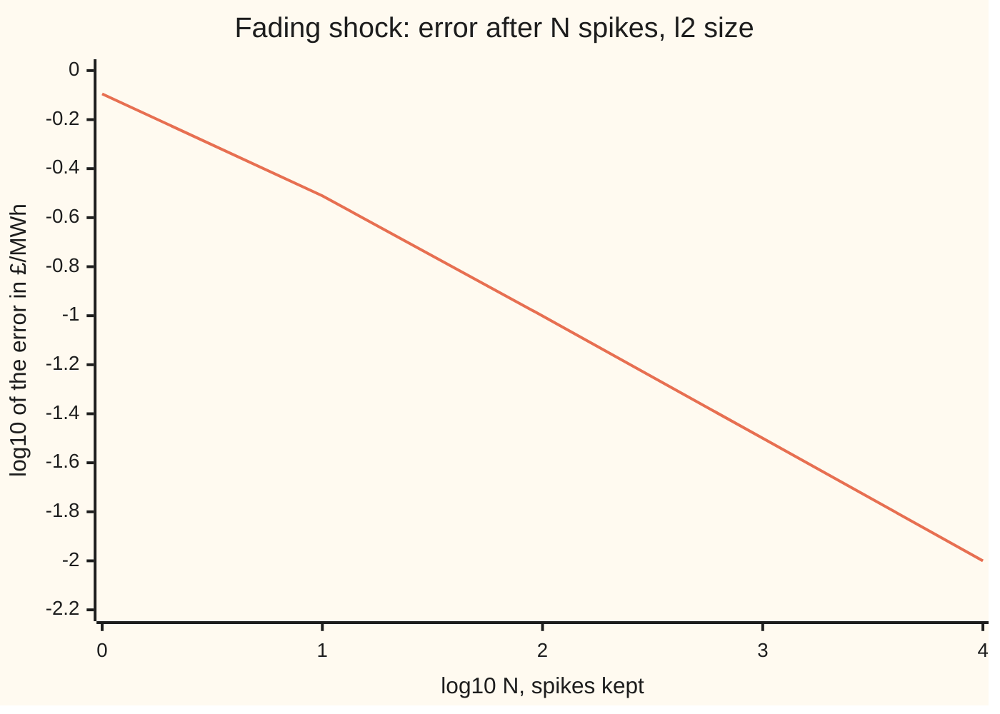

# Infinite dimensions: the unit ball stops being compact and bases get subtler

[Syllabus](../../../SYLLABUS.md) → [Functional analysis](../README.md) → [Normed and Banach Spaces](../README.md#s01) → Infinite dimensions

---

## General Overview

A week of hourly electricity prices is a list of 168 numbers, in £/MWh. The simplest record of that kind is a **spike**: 1 £/MWh at one hour and 0 at every other hour. The spike at hour n is written $`e_n`$, as on the [Sequence spaces](02-sequence-spaces-lp-and-c0.md) card.

Measure the gap between two records the usual way: square the hour-by-hour differences, add them, and take the square root. Two different spikes differ by 1 at two hours, so they are $`\sqrt{2}`$ = 1.414214 £/MWh apart.

One week holds only 168 spikes, so an endless list of them must reuse an hour. Cycle through the week and spike number 169 lands on hour 1 again, at distance 0 from spike 1. In finitely many dimensions this always happens: every bounded list has a part that settles. A set is **compact** when every list in it has a part (a sublist) that settles on a point of the set ([Compactness three ways](../../17-Topology/01-Metric%20Spaces/06-compactness-in-metric-spaces.md)).

Now let the record run on, hour after hour, with no last hour. The spikes at hours 1, 2, 3 and on never repeat. Every two of them stay 1.414214 apart, so no part of the list settles. Yet every spike has size 1, so the list is bounded. In infinitely many dimensions, closed and bounded no longer means compact.

Bases change too. In one week every record is a finite mix of the 168 spikes. On an endless record, a shock that fades, 1, then 1/2, then 1/3 £/MWh above normal (illustrative), needs every spike, as an infinite sum. That kind of basis is a Schauder basis.

**In infinitely many dimensions there is always room for one more direction a fixed distance from all the earlier ones, so the closed unit ball holds bounded lists with no settling part, and a basis must be read as an infinite sum that converges in the norm instead of a finite mix.**

**What kind of fact this is:** Riesz's lemma and Riesz's theorem are theorems, proved on this card in Why it works. A Schauder basis is a definition. That $`\ell^\infty`$ has no Schauder basis is proved in Step 6. That a space with a countable dense set can still have none, and that an algebraic basis of an infinite-dimensional complete space is uncountable, are stated with a named source and a link.

### The picture: two spikes under three size rules

```
distance from e_3 to e_7, in £/MWh
l1,  add the gaps              ████████████████████  2.000000
l2,  square, add, square root  ██████████████        1.414214
sup, largest gap               ██████████            1.000000
```

The three size rules come from [Sequence spaces](02-sequence-spaces-lp-and-c0.md). Each gives every pair of spikes the same distance. The rule changes the number, not the failure.

---

## The formula

Notation first, in words.

- A **normed space** $`X`$ is a space of vectors with a size $`\|x\|`$ for each member $`x`$ ([Normed and Banach spaces](01-normed-spaces-and-banach-spaces.md)). Here the members are price records.
- $`\ell^2`$ is the space of endless records whose squares add to a finite total, with size $`\|x\|_2`$ = the square root of that total. The subscript names the size rule: $`\|x\|_1`$ adds absolute values and $`\|x\|_\infty`$ takes the largest one.
- The **closed unit ball** $`B_X`$ is every member of size at most 1.
- A **subspace** $`M`$ is **closed** when a list in $`M`$ that converges in the norm has its limit in $`M`$.
- The **distance** $`\mathrm{dist}(x, M)`$ is the smallest size of $`x - m`$ over members $`m`$ of $`M`$, or the value those sizes close in on if none attains it (the infimum, written inf).

The spikes, the example of the whole card:

```math
\|e_n - e_m\|_2 = \sqrt{1^2 + 1^2} = \sqrt{2} \quad \text{for every } n \ne m
```

**Read it aloud:** any two different spikes differ by 1 at exactly two hours, so their distance is the square root of 2.

Riesz's lemma, which builds such lists in any normed space:

```math
M \text{ closed},\ M \ne X,\ 0 < \theta < 1 \implies \text{some } x \text{ has } \|x\| = 1,\ \mathrm{dist}(x, M) \ge \theta
```

**Read it aloud:** if a closed subspace misses part of the space, some vector of size 1 sits at least theta away from all of it, for any theta below 1.

Riesz's theorem, the consequence:

```math
B_X \text{ is compact} \iff \dim X < \infty
```

**Read it aloud:** the closed unit ball is compact exactly when the space has finitely many dimensions.

What replaces a basis. A list $`b_1, b_2, \ldots`$ is a **Schauder basis** of $`X`$ when each $`x`$ has exactly one list of numbers $`a_1, a_2, \ldots`$ with

```math
\Big\| x - \sum_{n=1}^{N} a_n b_n \Big\| \to 0 \quad \text{as } N \to \infty
```

**Read it aloud:** the error left after the first N terms shrinks to zero in the space's own size rule, and only one list of amounts does this.

In $`\ell^2`$ the spikes are a Schauder basis: the amount $`a_n`$ is the n-th entry of $`x`$, and the error after N terms is the size of what is left: the square root of the sum of the squared entries past hour N.

| Symbol | Plain meaning | In our example | Push it up and the answer… |
| --- | --- | --- | --- |
| $`X`$, $`\|x\|`$ | a normed space, and the size of a member | price records, sized by $`\|x\|_2`$ | — |
| $`\|x\|_1`$, $`\|x\|_2`$, $`\|x\|_\infty`$ | sum, square-root-of-squares and largest-entry sizes | 2, 1.414214, 1 for $`e_3 - e_7`$ | — |
| $`\ell^2`$, $`\ell^\infty`$, $`c_0`$ | endless records with a finite sum of squares; bounded endless records; records that fade to 0 | the fading shock $`y`$ | — |
| $`e_n`$ | the spike: 1 at hour n, 0 elsewhere | $`e_3`$, $`e_7`$ | — |
| $`N`$ | hours kept in a truncation, or terms kept in a sum | 10, 100, 168, 10000 | more balls needed; smaller error |
| $`M`$, $`m`$, $`m_0`$, $`t`$ | a closed subspace, a member, a member almost as close to $`z`$ as possible (here the nearest), the multiplier in t(1, 1) | multiples of (1, 1); $`m_0`$ = (0.5, 0.5) | — |
| $`\mathrm{dist}(x, M)`$, $`d`$ | the distance from $`x`$ to the nearest point of $`M`$; $`d`$ is this distance for $`z`$ | 0.5 for $`z`$, 1 for $`x`$ | — |
| $`\theta`$ | the distance Riesz's lemma promises, below 1 | 1/2 in Step 4; spikes in $`\ell^2`$ even reach 1, more than the lemma asks | harder to promise |
| $`z`$, $`x`$ | a point outside $`M`$, and the size-1 vector built from it | (1, 0) and (1, −1) | — |
| $`B_X`$, $`\dim X`$ | the closed unit ball; the number of dimensions | 168 for one week; endless for $`\ell^2`$ | compactness is lost at infinity |
| $`b_n`$, $`a_n`$ | Schauder basis vectors and their amounts | $`e_n`$ and $`y_n`$ | — |
| $`y`$, $`y_n`$ | the fading shock (1, 1/2, 1/3, …), and its entry at hour n | $`y_{10}`$ = 0.1000 | — |

### When it holds

- **A closed subspace.** If $`M`$ is not closed, every point can sit at distance 0. The records that are zero after some hour come within 0.0099998 of $`y`$ using 10000 spikes, and closer with more.
- **A subspace that misses something.** If $`M`$ is all of $`X`$, nothing sits at a positive distance.
- **Theta below 1.** In $`\ell^2`$ and in any finite-dimensional space, theta = 1 is reachable. Some complete spaces have closed subspaces with no size-1 vector at distance exactly 1, so the lemma asks only for theta below 1.
- **Compact in the norm.** The spikes do settle in a weaker sense: each entry of $`e_n`$ ends at 0. "Not compact" names the norm; the weaker sense is on [Reflexive spaces](10-reflexive-spaces-and-the-second-dual.md).
- **A space with a countable dense set, for a Schauder basis.** A dense set comes as close as wanted to every member, in the norm. $`\ell^\infty`$, the bounded records under the largest-entry size, has no countable one: its records of 0s and 1s sit exactly 1.000000 apart, 1024 of them at N = 10 hours and uncountably many with no last hour (Step 6).

---

## Why it works

### Step 0: there is always room for one more direction

In N dimensions, N independent directions fill the space, and the next one has nowhere new to point. A bounded list then has to crowd somewhere.

In infinitely many dimensions the directions never run out. Each new one can be chosen a fixed distance from everything spanned so far. A list built that way spreads out forever and never crowds.

### Step 1: in finite dimensions the ball is compact

[Equivalent norms](04-equivalence-of-norms-in-finite-dimensions.md) shows that every size rule on N-entry lists is within fixed factors of the square-root-of-squares rule. So the closed unit ball is closed and bounded in the ordinary sense. Heine–Borel (in N dimensions, closed and bounded means compact), proved on [Compactness three ways](../../17-Topology/01-Metric%20Spaces/06-compactness-in-metric-spaces.md), then makes it compact.

A count shows how crowded it must be. Take points of the 168-hour ball, every two at least 1.414214 apart. Put a ball of radius half that distance round each point. The small balls do not overlap, and all fit inside a ball of radius 1 plus that half. Volume in 168 dimensions grows as the 168th power of the radius, so the count is at most $`(1 + \sqrt{2})^{168}`$, about 10^64.31.

That is huge, but it is finite. A list longer than it must have two points closer than 1.414214.

### Step 2: in infinite dimensions the spikes never crowd

In $`\ell^2`$ the bound above grows without end as N grows. The spikes show it. Every two are 1.414214 apart, so no sublist is Cauchy (its terms never get close to each other), and none converges.

A finite cover fails too. A ball of radius 1/2 holds at most one spike, because two spikes inside it would be at most 1 apart. Records of 10, 100 and 168 hours need 10, 100 and 168 balls just to cover the spikes. At infinity no finite number works, so the unit ball is not totally bounded (coverable by finitely many small balls at every radius).

### Step 3: Riesz's lemma builds such a list in any normed space

Spikes are at right angles. Riesz's lemma finds far-apart vectors in any normed space, where angles may not exist.

Take a point $`z`$ outside the closed subspace $`M`$. Its distance $`d`$ to $`M`$ is positive, because $`M`$ is closed. Pick $`m_0`$ in $`M`$ almost as close as possible, within $`d/\theta`$. Scale $`z - m_0`$ to size 1 and call it $`x`$. Moving $`x`$ by any member of $`M`$ is moving $`z`$ by a member of $`M`$, scaled down, so $`x`$ stays at least $`\theta`$ away.

A worked case shows why the subtraction matters. Take the plane with the largest-entry size, $`\|(a, b)\|_\infty`$ = the larger of $`|a|`$ and $`|b|`$. Let $`M`$ be the multiples t(1, 1).

1. The point $`z`$ = (1, 0) has size 1. Its distance to $`M`$ is 0.5, at t = 0.5, so $`m_0`$ = (0.5, 0.5).
2. Then $`z - m_0`$ = (0.5, −0.5), of size 0.5.
3. Scaled to size 1, it is $`x`$ = (1, −1). Its distance to $`M`$ is 1, at t = 0.
4. The lazy choice, $`z`$ itself, sits only 0.5 away.

<details>
<summary>Detailed proof: Riesz's lemma</summary>

Let $`M`$ be a closed subspace of the normed space $`X`$ with $`M \ne X`$, and let $`0 < \theta < 1`$. Pick $`z`$ in $`X`$ outside $`M`$ and set $`d = \mathrm{dist}(z, M)`$.

If $`d`$ were 0, there would be members of $`M`$ closer and closer to $`z`$, a list in $`M`$ converging to $`z`$. Since $`M`$ is closed, $`z`$ would be in $`M`$. So $`d > 0`$, and $`d/\theta > d`$. By the meaning of an infimum there is $`m_0`$ in $`M`$ with $`\|z - m_0\| \le d/\theta`$.

Set $`x = (z - m_0)/\|z - m_0\|`$, so $`\|x\| = 1`$. For any $`m`$ in $`M`$, the vector $`m_0 + \|z - m_0\|\, m`$ is in $`M`$, since $`M`$ is a subspace. So

$`\displaystyle \|x - m\| = \frac{\| z - (m_0 + \|z - m_0\|\, m) \|}{\|z - m_0\|} \ge \frac{d}{\|z - m_0\|} \ge \frac{d}{d/\theta} = \theta.`$

Taking the infimum over $`m`$ gives $`\mathrm{dist}(x, M) \ge \theta`$.

</details>

### Step 4: Riesz's theorem

Suppose $`X`$ has infinitely many dimensions. Pick any $`x_1`$ of size 1. The span of $`x_1`$ is finite-dimensional, so it is complete and therefore closed ([Equivalent norms](04-equivalence-of-norms-in-finite-dimensions.md)). It is not all of $`X`$.

Riesz's lemma with theta = 1/2 gives $`x_2`$ of size 1 at least 1/2 from that span. The span of $`x_1, x_2`$ is again closed and not everything, so the lemma gives $`x_3`$, and so on. Every two terms are at least 1/2 apart, so no sublist converges, and the closed unit ball is not compact.

Step 1 is the other direction. So the ball is compact exactly when the dimension is finite.

In $`\ell^2`$ the spikes already do this with theta = 1. For any record $`m`$ that is zero from hour n + 1 on, the size of $`e_{n+1} - m`$ squared is 1 plus the size of $`m`$ squared, never below 1.

### Step 5: what replaces a basis

A basis on [Basis and dimension](../../03-Algebra/03-Vectors/05-basis-and-dimension.md) reaches every vector as a finite mix. In $`\ell^2`$ the spikes fail that test. The fading shock $`y`$ = (1, 1/2, 1/3, …) is in $`\ell^2`$: its squares add to $`\pi^2/6`$ = 1.644934, so its size is 1.282550. But a finite mix of spikes is zero after some hour, and $`y`$ never is.

The infinite sum works instead. Keep the first N spikes with amounts $`y_n`$. What is left is $`y`$ with its first N hours set to zero. Its size is the square root of the sum of $`1/n^2`$ past N, which falls like $`1/\sqrt{N}`$:

| N, spikes kept | error, size of what is left | log10 N | log10 error |
| ---: | ---: | ---: | ---: |
| 1 | 0.8030779 | 0 | −0.095 |
| 10 | 0.3084904 | 1 | −0.511 |
| 100 | 0.0997505 | 2 | −1.001 |
| 1000 | 0.0316149 | 3 | −1.500 |
| 10000 | 0.0099998 | 4 | −2.000 |



The line is the error for N = 1, 10, 100, 1000 and 10000. From N = 10 on, each step of 1 in log10 N drops it by about 0.5, so the error falls like one over the square root of N. It never reaches zero at any finite N.

The amounts are unique: reading off hour n, where only $`e_n`$ is nonzero, fixes the n-th amount. So the amount of $`e_n`$ in $`y`$ is $`y_n`$: $`y_1`$ = 1.0000, $`y_{10}`$ = 0.1000, $`y_{100}`$ = 0.0100, $`y_{1000}`$ = 0.0010.

### Step 6: where bases run out

- **An algebraic basis exists, but cannot be listed.** The axiom of choice (a set-theory rule that allows infinitely many arbitrary picks at once) gives every vector space a basis of finite mixes. In an infinite-dimensional complete normed space it is always uncountable, by the [Baire category theorem](../../17-Topology/01-Metric%20Spaces/10-baire-category-theorem.md). Nobody can write one down for $`\ell^2`$.
- **A Schauder basis needs a countable dense set.** The partial sums with rational amounts form such a set. $`\ell^\infty`$ has none. Take the records of 0s and 1s: each hour is either 0 or 1 £/MWh. Two different ones differ by 1 at some hour, so they sit exactly 1.000000 apart in the largest-entry size. Balls of radius 1/2 round them do not overlap, and a dense set needs a member in each ball, so it needs a different member for every such record. At N hours there are $`2^N`$ of them: 16, 256 and 1024 at N = 4, 8 and 10. With no last hour there is one for every endless string of binary digits, uncountably many. So no list of records is dense, and $`\ell^\infty`$ has no Schauder basis.
- **The spikes fail in $`\ell^\infty`$ for a narrower reason.** In the largest-entry size, a limit of records that end in zeros still fades to 0, so the spikes' sums reach only $`c_0`$ of [Sequence spaces](02-sequence-spaces-lp-and-c0.md). The all-ones record, a steady premium of 1 £/MWh at every hour, stays 1.000000 from the sum of its first N spikes at N = 10, 100 and 1000. That rules out the spikes, not every list; the records of 0s and 1s rule out the rest.
- **A countable dense set is not enough.** Per Enflo built a complete normed space with a countable dense set and no Schauder basis (1973).

---

## Worked numbers, by hand

| Step | Arithmetic | Value |
| --- | --- | --- |
| gap between two spikes | square root of 1 squared plus 1 squared | 1.414214 |
| spikes in one week | one per hour | 168 |
| spike 169, cycling through the week | it lands on hour 1 again | distance 0.000000 |
| balls of radius 1/2 for N spikes | each ball holds one spike, as 1.414214 > 2 × 1/2 | 10, 100, 168: one per spike |
| Riesz: distance of $`z`$ = (1, 0) to $`M`$ | larger of 1 − 0.5 and 0.5 | 0.5000 |
| scale $`z - m_0`$ = (0.5, −0.5) to size 1 | divide by its size, 0.5 | (1, −1) |
| distance of (1, −1) to $`M`$ | larger of 1 − 0 and 1 + 0, at t = 0 | 1.0000 |
| size of the fading shock squared | $`\pi^2/6`$ | 1.644934 |
| error after 100 spikes | square root of the sum of $`1/n^2`$ past 100 | 0.0997505 |
| endless record: balls of radius 1/2 | one per spike, spikes without end | **no finite number** |

With no last hour, the bounded list of spikes needs infinitely many small balls and has no settling sublist: the closed unit ball of $`\ell^2`$ is not compact.

### What breaks if you drop a piece

| Mistake | Comes out at | What went wrong |
| --- | --- | --- |
| Keep the record to one 168-hour week | spike 169 lands on hour 1: distance 0.000000 | finitely many dimensions: the list must repeat, and compactness returns |
| Use a subspace that is not closed: the records zero after some hour | distance from $`y`$ to the first N spikes: 0.0997505 at N = 100, 0.0099998 at N = 10000, and on toward 0 | the distance $`d`$ in Riesz's recipe is 0, so every vector sits at distance 0 and no positive theta can be promised |
| Treat the spikes as an algebraic basis of $`\ell^2`$ | the best mix of 100 spikes misses $`y`$ by 0.0997505; no finite mix hits it | $`y`$ needs every spike, and only the infinite sum reaches it |
| Use the spikes as a Schauder basis of $`\ell^\infty`$ | all-ones record: error 1.000000 at N = 10, 100 and 1000 | the spikes' sums reach only records that fade to 0, the space $`c_0`$; no other list works either, since 1024 records of 0s and 1s sit 1.000000 apart at N = 10 |

The code prints all four.

---

## Code, from first principles, and it actually runs

The code holds only truncations: records cut to N hours, at several N. It takes two independent roads to each answer:

- spike distances, computed hour by hour, against $`2`$, $`\sqrt{2}`$ and $`1`$;
- Riesz distances, by grid search, against the closed form $`|a - b|/2`$;
- the fading shock's error, as $`\pi^2/6`$ minus a partial sum, against the tail summed directly to a million hours, with the bracket $`1/(N+1)`$ to $`1/N`$ as a third check;
- the records of 0s and 1s, by a greedy cover with balls of radius 1/2, against the count $`2^N`$, with the closest pair checked at exactly 1;
- the cheapest hour to buy in, by search, against the last hour, with an evenly spread plan as a check that spreading never pays less.

What the truncation hides: every N-entry ball is compact, so the failure shows only as a trend in N that never closes.

### Python

```python
# Infinite dimensions -- the check behind the card.  Standard library only.
# A spike e_n is a price record that is 1 GBP/MWh at hour n and 0 at every
# other hour.  Every infinite object here is a truncation: a record cut to N
# hours, shown at several N.  Only the proofs on the card cover N = infinity.
import math

def norm(v, p):                       # l1, l2 or sup size of a finite list
    if p == 0:                        # p = 0 stands for the sup size here
        return max(abs(a) for a in v)
    return sum(abs(a) ** p for a in v) ** (1.0 / p)

def spike(n, size):                   # e_n cut to `size` hours, n counts from 1
    return [1.0 if k == n else 0.0 for k in range(1, size + 1)]

def minus(u, v):
    return [a - b for a, b in zip(u, v)]

# 1. Two spikes, three size rules.
d1, d2, dsup = (norm(minus(spike(3, 10), spike(7, 10)), p) for p in (1, 2, 0))
print(f"distance from e_3 to e_7: l1 {d1:.6f}, l2 {d2:.6f}, sup {dsup:.6f}")
assert abs(d1 - 2) < 1e-12 and abs(d2 - math.sqrt(2)) < 1e-12 and abs(dsup - 1) < 1e-12

# 2. Spikes at every hour of a record of N hours: closest pair, and a greedy
#    cover by balls of radius 1/2 (a ball holds a spike within 1/2 of its centre).
for size in (10, 100, 168):
    spikes = [spike(n, size) for n in range(1, size + 1)]
    closest = min(norm(minus(spikes[i], spikes[j]), 2)
                  for i in range(size) for j in range(i + 1, size))
    centres = []
    for s in spikes:
        if all(norm(minus(s, c), 2) > 0.5 for c in centres):
            centres.append(s)
    print(f"N = {size:3d} hours: closest pair of spikes {closest:.6f}, "
          f"balls of radius 1/2 needed {len(centres)}")
    assert abs(closest - math.sqrt(2)) < 1e-12 and len(centres) == size
week = [spike((k - 1) % 168 + 1, 168) for k in range(1, 170)]
print(f"spike number 169 in a 168-hour week sits at hour {(169 - 1) % 168 + 1}; "
      f"distance to spike 1: {norm(minus(week[168], week[0]), 2):.6f}")
print(f"volume bound on points of the 168-hour ball that are sqrt 2 apart: "
      f"10^{168 * math.log10(1 + math.sqrt(2)):.2f}")

# 3. Riesz's recipe in the plane under the sup size.  M = all multiples t(1, 1).
def dist_to_line(v):                  # road one: search t on a grid of 0.0001
    best, best_t = 9.0, 0.0
    for k in range(-30000, 30001):
        t = k / 10000
        size = max(abs(v[0] - t), abs(v[1] - t))
        if size < best:
            best, best_t = size, t
    return best, best_t

z = (1.0, 0.0)
dz, tz = dist_to_line(z)
m0 = (tz, tz)
w = (z[0] - m0[0], z[1] - m0[1])
x = (w[0] / max(map(abs, w)), w[1] / max(map(abs, w)))
dx, tx = dist_to_line(x)
print(f"z = ({z[0]:.4f}, {z[1]:.4f}): distance to M {dz:.4f}, nearest point t = {tz:.4f}")
print(f"x = (z - m0) / size = ({x[0]:.4f}, {x[1]:.4f}): size {max(map(abs, x)):.4f}, "
      f"distance to M {dx:.4f}, nearest t = {tx:.4f}")
for v, dv in ((z, dz), (x, dx)):      # road two: the closed form |a - b| / 2
    assert abs(dv - abs(v[0] - v[1]) / 2) < 1e-9

# 4. y = (1, 1/2, 1/3, ...) written in the spikes.  Error after N terms is the
#    tail sqrt(sum over n > N of 1/n^2).  Road A: pi^2/6 minus the partial sum.
#    Road B: sum the tail up to 10^6 directly, plus the Euler-Maclaurin rest.
total = math.pi ** 2 / 6
print(f"size of y squared, pi^2/6 = {total:.6f}; size of y {math.sqrt(total):.6f}")
big = 10 ** 6
rest = 1 / big - 1 / (2 * big ** 2) + 1 / (6 * big ** 3)
for n_terms in (1, 10, 100, 1000, 10000):
    road_a = math.sqrt(total - sum(1 / n ** 2 for n in range(1, n_terms + 1)))
    road_b = math.sqrt(sum(1 / n ** 2 for n in range(big, n_terms, -1)) + rest)
    print(f"N = {n_terms:5d}: error {road_a:.7f} (direct tail {road_b:.7f}), "
          f"log10 N {math.log10(n_terms):.0f}, log10 error {math.log10(road_a):.3f}")
    assert abs(road_a - road_b) < 1e-9
    assert 1 / (n_terms + 1) < road_a ** 2 < 1 / n_terms
print(f"the coefficient of e_n is y_n: y_1 = {1:.4f}, y_10 = {1 / 10:.4f}, "
      f"y_100 = {1 / 100:.4f}, y_1000 = {1 / 1000:.4f}")

# 5. The sup size.  Partial sums of spikes never close in on the all-ones record,
#    and the records of 0s and 1s are 2^N points, every two exactly 1 apart.
for n_terms in (10, 100, 1000):
    ones = [1.0] * (2 * n_terms)
    partial = [1.0 if k <= n_terms else 0.0 for k in range(1, 2 * n_terms + 1)]
    gap = norm(minus(ones, partial), 0)
    print(f"all-ones record, sup size, N = {n_terms:4d}: error {gap:.6f}")
    assert gap == 1.0
for size in (4, 8, 10):                # greedy cover by balls of radius 1/2, as in 2.
    records = [[float((k >> h) & 1) for h in range(size)] for k in range(2 ** size)]
    centres, closest = [], 9.0
    for r in records:
        gaps = [norm(minus(r, c), 0) for c in centres]
        closest = min([closest] + gaps)
        if all(g > 0.5 for g in gaps):
            centres.append(r)
    print(f"N = {size:2d} hours: {len(records):4d} records of 0s and 1s, closest pair "
          f"{closest:.6f} (sup size), balls of radius 1/2 needed {len(centres)}")
    assert closest == 1.0 and len(centres) == 2 ** size

# 6. Buy 1 MWh, split over hours, at 50 + 10/n GBP/MWh in hour n (illustrative).
#    Road one: search every hour.  Road two: the last hour is cheapest.  A plan
#    spread evenly over the hours costs the average price, more than the best.
for size in (168, 1000, 10000):
    prices = [50 + 10 / n for n in range(1, size + 1)]
    best = min(range(size), key=lambda k: prices[k])
    print(f"buy 1 MWh within N = {size:5d} hours: best hour {best + 1}, "
          f"cost {prices[best]:.6f} GBP")
    assert best + 1 == size and sum(prices) / size > prices[best] > 50
print("ALL CHECKS PASS")
```

**Ran 2026-11-15 on macOS, Python 3.14.10, standard library only. All checks passed. Output, pasted from the run:**

```
distance from e_3 to e_7: l1 2.000000, l2 1.414214, sup 1.000000
N =  10 hours: closest pair of spikes 1.414214, balls of radius 1/2 needed 10
N = 100 hours: closest pair of spikes 1.414214, balls of radius 1/2 needed 100
N = 168 hours: closest pair of spikes 1.414214, balls of radius 1/2 needed 168
spike number 169 in a 168-hour week sits at hour 1; distance to spike 1: 0.000000
volume bound on points of the 168-hour ball that are sqrt 2 apart: 10^64.31
z = (1.0000, 0.0000): distance to M 0.5000, nearest point t = 0.5000
x = (z - m0) / size = (1.0000, -1.0000): size 1.0000, distance to M 1.0000, nearest t = 0.0000
size of y squared, pi^2/6 = 1.644934; size of y 1.282550
N =     1: error 0.8030779 (direct tail 0.8030779), log10 N 0, log10 error -0.095
N =    10: error 0.3084904 (direct tail 0.3084904), log10 N 1, log10 error -0.511
N =   100: error 0.0997505 (direct tail 0.0997505), log10 N 2, log10 error -1.001
N =  1000: error 0.0316149 (direct tail 0.0316149), log10 N 3, log10 error -1.500
N = 10000: error 0.0099998 (direct tail 0.0099998), log10 N 4, log10 error -2.000
the coefficient of e_n is y_n: y_1 = 1.0000, y_10 = 0.1000, y_100 = 0.0100, y_1000 = 0.0010
all-ones record, sup size, N =   10: error 1.000000
all-ones record, sup size, N =  100: error 1.000000
all-ones record, sup size, N = 1000: error 1.000000
N =  4 hours:   16 records of 0s and 1s, closest pair 1.000000 (sup size), balls of radius 1/2 needed 16
N =  8 hours:  256 records of 0s and 1s, closest pair 1.000000 (sup size), balls of radius 1/2 needed 256
N = 10 hours: 1024 records of 0s and 1s, closest pair 1.000000 (sup size), balls of radius 1/2 needed 1024
buy 1 MWh within N =   168 hours: best hour 168, cost 50.059524 GBP
buy 1 MWh within N =  1000 hours: best hour 1000, cost 50.010000 GBP
buy 1 MWh within N = 10000 hours: best hour 10000, cost 50.001000 GBP
ALL CHECKS PASS
```

### Rust

Same numbers, same labels, built with `rustc --edition 2021 -O`.

```rust
// Infinite dimensions -- the same check as the Python, in Rust.  No crates.
// A spike e_n is a price record that is 1 GBP/MWh at hour n and 0 at every
// other hour.  Every infinite object here is a truncation: a record cut to N
// hours, shown at several N.  Only the proofs on the card cover N = infinity.

fn norm(v: &[f64], p: i32) -> f64 {           // l1, l2 or sup size of a finite list
    if p == 0 {                                // p = 0 stands for the sup size here
        return v.iter().fold(0.0, |m: f64, a| m.max(a.abs()));
    }
    v.iter().map(|a| a.abs().powi(p)).sum::<f64>().powf(1.0 / p as f64)
}

fn spike(n: usize, size: usize) -> Vec<f64> {  // e_n cut to `size` hours, n counts from 1
    (1..=size).map(|k| if k == n { 1.0 } else { 0.0 }).collect()
}

fn minus(u: &[f64], v: &[f64]) -> Vec<f64> {
    u.iter().zip(v).map(|(a, b)| a - b).collect()
}

fn dist_to_line(v: (f64, f64)) -> (f64, f64) { // road one: search t on a grid of 0.0001
    let (mut best, mut best_t) = (9.0_f64, 0.0_f64);
    for k in -30000..=30000 {
        let t = k as f64 / 10000.0;
        let size = (v.0 - t).abs().max((v.1 - t).abs());
        if size < best { best = size; best_t = t; }
    }
    (best, best_t)
}

fn main() {
    // 1. Two spikes, three size rules.
    let (a, b) = (spike(3, 10), spike(7, 10));
    let (d1, d2, dsup) = (norm(&minus(&a, &b), 1), norm(&minus(&a, &b), 2), norm(&minus(&a, &b), 0));
    println!("distance from e_3 to e_7: l1 {:.6}, l2 {:.6}, sup {:.6}", d1, d2, dsup);
    assert!((d1 - 2.0).abs() < 1e-12 && (d2 - 2f64.sqrt()).abs() < 1e-12 && (dsup - 1.0).abs() < 1e-12);

    // 2. Spikes at every hour of a record of N hours: closest pair, and a greedy
    //    cover by balls of radius 1/2 (a ball holds a spike within 1/2 of its centre).
    for size in [10usize, 100, 168] {
        let spikes: Vec<Vec<f64>> = (1..=size).map(|n| spike(n, size)).collect();
        let mut closest = f64::INFINITY;
        for i in 0..size {
            for j in i + 1..size { closest = closest.min(norm(&minus(&spikes[i], &spikes[j]), 2)); }
        }
        let mut centres: Vec<&Vec<f64>> = Vec::new();
        for s in &spikes {
            if centres.iter().all(|c| norm(&minus(s, c), 2) > 0.5) { centres.push(s); }
        }
        println!("N = {:3} hours: closest pair of spikes {:.6}, balls of radius 1/2 needed {}",
                 size, closest, centres.len());
        assert!((closest - 2f64.sqrt()).abs() < 1e-12 && centres.len() == size);
    }
    let week: Vec<Vec<f64>> = (1..170usize).map(|k| spike((k - 1) % 168 + 1, 168)).collect();
    println!("spike number 169 in a 168-hour week sits at hour {}; distance to spike 1: {:.6}",
             (169 - 1) % 168 + 1, norm(&minus(&week[168], &week[0]), 2));
    println!("volume bound on points of the 168-hour ball that are sqrt 2 apart: 10^{:.2}",
             168.0 * (1.0 + 2f64.sqrt()).log10());

    // 3. Riesz's recipe in the plane under the sup size.  M = all multiples t(1, 1).
    let z = (1.0_f64, 0.0_f64);
    let (dz, tz) = dist_to_line(z);
    let w = (z.0 - tz, z.1 - tz);
    let wsize = w.0.abs().max(w.1.abs());
    let x = (w.0 / wsize, w.1 / wsize);
    let (dx, tx) = dist_to_line(x);
    println!("z = ({:.4}, {:.4}): distance to M {:.4}, nearest point t = {:.4}", z.0, z.1, dz, tz);
    println!("x = (z - m0) / size = ({:.4}, {:.4}): size {:.4}, distance to M {:.4}, nearest t = {:.4}",
             x.0, x.1, x.0.abs().max(x.1.abs()), dx, tx);
    for (v, dv) in [(z, dz), (x, dx)] {        // road two: the closed form |a - b| / 2
        assert!((dv - (v.0 - v.1).abs() / 2.0).abs() < 1e-9);
    }

    // 4. y = (1, 1/2, 1/3, ...) written in the spikes.  Error after N terms is the
    //    tail sqrt(sum over n > N of 1/n^2).  Road A: pi^2/6 minus the partial sum.
    //    Road B: sum the tail up to 10^6 directly, plus the Euler-Maclaurin rest.
    let total = std::f64::consts::PI.powi(2) / 6.0;
    println!("size of y squared, pi^2/6 = {:.6}; size of y {:.6}", total, total.sqrt());
    let big: u64 = 1_000_000;
    let bf = big as f64;
    let rest = 1.0 / bf - 1.0 / (2.0 * bf * bf) + 1.0 / (6.0 * bf * bf * bf);
    for n_terms in [1u64, 10, 100, 1000, 10000] {
        let partial: f64 = (1..=n_terms).map(|n| 1.0 / (n as f64).powi(2)).sum();
        let road_a = (total - partial).sqrt();
        let tail: f64 = (n_terms + 1..=big).rev().map(|n| 1.0 / (n as f64).powi(2)).sum();
        let road_b = (tail + rest).sqrt();
        println!("N = {:5}: error {:.7} (direct tail {:.7}), log10 N {:.0}, log10 error {:.3}",
                 n_terms, road_a, road_b, (n_terms as f64).log10(), road_a.log10());
        assert!((road_a - road_b).abs() < 1e-9);
        let nf = n_terms as f64;
        assert!(1.0 / (nf + 1.0) < road_a * road_a && road_a * road_a < 1.0 / nf);
    }
    println!("the coefficient of e_n is y_n: y_1 = {:.4}, y_10 = {:.4}, y_100 = {:.4}, y_1000 = {:.4}",
             1.0, 1.0 / 10.0, 1.0 / 100.0, 1.0 / 1000.0);

    // 5. The sup size.  Partial sums of spikes never close in on the all-ones record,
    //    and the records of 0s and 1s are 2^N points, every two exactly 1 apart.
    for n_terms in [10usize, 100, 1000] {
        let ones = vec![1.0; 2 * n_terms];
        let partial: Vec<f64> = (1..=2 * n_terms).map(|k| if k <= n_terms { 1.0 } else { 0.0 }).collect();
        let gap = norm(&minus(&ones, &partial), 0);
        println!("all-ones record, sup size, N = {:4}: error {:.6}", n_terms, gap);
        assert!(gap == 1.0);
    }
    for size in [4usize, 8, 10] {               // greedy cover by balls of radius 1/2, as in 2.
        let records: Vec<Vec<f64>> = (0..1usize << size)
            .map(|k| (0..size).map(|h| ((k >> h) & 1) as f64).collect()).collect();
        let (mut centres, mut closest): (Vec<&Vec<f64>>, f64) = (Vec::new(), 9.0);
        for r in &records {
            let gaps: Vec<f64> = centres.iter().map(|c| norm(&minus(r, c), 0)).collect();
            closest = gaps.iter().fold(closest, |m, &g| m.min(g));
            if gaps.iter().all(|&g| g > 0.5) { centres.push(r); }
        }
        println!("N = {:2} hours: {:4} records of 0s and 1s, closest pair {:.6} (sup size), balls of radius 1/2 needed {}",
                 size, records.len(), closest, centres.len());
        assert!(closest == 1.0 && centres.len() == 1 << size);
    }

    // 6. Buy 1 MWh, split over hours, at 50 + 10/n GBP/MWh in hour n (illustrative).
    //    Road one: search every hour.  Road two: the last hour is cheapest.  A plan
    //    spread evenly over the hours costs the average price, more than the best.
    for size in [168usize, 1000, 10000] {
        let prices: Vec<f64> = (1..=size).map(|n| 50.0 + 10.0 / n as f64).collect();
        let best = (0..size).fold(0, |b, k| if prices[k] < prices[b] { k } else { b });
        println!("buy 1 MWh within N = {:5} hours: best hour {}, cost {:.6} GBP", size, best + 1, prices[best]);
        let spread = prices.iter().sum::<f64>() / size as f64;
        assert!(best + 1 == size && spread > prices[best] && prices[best] > 50.0);
    }
    println!("ALL CHECKS PASS");
}
```

**Ran 2026-11-15 on macOS, rustc 1.98.1, no crates. All checks passed. Output, pasted from the run:**

```
distance from e_3 to e_7: l1 2.000000, l2 1.414214, sup 1.000000
N =  10 hours: closest pair of spikes 1.414214, balls of radius 1/2 needed 10
N = 100 hours: closest pair of spikes 1.414214, balls of radius 1/2 needed 100
N = 168 hours: closest pair of spikes 1.414214, balls of radius 1/2 needed 168
spike number 169 in a 168-hour week sits at hour 1; distance to spike 1: 0.000000
volume bound on points of the 168-hour ball that are sqrt 2 apart: 10^64.31
z = (1.0000, 0.0000): distance to M 0.5000, nearest point t = 0.5000
x = (z - m0) / size = (1.0000, -1.0000): size 1.0000, distance to M 1.0000, nearest t = 0.0000
size of y squared, pi^2/6 = 1.644934; size of y 1.282550
N =     1: error 0.8030779 (direct tail 0.8030779), log10 N 0, log10 error -0.095
N =    10: error 0.3084904 (direct tail 0.3084904), log10 N 1, log10 error -0.511
N =   100: error 0.0997505 (direct tail 0.0997505), log10 N 2, log10 error -1.001
N =  1000: error 0.0316149 (direct tail 0.0316149), log10 N 3, log10 error -1.500
N = 10000: error 0.0099998 (direct tail 0.0099998), log10 N 4, log10 error -2.000
the coefficient of e_n is y_n: y_1 = 1.0000, y_10 = 0.1000, y_100 = 0.0100, y_1000 = 0.0010
all-ones record, sup size, N =   10: error 1.000000
all-ones record, sup size, N =  100: error 1.000000
all-ones record, sup size, N = 1000: error 1.000000
N =  4 hours:   16 records of 0s and 1s, closest pair 1.000000 (sup size), balls of radius 1/2 needed 16
N =  8 hours:  256 records of 0s and 1s, closest pair 1.000000 (sup size), balls of radius 1/2 needed 256
N = 10 hours: 1024 records of 0s and 1s, closest pair 1.000000 (sup size), balls of radius 1/2 needed 1024
buy 1 MWh within N =   168 hours: best hour 168, cost 50.059524 GBP
buy 1 MWh within N =  1000 hours: best hour 1000, cost 50.010000 GBP
buy 1 MWh within N = 10000 hours: best hour 10000, cost 50.001000 GBP
ALL CHECKS PASS
```

The two outputs match line for line.

### Lean

Lean proves Riesz's lemma and Riesz's theorem for every real normed space, and the spike facts in $`\ell^2`$.

- Take a closed subspace $`M`$, not all of $`X`$, and $`0 < \theta < 1`$. Then some $`x`$ has $`\|x\| = 1`$ and $`\mathrm{dist}(x, M) \ge \theta`$.
- The closed unit ball $`B_X`$ is compact exactly when $`X`$ has finitely many dimensions.
- Every spike $`e_n`$ in $`\ell^2`$ has size 1.
- Take two different spikes $`e_n`$ and $`e_m`$. Then $`\|e_n - e_m\|_2 = \sqrt{2}`$.
- No sublist of the spikes converges in the $`\|x\|_2`$ size.
- Spike number 169, cycling through a 168-hour week, lands on hour 1 again.
- There are 16, 256 and 1024 records of 0s and 1s at N = 4, 8 and 10 hours.

The truncated distances, the worked plane case, the fading shock's errors and the buying plans are left to the Python and Rust checks.

```lean
-- Infinite dimensions: the closed unit ball of a real normed space is compact exactly when the space is finite-dimensional, by Riesz's lemma, and the spikes in l2 are a bounded list with no convergent sublist.
import Mathlib.Analysis.Normed.Module.FiniteDimension
import Mathlib.Analysis.Normed.Module.RieszLemma
import Mathlib.Analysis.Normed.Lp.lpSpace
import Mathlib.Data.Fintype.Pi

open Filter Topology

/-- Riesz's theorem: the closed unit ball of a real normed space is compact
exactly when the space has finitely many dimensions. -/
theorem isCompact_closedBall_one_iff_finiteDimensional
    {X : Type*} [NormedAddCommGroup X] [NormedSpace ℝ X] :
    IsCompact (Metric.closedBall (0 : X) 1) ↔ FiniteDimensional ℝ X := by
  constructor
  · intro h
    exact FiniteDimensional.of_isCompact_closedBall₀ ℝ one_pos h
  · intro h
    exact isCompact_closedBall 0 1

/-- Riesz's lemma: if a closed subspace `M` misses part of a real normed space,
then for every theta with `0 < θ < 1` some vector of size 1 sits at distance
at least theta from all of `M`. -/
theorem riesz_lemma_unit_vector_far_from_subspace
    {X : Type*} [NormedAddCommGroup X] [NormedSpace ℝ X]
    (M : Subspace ℝ X) (hM : IsClosed (M : Set X)) (hMX : M ≠ ⊤)
    (θ : ℝ) (hθ0 : 0 < θ) (hθ1 : θ < 1) :
    ∃ x : X, ‖x‖ = 1 ∧ θ ≤ Metric.infDist x (M : Set X) := by
  have hF : ∃ x : X, x ∉ M := by
    by_contra h
    push Not at h
    exact hMX (eq_top_iff.mpr fun x _ => h x)
  obtain ⟨x₀, _, hnorm, hfar⟩ := riesz_lemma_of_lt_one hM hF hθ1
  refine ⟨x₀, hnorm, ?_⟩
  rw [Metric.le_infDist ⟨0, M.zero_mem⟩]
  intro y hy
  rw [dist_eq_norm]
  exact hfar y hy

/-- The spikes `e_n` in `ℓ²` (1 at hour `n`, 0 elsewhere) all have size 1,
every two different ones are `√2` apart, and no sublist of them converges
in the `ℓ²` norm: a bounded list with no settling part. -/
theorem spikes_bounded_sqrt_two_apart_no_convergent_sublist :
    (∀ n : ℕ, ‖(lp.single 2 n (1 : ℝ) : lp (fun _ : ℕ => ℝ) 2)‖ = 1) ∧
    (∀ n m : ℕ, n ≠ m →
      ‖(lp.single 2 n (1 : ℝ) : lp (fun _ : ℕ => ℝ) 2) - lp.single 2 m 1‖ = Real.sqrt 2) ∧
    (∀ φ : ℕ → ℕ, StrictMono φ →
      ¬ ∃ L : lp (fun _ : ℕ => ℝ) 2,
        Tendsto (fun k => (lp.single 2 (φ k) (1 : ℝ) : lp (fun _ : ℕ => ℝ) 2)) atTop (𝓝 L)) := by
  have hdiff : ∀ n m : ℕ, n ≠ m →
      ‖(lp.single 2 n (1 : ℝ) : lp (fun _ : ℕ => ℝ) 2) - lp.single 2 m 1‖ = Real.sqrt 2 := by
    intro n m hnm
    have hp : (0 : ℝ) < (2 : ENNReal).toReal := by norm_num
    have key := lp.norm_sum_single (E := fun _ : ℕ => ℝ) hp
      (fun i => if i = n then (1 : ℝ) else -1) {n, m}
    have hsum : (∑ i ∈ ({n, m} : Finset ℕ),
        lp.single 2 i (if i = n then (1 : ℝ) else -1) : lp (fun _ : ℕ => ℝ) 2)
        = lp.single 2 n (1 : ℝ) - lp.single 2 m 1 := by
      rw [Finset.sum_pair hnm]
      simp [Ne.symm hnm, sub_eq_add_neg]
    rw [hsum, Finset.sum_pair hnm] at key
    simp [Ne.symm hnm] at key
    have h2 : ‖(lp.single 2 n (1 : ℝ) : lp (fun _ : ℕ => ℝ) 2) - lp.single 2 m 1‖ ^ 2 = 2 := by
      have := key
      norm_num at this ⊢
      linarith
    rw [← h2, Real.sqrt_sq (norm_nonneg _)]
  refine ⟨fun n => ?_, hdiff, ?_⟩
  · rw [lp.norm_single (by norm_num)]
    simp
  · rintro φ hφ ⟨L, hL⟩
    set f := fun k => (lp.single 2 (φ k) (1 : ℝ) : lp (fun _ : ℕ => ℝ) 2)
    have h1 : Tendsto (fun k => f (k + 1) - f k) atTop (𝓝 (L - L)) :=
      ((hL.comp (tendsto_add_atTop_nat 1)).sub hL)
    rw [sub_self] at h1
    have h2 : Tendsto (fun k => ‖f (k + 1) - f k‖) atTop (𝓝 ‖(0 : lp (fun _ : ℕ => ℝ) 2)‖) :=
      h1.norm
    rw [norm_zero] at h2
    have h3 : (fun k => ‖f (k + 1) - f k‖) = fun _ => Real.sqrt 2 := by
      funext k
      exact hdiff _ _ (hφ (Nat.lt_succ_self k)).ne'
    rw [h3] at h2
    have := tendsto_nhds_unique tendsto_const_nhds h2
    have : (0 : ℝ) < Real.sqrt 2 := by positivity
    linarith

-- Spike number 169, cycling through a 168-hour week, lands on hour 1 again.
example : (169 - 1) % 168 + 1 = 1 := by decide

-- Records of 0s and 1s over N hours: 2^N of them, 16, 256 and 1024 at N = 4, 8, 10.
example : Fintype.card (Fin 4 → Fin 2) = 16 := by simp
example : Fintype.card (Fin 8 → Fin 2) = 256 := by simp
example : Fintype.card (Fin 10 → Fin 2) = 1024 := by simp

#print axioms isCompact_closedBall_one_iff_finiteDimensional
#print axioms riesz_lemma_unit_vector_far_from_subspace
#print axioms spikes_bounded_sqrt_two_apart_no_convergent_sublist
```

**Checked 2026-11-15 on macOS, Lean 4.36.0-rc2, Mathlib v4.36.0-rc2. Every proof is complete and uses only Lean's standard axioms. Output, pasted from the run:**

```
'isCompact_closedBall_one_iff_finiteDimensional' depends on axioms: [propext, Classical.choice, Quot.sound]
'riesz_lemma_unit_vector_far_from_subspace' depends on axioms: [propext, Classical.choice, Quot.sound]
'spikes_bounded_sqrt_two_apart_no_convergent_sublist' depends on axioms: [propext, Classical.choice, Quot.sound]
```

> [!TIP]
> **Try changing**
> - Guess first: does the distance change if the second spike is a neighbour? Change `spike(7, 10)` to `spike(4, 10)`. Answer: no. It stays 2.000000, 1.414214 and 1.000000, because any two spikes differ at exactly two hours.
> - Guess first: change the greedy cover's radius from 0.5 to 1.5. Answer: 1 ball at every N, and the assert fails. The first spike's ball reaches all the others, since 1.414214 < 1.5. Total boundedness asks for every radius, and small radii are where it breaks.
> - Guess first: move $`z`$ to (1, 0.5). Answer: its distance to $`M`$ falls to 0.2500, at t = 0.7500, yet the recipe still returns $`x`$ = (1, −1) at distance 1.0000.
> - Guess first: shrink the volume bound from 168 hours to 24. Answer: 10^9.19 points at most. Smaller, still finite; only an endless record makes it endless.

---

## The usual mistake

> [!warning]
> **Taking "closed and bounded" to mean compact in every space.** That test works in finitely many dimensions only. The set of all spikes in $`\ell^2`$ is closed, since it has no limit points to miss, and bounded, since every spike has size 1. Yet its 168 spikes in a week already need 168 balls of radius 1/2, and with no last hour no finite number does.
>
> Smaller traps:
>
> - **"The spikes tend to 0, since each entry does."** Each entry of $`e_n`$ does end at 0, but the size of $`e_n - 0`$ is 1 at every n. Convergence must name its norm.
> - **"The spikes are a basis of $`\ell^2`$, so every record is a finite mix."** The best mix of 100 spikes misses the fading shock by 0.0997505, and every finite mix misses it.
> - **"Every complete space has a Schauder basis."** In $`\ell^\infty`$ the records of 0s and 1s sit exactly 1.000000 apart, 1024 of them at N = 10 hours and uncountably many with no last hour, so no list comes close to them all. Enflo's space fails even with a countable dense set.
> - **"Riesz's recipe works without subtracting the nearest point."** In the plane with the largest-entry size, $`z`$ = (1, 0) has size 1 but sits only 0.5000 from $`M`$. After the subtraction, (1, −1) sits 1.0000 away.

---

## Where you meet it in real life

- **Truncated series in computation.** Spectral methods (solvers that write the answer as a sum of waves or polynomials) and audio coding keep the first N terms of an expansion in a basis. The error is the tail, as with the fading shock, and it never reaches zero at any finite N.
- **Existence proofs for best plans.** A buyer needs 1 MWh, split over hours, at 50 + 10/n £/MWh in hour n (illustrative), falling toward £50. A plan pays a weighted average of the hour prices, so the best plan within N hours buys it all in hour N: £50.059524 at N = 168, £50.001000 at N = 10000. With no last hour every plan pays more than £50, yet plans come as close to £50 as wanted. The better and better plans are spikes, 2 MWh apart in the $`\|x\|_1`$ size, so no part of them settles on a best plan. In finitely many hours a best plan always exists; in spaces of functions, proofs need the extra compactness supplied by [Compact operators](../03-Bounded%20Operators/05-compact-operators.md) or by weak limits.
- **Signal compression.** Fourier and wavelet bases are Schauder bases of square-integrable signals. A compressed file stores the amounts $`a_n`$ that matter and drops the rest.

> **Say it back**
> A spike is a record that is 1 at one hour and 0 elsewhere, and any two spikes are 1.414214 apart. In a 168-hour week a list of spikes must repeat, so the unit ball is compact. In an endless record the spikes never repeat and never crowd, so a bounded list can have no settling part. Riesz's lemma builds such a list in any infinite-dimensional normed space, and Riesz's theorem says the ball is compact exactly when the dimension is finite. A basis becomes an infinite sum that converges in the norm, a Schauder basis, and some spaces have none.

---

## What this builds on

- [Equivalent norms](04-equivalence-of-norms-in-finite-dimensions.md): every size rule agrees in finitely many dimensions, which makes the finite-dimensional ball compact and every finite-dimensional subspace closed.
- [Compactness three ways](../../17-Topology/01-Metric%20Spaces/06-compactness-in-metric-spaces.md): compactness by settling sublists and by finite covers at every radius, and Heine–Borel in N dimensions.
- [Basis and dimension](../../03-Algebra/03-Vectors/05-basis-and-dimension.md): a basis reaches every vector as a finite mix with nothing spare, the idea this card replaces with an infinite sum.

## Where this goes next

- [Compact operators](../03-Bounded%20Operators/05-compact-operators.md): linear maps that send the bounded spikes to lists that do settle, restoring the compactness lost here.
- [Schauder](../06-Banach%20Algebras%20and%20Fixed%20Points/05-schauder-fixed-point-theorem.md): a fixed-point theorem for continuous maps of a compact convex set, which must find its compactness somewhere other than the unit ball.

On this shelf, [Hahn-Banach](06-hahn-banach-theorem.md), [Dual spaces](09-dual-spaces-and-lp-duality.md) and [Reflexive spaces](10-reflexive-spaces-and-the-second-dual.md) build the measurements behind the weaker sense in which the spikes do tend to 0.

The question this card leaves open: if the norm cannot make bounded lists settle, what weaker kind of convergence can?

---

## Sources

Verified 2026-11-15: every link below resolves to the publisher's page.

- Riesz, Frigyes. "Über lineare Funktionalgleichungen." *Acta Mathematica* 41 (1916): 71–98. [doi:10.1007/BF02422940](https://doi.org/10.1007/BF02422940). The lemma on nearly perpendicular vectors and the theorem that a compact unit ball forces finite dimension.
- Schauder, Juliusz. "Eine Eigenschaft des Haarschen Orthogonalsystems." *Mathematische Zeitschrift* 28 (1928): 317–320. [doi:10.1007/BF01181164](https://doi.org/10.1007/BF01181164). Proves that the Haar system expands every function in Lp, for every finite p of 1 or more, as a norm-convergent series: an early Schauder basis.
- Enflo, Per. "A counterexample to the approximation problem in Banach spaces." *Acta Mathematica* 130 (1973): 309–317. [doi:10.1007/BF02392270](https://doi.org/10.1007/BF02392270). A complete normed space with a countable dense set and no Schauder basis.
- Brezis, Haim. *Functional Analysis, Sobolev Spaces and Partial Differential Equations*. Springer, 2011. [doi:10.1007/978-0-387-70914-7](https://doi.org/10.1007/978-0-387-70914-7). Riesz's lemma and theorem in a modern textbook proof.
