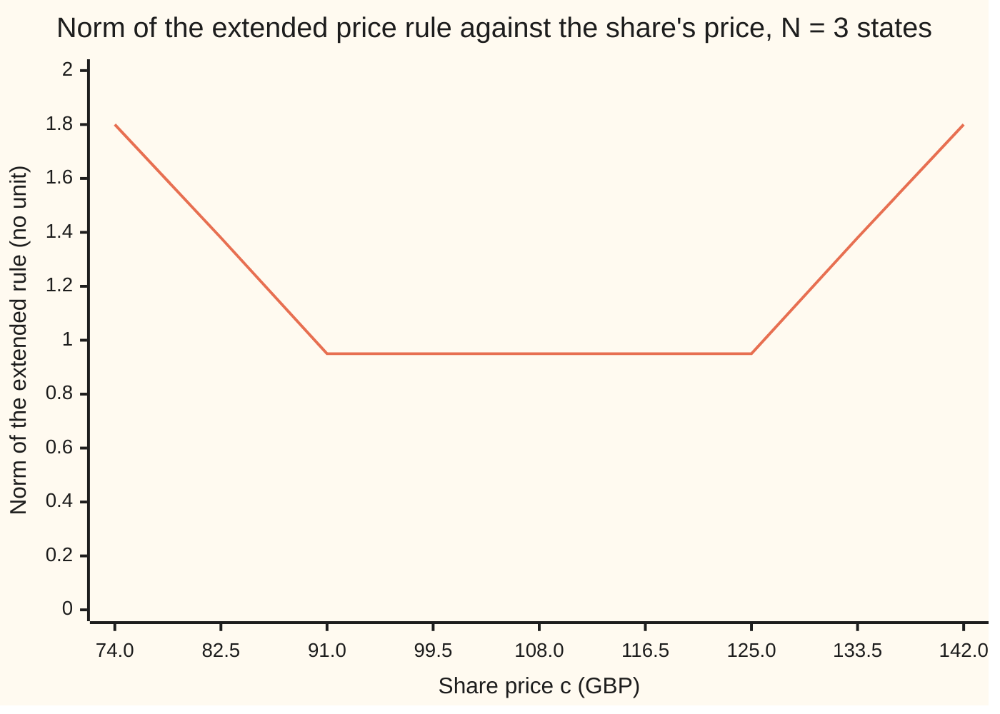
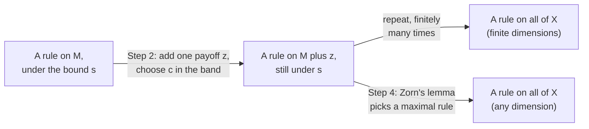

# Hahn-Banach: a measurement on part of a space extends to all of it, no bigger

[Syllabus](../../../SYLLABUS.md) → [Functional analysis](../README.md) → [Normed and Banach Spaces](../README.md#s01) → Hahn-Banach

---

## General Overview

A small market runs for one year and can end in three ways: a down state, a flat state or an up state. Two bonds trade in it. A government bond pays £100 in every state and costs £95 today. A corporate bond pays £100, except in the down state, where it defaults and pays £40. It costs £89. All prices on this card are illustrative.

Those two prices give a **price rule** for every holding of bonds. Hold $`a`$ government bonds and $`b`$ corporate bonds, and the rule charges $`95a + 89b`$ pounds. The rule is linear: double the holding and the price doubles; add two holdings and their prices add. It is also bounded. No bond holding's price is bigger in size than 0.95 times its largest payoff in any state, and the government bond meets that bound exactly.

Now a share fund comes to market. It pays £60, £100 or £140 in the three states. The bonds cannot copy that payoff, so their rule says nothing about its price. Can the rule be extended to every portfolio of bonds and shares, still linear, and still never more than 0.95 times the largest payoff?

Yes. Any share price from £91 to £125 works, and nothing outside that band does. The motivating case is on [The fundamental theorems](../../12-Financial%20mathematics/05-Black-Scholes%20from%20the%20Ground%20Up/02-risk-neutral-measure-and-the-fundamental-theorems.md): in an incomplete market, no arbitrage pins a new payoff's price only to a band. The Hahn-Banach theorem says such an extension always exists, in any space with a size rule (a norm), finite or infinite. It may not be unique, but it never has to grow.

**A linear measurement that is defined on part of a space, and kept under a size bound there, extends to the whole space without breaking that bound.**

**What kind of fact this is:** a theorem, proved on this card in Why it works. The one-step extension is proved by hand. The standard proof of the full theorem finishes with Zorn's lemma, a form of the axiom of choice; some form of choice cannot be avoided. The code checks the three-state market exactly; it checks no infinite case.

### The picture: one share price, one norm



The line is the norm of the extended rule: the most it charges per £1 of largest payoff. It stays at the bonds' 0.95 for every share price from £91 to £125. Outside the band it climbs, and the bound breaks.

---

## The formula

Notation first, in words.

- A **vector space** is a set of objects that can be added and scaled. Here X is the space of all payoffs: lists of three numbers, in pounds, one per state.
- A **subspace** M is a part of X that is closed under adding and scaling. Here M is every payoff the two bonds can make.
- The **sup norm** $`\lVert x\rVert_\infty`$ is the size of a payoff: its largest entry, ignoring sign ([Normed and Banach spaces](01-normed-spaces-and-banach-spaces.md)).
- A **functional** is a linear rule that turns each payoff into one number. The bonds' price rule $`\varphi`$ (said "phi") is a functional on M.
- A **bounded functional** has a finite **norm** $`\lVert\varphi\rVert`$: the largest value of $`\lvert\varphi(m)\rvert / \lVert m\rVert_\infty`$ over nonzero m in M.
- A **sublinear bound** $`s`$ never adds up to more than its parts and scales with positive multiples: $`s(x + y) \le s(x) + s(y)`$ and $`s(\lambda x) = \lambda s(x)`$ for every $`\lambda \ge 0`$. Here $`s(x) = 0.95\,\lVert x\rVert_\infty`$.

The theorem:

```math
\varphi(m) \le s(m) \text{ for every } m \text{ in } M \;\Longrightarrow\; \text{some linear } \Phi \text{ on } X \text{ has } \Phi = \varphi \text{ on } M \text{ and } \Phi(x) \le s(x) \text{ for every } x \text{ in } X
```

**Read it aloud:** if a linear rule stays under a sublinear bound on part of the space, then some linear rule on the whole space agrees with it there and stays under the same bound everywhere.

Take the bound $`s(x) = \lVert\varphi\rVert\,\lVert x\rVert`$ and the theorem keeps the norm:

```math
\lVert \Phi \rVert = \lVert \varphi \rVert
```

The proof works one new direction at a time. Adding a payoff z outside M means choosing its value $`c = \Phi(z)`$. The bound allows exactly the values in this band:

```math
\sup_{m \in M} \big[\varphi(m) - s(m - z)\big] \;\le\; c \;\le\; \inf_{m \in M} \big[s(m + z) - \varphi(m)\big]
```

Here sup means the least upper bound of the values (the largest, or the limit they climb to), and inf means the greatest lower bound.

**Read it aloud:** the new value must sit above every lower limit the old rule forces and below every upper limit, and there is always room between them.

In the market, z is the share and the band is £91 to £125.

| Symbol | Plain meaning | In our example | Push it up and the answer… |
| --- | --- | --- | --- |
| $`X`$, $`M`$ | the whole space; the subspace where the rule is known | all payoffs; every bond holding | a bigger M leaves a narrower band |
| $`m`$, $`m_1`$, $`m_2`$, $`x`$ | payoffs in M; a payoff in X | the government bond, (100, 100, 100) | — |
| $`z`$ | the new payoff added in one step | the share, (60, 100, 140) | — |
| $`\lVert x\rVert_\infty`$ | sup norm: largest payoff in size | 140 for the share | — |
| $`\varphi`$ | the known rule on M | 95a + 89b pounds | — |
| $`\lVert\varphi\rVert`$ | the rule's norm: worst price per £1 of size | 0.95 | higher ceiling everywhere |
| $`s`$ | the sublinear bound | $`0.95\,\lVert x\rVert_\infty`$ | wider band |
| $`\Phi`$ | the extended rule on X | any share price in the band | — |
| $`c`$ | the extended rule's value on z | £91 to £125 | outside the band, the norm grows |
| $`w_d`$, $`w_f`$, $`w_u`$ | state prices: what £1 in one state costs today | 0.10, 0.425, 0.425 at c = £108 | — |
| $`a`$, $`b`$, $`\lambda`$, $`t`$, $`r`$, $`N`$, $`n`$ | plain numbers: bonds held of each kind, a positive scale, a multiple of z, its size, the number of states, an hour in Step 5 | a = 8/15, b = 2/3 at the floor; N = 3; n up to 16,383 | a larger N makes a non-convex bound cost N-fold |
| $`\ell^\infty`$, $`L^p`$ | spaces from earlier cards: bounded sequences; functions whose p-th power has a finite integral | hourly prices run forever | — |

### When it holds

- **The bound is sublinear, so convex.** Swap in a square-root size rule, which is not convex, and start from the government bond's line (its multiples) alone. The best extension then needs a bound 3 times the old one at N = 3 states, and N times at N states. In infinite dimensions that becomes no bounded extension at all.
- **The rule is linear on a true subspace.** The bound must hold on every combination of the bonds, not just on the two bonds alone. Otherwise there is nothing consistent to extend.
- **Real numbers.** This statement uses real scalars. Complex scalars need one short extra step on the real part, not shown here.
- **Choice, in infinite dimensions.** With finitely many directions, finitely many steps finish. For a space like $`\ell^\infty`$, the bounded sequences, the standard proof uses Zorn's lemma. Set theory without any form of choice cannot prove the theorem there.
- **No completeness needed.** The theorem holds in any normed space, complete or not.

---

## Why it works

### Step 0: one new direction costs one number, and the bound leaves room for it

A linear rule is fixed by its values on a basis. So extending from M to M plus one new payoff z needs one number: the value c given to z. Every other new value follows by linearity.

The bound turns into a floor and a ceiling for c, and sublinearity keeps the floor under the ceiling.



### Step 1: the bonds fix part of the answer

On three payoffs, a linear rule is three **state prices** $`w_d`$, $`w_f`$, $`w_u`$: the cost today of £1 paid only in the down, flat or up state. The rule's value on a payoff is the sum of each payoff times its state price.

The bonds give two equations:

- Government bond: $`100(w_d + w_f + w_u) = 95`$.
- Corporate bond: $`40 w_d + 100(w_f + w_u) = 89`$.

Subtracting the second from the first gives $`w_d = 0.10`$, and then $`w_f + w_u = 0.85`$. One number is still free.

Under the sup norm, a rule's norm is the sum of the sizes of its state prices: $`\lvert w_d\rvert + \lvert w_f\rvert + \lvert w_u\rvert`$. Each payoff entry is at most $`\lVert x\rVert_\infty`$ in size, so the rule's value is at most that sum times $`\lVert x\rVert_\infty`$. The payoff with entries ±1 matching the signs of the state prices meets it.

So the norm stays at 0.95 exactly when no state price is negative. The norm bound and "no state costs less than nothing" are the same condition here. The bonds' own norm on M is 0.95: the government bond reaches it, and no bond holding exceeds it.

### Step 2: the one-step band

Write $`c = \Phi(z)`$ for the share's price. Linearity forces $`\Phi(m + z) = \varphi(m) + c`$ and $`\Phi(m - z) = \varphi(m) - c`$. Asking both to stay under s gives, for every m in M:

```math
\varphi(m) - s(m - z) \;\le\; c \;\le\; s(m + z) - \varphi(m)
```

The lower limits never pass the upper ones. For any two bond holdings $`m_1`$ and $`m_2`$, linearity and then sublinearity give

```math
\varphi(m_1) + \varphi(m_2) = \varphi(m_1 + m_2) \le s(m_1 + m_2) \le s(m_1 - z) + s(m_2 + z)
```

Move terms across, and every lower limit sits under every upper limit. So the sup of the lower limits is at most the inf of the upper ones, and any c between them works.

In the market, two bond holdings set the band's ends.

- **The floor, £91.** Hold 8/15 of a government bond and 2/3 of a corporate bond. That holding costs £110. Minus the share, it pays (20, 20, −20), of size 20, and $`s = 0.95 \times 20 = 19`$. So $`c \ge 110 - 19 = 91`$.
- **The ceiling, £125.** Hold 2/15 of a government bond and sell 4/3 of a corporate bond. That holding costs −£106: it brings in £106. Plus the share, it pays (20, −20, 20), so again s = 19. So $`c \le 19 + 106 = 125`$.

<details>
<summary>Detailed proof: the band is never empty, and the extended rule obeys the bound</summary>

Fix bond holdings $`m_1`$ and $`m_2`$ in M. The chain above, rearranged, reads

$`\displaystyle \varphi(m_1) - s(m_1 - z) \le s(m_2 + z) - \varphi(m_2).`$

The left side depends only on $`m_1`$ and the right only on $`m_2`$. So the sup of the left over all $`m_1`$ is at most the inf of the right over all $`m_2`$. Call them lo and hi, and pick any c with lo ≤ c ≤ hi.

Define $`\Phi(m + tz) = \varphi(m) + tc`$ for m in M and any real t. It is linear and agrees with $`\varphi`$ on M. For t > 0, divide m by t:

$`\displaystyle \Phi(m + tz) = t\big[\varphi(m/t) + c\big] \le t\, s(m/t + z) = s(m + tz),`$

using $`c \le s(m/t + z) - \varphi(m/t)`$ and then positive scaling of s. For t < 0, write t = −r with r > 0:

$`\displaystyle \Phi(m - rz) = r\big[\varphi(m/r) - c\big] \le r\, s(m/r - z) = s(m - rz),`$

using $`c \ge \varphi(m/r) - s(m/r - z)`$. For t = 0 it is the old bound. So $`\Phi \le s`$ on all of M plus z.

</details>

### Step 3: the bound holds both ways, so the norm is kept

The theorem gives $`\Phi(x) \le s(x)`$ from above only. Apply it to −x: $`-\Phi(x) = \Phi(-x) \le \lVert\varphi\rVert\,\lVert -x\rVert = \lVert\varphi\rVert\,\lVert x\rVert`$. So $`\lvert\Phi(x)\rvert \le \lVert\varphi\rVert\,\lVert x\rVert`$, and $`\lVert\Phi\rVert \le \lVert\varphi\rVert`$. It cannot be smaller, since $`\Phi`$ agrees with $`\varphi`$ on M.

At the midpoint price c = £108, the state prices are 0.10, 0.425 and 0.425. They sum to 0.95, the norm of the bonds' rule.

The same step gives a **norming functional**: for any nonzero x, a rule of norm 1 that reads off x's size exactly. Start on the multiples of x, giving $`t x`$ the value $`t\lVert x\rVert`$, and extend. For the share, the rule (0, 0, 1) reads £140 = $`\lVert z\rVert_\infty`$, with norm 1. In a general infinite-dimensional normed space, Hahn-Banach is what guarantees such a rule.

### Step 4: infinitely many directions, by Zorn's lemma

If a countable list of payoffs comes arbitrarily close to every payoff, Step 2 can run along the list, one payoff at a time, and the bound then extends the rule to the limits. No choice is needed. But a space like $`\ell^\infty`$ has no countable list that reaches every element, even approximately. Step 2 alone never ends.

Zorn's lemma finishes it. In a partly ordered set where every chain (a part in which every two members compare) has an upper bound, some member is maximal: nothing sits strictly above it. It is equivalent to the axiom of choice and taught on [Compactness with no distances, and Tychonoff](../../17-Topology/02-Topological%20Spaces/06-compactness-and-tychonoff.md).

1. **Collect partial extensions.** Take every pair (subspace L containing M, linear rule on L) that agrees with $`\varphi`$ on M and stays under s. Order them by "the larger subspace, with a rule that agrees on the smaller".
2. **Chains have upper bounds.** Along a chain, take the union of the subspaces and let each rule decide its own part. Any two payoffs lie in one member of the chain, so the union rule is linear and stays under s.
3. **Pick a maximal one (choice enters here).** Zorn's lemma gives a partial extension with nothing above it.
4. **It covers all of X.** If some payoff z were missing, Step 2 would add z and make something strictly bigger. So nothing is missing.

The proof says an extension exists. It gives no recipe for choosing one.

### Step 5: what changes in infinite dimensions: a long-run average with no recipe

The shelf's house example is hourly electricity prices in £/MWh, here run forever as a bounded sequence. The **long-run average** is a linear rule on the sequences whose running average (the mean of the first n hours) settles to a limit. It sits under the sublinear bound s(x) = the limsup of the running averages: the largest value they keep coming back near.

Take an illustrative price of £120 in peak blocks and £40 in every other hour. The peak blocks are hour 1, hours 4 to 7, hours 16 to 31, hours 64 to 127, and so on: each starts at a power of 4 and lasts that many hours. The blocks grow so fast that the running average never settles:

| Hour n | 7 | 15 | 31 | 63 | 127 | 255 | 2047 | 4095 | 8191 | 16383 |
| --- | ---: | ---: | ---: | ---: | ---: | ---: | ---: | ---: | ---: | ---: |
| Running average (£/MWh) | 97.14 | 66.67 | 94.19 | 66.67 | 93.54 | 66.67 | 93.35 | 66.67 | 93.34 | 66.67 |

After each peak block the average sits near 93.33; after each off-peak block it is exactly 66.67. The swing never closes as n grows. By Step 2, any extension of the long-run average under this bound gives the sequence a value from £66.67 to £93.33 per MWh. Which value depends on a choice that no formula makes. Every such extension also ignores a shift by one hour, since a sequence minus its shift has running averages that fall to 0; these extensions are called Banach limits. Without some form of choice, set theory cannot prove that even one exists.

---

## Worked numbers, by hand

| Step | Arithmetic | Value |
| --- | --- | --- |
| down-state price | $`(95 - 89) / (100 - 40)`$ | $`w_d = 0.10`$ |
| flat plus up | $`95/100 - 0.10`$ | $`w_f + w_u = 0.85`$ |
| share price, in terms of $`w_u`$ | $`60(0.10) + 100(0.85 - w_u) + 140 w_u`$ | $`91 + 40 w_u`$ |
| norm of the rule | $`0.10 + \lvert 0.85 - w_u\rvert + \lvert w_u\rvert`$ | 0.95 only if $`0 \le w_u \le 0.85`$ |
| floor, $`w_u = 0`$ | $`91 + 0`$ | **£91** |
| ceiling, $`w_u = 0.85`$ | $`91 + 40 \times 0.85`$ | **£125** |
| midpoint rule | $`w_u = 0.425`$, $`c = 91 + 40 \times 0.425`$ | £108, state prices 0.10, 0.425, 0.425 |

Every share price from £91 to £125 extends the bonds' rule and keeps its norm at 0.95, so Hahn-Banach allows the closed band. In finance, only the prices strictly inside it allow no arbitrage. At each end one state price is 0: $`w_u`$ at £91, $`w_f`$ at £125. There a bond holding costs the same as the share and pays the same in two states but a different amount in the third, so trading the difference is free money. That is why [The fundamental theorems](../../12-Financial%20mathematics/05-Black-Scholes%20from%20the%20Ground%20Up/02-risk-neutral-measure-and-the-fundamental-theorems.md) asks every state price to be strictly above 0.

### What breaks if you drop a piece

| Mistake | Comes out at | What went wrong |
| --- | --- | --- |
| Share priced at £131, outside the band | norm 1.25; flat-state price −0.15 | The bound fails; £1 in the flat state would cost less than nothing |
| Extend by pricing the share at £0 | norm 5.50; state prices 0.10, 3.125, −2.275 | A complement chosen without the bound inflates the norm |
| A square-root size rule, not convex | best bound 0.316667 against 0.105556 on the government bond's line at N = 3 | The bound is not sublinear: £1 in each of two states has size 4.00, not 2.00 |
| Same rule at N = 100 states | best bound 0.009500 against 0.000095: ratio 100.00 | The cost grows N-fold and never closes |

The square-root size of a payoff is the square of the sum of the square roots of its entries' sizes. Any extension must put at least 0.95/N on some state, while the government bond's line (here the whole subspace M) needs only 0.95/N². In infinite dimensions the ratio grows without bound. On $`L^p`$ of an interval with p below 1, cutting the interval into N equal pieces gives the same count with a factor that grows with N, so the rule on the constant functions has no bounded extension at all.

---

## Code, from first principles, and it actually runs

The code reaches the share's price band **three independent ways**:

1. Road 1 minimises the one-step formula over bond holdings, by searching by thirds (keeping the part of the interval where a convex minimum must lie).
2. Road 2 solves for the state prices and requires none to be negative.
3. Road 3 solves the pricing equations at share prices £0.25 apart and keeps those whose rule has norm 0.95, testing every payoff with entries ±1.

It also checks the hand witnesses, the bound on 343 test payoffs, the what-breaks rows, the N-fold trend, and the electricity averages against a closed-form count.

What the truncation hides: three states and 16,383 hours need only finitely many uses of Step 2, so no run ever reaches the choice step of Step 4.

### Python

```python
# Hahn-Banach check: extend a bond price rule to every portfolio, keeping its norm.
# Standard library only.  Three states (down, flat, up), payoffs and prices in pounds,
# all prices illustrative.  Nothing imported knows the answer: the searches are written out.
from itertools import product

G, B, Z = (100, 100, 100), (40, 100, 100), (60, 100, 140)  # government bond, corporate bond, share
PG, PB, BOUND = 95.0, 89.0, 0.95                           # bond prices; the bound s(x) = 0.95|x|
SIGNS = list(product((-1, 1), repeat=3))

def size(x): return max(abs(v) for v in x)                 # sup norm: the largest payoff in size
def value(w, x): return sum(w[i] * x[i] for i in range(3))  # price of payoff x under state prices w
def dnorm(w): return max(abs(value(w, s)) for s in SIGNS)  # norm of a rule: worst case on |x| = 1
def phi(a, b): return a * PG + b * PB                      # the price rule on M = all a*G + b*B
def port(a, b, k): return [a * G[i] + b * B[i] + k * Z[i] for i in range(3)]

def tmin(f, lo=-4.0, hi=4.0):                              # minimum of a convex f, by thirds
    for _ in range(200):
        m1, m2 = lo + (hi - lo) / 3, hi - (hi - lo) / 3
        if f(m1) <= f(m2): hi = m2
        else: lo = m1
    return f((lo + hi) / 2)

def min2(f): return tmin(lambda a: tmin(lambda b: f(a, b)))

def det(m):
    return (m[0][0] * (m[1][1] * m[2][2] - m[1][2] * m[2][1]) - m[0][1] * (m[1][0] * m[2][2]
            - m[1][2] * m[2][0]) + m[0][2] * (m[1][0] * m[2][1] - m[1][1] * m[2][0]))

def solve(c):                                              # state prices that price G, B and Z at c
    a, r = [G, B, Z], [PG, PB, c]
    return [det([[r[i] if j == k else a[i][j] for j in range(3)] for i in range(3)]) / det(a)
            for k in range(3)]

print("three states (down, flat, up); G = (100,100,100) at 95, B = (40,100,100) at 89")
onM = max(abs(phi(1, t / 1e5)) / size(port(1, t / 1e5, 0)) for t in range(-200000, 200001))
print(f"norm of the bond rule on M, scan of 400001 portfolios: {onM:.6f}")
assert abs(onM - PG / size(G)) < 1e-9, "the rule's norm on M is the government bond's ratio"

# road 1: the one-step band, lo = sup[phi(m) - s(m - z)], hi = inf[s(m + z) - phi(m)]
hi1 = min2(lambda a, b: BOUND * size(port(a, b, 1)) - phi(a, b))
lo1 = -min2(lambda a, b: BOUND * size(port(a, b, -1)) - phi(a, b))
# road 2: state prices; the bonds fix w_d and w_f + w_u, the share's price runs with w_u = t
wd = (PG - PB) / (G[0] - B[0]); rest = PG / 100 - wd
lo2, hi2 = value((wd, rest, 0), Z), value((wd, 0, rest), Z)
# road 3: solve for the rule at each share price c and keep the c whose norm stays 0.95
ok = [c / 4 for c in range(280, 585) if dnorm(solve(c / 4)) <= BOUND + 1e-9]
lo3, hi3 = min(ok), max(ok)
print(f"forced: w_d = {wd:.4f}, w_f + w_u = {rest:.4f}")
for name, lo, hi in [("road 1, one-step formula", lo1, hi1),
                     ("road 2, state prices >= 0", lo2, hi2), ("road 3, scan of c", lo3, hi3)]:
    print(f"{name:<27} share price band: {lo:.2f} to {hi:.2f}")
assert abs(lo1 - lo2) < 1e-6 and abs(hi1 - hi2) < 1e-6, "one-step formula against state prices"
assert abs(lo3 - lo2) < 1e-9 and abs(hi3 - hi2) < 1e-9, "norm scan against state prices"
for name, a, b, k in [("lo witness: m = (8/15)G + (2/3)B, m - z", 8 / 15, 2 / 3, -1),
                      ("hi witness: m = (2/15)G - (4/3)B, m + z", 2 / 15, -4 / 3, 1)]:
    y, s = port(a, b, k), BOUND * size(port(a, b, k))
    print(f"{name} = ({y[0]:.2f}, {y[1]:.2f}, {y[2]:.2f}), phi(m) = {phi(a, b):.2f}, s = {s:.2f}")
    assert abs(k * (s - phi(a, b)) - (lo2 if k < 0 else hi2)) < 1e-9, "a hand witness hits the band's end"

mid = solve((lo2 + hi2) / 2)
grid = list(product(range(-3, 4), repeat=3))
excess = max(value(mid, x) - BOUND * size(x) for x in grid)
print(f"midpoint c = {(lo2 + hi2) / 2:.2f}: w = ({mid[0]:.4f}, {mid[1]:.4f}, {mid[2]:.4f}), "
      f"norm {dnorm(mid):.4f}, sum of |w| {sum(abs(v) for v in mid):.4f}")
print(f"  largest Phi(x) - 0.95|x| over {len(grid)} payoffs: {abs(excess):.4f}")
assert excess < 1e-9 and abs(value(mid, G) - PG) < 1e-9 and abs(value(mid, B) - PB) < 1e-9
norming = (0, 0, 1)
print(f"norming rule for z: w = (0, 0, 1), value {value(norming, Z):.2f}, |z| = {size(Z):.2f}, "
      f"norm {dnorm(norming):.2f}")

print("chart, share price c:  " + " ".join(f"{c / 2:.1f}" for c in range(148, 285, 17)))
print("chart, norm of rule:   " + " ".join(f"{dnorm(solve(c / 2)):.2f}" for c in range(148, 285, 17)))
for c in (131.0, 0.0):
    w = solve(c)
    bad = max(value(w, x) - BOUND * size(x) for x in grid)
    print(f"breaks, share at {c:6.2f}: w = ({w[0]:.4f}, {w[1]:.4f}, {w[2]:.4f}), norm {dnorm(w):.4f},"
          f" worst excess {bad:.4f}")
    assert dnorm(w) > BOUND + 0.1 and abs(dnorm(w) - sum(abs(v) for v in w)) < 1e-9

def qsize(x): return sum(abs(v) ** 0.5 for v in x) ** 2   # the square-root size rule, not convex
print(f"square-root rule: size(e1) + size(e2) = 2.00, size(e1 + e2) = {qsize([1, 1]):.2f}")
for n in (3, 10, 100):
    line = PG / qsize([100] * n)
    w = [PG / 100 / n] * n                                 # spread the price evenly: the best case
    tests = [[1.0 if i == j else 0.0 for i in range(n)] for j in range(n)] + [[1.0] * n]
    best = max(abs(sum(w[i] * x[i] for i in range(n))) / qsize(x) for x in tests)
    print(f"  N = {n:3d}: bound on the bond line {line:.6f}, best extension {best:.6f},"
          f" ratio {best / line:.2f}")
    assert abs(best / line - n) < 1e-9, "the forced bound grows N-fold"

total, high, p, n, rows = 0.0, 0, 1, 0, []                 # hourly prices 120 on [4^k, 2*4^k)
for k in range(1, 7):
    for stop in (2 * 4 ** k - 1, 4 ** (k + 1) - 1):
        while n < stop:
            n += 1
            if p * 4 <= n: p *= 4
            price = 120.0 if n < 2 * p else 40.0
            total += price; high += price > 100
        assert high == (4 ** (k + 1) - 1) // 3, "count of peak hours against the closed form"
        rows.append(f"{stop}: {total / stop:.2f}")
print("peak blocks at GBP 120/MWh, else 40: hours 1, " + ", ".join(f"{4 ** j}-{2 * 4 ** j - 1}" for j in range(1, 4)))
print("running average, GBP/MWh, at hour " + ", ".join(rows[:6]))
print("                                  " + ", ".join(rows[6:]))
print(f"band for the long-run average: {40 + 80 / 3:.2f} to {40 + 160 / 3:.2f}")
for pb, z in [(92.0, Z), (PB, (60, 100, 100))]:
    d = (PG - pb) / (G[0] - B[0]); r = PG / 100 - d
    print(f"try: B at {pb:.2f}, share ({z[0]}, {z[1]}, {z[2]}): band {value((d, r, 0), z):.2f}"
          f" to {value((d, 0, r), z):.2f}")
print("ALL CHECKS PASS")
```

**Ran 2026-11-15 on macOS, Python 3.14.10, standard library only. All checks passed. Output, pasted from the run:**

```
three states (down, flat, up); G = (100,100,100) at 95, B = (40,100,100) at 89
norm of the bond rule on M, scan of 400001 portfolios: 0.950000
forced: w_d = 0.1000, w_f + w_u = 0.8500
road 1, one-step formula    share price band: 91.00 to 125.00
road 2, state prices >= 0   share price band: 91.00 to 125.00
road 3, scan of c           share price band: 91.00 to 125.00
lo witness: m = (8/15)G + (2/3)B, m - z = (20.00, 20.00, -20.00), phi(m) = 110.00, s = 19.00
hi witness: m = (2/15)G - (4/3)B, m + z = (20.00, -20.00, 20.00), phi(m) = -106.00, s = 19.00
midpoint c = 108.00: w = (0.1000, 0.4250, 0.4250), norm 0.9500, sum of |w| 0.9500
  largest Phi(x) - 0.95|x| over 343 payoffs: 0.0000
norming rule for z: w = (0, 0, 1), value 140.00, |z| = 140.00, norm 1.00
chart, share price c:  74.0 82.5 91.0 99.5 108.0 116.5 125.0 133.5 142.0
chart, norm of rule:   1.80 1.38 0.95 0.95 0.95 0.95 0.95 1.38 1.80
breaks, share at 131.00: w = (0.1000, -0.1500, 1.0000), norm 1.2500, worst excess 0.9000
breaks, share at   0.00: w = (0.1000, 3.1250, -2.2750), norm 5.5000, worst excess 13.6500
square-root rule: size(e1) + size(e2) = 2.00, size(e1 + e2) = 4.00
  N =   3: bound on the bond line 0.105556, best extension 0.316667, ratio 3.00
  N =  10: bound on the bond line 0.009500, best extension 0.095000, ratio 10.00
  N = 100: bound on the bond line 0.000095, best extension 0.009500, ratio 100.00
peak blocks at GBP 120/MWh, else 40: hours 1, 4-7, 16-31, 64-127
running average, GBP/MWh, at hour 7: 97.14, 15: 66.67, 31: 94.19, 63: 66.67, 127: 93.54, 255: 66.67
                                  511: 93.39, 1023: 66.67, 2047: 93.35, 4095: 66.67, 8191: 93.34, 16383: 66.67
band for the long-run average: 66.67 to 93.33
try: B at 92.00, share (60, 100, 140): band 93.00 to 129.00
try: B at 89.00, share (60, 100, 100): band 91.00 to 91.00
ALL CHECKS PASS
```

### Rust

```rust
// Hahn-Banach check: extend a bond price rule to every portfolio, keeping its norm.
// std only.  Three states (down, flat, up), payoffs and prices in pounds,
// all prices illustrative.  Nothing used knows the answer: the searches are written out.
const G: [f64; 3] = [100.0, 100.0, 100.0]; // government bond
const B: [f64; 3] = [40.0, 100.0, 100.0]; // corporate bond
const Z: [f64; 3] = [60.0, 100.0, 140.0]; // share
const PG: f64 = 95.0;
const PB: f64 = 89.0;
const BOUND: f64 = 0.95; // the bound s(x) = 0.95|x|

fn size(x: &[f64]) -> f64 { x.iter().fold(0.0, |m, v| m.max(v.abs())) }
fn value(w: &[f64], x: &[f64]) -> f64 { (0..3).map(|i| w[i] * x[i]).sum() }
fn signs() -> Vec<[f64; 3]> {
    let mut v = Vec::new();
    for a in [-1.0, 1.0] { for b in [-1.0, 1.0] { for c in [-1.0, 1.0] { v.push([a, b, c]); } } }
    v
}
fn dnorm(w: &[f64]) -> f64 { signs().iter().fold(0.0, |m, s| m.max(value(w, s).abs())) }
fn phi(a: f64, b: f64) -> f64 { a * PG + b * PB }
fn port(a: f64, b: f64, k: f64) -> [f64; 3] {
    [a * G[0] + b * B[0] + k * Z[0], a * G[1] + b * B[1] + k * Z[1], a * G[2] + b * B[2] + k * Z[2]]
}
fn tmin(f: &dyn Fn(f64) -> f64) -> f64 { // minimum of a convex f on [-4, 4], by thirds
    let (mut lo, mut hi) = (-4.0, 4.0);
    for _ in 0..200 {
        let (m1, m2) = (lo + (hi - lo) / 3.0, hi - (hi - lo) / 3.0);
        if f(m1) <= f(m2) { hi = m2 } else { lo = m1 }
    }
    f((lo + hi) / 2.0)
}
fn min2(f: &dyn Fn(f64, f64) -> f64) -> f64 { tmin(&|a| tmin(&|b| f(a, b))) }
fn det(m: &[[f64; 3]; 3]) -> f64 {
    m[0][0] * (m[1][1] * m[2][2] - m[1][2] * m[2][1]) - m[0][1] * (m[1][0] * m[2][2] - m[1][2] * m[2][0])
        + m[0][2] * (m[1][0] * m[2][1] - m[1][1] * m[2][0])
}
fn solve(c: f64) -> [f64; 3] { // state prices that price G, B and Z at c
    let (a, r) = ([G, B, Z], [PG, PB, c]);
    let mut w = [0.0; 3];
    for k in 0..3 {
        let mut m = a;
        for i in 0..3 { m[i][k] = r[i]; }
        w[k] = det(&m) / det(&a);
    }
    w
}
fn grid() -> Vec<[f64; 3]> {
    let mut v = Vec::new();
    for a in -3..4 { for b in -3..4 { for c in -3..4 { v.push([a as f64, b as f64, c as f64]); } } }
    v
}
fn qsize(x: &[f64]) -> f64 { x.iter().map(|v| v.abs().sqrt()).sum::<f64>().powi(2) }

fn main() {
    println!("three states (down, flat, up); G = (100,100,100) at 95, B = (40,100,100) at 89");
    let mut on_m: f64 = 0.0;
    for t in -200000..=200000 {
        let b = t as f64 / 1e5;
        on_m = on_m.max(phi(1.0, b).abs() / size(&port(1.0, b, 0.0)));
    }
    println!("norm of the bond rule on M, scan of 400001 portfolios: {:.6}", on_m);
    assert!((on_m - PG / size(&G)).abs() < 1e-9, "the rule's norm on M is the government bond's ratio");

    // road 1: the one-step band, lo = sup[phi(m) - s(m - z)], hi = inf[s(m + z) - phi(m)]
    let hi1 = min2(&|a, b| BOUND * size(&port(a, b, 1.0)) - phi(a, b));
    let lo1 = -min2(&|a, b| BOUND * size(&port(a, b, -1.0)) - phi(a, b));
    // road 2: state prices; the bonds fix w_d and w_f + w_u, the share's price runs with w_u = t
    let wd = (PG - PB) / (G[0] - B[0]);
    let rest = PG / 100.0 - wd;
    let (lo2, hi2) = (value(&[wd, rest, 0.0], &Z), value(&[wd, 0.0, rest], &Z));
    // road 3: solve for the rule at each share price c and keep the c whose norm stays 0.95
    let ok: Vec<f64> = (280..585).map(|c| c as f64 / 4.0).filter(|&c| dnorm(&solve(c)) <= BOUND + 1e-9).collect();
    let (lo3, hi3) = (ok.iter().cloned().fold(f64::MAX, f64::min), ok.iter().cloned().fold(f64::MIN, f64::max));
    println!("forced: w_d = {:.4}, w_f + w_u = {:.4}", wd, rest);
    for (name, lo, hi) in [("road 1, one-step formula", lo1, hi1),
                           ("road 2, state prices >= 0", lo2, hi2), ("road 3, scan of c", lo3, hi3)] {
        println!("{:<27} share price band: {:.2} to {:.2}", name, lo, hi);
    }
    assert!((lo1 - lo2).abs() < 1e-6 && (hi1 - hi2).abs() < 1e-6, "one-step formula against state prices");
    assert!((lo3 - lo2).abs() < 1e-9 && (hi3 - hi2).abs() < 1e-9, "norm scan against state prices");
    for (name, a, b, k) in [("lo witness: m = (8/15)G + (2/3)B, m - z", 8.0 / 15.0, 2.0 / 3.0, -1.0),
                            ("hi witness: m = (2/15)G - (4/3)B, m + z", 2.0 / 15.0, -4.0 / 3.0, 1.0)] {
        let (y, s) = (port(a, b, k), BOUND * size(&port(a, b, k)));
        println!("{} = ({:.2}, {:.2}, {:.2}), phi(m) = {:.2}, s = {:.2}", name, y[0], y[1], y[2], phi(a, b), s);
        let end = if k < 0.0 { lo2 } else { hi2 };
        assert!((k * (s - phi(a, b)) - end).abs() < 1e-9, "a hand witness hits the band's end");
    }

    let mid = solve((lo2 + hi2) / 2.0);
    let gr = grid();
    let excess = gr.iter().fold(f64::MIN, |m, x| m.max(value(&mid, x) - BOUND * size(x)));
    println!("midpoint c = {:.2}: w = ({:.4}, {:.4}, {:.4}), norm {:.4}, sum of |w| {:.4}",
             (lo2 + hi2) / 2.0, mid[0], mid[1], mid[2], dnorm(&mid), mid.iter().map(|v| v.abs()).sum::<f64>());
    println!("  largest Phi(x) - 0.95|x| over {} payoffs: {:.4}", gr.len(), excess.abs());
    assert!(excess < 1e-9 && (value(&mid, &G) - PG).abs() < 1e-9 && (value(&mid, &B) - PB).abs() < 1e-9);
    let norming = [0.0, 0.0, 1.0];
    println!("norming rule for z: w = (0, 0, 1), value {:.2}, |z| = {:.2}, norm {:.2}",
             value(&norming, &Z), size(&Z), dnorm(&norming));

    let cs: Vec<f64> = (0..9).map(|i| (148 + 17 * i) as f64 / 2.0).collect();
    println!("chart, share price c:  {}", cs.iter().map(|c| format!("{:.1}", c)).collect::<Vec<_>>().join(" "));
    println!("chart, norm of rule:   {}", cs.iter().map(|&c| format!("{:.2}", dnorm(&solve(c)))).collect::<Vec<_>>().join(" "));
    for c in [131.0, 0.0] {
        let w = solve(c);
        let bad = gr.iter().fold(f64::MIN, |m, x| m.max(value(&w, x) - BOUND * size(x)));
        println!("breaks, share at {:6.2}: w = ({:.4}, {:.4}, {:.4}), norm {:.4}, worst excess {:.4}",
                 c, w[0], w[1], w[2], dnorm(&w), bad);
        assert!(dnorm(&w) > BOUND + 0.1 && (dnorm(&w) - w.iter().map(|v| v.abs()).sum::<f64>()).abs() < 1e-9);
    }

    println!("square-root rule: size(e1) + size(e2) = 2.00, size(e1 + e2) = {:.2}", qsize(&[1.0, 1.0]));
    for n in [3usize, 10, 100] {
        let line = PG / qsize(&vec![100.0; n]);
        let w = vec![PG / 100.0 / n as f64; n]; // spread the price evenly: the best case
        let mut tests: Vec<Vec<f64>> = (0..n).map(|j| (0..n).map(|i| if i == j { 1.0 } else { 0.0 }).collect()).collect();
        tests.push(vec![1.0; n]);
        let best = tests.iter().fold(0.0f64, |m, x| m.max((0..n).map(|i| w[i] * x[i]).sum::<f64>().abs() / qsize(x)));
        println!("  N = {:3}: bound on the bond line {:.6}, best extension {:.6}, ratio {:.2}", n, line, best, best / line);
        assert!((best / line - n as f64).abs() < 1e-9, "the forced bound grows N-fold");
    }

    let (mut total, mut high, mut p, mut n) = (0.0f64, 0u64, 1u64, 0u64); // 120 on [4^k, 2*4^k)
    let mut rows: Vec<String> = Vec::new();
    for k in 1..7u32 {
        for stop in [2 * 4u64.pow(k) - 1, 4u64.pow(k + 1) - 1] {
            while n < stop {
                n += 1;
                if p * 4 <= n { p *= 4; }
                let price = if n < 2 * p { 120.0 } else { 40.0 };
                total += price;
                if price > 100.0 { high += 1; }
            }
            assert!(high == (4u64.pow(k + 1) - 1) / 3, "count of peak hours against the closed form");
            rows.push(format!("{}: {:.2}", stop, total / stop as f64));
        }
    }
    let blocks: Vec<String> = (1..4u32).map(|j| format!("{}-{}", 4u64.pow(j), 2 * 4u64.pow(j) - 1)).collect();
    println!("peak blocks at GBP 120/MWh, else 40: hours 1, {}", blocks.join(", "));
    println!("running average, GBP/MWh, at hour {}", rows[..6].join(", "));
    println!("                                  {}", rows[6..].join(", "));
    println!("band for the long-run average: {:.2} to {:.2}", 40.0 + 80.0 / 3.0, 40.0 + 160.0 / 3.0);
    for (pb, z) in [(92.0, Z), (PB, [60.0, 100.0, 100.0])] {
        let d = (PG - pb) / (G[0] - B[0]);
        let r = PG / 100.0 - d;
        println!("try: B at {:.2}, share ({}, {}, {}): band {:.2} to {:.2}", pb, z[0], z[1], z[2],
                 value(&[d, r, 0.0], &z), value(&[d, 0.0, r], &z));
    }
    println!("ALL CHECKS PASS");
}
```

**Ran 2026-11-15 on macOS, rustc 1.98.1, no crates. All checks passed. Output, pasted from the run:**

```
three states (down, flat, up); G = (100,100,100) at 95, B = (40,100,100) at 89
norm of the bond rule on M, scan of 400001 portfolios: 0.950000
forced: w_d = 0.1000, w_f + w_u = 0.8500
road 1, one-step formula    share price band: 91.00 to 125.00
road 2, state prices >= 0   share price band: 91.00 to 125.00
road 3, scan of c           share price band: 91.00 to 125.00
lo witness: m = (8/15)G + (2/3)B, m - z = (20.00, 20.00, -20.00), phi(m) = 110.00, s = 19.00
hi witness: m = (2/15)G - (4/3)B, m + z = (20.00, -20.00, 20.00), phi(m) = -106.00, s = 19.00
midpoint c = 108.00: w = (0.1000, 0.4250, 0.4250), norm 0.9500, sum of |w| 0.9500
  largest Phi(x) - 0.95|x| over 343 payoffs: 0.0000
norming rule for z: w = (0, 0, 1), value 140.00, |z| = 140.00, norm 1.00
chart, share price c:  74.0 82.5 91.0 99.5 108.0 116.5 125.0 133.5 142.0
chart, norm of rule:   1.80 1.38 0.95 0.95 0.95 0.95 0.95 1.38 1.80
breaks, share at 131.00: w = (0.1000, -0.1500, 1.0000), norm 1.2500, worst excess 0.9000
breaks, share at   0.00: w = (0.1000, 3.1250, -2.2750), norm 5.5000, worst excess 13.6500
square-root rule: size(e1) + size(e2) = 2.00, size(e1 + e2) = 4.00
  N =   3: bound on the bond line 0.105556, best extension 0.316667, ratio 3.00
  N =  10: bound on the bond line 0.009500, best extension 0.095000, ratio 10.00
  N = 100: bound on the bond line 0.000095, best extension 0.009500, ratio 100.00
peak blocks at GBP 120/MWh, else 40: hours 1, 4-7, 16-31, 64-127
running average, GBP/MWh, at hour 7: 97.14, 15: 66.67, 31: 94.19, 63: 66.67, 127: 93.54, 255: 66.67
                                  511: 93.39, 1023: 66.67, 2047: 93.35, 4095: 66.67, 8191: 93.34, 16383: 66.67
band for the long-run average: 66.67 to 93.33
try: B at 92.00, share (60, 100, 140): band 93.00 to 129.00
try: B at 89.00, share (60, 100, 100): band 91.00 to 91.00
ALL CHECKS PASS
```

### Lean

Lean proves Hahn-Banach for every real vector space and every real normed space, and checks the market's numbers as exact fractions.

- Take a linear rule on a subspace, kept under a sublinear bound s there. Then some linear rule on the whole space agrees with it there and stays under s everywhere.
- Take a bounded functional on a subspace of any normed space, complete or not. Then it extends to the whole space with the same norm.
- Take any nonzero x in a normed space. Then some rule of norm 1 reads off x's size exactly: a norming functional.
- The bonds' arithmetic holds exactly: the down-state price is 0.10, and the flat and up prices total 0.85.
- Take 8/15 of a government bond plus 2/3 of a corporate bond. Then it costs £110, minus the share it pays (20, 20, −20), and the floor is £91.
- Take 2/15 of a government bond, and sell 4/3 of a corporate bond. Then it costs −£106, plus the share it pays (20, −20, 20), and the ceiling is £125.
- Take the share price $`91 + 40 w_u`$. Then it is £91 at $`w_u = 0`$ and £125 at $`w_u = 0.85`$.
- Take state prices 0.10, 0.425 and 0.425. Then they price the bonds at £95 and £89 and the share at £108, and they sum to 0.95.

The three roads to the band, the square-root rule and the electricity averages are left to the Python and Rust checks.

```lean
-- Hahn-Banach: a linear rule kept under a sublinear bound on a subspace of a real vector space extends to the whole space under the same bound, and in a normed space it keeps its norm.
import Mathlib.Analysis.Convex.Cone.Extension
import Mathlib.Analysis.Normed.Module.HahnBanach

/-- Hahn-Banach, sublinear form. Let `X` be a real vector space, `M` a subspace, and `s` a
sublinear bound on `X`: `s (x + y) ≤ s x + s y`, and `s (t • x) = t * s x` for every `t ≥ 0`.
If a linear rule `φ` on `M` satisfies `φ m ≤ s m` for every `m` in `M`, then some linear rule
`Φ` on all of `X` agrees with `φ` on `M` and satisfies `Φ x ≤ s x` for every `x` in `X`. -/
theorem linear_rule_under_sublinear_bound_extends
    {X : Type*} [AddCommGroup X] [Module ℝ X]
    (M : Submodule ℝ X) (φ : M →ₗ[ℝ] ℝ) (s : X → ℝ)
    (hs_add : ∀ x y : X, s (x + y) ≤ s x + s y)
    (hs_smul : ∀ t : ℝ, 0 ≤ t → ∀ x : X, s (t • x) = t * s x)
    (hφ : ∀ m : M, φ m ≤ s m) :
    ∃ Φ : X →ₗ[ℝ] ℝ, (∀ m : M, Φ m = φ m) ∧ ∀ x : X, Φ x ≤ s x := by
  obtain ⟨g, hg, hle⟩ := exists_extension_of_le_sublinear ⟨M, φ⟩ s
    (fun c hc x => hs_smul c hc.le x) hs_add hφ
  exact ⟨g, hg, hle⟩

/-- Hahn-Banach, norm form. In any real normed space `X` (complete or not), a bounded linear
functional `φ` on a subspace `M` extends to a bounded linear functional `Φ` on all of `X`
that agrees with `φ` on `M` and has the same norm: `‖Φ‖ = ‖φ‖`. -/
theorem bounded_functional_extends_keeping_norm
    {X : Type*} [NormedAddCommGroup X] [NormedSpace ℝ X]
    (M : Submodule ℝ X) (φ : M →L[ℝ] ℝ) :
    ∃ Φ : X →L[ℝ] ℝ, (∀ m : M, Φ m = φ m) ∧ ‖Φ‖ = ‖φ‖ := by
  simpa using exists_extension_norm_eq M φ

/-- Norming functional. In any real normed space `X`, every nonzero `x` has a bounded linear
functional `g` of norm 1 that reads off its size exactly: `g x = ‖x‖`. -/
theorem norming_functional_exists
    {X : Type*} [NormedAddCommGroup X] [NormedSpace ℝ X]
    (x : X) (hx : x ≠ 0) :
    ∃ g : X →L[ℝ] ℝ, ‖g‖ = 1 ∧ g x = ‖x‖ := by
  simpa using exists_dual_vector ℝ x (norm_ne_zero_iff.mpr hx)

-- The card's three-state market, in exact fractions (0.95 = 19/20).
-- Down-state price from the two bonds, and the flat-plus-up total.
example : ((95 : ℚ) - 89) / (100 - 40) = 1 / 10 := by norm_num
example : (95 : ℚ) / 100 - 1 / 10 = 17 / 20 := by norm_num
-- Floor witness: 8/15 government plus 2/3 corporate costs £110; minus the share it pays
-- (20, 20, -20), so s = 19/20 * 20 = 19 and the floor is 110 - 19 = 91.
example : (8 / 15 : ℚ) * 95 + 2 / 3 * 89 = 110 := by norm_num
example : (8 / 15 : ℚ) * 100 + 2 / 3 * 40 - 60 = 20 ∧ (8 / 15 : ℚ) * 100 + 2 / 3 * 100 - 100 = 20 ∧
    (8 / 15 : ℚ) * 100 + 2 / 3 * 100 - 140 = -20 := by norm_num
example : (110 : ℚ) - 19 / 20 * 20 = 91 := by norm_num
-- Ceiling witness: 2/15 government minus 4/3 corporate costs -£106; plus the share it pays
-- (20, -20, 20), so s = 19 and the ceiling is 19 + 106 = 125.
example : (2 / 15 : ℚ) * 95 - 4 / 3 * 89 = -106 := by norm_num
example : (2 / 15 : ℚ) * 100 - 4 / 3 * 40 + 60 = 20 ∧ (2 / 15 : ℚ) * 100 - 4 / 3 * 100 + 100 = -20 ∧
    (2 / 15 : ℚ) * 100 - 4 / 3 * 100 + 140 = 20 := by norm_num
example : (19 / 20 : ℚ) * 20 + 106 = 125 := by norm_num
-- Band ends from the share price 91 + 40 w_u, with 0 ≤ w_u ≤ 17/20.
example : (91 : ℚ) + 40 * 0 = 91 ∧ (91 : ℚ) + 40 * (17 / 20) = 125 := by norm_num
-- Midpoint rule: state prices 1/10, 17/40, 17/40 price G at 95, B at 89, the share at 108,
-- and sum to 19/20, the bonds' norm.
example : (100 : ℚ) * (1 / 10 + 17 / 40 + 17 / 40) = 95 ∧
    (40 : ℚ) * (1 / 10) + 100 * (17 / 40 + 17 / 40) = 89 ∧
    (60 : ℚ) * (1 / 10) + 100 * (17 / 40) + 140 * (17 / 40) = 108 ∧
    (1 / 10 : ℚ) + 17 / 40 + 17 / 40 = 19 / 20 := by norm_num

#print axioms linear_rule_under_sublinear_bound_extends
#print axioms bounded_functional_extends_keeping_norm
#print axioms norming_functional_exists
```

**Checked 2026-11-15 on macOS, Lean 4.36.0-rc2, Mathlib v4.36.0-rc2. Every proof is complete and uses only Lean's standard axioms. Output, pasted from the run:**

```
'linear_rule_under_sublinear_bound_extends' depends on axioms: [propext, Classical.choice, Quot.sound]
'bounded_functional_extends_keeping_norm' depends on axioms: [propext, Classical.choice, Quot.sound]
'norming_functional_exists' depends on axioms: [propext, Classical.choice, Quot.sound]
```

> [!TIP]
> **Try changing**
> - **Guess first: a dearer corporate bond.** The first `try` line reprices it at £92 instead of £89. Does the band move up or down? The down-state price halves, and the band moves up to £93.00 to £129.00.
> - **Guess first: a share the bonds can copy.** The second `try` line prices a payoff of (60, 100, 100). It is 1/3 of a government bond plus 2/3 of a corporate bond, so the band shrinks to one price, £91.00 to £91.00. The value is forced only for a payoff that M already holds.
> - **Guess first: a starved search.** Change `range(200)` in `tmin` to `range(10)`. Will road 1 still land on £91 and £125? No: ten thirds-steps leave the search interval too wide, and the assert comparing road 1 with road 2 fails.
> - **Guess first: more hours.** Change `range(1, 7)` to `range(1, 9)`. The running average keeps landing on 66.67 and keeps rising back toward 93.33: no n closes the gap.

---

## The usual mistake

> [!warning]
> **Thinking the extension is unique.** It is not. Every share price from £91 to £125 gives a rule with the same norm, 0.95. Hahn-Banach promises at least one extension that keeps the bound, not a single right answer.
>
> Smaller traps, each with the wrong number it produces:
> - **Forgetting the bound.** Any share price gives some linear extension; the bound is the theorem's content. At £131 the norm is 1.25 and £1 in the flat state costs −0.15: the buyer would be paid to take it.
> - **Extending by zero on a complement.** Pricing the share at £0 is linear, but the state prices become 0.10, 3.125 and −2.275, with norm 5.50.
> - **Using a size rule that is not convex.** The square-root size gives £1 in each of two states a size of 4.00, not at most 2.00. At N = 3 states the best extension costs 3.00 times the bound on the bond line, and the factor is N in general.
> - **Expecting a formula in infinite dimensions.** The electricity averages swing between 66.67 and about 93.33 forever. Zorn's lemma picks a value in that band but gives no way to compute it.

---

## Where you meet it in real life

- **Pricing in an incomplete market.** When traded assets cannot copy a new payoff, its arbitrage-free price is a band, and each price in it extends the market's price rule. The finance wing's [The fundamental theorems](../../12-Financial%20mathematics/05-Black-Scholes%20from%20the%20Ground%20Up/02-risk-neutral-measure-and-the-fundamental-theorems.md) card builds that band; this card is the general extension behind it.
- **Price bounds by hedging.** The band's ends are set by bond holdings. Trading desks bound prices they cannot observe the same way, by super-replication: the cheapest holding that pays at least as much in every outcome.
- **Duality in optimisation.** A lower bound on a minimisation problem is often a linear rule that stays under a convex cost. Hahn-Banach, in its separation form, says such a certificate exists under mild conditions ([Separation](07-hahn-banach-separation-and-supporting-walls.md)).
- **Measuring size by testing.** A norming functional turns "how big is x?" into "what does one measurement read?". Error estimates for numerical methods test a quantity against such rules.
- **Long-run averages.** Banach limits give every bounded sequence a long-run average, even when its running averages never settle, as in ergodic theory (the study of long-run time averages).

> **Say it back**
> A linear rule known on part of a space, and kept under a convex size bound there, extends to the whole space under the same bound. One new direction needs one number, and sublinearity always leaves a band of allowed values for it. In the three-state market the bonds' price rule extends to the share at any price from £91 to £125, all with norm 0.95, and outside that band the norm grows. With infinitely many directions, Zorn's lemma, a form of the axiom of choice, finishes the construction but gives no formula. Without convexity the bound can fail N-fold, and without choice the extension may not exist.

---

## What this builds on

- [Normed and Banach spaces](01-normed-spaces-and-banach-spaces.md): the norm, the size rule that the extension must respect, and the sup norm used for payoffs.
- [Function spaces C and Lp](03-function-spaces-c-and-lp.md): the spaces of functions where extensions are needed and cannot be listed by hand, including $`L^p`$, whose p-size for p below 1 breaks the triangle rule and so is not a norm.
- [The axiom of choice](../../01-Foundations/09-Sizes%20of%20Infinity/05-axiom-of-choice.md): the axiom behind Zorn's lemma, and why a proof that uses it can promise an object without building it.
- [Convex functions](../../06-Calculus%20and%20analysis/07-Several%20Variables/09-convex-functions.md): a sublinear bound is a convex function, and convexity is what keeps the one-step band from being empty.
- [The fundamental theorems](../../12-Financial%20mathematics/05-Black-Scholes%20from%20the%20Ground%20Up/02-risk-neutral-measure-and-the-fundamental-theorems.md): no arbitrage gives a positive pricing rule, and an incomplete market gives a band of prices; this card's example is that band, seen as an extension.
- [Compactness with no distances, and Tychonoff](../../17-Topology/02-Topological%20Spaces/06-compactness-and-tychonoff.md): Zorn's lemma, stated and used there, and used here in Step 4.

## Where this goes next

- [Separation](07-hahn-banach-separation-and-supporting-walls.md): the same theorem read geometrically. Two convex sets that do not meet can be split by a flat wall, which is a bounded functional and one of its values.
- [Dual spaces](09-dual-spaces-and-lp-duality.md): the space of all bounded functionals. Norming functionals from Step 3 show it is large enough to tell any two points apart.

Other cards on this shelf: [Sequence spaces](02-sequence-spaces-lp-and-c0.md), [Equivalent norms](04-equivalence-of-norms-in-finite-dimensions.md), [Infinite dimensions](05-why-infinite-dimensions-are-different.md), [Three Banach theorems](08-open-mapping-closed-graph-and-uniform-boundedness.md) and [Reflexive spaces](10-reflexive-spaces-and-the-second-dual.md).

The question this card leaves open: when is the extension unique, so that the band shrinks to a single value?

---

## Sources

Verified 2026-11-15: every link below resolves to the publisher's page.

- Hahn, Hans. "Über lineare Gleichungssysteme in linearen Räumen." *Journal für die reine und angewandte Mathematik* 157 (1927): 214–229. [doi:10.1515/crll.1927.157.214](https://doi.org/10.1515/crll.1927.157.214). One of the two original proofs of the extension theorem.
- Banach, Stefan. "Sur les fonctionnelles linéaires." *Studia Mathematica* 1 (1929): 211–216. [doi:10.4064/sm-1-1-211-216](https://doi.org/10.4064/sm-1-1-211-216). The extension under a sublinear bound, in the form used on this card.
- Zorn, Max. "A remark on method in transfinite algebra." *Bulletin of the American Mathematical Society* 41 (1935): 667–670. [doi:10.1090/S0002-9904-1935-06166-X](https://doi.org/10.1090/S0002-9904-1935-06166-X). The maximum principle used in Step 4.
- Narici, Lawrence, and Edward Beckenstein. "The Hahn-Banach theorem: the life and times." *Topology and its Applications* 77 (1997): 193–211. [doi:10.1016/S0166-8641(96)00142-3](https://doi.org/10.1016/S0166-8641(96)00142-3). The history, the role of choice, and the many forms of the theorem.
- Brezis, Haim. *Functional Analysis, Sobolev Spaces and Partial Differential Equations*. Springer, 2011. [Publisher page](https://link.springer.com/book/10.1007/978-0-387-70914-7). A standard course text: the analytic and geometric forms of Hahn-Banach and the Zorn's-lemma proof.
