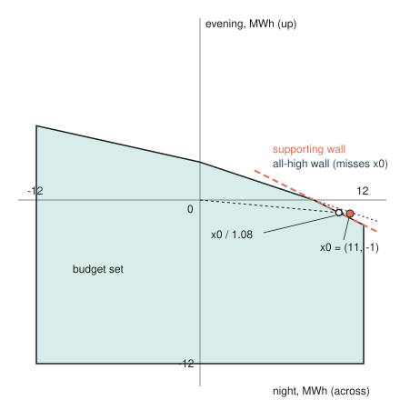

# Separation: two convex sets that miss each other can be split by a flat wall

[Syllabus](../../../SYLLABUS.md) → [Functional analysis](../README.md) → [Normed and Banach Spaces](../README.md#s01) → Separation

---

## General Overview

A factory with a battery buys electricity hour by hour. Take two hours of its week: one night hour, forecast at £50/MWh, and one evening hour, forecast at £150/MWh. The forecasts can miss by 20%, so the night price may land anywhere from £40 to £60 and the evening price anywhere from £120 to £180 (all prices on this card are illustrative).

The factory's rule: a plan is allowed only if its bill stays at or under £500 whatever prices land inside those bands, and no hour trades more than 12 MWh. Call the allowed plans the **budget set**. A plan is a pair of numbers, MWh bought in each hour; a negative number means MWh sold back to the grid from the battery.

A trader proposes a **cheaper bundle**: buy 11 MWh at night, sell 1 MWh in the evening. At the forecast prices the bill is 11 × 50 − 1 × 150 = £400, a full £100 under budget. Yet the plan is not allowed. At night £60 and evening £120 the bill is 660 − 120 = £540.

One price list proves it. Every allowed plan costs at most £500 at the prices (£60, £120); the trader's plan costs £540 there. That price list is a **flat wall** (the set where one weighted sum takes a fixed value): the budget set on one side, the cheaper bundle on the other. The wall also touches the budget set: shrink the plan to 1/1.08 of its size and it lands exactly on the £500 line. A wall that touches a set and keeps all of it on one side is a **supporting wall**.

In two hours a picture finds the wall. This card shows that a wall exists in every normed space (a space of vectors with a length rule, from [Normed and Banach spaces](01-normed-spaces-and-banach-spaces.md)), including spaces of infinitely long schedules, and it shows where the wall can fail to exist.

**If a point lies outside a closed convex set that holds a ball around 0, in any normed space, one bounded linear measurement scores the whole set at most 1 and the point above 1, and the level-1 wall of that measurement supports the set.**

**What kind of fact this is:** a theorem, the geometric form of the Hahn-Banach theorem, proved on this card in Why it works from the extension theorem on the [Hahn-Banach](06-hahn-banach-theorem.md) card. In general that extension uses the axiom of choice (a rule of set theory that lets a proof pick from infinitely many options at once). For the budget set the card computes the wall directly, with no choice needed. The bipolar theorem is a second theorem, also proved here.

### The picture: the budget set, the cheaper bundle and the wall

<p align="center"></p>

Drawn to scale, 15 units to 1 MWh both ways. The orange wall is 60 × night + 120 × evening = 500. The dotted line is 60 × night + 180 × evening = 500, the wall from raising every price: it leaves the bundle on the allowed side, so it proves nothing.

---

## The formula

Notation first, in words. $`x = (x_1, \dots, x_N)`$ is a plan over $`N`$ hours, $`x_t`$ the MWh bought in hour $`t`$. The length rule is $`\lVert x\rVert_1 = |x_1| + \dots + |x_N|`$, the total MWh traded. $`C`$ is the budget set and $`x_0`$ the cheaper bundle. A **functional** $`\varphi`$ is a linear rule turning a plan into one number; it is **bounded** when $`|\varphi(x)| \le \lVert\varphi\rVert\, \lVert x\rVert_1`$ for one fixed number $`\lVert\varphi\rVert`$, its norm, as on the [Hahn-Banach](06-hahn-banach-theorem.md) card.

The **gauge** of $`C`$ says how far a plan must be shrunk to fit:

```math
s_C(x) = \inf\{\, \lambda > 0 : x / \lambda \in C \,\}.
```

**Separation.** Let $`C`$ be a closed convex set in a normed space, holding the ball of radius $`r`$ around 0, and let $`x_0`$ lie outside $`C`$. Then some bounded functional $`\varphi`$ has

```math
\varphi(x) \le s_C(x) \ \text{ for every } x, \qquad \varphi(x) \le 1 \ \text{ on } C, \qquad \varphi(x_0) = s_C(x_0) > 1, \qquad \lVert\varphi\rVert \le \frac{1}{r}.
```

The **supporting wall** is $`\{x : \varphi(x) = 1\}`$. It touches $`C`$ at $`x_0 / s_C(x_0)`$.

**Read it aloud:** shrink the outside point until it just fits; a linear score that never beats the shrink factor, and equals it at the point, scores the whole set at most 1 and the point above 1.

**The bipolar.** For $`C`$ closed, convex and holding 0, the **polar** $`C^\circ`$ is the set of all bounded functionals that score $`C`$ at most 1. Testing against all of them gives back $`C`$:

```math
C^{\circ\circ} = \{\, x : \varphi(x) \le 1 \text{ for every } \varphi \in C^\circ \,\} = C .
```

In words: a closed convex set holding 0 is exactly the plans that pass every wall it passes.

| Symbol | Plain meaning | In our example | Push it up and the answer… |
| --- | --- | --- | --- |
| $`x`$, $`x_t`$, $`y`$, $`z`$ | plans; MWh bought in hour $`t`$, negative if sold; in Step 4, $`y`$ in $`A`$ and $`z`$ in $`B`$ | (night, evening) | — |
| $`N`$ | the number of hours | 2 by hand; 168 for a week | more hours, more walls to check, same rule |
| $`\lVert x\rVert_1`$; $`\ell^1`$, $`\ell^\infty`$ | total MWh traded, the length rule; unending plans with finite total; bounded price lists | 12 for the cheaper bundle | — |
| $`C`$; $`A`$, $`B`$ | the budget set: bill at most £500 at every price in the bands, at most 12 MWh an hour; $`A`$, $`B`$ two convex sets in Step 4 | six corners, in the picture | a bigger budget, a bigger set |
| $`x_0`$ | the cheaper bundle | (11, −1) | sell more in the evening and it can move inside |
| $`\bar q_t`$, $`w_t`$, $`q^*`$ | forecast price, band half-width, and the worst price list for $`x_0`$, £/MWh | (50, 150), (10, 30), (60, 120) | a wider band, a smaller set |
| $`s_C(x)`$, $`\lambda`$ | the gauge: the smallest shrink factor $`\lambda`$ that makes $`x`$ fit | 1.08 for $`x_0`$ | above 1 means outside |
| $`c`$, $`a`$, $`b`$, $`u`$, $`v`$ | plain numbers: scale factors in Steps 1 and 2, coordinates of the curve example | — | — |
| $`\varphi`$ | the separating functional: worst bill over £500 | $`\varphi(x) = (60x_1 + 120x_2)/500`$ | — |
| $`\lVert\varphi\rVert`$ | its norm: its largest entry, per MWh | 0.24 per MWh | a steeper wall |
| $`r`$ | radius of a ball around 0 inside $`C`$, in total MWh | 500 / 180 = 2.7778 | a fatter set, a gentler wall: $`\lVert\varphi\rVert \le 1/r`$ |
| $`C^\circ`$, $`C^{\circ\circ}`$ | the polar: every functional scoring $`C`$ at most 1; the bipolar: plans passing all of them | 6 corners each | a bigger set, a smaller polar |

### When it holds

- **The set is convex.** Allow only two plans, all-night (10, 0) or all-evening (0, 4), and nothing between. Their halfway mix (5, 2) is not allowed, but a linear score of the mix is the average of the two scores, so every wall that keeps both plans on one side keeps the mix there too. Of 121 walls the code tries, 0 put the mix beyond both plans.
- **The set is closed.** Over unending hours, take the plans that stop trading after some hour. That set is convex but not closed. The plan $`1/t^2`$ MWh in hour $`t`$ never stops, so it is outside. Against the plans that stop by hour $`N`$, the best wall of norm 1 has a margin equal to the leftover tail, which shrinks like $`1/N`$: 0.040811 MWh at $`N = 24`$, 0.000100 at $`N = 10{,}000`$. Against all of them, no wall survives.
- **For a margin, one side is a single point, or compact.** Compact means closed and bounded when there are finitely many hours; with unending hours, closed and bounded is not enough in general. The region on or above the curve $`v = 1/u`$ (for $`u > 0`$) and the half-plane $`v \le 0`$ are closed, convex and disjoint. The gap between them is 1 at $`u = 1`$ and 0.0010 at $`u = 1000`$. Only the wall $`v = 0`$ separates them. It is the edge of the half-plane, so there is no margin.
- **The functional may not be a formula.** In the space of bounded price lists, Hahn-Banach still gives a wall, but it can be something no schedule represents. The section after the worked numbers shows one.
- **0 sits inside $`C`$, with a ball around it.** The gauge proof measures from 0. A set with an interior point can be shifted so that the point is 0. A closed set with no interior point is handled by fattening $`x_0`$ into a small ball instead (Step 4).

---

## Why it works

### Step 0: the idea, in words

Shrink the outside plan until it just fits. The shrink factor, 1.08 here, is the gauge. It behaves like a length: it grows in proportion when a plan is scaled, and it never adds up to more than the sum for two plans added together. Hahn-Banach takes a linear rule known on one line and extends it to the whole space without beating such a bound. Start the rule on the line through $`x_0`$, matching the gauge there. Extended, it scores every point of $`C`$ at most 1, because the gauge does, and it scores $`x_0`$ at 1.08. That rule is the wall.

### Step 1: the gauge is a sublinear bound

Three facts make $`s_C`$ a **sublinear bound** $`s`$ in the sense of the [Hahn-Banach](06-hahn-banach-theorem.md) card:

1. **Scaling:** $`s_C(c x) = c\, s_C(x)`$ for $`c \ge 0`$. Shrinking twice as big a plan takes twice the factor.
2. **Adding:** $`s_C(x + y) \le s_C(x) + s_C(y)`$. This is where convexity enters.
3. **Finite and bounded:** $`s_C(x) \le \lVert x\rVert_1 / r`$, because $`r\, x / \lVert x\rVert_1`$ lies in the ball inside $`C`$.

For a closed $`C`$, a plan lies in $`C`$ exactly when its gauge is at most 1. For the budget set the gauge is the larger of two ratios: the worst bill over £500, and the largest hour over 12 MWh. For the cheaper bundle: 540 / 500 = 1.08 against 11 / 12 = 0.9167, so 1.08.

<details>
<summary>Detailed proof: why convexity gives the adding rule</summary>

Take $`a > s_C(x)`$ and $`b > s_C(y)`$, so that $`x/a`$ and $`y/b`$ lie in $`C`$ (for a convex set holding 0, once $`x/\lambda`$ fits, every larger $`\lambda`$ fits too). Write

$`\displaystyle \frac{x + y}{a + b} = \frac{a}{a + b}\cdot\frac{x}{a} + \frac{b}{a + b}\cdot\frac{y}{b}.`$

The right side is a weighted average of two points of $`C`$, with weights adding to 1, so it lies in $`C`$ by convexity. So $`s_C(x + y) \le a + b`$. Let $`a`$ and $`b`$ fall to $`s_C(x)`$ and $`s_C(y)`$.

For the last claim: if $`s_C(x) \le 1`$, then $`x/\lambda \in C`$ for every $`\lambda > 1`$, and $`x/\lambda \to x`$ as $`\lambda \to 1`$, so $`x \in C`$ because $`C`$ is closed. If $`x \in C`$, then $`\lambda = 1`$ works, so $`s_C(x) \le 1`$.

</details>

### Step 2: start the wall on one line, then extend it

On the line through $`x_0`$ define $`\varphi(c x_0) = c\, s_C(x_0)`$. This never beats the gauge on that line. For $`c \ge 0`$ it equals the gauge, by scaling. For $`c < 0`$ it is negative, and the gauge is never negative.

The [Hahn-Banach](06-hahn-banach-theorem.md) theorem extends $`\varphi`$ to every plan, still linear, still at most $`s_C`$. In a general space the proof adds one direction at a time and finishes with Zorn's lemma, a form of the axiom of choice. Nothing tells you which extension you get.

For the budget set the extension is explicit. Score each hour at the price that hurts $`x_0`$ most: the top of the band where it buys, the bottom where it sells. That gives $`q^* = (60, 120)`$ and $`\varphi(x) = (60x_1 + 120x_2)/500`$. Then $`\varphi(x_0) = 540/500 = 1.08`$, the gauge. And $`\varphi \le s_C`$ everywhere, because $`q^*`$ is one of the price lists in the band, so its bill for any plan is at most that plan's worst bill. The code tests this at 2000 random plans and finds no failure.

### Step 3: read off the separation and the supporting wall

Every plan in $`C`$ has $`\varphi \le s_C \le 1`$: its bill at (£60, £120) is at most £500. The cheaper bundle has $`\varphi(x_0) = 1.08`$: £540. That is the separation, with a margin of £40.

The wall is bounded, since $`\varphi(x) \le s_C(x) \le \lVert x\rVert_1/r`$ and the same holds for $`-x`$. Here $`r = 500/180 = 2.7778`$ MWh, because any plan trading at most that much in total costs at most £180 a MWh times 2.7778 = £500. So $`\lVert\varphi\rVert \le 0.36`$; the actual norm is 120 / 500 = 0.24.

The plan $`x_0 / 1.08 = (10.1852, -0.9259)`$ has gauge exactly 1, so it lies in $`C`$, and its bill at $`q^*`$ is exactly £500. The wall touches $`C`$ there: a **supporting wall**. Read in money: scale the trade down to 92.6% of its size and it just fits the budget.

### Step 4: two sets instead of a point

Two disjoint convex sets $`A`$ and $`B`$, with $`A`$ open, are separated by applying Step 3 to the single set $`A - B`$ (every difference $`y - z`$, with $`y`$ in $`A`$ and $`z`$ in $`B`$) and the point 0. That set is convex and open, and misses 0 because $`A`$ and $`B`$ do not meet. Shift it so that one of its points sits at 0; the gauge argument runs as before, except that for an open set a point is inside exactly when its gauge is below 1. The functional comes out with $`\varphi(y) < \varphi(z)`$ for every $`y`$ in $`A`$ and $`z`$ in $`B`$.

A point outside a closed convex set is the case "$`A`$ = a small open ball round the point", which is why closedness, not an interior, is what the point needs. Openness changes what the wall can touch. Take the open budget set: every worst bill below £500 and every hour below 12 MWh. The same wall still separates it from the cheaper bundle: every plan in it scores below 1, and $`x_0`$ scores 1.08. But the wall no longer touches the set. The plan $`x_0 / 1.08`$ has worst bill exactly £500, so it is outside, and the set only comes as close to the wall as wanted.

The [Separating hyperplanes](../../15-Optimization/01-Convexity/06-separating-hyperplanes.md) card proves the finite-dimensional case by the closest point. That argument needs right angles, and in some infinite-dimensional spaces, $`\ell^1`$ among them, a closed convex set can have no closest point at all. This route needs neither.

### Step 5: the bipolar theorem in two lines

Every $`x`$ in $`C`$ passes every wall in $`C^\circ`$, so $`C \subseteq C^{\circ\circ}`$. If $`x_0`$ is outside $`C`$, Step 3 builds a $`\varphi`$ that scores $`C`$ at most 1, so $`\varphi \in C^\circ`$, and scores $`x_0`$ above 1, so $`x_0 \notin C^{\circ\circ}`$. If $`C`$ has no ball around 0, Step 4 gives a $`\varphi`$ whose top score on $`C`$, at least 0 because 0 is in $`C`$, is below $`\varphi(x_0)`$; rescale it so that top score is at most 1 and $`\varphi(x_0)`$ is above 1. The two sets are equal.

For the budget set the code does the round trip in exact fractions. The set is cut out by 8 walls: the four corner price lists of the bands, divided by £500, and four for the 12 MWh limits. The polar is the smallest convex set holding those 8 points; 6 of them are its corners. The code also builds the polar from the other side, as every functional that scores the budget set's 6 corners at most 1, and gets the same 6 corners. Taking those 6 as walls gives back exactly the 6 corners of the budget set.

---

## Worked numbers, by hand

| Step | Arithmetic | Value |
| --- | --- | --- |
| forecast bill | 11 × 50 − 1 × 150 | £400 |
| bill with every price high | 11 × 60 − 1 × 180 | £480 |
| worst price list | high where buying, low where selling | (£60, £120) |
| worst bill | 11 × 60 − 1 × 120 | £540 |
| gauge, budget part | 540 / 500 | 1.08 |
| gauge, hourly limit part | 11 / 12 | 0.9167 |
| gauge | the larger | 1.08 |
| supporting point | (11, −1) / 1.08 | (10.1852, −0.9259) |
| its worst bill | 60 × 10.1852 − 120 × 0.9259 | £500 |
| **verdict** | $`\varphi(x_0)`$ = 1.08 > 1 | **outside the budget set, by £40 at (£60, £120)** |

The trade is allowed only at 1/1.08 of its size, or with a budget of at least £540.

### A week, then hours for ever

The same rule runs on the shelf's house example, a week of hourly prices. Forecast prices, illustrative: £50 from midnight to 06:00, £90 to 16:00, £150 to 20:00, £70 to midnight, all £10 lower at the weekend; bands ±20%. The factory uses 1 MWh an hour, charges its battery with 2 MWh more in each hour from midnight to 05:00, and in the four evening hours sells 2.25 MWh, a net −1.25 MWh.

| Hours $`N`$ | Forecast bill | Every price high | Worst bill |
| --- | --- | --- | --- |
| 24 (Monday) | £1,230 | £1,476 | £1,776 |
| 168 (the week) | £8,110 | £9,732 | £11,792 |

Against a weekly budget of £10,000 the forecast and the all-high test both pass. The worst-case wall prices 28 hours, the selling hours, at the bottom of their band and the rest at the top. The gauge is 1.1792: scale the week's plan to 84.8033% to fit.

Now let the hours run for ever, with the total MWh traded finite: the space $`\ell^1`$ of [Sequence spaces](02-sequence-spaces-lp-and-c0.md). Price lists with a top price are the space $`\ell^\infty`$. For this budget set nothing changes: the worst price list is still read hour by hour, a bounded list. The truncation at $`N`$ hours hides two things.

- **Closedness starts to matter.** In finitely many hours every subspace is closed. With unending hours, the plans that stop after some hour are not, and the margin against $`1/t^2`$ falls as $`1/N`$: N × margin is 0.9795, 0.9970, 0.9995, 1.0000 at $`N`$ = 24, 168, 1000, 10,000.
- **A wall need not be a schedule.** Swap roles: price lists are the points, and a schedule measures a price list by the bill. The list $`100(1 - 1/t)`$ £/MWh has top price 100 but never reaches it. The best 1 MWh placement in $`N`$ hours pays 95.8333, 99.4048 and 99.9000 at $`N`$ = 24, 168, 1000, never 100. Hahn-Banach gives a measurement of norm 1 that pays exactly 100, "an hour at the end of time". No schedule does it, and nobody can write it down: its existence rests on the axiom of choice.

### What breaks if you drop a piece

| Mistake | Comes out at | What went wrong |
| --- | --- | --- |
| Test with the forecast prices | £400, under £500 | The forecast is one price list; the rule is about all of them |
| Stress test by raising every price | £480, under £500 | A high evening price helps a seller; the worst list is (£60, £120), giving £540 |
| Plans that stop after some hour (not closed) | margin 0.040811 MWh at $`N`$ = 24, 0.000100 at 10,000 | The set is dense in total MWh traded: its closure holds the point, so no wall survives |
| Two closed sets, neither bounded | gap 1, 0.1000, 0.0100, 0.0010 at $`u`$ = 1, 10, 100, 1000 | They come arbitrarily close; the only wall is the edge of one set, with no margin. Neither is compact |

The code prints all four.

---

## Code, from first principles, and it actually runs

The code takes three independent roads to the worst bill and the gauge, and asserts that the wall scores the bundle at the gauge the bisection finds. Road one is the sign rule: high price where the plan buys, low where it sells. Road two is brute force: 441 price lists spread over the bands, keeping the largest bill. Road three finds the gauge by bisection, shrinking the plan until the brute-force test passes. It then checks Hahn-Banach's promise, $`\varphi \le s_C`$, at 2000 random plans from a SplitMix64 generator, builds the polar two ways and does the bipolar round trip in exact fractions. The week, the dense set (closed form with $`\pi^2/6`$ against a direct sum), the sup that is never reached and the curve gap close the run. Python uses the `fractions` module; the Rust writes its own fraction type.

### Python

```python
# Separation: a wall between a budget set and a cheaper bundle.  Standard library only.
# Every number on the card is printed here.  The worst-case price, the gauge, the polar
# and the bipolar are built by hand; Fractions keep the exact answers exact.
from fractions import Fraction as F
import math

def f4(x): return f"{float(x):.4f}"
def bill(q, x): return sum(a * b for a, b in zip(q, x))
def worst_price(x, qbar, w):  # road 1: high price where you buy, low where you sell
    return [qb + (wb if t >= 0 else -wb) for qb, wb, t in zip(qbar, w, x)]
def gauge(x, qbar, w, m, cap):  # s(x): the smallest t > 0 with x / t in the budget set
    return max(F(0), bill(worst_price(x, qbar, w), x) / m, max(abs(t) for t in x) / cap)

# ---- two hours, night then evening: pounds per MWh; MWh per hour, negative = sold back ----
QBAR, W, M, CAP, X0 = [F(50), F(150)], [F(10), F(30)], F(500), F(12), [F(11), F(-1)]
QS = worst_price(X0, QBAR, W)
fore, high, worst = bill(QBAR, X0), bill([a + b for a, b in zip(QBAR, W)], X0), bill(QS, X0)
grid = max(bill([QBAR[0] - W[0] + W[0] * i / 10, QBAR[1] - W[1] + W[1] * j / 10], X0)
           for i in range(21) for j in range(21))  # road 2: try 441 price lists in the band
assert worst == grid == 540 and fore == 400 and high == 480
s0 = gauge(X0, QBAR, W, M, CAP)
lo, hi = 0.5, 4.0  # road 3: bisection on the scale t, membership tested by the price grid
for _ in range(60):
    t = (lo + hi) / 2
    xs = [float(v) / t for v in X0]
    ok = max(bill([40 + i, 120 + 3 * j], xs) for i in range(21) for j in range(21)) <= 500
    (hi, lo) = (t, lo) if ok and max(abs(v) for v in xs) <= 12 else (hi, t)
assert s0 == F(27, 25) and abs(hi - 1.08) < 1e-12
sup = [v / s0 for v in X0]
assert bill(QS, sup) == M and max(abs(v) for v in sup) <= CAP
r = min(M / max(a + b for a, b in zip(QBAR, W)), CAP)
phi = [q / M for q in QS]
assert abs(float(bill(phi, X0)) - hi) < 1e-12  # the wall meets the bisection gauge at x0
print(f"forecast bill {f4(fore)}, all-high bill {f4(high)}, worst bill {f4(worst)} (grid of 441: {f4(grid)})")
print(f"worst price list ({f4(QS[0])}, {f4(QS[1])}); over budget by {f4(worst - M)}")
print(f"gauge s(x0) = {f4(s0)} (bisection {hi:.4f}); supporting point ({f4(sup[0])}, {f4(sup[1])})")
print(f"phi = ({f4(phi[0])}, {f4(phi[1])}) per MWh; phi(x0) = {f4(bill(phi, X0))}; ball radius {f4(r)}; "
      f"norm {f4(max(map(abs, phi)))} <= 1/r = {f4(1 / r)}")
state, bad = 2026, 0
def splitmix():
    global state
    state = (state + 0x9E3779B97F4A7C15) % 2**64
    z = state
    z = ((z ^ (z >> 30)) * 0xBF58476D1CE4E5B9) % 2**64
    z = ((z ^ (z >> 27)) * 0x94D049BB133111EB) % 2**64
    return (z ^ (z >> 31)) / 2**64
for _ in range(2000):  # Hahn-Banach's promise: phi never exceeds the gauge
    x = [F(int(40000 * splitmix()) - 20000, 1000) for _ in range(2)]
    bad += bill(phi, x) > gauge(x, QBAR, W, M, CAP)
assert bad == 0
print(f"phi <= s at 2000 random schedules (SplitMix64 seed 2026): {bad} failures")

# ---- convexity: two plans, their halfway mix, and 121 walls that try to split them ----
pair = [(F(10), F(0)), (F(0), F(4))]
mix = tuple((u + v) / 2 for u, v in zip(*pair))
tried = [(F(i), F(j)) for i in range(-5, 6) for j in range(-5, 6)]
split = sum(bill(q, mix) > max(bill(q, p) for p in pair) or bill(q, mix) < min(bill(q, p) for p in pair)
            for q in tried)
print(f"convexity: plans ({f4(pair[0][0])}, {f4(pair[0][1])}) and ({f4(pair[1][0])}, {f4(pair[1][1])}), "
      f"halfway mix ({f4(mix[0])}, {f4(mix[1])}); of {len(tried)} walls, {split} put the mix beyond both plans")
assert mix == (5, 2) and split == 0

# ---- the bipolar: walls a.x <= 1 -> corners -> polar -> walls again ----
def corners(walls):
    pts = set()
    for i, (a, b) in enumerate(walls):
        for c, d in walls[i + 1:]:
            det = a * d - b * c
            if det != 0:
                p = ((d - b) / det, (a - c) / det)
                if all(u * p[0] + v * p[1] <= 1 for u, v in walls): pts.add(p)
    return sorted(pts, key=lambda p: math.atan2(p[1], p[0]))
def hull(pts):
    pts, out = sorted(set(pts)), []
    for seq in (pts, pts[::-1]):
        part = []
        for p in seq:
            while len(part) > 1 and (part[-1][0] - part[-2][0]) * (p[1] - part[-2][1]) - (part[-1][1] - part[-2][1]) * (p[0] - part[-2][0]) <= 0:
                part.pop()
            part.append(p)
        out += part[:-1]
    return sorted(out, key=lambda p: math.atan2(p[1], p[0]))
walls = [(a / M, b / M) for a in (F(40), F(60)) for b in (F(120), F(180))] + [(1 / CAP, F(0)), (-1 / CAP, F(0)), (F(0), 1 / CAP), (F(0), -1 / CAP)]
C, polar = corners(walls), hull(walls)  # the polar as the hull of the 8 walls
polar2 = corners(C)  # road two: every functional that scores the corners of C at most 1
assert len(C) == 6 and len(polar) == 6 and polar2 == polar and corners(polar2) == C
print("budget set corners: " + ", ".join(f"({f4(a)}, {f4(b)})" for a, b in C))
print(f"8 walls, {len(polar)} of them corners of the polar; the polar built from the {len(C)} corners has "
      f"{len(polar2)}, the same; their walls give back the same {len(C)} corners")

# ---- a week: 168 hourly prices (illustrative), band 20 per cent, budget 10000 pounds ----
day = [50] * 6 + [90] * 10 + [150] * 4 + [70] * 4
qw = [F(day[h % 24] - (10 if h >= 120 else 0)) for h in range(168)]
ww = [q / 5 for q in qw]
xw = [F(3) if h % 24 < 5 else F(-5, 4) if 16 <= h % 24 < 20 else F(1) for h in range(168)]
for n, mb in ((24, None), (168, F(10000))):
    q, w, x = qw[:n], ww[:n], xw[:n]
    vals = bill(q, x), bill([a + b for a, b in zip(q, w)], x), bill(worst_price(x, q, w), x)
    line = f"N = {n}: forecast {f4(vals[0])}, all-high {f4(vals[1])}, worst {f4(vals[2])}"
    if mb:
        sw = gauge(x, q, w, mb, CAP)
        line += f"; budget {f4(mb)}, gauge {f4(sw)}, scale to {f4(100 / sw)} per cent"
        assert vals == (8110, 9732, 11792) and sum(t < 0 for t in x) == 28
    print(line)
print(f"hours priced at the low end in the week: {sum(t < 0 for t in xw)}")

# ---- infinite hours: what the finite rehearsal hides ----
direct = sum(1 / t**2 for t in range(10**6, 0, -1)) + 1 / (10**6 + 0.5)
for n in (24, 168, 1000, 10000):
    tail = math.pi**2 / 6 - sum(1 / t**2 for t in range(1, n + 1))
    tail2 = direct - sum(1 / t**2 for t in range(1, n + 1))
    assert abs(tail - tail2) < 1e-9 and abs(n * tail - 1) < 1 / n
    print(f"dense set, N = {n}: best margin {tail:.6f} MWh, N x margin {n * tail:.4f}")
for n in (24, 168, 1000):
    best = max(100 * (1 - 1 / t) for t in range(1, n + 1))
    assert abs(best - 100 * (1 - 1 / n)) < 1e-12
    print(f"sup price 100 never reached, N = {n}: best 1 MWh placement {best:.4f}")
print("curve v >= 1/u against v <= 0, gap at u = 1, 10, 100, 1000: "
      + ", ".join(f"{1 / x:.4f}" for x in (1, 10, 100, 1000)))

# ---- try changing ----
for label, w, m, x in (("band 30 per cent", [F(15), F(45)], M, X0), ("sell 3 MWh", W, M, [F(11), F(-3)]),
                       ("budget 550", W, F(550), X0), ("buy 13 MWh", W, M, [F(13), F(-1)])):
    print(f"try {label}: worst bill {f4(bill(worst_price(x, QBAR, w), x))}, gauge {f4(gauge(x, QBAR, w, m, CAP))}")

px = lambda a, b: f"{220 + 15 * float(a):.2f} {220 - 15 * float(b):.2f}"
print("figure, " + ", ".join(px(a, b) for a, b in C) + f", x0 {px(*X0)}, support {px(*sup)}, "
      f"wall {px(4, F(500 - 240, 120))} {px(13, F(500 - 780, 120))}, all-high {px(4, F(500 - 240, 180))} {px(13, F(500 - 780, 180))}")
print("ALL CHECKS PASS")
```

**Ran 2026-11-15 on macOS, Python 3.14.10, standard library only. All checks passed. Output, pasted from the run:**

```
forecast bill 400.0000, all-high bill 480.0000, worst bill 540.0000 (grid of 441: 540.0000)
worst price list (60.0000, 120.0000); over budget by 40.0000
gauge s(x0) = 1.0800 (bisection 1.0800); supporting point (10.1852, -0.9259)
phi = (0.1200, 0.2400) per MWh; phi(x0) = 1.0800; ball radius 2.7778; norm 0.2400 <= 1/r = 0.3600
phi <= s at 2000 random schedules (SplitMix64 seed 2026): 0 failures
convexity: plans (10.0000, 0.0000) and (0.0000, 4.0000), halfway mix (5.0000, 2.0000); of 121 walls, 0 put the mix beyond both plans
budget set corners: (-12.0000, -12.0000), (12.0000, -12.0000), (12.0000, -1.8333), (8.3333, 0.0000), (0.0000, 2.7778), (-12.0000, 5.4444)
8 walls, 6 of them corners of the polar; the polar built from the 6 corners has 6, the same; their walls give back the same 6 corners
N = 24: forecast 1230.0000, all-high 1476.0000, worst 1776.0000
N = 168: forecast 8110.0000, all-high 9732.0000, worst 11792.0000; budget 10000.0000, gauge 1.1792, scale to 84.8033 per cent
hours priced at the low end in the week: 28
dense set, N = 24: best margin 0.040811 MWh, N x margin 0.9795
dense set, N = 168: best margin 0.005935 MWh, N x margin 0.9970
dense set, N = 1000: best margin 0.001000 MWh, N x margin 0.9995
dense set, N = 10000: best margin 0.000100 MWh, N x margin 1.0000
sup price 100 never reached, N = 24: best 1 MWh placement 95.8333
sup price 100 never reached, N = 168: best 1 MWh placement 99.4048
sup price 100 never reached, N = 1000: best 1 MWh placement 99.9000
curve v >= 1/u against v <= 0, gap at u = 1, 10, 100, 1000: 1.0000, 0.1000, 0.0100, 0.0010
try band 30 per cent: worst bill 610.0000, gauge 1.2200
try sell 3 MWh: worst bill 300.0000, gauge 0.9167
try budget 550: worst bill 540.0000, gauge 0.9818
try buy 13 MWh: worst bill 660.0000, gauge 1.3200
figure, 40.00 400.00, 400.00 400.00, 400.00 247.50, 345.00 220.00, 220.00 178.33, 40.00 138.33, x0 385.00 235.00, support 372.78 233.89, wall 280.00 187.50 415.00 255.00, all-high 280.00 198.33 415.00 243.33
ALL CHECKS PASS
```

### Rust

Same numbers, same labels, built with `rustc --edition 2021 -O`.

```rust
// Separation: a wall between a budget set and a cheaper bundle.  std only, no crates.
// Same numbers and labels as the Python check.  A small exact-fraction type, Q, does the
// exact work; the worst-case price, the gauge, the polar and the bipolar are built by hand.
use std::{cmp::Ordering, ops::{Add, Div, Mul, Sub}};

#[derive(Clone, Copy, Debug, PartialEq, Eq)] struct Q(i128, i128);
fn gcd(a: i128, b: i128) -> i128 { if b == 0 { a.abs() } else { gcd(b, a % b) } }
fn q(n: i128, d: i128) -> Q { let g = gcd(n, d) * d.signum(); Q(n / g, d / g) }
fn qi(n: i128) -> Q { Q(n, 1) }
impl Add for Q { type Output = Q; fn add(self, o: Q) -> Q { q(self.0 * o.1 + o.0 * self.1, self.1 * o.1) } }
impl Sub for Q { type Output = Q; fn sub(self, o: Q) -> Q { q(self.0 * o.1 - o.0 * self.1, self.1 * o.1) } }
impl Mul for Q { type Output = Q; fn mul(self, o: Q) -> Q { q(self.0 * o.0, self.1 * o.1) } }
impl Div for Q { type Output = Q; fn div(self, o: Q) -> Q { q(self.0 * o.1, self.1 * o.0) } }
impl PartialOrd for Q { fn partial_cmp(&self, o: &Q) -> Option<Ordering> { Some(self.cmp(o)) } }
impl Ord for Q { fn cmp(&self, o: &Q) -> Ordering { (self.0 * o.1).cmp(&(o.0 * self.1)) } }
impl Q { fn f(self) -> f64 { self.0 as f64 / self.1 as f64 } fn abs(self) -> Q { Q(self.0.abs(), self.1) } }
fn f4(x: Q) -> String { format!("{:.4}", x.f()) }
fn bill(p: &[Q], x: &[Q]) -> Q { p.iter().zip(x).fold(qi(0), |s, (a, b)| s + *a * *b) }
fn worst_price(x: &[Q], qbar: &[Q], w: &[Q]) -> Vec<Q> { // road 1: high where you buy, low where you sell
    (0..x.len()).map(|t| if x[t] >= qi(0) { qbar[t] + w[t] } else { qbar[t] - w[t] }).collect()
}
fn gauge(x: &[Q], qbar: &[Q], w: &[Q], m: Q, cap: Q) -> Q { // the smallest t > 0 with x / t in the set
    let b = bill(&worst_price(x, qbar, w), x) / m;
    let c = x.iter().map(|v| v.abs()).max().unwrap() / cap;
    qi(0).max(b).max(c)
}
fn corners(walls: &[(Q, Q)]) -> Vec<(Q, Q)> {
    let mut pts: Vec<(Q, Q)> = Vec::new();
    for (i, &(a, b)) in walls.iter().enumerate() {
        for &(c, d) in &walls[i + 1..] {
            let det = a * d - b * c;
            if det == qi(0) { continue; }
            let p = ((d - b) / det, (a - c) / det);
            if walls.iter().all(|&(u, v)| u * p.0 + v * p.1 <= qi(1)) && !pts.contains(&p) { pts.push(p); }
        }
    }
    pts.sort_by(|a, b| a.1.f().atan2(a.0.f()).partial_cmp(&b.1.f().atan2(b.0.f())).unwrap());
    pts
}
fn hull(pts: &[(Q, Q)]) -> Vec<(Q, Q)> {
    let mut s: Vec<(Q, Q)> = pts.to_vec(); s.sort(); s.dedup();
    let mut out = Vec::new();
    for seq in [s.clone(), s.iter().rev().cloned().collect()] {
        let mut part: Vec<(Q, Q)> = Vec::new();
        for p in seq {
            while part.len() > 1 {
                let (a, b) = (part[part.len() - 2], part[part.len() - 1]);
                if (b.0 - a.0) * (p.1 - a.1) - (b.1 - a.1) * (p.0 - a.0) <= qi(0) { part.pop(); } else { break; }
            }
            part.push(p);
        }
        part.pop();
        out.extend(part);
    }
    out.sort_by(|a, b| a.1.f().atan2(a.0.f()).partial_cmp(&b.1.f().atan2(b.0.f())).unwrap());
    out
}
fn splitmix(state: &mut u64) -> f64 {
    *state = state.wrapping_add(0x9E3779B97F4A7C15);
    let mut z = (*state ^ (*state >> 30)).wrapping_mul(0xBF58476D1CE4E5B9);
    z = (z ^ (z >> 27)).wrapping_mul(0x94D049BB133111EB);
    (z ^ (z >> 31)) as f64 / 18446744073709551616.0
}
fn px(a: Q, b: Q) -> String { format!("{:.2} {:.2}", 220.0 + 15.0 * a.f(), 220.0 - 15.0 * b.f()) }

fn main() {
    // ---- two hours, night then evening: pounds per MWh; MWh per hour, negative = sold back ----
    let (qbar, w, m, cap, x0) = ([qi(50), qi(150)], [qi(10), qi(30)], qi(500), qi(12), [qi(11), qi(-1)]);
    let qs = worst_price(&x0, &qbar, &w);
    let (fore, hi_b, worst) = (bill(&qbar, &x0), bill(&[qbar[0] + w[0], qbar[1] + w[1]], &x0), bill(&qs, &x0));
    let grid = (0..441).map(|k| bill(&[qbar[0] - w[0] + w[0] * qi(k / 21) / qi(10), // road 2: try 441 price lists
                                      qbar[1] - w[1] + w[1] * qi(k % 21) / qi(10)], &x0)).max().unwrap(); // in the band
    assert!(worst == qi(540) && grid == qi(540) && fore == qi(400) && hi_b == qi(480));
    let s0 = gauge(&x0, &qbar, &w, m, cap);
    let (mut lo, mut hi) = (0.5f64, 4.0f64); // road 3: bisection, membership tested by the price grid
    for _ in 0..60 {
        let t = (lo + hi) / 2.0;
        let xs = [11.0 / t, -1.0 / t];
        let mut mx = f64::NEG_INFINITY;
        for i in 0..21 { for j in 0..21 { mx = mx.max((40 + i) as f64 * xs[0] + (120 + 3 * j) as f64 * xs[1]); } }
        if mx <= 500.0 && xs[0].abs().max(xs[1].abs()) <= 12.0 { hi = t; } else { lo = t; }
    }
    assert!(s0 == q(27, 25) && (hi - 1.08).abs() < 1e-12);
    let sup = [x0[0] / s0, x0[1] / s0];
    assert!(bill(&qs, &sup) == m && sup[0].abs().max(sup[1].abs()) <= cap);
    let r = (m / (qbar[0] + w[0]).max(qbar[1] + w[1])).min(cap);
    let phi = [qs[0] / m, qs[1] / m];
    println!("forecast bill {}, all-high bill {}, worst bill {} (grid of 441: {})", f4(fore), f4(hi_b), f4(worst), f4(grid));
    println!("worst price list ({}, {}); over budget by {}", f4(qs[0]), f4(qs[1]), f4(worst - m));
    println!("gauge s(x0) = {} (bisection {:.4}); supporting point ({}, {})", f4(s0), hi, f4(sup[0]), f4(sup[1]));
    println!("phi = ({}, {}) per MWh; phi(x0) = {}; ball radius {}; norm {} <= 1/r = {}", f4(phi[0]), f4(phi[1]),
             f4(bill(&phi, &x0)), f4(r), f4(phi[0].abs().max(phi[1].abs())), f4(qi(1) / r));
    let (mut state, mut bad) = (2026u64, 0);
    for _ in 0..2000 { // Hahn-Banach's promise: phi never exceeds the gauge
        let (a, b) = (q((40000.0 * splitmix(&mut state)) as i128 - 20000, 1000), q((40000.0 * splitmix(&mut state)) as i128 - 20000, 1000));
        if bill(&phi, &[a, b]) > gauge(&[a, b], &qbar, &w, m, cap) { bad += 1; }
    }
    assert!(bad == 0 && (bill(&phi, &x0).f() - hi).abs() < 1e-12); // and the wall meets the bisection gauge at x0
    println!("phi <= s at 2000 random schedules (SplitMix64 seed 2026): {} failures", bad);

    // ---- convexity: two plans, their halfway mix, and 121 walls that try to split them ----
    let (pa, pb) = ((qi(10), qi(0)), (qi(0), qi(4)));
    let mix = ((pa.0 + pb.0) / qi(2), (pa.1 + pb.1) / qi(2));
    let score = |k: i128, p: (Q, Q)| qi(k / 11 - 5) * p.0 + qi(k % 11 - 5) * p.1; // wall k of 121
    let split = (0..121).filter(|&k| { let (a, b, m) = (score(k, pa), score(k, pb), score(k, mix)); m > a.max(b) || m < a.min(b) }).count();
    println!("convexity: plans ({}, {}) and ({}, {}), halfway mix ({}, {}); of 121 walls, {} put the mix beyond both plans",
             f4(pa.0), f4(pa.1), f4(pb.0), f4(pb.1), f4(mix.0), f4(mix.1), split);
    assert!(mix == (qi(5), qi(2)) && split == 0);

    // ---- the bipolar: walls a.x <= 1 -> corners -> polar -> walls again ----
    let mut walls = Vec::new();
    for a in [qi(40), qi(60)] { for b in [qi(120), qi(180)] { walls.push((a / m, b / m)); } }
    let k = qi(1) / cap; walls.extend([(k, qi(0)), (qi(0) - k, qi(0)), (qi(0), k), (qi(0), qi(0) - k)]);
    let (c, polar) = (corners(&walls), hull(&walls)); // the polar as the hull of the 8 walls
    let polar2 = corners(&c); // road two: every functional that scores the corners of C at most 1
    assert!(c.len() == 6 && polar.len() == 6 && polar2 == polar && corners(&polar2) == c);
    let cs: Vec<String> = c.iter().map(|p| format!("({}, {})", f4(p.0), f4(p.1))).collect();
    println!("budget set corners: {}", cs.join(", "));
    println!("8 walls, {} of them corners of the polar; the polar built from the {} corners has {}, the same; their walls give back the same {} corners",
             polar.len(), c.len(), polar2.len(), c.len());

    // ---- a week: 168 hourly prices (illustrative), band 20 per cent, budget 10000 pounds ----
    let day = |h: usize| -> i128 { if h < 6 { 50 } else if h < 16 { 90 } else if h < 20 { 150 } else { 70 } };
    let qw: Vec<Q> = (0..168).map(|h| qi(day(h % 24) - if h >= 120 { 10 } else { 0 })).collect();
    let ww: Vec<Q> = qw.iter().map(|p| *p / qi(5)).collect();
    let xw: Vec<Q> = (0..168).map(|h| if h % 24 < 5 { qi(3) } else if (16..20).contains(&(h % 24)) { q(-5, 4) } else { qi(1) }).collect();
    let low = xw.iter().filter(|t| **t < qi(0)).count();
    for (n, mb) in [(24usize, None), (168usize, Some(qi(10000)))] {
        let (p, ws, x) = (&qw[..n], &ww[..n], &xw[..n]);
        let hp: Vec<Q> = p.iter().zip(ws).map(|(a, b)| *a + *b).collect();
        let vals = (bill(p, x), bill(&hp, x), bill(&worst_price(x, p, ws), x));
        let mut line = format!("N = {}: forecast {}, all-high {}, worst {}", n, f4(vals.0), f4(vals.1), f4(vals.2));
        if let Some(mb) = mb {
            let sw = gauge(x, p, ws, mb, cap);
            line += &format!("; budget {}, gauge {}, scale to {} per cent", f4(mb), f4(sw), f4(qi(100) / sw));
            assert!(vals == (qi(8110), qi(9732), qi(11792)) && low == 28);
        }
        println!("{}", line);
    }
    println!("hours priced at the low end in the week: {}", low);

    // ---- infinite hours: what the finite rehearsal hides ----
    let mut direct = 0.0f64;
    for t in (1..=1000000u64).rev() { direct += 1.0 / ((t * t) as f64); }
    direct += 1.0 / (1000000.0 + 0.5);
    for n in [24u64, 168, 1000, 10000] {
        let mut part = 0.0f64;
        for t in 1..=n { part += 1.0 / ((t * t) as f64); }
        let (tail, nf) = (std::f64::consts::PI.powi(2) / 6.0 - part, n as f64);
        assert!((tail - (direct - part)).abs() < 1e-9 && (nf * tail - 1.0).abs() < 1.0 / nf);
        println!("dense set, N = {}: best margin {:.6} MWh, N x margin {:.4}", n, tail, nf * tail);
    }
    for n in [24u64, 168, 1000] {
        let best = (1..=n).map(|t| 100.0 * (1.0 - 1.0 / t as f64)).fold(f64::MIN, f64::max);
        assert!((best - 100.0 * (1.0 - 1.0 / n as f64)).abs() < 1e-12);
        println!("sup price 100 never reached, N = {}: best 1 MWh placement {:.4}", n, best);
    }
    let gaps: Vec<String> = [1.0f64, 10.0, 100.0, 1000.0].iter().map(|x| format!("{:.4}", 1.0 / x)).collect();
    println!("curve v >= 1/u against v <= 0, gap at u = 1, 10, 100, 1000: {}", gaps.join(", "));

    // ---- try changing ----
    for (label, wt, mt, x) in [("band 30 per cent", [qi(15), qi(45)], m, x0), ("sell 3 MWh", w, m, [qi(11), qi(-3)]),
                               ("budget 550", w, qi(550), x0), ("buy 13 MWh", w, m, [qi(13), qi(-1)])] {
        println!("try {}: worst bill {}, gauge {}", label, f4(bill(&worst_price(&x, &qbar, &wt), &x)), f4(gauge(&x, &qbar, &wt, mt, cap)));
    }
    let cp: Vec<String> = c.iter().map(|p| px(p.0, p.1)).collect();
    println!("figure, {}, x0 {}, support {}, wall {} {}, all-high {} {}", cp.join(", "), px(x0[0], x0[1]), px(sup[0], sup[1]),
             px(qi(4), q(260, 120)), px(qi(13), q(-280, 120)), px(qi(4), q(260, 180)), px(qi(13), q(-280, 180)));
    println!("ALL CHECKS PASS");
}
```

**Ran 2026-11-15 on macOS, rustc 1.98.1, no crates. All checks passed. Output, pasted from the run:**

```
forecast bill 400.0000, all-high bill 480.0000, worst bill 540.0000 (grid of 441: 540.0000)
worst price list (60.0000, 120.0000); over budget by 40.0000
gauge s(x0) = 1.0800 (bisection 1.0800); supporting point (10.1852, -0.9259)
phi = (0.1200, 0.2400) per MWh; phi(x0) = 1.0800; ball radius 2.7778; norm 0.2400 <= 1/r = 0.3600
phi <= s at 2000 random schedules (SplitMix64 seed 2026): 0 failures
convexity: plans (10.0000, 0.0000) and (0.0000, 4.0000), halfway mix (5.0000, 2.0000); of 121 walls, 0 put the mix beyond both plans
budget set corners: (-12.0000, -12.0000), (12.0000, -12.0000), (12.0000, -1.8333), (8.3333, 0.0000), (0.0000, 2.7778), (-12.0000, 5.4444)
8 walls, 6 of them corners of the polar; the polar built from the 6 corners has 6, the same; their walls give back the same 6 corners
N = 24: forecast 1230.0000, all-high 1476.0000, worst 1776.0000
N = 168: forecast 8110.0000, all-high 9732.0000, worst 11792.0000; budget 10000.0000, gauge 1.1792, scale to 84.8033 per cent
hours priced at the low end in the week: 28
dense set, N = 24: best margin 0.040811 MWh, N x margin 0.9795
dense set, N = 168: best margin 0.005935 MWh, N x margin 0.9970
dense set, N = 1000: best margin 0.001000 MWh, N x margin 0.9995
dense set, N = 10000: best margin 0.000100 MWh, N x margin 1.0000
sup price 100 never reached, N = 24: best 1 MWh placement 95.8333
sup price 100 never reached, N = 168: best 1 MWh placement 99.4048
sup price 100 never reached, N = 1000: best 1 MWh placement 99.9000
curve v >= 1/u against v <= 0, gap at u = 1, 10, 100, 1000: 1.0000, 0.1000, 0.0100, 0.0010
try band 30 per cent: worst bill 610.0000, gauge 1.2200
try sell 3 MWh: worst bill 300.0000, gauge 0.9167
try budget 550: worst bill 540.0000, gauge 0.9818
try buy 13 MWh: worst bill 660.0000, gauge 1.3200
figure, 40.00 400.00, 400.00 400.00, 400.00 247.50, 345.00 220.00, 220.00 178.33, 40.00 138.33, x0 385.00 235.00, support 372.78 233.89, wall 280.00 187.50 415.00 255.00, all-high 280.00 198.33 415.00 243.33
ALL CHECKS PASS
```

The two outputs match line for line.

### Lean

Lean proves separation, the bipolar theorem and the two-set version in every real normed space, and checks the card's numbers.

- Take a closed convex set $`C`$ holding the ball of radius $`r > 0`$ around 0, and a point $`x_0`$ outside $`C`$. Then some bounded functional $`\varphi`$ has $`\varphi \le s_C`$ everywhere and $`\varphi \le 1`$ on $`C`$.
- Take the same $`C`$, $`x_0`$ and $`\varphi`$. Then $`\varphi(x_0) = s_C(x_0) > 1`$ and $`\lVert\varphi\rVert \le 1/r`$.
- Take the same $`C`$, $`x_0`$ and $`\varphi`$. Then $`x_0 / s_C(x_0)`$ lies in $`C`$ and $`\varphi`$ scores it exactly 1, so the wall supports $`C`$ there.
- Take a closed convex set $`C`$ holding 0. Then $`C^{\circ\circ} = C`$: the plans passing every wall in $`C^\circ`$ are exactly $`C`$.
- Take disjoint convex sets $`A`$ and $`B`$, with $`A`$ open. Then one bounded functional has $`\varphi(y) < \varphi(z)`$ for every $`y`$ in $`A`$ and $`z`$ in $`B`$.
- The cheaper bundle's bill is £400 at the forecast, £480 with every price high and £540 at (£60, £120).
- Over the four corner price lists of the bands, the cheaper bundle's worst bill is £540.
- The gauge of the cheaper bundle is the larger of 540 / 500 and 11 / 12, which is 1.08.
- The supporting point, the cheaper bundle divided by 1.08, has a bill of exactly £500 at (£60, £120).
- Take the ball radius $`r = 500/180`$. Then the wall's norm, 0.24 per MWh, is at most $`1/r = 0.36`$.
- The halfway mix of (10, 0) and (0, 4) is (5, 2).
- Over the 168-hour week the bills are £8,110 at the forecast, £9,732 all-high and £11,792 worst, with 28 selling hours.

The bisection, the 2000 random plans, the polar's corners and the unending-hours trends are left to the Python and Rust checks.

```lean
-- Separation: a point outside a closed convex set holding a ball around 0, in any real normed space, is split from the set by a bounded linear functional whose level-1 wall supports the set, and such walls rebuild the set (the bipolar theorem).
import Mathlib.Analysis.Convex.Gauge
import Mathlib.Analysis.LocallyConvex.Separation
import Mathlib.Analysis.Normed.Operator.Basic
import Mathlib.Tactic.NormNum

/-- Separation with a supporting wall. Let `C` be a closed convex set in a real normed space
that holds the ball of radius `r > 0` around 0, and let `x₀` lie outside `C`. Then some bounded
linear functional `φ` never beats the gauge `s_C`, scores every point of `C` at most 1, scores
`x₀` at its gauge `s_C(x₀) > 1`, and has norm at most `1 / r`. Its level-1 wall touches `C` at the
shrunken point `x₀ / s_C(x₀)`, which lies in `C` and scores exactly 1. -/
theorem closed_convex_set_point_separated_by_supporting_wall
    {E : Type*} [NormedAddCommGroup E] [NormedSpace ℝ E]
    {C : Set E} (hconv : Convex ℝ C) (hclosed : IsClosed C)
    {r : ℝ} (hr : 0 < r) (hball : Metric.ball (0 : E) r ⊆ C)
    {x₀ : E} (hx₀ : x₀ ∉ C) :
    ∃ φ : E →L[ℝ] ℝ,
      (∀ x, φ x ≤ gauge C x) ∧
      (∀ x ∈ C, φ x ≤ 1) ∧
      φ x₀ = gauge C x₀ ∧ 1 < gauge C x₀ ∧
      ‖φ‖ ≤ 1 / r ∧
      (gauge C x₀)⁻¹ • x₀ ∈ C ∧ φ ((gauge C x₀)⁻¹ • x₀) = 1 := by
  have hB : Metric.ball (0 : E) r ∈ nhds (0 : E) := Metric.ball_mem_nhds 0 hr
  have hC0 : C ∈ nhds (0 : E) := Filter.mem_of_superset hB hball
  have habs : Absorbent ℝ C := absorbent_nhds_zero hC0
  have h0 : (0 : E) ∈ C := mem_of_mem_nhds hC0
  have hmem : ∀ x, gauge C x ≤ 1 → x ∈ C := fun x hx => by
    have := (gauge_le_one_iff_mem_closure hconv hC0).1 hx
    rwa [hclosed.closure_eq] at this
  set g := gauge C x₀ with hg
  have hgt : 1 < g := by
    by_contra h
    exact hx₀ (hmem x₀ (not_lt.1 h))
  have hgpos : 0 < g := by linarith
  have hne : x₀ ≠ 0 := fun h => hx₀ (h ▸ h0)
  have hbound : ∀ x, gauge C x ≤ ‖x‖ / r := fun x => by
    have := gauge_mono (absorbent_nhds_zero hB) hball x
    rwa [gauge_ball hr.le] at this
  obtain ⟨φ, hφ₁, hφ₂⟩ := exists_extension_of_le_sublinear
    (LinearPMap.mkSpanSingleton x₀ g hne) (gauge C)
    (fun c hc => gauge_smul_of_nonneg hc.le) (gauge_add_le hconv habs) (by
      rintro ⟨x, hx⟩
      obtain ⟨y, rfl⟩ := Submodule.mem_span_singleton.1 hx
      rw [LinearPMap.mkSpanSingleton'_apply]
      simp only [smul_eq_mul]
      obtain h | h := le_or_gt y 0
      · exact (mul_nonpos_of_nonpos_of_nonneg h hgpos.le).trans (gauge_nonneg _)
      · rw [gauge_smul_of_nonneg h.le, smul_eq_mul, RingHom.id_apply, hg])
  have hφx₀ : φ x₀ = g := by
    have := hφ₁ ⟨x₀, Submodule.mem_span_singleton_self x₀⟩
    rw [this]
    exact LinearPMap.mkSpanSingleton'_apply_self _ _ _ _
  have hφb : ∀ x, ‖φ x‖ ≤ (1 / r) * ‖x‖ := fun x => by
    rw [Real.norm_eq_abs, abs_le]
    have h1 := (hφ₂ x).trans (hbound x)
    have h2 := (hφ₂ (-x)).trans (hbound (-x))
    rw [map_neg, norm_neg] at h2
    constructor <;> [skip; skip] <;> rw [one_div_mul_eq_div] <;> linarith
  refine ⟨φ.mkContinuous (1 / r) hφb, hφ₂, fun x hx => (hφ₂ x).trans (gauge_le_one_of_mem hx),
    hφx₀, hgt, LinearMap.mkContinuous_norm_le _ (by positivity) hφb, ?_, ?_⟩
  · apply hmem
    rw [gauge_smul_of_nonneg (inv_nonneg.2 hgpos.le), smul_eq_mul, ← hg, inv_mul_cancel₀ hgpos.ne']
  · simp only [LinearMap.mkContinuous_apply, map_smul, smul_eq_mul, hφx₀]
    exact inv_mul_cancel₀ hgpos.ne'

/-- The bipolar theorem. For a closed convex set `C` holding 0 in a real normed space, the plans
that every bounded functional scoring `C` at most 1 also scores at most 1 are exactly `C`. -/
theorem bipolar_of_closed_convex_set_holding_zero
    {E : Type*} [NormedAddCommGroup E] [NormedSpace ℝ E]
    {C : Set E} (hconv : Convex ℝ C) (hclosed : IsClosed C) (h0 : (0 : E) ∈ C) :
    {x : E | ∀ φ ∈ {φ : E →L[ℝ] ℝ | ∀ y ∈ C, φ y ≤ 1}, φ x ≤ 1} = C := by
  ext x
  constructor
  · intro hx
    by_contra hxC
    obtain ⟨f, u, hf, hu⟩ := geometric_hahn_banach_closed_point hconv hclosed hxC
    have hu0 : 0 < u := by simpa using hf 0 h0
    have := hx (u⁻¹ • f) (fun y hy => by
      simp only [FunLike.coe_smul, Pi.smul_apply, smul_eq_mul]
      rw [inv_mul_le_iff₀ hu0, mul_one]; exact (hf y hy).le)
    simp only [FunLike.coe_smul, Pi.smul_apply, smul_eq_mul] at this
    rw [inv_mul_le_iff₀ hu0, mul_one] at this
    linarith
  · intro hx φ hφ
    exact hφ x hx

/-- Two sets instead of a point. Two disjoint convex sets `A` and `B` in a real normed space, with
`A` open, are split by one bounded linear functional: `φ y < φ z` for every `y` in `A` and `z` in
`B`. -/
theorem disjoint_convex_sets_with_open_one_separated
    {E : Type*} [NormedAddCommGroup E] [NormedSpace ℝ E]
    {A B : Set E} (hA : Convex ℝ A) (hAo : IsOpen A) (hB : Convex ℝ B) (hAB : Disjoint A B) :
    ∃ φ : E →L[ℝ] ℝ, ∀ y ∈ A, ∀ z ∈ B, φ y < φ z := by
  obtain ⟨f, u, hf, hu⟩ := geometric_hahn_banach_open hA hAo hB hAB
  exact ⟨f, fun y hy z hz => (hf y hy).trans_le (hu z hz)⟩

-- The cheaper bundle (11, -1) against the bands: forecast (50, 150), all-high (60, 180),
-- worst list (60, 120).
example : (11 : ℤ) * 50 - 1 * 150 = 400 := by norm_num
example : (11 : ℤ) * 60 - 1 * 180 = 480 := by norm_num
example : (11 : ℤ) * 60 - 1 * 120 = 540 := by norm_num
-- The worst list is the largest bill over the four corner price lists of the bands.
example : max (max ((11 : ℤ) * 40 - 120) (11 * 40 - 180)) (max (11 * 60 - 120) (11 * 60 - 180)) = 540 := by
  norm_num
-- The gauge is the larger of 540 / 500 and 11 / 12, which is 27 / 25 = 1.08.
example : max ((540 : ℚ) / 500) (11 / 12) = 27 / 25 := by norm_num
-- The supporting point (11, -1) / (27 / 25) has bill exactly 500 at (60, 120).
example : 60 * ((11 : ℚ) / (27 / 25)) + 120 * ((-1) / (27 / 25)) = 500 := by norm_num
-- Ball radius r = 500 / 180, norm of the wall 120 / 500, and 120 / 500 ≤ 1 / r.
example : (120 : ℚ) / 500 ≤ 1 / (500 / 180) := by norm_num
-- Convexity: the halfway mix of (10, 0) and (0, 4) is (5, 2).
example : ((10 : ℚ) + 0) / 2 = 5 ∧ ((0 : ℚ) + 4) / 2 = 2 := by norm_num
-- The week, in whole numbers: plan in quarter-MWh (12, -5 or 4 a quarter, i.e. 3, -1.25 or 1 MWh),
-- prices in fifths of the forecast (5 = forecast, 6 = top of the band, 4 = bottom), so every bill
-- is 20 times its value in pounds: forecast £8,110, all-high £9,732, worst £11,792; 28 selling hours.
example :
    let q : ℕ → ℤ := fun h =>
      (if h % 24 < 6 then 50 else if h % 24 < 16 then 90 else if h % 24 < 20 then 150 else 70)
        - (if 120 ≤ h then 10 else 0)
    let x : ℕ → ℤ := fun h =>
      if h % 24 < 5 then 12 else if 16 ≤ h % 24 ∧ h % 24 < 20 then -5 else 4
    ((List.range 168).map (fun h => 5 * q h * x h)).sum = 20 * 8110 ∧
    ((List.range 168).map (fun h => 6 * q h * x h)).sum = 20 * 9732 ∧
    ((List.range 168).map (fun h => (if 0 ≤ x h then 6 else 4) * q h * x h)).sum = 20 * 11792 ∧
    ((List.range 168).filter (fun h => x h < 0)).length = 28 := by
  decide +kernel

#print axioms closed_convex_set_point_separated_by_supporting_wall
#print axioms bipolar_of_closed_convex_set_holding_zero
#print axioms disjoint_convex_sets_with_open_one_separated
```

**Checked 2026-11-15 on macOS, Lean 4.36.0-rc2, Mathlib v4.36.0-rc2. Every proof is complete and uses only Lean's standard axioms. Output, pasted from the run:**

```
'closed_convex_set_point_separated_by_supporting_wall' depends on axioms: [propext, Classical.choice, Quot.sound]
'bipolar_of_closed_convex_set_holding_zero' depends on axioms: [propext, Classical.choice, Quot.sound]
'disjoint_convex_sets_with_open_one_separated' depends on axioms: [propext, Classical.choice, Quot.sound]
```

> [!TIP]
> **Try changing**
> - **Widen the bands to ±30%.** Guess first: does the bundle move further out? Set `W` to `[F(15), F(45)]`. The worst bill is £610 and the gauge 1.22.
> - **Sell 3 MWh in the evening.** Guess first: in or out? Set `X0` to `[F(11), F(-3)]`. The worst bill falls to £300, and the gauge is 0.9167, set by the 12 MWh limit. Inside.
> - **Raise the budget to £550.** Set `M = F(550)`. The gauge is 0.9818: the same bundle is now allowed.
> - **Buy 13 MWh at night.** Set `X0` to `[F(13), F(-1)]`. The worst bill is £660 and the gauge 1.32, so the bundle must shrink to 1/1.32 of its size.

---

## The usual mistake

> [!warning]
> **Stress-testing a plan by raising every price.** The worst case is not "everything dear". It is dear where you buy and cheap where you sell. For the cheaper bundle the all-high test gives £480 and passes; the true worst case, (£60, £120), gives £540 and fails. The separating wall is a specific price list, read off the plan's signs.
>
> Smaller traps:
> - **Trusting the forecast.** At the forecast the bundle costs £400. The budget rule is about every price in the band, and one bad list is enough.
> - **Expecting a wall for any convex set.** The plans that stop after some hour form a convex set that misses $`1/t^2`$, yet the best margin is 0.000100 MWh at 10,000 hours and 0 in the limit. Close the set first.
> - **Expecting a gap between any two closed sets.** The curve $`v = 1/u`$ and the line $`v = 0`$ never meet, but the gap is 0.0010 at $`u = 1000`$. A wall with a margin is promised only when one side is compact.
> - **Expecting every wall to be a formula.** On bounded price lists, the wall that pays the top price 100 for $`100(1 - 1/t)`$ is no schedule: 1 MWh in $`N`$ hours pays at most 99.9000 at $`N = 1000`$.

---

## Where you meet it in real life

- **Robust budgets.** Procurement teams check a plan against every price in a band, not one forecast. With independent bands per item, the worst case is found item by item, exactly as here; this is Soyster's 1973 rule, the start of robust optimisation.
- **Prices in economics.** The theorem that a good allocation can be supported by prices is a separation: the set of better allocations and the set of feasible ones miss each other, and the wall between them is a price list. With infinitely many goods (dates, states of the world) this needs the version on this card.
- **Risk measures.** A bank's coherent risk measure is a worst case over a set of scenario weightings. The bipolar theorem says the measure and its set of scenarios determine each other.
- **Optimisation certificates.** Every dual solution in a convex problem is a wall proving that no feasible point does better. The [Separating hyperplanes](../../15-Optimization/01-Convexity/06-separating-hyperplanes.md) card does this with Farkas' lemma.
- **Classifiers.** A support vector machine looks for a separating wall between two classes of points, often in a space of functions with infinitely many dimensions. For finitely many training points the hulls of the two classes are compact; when they miss each other, this theorem says a wall with a margin exists.

> **Say it back**
> A point outside a closed convex set can be split from it by a flat wall: one bounded linear measurement scores the set at most 1 and the point above 1. Build it by shrinking the point until it fits; that shrink factor, the gauge, is a sublinear bound, and Hahn-Banach extends a rule from the point's line without beating it. For the budget set the wall is a price list, high where the plan buys and low where it sells, (£60, £120), pricing the cheaper bundle at £540 against £500. The wall touches the set at the shrunken plan, and all such walls together rebuild the set: the bipolar theorem. With infinitely many hours, closedness becomes essential, and some walls exist only through the axiom of choice.

---

## What this builds on

- [Hahn-Banach](06-hahn-banach-theorem.md): extends a linear rule from part of a space to all of it without beating a sublinear bound. Step 2 is that theorem applied to the gauge.
- [Convex sets](../../05-Geometry%20and%20trig/07-Points%2C%20Convexity%20and%20Fractals/02-convex-sets-and-convex-hulls.md): sets with no dents, and the hull of a list of points. The polar in Step 5 is such a hull.
- [Convex functions](../../06-Calculus%20and%20analysis/07-Several%20Variables/09-convex-functions.md): bowl-shaped functions. The gauge is one, and a convex function's region on or above its graph is a convex set that walls can support.
- [Separating hyperplanes](../../15-Optimization/01-Convexity/06-separating-hyperplanes.md): the finite-dimensional theorem by the closest point, with a price line and Farkas' lemma. This card removes the need for a closest point and for finitely many dimensions.

## Where this goes next

- [Krein-Milman](../06-Banach%20Algebras%20and%20Fixed%20Points/06-krein-milman-and-extreme-points.md): a compact convex set is rebuilt from its corners; the proof uses supporting walls from this card.
- [The slope transform](../06-Banach%20Algebras%20and%20Fixed%20Points/07-legendre-fenchel-and-subgradients.md): a convex function is rebuilt from its supporting lines, the bipolar theorem for functions.
- [Dual spaces](09-dual-spaces-and-lp-duality.md): the space of all bounded functionals. This card shows it has enough of them to separate any point from any closed convex set.
- [Reflexive spaces](10-reflexive-spaces-and-the-second-dual.md): when every wall is a point of the original kind, unlike the price-list example above.

The question this card leaves open: when the set has no interior and the space is a space of bounded lists, which walls can be written down, and which exist only by choice?

---

## Sources

Verified 2026-11-15: every link below resolves to the publisher's page.

- Mazur, Stanisław. "Über konvexe Mengen in linearen normierten Räumen." *Studia Mathematica* 4 (1933): 70–84. [doi:10.4064/sm-4-1-70-84](https://doi.org/10.4064/sm-4-1-70-84). The geometric form of Hahn-Banach: separation in any normed space.
- Brezis, Haim. *Functional Analysis, Sobolev Spaces and Partial Differential Equations*. Springer, 2011. [doi:10.1007/978-0-387-70914-7](https://doi.org/10.1007/978-0-387-70914-7). Chapter 1: the gauge, the first and second geometric forms, and the open-versus-closed hypotheses.
- Rockafellar, R. Tyrrell. *Convex Analysis*. Princeton University Press, 1970. [doi:10.1515/9781400873173](https://doi.org/10.1515/9781400873173). Supporting hyperplanes, gauges and polars, and the bipolar theorem.
- Soyster, A. L. "Convex Programming with Set-Inclusive Constraints and Applications to Inexact Linear Programming." *Operations Research* 21, no. 5 (1973): 1154–1157. [doi:10.1287/opre.21.5.1154](https://doi.org/10.1287/opre.21.5.1154). Constraints that must hold for every coefficient in a band; the worst case taken entry by entry.
