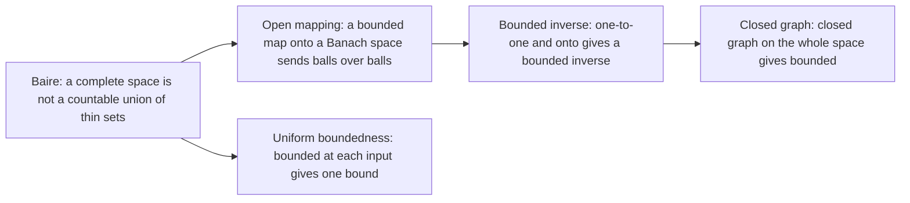
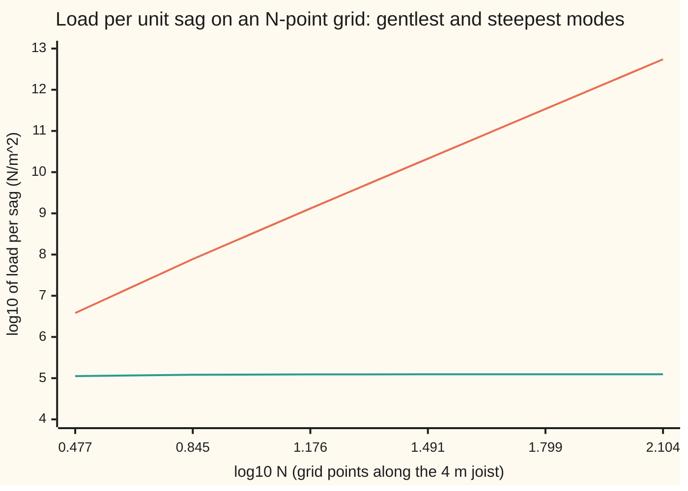

# Three Banach theorems: completeness turns weak checks into full continuity

[Syllabus](../../../SYLLABUS.md) → [Functional analysis](../README.md) → [Normed and Banach Spaces](../README.md#s01) → Three Banach theorems

---

## General Overview

A steel footbridge joist spans 4 m between two pins. Its bending stiffness is 326,645 N m², the same 100 mm I-section as in [Stress, strain and bending](../../13-Engineering%20mathematics/07-Mechanics%20and%20Structures/07-stress-strain-and-beam-bending.md). Spread 500 N/m evenly along it and the middle sags 5.102379 mm.

Now run it backwards. A laser reads the sag along the joist to 0.01 mm (an illustrative accuracy). From the sag, recover the load. The forward rule is gentle. Measure a load and its sag by their overall size along the span (the $`L^2`$ size, defined in The formula). Then each 1 N/m of load makes at most 8.0457 micrometres of sag. Different loads give different sags. So the backward rule should be safe.

It is not. Suppose the laser is off by 0.01 mm in one short wave of the sag: ten half-waves along the span. The recovered load is off by 12,429.0 N/m, against a true load of 500 N/m.

Three theorems of Banach explain when a backward rule like this is safe, and why here it cannot be. Each takes a check made one input at a time and, in a complete space, turns it into one bound for every input at once:

- **Open mapping and bounded inverse.** A bounded linear map that is one-to-one and reaches every output has a bounded inverse.
- **Closed graph.** A linear map defined on the whole space that respects limits is bounded.
- **Uniform boundedness.** A family of bounded maps that stays bounded at each input stays bounded on the whole unit ball.

All three rest on [Baire category theorem](../../17-Topology/01-Metric%20Spaces/10-baire-category-theorem.md): a complete space is never a countable union of thin sets (nowhere dense sets: sets whose closure holds no ball).

**In a complete normed space, Baire's theorem upgrades a check made one input at a time (reaching every output, respecting limits, staying bounded at each point) into a single bound that holds for every input at once.**

**What kind of fact this is:** three theorems, proved on this card in Why it works from Baire's theorem, which is proved on its own card. The joist numbers are an illustrative model, computed on finite grids and finite lists of modes.

### The picture: one theorem feeds three



Schematic. Open mapping and uniform boundedness each use Baire directly. Closed graph follows from the bounded inverse theorem.

---

## The formula

Notation first, in words. A **normed space** gives every vector a length $`\lVert x \rVert`$. A **Banach space** is a normed space that is complete: every Cauchy sequence (one whose terms end up as close together as you like) converges to a point of the space ([Normed and Banach spaces](01-normed-spaces-and-banach-spaces.md), [Complete space](../../17-Topology/01-Metric%20Spaces/05-completeness-and-completion.md)).

Four pieces of operator notation start on this card. [Bounded operators](../03-Bounded%20Operators/01-bounded-operators-and-the-operator-norm.md) treats them in full.

- $`T: X \to Y`$ is a **linear map** (an operator) from a space $`X`$ to a space $`Y`$: it respects sums and multiples.
- $`\lVert T \rVert`$ is its **operator norm**, the worst-case gain $`\sup_{x \ne 0} \lVert Tx \rVert / \lVert x \rVert`$. $`T`$ is **bounded** when this is finite. For a linear map, bounded is the same as continuous.
- $`\ker T`$, the **kernel** of $`T`$, is every input that $`T`$ sends to zero. $`T`$ is one-to-one exactly when $`\ker T = \{0\}`$.
- $`\mathrm{ran}\, T`$, the **range** of $`T`$, is every output $`T`$ actually reaches. $`T`$ is onto when $`\mathrm{ran}\, T = Y`$.

$`B_X(r)`$ is the open ball of radius $`r`$ about zero in $`X`$. The three theorems, with $`X`$ and $`Y`$ Banach spaces:

```math
T \text{ bounded, linear, onto} \;\Longrightarrow\; T(B_X(1)) \supseteq B_Y(\delta) \text{ for some } \delta > 0, \text{ and if } \ker T = \{0\}, \ \lVert T^{-1} \rVert \le 1/\delta
```

**Read it aloud:** a bounded linear map onto a Banach space covers a whole ball around zero with the image of the unit ball; if it is also one-to-one, its inverse is bounded by one over that ball's radius.

```math
T: X \to Y \text{ linear, defined on all of } X, \text{ graph closed} \;\Longrightarrow\; \lVert T \rVert < \infty
```

**Read it aloud:** a linear map defined everywhere on a Banach space whose graph contains all its limits is bounded.

```math
\sup_{\alpha} \lVert T_\alpha x \rVert < \infty \text{ for every } x \in X \;\Longrightarrow\; \sup_{\alpha} \lVert T_\alpha \rVert < \infty
```

**Read it aloud:** if a family of bounded maps on a Banach space stays bounded at each single input, the family's gains share one bound.

The **graph** of $`T`$ is the set of pairs $`(x, Tx)`$. It is **closed** when $`x_n \to x`$ and $`Tx_n \to y`$ together force $`y = Tx`$. That is weaker than continuity: it says nothing unless $`Tx_n`$ already converges.

On the joist, $`X`$ is the loads and $`Y`$ the sags, both measured in $`L^2`$: the size of a function $`f`$ on the span is $`\lVert f \rVert = (\int_0^L f(x)^2\,dx)^{1/2}`$. The **forward map** $`T`$ takes a load $`q`$ to the sag $`w`$ that solves $`EI\,w'''' = q`$ with $`w = w'' = 0`$ at both pins.

Sine waves $`\sin(n\pi x/L)`$ are the joist's modes ([Half-range series](../../08-Differential%20equations%20and%20dynamics/09-Fourier%20Series/04-half-range-sine-and-cosine-series.md)). Mode $`n`$ of the load becomes mode $`n`$ of the sag, divided by $`EI(n\pi/L)^4`$. So the backward map $`A = T^{-1}`$ multiplies mode $`n`$ by $`EI(n\pi/L)^4`$, which grows without limit.

| Symbol | Plain meaning | In our example | Push it up and the answer… |
| --- | --- | --- | --- |
| $`X`$, $`Y`$ | Banach spaces: complete normed spaces | loads and sags in $`L^2`$ on the 4 m span | — |
| $`\lVert x \rVert`$ | the norm: a vector's length | the $`L^2`$ size; units carry an extra $`\sqrt{\mathrm{m}}`$, left off the labels | — |
| $`T`$, $`Tx`$ | a linear map and its output | load to sag | — |
| $`\lVert T \rVert`$ | worst-case gain of $`T`$ | 8.0457 micrometres of sag per N/m | bigger gain: a softer joist |
| $`\ker T`$, $`\mathrm{ran}\, T`$ | inputs sent to zero; outputs reached | $`\{0\}`$; the sags of $`L^2`$ loads, not every sag | — |
| $`T^{-1}`$, $`A`$ | the inverse; the load-from-sag map | $`EI\,w''''`$: mode $`n`$ times $`EI(n\pi/L)^4`$ | — |
| $`B_X(r)`$, $`U_k`$, $`\varepsilon`$, $`\delta`$, $`\eta`$ | open ball of radius $`r`$ about zero; the closure of $`T(B_X(k))`$; the radius of the ball Baire finds in some $`U_k`$; the open-mapping radius; the radius before the closure is removed, $`\delta = \eta/2`$ | no $`\delta`$ works for the joist | bigger $`\delta`$: a smaller bound $`1/\delta`$ on $`T^{-1}`$ |
| $`(x, Tx)`$, $`G`$, $`P`$, $`C`$ | a point of the graph of $`T`$; the graph, all such pairs; the map $`P(x, Tx) = x`$; the constant that bounds $`\lVert T \rVert`$ in the closed graph proof | a load with its sag | — |
| $`T_\alpha`$, $`R_N`$, $`F_k`$, $`\varphi`$ | a family of bounded maps indexed by $`\alpha`$; the inversion that keeps $`N`$ modes; the inputs where every $`T_\alpha`$ gives length at most $`k`$; a bounded functional, a bounded linear map to the numbers | $`\lVert R_{10} \rVert = 1242898146.1`$ N/m² | more modes: a larger gain |
| $`q`$, $`w`$, $`EI`$, $`L`$ | load (N/m), sag (m), bending stiffness (N m²), span (m) | 500 N/m, 5.102379 mm at midspan, 326645 N m², 4 m | stiffer: less sag, more load per sag |
| $`n`$, $`k`$, $`e_k`$ | $`n`$: a mode number (half-waves along the span), or a sequence's index; $`k`$: a whole number counting the pieces of a cover ($`U_k`$, $`F_k`$) or the functionals $`f_k`$; $`e_k`$: the list with 1 in place $`k`$, 0 elsewhere | mode 10: ten half-waves along the span | load per sag grows as $`n^4`$ |
| $`N`$, $`h`$ | grid points or modes kept; grid spacing $`L/(N+1)`$ | 3 to 127 points | finer grid, larger $`\lVert T_N^{-1} \rVert`$ |

### When it holds

- **Both spaces complete.** Drop completeness and the inverse can blow up. On finite sequences, the identity map from the sum norm to the max norm is bounded, one-to-one and onto. Its inverse has gain 1000 on a list of 1000 ones, and more on longer lists.
- **Onto, for the bounded inverse.** The joist's $`T`$ is bounded and one-to-one, and its range is dense in $`L^2`$ (it holds every sine mode) but is not all of $`L^2`$. A bounded inverse would make the range closed: if $`Tx_n \to y`$, the $`x_n`$ would be Cauchy, with a limit $`x`$ and $`Tx = y`$. A closed, dense range is all of $`L^2`$, so the inverse has no bound. Missing outputs alone prove nothing: shifting a square-summable list one place right never makes $`(1, 0, 0, \ldots)`$, yet shifting back has gain 1, because that range is closed.
- **Defined on the whole space, for the closed graph.** The load-from-sag map $`A`$ has a closed graph and is unbounded. That is possible only because $`A`$ acts on smooth sags, not on every sag in $`L^2`$.
- **A bound at every single input, for uniform boundedness.** A bound on a dense set (a set coming close to every point) is not enough. The inversions $`R_N`$ settle on every sag a real load makes, yet their gains grow without limit.

---

## Why it works

### Step 0: one piece of a countable cover must hold a ball, and linearity spreads a ball everywhere

Each theorem writes the whole space as a countable union of sets, one for each whole number $`k`$. Baire's theorem says one of them is not thin: its closure holds a ball. A linear map treats every ball like every other ball after shifting and scaling. So a bound on one small ball becomes a bound on the unit ball, and that is a bound on the operator norm.

In finite dimensions none of this is needed. Every linear map on a space of dimension $`N`$ is bounded, so all three conclusions hold for free. The theorems matter where the dimension is infinite.

### Step 1: open mapping, by Baire on the outputs

$`T`$ is onto, so every output lies in the image of some ball $`B_X(k)`$. So $`Y`$ is the union of the closures of $`T(B_X(1)), T(B_X(2)), \ldots`$. $`Y`$ is complete, so by Baire one closure holds a ball.

Shift that ball to the origin, using linearity and the symmetry $`-B_X(k) = B_X(k)`$. Scale it down. The closure of $`T(B_X(1))`$ then holds a ball $`B_Y(\eta)`$ for some radius $`\eta > 0`$.

### Step 2: completeness of the inputs removes the closure

The closure says every $`y`$ in $`B_Y(\eta)`$ can be approached by outputs $`Tx`$ with $`\lVert x \rVert < 1`$. It does not yet say $`y`$ is hit. Correct in rounds: hit $`y`$ to within $`\eta/2`$, then hit the leftover to within $`\eta/4`$, and so on, each correction half the size of the last.

The corrections add up to a convergent series in $`X`$, because $`X`$ is complete. Its sum $`x`$ has $`Tx = y`$. So $`T(B_X(1))`$ holds $`B_Y(\delta)`$ with $`\delta = \eta/2`$. If $`T`$ is also one-to-one, every $`y`$ of length below $`\delta`$ has $`\lVert T^{-1} y \rVert < 1`$, which is $`\lVert T^{-1} \rVert \le 1/\delta`$.

<details>
<summary>Detailed proof: the open mapping theorem and the bounded inverse theorem</summary>

Write $`U_k`$ for the closure of $`T(B_X(k))`$. As $`T`$ is onto, $`Y = U_1 \cup U_2 \cup \cdots`$. Each $`U_k`$ is closed. $`Y`$ is complete, so by Baire some $`U_k`$ has an interior point: $`U_k \supseteq y_0 + B_Y(\varepsilon)`$ for some $`y_0`$ and $`\varepsilon > 0`$.

**A ball at zero.** Take $`\lVert y \rVert < \varepsilon`$. Both $`y_0 + y`$ and $`y_0`$ lie in $`U_k`$. Approach each by images and subtract: $`y`$ is a limit of $`Tx' - Tx''`$ with $`\lVert x' \rVert, \lVert x'' \rVert < k`$, so $`y \in U_{2k}`$. Scaling by $`1/(2k)`$ gives $`U_1 \supseteq B_Y(\eta)`$ with $`\eta = \varepsilon/(2k)`$. By scaling again, $`U_r \supseteq B_Y(r\eta)`$ for every $`r > 0`$.

**Removing the closure.** Take $`\lVert y \rVert < \eta/2`$. As $`y \in U_{1/2}`$, choose $`x_1`$ with $`\lVert x_1 \rVert < 1/2`$ and $`\lVert y - Tx_1 \rVert < \eta/4`$. Then $`y - Tx_1 \in U_{1/4}`$, so choose $`x_2`$ with $`\lVert x_2 \rVert < 1/4`$ and $`\lVert y - Tx_1 - Tx_2 \rVert < \eta/8`$. Continue: $`\lVert x_n \rVert < 1/2^n`$ and

$`\displaystyle \Big\lVert y - T(x_1 + \cdots + x_n) \Big\rVert < \frac{\eta}{2^{n+1}}.`$

The partial sums $`x_1 + \cdots + x_n`$ form a Cauchy sequence, since the tail after step $`n`$ has length below $`1/2^n`$. $`X`$ is complete, so they converge to some $`x`$ with $`\lVert x \rVert < 1`$. $`T`$ is continuous, so $`Tx = y`$. Hence $`T(B_X(1)) \supseteq B_Y(\eta/2)`$.

**Open sets go to open sets.** Take an open set in $`X`$ and a point $`x`$ of it. Some ball $`x + B_X(r)`$ lies inside the set, so the set's image holds $`Tx + B_Y(r\eta/2)`$. So the image is open.

**Bounded inverse.** If $`T`$ is also one-to-one, $`T^{-1}`$ is linear. For $`\lVert y \rVert < \eta/2`$ the point $`T^{-1}y`$ is the $`x`$ above, of length below 1. Scaling gives $`\lVert T^{-1} y \rVert \le (2/\eta) \lVert y \rVert`$ for every $`y`$. ∎

</details>

### Step 3: what the bounded inverse theorem says about the joist

The forward map $`T`$ is bounded, with $`\lVert T \rVert`$ = 8.0457 micrometres per N/m. It is one-to-one: $`EI\,w'''' = q`$ recovers $`q`$ from a smooth $`w`$. Yet $`A = T^{-1}`$ multiplies mode 10 by 1242898146.1 N/m²: 0.01 mm becomes 12,429.0 N/m.

If $`T`$ reached every sag in $`L^2`$, the theorem would make $`T^{-1}`$ bounded. It is not bounded, so $`T`$ is not onto. Some perfectly ordinary sags come from no load in $`L^2`$. Measurement noise lives among them.

One such sag has mode $`n`$ of amplitude 0.01 mm divided by $`n`$. Its $`L^2`$ size is only 0.018138 mm, yet Step 5 shows no load makes it.

### Step 4: closed graph, from the bounded inverse theorem

Give the pairs $`(x, Tx)`$ the length $`\lVert x \rVert + \lVert Tx \rVert`$. A closed graph inside the complete space of all pairs is complete itself. The map $`(x, Tx) \mapsto x`$ is bounded, one-to-one and onto $`X`$. By Step 2 its inverse is bounded: $`\lVert x \rVert + \lVert Tx \rVert \le C \lVert x \rVert`$ for some constant $`C`$. So $`\lVert T \rVert \le C`$.

On the joist, the load-from-sag map $`A`$ has a closed graph. If sags $`w_n \to w`$ and their loads $`Aw_n \to q`$, then $`w_n = T(Aw_n) \to Tq`$ because $`T`$ is continuous. So $`w = Tq`$, which says $`Aw = q`$.

Yet $`A`$ is unbounded. The ripple $`w_n = (0.01\text{ mm}/n)\sin(n\pi x/L)`$ has $`L^2`$ size 0.014142 mm at $`n = 1`$ and 0.000141 mm at $`n = 100`$. Its load grows from 1.8 N/m to 1757723.4 N/m.

The closed graph theorem resolves the clash. A closed, unbounded map cannot be defined on all of a Banach space. $`A`$ is defined only on sags with a fourth derivative in $`L^2`$ and pinned ends, and that set is not complete in the $`L^2`$ norm. [Unbounded operators](../05-Unbounded%20Operators%20and%20Semigroups/01-unbounded-operators-and-domains.md) builds on exactly this.

<details>
<summary>Detailed proof: the closed graph theorem</summary>

Let $`X`$ and $`Y`$ be Banach spaces and $`T: X \to Y`$ linear with a closed graph $`G = \{(x, Tx)\}`$. On pairs use $`\lVert (x, y) \rVert = \lVert x \rVert + \lVert y \rVert`$. The pairs form a Banach space: a Cauchy sequence of pairs has Cauchy first and second parts, which converge in $`X`$ and $`Y`$.

$`G`$ is a linear subspace, as $`T`$ is linear. It is closed, so it is complete. The map $`P(x, Tx) = x`$ from $`G`$ to $`X`$ is linear, with $`\lVert P(x, Tx) \rVert = \lVert x \rVert \le \lVert (x, Tx) \rVert`$, so it is bounded with gain at most 1. It is one-to-one, since $`x`$ fixes $`Tx`$, and onto $`X`$, since $`T`$ is defined on all of $`X`$.

By the bounded inverse theorem, $`P^{-1}`$ is bounded: some $`C`$ has

$`\displaystyle \lVert x \rVert + \lVert Tx \rVert \le C \lVert x \rVert \quad \text{for every } x \in X.`$

So $`\lVert Tx \rVert \le C \lVert x \rVert`$, and $`T`$ is bounded. ∎

</details>

### Step 5: uniform boundedness, by Baire on the inputs

Let $`F_k`$ be the inputs where every map of the family gives an output of length at most $`k`$. Each $`F_k`$ is closed, being an intersection of closed sets. The hypothesis says every input lies in some $`F_k`$, so $`X = F_1 \cup F_2 \cup \cdots`$.

$`X`$ is complete, so by Baire some $`F_k`$ holds a closed ball of radius $`r`$ about a point $`x_0`$. Any $`z`$ with $`\lVert z \rVert \le r`$ is the difference of two points of that ball, $`x_0 + z`$ and $`x_0`$. So every $`\lVert T_\alpha z \rVert`$ is at most $`2k`$, which gives $`\lVert T_\alpha \rVert \le 2k/r`$ for the whole family.

One consequence is used on later cards. Call a sequence $`x_1, x_2, \ldots`$ **weakly convergent** when every bounded functional $`\varphi`$ ([Hahn-Banach](06-hahn-banach-theorem.md)) gives readings $`\varphi(x_n)`$ that converge. Such a sequence is bounded in norm. Read each $`x_n`$ as a map on the functionals, $`\varphi \mapsto \varphi(x_n)`$. The functionals form a Banach space ([Dual spaces](09-dual-spaces-and-lp-duality.md)), and a norming functional from Hahn-Banach makes this map's gain exactly $`\lVert x_n \rVert`$. At each $`\varphi`$ the readings converge, so they stay bounded. Uniform boundedness then bounds the gains: $`\sup_n \lVert x_n \rVert < \infty`$.

Read backwards, uniform boundedness finds bad inputs. The joist's truncated inversion $`R_N`$ keeps modes 1 to $`N`$ of a sag and multiplies mode $`n`$ by $`EI(n\pi/L)^4`$. Each $`R_N`$ is bounded, with $`\lVert R_N \rVert = EI(N\pi/L)^4`$, which grows without limit. So some sag in $`L^2`$ makes $`\lVert R_N w \rVert`$ grow without limit. In fact most sags do, in Baire's sense: the bad sags are comeagre (they contain a countable intersection of open dense sets; see the fold).

The noisy sag of Step 3 is one. Its recovered load has size 1.8 N/m at $`N = 1`$, 2472.3 N/m at $`N = 10`$ and 3109055.4 N/m at $`N = 80`$. For the true sag, the same $`R_N`$ closes in on the true load: the gap falls from 435.2 N/m at $`N = 1`$ to 71.2 N/m at $`N = 80`$ ($`L^2`$ sizes).

<details>
<summary>Detailed proof: the uniform boundedness principle</summary>

Let $`X`$ be a Banach space, $`Y`$ a normed space and $`\{T_\alpha\}`$ a family of bounded linear maps from $`X`$ to $`Y`$ with $`\sup_\alpha \lVert T_\alpha x \rVert < \infty`$ for each $`x`$.

For each whole number $`k`$ let

$`\displaystyle F_k = \{x \in X : \lVert T_\alpha x \rVert \le k \text{ for every } \alpha\}.`$

Each set $`\{x : \lVert T_\alpha x \rVert \le k\}`$ is closed, because $`T_\alpha`$ is continuous. $`F_k`$ is their intersection, so it is closed. Every $`x`$ lies in some $`F_k`$, so $`X = F_1 \cup F_2 \cup \cdots`$.

$`X`$ is complete, so by Baire some $`F_k`$ is not nowhere dense. Being closed, it contains a closed ball $`\{x : \lVert x - x_0 \rVert \le r\}`$ with $`r > 0`$.

For $`\lVert z \rVert \le r`$, both $`x_0 + z`$ and $`x_0`$ lie in $`F_k`$, so

$`\displaystyle \lVert T_\alpha z \rVert \le \lVert T_\alpha (x_0 + z) \rVert + \lVert T_\alpha x_0 \rVert \le 2k.`$

Scaling, $`\lVert T_\alpha x \rVert \le (2k/r) \lVert x \rVert`$ for all $`x`$ and all $`\alpha`$. ∎

The same argument gives more. If $`\sup_\alpha \lVert T_\alpha \rVert = \infty`$, every $`F_k`$ is nowhere dense, so the inputs where the family stays bounded form a meagre set. The bad inputs are comeagre: they hold a countable intersection of open dense sets.

</details>

---

## Worked numbers, by hand

The forward map on a grid. Put $`N`$ points along the span, spacing $`h = L/(N+1)`$, and replace each second derivative by $`(w_{j-1} - 2w_j + w_{j+1})/h^2`$ ([Finite differences](../../08-Differential%20equations%20and%20dynamics/07-Series%20Solutions%20and%20Boundary%20Problems/07-finite-differences-for-boundary-problems.md)). The load-from-sag matrix $`T_N^{-1}`$ has the same sine modes, and its gains are known in closed form. The table follows the true sag under 500 N/m.

| Step | Arithmetic | Value |
| --- | --- | --- |
| exact midspan sag | $`5qL^4/(384EI) = 5 \times 500 \times 4^4 / (384 \times 326645)`$ | 5.102379 mm |
| grid, $`N = 3`$ | two tridiagonal solves, moment then sag | 5.357498 mm |
| grid, $`N = 127`$ | the same, error falling 4 times per halving of $`h`$ | 5.102628 mm |
| gentlest mode, $`N \to \infty`$ | $`EI(\pi/L)^4`$ with $`EI = 326645`$, $`L = 4`$ | 124289.8 N/m² |
| forward gain | $`1/124289.8`$ m² per N | 8.0457 micrometres per N/m |
| steepest mode, $`N = 127`$ | $`EI\,(4/h^2)^2 \sin^4(127\pi/256)`$, $`h = 4/128`$ m | 5478543312707.6 N/m² |
| noise in mode 10 | $`10^{-5}\text{ m} \times 124289.8 \times 10^4`$ | **12429.0 N/m** |

A 0.01 mm ripple with ten half-waves turns into a load error of 12,429.0 N/m, against a true 500 N/m. At every finite $`N`$ the inverse is bounded. Its bound grows as $`N^4`$ and never settles, which is the infinite-dimensional failure seen through a finite window.



Grids of $`N`$ = 3, 7, 15, 31, 63 and 127 points. The rising line is $`\lVert T_N^{-1} \rVert`$, the steepest mode: it grows like $`N^4`$, with no ceiling. The flat line is $`1/\lVert T_N \rVert`$, the gentlest mode, settling at 124289.8 N/m². The forward map stays tame; the backward map does not.

What the truncation hides: every grid matrix is invertible with a finite inverse. Only in the limit does the inverse lose its bound, and only there does $`T`$ fail to be onto.

### What breaks if you drop a piece

| Mistake | Comes out at | What went wrong |
| --- | --- | --- |
| Invert the measured sag mode by mode | 0.01 mm of noise in mode 20 gives 198863.7 N/m | $`\mathrm{ran}\, T`$ is dense in $`L^2`$ but not closed, so $`T^{-1}`$ is unbounded: gain $`EI(n\pi/L)^4`$ |
| Drop completeness from the bounded inverse theorem | finite sequences, 1000 ones: max norm 1, sum norm 1000, inverse gain 1000 | the space of finite sequences is not complete in either norm |
| Drop completeness from uniform boundedness | $`f_k(x) = k x_k`$ on finite sequences with the max norm: $`\sup_k \lvert f_k(x) \rvert`$ is 0.500 at $`(0.5, -0.25, 0.125)`$, 10.000 at ten ones and 100.000 at $`e_{100}`$, each finite, yet $`\lVert f_k \rVert = \lvert f_k(e_k) \rvert`$ = 1, 10, 100 at k = 1, 10, 100 | bounded at each finite input, no common bound |
| Trust a bound on the good sags only | $`R_N`$ on the noisy sag reaches 3109055.4 N/m at $`N = 80`$ | the true sags are dense, but the bound must hold at every sag |

---

## Code, from first principles, and it actually runs

The code solves the joist on six grids and tracks the inversions mode by mode. There are three roads to the gains: the closed-form eigenvalues of the grid matrix, inverse power iteration through the beam solver (repeatedly apply $`T_N`$ and rescale, which singles out the gentlest mode), and the stencil itself with a Gershgorin row bound (no eigenvalue exceeds the largest row sum). The midspan sag is checked three ways: the beam formula, a 1000-term sine series, and the grid at a rate of 4 per halving. The noisy inversion is checked against an exact integer sum of sixth powers, and the true-load gap against a midpoint-rule integral.

### Python

```python
# Three Banach theorems on a footbridge joist: recovering its load from its sag.
# Standard library only.  Every number quoted on the card is printed here.
import math

L, EI, Q, NOISE = 4.0, 326645.0, 500.0, 1e-5  # span m, stiffness N m^2, load N/m, 0.01 mm
K1 = EI * (math.pi / L) ** 4                   # load per unit sag in mode 1, N/m^2


def solve_d2(rhs, h):
    # Thomas algorithm: (v[j-1] - 2 v[j] + v[j+1]) / h^2 = rhs[j], with v = 0 at both pins
    n = len(rhs)
    c, d, v = [0.0] * n, [0.0] * n, [0.0] * n
    for j in range(n):
        piv = -2.0 - (c[j - 1] if j else 0.0)
        c[j] = 1.0 / piv
        d[j] = (rhs[j] * h * h - (d[j - 1] if j else 0.0)) / piv
    for j in range(n - 1, -1, -1):
        v[j] = d[j] - c[j] * (v[j + 1] if j < n - 1 else 0.0)
    return v


def beam(load, h):  # T: sag from load, EI w'''' = load, w = w'' = 0 at the pins
    m = solve_d2([-x for x in load], h)       # bending moment: M'' = -load
    return solve_d2([-x / EI for x in m], h)  # sag: EI w'' = -M


def d2(u, h):
    n = len(u)
    return [((u[j - 1] if j else 0.0) - 2 * u[j] + (u[j + 1] if j < n - 1 else 0.0)) / h ** 2 for j in range(n)]


def load_of(v, h):  # A: load from sag, EI times the second difference applied twice
    return [EI * x for x in d2(d2(v, h), h)]


def nrm(v, h):  # the L2 size on the grid: square root of h times the sum of squares
    return math.sqrt(h * sum(x * x for x in v))


exact = 5 * Q * L ** 4 / (384 * EI)
series = sum(4 * Q / (n * math.pi) / (EI * (n * math.pi / L) ** 4) * math.sin(n * math.pi / 2)
             for n in range(1, 2000, 2))
assert abs(series - exact) < 1e-12
print(f"joist: span {L:.0f} m, EI = {EI:.0f} N m^2, uniform load {Q:.0f} N/m")
print(f"midspan sag: 5qL^4/384EI = {exact * 1e3:.6f} mm; sine series, 1000 modes = {series * 1e3:.6f} mm")
print("   N  grid sag mm  error mm   1/||T_N|| N/m^2  ||T_N^-1|| N/m^2")
prev, chart_x, chart_lo, chart_hi = None, [], [], []
for N in (3, 7, 15, 31, 63, 127):
    h = L / (N + 1)
    w = beam([Q] * N, h)
    err = w[N // 2] - exact

    def lam(k):  # closed form: eigenvalue k of the load-from-sag matrix
        return EI * (4 / h ** 2) ** 2 * math.sin(k * math.pi / (2 * (N + 1))) ** 4
    v = [1.0] * N  # road 2: inverse power iteration through the solver finds the gentlest mode
    for _ in range(60):
        u = beam(v, h)
        s = nrm(u, h)
        v = [x / s for x in u]
    lo = 1 / nrm(beam(v, h), h)
    assert abs(lo / lam(1) - 1) < 1e-9
    top = [math.sin(N * math.pi * (j + 1) / (N + 1)) for j in range(N)]  # road 3: the stencil itself
    assert nrm([a - lam(N) * b for a, b in zip(load_of(top, h), top)], h) < 1e-9 * lam(N) * nrm(top, h)
    assert lam(N) <= 16 * EI / h ** 4  # Gershgorin: no row of the stencil sums past 16 EI / h^4
    if prev is not None:
        assert 3.9 < prev / err < 4.1  # the grid error falls 4 times per halving of the spacing
    prev = err
    chart_x.append(f"{math.log10(N):.3f}")
    chart_lo.append(f"{math.log10(lo):.3f}")
    chart_hi.append(f"{math.log10(lam(N)):.3f}")
    print(f"{N:4d} {w[N // 2] * 1e3:11.6f} {err * 1e3:10.6f} {lo:16.1f} {lam(N):17.1f}")
assert abs(lo / K1 - 1) < 1e-3
print(f"limit: 1/||T|| = EI (pi/L)^4 = {K1:.1f} N/m^2, so ||T|| = {1e6 / K1:.4f} micrometres of sag per N/m")
print(f"chart: log10 N {', '.join(chart_x)}")
print(f"chart: log10 1/||T_N|| {', '.join(chart_lo)}")
print(f"chart: log10 ||T_N^-1|| {', '.join(chart_hi)}")
for n in (1, 2, 5, 10, 20):
    print(f"0.01 mm of sag noise in mode {n:2d} -> load error {NOISE * K1 * n ** 4:10.1f} N/m")

# uniform boundedness: R_N keeps N sine modes of the sag and multiplies mode n by EI (n pi / L)^4
print(f"noisy sag: mode n has amplitude 0.01 mm / n; L2 size {NOISE * math.sqrt(L / 2 * math.pi ** 2 / 6) * 1e3:.6f} mm")
print("   N      ||R_N|| N/m^2  ||R_N w_noisy|| N/m  ||R_N w_true - q|| N/m")
for N in (1, 5, 10, 20, 40, 80):
    s6 = N * (N + 1) * (2 * N + 1) * (3 * N ** 4 + 6 * N ** 3 - 3 * N + 1) // 42  # sum of n^6, exact
    noisy = math.sqrt(L / 2 * sum((NOISE / n * K1 * n ** 4) ** 2 for n in range(1, N + 1)))
    assert abs(noisy / (NOISE * K1 * math.sqrt(L / 2 * s6)) - 1) < 1e-12
    gap = math.sqrt(Q * Q * L - L / 2 * sum((4 * Q / (n * math.pi)) ** 2 for n in range(1, N + 1, 2)))
    if N == 10:  # road 2 for the gap: midpoint rule on (q - its first ten sine modes)^2 over the span
        M = 20000
        quad = sum((Q - sum(4 * Q / (n * math.pi) * math.sin(n * math.pi * (i + 0.5) / M)
                            for n in range(1, 11, 2))) ** 2 for i in range(M)) * L / M
        assert abs(math.sqrt(quad) / gap - 1) < 1e-6
    print(f"{N:4d} {K1 * N ** 4:18.1f} {noisy:20.1f} {gap:22.1f}")

# closed graph: ripples w_n = (0.01 mm / n) sin(n pi x / L) shrink, their loads grow
for n in (1, 10, 100):
    size = NOISE / n * math.sqrt(L / 2)
    print(f"ripple n = {n:3d}: ||w_n|| = {size * 1e3:.6f} mm, ||A w_n|| = {size * K1 * n ** 4:.1f} N/m")
h = L / 128
rip = [NOISE / 10 * math.sin(10 * math.pi * (j + 1) / 128) for j in range(127)]
assert abs(nrm(load_of(rip, h), h) / nrm(rip, h) / (K1 * 10 ** 4) - 1) < 0.02  # grid agrees within 2%

# completeness dropped: finite sequences only, not a Banach space under either norm
ones = [1.0] * 1000
print(f"finite sequences, 1000 ones: max norm {max(ones):.0f}, sum norm {sum(ones):.0f}, inverse gain {sum(ones) / max(ones):.0f}")
f = lambda k, x: k * x[k - 1]  # f_k(x) = k x_k on a finite sequence x
gains = [abs(f(k, [0.0] * (k - 1) + [1.0])) for k in (1, 10, 100)]  # at e_k, of max norm 1
assert gains == [1, 10, 100]  # and |k x_k| <= k max |x|, so ||f_k|| = k
print(f"f_k(x) = k x_k, max norm: |f_k(e_k)| = {', '.join(f'{g:.0f}' for g in gains)} at k = 1, 10, 100, so ||f_k|| = k")
tops = [max(abs(f(k, x)) for k in range(1, len(x) + 1)) for x in ([0.5, -0.25, 0.125], [1.0] * 10, [0.0] * 99 + [1.0])]
print(f"  sup over k of |f_k(x)|: {tops[0]:.3f} at (0.5, -0.25, 0.125); {tops[1]:.3f} at ten ones; {tops[2]:.3f} at e_100")
print("ALL CHECKS PASS")
```

**Ran 2026-11-15 on macOS, Python 3.14.10, standard library only. All checks passed. Output, pasted from the run:**

```
joist: span 4 m, EI = 326645 N m^2, uniform load 500 N/m
midspan sag: 5qL^4/384EI = 5.102379 mm; sine series, 1000 modes = 5.102379 mm
   N  grid sag mm  error mm   1/||T_N|| N/m^2  ||T_N^-1|| N/m^2
   3    5.357498   0.255119         112086.8         3807653.2
   7    5.166159   0.063780         121132.0        77376973.3
  15    5.118324   0.015945         123493.5      1312353311.5
  31    5.106365   0.003986         124090.3     21304050221.8
  63    5.103376   0.000997         124239.9    342099660926.1
 127    5.102628   0.000249         124277.3   5478543312707.6
limit: 1/||T|| = EI (pi/L)^4 = 124289.8 N/m^2, so ||T|| = 8.0457 micrometres of sag per N/m
chart: log10 N 0.477, 0.845, 1.176, 1.491, 1.799, 2.104
chart: log10 1/||T_N|| 5.050, 5.083, 5.092, 5.094, 5.094, 5.094
chart: log10 ||T_N^-1|| 6.581, 7.889, 9.118, 10.328, 11.534, 12.739
0.01 mm of sag noise in mode  1 -> load error        1.2 N/m
0.01 mm of sag noise in mode  2 -> load error       19.9 N/m
0.01 mm of sag noise in mode  5 -> load error      776.8 N/m
0.01 mm of sag noise in mode 10 -> load error    12429.0 N/m
0.01 mm of sag noise in mode 20 -> load error   198863.7 N/m
noisy sag: mode n has amplitude 0.01 mm / n; L2 size 0.018138 mm
   N      ||R_N|| N/m^2  ||R_N w_noisy|| N/m  ||R_N w_true - q|| N/m
   1           124289.8                  1.8                  435.2
   5         77681134.1                251.8                  258.7
  10       1242898146.1               2472.3                  201.0
  20      19886370338.0              25860.4                  142.3
  40     318181925408.0             280712.9                  100.6
  80    5090910806528.3            3109055.4                   71.2
ripple n =   1: ||w_n|| = 0.014142 mm, ||A w_n|| = 1.8 N/m
ripple n =  10: ||w_n|| = 0.001414 mm, ||A w_n|| = 1757.7 N/m
ripple n = 100: ||w_n|| = 0.000141 mm, ||A w_n|| = 1757723.4 N/m
finite sequences, 1000 ones: max norm 1, sum norm 1000, inverse gain 1000
f_k(x) = k x_k, max norm: |f_k(e_k)| = 1, 10, 100 at k = 1, 10, 100, so ||f_k|| = k
  sup over k of |f_k(x)|: 0.500 at (0.5, -0.25, 0.125); 10.000 at ten ones; 100.000 at e_100
ALL CHECKS PASS
```

### Rust

```rust
// Three Banach theorems on a footbridge joist: recovering its load from its sag.
// std only, no crates.  Every number quoted on the card is printed here.
use std::f64::consts::PI;

const L: f64 = 4.0; // span, m
const EI: f64 = 326645.0; // bending stiffness, N m^2
const Q: f64 = 500.0; // uniform load, N/m
const NOISE: f64 = 1e-5; // 0.01 mm of sag

// Thomas algorithm: (v[j-1] - 2 v[j] + v[j+1]) / h^2 = rhs[j], with v = 0 at both pins
fn solve_d2(rhs: &[f64], h: f64) -> Vec<f64> {
    let n = rhs.len();
    let (mut c, mut d, mut v) = (vec![0.0; n], vec![0.0; n], vec![0.0; n]);
    for j in 0..n {
        let piv = -2.0 - if j > 0 { c[j - 1] } else { 0.0 };
        c[j] = 1.0 / piv;
        d[j] = (rhs[j] * h * h - if j > 0 { d[j - 1] } else { 0.0 }) / piv;
    }
    for j in (0..n).rev() {
        v[j] = d[j] - c[j] * if j + 1 < n { v[j + 1] } else { 0.0 };
    }
    v
}

// T: sag from load, EI w'''' = load, w = w'' = 0 at the pins
fn beam(load: &[f64], h: f64) -> Vec<f64> {
    let m = solve_d2(&load.iter().map(|x| -x).collect::<Vec<_>>(), h); // M'' = -load
    solve_d2(&m.iter().map(|x| -x / EI).collect::<Vec<_>>(), h) // EI w'' = -M
}

fn d2(u: &[f64], h: f64) -> Vec<f64> {
    let n = u.len();
    (0..n)
        .map(|j| {
            let a = if j > 0 { u[j - 1] } else { 0.0 };
            let b = if j + 1 < n { u[j + 1] } else { 0.0 };
            (a - 2.0 * u[j] + b) / (h * h)
        })
        .collect()
}

// A: load from sag, EI times the second difference applied twice
fn load_of(v: &[f64], h: f64) -> Vec<f64> {
    d2(&d2(v, h), h).iter().map(|x| EI * x).collect()
}

// the L2 size on the grid: square root of h times the sum of squares
fn nrm(v: &[f64], h: f64) -> f64 {
    (h * v.iter().map(|x| x * x).sum::<f64>()).sqrt()
}

fn main() {
    let k1 = EI * (PI / L).powi(4); // load per unit sag in mode 1, N/m^2
    let exact = 5.0 * Q * L.powi(4) / (384.0 * EI);
    let mut series = 0.0;
    for n in (1..2000).step_by(2) {
        let nf = n as f64;
        series += 4.0 * Q / (nf * PI) / (EI * (nf * PI / L).powi(4)) * (nf * PI / 2.0).sin();
    }
    assert!((series - exact).abs() < 1e-12);
    println!("joist: span {:.0} m, EI = {:.0} N m^2, uniform load {:.0} N/m", L, EI, Q);
    println!("midspan sag: 5qL^4/384EI = {:.6} mm; sine series, 1000 modes = {:.6} mm", exact * 1e3, series * 1e3);
    println!("   N  grid sag mm  error mm   1/||T_N|| N/m^2  ||T_N^-1|| N/m^2");
    let (mut prev, mut lo) = (f64::NAN, 0.0);
    let (mut cx, mut clo, mut chi) = (vec![], vec![], vec![]);
    for &n in &[3usize, 7, 15, 31, 63, 127] {
        let h = L / (n as f64 + 1.0);
        let w = beam(&vec![Q; n], h);
        let err = w[n / 2] - exact;
        // closed form: eigenvalue k of the load-from-sag matrix
        let lam = |k: usize| EI * (4.0 / (h * h)).powi(2) * (k as f64 * PI / (2.0 * (n as f64 + 1.0))).sin().powi(4);
        let mut v = vec![1.0; n]; // road 2: inverse power iteration through the solver
        for _ in 0..60 {
            let u = beam(&v, h);
            let s = nrm(&u, h);
            v = u.iter().map(|x| x / s).collect();
        }
        lo = 1.0 / nrm(&beam(&v, h), h);
        assert!((lo / lam(1) - 1.0).abs() < 1e-9);
        // road 3: the stencil itself
        let top: Vec<f64> = (0..n).map(|j| (n as f64 * PI * (j as f64 + 1.0) / (n as f64 + 1.0)).sin()).collect();
        let res: Vec<f64> = load_of(&top, h).iter().zip(&top).map(|(a, b)| a - lam(n) * b).collect();
        assert!(nrm(&res, h) < 1e-9 * lam(n) * nrm(&top, h));
        assert!(lam(n) <= 16.0 * EI / h.powi(4)); // Gershgorin row bound
        if !prev.is_nan() {
            assert!(3.9 < prev / err && prev / err < 4.1); // error falls 4 times per halving
        }
        prev = err;
        cx.push(format!("{:.3}", (n as f64).log10()));
        clo.push(format!("{:.3}", lo.log10()));
        chi.push(format!("{:.3}", lam(n).log10()));
        println!("{:4} {:11.6} {:10.6} {:16.1} {:17.1}", n, w[n / 2] * 1e3, err * 1e3, lo, lam(n));
    }
    assert!((lo / k1 - 1.0).abs() < 1e-3);
    println!("limit: 1/||T|| = EI (pi/L)^4 = {:.1} N/m^2, so ||T|| = {:.4} micrometres of sag per N/m", k1, 1e6 / k1);
    println!("chart: log10 N {}", cx.join(", "));
    println!("chart: log10 1/||T_N|| {}", clo.join(", "));
    println!("chart: log10 ||T_N^-1|| {}", chi.join(", "));
    for &n in &[1i32, 2, 5, 10, 20] {
        println!("0.01 mm of sag noise in mode {:2} -> load error {:10.1} N/m", n, NOISE * k1 * (n as f64).powi(4));
    }

    // uniform boundedness: R_N keeps N sine modes of the sag and multiplies mode n by EI (n pi / L)^4
    println!("noisy sag: mode n has amplitude 0.01 mm / n; L2 size {:.6} mm", NOISE * (L / 2.0 * PI * PI / 6.0).sqrt() * 1e3);
    println!("   N      ||R_N|| N/m^2  ||R_N w_noisy|| N/m  ||R_N w_true - q|| N/m");
    for &nn in &[1u64, 5, 10, 20, 40, 80] {
        let s6 = nn * (nn + 1) * (2 * nn + 1) * (3 * nn.pow(4) + 6 * nn.pow(3) - 3 * nn + 1) / 42; // sum of n^6
        let noisy = (L / 2.0 * (1..=nn).map(|n| (NOISE / n as f64 * k1 * (n as f64).powi(4)).powi(2)).sum::<f64>()).sqrt();
        assert!((noisy / (NOISE * k1 * (L / 2.0 * s6 as f64).sqrt()) - 1.0).abs() < 1e-12);
        let kept: f64 = (1..=nn).step_by(2).map(|n| (4.0 * Q / (n as f64 * PI)).powi(2)).sum();
        let gap = (Q * Q * L - L / 2.0 * kept).sqrt();
        if nn == 10 {
            // road 2 for the gap: midpoint rule on (q - its first ten sine modes)^2 over the span
            let m = 20000;
            let mut quad = 0.0;
            for i in 0..m {
                let mut s = 0.0;
                for n in (1..11).step_by(2) {
                    s += 4.0 * Q / (n as f64 * PI) * (n as f64 * PI * (i as f64 + 0.5) / m as f64).sin();
                }
                quad += (Q - s).powi(2);
            }
            quad *= L / m as f64;
            assert!((quad.sqrt() / gap - 1.0).abs() < 1e-6);
        }
        println!("{:4} {:18.1} {:20.1} {:22.1}", nn, k1 * (nn as f64).powi(4), noisy, gap);
    }

    // closed graph: ripples w_n = (0.01 mm / n) sin(n pi x / L) shrink, their loads grow
    for &n in &[1i32, 10, 100] {
        let size = NOISE / n as f64 * (L / 2.0).sqrt();
        println!("ripple n = {:3}: ||w_n|| = {:.6} mm, ||A w_n|| = {:.1} N/m", n, size * 1e3, size * k1 * (n as f64).powi(4));
    }
    let h = L / 128.0;
    let rip: Vec<f64> = (0..127).map(|j| NOISE / 10.0 * (10.0 * PI * (j as f64 + 1.0) / 128.0).sin()).collect();
    assert!((nrm(&load_of(&rip, h), h) / nrm(&rip, h) / (k1 * 1e4) - 1.0).abs() < 0.02); // grid within 2%

    // completeness dropped: finite sequences only, not a Banach space under either norm
    let ones = vec![1.0f64; 1000];
    let (mx, sm) = (ones.iter().cloned().fold(0.0, f64::max), ones.iter().sum::<f64>());
    println!("finite sequences, 1000 ones: max norm {:.0}, sum norm {:.0}, inverse gain {:.0}", mx, sm, sm / mx);
    let f = |k: usize, x: &[f64]| k as f64 * x[k - 1]; // f_k(x) = k x_k on a finite sequence x
    let gains: Vec<f64> = [1usize, 10, 100].iter().map(|&k| {
        let mut e = vec![0.0; k];
        e[k - 1] = 1.0; // e_k, of max norm 1
        f(k, &e).abs()
    }).collect();
    assert!(gains == vec![1.0, 10.0, 100.0]); // and |k x_k| <= k max |x|, so ||f_k|| = k
    let gs: Vec<String> = gains.iter().map(|g| format!("{:.0}", g)).collect();
    println!("f_k(x) = k x_k, max norm: |f_k(e_k)| = {} at k = 1, 10, 100, so ||f_k|| = k", gs.join(", "));
    let mut e100 = vec![0.0; 100];
    e100[99] = 1.0;
    let xs: [Vec<f64>; 3] = [vec![0.5, -0.25, 0.125], vec![1.0; 10], e100];
    let tops: Vec<f64> = xs.iter().map(|x| (1..=x.len()).map(|k| f(k, x).abs()).fold(0.0, f64::max)).collect();
    println!("  sup over k of |f_k(x)|: {:.3} at (0.5, -0.25, 0.125); {:.3} at ten ones; {:.3} at e_100", tops[0], tops[1], tops[2]);
    println!("ALL CHECKS PASS");
}
```

**Ran 2026-11-15 on macOS, rustc 1.98.1, no crates. All checks passed. Output, pasted from the run:**

```
joist: span 4 m, EI = 326645 N m^2, uniform load 500 N/m
midspan sag: 5qL^4/384EI = 5.102379 mm; sine series, 1000 modes = 5.102379 mm
   N  grid sag mm  error mm   1/||T_N|| N/m^2  ||T_N^-1|| N/m^2
   3    5.357498   0.255119         112086.8         3807653.2
   7    5.166159   0.063780         121132.0        77376973.3
  15    5.118324   0.015945         123493.5      1312353311.5
  31    5.106365   0.003986         124090.3     21304050221.8
  63    5.103376   0.000997         124239.9    342099660926.1
 127    5.102628   0.000249         124277.3   5478543312707.6
limit: 1/||T|| = EI (pi/L)^4 = 124289.8 N/m^2, so ||T|| = 8.0457 micrometres of sag per N/m
chart: log10 N 0.477, 0.845, 1.176, 1.491, 1.799, 2.104
chart: log10 1/||T_N|| 5.050, 5.083, 5.092, 5.094, 5.094, 5.094
chart: log10 ||T_N^-1|| 6.581, 7.889, 9.118, 10.328, 11.534, 12.739
0.01 mm of sag noise in mode  1 -> load error        1.2 N/m
0.01 mm of sag noise in mode  2 -> load error       19.9 N/m
0.01 mm of sag noise in mode  5 -> load error      776.8 N/m
0.01 mm of sag noise in mode 10 -> load error    12429.0 N/m
0.01 mm of sag noise in mode 20 -> load error   198863.7 N/m
noisy sag: mode n has amplitude 0.01 mm / n; L2 size 0.018138 mm
   N      ||R_N|| N/m^2  ||R_N w_noisy|| N/m  ||R_N w_true - q|| N/m
   1           124289.8                  1.8                  435.2
   5         77681134.1                251.8                  258.7
  10       1242898146.1               2472.3                  201.0
  20      19886370338.0              25860.4                  142.3
  40     318181925408.0             280712.9                  100.6
  80    5090910806528.3            3109055.4                   71.2
ripple n =   1: ||w_n|| = 0.014142 mm, ||A w_n|| = 1.8 N/m
ripple n =  10: ||w_n|| = 0.001414 mm, ||A w_n|| = 1757.7 N/m
ripple n = 100: ||w_n|| = 0.000141 mm, ||A w_n|| = 1757723.4 N/m
finite sequences, 1000 ones: max norm 1, sum norm 1000, inverse gain 1000
f_k(x) = k x_k, max norm: |f_k(e_k)| = 1, 10, 100 at k = 1, 10, 100, so ||f_k|| = k
  sup over k of |f_k(x)|: 0.500 at (0.5, -0.25, 0.125); 10.000 at ten ones; 100.000 at e_100
ALL CHECKS PASS
```

### Lean

Lean proves all three theorems for any real Banach spaces, and checks the numbers in the finite counterexamples.

- Take a bounded linear map $`T: X \to Y`$ that is onto. Then $`T(B_X(1))`$ holds a ball $`B_Y(\delta)`$ with $`\delta > 0`$.
- Suppose also that this $`T`$ is one-to-one. Then every input $`x`$ has $`\lVert x \rVert \le \lVert Tx \rVert / \delta`$, with that same $`\delta`$.
- Take a linear map $`T`$ defined on all of $`X`$ whose graph is closed. Then some constant $`C`$ gives $`\lVert Tx \rVert \le C \lVert x \rVert`$ for every $`x`$.
- Take bounded linear maps $`T_\alpha`$ from a Banach space $`X`$ to a normed space $`Y`$, bounded at each single input. Then $`\sup_\alpha \lVert T_\alpha \rVert < \infty`$.
- A list of 1000 ones has max norm 1 and sum norm 1000.
- Take $`f_k(x) = k x_k`$. Then the largest $`\lvert f_k(x) \rvert`$ is 0.5 at $`(0.5, -0.25, 0.125)`$ and 10 at ten ones.
- Take $`e_k`$ and the same $`f_k`$. Then $`f_k(e_k) = k`$ at $`k`$ = 1, 10 and 100.

The joist's grids, sags, gains, noisy inversions and ripples are left to the Python and Rust checks.

```lean
-- Three Banach theorems: in complete normed spaces, a bounded linear map onto covers a ball and has a bounded inverse when one-to-one, a linear map with a closed graph is bounded, and a family bounded at each input has one common bound.
import Mathlib.Analysis.Normed.Operator.Banach
import Mathlib.Analysis.Normed.Operator.BanachSteinhaus

open Metric

/-- Open mapping and bounded inverse. Let `X` and `Y` be real Banach spaces and `T : X → Y`
a bounded linear map onto `Y`. Then the image of the unit ball of `X` holds a whole ball
`B_Y(δ)` about zero for some `δ > 0`; and if also `ker T = {0}`, the inverse is bounded by
`1/δ`: every input `x` has `‖x‖ ≤ (1/δ) ‖T x‖`. -/
theorem open_mapping_and_bounded_inverse
    {X Y : Type*} [NormedAddCommGroup X] [NormedSpace ℝ X] [CompleteSpace X]
    [NormedAddCommGroup Y] [NormedSpace ℝ Y] [CompleteSpace Y]
    (T : X →L[ℝ] Y) (hT : Function.Surjective T) :
    ∃ δ > 0, ball (0 : Y) δ ⊆ T '' ball (0 : X) 1 ∧
      (LinearMap.ker (T : X →ₗ[ℝ] Y) = ⊥ → ∀ x : X, ‖x‖ ≤ (1 / δ) * ‖T x‖) := by
  obtain ⟨C, C0, hC⟩ := ContinuousLinearMap.exists_preimage_norm_le T hT
  refine ⟨1 / C, by positivity, ?_, ?_⟩
  · intro y hy
    rw [mem_ball_zero_iff] at hy
    obtain ⟨x, hx, hxn⟩ := hC y
    refine ⟨x, ?_, hx⟩
    rw [mem_ball_zero_iff]
    calc ‖x‖ ≤ C * ‖y‖ := hxn
      _ < C * (1 / C) := mul_lt_mul_of_pos_left hy C0
      _ = 1 := by field_simp
  · intro hker x
    obtain ⟨x', hx', hxn⟩ := hC (T x)
    have hinj : Function.Injective (T : X →ₗ[ℝ] Y) := LinearMap.ker_eq_bot.mp hker
    have : x' = x := hinj hx'
    subst this
    simpa using hxn

/-- Closed graph. Let `X` and `Y` be real Banach spaces and `T : X → Y` a linear map defined on
all of `X` whose graph `{(x, T x)}` is closed in `X × Y`. Then `T` is bounded: some constant `C`
has `‖T x‖ ≤ C ‖x‖` for every `x`. -/
theorem closed_graph_linear_map_is_bounded
    {X Y : Type*} [NormedAddCommGroup X] [NormedSpace ℝ X] [CompleteSpace X]
    [NormedAddCommGroup Y] [NormedSpace ℝ Y] [CompleteSpace Y]
    (T : X →ₗ[ℝ] Y) (hG : IsClosed (T.graph : Set (X × Y))) :
    ∃ C : ℝ, ∀ x : X, ‖T x‖ ≤ C * ‖x‖ := by
  refine ⟨‖ContinuousLinearMap.ofIsClosedGraph hG‖, fun x => ?_⟩
  have := (ContinuousLinearMap.ofIsClosedGraph hG).le_opNorm x
  simpa using this

/-- Uniform boundedness. Let `X` be a real Banach space, `Y` a real normed space and `T α` a
family of bounded linear maps from `X` to `Y`. If the family stays bounded at each single input
(`sup_α ‖T α x‖ < ∞` for every `x`), then the gains share one bound: `sup_α ‖T α‖ < ∞`. -/
theorem uniform_boundedness_principle
    {X Y ι : Type*} [NormedAddCommGroup X] [NormedSpace ℝ X] [CompleteSpace X]
    [NormedAddCommGroup Y] [NormedSpace ℝ Y]
    (T : ι → X →L[ℝ] Y) (h : ∀ x : X, BddAbove (Set.range fun α => ‖T α x‖)) :
    BddAbove (Set.range fun α => ‖T α‖) := by
  obtain ⟨C, hC⟩ := banach_steinhaus (g := T) (fun x => by
    obtain ⟨B, hB⟩ := h x
    exact ⟨B, fun i => hB ⟨i, rfl⟩⟩)
  exact ⟨C, by rintro _ ⟨i, rfl⟩; exact hC i⟩

-- The list of 1000 ones: max norm 1, sum norm 1000, so the inverse gain is 1000.
example : (Finset.range 1000).sup (fun _ => (1 : ℕ)) = 1 := by norm_num [Finset.sup_const]
example : ∑ _k ∈ Finset.range 1000, (1 : ℕ) = 1000 := by norm_num

-- f_k(x) = k x_k: at (1/2, -1/4, 1/8) the largest |f_k(x)| is 1/2.
example : max (max |1 * (1 / 2 : ℚ)| |2 * (-1 / 4 : ℚ)|) |3 * (1 / 8 : ℚ)| = 1 / 2 := by norm_num

-- At ten ones the largest |f_k(x)| = k is 10; at e_k the reading f_k(e_k) is k for k = 1, 10, 100.
example : (Finset.Icc 1 10).sup (fun k : ℕ => k * 1) = 10 := by decide
example : ∀ k ∈ ({1, 10, 100} : Finset ℕ),
    k * (fun i : ℕ => if i = k then 1 else 0) k = k := by decide

#print axioms open_mapping_and_bounded_inverse
#print axioms closed_graph_linear_map_is_bounded
#print axioms uniform_boundedness_principle
```

**Checked 2026-11-15 on macOS, Lean 4.36.0-rc2, Mathlib v4.36.0-rc2. Every proof is complete and uses only Lean's standard axioms. Output, pasted from the run:**

```
'open_mapping_and_bounded_inverse' depends on axioms: [propext, Classical.choice, Quot.sound]
'closed_graph_linear_map_is_bounded' depends on axioms: [propext, Classical.choice, Quot.sound]
'uniform_boundedness_principle' depends on axioms: [propext, Classical.choice, Quot.sound]
```

> [!TIP]
> **Try changing**
> Guess first, then run it.
> - **A laser ten times better.** Set `NOISE` to `1e-6` in the first line of constants. Guess: does mode 10 become harmless? It prints 1242.9 N/m, still larger than the true load of 500 N/m. The labels still say 0.01 mm; only the number moved.
> - **An aluminium joist.** Set `EI` to `114326.0`, the same section in aluminium. The sag grows to 14.578195 mm, and mode-10 noise falls to 4350.2 N/m: a softer joist is easier to read backwards.
> - **A finer grid.** Add `255` to the list of grid sizes. Guess the steepest mode first. It prints 87676497273274.3 N/m², while the gentlest mode only creeps to 124286.7 N/m².
> - **A sag a real load makes.** In the noisy sum, change `NOISE / n` to `NOISE / n ** 5`, and delete the sixth-power assert on the next line: it is pinned to the noisy sag. The recovered load now settles: 1.8 N/m at $`N = 1`$, then 2.2 N/m from $`N = 10`$ to $`N = 80`$.

---

## The usual mistake

> [!warning]
> **Reading the bounded inverse theorem as "continuous and one-to-one means the inverse is safe".** The theorem also needs the map to be onto a complete space. The joist's forward map is bounded and one-to-one, and 0.01 mm of noise in mode 10 still becomes 12,429.0 N/m. The theorem's real message runs the other way: since the inverse is unbounded, the forward map misses some sags, and noise lands there.
>
> - **Closed graph is not continuity.** A closed graph only constrains limits that already exist. The load-from-sag map has one and sends ripples of size 0.000141 mm to 1757723.4 N/m.
> - **Bounded at each input is not "bounded on a dense set".** $`R_N`$ settles on every true sag, a dense set, yet blows up to 3109055.4 N/m on the noisy sag at $`N = 80`$.
> - **A finite grid looks well behaved.** At $`N = 7`$ the steepest gain is 77376973.3 N/m², finite and harmless-looking. The grid hides the failure until $`N`$ grows.

---

## Where you meet it in real life

- **Load identification on bridges and machines.** Engineers infer forces from measured strains and deflections. The unbounded inverse is why they always regularise: keep a limited number of modes, or penalise wild loads.
- **Medical scanners and deblurring.** A CT scanner or a blurring lens is a bounded one-to-one map, and naive inversion amplifies noise without limit. Read through the bounded inverse theorem, that blow-up says the range is not closed: some ordinary images come from no scene, and noise lands among them.
- **Numerical schemes.** [Finite differences on a grid](../../16-Numerical%20analysis/07-PDE%20Solvers/02-finite-differences-consistency-stability-and-convergence.md) uses uniform boundedness inside the Lax equivalence theorem: a scheme that converges for every start must be stable.
- **Fourier series.** Uniform boundedness shows that some continuous function has a Fourier series that diverges at a point, because the partial-sum maps at that point have gains that grow like $`\log N`$ ([Convergence](../../08-Differential%20equations%20and%20dynamics/09-Fourier%20Series/02-convergence-jumps-and-gibbs.md)).

> **Say it back**
> Three theorems of Banach turn a check made one input at a time into one bound for every input, as long as the spaces are complete. A bounded linear map onto a Banach space has a bounded inverse when it is one-to-one; a linear map defined everywhere with a closed graph is bounded; a family bounded at every input is bounded in norm. Each proof covers the space by countably many sets and uses Baire's theorem to find a ball in one of them. The joist's forward map is bounded and one-to-one, yet 0.01 mm of noise in mode 10 becomes 12,429.0 N/m, so the map cannot be onto. The theorems tell you when inversion is safe, and when it never can be.

---

## What this builds on

- [Normed and Banach spaces](01-normed-spaces-and-banach-spaces.md): the norm and completeness that every hypothesis here names.
- [Baire category theorem](../../17-Topology/01-Metric%20Spaces/10-baire-category-theorem.md): a complete space is never a countable union of nowhere dense sets. Every proof on this card is one application of it.
- [Complete space](../../17-Topology/01-Metric%20Spaces/05-completeness-and-completion.md): Cauchy sequences and why their limits must exist. Step 2 sums its corrections with it.
- [Stress, strain and bending](../../13-Engineering%20mathematics/07-Mechanics%20and%20Structures/07-stress-strain-and-beam-bending.md): the joist, its stiffness and the beam law.

## Where this goes next

- [Dual spaces](09-dual-spaces-and-lp-duality.md): all the bounded functionals on a space, and what they turn out to be on $`\ell^p`$, $`L^p`$ and $`C[a, b]`$; the operator words of this card return in the transpose.
- [Reflexive spaces](10-reflexive-spaces-and-the-second-dual.md): the second dual and the spaces it gives back exactly; it uses Step 5's consequence that weakly convergent sequences are bounded.
- [Bounded operators](../03-Bounded%20Operators/01-bounded-operators-and-the-operator-norm.md): the space of all bounded maps between two Banach spaces, and why bounded means continuous.
- [Unbounded operators](../05-Unbounded%20Operators%20and%20Semigroups/01-unbounded-operators-and-domains.md): maps like the joist's load-from-sag map, defined only on part of the space, with closed graphs.

Left open: if the backward map can never be bounded, how much of the load can be recovered from a noisy sag, and at what cost?

---

## Sources

Verified 2026-11-15: every link below resolves to the publisher's page.

- Banach, S., and Steinhaus, H. "Sur le principe de la condensation de singularités." *Fundamenta Mathematicae* 9 (1927): 50–61. [doi:10.4064/fm-9-1-50-61](https://doi.org/10.4064/fm-9-1-50-61). The original uniform boundedness principle.
- Banach, S. "Sur les fonctionnelles linéaires II." *Studia Mathematica* 1 (1929): 223–239. [doi:10.4064/sm-1-1-223-239](https://doi.org/10.4064/sm-1-1-223-239). The paper in which the bounded inverse theorem first appears.
- Brezis, H. *Functional Analysis, Sobolev Spaces and Partial Differential Equations.* Springer, 2011. [doi:10.1007/978-0-387-70914-7](https://doi.org/10.1007/978-0-387-70914-7). Chapter 2 proves all three theorems from Baire, in the form used here.
- Engl, H. W., Hanke, M., and Neubauer, A. *Regularization of Inverse Problems.* Springer, 1996. [doi:10.1007/978-94-009-1740-8](https://doi.org/10.1007/978-94-009-1740-8). Why the inverse of a bounded one-to-one map is bounded exactly when its range is closed, and how truncation tames the unbounded case.
