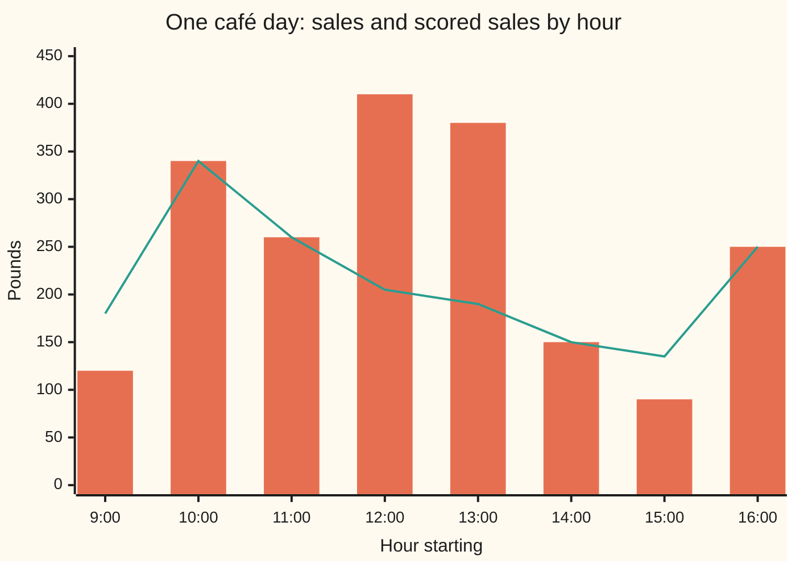
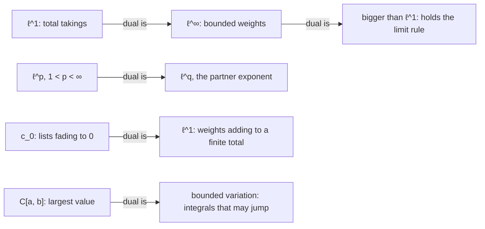
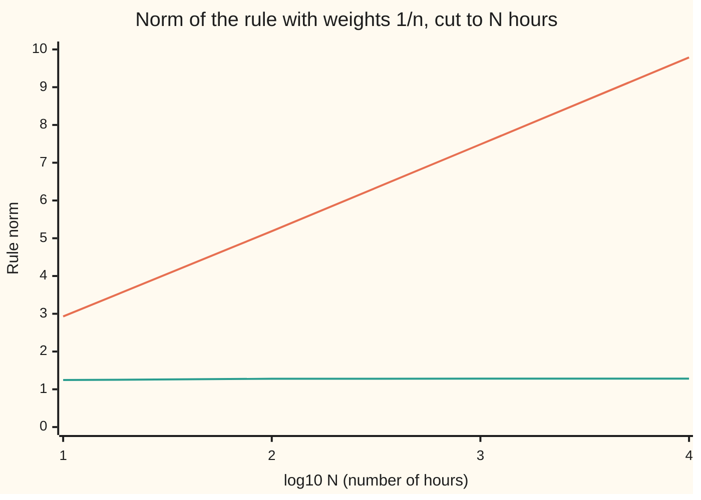

# Dual spaces: the continuous measurements on a space, and what they turn out to be

[Syllabus](../../../SYLLABUS.md) → [Functional analysis](../README.md) → [Normed and Banach Spaces](../README.md#s01) → Dual spaces

---

## General Overview

A café opens from 9:00 to 17:00. Yesterday it took £120, £340, £260, £410, £380, £150, £90 and £250 in its eight hours, £2,000 in all. The figures are illustrative.

Head office scores every café's day with a weighted sum. Sales in the opening hour (9:00) and the 15:00 hour count 1.5 times. Sales in the lunch rush (12:00 and 13:00) count half. Every other hour counts once. The aim is to reward trade built outside lunch. Yesterday's score is 1,710.

The scoring rule is a **measurement**: it turns a whole day into one number. It is linear: double the sales and the score doubles; add two days and the scores add. It is also steady: a small change in sales gives a small change in score. A linear rule that is steady in this sense is called a **bounded linear functional**, or a **functional** for short. All the functionals on a space form its **dual space**.

Two questions follow. How large can the score get, compared with the size of the day? And which functionals exist at all? The first answer depends on how the day is sized:

- Sized by total takings, the score is at most 1.5 times the size: the largest weight.
- Sized by the busiest hour, it is at most 8 times the size: the weights added up.
- Sized by root-sum-square, it is at most 3 times the size: the root-sum-square of the weights.

So the weights are sized by a partner rule, called the conjugate size. That pairing is the content of this card. With eight hours, every functional is a weighted sum. With an endless list of hours, or a sales rate at every instant of the day, two surprises appear. Some functionals on bounded lists have no weights at all. And the noon reading of a continuous sales rate is a functional with no weight function: it is an integral against a jump.

**The dual of a space is the set of its continuous linear measurements; for lists or functions sized by a p-th power with p from 1 up to (not including) infinity, every such measurement is a weighted sum or integral whose weights have finite conjugate size q, with norm exactly that q-size; on continuous functions sized by their largest value, every measurement is an integral against a function of bounded variation; and every bounded operator T has a transpose that pulls measurements back through it.**

**What kind of fact this is:** the dual space and the transpose are definitions. The identification of the dual of ℓ^p, the norm of the transpose, and the annihilator rule are theorems proved on this card in Why it works. The dual of L^p is proved in a fold from the Radon-Nikodym theorem. The dual of C[a, b] (the Riesz-Markov theorem) is proved in outline in a fold, following Kreyszig (Banach's route), with Kakutani (1941) for the general case; that proof uses Hahn-Banach, so it rests on the axiom of choice.

### The picture: one day, sales and scored sales



Bars: the sales in each hour, N = 8 hours, £2,000 in all. Line: the same hour after weighting, which adds up to the score of 1,710. The lunch bars are cut in half; the 9:00 and 15:00 bars grow by half.

---

## The formula

Notation first, in words. A **normed space** X is a vector space with a size rule ‖x‖ ([Normed and Banach spaces](01-normed-spaces-and-banach-spaces.md)). A **functional** φ (read "phi") is a linear map from X to the real numbers that is bounded: some number C has |φ(x)| ≤ C‖x‖ for every x. Its **norm** ‖φ‖ is the smallest such C, the largest score per unit of size ([Hahn-Banach](06-hahn-banach-theorem.md) uses the same words).

The **dual space** X′ (read "X dual") is the set of all functionals on X, with that norm. Here the prime marks a dual space, not a derivative. X′ is always complete, even when X is not.

On sequences, ℓ^p is the space of lists x = (x_1, x_2, …) with finite p-size, and e_n is the list with 1 in place n and 0 elsewhere ([Sequence spaces](02-sequence-spaces-lp-and-c0.md)). Two exponents p and q are **conjugate** when 1/p + 1/q = 1, with 1 paired to infinity ([Lp spaces](../../10-Measure%20and%20integration/07-Sizes%20of%20Functions/01-lp-spaces.md)).

**The dual of ℓ^p.** For 1 ≤ p < ∞, every functional on ℓ^p is a weighted sum, and its norm is the q-size of the weights:

```math
\varphi(x) = \sum_{n} w_n x_n, \qquad w_n = \varphi(e_n), \qquad \lVert \varphi \rVert = \lVert w \rVert_q .
```

**Read it aloud:** a measurement on lists is fixed by what it gives each single hour; those numbers are its weights, and the measurement's size is the weights' size in the partner exponent.

On the café, w = (1.5, 1, 1, 0.5, 0.5, 1, 1.5, 1). Sized by total takings (p = 1, q = ∞), ‖φ‖ = 1.5. Sized by root-sum-square (p = q = 2), ‖φ‖ = √(2.25 + 1 + 1 + 0.25 + 0.25 + 1 + 2.25 + 1) = √9 = 3. Sized by the busiest hour (p = ∞, q = 1), ‖φ‖ = 8.

**The dual of L^p.** On a measure space, for 1 ≤ p < ∞ (and a σ-finite measure, one that splits into countably many pieces of finite size, when p = 1), every functional on L^p is an integral against a weight function g in L^q:

```math
\varphi(f) = \int g\, f \, d\mu, \qquad \lVert \varphi \rVert = \lVert g \rVert_q .
```

**The dual of C[a, b].** C[a, b] is the continuous functions on the interval from a to b, sized by their largest absolute value ([Function spaces C and Lp](03-function-spaces-c-and-lp.md)). Every functional on it is an integral against a function α of **bounded variation** (finite total up-and-down movement), and its norm is that total movement, written V(α):

```math
\varphi(f) = \int_a^b f \, d\alpha, \qquad \lVert \varphi \rVert = V(\alpha).
```

**Read it aloud:** a continuous measurement on continuous functions is an integral against a running total that may jump, and its size is how far that running total travels.

**The transpose.** Take a bounded operator T from X to Y: a linear map with ‖Tx‖ ≤ C‖x‖ for some C. Its norm ‖T‖ is the smallest such C, its **kernel** ker T is the set it sends to 0, and its **range** ran T is the set of its outputs ([Three Banach theorems](08-open-mapping-closed-graph-and-uniform-boundedness.md) uses these; [Bounded operators](../03-Bounded%20Operators/01-bounded-operators-and-the-operator-norm.md) owns them). For a subspace M of X, the **annihilator** M^⊥ (read "M perp") is the set of functionals that give 0 on every member of M. The **transpose** T^t sends a functional ψ (read "psi") on Y to a functional on X:

```math
(T^t \psi)(x) = \psi(T x), \qquad \lVert T^t \rVert = \lVert T \rVert, \qquad \ker T^t = (\mathrm{ran}\, T)^{\perp}.
```

**Read it aloud:** to measure x through T, first push x through T, then measure; pulling back through T has exactly the size of T, and the pulled-back measurement is blind exactly to what T never reaches.

On lists the transpose is the transposed matrix, A^T from [Linear maps](../../03-Algebra/04-Matrices/04-linear-maps-as-matrices.md); T^t is the same idea on any normed space.

| Symbol | Plain meaning | In our example | Push it up and the answer… |
| --- | --- | --- | --- |
| $`x`$, $`x_n`$, $`n`$ | the day's sales list; sales in hour n | 120, 340, 260, 410, 380, 150, 90, 250 (£) | the score rises by w_n per £1 in hour n |
| $`w`$, $`w_n`$ | the weights; the weight on hour n | 1.5, 1, 1, 0.5, 0.5, 1, 1.5, 1 | the score and the rule's norm rise |
| $`\varphi`$, $`\varphi(x)`$ | a functional; its value | the scoring rule; 1,710 | — |
| $`p`$, $`q`$ | the exponent of the size rule; its conjugate, 1/p + 1/q = 1 | 1 and ∞; 2 and 2; 3 and 1.5; ∞ and 1 | a larger p sizes the day by its peaks |
| $`\lVert x\rVert_p`$, $`\lVert w\rVert_q`$ | p-size of the sales; q-size of the weights | 2,000, 776.66, 410; 1.5, 3, 8 | the ceiling on the score rises |
| $`\lVert \varphi\rVert`$ | the norm: largest score per unit of size | 1.5, 3, 4.126125, 8 for p = 1, 2, 3, ∞ | — |
| $`X`$, $`X'`$, $`e_n`$ | a normed space; its dual; the single-hour list | eight-hour lists; all weight lists; £1 in hour n only | — |
| $`\ell^p`$, $`c_0`$, $`L^p`$, $`C[a,b]`$, $`N`$ | lists with finite p-size; lists that fade to 0; functions with finite p-size; continuous functions; a truncation length | N = 8 here; N up to 10,000 in the code | — |
| $`t`$, $`f`$, $`g`$, $`\mu`$, $`\nu`$, $`E`$, $`1_E`$, $`h_k`$, $`k`$ | hours after 9:00; a sales rate in £ per hour; a weight function; a measure; a signed measure; a set; its indicator; test functions in the L^p proof, cut at level k | noon is t = 3; g = w_n on hour n; μ is length | — |
| $`\alpha`$, $`V(\alpha)`$, $`\Phi`$, $`B[a,b]`$, $`\varepsilon_k`$ | a function of bounded variation; its total variation; an extension of φ to the bounded functions B[a, b]; signs ±1 | the running integral of g; 8 | the norm on C rises |
| $`T`$, $`S`$, $`T^t`$, $`A^T`$, $`\psi`$, $`\ker`$, $`\mathrm{ran}`$ | an operator; the running-total operator; the transpose; a transposed matrix; a functional on the output; kernel; range | ψ reads the running total at noon and at close | — |
| $`M`$, $`M^\perp`$, $`D`$ | a subspace; its annihilator; deviation from the day's mean | reshuffles (total 0); multiples of total takings | — |

### The map of duals



Schematic. Each arrow points from a space to its dual. Two duals are larger than the obvious weights: ℓ^∞ gains the limit rule, and C[a, b] gains point readings such as noon, which no weight function gives.

### When it holds

- **The exponent p is finite.** For p < ∞, cutting a list to its first N entries converges to the list in p-size, so the weights decide everything. At p = ∞ the cut of the all-ones list stays at distance 1 for every N, and the limit rule slips in: it gives 0 to every e_n but 1 to the all-ones list.
- **The weights are sized by the conjugate exponent, not by p.** Size the weights with the same exponent as the sales and the busiest-hour "ceiling" is 1.5 × 410 = 615, below the true score of 1,710.
- **The functional is bounded.** A linear rule that is not bounded is not in the dual. With weights 1/n on an endless list sized by its busiest hour, the rule's norm at N hours is 1 + 1/2 + … + 1/N, which grows without limit (9.787606 at N = 10,000).
- **For p = 1 on functions, the measure is σ-finite.** On an interval with length it always is. Without it, some functionals on L^1 have no weight function in L^∞.
- **For C, the interval is closed and bounded.** That makes every continuous function bounded, so the largest-value size is finite.

---

## Why it works

### Step 0: a linear rule is fixed by single hours, and its size is a best-case question

A linear rule on lists is known once its value on each single-hour list e_n is known. Call that value w_n. By linearity, a list with finitely many entries scores Σ w_n x_n.

The rule's norm asks: over all days of size 1, how high can the score go? That is a question about the best day to feed it. Hölder's inequality answers one half, and one well-chosen day answers the other.

### Step 1: Hölder caps the score

[Holder's inequality](../../10-Measure%20and%20integration/07-Sizes%20of%20Functions/02-holders-inequality.md) gives, for conjugate p and q,

```math
\lvert \varphi(x) \rvert = \Big\lvert \sum_n w_n x_n \Big\rvert \le \lVert w \rVert_q \, \lVert x \rVert_p .
```

So ‖φ‖ ≤ ‖w‖_q. On the café: 1,710 ≤ 1.5 × 2,000 = 3,000, and 1,710 ≤ 3 × 776.66 = 2,329.98, and 1,710 ≤ 8 × 410 = 3,280.

### Step 2: one day reaches the cap

The best day puts its sales where the weights are large. Take x_n = |w_n|^(q−1), signed like w_n. For 1 < p < ∞ this day scores exactly ‖w‖_q times its own p-size. That is Hölder's equality case.

The two end cases are simpler:

- **p = 1.** Put all sales in the hour with the largest weight. A £1 day at 9:00 scores 1.5.
- **p = ∞.** Put the maximum in every hour, signed like the weights. A day of £1 every hour scores 1.5 + 1 + 1 + 0.5 + 0.5 + 1 + 1.5 + 1 = 8.

So ‖φ‖ = ‖w‖_q exactly. At p = 2 the best day is w itself: it scores 9 and has size 3, a ratio of 3.

### Step 3: endless lists, when p is finite

Now let the list run on for ever, in ℓ^p with p < ∞. A functional φ still gives weights w_n = φ(e_n). Two things must be shown.

1. **The weights have finite q-size.** Feed φ the best day of Step 2, cut to N hours. Its score is the q-size of the cut weights (the first N) times its size, and boundedness caps that by ‖φ‖ times its size. So the cut q-size of the weights never passes ‖φ‖, for every N.
2. **φ is the weighted sum.** For p < ∞, the cut list x^(N) (the first N entries, then zeros) approaches x in p-size: the leftover is the tail of a convergent sum. Since φ is bounded, φ(x^(N)) approaches φ(x), and φ(x^(N)) is the weighted sum over N hours.

So every functional on ℓ^p is a weighted sum with weights in ℓ^q, and Step 1 and Step 2 give its norm. The same argument shows the dual of c_0 is ℓ^1, because cut lists approach their limit in c_0 too.

Example of the tail: the list x_n = 1/n is in ℓ^2. Its tail after N entries has 2-size 0.308490 at N = 10 and 0.010000 at N = 10,000, close to 1/√N.

### Step 4: what changes at p = ∞

The all-ones list never approaches its cuts in the busiest-hour size: the distance is 1 at every N. Step 3's second half fails, and room opens for functionals that ignore every single hour.

On the convergent lists the **limit rule** reads the limit. It is linear, and |lim x_n| ≤ sup |x_n|, so its norm is 1. Its weights are lim(e_n) = 0 for every n, so the weighted sum gives 0 on the all-ones list, while the limit rule gives 1. No weight list represents it.

Hahn-Banach extends the limit rule from convergent lists to all bounded lists, with norm 1 ([Hahn-Banach](06-hahn-banach-theorem.md)). Its existence is proved through the axiom of choice, and no formula for one is known. So the dual of ℓ^∞ is strictly bigger than ℓ^1. The convergent lists are the explicit case the code computes.

### Step 5: functions, sized by an integral

For L^p, the single hours become small sets. Given a functional φ on L^p over an interval, set ν(E) = φ(1_E), the measurement of the indicator of a set E (the function that is 1 on E and 0 off it). Boundedness makes ν a signed measure that gives 0 to sets of length 0. [The Radon-Nikodym theorem](../../10-Measure%20and%20integration/08-Densities%20and%20Changing%20Measure/03-radon-nikodym-theorem.md) then gives a weight function g with ν(E) = ∫_E g dμ. Steps 1 and 2 repeat with integrals for sums.

<details>
<summary>Detailed proof: the dual of L^p is L^q, for 1 ≤ p &lt; ∞ on a finite measure</summary>

Let φ be a functional on L^p(μ) with μ finite. For a measurable set E put ν(E) = φ(1_E).

Additivity: for disjoint sets E_1, E_2, … with union E, the indicators of the finite unions approach 1_E in p-size, because

$`\displaystyle \Big\lVert 1_E - \sum_{k \le K} 1_{E_k} \Big\rVert_p = \mu\Big(\bigcup_{k > K} E_k\Big)^{1/p} \to 0 .`$

Boundedness of φ then gives ν(E) = Σ ν(E_k). So ν is a signed measure. If μ(E) = 0 then 1_E = 0 in L^p, so ν(E) = 0: ν is absolutely continuous with respect to μ.

Radon-Nikodym gives an integrable g with

$`\displaystyle \varphi(1_E) = \int_E g \, d\mu \quad \text{for every measurable } E .`$

By linearity φ(s) = ∫ g s dμ for every simple function s (a finite weighted sum of indicators).

Bounded functions: a bounded measurable h is a limit of simple functions in largest-value size, hence in p-size because μ is finite. Dominated convergence then gives φ(h) = ∫ g h dμ.

Size of g, for 1 < p < ∞: let E_k be the set where |g| ≤ k, and h_k = |g|^(q−1), signed like g, on E_k and 0 elsewhere. Since (q − 1)p = q,

$`\displaystyle \int_{E_k} \lvert g \rvert^q \, d\mu = \varphi(h_k) \le \lVert \varphi \rVert \, \lVert h_k \rVert_p = \lVert \varphi \rVert \Big( \int_{E_k} \lvert g \rvert^q \, d\mu \Big)^{1/p} .`$

Divide: the q-size of g on E_k is at most ‖φ‖. Let k grow: by monotone convergence ‖g‖_q ≤ ‖φ‖. For p = 1, test with h = ±1, signed like g, on the set where |g| exceeds ‖φ‖ by any fixed positive amount: that set must have measure 0, so |g| ≤ ‖φ‖ almost everywhere.

Simple functions are dense in L^p for p < ∞, and both φ and f ↦ ∫ g f dμ are bounded, so they agree everywhere. Hölder gives ‖φ‖ ≤ ‖g‖_q. A σ-finite measure is handled by gluing the pieces of finite size.

</details>

### Step 6: continuous functions, and the noon reading

Now size the day's sales rate f(t) by its largest value, on C[0, 8], with t in hours after 9:00. The weight rule φ(f) = ∫ g f dt, with g = w_n on hour n, is still a functional. Its norm is ∫ |g| dt = 8, the same 8 as the busiest-hour sizing of the eight-hour list.

But C has a new functional: the **noon reading**, f ↦ f(3). It is linear, and |f(3)| ≤ max |f|, so its norm is 1. No weight function represents it. Test both on a narrow tent: a continuous bump of height 1 at noon, falling to 0 at noon ± 1/N hours. The noon reading gives 1 at every N. The weight rule gives 0.75/N, which is 0.075000 at N = 10 and 0.000750 at N = 1,000, and the same shrinking happens for any integrable weight.

The fix is to integrate against a function that may jump. The noon reading is ∫ f dα with α = 0 before noon and 1 from noon on. The weight rule is ∫ f dα with α(t) = ∫_0^t g, whose total variation is 8. That is the setting of [The Lebesgue-Stieltjes integral](../../10-Measure%20and%20integration/11-Derivatives%20Meet%20the%20Lebesgue%20Integral/05-lebesgue-stieltjes-integral.md). The **Riesz-Markov theorem** says nothing else can happen.

<details>
<summary>Detailed proof, in outline: every functional on C[a, b] is a Stieltjes integral (Banach's route, through Hahn-Banach)</summary>

Let φ be a functional on C[a, b]. C[a, b] sits inside the bounded functions B[a, b], sized by their largest absolute value. Hahn-Banach extends φ to a functional Φ on B[a, b] with the same norm. This is the step that uses the axiom of choice.

Define a running total from the extension, using the indicator of the stretch from a to t:

$`\displaystyle \alpha(t) = \Phi\big(1_{[a, t]}\big) .`$

Bounded variation: take a partition a = t_0 < t_1 < … < t_m = b, read α(t_0) as 0, and make the first piece [a, t_1] closed at a. Pick signs ε_k = ±1 matching the increments of α. The step function Σ ε_k 1_{(t_{k−1}, t_k]} has largest value 1, so

$`\displaystyle \sum_{k} \lvert \alpha(t_k) - \alpha(t_{k-1}) \rvert = \Phi\Big(\sum_k \varepsilon_k 1_{(t_{k-1}, t_k]}\Big) \le \lVert \varphi \rVert .`$

So V(α) ≤ ‖φ‖.

The integral: a continuous f on a closed interval is uniformly continuous, so the step functions Σ f(t_k) 1_{(t_{k−1}, t_k]} approach f in largest-value size as the mesh shrinks. Apply Φ, which is bounded:

$`\displaystyle \varphi(f) = \lim \sum_k f(t_k) \big(\alpha(t_k) - \alpha(t_{k-1})\big) = \int_a^b f \, d\alpha .`$

The reverse bound |∫ f dα| ≤ V(α) max |f| gives ‖φ‖ ≤ V(α), so ‖φ‖ = V(α). Normalising α (α(a) = 0, right-continuous inside the interval) makes it unique. Kakutani (1941) proved the version for any compact space ([Radon measures and the Riesz representation theorem](../../10-Measure%20and%20integration/11-Derivatives%20Meet%20the%20Lebesgue%20Integral/06-radon-measures-and-riesz-representation.md)), where α is replaced by a signed measure.

</details>

### Step 7: the transpose pulls measurements back

The **running-total operator** S sends hourly sales to running totals: (120, 460, 720, 1130, 1510, 1660, 1750, 2000). Head office reads the running total at noon and at close: ψ = e_3 + e_8, so ψ(Sx) = 720 + 2,000 = 2,720.

The transpose S^t ψ is the same measurement, written on the hourly sales. Its weights are the transposed matrix times ψ: each hour's weight is the number of readings that include it. That gives (2, 2, 2, 1, 1, 1, 1, 1): morning sales appear in both running totals. On the day, 2 × 720 + 1 × 1,280 = 2,720 again.

**The norm.** For any x, |(T^t ψ)(x)| = |ψ(Tx)| ≤ ‖ψ‖ ‖T‖ ‖x‖, so ‖T^t‖ ≤ ‖T‖. For the reverse, take any x with Tx not 0. Hahn-Banach gives a norming functional: a ψ of norm 1 with ψ(Tx) = ‖Tx‖. Then ‖T^t‖ ≥ |(T^t ψ)(x)| / ‖x‖ = ‖Tx‖ / ‖x‖, and the supremum over x is ‖T‖. On the café, ‖S‖ on total takings is 8 (£1 at 9:00 appears in all eight running totals), and ‖S^t‖ on busiest-hour sizing, found by trying all 256 sign patterns, is also 8.

**The kernel.** T^t ψ = 0 means ψ(Tx) = 0 for every x, which says ψ is 0 on all of ran T. So ker T^t = (ran T)^⊥, in one line.

**Annihilators on the café.** Let M be the **reshuffles**: lists with total 0, such as moving £50 from 12:00 to 15:00. A functional is 0 on every reshuffle exactly when all its weights are equal, so M^⊥ is the multiples of total takings. Head office's rule is not in M^⊥: it scores that move at +50, which is its purpose. The operator D, "each hour's deviation from the day's mean", has ran D = M. Its transpose kills the all-ones rule, as ker D^t = (ran D)^⊥ predicts.

### The trend over N: when weights stop giving a bounded rule



Orange: the norm when lists are sized by their busiest hour, 1 + 1/2 + … + 1/N, rising by about the same amount at each tenfold step and never settling. Green: the norm when lists are sized by root-sum-square, settling at π/√6 = 1.282550. The weights 1/n are in ℓ^2 but not in ℓ^1, so they give a functional on ℓ^2 and none on ℓ^∞. What the truncation hides: at every finite N both rules are bounded; only the trend shows which one survives.

---

## Worked numbers, by hand

The café: sales x = (120, 340, 260, 410, 380, 150, 90, 250) in pounds, weights w = (1.5, 1, 1, 0.5, 0.5, 1, 1.5, 1).

| Step | Arithmetic | Value |
| --- | --- | --- |
| scored hours w_n x_n | 180, 340, 260, 205, 190, 150, 135, 250 | — |
| score φ(x) | 180 + 340 + 260 + 205 + 190 + 150 + 135 + 250 | 1,710 |
| total takings ‖x‖_1 | 120 + 340 + … + 250 | 2,000 |
| busiest hour ‖x‖_∞ | the 12:00 hour | 410 |
| root-sum-square ‖x‖_2 | square root of the sum of the squared sales | 776.66 |
| rule norm, p = 1 | largest weight | 1.5 |
| rule norm, p = 2 | √(2 × 2.25 + 4 × 1 + 2 × 0.25) = √9 | 3 |
| rule norm, p = ∞ | 1.5 + 1 + 1 + 0.5 + 0.5 + 1 + 1.5 + 1 | 8 |
| ceilings ‖w‖_q ‖x‖_p | 1.5 × 2,000; 3 × 776.66; 8 × 410 | 3,000; 2,329.98; 3,280 |
| running totals Sx | 120, 460, 720, …, 2,000 | noon 720, close 2,000 |
| ψ(Sx) | 720 + 2,000 | 2,720 |
| S^t ψ | readings that include each hour | (2, 2, 2, 1, 1, 1, 1, 1) |
| **(S^t ψ)(x)** | **2 × (120 + 340 + 260) + 1 × 1,280** | **2,720** |

The score of 1,710 sits under every ceiling, and the busiest-hour ceiling of 3,280 is the loosest. The pulled-back weights say what head office's two readings really reward: a pound before noon counts twice.

### What breaks if you drop a piece

| Mistake | Comes out at | What went wrong |
| --- | --- | --- |
| Size the weights with p, not q, under busiest-hour sizing | ceiling 615, below the true score of 1,710 | the weights need the partner exponent: 8, not 1.5 |
| Pull back with S, not its transpose | 1,790 instead of 2,720 | S sends the noon reading's weight to the afternoon; the transpose sends it to the morning |
| Weights 1/n on lists sized by the busiest hour | norm 9.787606 at N = 10,000, still rising | the weights are not in ℓ^1, so no bounded rule exists |
| Treat the dual of ℓ^∞ as ℓ^1 | the limit rule's weights are all 0, yet it reads 1 on all-ones | cut lists do not approach the list in the busiest-hour size |
| Look for a weight function for the noon reading | 0.000750 at tent half-width 1/1,000, against the true 1 | the noon reading is an integral against a jump, not a density |

---

## Code, from first principles, and it actually runs

The script scores the café's day and finds the rule's norm under four size rules by two roads: the conjugate-size formula, and brute force. Brute force means the corners of the unit ball for p = 1 and p = ∞ (all 256 sign patterns), and the extremal day of Step 2 plus 20,000 random days for p = 2 and 3. It then checks the transpose both ways, and the norm of S against the norm of S^t by columns and by corners. Last, it runs the infinite-dimensional trends against closed forms: the harmonic sum against ln N + γ (γ = 0.5772…, Euler's constant), the ℓ^2 norm against π/√6, and the tent against 0.75/N. Random days come from SplitMix64 with seed 20261115, written out in both languages.

### Python

```python
# Dual spaces and Lp duality -- the check behind the card. Standard library only.
# A cafe's day of hourly sales, scored by a weighted rule. Every number on the
# card is printed here. A rule's norm is found by the dual-norm formula and,
# separately, by brute force over the unit ball's corners or the extremal list.
import math

X = [120, 340, 260, 410, 380, 150, 90, 250]   # sales in pounds, 9:00 to 17:00
W = [1.5, 1, 1, 0.5, 0.5, 1, 1.5, 1]          # head office's weight per hour
INF = math.inf

def size(v, p):
    if p == INF:
        return max(abs(a) for a in v)
    return sum(abs(a) ** p for a in v) ** (1 / p)

def rule(w, v):
    return sum(a * b for a, b in zip(w, v))

def conj(p):
    return INF if p == 1 else 1.0 if p == INF else p / (p - 1)

def name(p):
    return "inf" if p == INF else f"{p:g}"

def signs(n):
    return [[1 if (k >> i) & 1 else -1 for i in range(n)] for k in range(2 ** n)]

state = 20261115
def unif():  # SplitMix64, seed 20261115, uniform on [-1, 1)
    global state
    state = (state + 0x9E3779B97F4A7C15) % 2 ** 64
    z = state
    z = ((z ^ (z >> 30)) * 0xBF58476D1CE4E5B9) % 2 ** 64
    z = ((z ^ (z >> 27)) * 0x94D049BB133111EB) % 2 ** 64
    z ^= z >> 31
    return (z >> 11) / 2.0 ** 53 * 2 - 1

score = rule(W, X)
print(f"day: score {score:.2f}  total {size(X, 1):.2f}  busiest {size(X, INF):.2f}  root-sum-square {size(X, 2):.6f}")
print("hourly score w_n x_n " + " ".join(f"{a * b:g}" for a, b in zip(W, X)))
print("size rule p | rule norm ||w||_q | brute force | Holder ceiling ||w||_q ||x||_p")
norms = {}
for p in [1, 2, 3, INF]:
    q = conj(p)
    formula = size(W, q)
    if p == 1:        # corners of the l1 ball: +-e_n
        brute = max(abs(rule(W, [1 if j == i else 0 for j in range(8)])) for i in range(8))
    elif p == INF:    # corners of the sup ball: the 256 sign lists
        brute = max(rule(W, s) for s in signs(8))
    else:             # the extremal list x_n = |w_n|^(q-1), then a random search
        ext = [abs(a) ** (q - 1) for a in W]
        brute = rule(W, ext) / size(ext, p)
        best = 0.0
        for _ in range(20000):
            v = [unif() for _ in range(8)]
            best = max(best, abs(rule(W, v)) / size(v, p))
        print(f"  p={name(p)}: best of 20000 random lists {best:.6f}, never above {formula:.6f}")
        assert best <= formula + 1e-12 and best > 0.9 * formula
    assert abs(brute - formula) < 1e-9 and score <= formula * size(X, p) + 1e-9
    norms[p] = formula
    print(f"p={name(p):>3} q={name(q):>3} | {formula:.6f} | {brute:.6f} | {formula * size(X, p):.2f}")
assert abs(norms[2] - 3) < 1e-12 and abs(norms[1] - 1.5) < 1e-12 and abs(norms[INF] - 8) < 1e-12

# transpose: S = running totals; psi reads the running total at noon and at close
S = [[1 if j <= i else 0 for j in range(8)] for i in range(8)]
ST = [[S[j][i] for j in range(8)] for i in range(8)]
apply = lambda A, v: [rule(row, v) for row in A]
psi = [0, 0, 1, 0, 0, 0, 0, 1]
Sx, pulled = apply(S, X), apply(ST, psi)
print("running totals Sx " + " ".join(str(a) for a in Sx))
print("pulled-back weights S^t psi " + " ".join(str(a) for a in pulled))
print(f"psi(Sx) {rule(psi, Sx)}  (S^t psi)(x) {rule(pulled, X)}")
assert rule(psi, Sx) == rule(pulled, X) == 2720
normS = max(size([S[i][j] for i in range(8)], 1) for j in range(8))   # ||S|| on l1, columns
normST = max(size(apply(ST, s), INF) for s in signs(8))               # ||S^t|| on sup, corners
print(f"||S|| on l1 by columns {normS:g}  ||S^t|| on sup by 256 corners {normST:g}")
assert normS == normST == 8

# annihilator: reshuffles (total 0) are killed exactly by multiples of the total
r = [0, 0, 0, -50, 0, 0, 50, 0]            # move 50 pounds from 12:00 to 15:00
D = [[(1 if i == j else 0) - 1 / 8 for j in range(8)] for i in range(8)]   # deviation from the mean; D^t = D
print(f"reshuffle: head office rule {rule(W, r):g}  total-takings rule {rule([1] * 8, r):g}")
print(f"D^t on the all-ones rule, largest entry {max(abs(a) for a in apply(D, [1] * 8)):.6f}")
assert rule(W, r) == 50 and rule([1] * 8, r) == 0 and max(abs(a) for a in apply(D, W)) > 0.4
assert max(abs(a) for a in apply(D, [1] * 8)) < 1e-12   # ker D^t = (ran D)^perp holds the total

# infinite dimensions: weights 1/n on an endless list of hours, cut to N
gamma = 0.5772156649015329
print(f"weights 1/n; pi/sqrt6 = {math.pi / math.sqrt(6):.6f}")
print("N | l2 rule norm | gap to pi/sqrt6 | sup-size rule norm H_N | ln N + gamma | l2 tail of 1/n")
for k in [1, 2, 3, 4]:
    N = 10 ** k
    s1 = sum(1 / m for m in range(1, N + 1))
    s2 = sum(1 / m ** 2 for m in range(1, N + 1))
    gap = math.pi / math.sqrt(6) - math.sqrt(s2)
    tail = math.sqrt(math.pi ** 2 / 6 - s2)
    print(f"{N:>5} | {math.sqrt(s2):.6f} | {gap:.6f} | {s1:.6f} | {math.log(N) + gamma:.6f} | {tail:.6f}")
    assert 0 < gap < 0.5 / N and abs(s1 - math.log(N) - gamma - 1 / (2 * N)) < 1 / N ** 2
    assert abs(tail * math.sqrt(N) - 1) < 1 / N
lim = lambda v: v[-1]          # the limit reading, on lists that are constant after hour N
N = 1000
weights = [lim([1 if j == i else 0 for j in range(N + 1)]) for i in range(N)]
ones = [1] * (N + 1)
cut_gap = size([a - (1 if i < N else 0) for i, a in enumerate(ones)], INF)
print(f"limit rule: weights lim(e_n) all {max(weights)}, weighted sum on all-ones {rule(weights, ones)}, "
      f"limit {lim(ones)}; sup gap from all-ones to its cut {cut_gap}")
assert rule(weights, ones) == 0 and lim(ones) == 1 and cut_gap == 1

# C[0, 8]: the noon reading f(3) against any weight function, here the step g = w
g = lambda t: W[min(int(t), 7)]
alpha = [0.0]                                  # alpha(t) = integral of g from 0 to t, on a grid of 800
for k in range(800):
    alpha.append(alpha[-1] + g((k + 0.5) / 100) / 100)
alpha_tv = sum(abs(alpha[k + 1] - alpha[k]) for k in range(800))
print(f"weight rule on C: value on f = 1 is {rule(W, [1] * 8):g}, total variation of alpha {alpha_tv:.6f}")
assert abs(alpha_tv - norms[INF]) < 1e-9
for N in [10, 100, 1000]:
    h, M = 1 / N, 2000
    tent = lambda t: max(0.0, 1 - abs(t - 3) / h)
    integral = sum(g(3 - h + (i + 0.5) * 2 * h / M) * tent(3 - h + (i + 0.5) * 2 * h / M) for i in range(M)) * 2 * h / M
    print(f"tent half-width 1/{N}: noon reading {tent(3):g}, weight rule {integral:.6f}")
    assert abs(integral - 0.75 * h) < 1e-9
# what breaks
print(f"wrong: same exponent p on the weights, busiest-hour ceiling {size(W, INF) * size(X, INF):.2f} < score {score:.2f}")
print(f"wrong: pull back with S, not S^t: {rule(apply(S, psi), X)} instead of 2720")
W2 = W[:6] + [3] + W[7:]
print(f"try: weight 3 at 15:00: score {rule(W2, X):g}, rule norm on total takings {size(W2, INF):g}")
psi2 = [0, 0, 0, 0, 1, 0, 0, 1]
print(f"try: read the running total at 14:00 and close: weights {' '.join(str(a) for a in apply(ST, psi2))}, "
      f"score {rule(psi2, apply(S, X))}")
print(f"try: weights 1/n^2, sup-size rule norm at N = 10000 {sum(1 / m ** 2 for m in range(1, 10001)):.6f}, "
      f"limit pi^2/6 {math.pi ** 2 / 6:.6f}")
print("ALL CHECKS PASS")
```

**Ran 2026-11-15 on macOS, Python 3.14.10, standard library only. All checks passed. Output, pasted from the run:**

```
day: score 1710.00  total 2000.00  busiest 410.00  root-sum-square 776.659514
hourly score w_n x_n 180 340 260 205 190 150 135 250
size rule p | rule norm ||w||_q | brute force | Holder ceiling ||w||_q ||x||_p
p=  1 q=inf | 1.500000 | 1.500000 | 3000.00
  p=2: best of 20000 random lists 2.884936, never above 3.000000
p=  2 q=  2 | 3.000000 | 3.000000 | 2329.98
  p=3: best of 20000 random lists 4.066369, never above 4.126125
p=  3 q=1.5 | 4.126125 | 4.126125 | 2421.51
p=inf q=  1 | 8.000000 | 8.000000 | 3280.00
running totals Sx 120 460 720 1130 1510 1660 1750 2000
pulled-back weights S^t psi 2 2 2 1 1 1 1 1
psi(Sx) 2720  (S^t psi)(x) 2720
||S|| on l1 by columns 8  ||S^t|| on sup by 256 corners 8
reshuffle: head office rule 50  total-takings rule 0
D^t on the all-ones rule, largest entry 0.000000
weights 1/n; pi/sqrt6 = 1.282550
N | l2 rule norm | gap to pi/sqrt6 | sup-size rule norm H_N | ln N + gamma | l2 tail of 1/n
   10 | 1.244897 | 0.037653 | 2.928968 | 2.879801 | 0.308490
  100 | 1.278665 | 0.003885 | 5.187378 | 5.182386 | 0.099751
 1000 | 1.282160 | 0.000390 | 7.485471 | 7.484971 | 0.031615
10000 | 1.282511 | 0.000039 | 9.787606 | 9.787556 | 0.010000
limit rule: weights lim(e_n) all 0, weighted sum on all-ones 0, limit 1; sup gap from all-ones to its cut 1
weight rule on C: value on f = 1 is 8, total variation of alpha 8.000000
tent half-width 1/10: noon reading 1, weight rule 0.075000
tent half-width 1/100: noon reading 1, weight rule 0.007500
tent half-width 1/1000: noon reading 1, weight rule 0.000750
wrong: same exponent p on the weights, busiest-hour ceiling 615.00 < score 1710.00
wrong: pull back with S, not S^t: 1790 instead of 2720
try: weight 3 at 15:00: score 1845, rule norm on total takings 3
try: read the running total at 14:00 and close: weights 2 2 2 2 2 1 1 1, score 3510
try: weights 1/n^2, sup-size rule norm at N = 10000 1.644834, limit pi^2/6 1.644934
ALL CHECKS PASS
```

The random search never beats the formula, and the extremal day meets it to six decimals. Corners and columns agree on 8 for S and S^t. The harmonic sum tracks ln N + γ while the ℓ^2 norm settles.

### Rust

The same checks, the same inputs, the same SplitMix64. No crates.

```rust
// Dual spaces and Lp duality -- the same check as dual_spaces_and_lp_duality_check.py.
// Standard library only, no crates. A cafe's day of hourly sales, scored by a
// weighted rule; a rule's norm is found by the dual-norm formula and, separately,
// by brute force over the unit ball's corners or the extremal list.
// Compile: rustc --edition 2021 -O dual_spaces_and_lp_duality_check.rs -o /tmp/dual_check
const INF: f64 = f64::INFINITY;
const X: [f64; 8] = [120.0, 340.0, 260.0, 410.0, 380.0, 150.0, 90.0, 250.0]; // pounds, 9:00 to 17:00
const W: [f64; 8] = [1.5, 1.0, 1.0, 0.5, 0.5, 1.0, 1.5, 1.0]; // head office's weight per hour

fn size(v: &[f64], p: f64) -> f64 {
    if p == INF {
        return v.iter().fold(0.0, |m, a| f64::max(m, a.abs()));
    }
    v.iter().map(|a| a.abs().powf(p)).sum::<f64>().powf(1.0 / p)
}
fn rule(w: &[f64], v: &[f64]) -> f64 {
    w.iter().zip(v).map(|(a, b)| a * b).sum()
}
fn conj(p: f64) -> f64 {
    if p == 1.0 { INF } else if p == INF { 1.0 } else { p / (p - 1.0) }
}
fn name(p: f64) -> String {
    if p == INF { "inf".to_string() } else { format!("{}", p) }
}
fn signs(n: usize) -> Vec<Vec<f64>> {
    (0..1usize << n).map(|k| (0..n).map(|i| if (k >> i) & 1 == 1 { 1.0 } else { -1.0 }).collect()).collect()
}
fn apply(a: &[Vec<f64>], v: &[f64]) -> Vec<f64> {
    a.iter().map(|row| rule(row, v)).collect()
}
fn join(v: &[f64]) -> String {
    v.iter().map(|a| format!("{}", a)).collect::<Vec<_>>().join(" ")
}
struct SplitMix(u64); // SplitMix64, seed 20261115, uniform on [-1, 1)
impl SplitMix {
    fn unif(&mut self) -> f64 {
        self.0 = self.0.wrapping_add(0x9E3779B97F4A7C15);
        let mut z = self.0;
        z = (z ^ (z >> 30)).wrapping_mul(0xBF58476D1CE4E5B9);
        z = (z ^ (z >> 27)).wrapping_mul(0x94D049BB133111EB);
        z ^= z >> 31;
        (z >> 11) as f64 / 9007199254740992.0 * 2.0 - 1.0
    }
}

fn main() {
    let mut rng = SplitMix(20261115);
    let score = rule(&W, &X);
    println!("day: score {:.2}  total {:.2}  busiest {:.2}  root-sum-square {:.6}", score, size(&X, 1.0), size(&X, INF), size(&X, 2.0));
    println!("hourly score w_n x_n {}", join(&W.iter().zip(&X).map(|(a, b)| a * b).collect::<Vec<_>>()));
    println!("size rule p | rule norm ||w||_q | brute force | Holder ceiling ||w||_q ||x||_p");
    let mut norms = vec![];
    for p in [1.0, 2.0, 3.0, INF] {
        let q = conj(p);
        let formula = size(&W, q);
        let brute = if p == 1.0 {
            (0..8).map(|i| rule(&W, &(0..8).map(|j| if j == i { 1.0 } else { 0.0 }).collect::<Vec<_>>()).abs()).fold(0.0, f64::max)
        } else if p == INF {
            signs(8).iter().map(|s| rule(&W, s)).fold(f64::MIN, f64::max)
        } else {
            let ext: Vec<f64> = W.iter().map(|a| a.abs().powf(q - 1.0)).collect();
            let mut best = 0.0f64;
            for _ in 0..20000 {
                let v: Vec<f64> = (0..8).map(|_| rng.unif()).collect();
                best = best.max(rule(&W, &v).abs() / size(&v, p));
            }
            println!("  p={}: best of 20000 random lists {:.6}, never above {:.6}", name(p), best, formula);
            assert!(best <= formula + 1e-12 && best > 0.9 * formula);
            rule(&W, &ext) / size(&ext, p)
        };
        assert!((brute - formula).abs() < 1e-9 && score <= formula * size(&X, p) + 1e-9);
        norms.push(formula);
        println!("p={:>3} q={:>3} | {:.6} | {:.6} | {:.2}", name(p), name(q), formula, brute, formula * size(&X, p));
    }
    assert!((norms[1] - 3.0).abs() < 1e-12 && (norms[0] - 1.5).abs() < 1e-12 && (norms[3] - 8.0).abs() < 1e-12);

    // transpose: S = running totals; psi reads the running total at noon and at close
    let s: Vec<Vec<f64>> = (0..8).map(|i| (0..8).map(|j| if j <= i { 1.0 } else { 0.0 }).collect()).collect();
    let st: Vec<Vec<f64>> = (0..8).map(|i| (0..8).map(|j| s[j][i]).collect()).collect();
    let psi = [0.0, 0.0, 1.0, 0.0, 0.0, 0.0, 0.0, 1.0];
    let (sx, pulled) = (apply(&s, &X), apply(&st, &psi));
    println!("running totals Sx {}", join(&sx));
    println!("pulled-back weights S^t psi {}", join(&pulled));
    println!("psi(Sx) {}  (S^t psi)(x) {}", rule(&psi, &sx), rule(&pulled, &X));
    assert!(rule(&psi, &sx) == 2720.0 && rule(&pulled, &X) == 2720.0);
    let norm_s = (0..8).map(|j| size(&(0..8).map(|i| s[i][j]).collect::<Vec<_>>(), 1.0)).fold(0.0, f64::max);
    let norm_st = signs(8).iter().map(|v| size(&apply(&st, v), INF)).fold(0.0, f64::max);
    println!("||S|| on l1 by columns {}  ||S^t|| on sup by 256 corners {}", norm_s, norm_st);
    assert!(norm_s == 8.0 && norm_st == 8.0);

    // annihilator: reshuffles (total 0) are killed exactly by multiples of the total
    let r = [0.0, 0.0, 0.0, -50.0, 0.0, 0.0, 50.0, 0.0]; // move 50 pounds from 12:00 to 15:00
    let d: Vec<Vec<f64>> = (0..8).map(|i| (0..8).map(|j| if i == j { 1.0 } else { 0.0 } - 1.0 / 8.0).collect()).collect(); // D^t = D
    let ones8 = [1.0; 8];
    println!("reshuffle: head office rule {}  total-takings rule {}", rule(&W, &r), rule(&ones8, &r));
    println!("D^t on the all-ones rule, largest entry {:.6}", size(&apply(&d, &ones8), INF));
    assert!(rule(&W, &r) == 50.0 && rule(&ones8, &r) == 0.0 && size(&apply(&d, &W), INF) > 0.4);
    assert!(size(&apply(&d, &ones8), INF) < 1e-12); // ker D^t = (ran D)^perp holds the total

    // infinite dimensions: weights 1/n on an endless list of hours, cut to N
    let gamma = 0.5772156649015329;
    let pi = std::f64::consts::PI;
    println!("weights 1/n; pi/sqrt6 = {:.6}", pi / 6f64.sqrt());
    println!("N | l2 rule norm | gap to pi/sqrt6 | sup-size rule norm H_N | ln N + gamma | l2 tail of 1/n");
    for k in 1..5 {
        let n = 10usize.pow(k);
        let nf = n as f64;
        let s1: f64 = (1..=n).map(|m| 1.0 / m as f64).sum();
        let s2: f64 = (1..=n).map(|m| 1.0 / (m * m) as f64).sum();
        let gap = pi / 6f64.sqrt() - s2.sqrt();
        let tail = (pi.powf(2.0) / 6.0 - s2).sqrt();
        println!("{:>5} | {:.6} | {:.6} | {:.6} | {:.6} | {:.6}", n, s2.sqrt(), gap, s1, nf.ln() + gamma, tail);
        assert!(0.0 < gap && gap < 0.5 / nf && (s1 - nf.ln() - gamma - 1.0 / (2.0 * nf)).abs() < 1.0 / (nf * nf));
        assert!((tail * nf.sqrt() - 1.0).abs() < 1.0 / nf);
    }
    let lim = |v: &[f64]| v[v.len() - 1]; // the limit reading, on lists that are constant after hour N
    let n = 1000;
    let weights: Vec<f64> = (0..n).map(|i| lim(&(0..=n).map(|j| if j == i { 1.0 } else { 0.0 }).collect::<Vec<_>>())).collect();
    let ones = vec![1.0; n + 1];
    let cut_gap = size(&ones.iter().enumerate().map(|(i, a)| a - if i < n { 1.0 } else { 0.0 }).collect::<Vec<_>>(), INF);
    println!("limit rule: weights lim(e_n) all {}, weighted sum on all-ones {}, limit {}; sup gap from all-ones to its cut {}",
        weights.iter().fold(0.0, |m: f64, a| m.max(*a)), rule(&weights, &ones), lim(&ones), cut_gap);
    assert!(rule(&weights, &ones) == 0.0 && lim(&ones) == 1.0 && cut_gap == 1.0);

    // C[0, 8]: the noon reading f(3) against any weight function, here the step g = w
    let g = |t: f64| W[std::cmp::min(t as usize, 7)];
    let mut alpha = vec![0.0f64]; // alpha(t) = integral of g from 0 to t, on a grid of 800
    for k in 0..800 {
        let last = alpha[alpha.len() - 1];
        alpha.push(last + g((k as f64 + 0.5) / 100.0) / 100.0);
    }
    let alpha_tv: f64 = (0..800).map(|k| (alpha[k + 1] - alpha[k]).abs()).sum();
    println!("weight rule on C: value on f = 1 is {}, total variation of alpha {:.6}", rule(&W, &ones8), alpha_tv);
    assert!((alpha_tv - norms[3]).abs() < 1e-9);
    for n in [10, 100, 1000] {
        let (h, m) = (1.0 / n as f64, 2000);
        let tent = |t: f64| f64::max(0.0, 1.0 - (t - 3.0).abs() / h);
        let integral = (0..m).map(|i| {
            let t = 3.0 - h + (i as f64 + 0.5) * 2.0 * h / m as f64;
            g(t) * tent(t)
        }).sum::<f64>() * 2.0 * h / m as f64;
        println!("tent half-width 1/{}: noon reading {}, weight rule {:.6}", n, tent(3.0), integral);
        assert!((integral - 0.75 * h).abs() < 1e-9);
    }
    // what breaks
    println!("wrong: same exponent p on the weights, busiest-hour ceiling {:.2} < score {:.2}", size(&W, INF) * size(&X, INF), score);
    println!("wrong: pull back with S, not S^t: {} instead of 2720", rule(&apply(&s, &psi), &X));
    let mut w2 = W;
    w2[6] = 3.0;
    println!("try: weight 3 at 15:00: score {}, rule norm on total takings {}", rule(&w2, &X), size(&w2, INF));
    let psi2 = [0.0, 0.0, 0.0, 0.0, 1.0, 0.0, 0.0, 1.0];
    println!("try: read the running total at 14:00 and close: weights {}, score {}", join(&apply(&st, &psi2)), rule(&psi2, &apply(&s, &X)));
    let s3: f64 = (1..=10000usize).map(|m| 1.0 / (m * m) as f64).sum();
    println!("try: weights 1/n^2, sup-size rule norm at N = 10000 {:.6}, limit pi^2/6 {:.6}", s3, pi.powf(2.0) / 6.0);
    println!("ALL CHECKS PASS");
}
```

**Ran 2026-11-15 on macOS, rustc 1.98.1, no crates. All checks passed. Output, pasted from the run:**

```
day: score 1710.00  total 2000.00  busiest 410.00  root-sum-square 776.659514
hourly score w_n x_n 180 340 260 205 190 150 135 250
size rule p | rule norm ||w||_q | brute force | Holder ceiling ||w||_q ||x||_p
p=  1 q=inf | 1.500000 | 1.500000 | 3000.00
  p=2: best of 20000 random lists 2.884936, never above 3.000000
p=  2 q=  2 | 3.000000 | 3.000000 | 2329.98
  p=3: best of 20000 random lists 4.066369, never above 4.126125
p=  3 q=1.5 | 4.126125 | 4.126125 | 2421.51
p=inf q=  1 | 8.000000 | 8.000000 | 3280.00
running totals Sx 120 460 720 1130 1510 1660 1750 2000
pulled-back weights S^t psi 2 2 2 1 1 1 1 1
psi(Sx) 2720  (S^t psi)(x) 2720
||S|| on l1 by columns 8  ||S^t|| on sup by 256 corners 8
reshuffle: head office rule 50  total-takings rule 0
D^t on the all-ones rule, largest entry 0.000000
weights 1/n; pi/sqrt6 = 1.282550
N | l2 rule norm | gap to pi/sqrt6 | sup-size rule norm H_N | ln N + gamma | l2 tail of 1/n
   10 | 1.244897 | 0.037653 | 2.928968 | 2.879801 | 0.308490
  100 | 1.278665 | 0.003885 | 5.187378 | 5.182386 | 0.099751
 1000 | 1.282160 | 0.000390 | 7.485471 | 7.484971 | 0.031615
10000 | 1.282511 | 0.000039 | 9.787606 | 9.787556 | 0.010000
limit rule: weights lim(e_n) all 0, weighted sum on all-ones 0, limit 1; sup gap from all-ones to its cut 1
weight rule on C: value on f = 1 is 8, total variation of alpha 8.000000
tent half-width 1/10: noon reading 1, weight rule 0.075000
tent half-width 1/100: noon reading 1, weight rule 0.007500
tent half-width 1/1000: noon reading 1, weight rule 0.000750
wrong: same exponent p on the weights, busiest-hour ceiling 615.00 < score 1710.00
wrong: pull back with S, not S^t: 1790 instead of 2720
try: weight 3 at 15:00: score 1845, rule norm on total takings 3
try: read the running total at 14:00 and close: weights 2 2 2 2 2 1 1 1, score 3510
try: weights 1/n^2, sup-size rule norm at N = 10000 1.644834, limit pi^2/6 1.644934
ALL CHECKS PASS
```

### Lean

Lean proves the duals of $`\ell^p`$ and $`L^p`$ for $`1 \le p < \infty`$, the transpose rules, and the café's sums.

- Take $`1 \le p < \infty`$, and $`q`$ conjugate to $`p`$. Then each functional on $`\ell^p`$ is a weighted sum $`\sum w_n x_n`$, for exactly one $`w`$ in $`\ell^q`$.
- Take such a functional $`\varphi`$ with weights $`w`$. Then $`\lVert \varphi \rVert = \lVert w \rVert_q`$.
- Take the same $`p`$ and $`q`$ on any measure space, with a σ-finite measure when $`p = 1`$. Then each functional on $`L^p`$ is an integral $`\int g f \, d\mu`$, for exactly one $`g`$ in $`L^q`$.
- Take such a functional $`\varphi`$ with weight function $`g`$. Then $`\lVert \varphi \rVert = \lVert g \rVert_q`$.
- Take a bounded operator $`T`$ from $`X`$ to $`Y`$. Then $`\lVert T^t \rVert = \lVert T \rVert`$ and $`\ker T^t = (\mathrm{ran}\, T)^{\perp}`$.
- The café's score is 1,710, and its total takings are £2,000.
- The weights add to 8, their squares add to 9, and the largest weight is 1.5, at 9:00.
- Take the café's day $`x`$. Then the running totals $`Sx`$ are 120, 460, 720, 1,130, 1,510, 1,660, 1,750 and 2,000.
- Take $`\psi`$, which reads the running total at noon and at close. Then $`S^t \psi = (2, 2, 2, 1, 1, 1, 1, 1)`$.
- Take the same $`x`$ and $`\psi`$. Then $`\psi(Sx)`$ and $`(S^t \psi)(x)`$ are both 2,720, while pulling back with $`S`$ gives 1,790.
- Moving £50 from 12:00 to 15:00 scores +50 under head office's rule, and 0 under total takings.

The $`p = 3`$ norm, the noon reading, the limit rule and the trends over $`N`$ are left to the Python and Rust checks.

```lean
-- Dual spaces: for 1 ≤ p < ∞ every bounded functional on ℓ^p and on L^p is a weighted sum or integral against weights in the conjugate space, with norm exactly their q-size, and a transpose keeps the operator's norm and has the annihilator of the range as its kernel.
import Mathlib.Analysis.Normed.Lp.lpSpace
import Mathlib.Analysis.Normed.Operator.Bilinear
import Mathlib.MeasureTheory.Function.LpSpace.Complete
import Mathlib.MeasureTheory.Integral.Bochner.Basic
import Mathlib.Data.Matrix.Mul
import Mathlib.Analysis.Normed.Lp.lpHolder
import Mathlib.Analysis.Normed.Module.HahnBanach
import Mathlib.Analysis.SpecialFunctions.Pow.Continuity
import Mathlib.Basic.Real.Sign
import Mathlib.MeasureTheory.Function.Holder
import Mathlib.MeasureTheory.Function.AEEqOfIntegral
import Mathlib.MeasureTheory.Function.SimpleFuncDenseLp
import Mathlib.MeasureTheory.Function.StronglyMeasurable.Lp
import Mathlib.MeasureTheory.Integral.DominatedConvergence
import Mathlib.MeasureTheory.Order.Group.Lattice
import Mathlib.MeasureTheory.VectorMeasure.Decomposition.RadonNikodym

open scoped ENNReal
open MeasureTheory Matrix

/-! Helper lemmas for the three theorems below. -/

section Helpers

open Filter Topology
open scoped symmDiff

lemma aux_sign (a Q : ℝ) (hQ : 1 < Q) :
    Real.sign a * |a| ^ (Q - 1) * a = |a| ^ Q ∧ |Real.sign a * |a| ^ (Q - 1)| = |a| ^ (Q - 1) := by
  have hQ0 : Q ≠ 0 := by linarith
  have hQ1 : Q - 1 ≠ 0 := by linarith
  have hnn : 0 ≤ |a| ^ (Q - 1) := Real.rpow_nonneg (abs_nonneg a) _
  rcases lt_trichotomy a 0 with h | h | h
  · have ha : |a| ≠ 0 := abs_ne_zero.mpr h.ne
    have key : |a| ^ (Q - 1) * |a| = |a| ^ Q := by rw [Real.rpow_sub_one ha, div_mul_cancel₀ _ ha]
    rw [Real.sign_of_neg h]
    refine ⟨?_, ?_⟩
    · rw [← key]
      rw [abs_of_neg h]; ring
    · rw [abs_mul]; simp [abs_of_nonneg hnn]
  · subst h; simp [Real.sign_zero, Real.zero_rpow hQ0, Real.zero_rpow hQ1]
  · have ha : |a| ≠ 0 := abs_ne_zero.mpr h.ne'
    have key : |a| ^ (Q - 1) * |a| = |a| ^ Q := by rw [Real.rpow_sub_one ha, div_mul_cancel₀ _ ha]
    rw [Real.sign_of_pos h]
    refine ⟨?_, ?_⟩
    · rw [← key]
      rw [abs_of_pos h]; ring
    · rw [abs_mul]; simp [abs_of_nonneg hnn]

lemma lp_weights_mem {p q : ℝ≥0∞} [Fact (1 ≤ p)] [Fact (1 ≤ q)]
    [p.HolderConjugate q] (hp : p ≠ ∞) (φ : StrongDual ℝ (lp (fun _ : ℕ => ℝ) p))
    (w : ℕ → ℝ) (hw : ∀ n, w n = φ (lp.single p n (1:ℝ))) :
    ∃ h : Memℓp w q, ‖(⟨w, h⟩ : lp (fun _ : ℕ => ℝ) q)‖ ≤ ‖φ‖ := by
  have hp0 : 0 < p := zero_lt_one.trans_le Fact.out
  by_cases hq : q = ∞
  · subst hq
    have hb : ∀ n, ‖w n‖ ≤ ‖φ‖ := fun n => by
      calc ‖w n‖ ≤ ‖φ‖ * ‖(lp.single p n (1:ℝ) : lp (fun _ : ℕ => ℝ) p)‖ := by
            rw [hw]; exact φ.le_opNorm _
        _ = ‖φ‖ := by rw [lp.norm_single hp0]; simp
    refine ⟨memℓp_infty ⟨‖φ‖, ?_⟩, lp.norm_le_of_forall_le (norm_nonneg _) hb⟩
    rintro _ ⟨n, rfl⟩; exact hb n
  · have hpq : p.toReal.HolderConjugate q.toReal :=
      ENNReal.HolderConjugate.toReal_of_ne_top hp hq
    set P := p.toReal
    set Q := q.toReal
    have hQ1 : 1 < Q := hpq.symm.lt
    have hP0 : 0 < P := hpq.pos
    have hQ0 : 0 < Q := hpq.symm.pos
    have hPQ : (Q - 1) * P = Q := hpq.symm.sub_one_mul_conj
    have hsum : ∀ s : Finset ℕ, ∑ i ∈ s, ‖w i‖ ^ Q ≤ ‖φ‖ ^ Q := by
      intro s
      set c : ℕ → ℝ := fun i => Real.sign (w i) * |w i| ^ (Q - 1) with hc
      set x := ∑ i ∈ s, lp.single p i (c i) with hxdef
      set S := ∑ i ∈ s, ‖w i‖ ^ Q with hSdef
      have hS0 : 0 ≤ S := Finset.sum_nonneg fun i _ => by positivity
      have hφx : φ x = S := by
        rw [hxdef, map_sum, hSdef]
        refine Finset.sum_congr rfl fun i _ => ?_
        have : (lp.single p i (c i) : lp (fun _ : ℕ => ℝ) p) = c i • lp.single p i (1:ℝ) := by
          rw [← lp.single_smul]; simp
        rw [this, map_smul, smul_eq_mul, Real.norm_eq_abs, ← hw]
        exact (aux_sign (w i) Q hQ1).1
      have hxn : ‖x‖ ^ P = S := by
        rw [hxdef, lp.norm_sum_single hP0]
        refine Finset.sum_congr rfl fun i _ => ?_
        rw [Real.norm_eq_abs, (aux_sign (w i) Q hQ1).2, ← Real.rpow_mul (abs_nonneg _), hPQ,
          Real.norm_eq_abs]
      have hx : ‖x‖ = S ^ P⁻¹ := by
        rw [← hxn, ← Real.rpow_mul (norm_nonneg _), mul_inv_cancel₀ hP0.ne', Real.rpow_one]
      have hle : S ≤ ‖φ‖ * S ^ P⁻¹ := by
        calc S = φ x := hφx.symm
          _ ≤ ‖φ x‖ := le_abs_self _
          _ ≤ ‖φ‖ * ‖x‖ := φ.le_opNorm x
          _ = ‖φ‖ * S ^ P⁻¹ := by rw [hx]
      rcases hS0.eq_or_lt with h0 | hpos
      · rw [← h0]; positivity
      · have hsplit : S = S ^ P⁻¹ * S ^ Q⁻¹ := by
          rw [← Real.rpow_add hpos, hpq.inv_add_inv_eq_one, Real.rpow_one]
        have hPpos : 0 < S ^ P⁻¹ := Real.rpow_pos_of_pos hpos _
        have h1 : S ^ Q⁻¹ ≤ ‖φ‖ := by
          have hle' : S ^ P⁻¹ * S ^ Q⁻¹ ≤ S ^ P⁻¹ * ‖φ‖ := by
            calc S ^ P⁻¹ * S ^ Q⁻¹ = S := hsplit.symm
              _ ≤ ‖φ‖ * S ^ P⁻¹ := hle
              _ = _ := mul_comm _ _
          exact le_of_mul_le_mul_left hle' hPpos
        calc S = (S ^ Q⁻¹) ^ Q := (Real.rpow_inv_rpow hS0 hQ0.ne').symm
          _ ≤ ‖φ‖ ^ Q := Real.rpow_le_rpow (by positivity) h1 hQ0.le
    have hmem : Memℓp w q := memℓp_gen' hsum
    refine ⟨hmem, lp.norm_le_of_forall_sum_le hQ0 (norm_nonneg _) fun s => hsum s⟩

variable {α : Type*} [MeasurableSpace α] {μ : Measure α} {p q : ℝ≥0∞}

lemma aux_rpow (a Q : ℝ) (hQ : 1 < Q) :
    a * |a| ^ (Q - 2) * a = |a| ^ Q ∧ |a * |a| ^ (Q - 2)| = |a| ^ (Q - 1) := by
  have hQ0 : Q ≠ 0 := by linarith
  have hQ1 : Q - 1 ≠ 0 := by linarith
  rcases eq_or_ne a 0 with rfl | ha
  · simp [Real.zero_rpow hQ0, Real.zero_rpow hQ1]
  · have hpos : 0 < |a| := abs_pos.mpr ha
    refine ⟨?_, ?_⟩
    · have : a * |a| ^ (Q - 2) * a = |a| ^ (2 : ℝ) * |a| ^ (Q - 2) := by
        rw [Real.rpow_two, sq_abs]; ring
      rw [this, ← Real.rpow_add hpos]; ring_nf
    · rw [abs_mul, abs_of_nonneg (Real.rpow_nonneg (abs_nonneg a) _)]
      have : |a| * |a| ^ (Q - 2) = |a| ^ (1 + (Q - 2)) := by
        rw [Real.rpow_add hpos, Real.rpow_one]
      rw [this]; ring_nf

lemma ind_congr {s t : Set α} (hs : MeasurableSet s) (ht : MeasurableSet t) (hμs : μ s ≠ ∞)
    (hμt : μ t ≠ ∞) (hst : s = t) (c : ℝ) :
    indicatorConstLp p hs hμs c = indicatorConstLp p ht hμt c := by
  subst hst; rfl

lemma ind_smul_one {s : Set α} (hs : MeasurableSet s) (hμs : μ s ≠ ∞) (c : ℝ) :
    indicatorConstLp p hs hμs c = c • indicatorConstLp p hs hμs (1 : ℝ) := by
  ext1
  filter_upwards [indicatorConstLp_coeFn (p := p) (hs := hs) (hμs := hμs) (c := c),
    indicatorConstLp_coeFn (p := p) (hs := hs) (hμs := hμs) (c := (1:ℝ)),
    Lp.coeFn_smul c (indicatorConstLp p hs hμs (1 : ℝ))] with x h1 h2 h3
  rw [h1, h3, Pi.smul_apply, h2]
  by_cases hx : x ∈ s <;> simp [hx]

variable [Fact (1 ≤ p)] [Fact (1 ≤ q)] [p.HolderConjugate q]

lemma lpPair_apply (g : Lp ℝ q μ) (f : Lp ℝ p μ) :
    ContinuousLinearMap.lpPairing μ q p (ContinuousLinearMap.mul ℝ ℝ) g f
      = ∫ a, g a * f a ∂μ := by
  rw [ContinuousLinearMap.lpPairing_eq_integral]; rfl

lemma lpPair_norm_le (g : Lp ℝ q μ) :
    ‖ContinuousLinearMap.lpPairing μ q p (ContinuousLinearMap.mul ℝ ℝ) g‖ ≤ ‖g‖ := by
  refine ContinuousLinearMap.opNorm_le_bound _ (norm_nonneg _) fun f => ?_
  rw [lpPair_apply]
  set B := ContinuousLinearMap.mul ℝ ℝ
  have h1 : ∫ a, g a * f a ∂μ = ∫ a, (B.holder 1 g f) a ∂μ :=
    integral_congr_ae (B.coeFn_holder (r := 1) g f).symm
  rw [h1, ← L1.integral_eq_integral]
  calc ‖L1.integral (B.holder 1 g f)‖ ≤ ‖B.holder 1 g f‖ := L1.norm_integral_le _
    _ ≤ ‖B‖ * ‖g‖ * ‖f‖ := B.norm_holder_apply_apply_le g f
    _ ≤ 1 * ‖g‖ * ‖f‖ := by gcongr; exact ContinuousLinearMap.opNorm_mul_le ℝ ℝ
    _ = ‖g‖ * ‖f‖ := by ring

lemma lpPair_indicator (g : Lp ℝ q μ) {s : Set α} (hs : MeasurableSet s) (hμs : μ s ≠ ∞) :
    ContinuousLinearMap.lpPairing μ q p (ContinuousLinearMap.mul ℝ ℝ) g
      (indicatorConstLp p hs hμs (1 : ℝ)) = ∫ x in s, g x ∂μ := by
  rw [lpPair_apply, ← integral_indicator hs]
  refine integral_congr_ae ?_
  filter_upwards [indicatorConstLp_coeFn (p := p) (hs := hs) (hμs := hμs) (c := (1:ℝ))]
    with x hx
  rw [hx]
  by_cases hxs : x ∈ s <;> simp [hxs]

lemma clm_ext_indicator (hp : p ≠ ∞) (ψ₁ ψ₂ : StrongDual ℝ (Lp ℝ p μ))
    (h : ∀ s (hs : MeasurableSet s) (hμs : μ s ≠ ∞),
      ψ₁ (indicatorConstLp p hs hμs (1 : ℝ)) = ψ₂ (indicatorConstLp p hs hμs (1 : ℝ))) :
    ψ₁ = ψ₂ := by
  ext f
  induction f using Lp.induction hp with
  | indicatorConst c hs hμs =>
    rw [Lp.simpleFunc.coe_indicatorConst, ind_smul_one, map_smul, map_smul, h]
  | add hf hg _ h1 h2 => rw [map_add, map_add, h1, h2]
  | isClosed => exact isClosed_eq ψ₁.continuous ψ₂.continuous

lemma exists_indicator_clm {T : Set α} (hT : MeasurableSet T) :
    ∃ M : Lp ℝ p μ →L[ℝ] Lp ℝ p μ, ‖M‖ ≤ 1 ∧ ∀ f, M f =ᵐ[μ] T.indicator f := by
  let Mlin : Lp ℝ p μ →ₗ[ℝ] Lp ℝ p μ :=
    { toFun := fun f => ((Lp.memLp f).indicator hT.nullMeasurableSet).toLp (T.indicator f)
      map_add' := fun f g => by
        rw [← MemLp.toLp_add]
        apply MemLp.toLp_congr
        filter_upwards [Lp.coeFn_add f g] with x hx
        by_cases hxT : x ∈ T <;> simp [hxT]; exact hx
      map_smul' := fun c f => by
        rw [← MemLp.toLp_const_smul]
        apply MemLp.toLp_congr
        filter_upwards [Lp.coeFn_smul c f] with x hx
        by_cases hxT : x ∈ T <;> simp [hxT, hx] }
  have hbound : ∀ f, ‖Mlin f‖ ≤ 1 * ‖f‖ := by
    intro f
    rw [one_mul]
    show ‖((Lp.memLp f).indicator hT.nullMeasurableSet).toLp (T.indicator f)‖ ≤ ‖f‖
    rw [Lp.norm_toLp, Lp.norm_def]
    exact ENNReal.toReal_mono (Lp.eLpNorm_ne_top f) (eLpNorm_indicator_le _ hT.nullMeasurableSet)
  refine ⟨Mlin.mkContinuous 1 hbound, LinearMap.mkContinuous_norm_le _ zero_le_one _, ?_⟩
  intro f
  rw [LinearMap.mkContinuous_apply]
  exact MemLp.coeFn_toLp ((Lp.memLp f).indicator hT.nullMeasurableSet)

lemma norm_le_lpPair (hp : p ≠ ∞) (hσ : p = 1 → SigmaFinite μ) (g : Lp ℝ q μ) :
    ‖g‖ ≤ ‖ContinuousLinearMap.lpPairing μ q p (ContinuousLinearMap.mul ℝ ℝ) g‖ := by
  set Λ := ContinuousLinearMap.lpPairing μ q p (ContinuousLinearMap.mul ℝ ℝ) with hΛ
  set C := ‖Λ g‖ with hC
  by_cases hq : q = ∞
  · have hp1 : p = 1 := (ENNReal.HolderConjugate.eq_top_iff_eq_one q p).mp hq
    have := hσ hp1
    have hint : ∀ s, MeasurableSet s → μ s < ∞ → IntegrableOn g s μ := by
      intro s hs hμs
      have : Fact (μ s < ∞) := ⟨hμs⟩
      exact ((Lp.memLp g).restrict s).integrable Fact.out
    have hb : ∀ s, MeasurableSet s → μ s < ∞ → |∫ x in s, g x ∂μ| ≤ C * μ.real s := by
      intro s hs hμs
      rw [← lpPair_indicator (p := p) g hs hμs.ne]
      calc ‖Λ g (indicatorConstLp p hs hμs.ne (1 : ℝ))‖
          ≤ C * ‖indicatorConstLp p hs hμs.ne (1 : ℝ)‖ := (Λ g).le_opNorm _
        _ = C * μ.real s := by
          rw [norm_indicatorConstLp (by rw [hp1]; exact one_ne_zero) hp, hp1]; simp
    have h1 : 0 ≤ᵐ[μ] fun x => C - g x := by
      refine ae_nonneg_of_forall_setIntegral_nonneg_of_sigmaFinite
        (fun s hs hμs => (integrableOn_const hμs.ne).sub (hint s hs hμs)) fun s hs hμs => ?_
      rw [integral_sub (integrableOn_const hμs.ne) (hint s hs hμs), setIntegral_const,
        smul_eq_mul]
      have := hb s hs hμs
      have := le_abs_self (∫ x in s, g x ∂μ)
      nlinarith
    have h2 : 0 ≤ᵐ[μ] fun x => C + g x := by
      refine ae_nonneg_of_forall_setIntegral_nonneg_of_sigmaFinite
        (fun s hs hμs => (integrableOn_const hμs.ne).add (hint s hs hμs)) fun s hs hμs => ?_
      rw [integral_add (integrableOn_const hμs.ne) (hint s hs hμs), setIntegral_const,
        smul_eq_mul]
      have := hb s hs hμs
      have := neg_abs_le (∫ x in s, g x ∂μ)
      nlinarith
    have hbd : ∀ᵐ x ∂μ, ‖(g : α → ℝ) x‖ ≤ C := by
      filter_upwards [h1, h2] with x hx1 hx2
      simp only [Pi.zero_apply] at hx1 hx2
      rw [Real.norm_eq_abs, abs_le]; constructor <;> linarith
    have key : ∀ r : ℝ≥0∞, r = ∞ → eLpNorm (g : α → ℝ) r μ ≤ ENNReal.ofReal C := by
      rintro r rfl
      rw [eLpNorm_exponent_top (Lp.aestronglyMeasurable g)]; exact eLpNormEssSup_le_of_ae_bound hbd
    have := key q hq
    rw [Lp.norm_def]
    exact ENNReal.toReal_le_of_le_ofReal (norm_nonneg _) this
  · have hpq : p.toReal.HolderConjugate q.toReal :=
      ENNReal.HolderConjugate.toReal_of_ne_top hp hq
    set P := p.toReal with hPdef
    set Q := q.toReal with hQdef
    have hQ1 : 1 < Q := hpq.symm.lt
    have hP0 : 0 < P := hpq.pos
    have hPQ : (Q - 1) * P = Q := hpq.symm.sub_one_mul_conj
    have hq0 : q ≠ 0 := (zero_lt_one.trans_le (Fact.out : 1 ≤ q)).ne'
    have hgm : StronglyMeasurable (g : α → ℝ) := Lp.stronglyMeasurable g
    set f0 : α → ℝ := fun x => g x * |g x| ^ (Q - 2) with hf0def
    have hf0m : AEStronglyMeasurable f0 μ :=
      (hgm.measurable.mul (hgm.measurable.abs.pow_const _)).aestronglyMeasurable
    have hnorm_f0 : (fun x => ‖f0 x‖) = fun x => ‖(g : α → ℝ) x‖ ^ (Q - 1) := by
      funext x; simp only [hf0def, Real.norm_eq_abs]; exact (aux_rpow (g x) Q hQ1).2
    have hpQ : p * ENNReal.ofReal (Q - 1) = q := by
      rw [← ENNReal.ofReal_toReal hp, ← ENNReal.ofReal_mul hP0.le, mul_comm, hPQ,
        hQdef, ENNReal.ofReal_toReal hq]
    have heLp : eLpNorm f0 p μ = eLpNorm g q μ ^ (Q - 1) := by
      rw [← eLpNorm_norm f0 hf0m, hnorm_f0,
        eLpNorm_norm_rpow _ (Lp.aestronglyMeasurable g) (by linarith : 0 < Q - 1), hpQ]
    have hf0 : MemLp f0 p μ := by
      rw [memLp_iff, heLp]; exact ENNReal.rpow_lt_top_of_nonneg (by linarith) (Lp.eLpNorm_ne_top g)
    have hF : ‖hf0.toLp f0‖ = ‖g‖ ^ (Q - 1) := by
      rw [Lp.norm_toLp, heLp, ← ENNReal.toReal_rpow, ← Lp.norm_def]
    have hΛF : Λ g (hf0.toLp f0) = ‖g‖ ^ Q := by
      rw [hΛ, lpPair_apply]
      have hc : ∫ a, g a * (hf0.toLp f0) a ∂μ = ∫ a, ‖(g : α → ℝ) a‖ ^ Q ∂μ := by
        refine integral_congr_ae ?_
        filter_upwards [hf0.coeFn_toLp] with x hx
        rw [hx, hf0def, Real.norm_eq_abs, ← (aux_rpow (g x) Q hQ1).1]
        ring
      rw [hc]
      have he := (Lp.memLp g).eLpNorm_eq_integral_rpow_norm hq0 hq
      have hI : 0 ≤ ∫ a, ‖(g : α → ℝ) a‖ ^ Q ∂μ := integral_nonneg fun _ => by positivity
      rw [Lp.norm_def, he, ENNReal.toReal_ofReal (by positivity), ← hQdef,
        ← Real.rpow_mul hI, inv_mul_cancel₀ (by linarith), Real.rpow_one]
    have hle : ‖g‖ ^ Q ≤ C * ‖g‖ ^ (Q - 1) := by
      rw [← hΛF, ← hF]; exact (le_abs_self _).trans ((Λ g).le_opNorm _)
    rcases (norm_nonneg g).eq_or_lt with h0 | hpos
    · rw [← h0]; exact norm_nonneg _
    · have hsplit : ‖g‖ ^ Q = ‖g‖ ^ (Q - 1) * ‖g‖ := by
        rw [← Real.rpow_add_one hpos.ne']; ring_nf
      rw [hsplit, mul_comm C] at hle
      exact le_of_mul_le_mul_left hle (Real.rpow_pos_of_pos hpos _)

lemma key_bound (hp : p ≠ ∞) (hσ : p = 1 → SigmaFinite μ) (φ : StrongDual ℝ (Lp ℝ p μ))
    {A : Set α} (hA : MeasurableSet A) (hμA : μ A < ∞) {h : α → ℝ}
    (hm : StronglyMeasurable h) (h0 : ∀ x ∉ A, h x = 0)
    (hrep : ∀ F (hF : MeasurableSet F) (hμF : μ F ≠ ∞), F ⊆ A →
      ∫ x in F, h x ∂μ = φ (indicatorConstLp p hF hμF (1 : ℝ))) :
    eLpNorm h q μ ≤ ENNReal.ofReal ‖φ‖ := by
  set Λ := ContinuousLinearMap.lpPairing μ q p (ContinuousLinearMap.mul ℝ ℝ) with hΛ
  set T : ℕ → Set α := fun n => A ∩ {x | |h x| ≤ n} with hTdef
  have hTm : ∀ n, MeasurableSet (T n) := fun n =>
    hA.inter (measurableSet_le hm.measurable.abs measurable_const)
  have hTA : ∀ n, T n ⊆ A := fun n => Set.inter_subset_left
  have hμT : ∀ n, μ (T n) < ∞ := fun n => (measure_mono (hTA n)).trans_lt hμA
  have hbound : ∀ n, eLpNorm ((T n).indicator h) q μ ≤ ENNReal.ofReal ‖φ‖ := by
    intro n
    have hmem : MemLp ((T n).indicator h) q μ := by
      rw [memLp_indicator_iff_restrict (hTm n).nullMeasurableSet]
      have : Fact (μ (T n) < ∞) := ⟨hμT n⟩
      refine MemLp.of_bound hm.aestronglyMeasurable.restrict n ?_
      rw [ae_restrict_iff' (hTm n)]
      exact Eventually.of_forall fun x hx => by rw [Real.norm_eq_abs]; exact hx.2
    set G := hmem.toLp _ with hG
    obtain ⟨M, hMn, hM⟩ := exists_indicator_clm (p := p) (μ := μ) (hTm n)
    have heq : Λ G = φ.comp M := by
      apply clm_ext_indicator hp
      intro s hs hμs
      have hμsT : μ (s ∩ T n) ≠ ∞ := ne_top_of_le_ne_top hμs (measure_mono Set.inter_subset_left)
      rw [hΛ, lpPair_indicator, ContinuousLinearMap.comp_apply]
      have hMs : M (indicatorConstLp p hs hμs (1 : ℝ))
          = indicatorConstLp p (hs.inter (hTm n)) hμsT (1 : ℝ) := by
        ext1
        filter_upwards [hM (indicatorConstLp p hs hμs (1 : ℝ)),
          indicatorConstLp_coeFn (p := p) (hs := hs) (hμs := hμs) (c := (1:ℝ)),
          indicatorConstLp_coeFn (p := p) (hs := hs.inter (hTm n)) (hμs := hμsT) (c := (1:ℝ))]
          with x h1 h2 h3
        rw [h1, h3]
        by_cases hxT : x ∈ T n
        · rw [Set.indicator_of_mem hxT, h2]
          by_cases hxs : x ∈ s <;> simp [hxs, hxT]
        · rw [Set.indicator_of_notMem hxT, Set.indicator_of_notMem (show x ∉ s ∩ T n from fun hx => hxT hx.2)]
      rw [hMs, ← hrep _ _ _ (Set.inter_subset_right.trans (hTA n))]
      calc ∫ x in s, G x ∂μ = ∫ x in s, (T n).indicator h x ∂μ :=
            integral_congr_ae (ae_restrict_of_ae hmem.coeFn_toLp)
        _ = ∫ x in s ∩ T n, h x ∂μ := setIntegral_indicator (hTm n)
    have h1 : ‖G‖ ≤ ‖φ‖ := by
      calc ‖G‖ ≤ ‖Λ G‖ := norm_le_lpPair hp hσ G
        _ = ‖φ.comp M‖ := by rw [heq]
        _ ≤ ‖φ‖ * ‖M‖ := ContinuousLinearMap.opNorm_comp_le _ _
        _ ≤ ‖φ‖ * 1 := by gcongr
        _ = ‖φ‖ := mul_one _
    calc eLpNorm ((T n).indicator h) q μ = ENNReal.ofReal ‖G‖ := by
          rw [hG, Lp.norm_toLp, ENNReal.ofReal_toReal hmem.eLpNorm_ne_top]
      _ ≤ ENNReal.ofReal ‖φ‖ := ENNReal.ofReal_le_ofReal h1
  refine Lp.eLpNorm_le_of_ae_tendsto (u := atTop) (Eventually.of_forall hbound)
    (fun n => (hm.indicator (hTm n)).aestronglyMeasurable) hm.aestronglyMeasurable
    (Eventually.of_forall fun x => ?_)
  by_cases hxA : x ∈ A
  · obtain ⟨N, hN⟩ := exists_nat_ge |h x|
    refine tendsto_const_nhds.congr' ?_
    filter_upwards [eventually_ge_atTop N] with n hn
    have hxn : |h x| ≤ n := hN.trans (Nat.cast_le.mpr hn)
    rw [Set.indicator_of_mem (show x ∈ T n from ⟨hxA, hxn⟩)]
  · have : ∀ n, (T n).indicator h x = h x := fun n => by
      rw [Set.indicator_of_notMem (show x ∉ T n from fun hx => hxA hx.1), h0 x hxA]
    simp only [this]
    exact tendsto_const_nhds

lemma fin_rep (hp : p ≠ ∞) (φ : StrongDual ℝ (Lp ℝ p μ))
    {A : Set α} (hA : MeasurableSet A) (hμA : μ A < ∞) :
    ∃ h : α → ℝ, StronglyMeasurable h ∧ (∀ x ∉ A, h x = 0) ∧ Integrable h μ ∧
      ∀ F (hF : MeasurableSet F) (hμF : μ F ≠ ∞), F ⊆ A →
        ∫ x in F, h x ∂μ = φ (indicatorConstLp p hF hμF (1 : ℝ)) := by
  classical
  have hp0 : p ≠ 0 := (zero_lt_one.trans_le (Fact.out : 1 ≤ p)).ne'
  have hfin : ∀ F, μ (F ∩ A) ≠ ∞ := fun F =>
    ne_top_of_le_ne_top hμA.ne (measure_mono Set.inter_subset_right)
  set m : Set α → ℝ := fun F => if hF : MeasurableSet F then
    φ (indicatorConstLp p (hF.inter hA) (hfin F) (1 : ℝ)) else 0 with hmdef
  have hm_meas : ∀ F (hF : MeasurableSet F),
      m F = φ (indicatorConstLp p (hF.inter hA) (hfin F) (1 : ℝ)) := fun F hF => by
    simp [hmdef, hF]
  have hm_empty : m ∅ = 0 := by
    rw [hm_meas ∅ MeasurableSet.empty]
    have : indicatorConstLp p (MeasurableSet.empty.inter hA) (hfin ∅) (1 : ℝ)
        = indicatorConstLp p MeasurableSet.empty (by simp) (1 : ℝ) :=
      ind_congr _ _ _ _ (Set.empty_inter A) 1
    rw [this, indicatorConstLp_empty, map_zero]
  have hsum : ∀ ⦃f : ℕ → Set α⦄, (∀ i, MeasurableSet (f i)) → Pairwise (Function.onFun Disjoint f) →
      HasSum (fun i => m (f i)) (m (⋃ i, f i)) := by
    intro f hf hd
    have hfinsum : ∀ s : Finset ℕ, ∑ i ∈ s, m (f i) = φ (indicatorConstLp p
        ((s.measurableSet_biUnion fun i _ => hf i).inter hA) (hfin _) (1 : ℝ)) := by
      intro s
      induction s using Finset.induction_on with
      | empty =>
        rw [Finset.sum_empty]
        have : indicatorConstLp p
            (((∅ : Finset ℕ).measurableSet_biUnion fun i _ => hf i).inter hA) (hfin _) (1 : ℝ)
            = indicatorConstLp p MeasurableSet.empty (by simp) (1 : ℝ) :=
          ind_congr _ _ _ _ (by simp) 1
        rw [this, indicatorConstLp_empty, map_zero]
      | insert j s hj ih =>
        rw [Finset.sum_insert hj, ih, hm_meas _ (hf j), ← map_add,
          ← indicatorConstLp_disjoint_union]
        · congr 1
          apply ind_congr
          ext x
          simp only [Set.mem_union, Set.mem_inter_iff, Set.mem_iUnion, Finset.mem_insert,
            exists_prop]
          constructor
          · rintro (⟨h1, h2⟩ | ⟨⟨i, hi, h1⟩, h2⟩)
            · exact ⟨⟨j, Or.inl rfl, h1⟩, h2⟩
            · exact ⟨⟨i, Or.inr hi, h1⟩, h2⟩
          · rintro ⟨⟨i, hi | hi, h1⟩, h2⟩
            · subst hi; exact Or.inl ⟨h1, h2⟩
            · exact Or.inr ⟨⟨i, hi, h1⟩, h2⟩
        · rw [Set.disjoint_left]
          rintro x ⟨hx1, -⟩ ⟨hx2, -⟩
          simp only [Set.mem_iUnion, exists_prop] at hx2
          obtain ⟨i, hi, hx2⟩ := hx2
          have hij : j ≠ i := fun h => hj (h ▸ hi)
          exact Set.disjoint_left.mp (hd hij) hx1 hx2
    have hU : MeasurableSet (⋃ i, f i) := MeasurableSet.iUnion hf
    rw [HasSum, hm_meas _ hU]
    refine Tendsto.congr (fun s => (hfinsum s).symm) ?_
    refine (φ.continuous.tendsto _).comp ?_
    refine tendsto_indicatorConstLp_set hp ?_
    have htot : ∑' i, μ (f i ∩ A) ≠ ∞ := by
      rw [← measure_iUnion (fun i j hij => (hd hij).mono Set.inter_subset_left
        Set.inter_subset_left) (fun i => (hf i).inter hA)]
      exact ne_top_of_le_ne_top hμA.ne (measure_mono (Set.iUnion_subset fun i =>
        Set.inter_subset_right))
    refine tendsto_of_tendsto_of_tendsto_of_le_of_le tendsto_const_nhds
      (ENNReal.tendsto_tsum_compl_atTop_zero htot) (fun s => bot_le) fun s => ?_
    calc μ (((⋃ i ∈ s, f i) ∩ A) ∆ ((⋃ i, f i) ∩ A))
        ≤ μ (⋃ i : {i // i ∉ s}, f i ∩ A) := by
          apply measure_mono
          intro x hx
          rcases hx with ⟨⟨hx1, hxA⟩, hx2⟩ | ⟨⟨hx1, hxA⟩, hx2⟩
          · obtain ⟨i, -, hi⟩ := Set.mem_iUnion₂.mp hx1
            exact absurd ⟨Set.mem_iUnion.mpr ⟨i, hi⟩, hxA⟩ hx2
          · obtain ⟨i, hi⟩ := Set.mem_iUnion.mp hx1
            have his : i ∉ s := fun his => hx2 ⟨Set.mem_biUnion his hi, hxA⟩
            exact Set.mem_iUnion.mpr ⟨⟨i, his⟩, hi, hxA⟩
      _ ≤ ∑' i : {i // i ∉ s}, μ (f i ∩ A) := measure_iUnion_le _
  let ν : SignedMeasure α :=
    { measureOf' := m
      empty' := hm_empty
      not_measurable' := fun F hF => by simp [hmdef, hF]
      m_iUnion' := hsum }
  have hνapp : ∀ F, ν F = m F := fun F => rfl
  have hac : ν ≪ᵥ (μ.restrict A).toENNRealVectorMeasure := by
    refine VectorMeasure.AbsolutelyContinuous.mk fun F hF h0 => ?_
    rw [Measure.toENNRealVectorMeasure_apply_measurable hF, Measure.restrict_apply hF] at h0
    rw [hνapp, hm_meas F hF]
    have : indicatorConstLp p (hF.inter hA) (hfin F) (1 : ℝ) = 0 := by
      rw [← norm_eq_zero, norm_indicatorConstLp hp0 hp, measureReal_def, h0]
      have : 0 < p.toReal := ENNReal.toReal_pos hp0 hp
      simp [Real.zero_rpow (inv_ne_zero this.ne')]
    rw [this, map_zero]
  have : IsFiniteMeasure (μ.restrict A) := isFiniteMeasure_restrict.mpr hμA.ne
  have hr := SignedMeasure.withDensityᵥ_rnDeriv_eq ν (μ.restrict A) hac
  refine ⟨A.indicator (ν.rnDeriv (μ.restrict A)),
    (SignedMeasure.measurable_rnDeriv _ _).stronglyMeasurable.indicator hA,
    fun x hx => Set.indicator_of_notMem hx _,
    (integrable_indicator_iff hA).mpr (SignedMeasure.integrable_rnDeriv _ _), ?_⟩
  intro F hF hμF hFA
  rw [setIntegral_indicator hA]
  have h1 : ν F = ∫ x in F, ν.rnDeriv (μ.restrict A) x ∂(μ.restrict A) := by
    conv_lhs => rw [← hr]
    rw [withDensityᵥ_apply (SignedMeasure.integrable_rnDeriv _ _) hF]
  rw [Measure.restrict_restrict hF] at h1
  rw [← h1, hνapp, hm_meas F hF]
  exact congrArg φ (ind_congr _ _ _ _ (Set.inter_eq_left.mpr hFA) 1)

lemma glue (hp : p ≠ ∞) (hσ : p = 1 → SigmaFinite μ) (φ : StrongDual ℝ (Lp ℝ p μ))
    (D : ℕ → Set α) (hDm : ∀ k, MeasurableSet (D k)) (hDμ : ∀ k, μ (D k) < ∞)
    (hDd : Pairwise (Function.onFun Disjoint D)) :
    ∃ g : α → ℝ, MemLp g q μ ∧ (∀ x, x ∉ ⋃ k, D k → g x = 0) ∧
      ∀ F (hF : MeasurableSet F) (hμF : μ F ≠ ∞), F ⊆ ⋃ k, D k →
        ∫ x in F, g x ∂μ = φ (indicatorConstLp p hF hμF (1 : ℝ)) := by
  classical
  choose h hhm hh0 hhi hhrep using fun k => fin_rep hp φ (hDm k) (hDμ k)
  -- the set function
  set ψ : Set α → ℝ := fun F => if hF : MeasurableSet F ∧ μ F ≠ ∞ then
    φ (indicatorConstLp p hF.1 hF.2 (1 : ℝ)) else 0 with hψdef
  have hψ : ∀ F (hF : MeasurableSet F) (hμF : μ F ≠ ∞),
      φ (indicatorConstLp p hF hμF (1 : ℝ)) = ψ F := by
    intro F hF hμF
    simp [hψdef, hF, hμF]
  have hψunion : ∀ s t, MeasurableSet s → MeasurableSet t → μ s ≠ ∞ → μ t ≠ ∞ →
      Disjoint s t → ψ (s ∪ t) = ψ s + ψ t := by
    intro s t hs ht hμs hμt hst
    rw [← hψ s hs hμs, ← hψ t ht hμt, ← map_add, ← indicatorConstLp_disjoint_union hs ht hμs hμt hst,
      hψ]
  set S := ⋃ k, D k with hSdef
  set B : ℕ → Set α := fun N => ⋃ k ∈ Finset.range N, D k with hBdef
  have hBm : ∀ N, MeasurableSet (B N) := fun N =>
    Finset.measurableSet_biUnion _ fun k _ => hDm k
  have hBμ : ∀ N, μ (B N) < ∞ := fun N =>
    measure_biUnion_lt_top (Finset.finite_toSet _) fun k _ => hDμ k
  have hBsucc : ∀ N, B (N + 1) = B N ∪ D N := by
    intro N
    simp only [hBdef, Finset.range_add_one, Finset.set_biUnion_insert]
    exact Set.union_comm _ _
  have hBS : ∀ N, B N ⊆ S := fun N =>
    Set.iUnion₂_subset fun k _ => Set.subset_iUnion D k
  -- finite additivity
  have hadd : ∀ F, MeasurableSet F → μ F ≠ ∞ → ∀ N,
      ∑ k ∈ Finset.range N, ψ (F ∩ D k) = ψ (F ∩ B N) := by
    intro F hF hμF N
    induction N with
    | zero =>
      simp only [Finset.range_zero, Finset.sum_empty, hBdef, Finset.notMem_empty,
        Set.iUnion_of_empty, Set.iUnion_empty, Set.inter_empty]
      rw [← hψ ∅ MeasurableSet.empty (by simp), indicatorConstLp_empty, map_zero]
    | succ N ih =>
      rw [Finset.sum_range_succ, ih, hBsucc, Set.inter_union_distrib_left]
      have hμ1 : μ (F ∩ B N) ≠ ∞ := ne_top_of_le_ne_top hμF (measure_mono Set.inter_subset_left)
      have hμ2 : μ (F ∩ D N) ≠ ∞ := ne_top_of_le_ne_top hμF (measure_mono Set.inter_subset_left)
      rw [hψunion _ _ (hF.inter (hBm N)) (hF.inter (hDm N)) hμ1 hμ2]
      rw [Set.disjoint_left]
      rintro x ⟨-, hx1⟩ ⟨-, hx2⟩
      obtain ⟨k, hk, hxk⟩ := Set.mem_iUnion₂.mp hx1
      have hkN : k ≠ N := fun h => by simp [h] at hk
      exact Set.disjoint_left.mp (hDd hkN) hxk hx2
  -- the glued function
  set g : α → ℝ := fun x => ∑' k, h k x with hgdef
  have hg_mem : ∀ j x, x ∈ D j → g x = h j x := by
    intro j x hx
    exact tsum_eq_single j fun k hk => hh0 k x (fun hxk => Set.disjoint_left.mp (hDd hk) hxk hx)
  have hg_out : ∀ x, x ∉ S → g x = 0 := by
    intro x hx
    have : ∀ k, h k x = 0 := fun k => hh0 k x (fun hk => hx (Set.mem_iUnion.mpr ⟨k, hk⟩))
    simp [hgdef, this]
  set G : ℕ → α → ℝ := fun N x => ∑ k ∈ Finset.range N, h k x with hGdef
  have hG_eq : ∀ N x, G N x = (B N).indicator g x := by
    intro N x
    by_cases hx : x ∈ S
    · obtain ⟨j, hj⟩ := Set.mem_iUnion.mp hx
      have hz : ∀ k, k ≠ j → h k x = 0 := fun k hk =>
        hh0 k x (fun hxk => Set.disjoint_left.mp (hDd hk) hxk hj)
      by_cases hjN : j ∈ Finset.range N
      · rw [Set.indicator_of_mem (show x ∈ B N from Set.mem_iUnion₂.mpr ⟨j, hjN, hj⟩), hg_mem j x hj]
        exact Finset.sum_eq_single_of_mem j hjN fun k _ hk => hz k hk
      · have hxB : x ∉ B N := by
          intro hxB
          obtain ⟨k, hk, hxk⟩ := Set.mem_iUnion₂.mp hxB
          have : k = j := by
            by_contra hkj
            exact Set.disjoint_left.mp (hDd hkj) hxk hj
          exact hjN (this ▸ hk)
        rw [Set.indicator_of_notMem hxB]
        exact Finset.sum_eq_zero fun k hk => hz k (fun h => hjN (h ▸ hk))
    · have hz : ∀ k, h k x = 0 := fun k => hh0 k x (fun hk => hx (Set.mem_iUnion.mpr ⟨k, hk⟩))
      have : G N x = 0 := Finset.sum_eq_zero fun k _ => hz k
      rw [this]
      by_cases hxB : x ∈ B N
      · rw [Set.indicator_of_mem hxB, hg_out x hx]
      · rw [Set.indicator_of_notMem hxB]
  have hGm : ∀ N, StronglyMeasurable (G N) := fun N =>
    Finset.stronglyMeasurable_fun_sum _ fun k _ => hhm k
  have hGint : ∀ N, Integrable (G N) μ := fun N =>
    integrable_finsetSum _ fun k _ => hhi k
  -- representation for G N
  have hGrep : ∀ N F (hF : MeasurableSet F), μ F ≠ ∞ →
      ∫ x in F, G N x ∂μ = ψ (F ∩ B N) := by
    intro N F hF hμF
    rw [hGdef]
    simp only
    rw [MeasureTheory.integral_finsetSum _ fun k _ => (hhi k).integrableOn, ← hadd F hF hμF N]
    refine Finset.sum_congr rfl fun k _ => ?_
    have hhk : h k = (D k).indicator (h k) := by
      funext x
      by_cases hx : x ∈ D k
      · rw [Set.indicator_of_mem hx]
      · rw [Set.indicator_of_notMem hx, hh0 k x hx]
    have hμk : μ (F ∩ D k) ≠ ∞ := ne_top_of_le_ne_top hμF (measure_mono Set.inter_subset_left)
    rw [hhk, setIntegral_indicator (hDm k),
      hhrep k (F ∩ D k) (hF.inter (hDm k)) hμk Set.inter_subset_right, hψ]
  have hGbound : ∀ N, eLpNorm (G N) q μ ≤ ENNReal.ofReal ‖φ‖ := by
    intro N
    refine key_bound hp hσ φ (hBm N) (hBμ N) (hGm N) (fun x hx => by rw [hG_eq,
      Set.indicator_of_notMem hx]) ?_
    intro F hF hμF hFB
    rw [hGrep N F hF hμF, Set.inter_eq_left.mpr hFB, hψ]
  -- convergence
  have hGlim : ∀ x, Tendsto (fun N => G N x) atTop (𝓝 (g x)) := by
    intro x
    by_cases hx : x ∈ S
    · obtain ⟨j, hj⟩ := Set.mem_iUnion.mp hx
      refine tendsto_const_nhds.congr' ?_
      filter_upwards [eventually_gt_atTop j] with N hN
      rw [hG_eq, Set.indicator_of_mem (show x ∈ B N from
        Set.mem_iUnion₂.mpr ⟨j, Finset.mem_range.mpr hN, hj⟩)]
    · have : ∀ N, G N x = g x := fun N => by
        rw [hG_eq, hg_out x hx]; exact Set.indicator_apply_eq_zero.mpr fun _ => hg_out x hx
      simp only [this]
      exact tendsto_const_nhds
  have hgm : StronglyMeasurable g :=
    stronglyMeasurable_of_tendsto atTop hGm (tendsto_pi_nhds.mpr hGlim)
  have hgle : eLpNorm g q μ ≤ ENNReal.ofReal ‖φ‖ :=
    Lp.eLpNorm_le_of_ae_tendsto (Eventually.of_forall hGbound)
      (fun N => (hGm N).aestronglyMeasurable) hgm.aestronglyMeasurable
      (Eventually.of_forall hGlim)
  have hgmem : MemLp g q μ := by
    rw [memLp_iff]; exact hgle.trans_lt ENNReal.ofReal_lt_top
  refine ⟨g, hgmem, hg_out, ?_⟩
  intro F hF hμF hFS
  have : Fact (μ F < ∞) := ⟨hμF.lt_top⟩
  have hgF : Integrable g (μ.restrict F) := (hgmem.restrict F).integrable Fact.out
  have h1 : Tendsto (fun N => ∫ x in F, G N x ∂μ) atTop (𝓝 (∫ x in F, g x ∂μ)) := by
    refine tendsto_integral_of_dominated_convergence (fun x => ‖g x‖)
      (fun N => (hGm N).aestronglyMeasurable) hgF.norm (fun N => ?_)
      (Eventually.of_forall hGlim)
    refine Eventually.of_forall fun x => ?_
    rw [hG_eq]
    by_cases hxB : x ∈ B N
    · rw [Set.indicator_of_mem hxB]
    · rw [Set.indicator_of_notMem hxB, norm_zero]; exact norm_nonneg _
  have h2 : Tendsto (fun N => ∫ x in F, G N x ∂μ) atTop
      (𝓝 (φ (indicatorConstLp p hF hμF (1 : ℝ)))) := by
    have hμFB : ∀ N, μ (F ∩ B N) ≠ ∞ := fun N =>
      ne_top_of_le_ne_top hμF (measure_mono Set.inter_subset_left)
    have he : (fun N => ∫ x in F, G N x ∂μ) =
        fun N => φ (indicatorConstLp p (hF.inter (hBm N)) (hμFB N) (1 : ℝ)) := by
      funext N; rw [hGrep N F hF hμF, hψ]
    rw [he]
    refine (φ.continuous.tendsto _).comp (tendsto_indicatorConstLp_set hp ?_)
    have hsd : ∀ N, (F ∩ B N) ∆ F = F \ B N := by
      intro N; ext x
      simp only [Set.mem_symmDiff, Set.mem_inter_iff, Set.mem_sdiff]
      tauto
    simp only [hsd]
    have hlim := tendsto_measure_iInter_atTop (μ := μ) (s := fun N => F \ B N)
      (fun N => (hF.diff (hBm N)).nullMeasurableSet)
      (fun N M hNM => Set.sdiff_subset_sdiff_right
        (Set.biUnion_subset_biUnion_left (by simpa using hNM)))
      ⟨0, ne_top_of_le_ne_top hμF (measure_mono Set.sdiff_subset)⟩
    have hempty : (⋂ N, F \ B N) = ∅ := by
      refine Set.eq_empty_iff_forall_notMem.mpr fun x hx => ?_
      have hx' := Set.mem_iInter.mp hx
      obtain ⟨j, hj⟩ := Set.mem_iUnion.mp (hFS (hx' 0).1)
      exact (hx' (j + 1)).2 (Set.mem_iUnion₂.mpr ⟨j, Finset.mem_range.mpr (Nat.lt_succ_self j), hj⟩)
    rw [hempty, measure_empty] at hlim
    exact hlim
  exact tendsto_nhds_unique h1 h2

lemma norm_rpow_eq_integral (hp : p ≠ ∞) (v : Lp ℝ p μ) :
    ‖v‖ ^ p.toReal = ∫ x, ‖v x‖ ^ p.toReal ∂μ := by
  have hp0 : p ≠ 0 := (zero_lt_one.trans_le (Fact.out : 1 ≤ p)).ne'
  have hP : 0 < p.toReal := ENNReal.toReal_pos hp0 hp
  have hI : 0 ≤ ∫ x, ‖v x‖ ^ p.toReal ∂μ := integral_nonneg fun _ => by positivity
  rw [Lp.norm_def, (Lp.memLp v).eLpNorm_eq_integral_rpow_norm hp0 hp,
    ENNReal.toReal_ofReal (by positivity), Real.rpow_inv_rpow hI hP.ne']

lemma exists_cover (hp : p ≠ ∞) (hp1 : p ≠ 1) (φ : StrongDual ℝ (Lp ℝ p μ)) :
    ∃ D : ℕ → Set α, (∀ k, MeasurableSet (D k)) ∧ (∀ k, μ (D k) < ∞) ∧
      Pairwise (Function.onFun Disjoint D) ∧
      ∀ G (hG : MeasurableSet G) (hμG : μ G ≠ ∞), G ⊆ (⋃ k, D k)ᶜ →
        φ (indicatorConstLp p hG hμG (1 : ℝ)) = 0 := by
  classical
  have hp0 : p ≠ 0 := (zero_lt_one.trans_le (Fact.out : 1 ≤ p)).ne'
  have hP1 : 1 < p.toReal := by
    have h1 : 1 < p := lt_of_le_of_ne (Fact.out : 1 ≤ p) (Ne.symm hp1)
    have := (ENNReal.toReal_lt_toReal ENNReal.one_ne_top hp).mpr h1
    simpa using this
  set P := p.toReal with hPdef
  have hP0 : 0 < P := by linarith
  -- a norming sequence
  have hnorming : ∀ n : ℕ, ∃ f : Lp ℝ p μ, ‖f‖ ≤ 1 ∧ ‖φ‖ - 1 / (n + 1) ≤ φ f := by
    intro n
    have hlt : ‖φ‖ - 1 / (n + 1) < ‖φ‖ := by
      have : (0 : ℝ) < 1 / (n + 1) := by positivity
      linarith
    obtain ⟨x, hx1, hx2⟩ := φ.exists_lt_apply_of_lt_opNorm hlt
    rcases le_or_gt 0 (φ x) with h | h
    · refine ⟨x, hx1.le, ?_⟩
      rw [Real.norm_eq_abs, abs_of_nonneg h] at hx2; exact hx2.le
    · refine ⟨-x, by rw [norm_neg]; exact hx1.le, ?_⟩
      rw [map_neg]; rw [Real.norm_eq_abs, abs_of_neg h] at hx2; exact hx2.le
  choose f hf1 hf2 using hnorming
  -- countably many finite-measure sets carrying all the f n
  have hfs : ∀ n, ∃ fs : ℕ → SimpleFunc α ℝ, (∀ j, μ (Function.support (fs j)) < ∞) ∧
      ∀ x, Tendsto (fun j => fs j x) atTop (𝓝 (f n x)) := fun n =>
    Lp.finStronglyMeasurable (f n) hp0 hp
  choose fs hfsμ hfslim using hfs
  set E : ℕ → Set α := fun m => Function.support (fs (Nat.unpair m).1 (Nat.unpair m).2)
    with hEdef
  have hEm : ∀ m, MeasurableSet (E m) := fun m => SimpleFunc.measurableSet_support _
  have hEμ : ∀ m, μ (E m) < ∞ := fun m => hfsμ _ _
  have hf0 : ∀ n x, x ∉ ⋃ m, E m → f n x = 0 := by
    intro n x hx
    have hz : ∀ j, fs n j x = 0 := fun j => by
      by_contra hne
      refine hx (Set.mem_iUnion.mpr ⟨Nat.pair n j, ?_⟩)
      simpa [hEdef, Nat.unpair_pair] using hne
    have : Tendsto (fun j => fs n j x) atTop (𝓝 0) := by simp only [hz]; exact tendsto_const_nhds
    exact tendsto_nhds_unique (hfslim n x) this
  refine ⟨disjointed E, MeasurableSet.disjointed hEm,
    fun k => (measure_mono (disjointed_subset E k)).trans_lt (hEμ k), disjoint_disjointed E, ?_⟩
  rw [iUnion_disjointed]
  intro G hG hμG hGsub
  set c := φ (indicatorConstLp p hG hμG (1 : ℝ)) with hc
  set m := μ.real G with hm
  set K := ‖φ‖ with hK
  have hm0 : 0 ≤ m := measureReal_nonneg
  have hK0 : 0 ≤ K := norm_nonneg _
  -- the basic inequality
  have hineq : ∀ (n : ℕ) (s : ℝ), φ (f n) + s * c ≤ K * (1 + |s| ^ P * m) := by
    intro n s
    set u := f n + s • indicatorConstLp p hG hμG (1 : ℝ) with hu
    have hφu : φ u = φ (f n) + s * c := by
      rw [hu, map_add, map_smul, smul_eq_mul]
    have hupt : (fun x => ‖u x‖ ^ P) =ᵐ[μ]
        fun x => ‖f n x‖ ^ P + G.indicator (fun _ => |s| ^ P) x := by
      filter_upwards [Lp.coeFn_add (f n) (s • indicatorConstLp p hG hμG (1 : ℝ)),
        Lp.coeFn_smul s (indicatorConstLp p hG hμG (1 : ℝ)),
        indicatorConstLp_coeFn (p := p) (hs := hG) (hμs := hμG) (c := (1 : ℝ))]
        with x h1 h2 h3
      rw [h1, Pi.add_apply, h2, Pi.smul_apply, h3]
      by_cases hxG : x ∈ G
      · have : f n x = 0 := hf0 n x (hGsub hxG)
        simp [hxG, this, Real.zero_rpow hP0.ne']
      · simp [hxG]
    have hu_rpow : ‖u‖ ^ P = ‖f n‖ ^ P + |s| ^ P * m := by
      rw [norm_rpow_eq_integral hp, norm_rpow_eq_integral hp, integral_congr_ae hupt,
        integral_add ((Lp.memLp (f n)).integrable_norm_rpow hp0 hp)
          ((integrable_indicator_iff hG).mpr (integrableOn_const hμG)),
        integral_indicator_const _ hG, smul_eq_mul, mul_comm]
    have hfnP : ‖f n‖ ^ P ≤ 1 := Real.rpow_le_one (norm_nonneg _) (hf1 n) hP0.le
    have hu_le : ‖u‖ ≤ 1 + |s| ^ P * m := by
      have hR : 1 ≤ 1 + |s| ^ P * m := by
        have : 0 ≤ |s| ^ P * m := by positivity
        linarith
      rcases le_or_gt ‖u‖ 1 with h | h
      · linarith
      · calc ‖u‖ = ‖u‖ ^ (1 : ℝ) := (Real.rpow_one _).symm
          _ ≤ ‖u‖ ^ P := Real.rpow_le_rpow_of_exponent_le h.le hP1.le
          _ = ‖f n‖ ^ P + |s| ^ P * m := hu_rpow
          _ ≤ 1 + |s| ^ P * m := by linarith
    calc φ (f n) + s * c = φ u := hφu.symm
      _ ≤ ‖φ u‖ := le_abs_self _
      _ ≤ K * ‖u‖ := φ.le_opNorm u
      _ ≤ K * (1 + |s| ^ P * m) := by gcongr
  -- remove the 1/(n+1)
  have hineq2 : ∀ s : ℝ, s * c ≤ K * (|s| ^ P * m) := by
    intro s
    refine le_of_forall_pos_lt_add fun ε hε => ?_
    obtain ⟨n, hn⟩ := exists_nat_one_div_lt hε
    have h1 := hineq n s
    have h2 := hf2 n
    nlinarith
  have hsmall : ∀ t : ℝ, 0 < t → |c| ≤ K * m * t ^ (P - 1) := by
    intro t ht
    have ha := hineq2 t
    have hb := hineq2 (-t)
    rw [abs_neg, abs_of_pos ht] at hb
    rw [abs_of_pos ht] at ha
    have hsplit : t ^ P = t * t ^ (P - 1) := by
      rw [← Real.rpow_one_add' ht.le (by linarith)]; ring_nf
    rw [hsplit] at ha hb
    have : t * |c| ≤ t * (K * m * t ^ (P - 1)) := by
      rcases le_or_gt 0 c with hc0 | hc0
      · rw [abs_of_nonneg hc0]; nlinarith
      · rw [abs_of_neg hc0]; nlinarith
    exact le_of_mul_le_mul_left this ht
  have hlim : Tendsto (fun t : ℝ => K * m * t ^ (P - 1)) (𝓝[>] 0) (𝓝 0) := by
    have hc : ContinuousAt (fun t : ℝ => K * m * t ^ (P - 1)) 0 :=
      continuousAt_const.mul (Real.continuousAt_rpow_const 0 (P - 1) (Or.inr (by linarith)))
    have := hc.tendsto
    rw [Real.zero_rpow (by linarith : P - 1 ≠ 0), mul_zero] at this
    exact tendsto_nhdsWithin_of_tendsto_nhds this
  have habs : |c| ≤ 0 := ge_of_tendsto hlim (eventually_nhdsWithin_of_forall fun t ht => hsmall t ht)
  exact abs_nonpos_iff.mp habs

lemma lpPair_surj (hp : p ≠ ∞) (hσ : p = 1 → SigmaFinite μ) (φ : StrongDual ℝ (Lp ℝ p μ)) :
    ∃ g : Lp ℝ q μ, ContinuousLinearMap.lpPairing μ q p (ContinuousLinearMap.mul ℝ ℝ) g = φ := by
  obtain ⟨D, hDm, hDμ, hDd, hZ⟩ : ∃ D : ℕ → Set α, (∀ k, MeasurableSet (D k)) ∧
      (∀ k, μ (D k) < ∞) ∧ Pairwise (Function.onFun Disjoint D) ∧
      ∀ G (hG : MeasurableSet G) (hμG : μ G ≠ ∞), G ⊆ (⋃ k, D k)ᶜ →
        φ (indicatorConstLp p hG hμG (1 : ℝ)) = 0 := by
    by_cases hp1 : p = 1
    · have := hσ hp1
      refine ⟨disjointed (spanningSets μ), MeasurableSet.disjointed (measurableSet_spanningSets μ),
        fun k => (measure_mono (disjointed_subset _ k)).trans_lt (measure_spanningSets_lt_top μ k),
        disjoint_disjointed _, fun G hG hμG hsub => ?_⟩
      rw [iUnion_disjointed, iUnion_spanningSets, Set.compl_univ, Set.subset_empty_iff] at hsub
      subst hsub
      rw [indicatorConstLp_empty, map_zero]
    · exact exists_cover hp hp1 φ
  obtain ⟨g, hgmem, hg0, hgrep⟩ := glue (q := q) hp hσ φ D hDm hDμ hDd
  refine ⟨hgmem.toLp g, ?_⟩
  apply clm_ext_indicator hp
  intro s hs hμs
  rw [lpPair_indicator]
  have hS : MeasurableSet (⋃ k, D k) := MeasurableSet.iUnion hDm
  have hμ1 : μ (s ∩ ⋃ k, D k) ≠ ∞ := ne_top_of_le_ne_top hμs (measure_mono Set.inter_subset_left)
  have hμ2 : μ (s \ ⋃ k, D k) ≠ ∞ := ne_top_of_le_ne_top hμs (measure_mono Set.sdiff_subset)
  have hgS : g = (⋃ k, D k).indicator g := by
    funext x
    by_cases hx : x ∈ ⋃ k, D k
    · rw [Set.indicator_of_mem hx]
    · rw [Set.indicator_of_notMem hx, hg0 x hx]
  calc ∫ x in s, (hgmem.toLp g) x ∂μ = ∫ x in s, g x ∂μ :=
        integral_congr_ae (ae_restrict_of_ae hgmem.coeFn_toLp)
    _ = ∫ x in s, (⋃ k, D k).indicator g x ∂μ := by rw [← hgS]
    _ = ∫ x in s ∩ ⋃ k, D k, g x ∂μ := setIntegral_indicator hS
    _ = φ (indicatorConstLp p (hs.inter hS) hμ1 (1 : ℝ)) :=
        hgrep _ _ _ Set.inter_subset_right
    _ = φ (indicatorConstLp p (hs.inter hS) hμ1 (1 : ℝ))
          + φ (indicatorConstLp p (hs.diff hS) hμ2 (1 : ℝ)) := by
        rw [hZ _ _ _ (show s \ ⋃ k, D k ⊆ (⋃ k, D k)ᶜ from fun x hx => hx.2), add_zero]
    _ = φ (indicatorConstLp p hs hμs (1 : ℝ)) := by
        rw [← map_add, ← indicatorConstLp_disjoint_union _ _ _ _
          (Set.disjoint_sdiff_inter.symm)]
        exact congrArg φ (ind_congr _ _ _ _ (Set.inter_union_sdiff s _) 1)

end Helpers

#print axioms aux_sign
#print axioms lp_weights_mem
#print axioms aux_rpow
#print axioms ind_congr
#print axioms ind_smul_one
#print axioms lpPair_apply
#print axioms lpPair_norm_le
#print axioms lpPair_indicator
#print axioms clm_ext_indicator
#print axioms exists_indicator_clm
#print axioms norm_le_lpPair
#print axioms key_bound
#print axioms fin_rep
#print axioms glue
#print axioms norm_rpow_eq_integral
#print axioms exists_cover
#print axioms lpPair_surj

/-- The dual of ℓ^p, for 1 ≤ p < ∞ and q the conjugate exponent (1/p + 1/q = 1, with 1 paired
to ∞): weighted sums give an exact match between weight lists w in ℓ^q and the bounded linear
functionals on ℓ^p. Every functional is the weighted sum x ↦ ∑ wₙ xₙ for exactly one w in ℓ^q,
and its norm is exactly the q-size ‖w‖_q. -/
theorem dual_of_lp_is_lq_by_weighted_sums {p q : ℝ≥0∞} [Fact (1 ≤ p)] [Fact (1 ≤ q)]
    [p.HolderConjugate q] (hp : p ≠ ∞) :
    ∃ e : lp (fun _ : ℕ => ℝ) q ≃ₗᵢ[ℝ] StrongDual ℝ (lp (fun _ : ℕ => ℝ) p),
      ∀ (w : lp (fun _ : ℕ => ℝ) q) (x : lp (fun _ : ℕ => ℝ) p),
        e w x = ∑' n, w n * x n := by
  have hK : ∀ _ : ℕ, ‖ContinuousLinearMap.mul ℝ ℝ‖ ≤ ((1 : NNReal) : ℝ) := fun _ => by
    simp
  set Λ := lp.dualPairing q p (fun _ : ℕ => ContinuousLinearMap.mul ℝ ℝ) hK with hΛ
  have hΛapp : ∀ w x, Λ w x = ∑' n, w n * x n := fun w x => by
    rw [hΛ, lp.dualPairing_apply]; simp
  have hΛn : ‖Λ‖ ≤ 1 := by simpa using lp.norm_dualPairing (p := q) (q := p) _ hK
  have hp0 : 0 < p := zero_lt_one.trans_le Fact.out
  choose hmem hnorm using fun φ => lp_weights_mem (q := q) hp φ _ (fun _ => rfl)
  let Ψ : StrongDual ℝ (lp (fun _ : ℕ => ℝ) p) → lp (fun _ : ℕ => ℝ) q :=
    fun φ => ⟨_, hmem φ⟩
  have hΨΛ : ∀ w, Ψ (Λ w) = w := by
    intro w
    ext n
    show Λ w (lp.single p n (1:ℝ)) = w n
    rw [hΛapp, tsum_eq_single n]
    · simp
    · intro m hm; simp [hm]
  have hΛΨ : ∀ φ, Λ (Ψ φ) = φ := by
    intro φ
    ext x
    rw [hΛapp]
    have hs := (lp.hasSum_single hp x).mapL φ
    refine (HasSum.tsum_eq ?_)
    convert hs using 1
    funext i
    show φ (lp.single p i (1:ℝ)) * x i = φ (lp.single p i (x i))
    have : (lp.single p i (x i) : lp (fun _ : ℕ => ℝ) p) = x i • lp.single p i (1:ℝ) := by
      rw [← lp.single_smul]; simp
    rw [this, map_smul, smul_eq_mul, mul_comm]
  have hiso : ∀ w, ‖Λ w‖ = ‖w‖ := by
    intro w
    apply le_antisymm
    · calc ‖Λ w‖ ≤ ‖Λ‖ * ‖w‖ := Λ.le_opNorm w
        _ ≤ 1 * ‖w‖ := by gcongr
        _ = ‖w‖ := one_mul _
    · calc ‖w‖ = ‖Ψ (Λ w)‖ := by rw [hΨΛ]
        _ ≤ ‖Λ w‖ := hnorm _
  let L : lp (fun _ : ℕ => ℝ) q →ₗᵢ[ℝ] StrongDual ℝ (lp (fun _ : ℕ => ℝ) p) :=
    { toLinearMap := Λ.toLinearMap, norm_map' := hiso }
  have hsurj : Function.Surjective L := fun φ => ⟨Ψ φ, hΛΨ φ⟩
  exact ⟨LinearIsometryEquiv.ofSurjective L hsurj, fun w x => hΛapp w x⟩

/-- The dual of L^p, for 1 ≤ p < ∞ and q the conjugate exponent, on a measure space whose
measure is σ-finite when p = 1: integrals against weight functions give an exact match between
g in L^q and the bounded linear functionals on L^p. Every functional is f ↦ ∫ g f dμ for exactly
one g in L^q, and its norm is exactly ‖g‖_q. -/
theorem dual_of_Lp_is_Lq_by_integrals {α : Type*} [MeasurableSpace α] (μ : Measure α)
    {p q : ℝ≥0∞} [Fact (1 ≤ p)] [Fact (1 ≤ q)] [p.HolderConjugate q] (hp : p ≠ ∞)
    (hσ : p = 1 → SigmaFinite μ) :
    ∃ e : Lp ℝ q μ ≃ₗᵢ[ℝ] StrongDual ℝ (Lp ℝ p μ),
      ∀ (g : Lp ℝ q μ) (f : Lp ℝ p μ), e g f = ∫ a, g a * f a ∂μ := by
  let Λ := ContinuousLinearMap.lpPairing μ q p (ContinuousLinearMap.mul ℝ ℝ)
  have hiso : ∀ g, ‖Λ g‖ = ‖g‖ := fun g =>
    le_antisymm (lpPair_norm_le g) (norm_le_lpPair hp hσ g)
  let L : Lp ℝ q μ →ₗᵢ[ℝ] StrongDual ℝ (Lp ℝ p μ) :=
    { toLinearMap := Λ.toLinearMap, norm_map' := hiso }
  exact ⟨LinearIsometryEquiv.ofSurjective L (fun φ => lpPair_surj hp hσ φ),
    fun g f => lpPair_apply g f⟩

/-- The transpose of a bounded operator T : X → Y, which sends a functional ψ on Y to the
functional x ↦ ψ (T x) on X, has exactly the norm of T, and its kernel is the annihilator of the
range of T: the functionals that give 0 on every output of T. -/
theorem transpose_norm_and_kernel {X Y : Type*} [NormedAddCommGroup X] [NormedSpace ℝ X]
    [NormedAddCommGroup Y] [NormedSpace ℝ Y] (T : X →L[ℝ] Y) :
    ‖(ContinuousLinearMap.compL ℝ X Y ℝ).flip T‖ = ‖T‖ ∧
      {ψ : StrongDual ℝ Y | (ContinuousLinearMap.compL ℝ X Y ℝ).flip T ψ = 0} =
        {ψ : StrongDual ℝ Y | ∀ y ∈ Set.range T, ψ y = 0} := by
  have happly : ∀ ψ : StrongDual ℝ Y,
      (ContinuousLinearMap.compL ℝ X Y ℝ).flip T ψ = ψ.comp T := fun ψ => rfl
  refine ⟨le_antisymm ?_ ?_, ?_⟩
  · refine ContinuousLinearMap.opNorm_le_bound _ (norm_nonneg _) fun ψ => ?_
    rw [happly, mul_comm]
    exact ψ.opNorm_comp_le T
  · refine T.opNorm_le_bound (by positivity) fun x => ?_
    obtain ⟨ψ, hψ1, hψ2⟩ := exists_dual_vector'' ℝ (T x)
    calc ‖T x‖ = ψ (T x) := hψ2.symm
      _ ≤ ‖ψ (T x)‖ := Real.le_norm_self _
      _ = ‖(ContinuousLinearMap.compL ℝ X Y ℝ).flip T ψ x‖ := by rw [happly]; rfl
      _ ≤ ‖(ContinuousLinearMap.compL ℝ X Y ℝ).flip T ψ‖ * ‖x‖ :=
          ContinuousLinearMap.le_opNorm _ _
      _ ≤ ‖(ContinuousLinearMap.compL ℝ X Y ℝ).flip T‖ * ‖ψ‖ * ‖x‖ := by
          gcongr; exact ContinuousLinearMap.le_opNorm _ _
      _ ≤ ‖(ContinuousLinearMap.compL ℝ X Y ℝ).flip T‖ * 1 * ‖x‖ := by gcongr
      _ = _ := by ring
  · ext ψ
    simp only [Set.mem_ofPred_eq, happly, Set.mem_range, forall_exists_index,
      forall_apply_eq_imp_iff]
    constructor
    · intro h x
      have := congrArg (fun L : StrongDual ℝ X => L x) h
      simpa using this
    · intro h
      ext x
      simpa using h x

/-! The café's day: sales x (pounds) and head office's weights w, over eight hours. -/

-- The score of the day is 1,710.
example : ∑ i : Fin 8, (![3/2, 1, 1, 1/2, 1/2, 1, 3/2, 1] : Fin 8 → ℚ) i *
    (![120, 340, 260, 410, 380, 150, 90, 250] : Fin 8 → ℚ) i = 1710 := by
  norm_num [Fin.sum_univ_succ]

-- Total takings are £2,000.
example : ∑ i : Fin 8, (![120, 340, 260, 410, 380, 150, 90, 250] : Fin 8 → ℚ) i = 2000 := by
  norm_num [Fin.sum_univ_succ]

-- Busiest-hour sizing: the rule's norm is the weights' total, 8.
example : ∑ i : Fin 8, |(![3/2, 1, 1, 1/2, 1/2, 1, 3/2, 1] : Fin 8 → ℚ) i| = 8 := by
  norm_num [Fin.sum_univ_succ]

-- Root-sum-square sizing: the weights' squares add to 9, so the rule's norm is √9 = 3.
example : ∑ i : Fin 8, (![3/2, 1, 1, 1/2, 1/2, 1, 3/2, 1] : Fin 8 → ℚ) i ^ 2 = 9 := by
  norm_num [Fin.sum_univ_succ]

-- Total-takings sizing: the rule's norm is the largest weight, 3/2, reached at 9:00.
example : (∀ i : Fin 8, |(![3/2, 1, 1, 1/2, 1/2, 1, 3/2, 1] : Fin 8 → ℚ) i| ≤ 3/2) ∧
    (![3/2, 1, 1, 1/2, 1/2, 1, 3/2, 1] : Fin 8 → ℚ) 0 = 3/2 := by
  refine ⟨fun i => ?_, by norm_num⟩
  fin_cases i <;> norm_num

-- The running totals S x.
example : (Matrix.of fun i j : Fin 8 => if j ≤ i then (1 : ℤ) else 0) *ᵥ
    ![120, 340, 260, 410, 380, 150, 90, 250] = ![120, 460, 720, 1130, 1510, 1660, 1750, 2000] := by
  decide

-- Pulling back ψ = (reading at noon) + (reading at close) through the transpose gives the
-- weights (2, 2, 2, 1, 1, 1, 1, 1).
example : (Matrix.of fun i j : Fin 8 => if j ≤ i then (1 : ℤ) else 0)ᵀ *ᵥ
    ![0, 0, 1, 0, 0, 0, 0, 1] = ![2, 2, 2, 1, 1, 1, 1, 1] := by
  decide

-- Both ways of reading give 2,720: ψ(S x) = (Sᵀ ψ)(x).
example : (![2, 2, 2, 1, 1, 1, 1, 1] : Fin 8 → ℤ) ⬝ᵥ ![120, 340, 260, 410, 380, 150, 90, 250]
    = 2720 ∧ (![0, 0, 1, 0, 0, 0, 0, 1] : Fin 8 → ℤ) ⬝ᵥ
      ![120, 460, 720, 1130, 1510, 1660, 1750, 2000] = 2720 := by
  decide

-- Pulling back with S instead of its transpose gives the wrong 1,790.
example : ((Matrix.of fun i j : Fin 8 => if j ≤ i then (1 : ℤ) else 0) *ᵥ
    ![0, 0, 1, 0, 0, 0, 0, 1]) ⬝ᵥ ![120, 340, 260, 410, 380, 150, 90, 250] = 1790 := by
  decide

-- The reshuffle (£50 moved from 12:00 to 15:00): head office's rule scores +50, total takings 0.
example : (![3/2, 1, 1, 1/2, 1/2, 1, 3/2, 1] : Fin 8 → ℚ) ⬝ᵥ ![0, 0, 0, -50, 0, 0, 50, 0] = 50 ∧
    (![1, 1, 1, 1, 1, 1, 1, 1] : Fin 8 → ℚ) ⬝ᵥ ![0, 0, 0, -50, 0, 0, 50, 0] = 0 := by
  norm_num [dotProduct, Fin.sum_univ_succ]

#print axioms dual_of_lp_is_lq_by_weighted_sums
#print axioms dual_of_Lp_is_Lq_by_integrals
#print axioms transpose_norm_and_kernel
```

**Checked 2026-11-15 on macOS, Lean 4.36.0-rc2, Mathlib v4.36.0-rc2. Every proof is complete and uses only Lean's standard axioms. Output, pasted from the run:**

```
'aux_sign' depends on axioms: [propext, Classical.choice, Quot.sound]
'lp_weights_mem' depends on axioms: [propext, Classical.choice, Quot.sound]
'aux_rpow' depends on axioms: [propext, Classical.choice, Quot.sound]
'ind_congr' depends on axioms: [propext, Classical.choice, Quot.sound]
'ind_smul_one' depends on axioms: [propext, Classical.choice, Quot.sound]
'lpPair_apply' depends on axioms: [propext, Classical.choice, Quot.sound]
'lpPair_norm_le' depends on axioms: [propext, Classical.choice, Quot.sound]
'lpPair_indicator' depends on axioms: [propext, Classical.choice, Quot.sound]
'clm_ext_indicator' depends on axioms: [propext, Classical.choice, Quot.sound]
'exists_indicator_clm' depends on axioms: [propext, Classical.choice, Quot.sound]
'norm_le_lpPair' depends on axioms: [propext, Classical.choice, Quot.sound]
'key_bound' depends on axioms: [propext, Classical.choice, Quot.sound]
'fin_rep' depends on axioms: [propext, Classical.choice, Quot.sound]
'glue' depends on axioms: [propext, Classical.choice, Quot.sound]
'norm_rpow_eq_integral' depends on axioms: [propext, Classical.choice, Quot.sound]
'exists_cover' depends on axioms: [propext, Classical.choice, Quot.sound]
'lpPair_surj' depends on axioms: [propext, Classical.choice, Quot.sound]
'dual_of_lp_is_lq_by_weighted_sums' depends on axioms: [propext, Classical.choice, Quot.sound]
'dual_of_Lp_is_Lq_by_integrals' depends on axioms: [propext, Classical.choice, Quot.sound]
'transpose_norm_and_kernel' depends on axioms: [propext, Classical.choice, Quot.sound]
```

> [!TIP]
> **Try changing**
> The asserts are pinned to the card's numbers, so the first two changes end in an assert error once the new numbers have printed; the `try:` lines print every answer too.
> - Guess first: raise the 15:00 weight from 1.5 to 3. Set `W[6] = 3`. The score rises to **1,845**, and the rule's norm under total-takings sizing becomes **3**, the new largest weight.
> - Guess first: read the running total at 14:00 instead of noon. Set `psi = [0, 0, 0, 0, 1, 0, 0, 1]`. The pulled-back weights become **(2, 2, 2, 2, 2, 1, 1, 1)** and the reading is **3,510**.
> - Guess first: use weights 1/n² instead of 1/n on lists sized by the busiest hour. The norm at N = 10,000 is **1.644834**, settling at π²/6 = **1.644934**. These weights are in ℓ^1, so the rule is bounded.

---

## The usual mistake

> [!warning]
> **Assuming the dual of every ℓ^p is the matching weight space, including p = ∞.** It is not. The dual of ℓ^1 is ℓ^∞, but the dual of ℓ^∞ is strictly bigger than ℓ^1. The limit rule has weights 0 in every place, yet reads 1 on the all-ones list. The proof of Step 3 needs cut lists to approach the list, and in the busiest-hour size they never do: the gap stays 1.
>
> Smaller traps:
> - **Sizing the weights with the same exponent as the data.** Under busiest-hour sizing the weights need their total, 8, not their largest entry, 1.5. The wrong pairing gives a "ceiling" of 615 on a score of 1,710.
> - **Pulling back with the operator instead of its transpose.** Reading noon and close through S, but weighting the hours by S ψ, gives 1,790 instead of 2,720.
> - **Expecting a weight function for every functional on C.** The noon reading has none: against any integrable weight a narrow tent scores near 0 (0.000750 at half-width 1/1,000), while the reading gives 1.
> - **Forgetting boundedness.** Weights 1/n define a linear rule on lists with finitely many non-zero entries, but under busiest-hour sizing its norm grows past 9.787606 at N = 10,000. It is not in the dual.

---

## Where you meet it in real life

- **Shadow prices in linear programming.** The dual of a linear program prices each constraint, and the constraint matrix appears transposed, A^T, exactly as T^t does here ([LP duality](../../15-Optimization/04-Linear%20Programming/04-lp-duality-and-complementary-slackness.md)).
- **Backpropagation.** A network's gradient is pulled back through each linear layer by its transpose, which is Step 7 run layer by layer ([Backpropagation](../../14-Applied%20and%20computational/06-Machine%20Learning%20Mathematics/04-backpropagation.md)).
- **Probability distributions.** A probability on an interval is a functional on C[a, b] with norm 1 that never gives a negative value to a non-negative function. Convergence in distribution is defined by testing against continuous functions ([Convergence in distribution](../../10-Measure%20and%20integration/10-The%20Limit%20Theorems%2C%20Proved/05-convergence-in-distribution.md)).
- **Sensors and sampling.** A point sample, like the noon reading, is a functional on continuous signals but not on L^2 signals, where values at single instants do not exist. Sampling theory works on spaces where point readings are continuous.
- **Risk and portfolio scores.** A linear score on a portfolio is a weighted sum. Its worst case under a cap on each position (busiest-hour sizing) is the total of the absolute weights, and under a cap on total exposure it is the largest weight.

> **Say it back**
> The dual of a space is the set of its continuous linear measurements, the functionals. On lists sized by a p-th power with p finite, every functional is a weighted sum, and its norm is the weights' size in the conjugate exponent q, by Hölder one way and the best day the other way. The same holds for functions in L^p, through Radon-Nikodym. On continuous functions sized by their largest value, functionals are integrals against functions of bounded variation, so a single-point reading counts. The transpose pulls a measurement back through an operator, keeps its norm, and is blind exactly to what the operator never reaches.

---

## What this builds on

- [Hahn-Banach](06-hahn-banach-theorem.md): bounded functionals, their norm, and the extension that makes the limit rule on ℓ^∞, the Riesz-Markov proof and ‖T^t‖ = ‖T‖ work.
- [Lp spaces](../../10-Measure%20and%20integration/07-Sizes%20of%20Functions/01-lp-spaces.md): the p-sizes, the space L^p, and conjugate exponents.
- [Holder's inequality](../../10-Measure%20and%20integration/07-Sizes%20of%20Functions/02-holders-inequality.md): the ceiling of Step 1 and the equality case behind the best day of Step 2.
- [L2 as a Hilbert space](../../10-Measure%20and%20integration/07-Sizes%20of%20Functions/06-l2-as-a-hilbert-space.md): the case p = q = 2, already proved there as the Riesz representation theorem for L^2.
- [The Lebesgue-Stieltjes integral](../../10-Measure%20and%20integration/11-Derivatives%20Meet%20the%20Lebesgue%20Integral/05-lebesgue-stieltjes-integral.md): integrals against functions of bounded variation, which Riesz-Markov shows are all the functionals on C.

## Where this goes next

- [Reflexive spaces](10-reflexive-spaces-and-the-second-dual.md): the dual of the dual, and the spaces, like ℓ^p for 1 < p < ∞, that it gives back exactly.
- [Riesz representation](../02-Hilbert%20Spaces/06-riesz-representation-theorem.md): in any Hilbert space every functional is an inner product with one fixed vector.
- [Distributions](../04-Distributions%20and%20Sobolev%20Spaces/01-test-functions-and-distributions.md): functionals on smooth test functions, where the noon reading becomes the Dirac delta.

The question this card leaves open: the dual of ℓ^∞ holds the limit rule and its relatives, so which spaces equal the dual of their own dual, and what does that buy?

---

## Sources

Verified 2026-11-15: every link below resolves to the publisher's page, and every DOI was checked against Crossref.

- Riesz, Frigyes. "Untersuchungen über Systeme integrierbarer Funktionen." *Mathematische Annalen* 69 (1910): 449–497. [doi:10.1007/BF01457637](https://doi.org/10.1007/BF01457637). Introduces L^p and identifies its functionals with L^q, as on this card.
- Kakutani, Shizuo. "Concrete Representation of Abstract (M)-Spaces (A characterization of the Space of Continuous Functions)." *Annals of Mathematics* 42, no. 4 (1941): 994–1024. [doi:10.2307/1968778](https://doi.org/10.2307/1968778). The representation of functionals on continuous functions for any compact space.
- Folland, Gerald B. *Real Analysis: Modern Techniques and Their Applications*, 2nd ed. Wiley, 1999. [Publisher page](https://www.wiley.com/en-us/Real+Analysis%3A+Modern+Techniques+and+Their+Applications%2C+2nd+Edition-p-9780471317166). Chapter 6 proves the dual of L^p; Chapter 7 proves the Riesz representation theorem for continuous functions.
- Kreyszig, Erwin. *Introductory Functional Analysis with Applications*. Wiley, 1978. [Publisher page](https://www.wiley.com/en-us/Introductory+Functional+Analysis+with+Applications-p-9780471504597). Dual spaces of ℓ^p worked by hand, and the Riesz theorem on C[a, b] by Riemann-Stieltjes integrals.
- Brezis, Haim. *Functional Analysis, Sobolev Spaces and Partial Differential Equations*. Springer, 2011. [doi:10.1007/978-0-387-70914-7](https://doi.org/10.1007/978-0-387-70914-7). Transposes, annihilators and the rule that the kernel of the transpose is the annihilator of the range.
