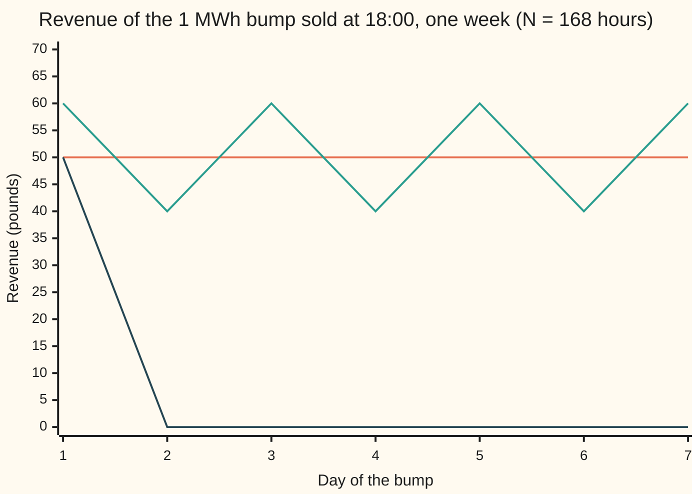
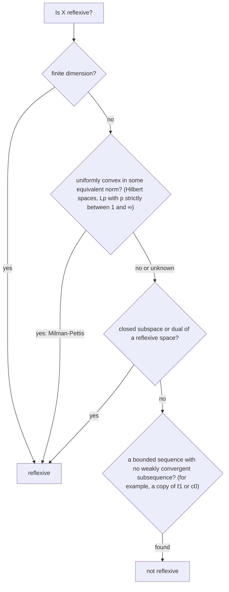

# Reflexive spaces: when a space is exactly the dual of its own dual

[Syllabus](../../../SYLLABUS.md) → [Functional analysis](../README.md) → [Normed and Banach Spaces](../README.md#s01) → Reflexive spaces

---

## General Overview

A battery holds 1 MWh (megawatt-hour) of electricity. Its operator sells all of it in one hour of the week. The schedule is a list of 168 hourly numbers: 1 in the hour it sells, 0 everywhere else. Call the schedule that sells in hour n the **bump** at hour n.

A price list gives a price in £/MWh for every hour. It values a schedule by its revenue: price times energy, added over the hours. The bump at hour n earns exactly the price at hour n. A price list is one example of a **measurement**: a rule that turns each schedule into a number, linearly. All prices on this card are illustrative.

Now let the calendar run on forever and move the bump later each day: 18:00 on day 1, 18:00 on day 2, and so on. Does the bump settle anywhere? Hour by hour, it does: a price paid only at 18:00 on day 1 earns £50 once and then £0 for ever. But a flat price of £50 every hour earns £50 every time. And a price list that pays £60 and £40 on alternate days earns 60, 40, 60, 40, and never settles at all.

So the drifting bump has no limit, even in the loosest sense of "every price list's revenue settles". A space whose bounded sequences can always be thinned out until every revenue settles at the revenue of one schedule in the space is called **reflexive**. Schedules sized by total energy are not reflexive. Sized by the root of the sum of squares instead, the same bumps do settle in this sense, to the empty schedule.

**A space is reflexive when every measurement of its measurements is a reading at some point of the space; exactly then, every bounded sequence has a subsequence on which every measurement settles at its value at one point of the space.**

**What kind of fact this is:** a definition (reflexive, the second dual, weak convergence) and a theorem. The direction "reflexive gives weakly convergent subsequences" is proved on this card in Why it works, with two cited Hahn–Banach facts for the general case; the converse is stated, with its source (Eberlein–Šmulian). Milman–Pettis, the shape test in Step 5, is stated with its source.

### The picture: three price lists read the 18:00 bump



Orange: the flat £50 list, which reads 50 every day. Green: the alternating list, £60 and £40 on alternate days' 18:00 and £50 at every other hour, which never settles. Dark blue: the list paying £50 only at 18:00 on day 1, which reads 0 from day 2. The code prints all three rows.

---

## The formula

Notation first, in words. $`X`$ is a Banach space: a vector space with a size rule $`\lVert x\rVert`$ in which Cauchy sequences converge ([Normed and Banach spaces](01-normed-spaces-and-banach-spaces.md)). Here $`X = \ell^1`$, the schedules $`x = (x_1, x_2, \dots)`$ with finite total energy $`\lVert x\rVert_1 = \sum_k \lvert x_k\rvert`$ ([Sequence spaces](02-sequence-spaces-lp-and-c0.md)). The bump $`e_n`$ is 1 in place n and 0 elsewhere.

The **dual** $`X'`$ is the set of bounded linear functionals on $`X`$: rules $`\varphi`$ turning each point into a number, linearly, with $`\lvert \varphi(x)\rvert \le \lVert\varphi\rVert\,\lVert x\rVert`$ ([Dual spaces](09-dual-spaces-and-lp-duality.md)). For schedules, every such rule is a revenue $`\varphi_y(x) = \sum_k y_k x_k`$ for a bounded price list $`y`$, and $`\lVert\varphi_y\rVert = \sup_k \lvert y_k\rvert`$. So $`(\ell^1)' = \ell^\infty`$.

The **second dual** $`X'' = (X')'`$ is the dual of the dual: bounded linear rules $`\Phi`$ that turn each price list into a number. Every point gives one, by reading:

```math
(Jx)(\varphi) = \varphi(x) \quad \text{for every } \varphi \in X', \qquad X \text{ is reflexive} \iff J(X) = X''
```

**Read it aloud:** the point x becomes the rule "hand me a measurement and I return its value at x"; the space is reflexive when every rule on measurements is one of these.

A sequence **converges weakly**, written $`x_n \rightharpoonup x`$, when $`\varphi(x_n) \to \varphi(x)`$ for every $`\varphi \in X'`$: every measurement settles at its value on $`x`$. The [Weak convergence](../02-Hilbert%20Spaces/09-weak-convergence-and-banach-alaoglu.md) card owns the rest of this idea. The theorem the card is about:

```math
X \text{ reflexive} \iff \text{every sequence with } \sup_n \lVert x_n\rVert < \infty \text{ has a subsequence } x_{n_k} \rightharpoonup x \text{ for some } x \in X
```

**Read it aloud:** in a reflexive space, any sequence that stays inside a ball can be thinned out so that every measurement settles on a point of the space; and if every bounded sequence can be thinned out that way, the space is reflexive.

| Symbol | Plain meaning | In our example | Push it up and the answer… |
| --- | --- | --- | --- |
| $`X`$, $`\lVert x\rVert`$ | a Banach space and its size rule | $`\ell^1`$: schedules, sized by total MWh | — |
| $`X'`$, $`\varphi`$, $`\varphi_y`$, $`\varphi_j`$ | the dual: bounded linear measurements; one measurement; revenue under price list y; the j-th of a dense list | $`\ell^\infty`$: bounded price lists; revenue in £ | — |
| $`X''`$, $`\Phi`$ | the second dual: measurements of measurements; one of them | the long-run price, "the limit of the price list" | — |
| $`J`$ | the reading map, $`(Jx)(\varphi) = \varphi(x)`$ | a schedule read by every price list | — |
| $`e_n`$ | the bump: 1 in place n, 0 elsewhere | 1 MWh sold in hour n | later hour, same size 1 |
| $`y`$, $`y_k`$ | a price list; its price in hour k, £/MWh | flat 50; alternating 60 and 40 | higher prices, higher revenue |
| $`x_n \rightharpoonup x`$ | weak convergence: every measurement settles at its value on x | $`e_n \rightharpoonup 0`$ in $`\ell^2`$, but not in $`\ell^1`$ | — |
| $`x_n`$, $`n_k`$, $`B`$ | a sequence; the k-th index kept in a subsequence; a bound on every size | 18:00 bumps, $`n_k = 18 + 24(k-1)`$, $`B = 1`$ | — |
| $`\ell^p`$, $`q`$, $`c_0`$ | sequences with finite p-norm; the conjugate exponent $`q = p/(p-1)`$; sequences tending to 0 | $`\ell^2`$, with $`q = 2`$ | reflexive for every p strictly between 1 and ∞, not at p = 1 or ∞ |
| $`N`$ | hours kept in a truncation | 168, 336, 672, 1344 | the flat list's 2-norm $`50\sqrt N`$ grows |
| $`\delta_p(\varepsilon)`$, $`\varepsilon`$, $`u`$, $`v`$ | the dent: how far the midpoint of two unit points u, v at distance ε sits inside the ball | $`\delta_2(1) = 0.1340`$; $`\delta_1(1) = 0`$ | bigger ε, deeper dent |
| $`c`$ | the coefficient of a weak limit $`c\,e_1`$ | in $`[0.992188, 1]`$ after 8 halvings, $`[0.999512, 1]`$ after 12; this halving rule drives it to 1 | — |

### When it holds

- **The map must be J itself.** A space can be the same size and shape as its second dual through some other map and still not be reflexive: James built one in 1951. The test is that J, the reading map, is onto.
- **Completeness comes free.** A reflexive space is complete, because $`X''`$ is complete and J copies $`X`$ onto it without changing sizes. The schedules with finitely many nonzero hours are not complete, so they fail.
- **Bounded sequences only.** The schedules $`n\,e_n`$ in $`\ell^2`$ grow without limit; no subsequence converges weakly, since weakly convergent sequences are bounded ([Three Banach theorems](08-open-mapping-closed-graph-and-uniform-boundedness.md)).
- **Weak, not in norm.** In $`\ell^2`$ the bumps converge weakly to 0, yet $`\lVert e_m - e_n\rVert_2 = \sqrt 2`$ for $`m \ne n`$, so no subsequence converges in norm.
- **The size rule decides.** The same 168 hours sized by total energy ($`\ell^1`$) or by sum of squares ($`\ell^2`$) give a non-reflexive and a reflexive space once the calendar runs on for ever.

---

## Why it works

### Step 0: a point is known by its readings

A bounded sequence gives, for each measurement, a bounded list of numbers. A bounded list of real numbers always has a settling subsequence: halve the interval it lives in, keep a half holding infinitely many terms, and repeat ([No gaps](../../06-Calculus%20and%20analysis/01-Limits%20and%20Continuity/02-supremum-and-completeness.md) guarantees the nested halves close on a number). One measurement at a time is easy. Making every measurement settle along one subsequence is harder: the diagonal argument of Step 3 handles a countable list of measurements, so it needs one that comes close to all the others. When it works, the limit readings form a measurement of measurements, an element $`\Phi`$ of $`X''`$.

Reflexivity is used twice: it supplies that countable list (the fold in Step 3), and it promises that $`\Phi`$ is a reading at an actual point, $`\Phi = Jx`$. Without it, either use can fail. In $`c_0`$ the running sums $`e_1 + \dots + e_n`$ settle under every measurement, but their limit readings are those of the all-ones list, a ghost: a point of $`X''`$ that no point of $`c_0`$ produces (Step 4). In $`\ell^1`$ the drifting bumps fail earlier: the alternating price list defeats every subsequence, so no limit readings exist at all. Step 4's ghost there comes from Hahn-Banach, not from any subsequence.

### Step 1: J is a faithful copy

J is linear, and it keeps sizes: $`\lVert Jx\rVert = \lVert x\rVert`$. One half is the bound $`\lvert\varphi(x)\rvert \le \lVert\varphi\rVert\,\lVert x\rVert`$. The other half needs one measurement of size 1 that reads $`\lVert x\rVert`$ at x; [Hahn-Banach](06-hahn-banach-theorem.md) supplies it in any normed space.

For schedules the measurement is explicit. Take six hours: the battery buys 0.30 and 0.20 MWh, idles, then sells 0.10, 0.25 and 0.15 MWh. Its total $`\lVert x\rVert_1`$ is 1.00 MWh. The price list −100, −100, any, 100, 100, 100 (in £/MWh) earns £100. Trying all 64 lists with each price at −100 or +100 finds no better, so the best revenue at a price cap of £100 is $`100 \times \lVert x\rVert_1`$. Rescaled to a cap of 1, that says $`\lVert Jx\rVert = \lVert x\rVert_1 = 1.00`$. At the prices 40, 35, 45, 70, 90, 60 the same schedule earns £19.50.

So J places a perfect copy of $`X`$ inside $`X''`$. The only question is whether the copy fills $`X''`$.

### Step 2: finite dimensions and $`\ell^p`$ for $`1 < p < \infty`$ are reflexive

In $`N`$ dimensions, $`X'`$ and $`X''`$ also have dimension $`N`$. J is linear and loses nothing, so it fills $`X''`$. Every truncation the code holds is therefore reflexive; what fails in infinite dimensions shows only as a trend over $`N`$.

For $`1 < p < \infty`$, the [Dual spaces](09-dual-spaces-and-lp-duality.md) card shows $`(\ell^p)' = \ell^q`$ through the pairing $`\sum_k y_k x_k`$, and likewise $`(\ell^q)' = \ell^p`$. So a rule $`\Phi`$ on $`\ell^q`$ is $`\Phi(y) = \sum_k y_k x_k`$ for some $`x \in \ell^p`$. That says $`\Phi = Jx`$. The same holds for $`L^p`$ with $`1 < p < \infty`$ ([Lp spaces](../../10-Measure%20and%20integration/07-Sizes%20of%20Functions/01-lp-spaces.md)) and for every Hilbert space.

### Step 3: reflexive gives a settling subsequence

Take a bounded sequence $`x_n`$ in a reflexive space, with $`\lVert x_n\rVert \le B`$. Suppose first that $`X'`$ has a countable dense list of measurements $`\varphi_1, \varphi_2, \dots`$, as $`\ell^q`$ does.

1. The readings $`\varphi_1(x_n)`$ are bounded, so some subsequence makes them settle.
2. Inside it, thin again so $`\varphi_2`$ settles; then $`\varphi_3`$; and so on.
3. The diagonal, the first term of the first thinning, the second of the second, and so on, makes every $`\varphi_j`$ settle.
4. Any other $`\varphi`$ is within a small distance of some $`\varphi_j`$. Its readings differ from $`\varphi_j`$'s by at most $`B\,\lVert\varphi - \varphi_j\rVert`$, so they settle too.
5. The limit readings define $`\Phi(\varphi) = \lim_k \varphi(x_{n_k})`$, with $`\lvert\Phi(\varphi)\rvert \le B\lVert\varphi\rVert`$: an element of $`X''`$. Reflexivity gives $`\Phi = Jx`$, and then $`x_{n_k} \rightharpoonup x`$.

The general case reduces to this one in the fold.

A worked case in $`\ell^2`$: $`x_n = \sin(n)\,e_1 + e_{n+1}`$, with sizes at most $`\sqrt 2`$. Every measurement $`y`$ in $`\ell^2`$ reads $`y_1 \sin n + y_{n+1}`$, and $`y_{n+1} \to 0`$. So only $`\sin n`$ needs to settle. Halving $`[-1, 1]`$ eight times, each time keeping the half that holds more of the remaining terms up to n = 100,000, picks $`n_k = 1, 2, 8, 14, 27, 33, 52, 58`$. The last interval is $`[0.992188, 1]`$, of width 0.007812. Every halving kept the upper half: $`n`$ spreads evenly around the circle, so $`\sin n`$ crowds towards ±1, and from $`[0, 1]`$ on, the upper half of each interval holds the larger share. Run on for ever, this rule drives $`c`$ to 1, and the subsequence converges weakly to $`c\,e_1 = e_1`$. The eighth interval holds 3983 of the first 100,000 terms, matching the share 0.0398 that the even spread predicts, so the thinning can go on for ever.

<details>
<summary>Detailed proof: the general case, and the converse with its source</summary>

**General case.** Let $`x_n`$ be bounded in a reflexive $`X`$. Let $`Y`$ be the closed span of the $`x_n`$: all limits of finite combinations with rational coefficients, so $`Y`$ has a countable dense set.

Two facts, both proved with Hahn–Banach in Brezis, chapter 3. First, a closed subspace of a reflexive space is reflexive, so $`Y`$ is reflexive. Second, if the dual of a space has a countable dense set, so does the space. Apply it to $`Y'`$: its dual $`Y'' = J(Y)`$ has a countable dense set, hence so does $`Y'`$.

Now the argument above runs in $`Y`$ and gives $`x_{n_k} \rightharpoonup x`$ in $`Y`$. For $`\varphi \in X'`$, its restriction to $`Y`$ is in $`Y'`$, so

$`\displaystyle \varphi(x_{n_k}) = \varphi|_Y(x_{n_k}) \to \varphi|_Y(x) = \varphi(x),`$

which is weak convergence in $`X`$.

**The bound in step 4.** For $`\lVert x_n\rVert \le B`$:

$`\displaystyle \lvert\varphi(x_{n_k}) - \varphi(x_{n_l})\rvert \le \lvert\varphi_j(x_{n_k}) - \varphi_j(x_{n_l})\rvert + 2B\,\lVert\varphi - \varphi_j\rVert,`$

so the readings of $`\varphi`$ form a Cauchy list of numbers and converge. The limit $`\Phi`$ is linear because each reading is linear in $`\varphi`$.

**The converse.** If every bounded sequence has a weakly convergent subsequence, then the closed unit ball is weakly compact (the Eberlein–Šmulian theorem), and a space whose closed unit ball is weakly compact is reflexive (Kakutani's theorem). Megginson proves both, in chapters 1 and 2; Brezis, chapter 3, proves Kakutani's theorem. This card uses the converse only to name the test; every non-reflexivity claim below is proved directly.

</details>

### Step 4: the drifting bump shows $`\ell^1`$ is not reflexive

The sliding bump on the half-line, 1 on $`[n, n+1)`$, settles to 0 at every point while its integral stays 1 ([Modes of convergence](../../10-Measure%20and%20integration/05-Swapping%20Limits%20and%20Integrals/04-modes-of-convergence.md)). The schedule $`e_n`$ is its version on whole hours. What is new here is a stronger failure: no subsequence converges even weakly.

1. **Only 0 could be the limit.** Suppose $`e_{n_k} \rightharpoonup x`$. The list paying £50 only in hour j reads $`50 x_j`$ at $`x`$, and reads 0 at $`e_{n_k}`$ once $`n_k > j`$. So every $`x_j = 0`$, and $`x = 0`$.
2. **The flat list says no.** The flat £50 list reads 50 at every bump and 0 at $`x = 0`$. So no subsequence converges weakly. By Step 3, $`\ell^1`$ is not reflexive.
3. **Not even settling.** For any chosen subsequence, pay £60 and £40 at its hours in turn, £50 elsewhere. The revenues alternate 60, 40, 60, with gaps of 20 for ever.

**The ghost.** A price list that settles, such as $`50 + 30/k`$, reads the bump at hours 18, 168 and 1344 as 51.6667, 50.1786 and 50.0223: it approaches the long-run price 50. The rule "long-run price" is a measurement of size 1 on the settling price lists. [Hahn-Banach](06-hahn-banach-theorem.md) extends it to all bounded price lists, giving a $`\Phi \in (\ell^\infty)' = (\ell^1)''`$. That $`\Phi`$ reads 0 for every one-hour list and 50 for the flat list, so it is no schedule's reading: $`J`$ misses it.

This extension needs the axiom of choice, the rule that lets a proof pick from infinitely many options at once; nobody can write $`\Phi`$ down in full. The bump argument in points 1 to 3 names only explicit price lists.

The same shape breaks $`c_0`$, the sequences tending to 0: the running sums $`e_1 + \dots + e_n`$ have size 1, and their weak limit would have to be the all-ones list, which is not in $`c_0`$. $`L^1`$, $`\ell^\infty`$ and $`C[a,b]`$ are not reflexive either, since each contains a copy of $`\ell^1`$ or $`c_0`$.

### Step 5: tests by shape

Reflexivity does not change when the norm is swapped for an equivalent one, passes to closed subspaces, and holds for $`X`$ exactly when it holds for $`X'`$. A shape test gives a quick yes.

A space is **uniformly convex** when unit points that are far apart have their midpoint well inside the ball. The dent $`\delta_p(\varepsilon)`$ measures how far inside, at distance ε:

```math
\delta_p(\varepsilon) = \inf\Big\{\, 1 - \Big\lVert \tfrac{u+v}{2} \Big\rVert : \lVert u\rVert = \lVert v\rVert = 1,\ \lVert u - v\rVert \ge \varepsilon \,\Big\}
```

The **Milman–Pettis theorem**: a uniformly convex Banach space is reflexive. Clarkson showed $`\ell^p`$ and $`L^p`$ are uniformly convex for $`1 < p < \infty`$, with $`\delta_p(\varepsilon) = 1 - (1 - (\varepsilon/2)^p)^{1/p}`$ when $`p \ge 2`$.

In the plane, a 720-angle grid search gives $`\delta_2(1) = 0.1340`$ and $`\delta_4(1) = 0.0162`$, against Clarkson's 0.1340 and 0.0160. A grid tries only some pairs, so it lands at or slightly above the least dent. For $`p \ge 2`$ the plane meets Clarkson's value exactly, at two unit points that differ only in their second coordinate, by 1; the excess at $`p = 4`$ is grid error. The 1-norm and the sup norm have flat faces: $`e_1`$ and $`e_2`$ sit at 1-distance 2, and their midpoint still has 1-norm 1.0000. Their dent is 0.



---

## Worked numbers, by hand

The 18:00 bumps on days 1 to 7 sit at hours 18, 42, 66, 90, 114, 138 and 162.

| Step | Arithmetic | Value |
| --- | --- | --- |
| bump on day 1, list paying £50 only at hour 18 | 50 × 1 | 50 |
| bump on day 2, same list | 50 × 0 | 0 |
| any bump, flat £50 list | 50 × 1 | 50 |
| candidate limit $`x = 0`$, flat £50 list | 50 × 0 | 0 |
| gap the flat list cannot close | 50 − 0 | 50 |
| alternating list, days 1 to 4 | 60, 40, 60, 40 | gap 20 |
| distance between two bumps in $`\ell^1`$ | 1 + 1 | 2 |
| flat list's 2-norm, one week | 50 × √168 | 648.07 |
| list $`50/k`$, bump at hour 1344, in $`\ell^2`$ | 50 / 1344 | 0.0372 |

**In $`\ell^1`$ no subsequence of the bumps converges weakly; in $`\ell^2`$ the whole sequence converges weakly to the empty schedule.** In $`\ell^2`$ the flat list is not an allowed measurement, and every allowed list fades, so its readings of a drifting bump fade too.

### What breaks if you drop a piece

| Mistake | Comes out at | What went wrong |
| --- | --- | --- |
| Test only the one-hour price lists | every one reads 0 from some day on, so "the limit is 0" | the flat £50 list reads 50, not 0 |
| Thin out to the 18:00 bumps and hope | alternating list reads 60, 40, 60, 40, 60, 40, 60 | a price list can be built against any subsequence |
| Use the flat list as a measurement on $`\ell^2`$ | 2-norm 648.07 at N = 168, 1833.03 at N = 1344, still growing | it is not square-summable, so it is not in $`(\ell^2)' = \ell^2`$ |
| Read a zero dent as "not reflexive" | the plane with the 1-norm has dent 0.0000 | the plane is reflexive; Milman–Pettis only gives a yes |

The code prints all four.

---

## Code, from first principles, and it actually runs

The code holds truncations only: N hours, a finite list, so every space it touches is reflexive. What it shows is the trend that does not close as N grows, and finite instances of each step. Each number has two roads. The bidual size $`\lVert Jx\rVert`$ comes from a search over 64 price lists and from $`100\lVert x\rVert_1`$. Bump readings come from summing a whole price list against the schedule, checked against the values derived above. The flat list's 2-norm is summed and compared with $`50\sqrt N`$. The partial 2-norms of $`50/k`$ climb towards $`50\pi/\sqrt 6`$. The bisection's interval is checked against the arcsine law, the share of $`\sin n`$ falling in an interval. The dents come from a 720-angle grid and from Clarkson's formula.

### Python

```python
# Reflexive spaces -- the check behind the card.  Standard library only.
# A schedule x lists the MWh a battery moves each hour (+ sells, - buys); a
# price list y (pounds/MWh, illustrative) values it by the revenue sum y_k x_k.
# Every list here is cut to N hours: a truncation is finite-dimensional, so it
# is always reflexive.  The infinite claims rest on the proofs; the code shows
# the trends over N that never close.
from fractions import Fraction as Q
from itertools import product
import math

def rev(y, x):                                   # revenue: sum of y_k x_k
    return sum(a * b for a, b in zip(y, x))

def bump(n, N):                                  # e_n: 1 MWh sold in hour n
    return [1 if k == n else 0 for k in range(1, N + 1)]

# 1. Six-hour rehearsal: ||Jx|| = sup |revenue| over |y_k| <= 100, against 100 ||x||_1
x = [Q(-3, 10), Q(-2, 10), Q(0), Q(1, 10), Q(25, 100), Q(15, 100)]
day = [40, 35, 45, 70, 90, 60]
corners = [rev([100 * s for s in signs], x) for signs in product((-1, 1), repeat=6)]
norm1 = sum(abs(v) for v in x)
print("rehearsal, 6 hours: x =", ", ".join(f"{float(v):.2f}" for v in x), "MWh")
print(f"  ||x||_1 = {float(norm1):.2f} MWh; revenue at prices {", ".join(map(str, day))}: {float(rev(day, x)):.2f}")
print(f"  best |revenue| over 64 corner lists, |y_k| <= 100: {float(max(corners)):.2f}; 100 ||x||_1 = {float(100 * norm1):.2f}")

# 2. Bumps in l1: three price lists read the bump at hour n
print("l1 bumps e_n read by: flat 50 | 50 at hour 18 only | sup and 2-norm of the flat list")
flat_norm2 = []
for N in (168, 336, 672, 1344):
    flat, h18 = [50] * N, [50 if k == 18 else 0 for k in range(1, N + 1)]
    e = bump(N, N)
    s2 = math.sqrt(sum(v * v for v in flat))
    flat_norm2.append(s2)
    print(f"  N={N:4d} bump at hour {N:4d}: {rev(flat, e)} | {rev(h18, e)} | {max(flat)}, {s2:.2f}"
          f" (50 sqrt N = {50 * math.sqrt(N):.2f})")
days = [18 + 24 * (k - 1) for k in range(1, 8)]  # the 18:00 bump on days 1..7
alt = [50] * 168
for k, n in enumerate(days):
    alt[n - 1] = 60 if k % 2 == 0 else 40
read_alt = [rev(alt, bump(n, 168)) for n in days]
read_h18 = [rev([50 if k == 18 else 0 for k in range(1, 169)], bump(n, 168)) for n in days]
read_flat = [rev([50] * 168, bump(n, 168)) for n in days]
print("  18:00 bumps, hours", ", ".join(map(str, days)))
print("  flat list reads", ", ".join(map(str, read_flat)))
print("  alternating list reads", ", ".join(map(str, read_alt)), "; hour-18 list reads", ", ".join(map(str, read_h18)))
settle = [rev([50 + 30 / k for k in range(1, N + 1)], bump(N, N)) for N in (18, 168, 1344)]
print("  settling list 50 + 30/k reads the bump at hours 18, 168, 1344 as",
      ", ".join(f"{v:.4f}" for v in settle), "-> long-run price 50")
gaps = [abs(a - b) for a, b in zip(read_alt, read_alt[1:])]
dist = {sum(abs(a - b) for a, b in zip(bump(m, 168), bump(n, 168))) for m in days for n in days if m != n}
print(f"  gaps between neighbours: {sorted(set(gaps))}; ||e_m - e_n||_1 for m != n: {sorted(dist)}")

# 3. The same bumps in l2: an allowed price list must be square-summable, so it dies away
ysq = lambda k: 50 / k
tail = [math.sqrt(sum(ysq(k) ** 2 for k in range(1, N + 1))) for N in (168, 1344)]
lim2 = 50 * math.pi / math.sqrt(6)
print(f"l2: price list 50/k has 2-norm {tail[0]:.4f} (N=168), {tail[1]:.4f} (N=1344), limit 50 pi/sqrt 6 = {lim2:.4f}")
reads2 = [rev([ysq(k) for k in range(1, N + 1)], bump(N, N)) for N in (18, 168, 1344)]
print("  it reads the bump at hours 18, 168, 1344 as", ", ".join(f"{v:.4f}" for v in reads2), "-> 0; ||e_n||_2 = 1")

# 4. The promise in l2: x_n = sin(n) e_1 + e_(n+1), bounded by sqrt 2.  Bisection keeps the
#    half of [-1, 1] holding more later terms and takes the next term there.
S = [math.sin(n) for n in range(1, 100001)]
def bisect(K):
    lo, hi, last, picks, boxes = -1.0, 1.0, 0, [], []
    for k in range(K):
        mid = (lo + hi) / 2
        low = sum(1 for n in range(last + 1, 100001) if lo <= S[n - 1] < mid)
        upp = sum(1 for n in range(last + 1, 100001) if mid <= S[n - 1] <= hi)
        lo, hi = (lo, mid) if low >= upp else (mid, hi)
        last = next(n for n in range(last + 1, 100001) if lo <= S[n - 1] <= hi)
        picks.append(last)
        boxes.append((lo, hi))
    return picks, boxes

picks, boxes = bisect(8)
lo, hi = boxes[-1]
c = (lo + hi) / 2
print("bisection picks n_k =", ", ".join(map(str, picks)))
print("  sin(n_k) =", ", ".join(f"{S[n - 1]:.4f}" for n in picks))
print(f"  last interval [{lo:.6f}, {hi:.6f}], width {hi - lo:.6f}; weak limit about {c:.4f} e_1")
count = sum(1 for v in S if lo <= v <= hi)
law = (math.asin(hi) - math.asin(lo)) / math.pi        # share of sin(n) in [lo, hi] as n runs on
print(f"  terms n <= 100000 inside it: {count}, share {count / 100000:.4f}; arcsine law {law:.4f}")
print(f"  ||x_(n_8)||_2 = {math.sqrt(1 + S[picks[-1] - 1] ** 2):.4f}; ||limit||_2 about {abs(c):.4f}")

# 5. Uniform convexity in the plane: delta_p(1) = least dent 1 - ||(u+v)/2||_p over unit
#    u, v at distance >= 1, by a 720-angle grid; Clarkson's formula 1 - (1 - 2^-p)^(1/p)
def norm(v, p):
    return max(abs(v[0]), abs(v[1])) if p == 0 else (abs(v[0]) ** p + abs(v[1]) ** p) ** (1 / p)

def dent(p, M=720):
    pts = []
    for i in range(M):
        t = 2 * math.pi * i / M
        r = norm((math.cos(t), math.sin(t)), p)
        pts.append((math.cos(t) / r, math.sin(t) / r))
    best = 1.0
    for u in pts:
        for v in pts:
            if norm((u[0] - v[0], u[1] - v[1]), p) >= 1 - 1e-9:
                best = min(best, 1 - norm(((u[0] + v[0]) / 2, (u[1] + v[1]) / 2), p))
    return max(best, 0.0)

dents = {p: dent(p) for p in (1, 2, 4, 0)}
clark = {p: 1 - (1 - 2.0 ** -p) ** (1 / p) for p in (2, 4)}
print("dent delta_p(1): p=1 {:.4f}, p=2 {:.4f} (Clarkson {:.4f}), p=4 {:.4f} (Clarkson {:.4f}), p=inf {:.4f}".format(
    dents[1], dents[2], clark[2], dents[4], clark[4], dents[0]))
mid = norm((0.5, 0.5), 1)
print(f"  l1 flat face: e_1, e_2 at distance 2, midpoint 1-norm {mid:.4f}; in 2-norm {norm((0.5, 0.5), 2):.4f}")

p12, b12 = bisect(12)
print(f"try: 12 halvings pick n_12 = {p12[-1]}, interval [{b12[-1][0]:.6f}, {b12[-1][1]:.6f}]")
print(f"try: dent p=1.5 {dent(1.5):.4f}; p=3 {dent(3):.4f} (Clarkson {1 - (1 - 2.0 ** -3) ** (1 / 3):.4f})")
root = [math.sqrt(sum(2500 / k for k in range(1, N + 1))) for N in (168, 1344)]
print(f"try: price list 50/sqrt k has 2-norm {root[0]:.2f} (N=168), {root[1]:.2f} (N=1344), still growing")

assert max(corners) == 100 * norm1 == 100               # ||Jx|| = ||x|| two roads
assert rev(day, x) == Q(195, 10)
assert read_alt == [60, 40, 60, 40, 60, 40, 60] and read_h18 == [50, 0, 0, 0, 0, 0, 0]
assert gaps == [20] * 6 and dist == {2}
assert all(abs(s - 50 * math.sqrt(N)) < 1e-9 for s, N in zip(flat_norm2, (168, 336, 672, 1344)))
assert tail[0] < tail[1] < lim2 and lim2 - tail[1] < 0.03     # partial sums climb to the limit
assert all(a <= S[n - 1] <= b for n, (a, b) in zip(picks, boxes)) and picks == sorted(set(picks))
assert all(a2 >= a1 and b2 <= b1 and b2 - a2 == (b1 - a1) / 2 for (a1, b1), (a2, b2) in zip(boxes, boxes[1:]))
assert p12[:8] == picks and abs(b12[-1][1] - b12[-1][0] - 2 / 2 ** 12) < 1e-12
assert abs((hi - lo) - 2 / 2 ** 8) < 1e-12 and read_flat == [50] * 7
assert count > 1000 and abs(count / 100000 - law) < 2e-3      # plenty left: the run can go on
assert all(abs(v - (50 + 30 / n)) < 1e-12 for v, n in zip(settle, (18, 168, 1344)))
assert abs(dents[2] - clark[2]) < 2e-3 and abs(dents[4] - clark[4]) < 2e-3
assert dents[1] < 1e-9 and dents[0] < 1e-9 and mid == 1.0
print("ALL CHECKS PASS")
```

**Ran 2026-11-15 on macOS, Python 3.14.10, standard library only. All checks passed. Output, pasted from the run:**

```
rehearsal, 6 hours: x = -0.30, -0.20, 0.00, 0.10, 0.25, 0.15 MWh
  ||x||_1 = 1.00 MWh; revenue at prices 40, 35, 45, 70, 90, 60: 19.50
  best |revenue| over 64 corner lists, |y_k| <= 100: 100.00; 100 ||x||_1 = 100.00
l1 bumps e_n read by: flat 50 | 50 at hour 18 only | sup and 2-norm of the flat list
  N= 168 bump at hour  168: 50 | 0 | 50, 648.07 (50 sqrt N = 648.07)
  N= 336 bump at hour  336: 50 | 0 | 50, 916.52 (50 sqrt N = 916.52)
  N= 672 bump at hour  672: 50 | 0 | 50, 1296.15 (50 sqrt N = 1296.15)
  N=1344 bump at hour 1344: 50 | 0 | 50, 1833.03 (50 sqrt N = 1833.03)
  18:00 bumps, hours 18, 42, 66, 90, 114, 138, 162
  flat list reads 50, 50, 50, 50, 50, 50, 50
  alternating list reads 60, 40, 60, 40, 60, 40, 60 ; hour-18 list reads 50, 0, 0, 0, 0, 0, 0
  settling list 50 + 30/k reads the bump at hours 18, 168, 1344 as 51.6667, 50.1786, 50.0223 -> long-run price 50
  gaps between neighbours: [20]; ||e_m - e_n||_1 for m != n: [2]
l2: price list 50/k has 2-norm 64.0117 (N=168), 64.1130 (N=1344), limit 50 pi/sqrt 6 = 64.1275
  it reads the bump at hours 18, 168, 1344 as 2.7778, 0.2976, 0.0372 -> 0; ||e_n||_2 = 1
bisection picks n_k = 1, 2, 8, 14, 27, 33, 52, 58
  sin(n_k) = 0.8415, 0.9093, 0.9894, 0.9906, 0.9564, 0.9999, 0.9866, 0.9929
  last interval [0.992188, 1.000000], width 0.007812; weak limit about 0.9961 e_1
  terms n <= 100000 inside it: 3983, share 0.0398; arcsine law 0.0398
  ||x_(n_8)||_2 = 1.4092; ||limit||_2 about 0.9961
dent delta_p(1): p=1 0.0000, p=2 0.1340 (Clarkson 0.1340), p=4 0.0162 (Clarkson 0.0160), p=inf 0.0000
  l1 flat face: e_1, e_2 at distance 2, midpoint 1-norm 1.0000; in 2-norm 0.7071
try: 12 halvings pick n_12 = 322, interval [0.999512, 1.000000]
try: dent p=1.5 0.0674; p=3 0.0443 (Clarkson 0.0435)
try: price list 50/sqrt k has 2-norm 119.42 (N=168), 139.47 (N=1344), still growing
ALL CHECKS PASS
```

### Rust

```rust
// Reflexive spaces -- the check behind the card.  std only, no crates.
// A schedule x lists the MWh a battery moves each hour (+ sells, - buys); a
// price list y (pounds/MWh, illustrative) values it by the revenue sum y_k x_k.
// Every list here is cut to N hours: a truncation is finite-dimensional, so it
// is always reflexive.  The infinite claims rest on the proofs; the code shows
// the trends over N that never close.  Schedules in section 1 are kept in
// hundredths of a MWh, so the rehearsal is exact integer arithmetic.
use std::f64::consts::PI;

fn rev(y: &[i64], x: &[i64]) -> i64 { y.iter().zip(x).map(|(a, b)| a * b).sum() }
fn revf(y: &[f64], x: &[i64]) -> f64 { y.iter().zip(x).map(|(a, b)| a * (*b as f64)).sum() }
fn bump(n: usize, big_n: usize) -> Vec<i64> { (1..=big_n).map(|k| if k == n { 1 } else { 0 }).collect() }
fn hund(v: i64) -> String {
    let s = if v < 0 { "-" } else { "" };
    format!("{}{}.{:02}", s, v.abs() / 100, v.abs() % 100)
}
fn join<T: ToString>(v: &[T]) -> String { v.iter().map(|a| a.to_string()).collect::<Vec<_>>().join(", ") }
fn join4(v: &[f64]) -> String { v.iter().map(|a| format!("{:.4}", a)).collect::<Vec<_>>().join(", ") }
fn norm(v: (f64, f64), p: f64) -> f64 {
    if p == 0.0 { v.0.abs().max(v.1.abs()) } else { (v.0.abs().powf(p) + v.1.abs().powf(p)).powf(1.0 / p) }
}
fn dent(p: f64, m: usize) -> f64 {
    let pts: Vec<(f64, f64)> = (0..m).map(|i| {
        let t = 2.0 * PI * i as f64 / m as f64;
        let r = norm((t.cos(), t.sin()), p);
        (t.cos() / r, t.sin() / r)
    }).collect();
    let mut best = 1.0f64;
    for u in &pts {
        for v in &pts {
            if norm((u.0 - v.0, u.1 - v.1), p) >= 1.0 - 1e-9 {
                best = best.min(1.0 - norm(((u.0 + v.0) / 2.0, (u.1 + v.1) / 2.0), p));
            }
        }
    }
    best.max(0.0)
}

fn main() {
    // 1. Six-hour rehearsal: ||Jx|| = sup |revenue| over |y_k| <= 100, against 100 ||x||_1
    let x: [i64; 6] = [-30, -20, 0, 10, 25, 15];
    let day: [i64; 6] = [40, 35, 45, 70, 90, 60];
    let corners: Vec<i64> = (0..64u32).map(|mask| {
        let y: Vec<i64> = (0..6).map(|i| if mask >> i & 1 == 1 { 100 } else { -100 }).collect();
        rev(&y, &x)
    }).collect();
    let best = *corners.iter().max().unwrap();
    let norm1: i64 = x.iter().map(|v| v.abs()).sum();
    println!("rehearsal, 6 hours: x = {} MWh", x.iter().map(|&v| hund(v)).collect::<Vec<_>>().join(", "));
    println!("  ||x||_1 = {} MWh; revenue at prices {}: {}", hund(norm1), join(&day), hund(rev(&day, &x)));
    println!("  best |revenue| over 64 corner lists, |y_k| <= 100: {}; 100 ||x||_1 = {}", hund(best), hund(100 * norm1));

    // 2. Bumps in l1: three price lists read the bump at hour n
    println!("l1 bumps e_n read by: flat 50 | 50 at hour 18 only | sup and 2-norm of the flat list");
    let mut flat_norm2 = vec![];
    for &n in &[168usize, 336, 672, 1344] {
        let flat = vec![50i64; n];
        let h18: Vec<i64> = (1..=n).map(|k| if k == 18 { 50 } else { 0 }).collect();
        let e = bump(n, n);
        let s2 = (flat.iter().map(|v| (v * v) as f64).sum::<f64>()).sqrt();
        flat_norm2.push(s2);
        println!("  N={:4} bump at hour {:4}: {} | {} | {}, {:.2} (50 sqrt N = {:.2})",
                 n, n, rev(&flat, &e), rev(&h18, &e), flat.iter().max().unwrap(), s2, 50.0 * (n as f64).sqrt());
    }
    let days: Vec<usize> = (1..=7).map(|k| 18 + 24 * (k - 1)).collect();
    let mut alt = vec![50i64; 168];
    for (k, &n) in days.iter().enumerate() { alt[n - 1] = if k % 2 == 0 { 60 } else { 40 }; }
    let h18w: Vec<i64> = (1..=168).map(|k| if k == 18 { 50 } else { 0 }).collect();
    let read_alt: Vec<i64> = days.iter().map(|&n| rev(&alt, &bump(n, 168))).collect();
    let read_h18: Vec<i64> = days.iter().map(|&n| rev(&h18w, &bump(n, 168))).collect();
    let read_flat: Vec<i64> = days.iter().map(|&n| rev(&vec![50i64; 168], &bump(n, 168))).collect();
    println!("  18:00 bumps, hours {}", join(&days));
    println!("  flat list reads {}", join(&read_flat));
    println!("  alternating list reads {} ; hour-18 list reads {}", join(&read_alt), join(&read_h18));
    let settle: Vec<f64> = [18usize, 168, 1344].iter().map(|&n| {
        let y: Vec<f64> = (1..=n).map(|k| 50.0 + 30.0 / k as f64).collect();
        revf(&y, &bump(n, n))
    }).collect();
    println!("  settling list 50 + 30/k reads the bump at hours 18, 168, 1344 as {} -> long-run price 50", join4(&settle));
    let gaps: Vec<i64> = read_alt.windows(2).map(|w| (w[0] - w[1]).abs()).collect();
    let mut dist = vec![];
    for &m in &days { for &n in &days { if m != n {
        let d: i64 = bump(m, 168).iter().zip(bump(n, 168)).map(|(a, b)| (a - b).abs()).sum();
        if !dist.contains(&d) { dist.push(d); }
    } } }
    let mut gset = gaps.clone(); gset.sort(); gset.dedup();
    println!("  gaps between neighbours: [{}]; ||e_m - e_n||_1 for m != n: [{}]", join(&gset), join(&dist));

    // 3. The same bumps in l2: an allowed price list must be square-summable, so it dies away
    let ysq = |k: usize| 50.0 / k as f64;
    let tail: Vec<f64> = [168usize, 1344].iter().map(|&n| (1..=n).map(|k| ysq(k).powi(2)).sum::<f64>().sqrt()).collect();
    let lim2 = 50.0 * PI / 6f64.sqrt();
    println!("l2: price list 50/k has 2-norm {:.4} (N=168), {:.4} (N=1344), limit 50 pi/sqrt 6 = {:.4}", tail[0], tail[1], lim2);
    let reads2: Vec<f64> = [18usize, 168, 1344].iter().map(|&n| {
        let y: Vec<f64> = (1..=n).map(ysq).collect();
        revf(&y, &bump(n, n))
    }).collect();
    println!("  it reads the bump at hours 18, 168, 1344 as {} -> 0; ||e_n||_2 = 1", join4(&reads2));

    // 4. The promise in l2: x_n = sin(n) e_1 + e_(n+1), bounded by sqrt 2.  Bisection keeps the
    //    half of [-1, 1] holding more later terms and takes the next term there.
    let s: Vec<f64> = (1..=100000).map(|n| (n as f64).sin()).collect();
    let bisect = |kk: usize| {
        let (mut lo, mut hi, mut last) = (-1.0f64, 1.0f64, 0usize);
        let (mut picks, mut boxes) = (vec![], vec![]);
        for _ in 0..kk {
            let mid = (lo + hi) / 2.0;
            let low = (last + 1..=100000).filter(|&n| lo <= s[n - 1] && s[n - 1] < mid).count();
            let upp = (last + 1..=100000).filter(|&n| mid <= s[n - 1] && s[n - 1] <= hi).count();
            if low >= upp { hi = mid } else { lo = mid }
            last = (last + 1..=100000).find(|&n| lo <= s[n - 1] && s[n - 1] <= hi).unwrap();
            picks.push(last);
            boxes.push((lo, hi));
        }
        (picks, boxes)
    };
    let (picks, boxes) = bisect(8);
    let (lo, hi) = boxes[7];
    let c = (lo + hi) / 2.0;
    let sp: Vec<f64> = picks.iter().map(|&n| s[n - 1]).collect();
    println!("bisection picks n_k = {}", join(&picks));
    println!("  sin(n_k) = {}", join4(&sp));
    println!("  last interval [{:.6}, {:.6}], width {:.6}; weak limit about {:.4} e_1", lo, hi, hi - lo, c);
    let count = s.iter().filter(|&&v| lo <= v && v <= hi).count();
    let law = (hi.asin() - lo.asin()) / PI;        // share of sin(n) in [lo, hi] as n runs on
    println!("  terms n <= 100000 inside it: {}, share {:.4}; arcsine law {:.4}", count, count as f64 / 100000.0, law);
    println!("  ||x_(n_8)||_2 = {:.4}; ||limit||_2 about {:.4}", (1.0 + sp[7] * sp[7]).sqrt(), c.abs());

    // 5. Uniform convexity in the plane: delta_p(1) = least dent 1 - ||(u+v)/2||_p over unit
    //    u, v at distance >= 1, by a 720-angle grid; Clarkson's formula 1 - (1 - 2^-p)^(1/p)
    let d: Vec<f64> = [1.0, 2.0, 4.0, 0.0].iter().map(|&p| dent(p, 720)).collect();
    let clark = |p: i32| 1.0 - (1.0 - 2f64.powi(-p)).powf(1.0 / p as f64);
    println!("dent delta_p(1): p=1 {:.4}, p=2 {:.4} (Clarkson {:.4}), p=4 {:.4} (Clarkson {:.4}), p=inf {:.4}",
             d[0], d[1], clark(2), d[2], clark(4), d[3]);
    let mid = norm((0.5, 0.5), 1.0);
    println!("  l1 flat face: e_1, e_2 at distance 2, midpoint 1-norm {:.4}; in 2-norm {:.4}", mid, norm((0.5, 0.5), 2.0));

    let (p12, b12) = bisect(12);
    println!("try: 12 halvings pick n_12 = {}, interval [{:.6}, {:.6}]", p12[11], b12[11].0, b12[11].1);
    println!("try: dent p=1.5 {:.4}; p=3 {:.4} (Clarkson {:.4})", dent(1.5, 720), dent(3.0, 720), clark(3));
    let root: Vec<f64> = [168usize, 1344].iter().map(|&n| (1..=n).map(|k| 2500.0 / k as f64).sum::<f64>().sqrt()).collect();
    println!("try: price list 50/sqrt k has 2-norm {:.2} (N=168), {:.2} (N=1344), still growing", root[0], root[1]);

    assert!(best == 100 * norm1 && 100 * norm1 == 10000);          // ||Jx|| = ||x|| two roads
    assert_eq!(rev(&day, &x), 1950);
    assert!(read_alt == vec![60, 40, 60, 40, 60, 40, 60] && read_h18 == vec![50, 0, 0, 0, 0, 0, 0]);
    assert!(gaps == vec![20; 6] && dist == vec![2]);
    for (s2, n) in flat_norm2.iter().zip([168.0f64, 336.0, 672.0, 1344.0]) { assert!((s2 - 50.0 * n.sqrt()).abs() < 1e-9); }
    assert!(tail[0] < tail[1] && tail[1] < lim2 && lim2 - tail[1] < 0.03);
    assert!(picks.iter().zip(&boxes).all(|(&n, &(a, b))| a <= s[n - 1] && s[n - 1] <= b));
    assert!(picks.windows(2).all(|w| w[0] < w[1]));
    assert!(boxes.windows(2).all(|w| w[1].0 >= w[0].0 && w[1].1 <= w[0].1 && w[1].1 - w[1].0 == (w[0].1 - w[0].0) / 2.0));
    assert!(p12[..8] == picks[..] && (b12[11].1 - b12[11].0 - 2.0 / 4096.0).abs() < 1e-12);
    assert!(((hi - lo) - 2.0 / 256.0).abs() < 1e-12 && read_flat == vec![50; 7]);
    assert!(count > 1000 && (count as f64 / 100000.0 - law).abs() < 2e-3);   // plenty left: the run can go on
    for (v, n) in settle.iter().zip([18.0f64, 168.0, 1344.0]) { assert!((v - (50.0 + 30.0 / n)).abs() < 1e-12); }
    assert!((d[1] - clark(2)).abs() < 2e-3 && (d[2] - clark(4)).abs() < 2e-3);
    assert!(d[0] < 1e-9 && d[3] < 1e-9 && mid == 1.0);
    println!("ALL CHECKS PASS");
}
```

**Ran 2026-11-15 on macOS, rustc 1.98.1, no crates. All checks passed. Output, pasted from the run:**

```
rehearsal, 6 hours: x = -0.30, -0.20, 0.00, 0.10, 0.25, 0.15 MWh
  ||x||_1 = 1.00 MWh; revenue at prices 40, 35, 45, 70, 90, 60: 19.50
  best |revenue| over 64 corner lists, |y_k| <= 100: 100.00; 100 ||x||_1 = 100.00
l1 bumps e_n read by: flat 50 | 50 at hour 18 only | sup and 2-norm of the flat list
  N= 168 bump at hour  168: 50 | 0 | 50, 648.07 (50 sqrt N = 648.07)
  N= 336 bump at hour  336: 50 | 0 | 50, 916.52 (50 sqrt N = 916.52)
  N= 672 bump at hour  672: 50 | 0 | 50, 1296.15 (50 sqrt N = 1296.15)
  N=1344 bump at hour 1344: 50 | 0 | 50, 1833.03 (50 sqrt N = 1833.03)
  18:00 bumps, hours 18, 42, 66, 90, 114, 138, 162
  flat list reads 50, 50, 50, 50, 50, 50, 50
  alternating list reads 60, 40, 60, 40, 60, 40, 60 ; hour-18 list reads 50, 0, 0, 0, 0, 0, 0
  settling list 50 + 30/k reads the bump at hours 18, 168, 1344 as 51.6667, 50.1786, 50.0223 -> long-run price 50
  gaps between neighbours: [20]; ||e_m - e_n||_1 for m != n: [2]
l2: price list 50/k has 2-norm 64.0117 (N=168), 64.1130 (N=1344), limit 50 pi/sqrt 6 = 64.1275
  it reads the bump at hours 18, 168, 1344 as 2.7778, 0.2976, 0.0372 -> 0; ||e_n||_2 = 1
bisection picks n_k = 1, 2, 8, 14, 27, 33, 52, 58
  sin(n_k) = 0.8415, 0.9093, 0.9894, 0.9906, 0.9564, 0.9999, 0.9866, 0.9929
  last interval [0.992188, 1.000000], width 0.007812; weak limit about 0.9961 e_1
  terms n <= 100000 inside it: 3983, share 0.0398; arcsine law 0.0398
  ||x_(n_8)||_2 = 1.4092; ||limit||_2 about 0.9961
dent delta_p(1): p=1 0.0000, p=2 0.1340 (Clarkson 0.1340), p=4 0.0162 (Clarkson 0.0160), p=inf 0.0000
  l1 flat face: e_1, e_2 at distance 2, midpoint 1-norm 1.0000; in 2-norm 0.7071
try: 12 halvings pick n_12 = 322, interval [0.999512, 1.000000]
try: dent p=1.5 0.0674; p=3 0.0443 (Clarkson 0.0435)
try: price list 50/sqrt k has 2-norm 119.42 (N=168), 139.47 (N=1344), still growing
ALL CHECKS PASS
```

### Lean

Lean proves the main theorem for every real Banach space and the bump facts for $`\ell^1`$, and checks the hand arithmetic.

- Take a real Banach space $`X`$. Then $`J`$ is onto exactly when every bounded sequence has a weakly convergent subsequence.
- Take the bumps $`e_n`$ in $`\ell^1`$. Then no subsequence of them converges weakly to any schedule in $`\ell^1`$.
- Take $`X = \ell^1`$. Then $`J`$ is not onto, so $`\ell^1`$ is not reflexive.
- The 18:00 bumps on days 1 to 7 sit at hours 18, 42, 66, 90, 114, 138 and 162.
- The six-hour schedule of Step 1 has total 1.00 MWh and earns £19.50 at prices 40, 35, 45, 70, 90, 60.
- The same schedule earns £100 under the price list −100, −100, any, 100, 100, 100.
- The worked gaps 50 − 0 = 50 and 60 − 40 = 20 are right, and so is the bump distance 1 + 1 = 2.

The 2-norm trends over $`N`$, the sine halvings and the dents are left to the Python and Rust checks.

```lean
-- Reflexive spaces: a real Banach space is reflexive (the reading map J from X to X'' is onto) exactly when every bounded sequence has a weakly convergent subsequence, and the bumps e_n in l1 show l1 is not reflexive.
import Mathlib.Analysis.Normed.Module.DoubleDual
import Mathlib.Analysis.Normed.Lp.lpSpace

open Filter Topology NormedSpace

theorem refl_exists_dual_vanish {X : Type*} [NormedAddCommGroup X] [NormedSpace ℝ X]
    (S : Submodule ℝ X) {z : X} (hz : z ∉ S.topologicalClosure) :
    ∃ f : StrongDual ℝ X, (∀ a ∈ S, f a = 0) ∧ f z ≠ 0 := by
  obtain ⟨f, u, hf, hu⟩ := geometric_hahn_banach_closed_point
    (Submodule.convex S.topologicalClosure) S.isClosed_topologicalClosure hz
  have h0 : 0 < u := by simpa using hf 0 S.topologicalClosure.zero_mem
  refine ⟨f, fun a ha => ?_, ?_⟩
  · by_contra hne
    have := hf ((u / f a) • a)
      (S.topologicalClosure.smul_mem _ (S.le_topologicalClosure ha))
    rw [map_smul, smul_eq_mul, div_mul_cancel₀ _ hne] at this
    exact lt_irrefl _ this
  · intro h
    rw [h] at hu
    linarith

theorem refl_goldstine_approx {X : Type*} [NormedAddCommGroup X] [NormedSpace ℝ X]
    (F : StrongDual ℝ (StrongDual ℝ X)) (Φ : Finset (StrongDual ℝ X)) {ε : ℝ} (hε : 0 < ε) :
    ∃ x : X, ‖x‖ ≤ ‖F‖ + 1 ∧ ∀ φ ∈ Φ, |F φ - φ x| < ε := by
  classical
  set r : ℝ := ‖F‖ + 1 with hr
  have hr0 : 0 < r := by positivity
  let T : X →L[ℝ] (Φ → ℝ) := ContinuousLinearMap.pi (fun φ => (φ : StrongDual ℝ X))
  have hT : ∀ x φ, T x φ = (φ : StrongDual ℝ X) x := fun _ _ => rfl
  let v : Φ → ℝ := fun φ => F φ
  have hv : v ∈ closure (T '' Metric.closedBall 0 r) := by
    by_contra hv
    obtain ⟨f, u, hf, hu⟩ := geometric_hahn_banach_closed_point
      (((convex_closedBall (0 : X) r).linear_image T.toLinearMap).closure) isClosed_closure hv
    have hfw : ∀ w : Φ → ℝ, f w = ∑ φ : Φ, w φ * f (Pi.single φ 1) := by
      intro w
      conv_lhs => rw [← Finset.univ_sum_single w]
      rw [map_sum]
      refine Finset.sum_congr rfl fun φ _ => ?_
      rw [← smul_eq_mul, ← map_smul]
      congr 1
      ext j
      simp [Pi.single_apply]
    let ψ : StrongDual ℝ X := ∑ φ : Φ, f (Pi.single φ 1) • (φ : StrongDual ℝ X)
    have hψ : ∀ x, f (T x) = ψ x := by
      intro x
      rw [hfw]
      simp [ψ, hT, mul_comm]
    have hFψ : F ψ = f v := by
      rw [hfw]
      simp [ψ, v, mul_comm]
    have h1 : u < ‖F‖ * ‖ψ‖ := by
      have := F.le_opNorm ψ
      rw [Real.norm_eq_abs] at this
      linarith [le_abs_self (F ψ)]
    have h2 : u / r < ‖ψ‖ := by
      rw [div_lt_iff₀ hr0]
      nlinarith [norm_nonneg ψ]
    obtain ⟨y, hy1, hy2⟩ := ψ.exists_lt_apply_of_lt_opNorm h2
    rw [Real.norm_eq_abs] at hy2
    have key : ∃ x : X, ‖x‖ ≤ r ∧ u ≤ ψ x := by
      rcases le_total 0 (ψ y) with h | h
      · refine ⟨r • y, ?_, ?_⟩
        · rw [norm_smul, Real.norm_eq_abs, abs_of_pos hr0]
          nlinarith [norm_nonneg y]
        · rw [map_smul, smul_eq_mul]
          rw [abs_of_nonneg h, div_lt_iff₀ hr0] at hy2
          linarith
      · refine ⟨(-r) • y, ?_, ?_⟩
        · rw [norm_smul, Real.norm_eq_abs, abs_neg, abs_of_pos hr0]
          nlinarith [norm_nonneg y]
        · rw [map_smul, smul_eq_mul]
          rw [abs_of_nonpos h, div_lt_iff₀ hr0] at hy2
          linarith
    obtain ⟨x, hx, hux⟩ := key
    have := hf (T x) (subset_closure ⟨x, by simpa using hx, rfl⟩)
    rw [hψ] at this
    linarith
  rw [Metric.mem_closure_iff] at hv
  obtain ⟨w, ⟨x, hx, rfl⟩, hd⟩ := hv ε hε
  refine ⟨x, by simpa using hx, fun φ hφ => ?_⟩
  have := dist_le_pi_dist v (T x) ⟨φ, hφ⟩
  rw [Real.dist_eq] at this
  exact lt_of_le_of_lt this hd

theorem refl_finite_norming {V : Type*} [NormedAddCommGroup V] [NormedSpace ℝ V]
    (E : Submodule ℝ (StrongDual ℝ V)) [FiniteDimensional ℝ E] :
    ∃ Ψ : Finset V, (∀ ψ ∈ Ψ, ‖ψ‖ ≤ 1) ∧ ∀ G ∈ E, ∃ ψ ∈ Ψ, ‖G‖ ≤ 4 * |G ψ| := by
  classical
  have hD : ∀ G : StrongDual ℝ V, ∃ ψ : V, ‖ψ‖ ≤ 1 ∧ ‖G‖ - 1 / 4 < |G ψ| := by
    intro G
    obtain ⟨ψ, h1, h2⟩ := G.exists_lt_apply_of_lt_opNorm (r := ‖G‖ - 1 / 4) (by linarith)
    exact ⟨ψ, h1.le, by simpa [Real.norm_eq_abs] using h2⟩
  choose D hD1 hD2 using hD
  set K : Set (StrongDual ℝ V) := (Subtype.val : E → _) '' Metric.closedBall (0 : E) 1
  have hK : IsCompact K := (isCompact_closedBall (0 : E) 1).image continuous_subtype_val
  obtain ⟨t, -, ht, hKt⟩ := finite_cover_balls_of_compact hK (e := 1 / 4) (by norm_num)
  refine ⟨ht.toFinset.image D, ?_, ?_⟩
  · intro ψ hψ
    obtain ⟨G, -, rfl⟩ := Finset.mem_image.1 hψ
    exact hD1 G
  · intro G hG
    set G' : StrongDual ℝ V := ‖G‖⁻¹ • G with hG'
    have hG'K : G' ∈ K := by
      refine ⟨⟨G', E.smul_mem _ hG⟩, ?_, rfl⟩
      rw [Metric.mem_closedBall, Subtype.dist_eq]
      simp only [ZeroMemClass.coe_zero, dist_zero_right, hG']
      rw [norm_smul, norm_inv, norm_norm]
      rcases eq_or_ne ‖G‖ 0 with h | h
      · simp [h]
      · rw [inv_mul_cancel₀ h]
    obtain ⟨s, hs, hGs⟩ := Set.mem_iUnion₂.1 (hKt hG'K)
    refine ⟨D s, Finset.mem_image.2 ⟨s, ht.mem_toFinset.2 hs, rfl⟩, ?_⟩
    rcases eq_or_ne G 0 with h0 | h0
    · simp [h0]
    have hn : 0 < ‖G‖ := norm_pos_iff.2 h0
    have hG'n : ‖G'‖ = 1 := by
      rw [hG', norm_smul, norm_inv, norm_norm, inv_mul_cancel₀ hn.ne']
    rw [Metric.mem_ball] at hGs
    have hds : ‖G' - s‖ < 1 / 4 := by rwa [← dist_eq_norm]
    have hs1 : 3 / 4 ≤ ‖s‖ := by
      have := norm_sub_norm_le G' s
      linarith
    have hdiff : |G' (D s) - s (D s)| ≤ 1 / 4 := by
      have := (G' - s).le_opNorm (D s)
      rw [sub_apply, Real.norm_eq_abs] at this
      nlinarith [hD1 s, norm_nonneg (G' - s), norm_nonneg (D s)]
    have hGs' : 1 / 4 ≤ |G' (D s)| := by
      have := hD2 s
      have := abs_sub_abs_le_abs_sub (s (D s)) (G' (D s))
      rw [abs_sub_comm] at this
      linarith
    have hGG : G (D s) = ‖G‖ * G' (D s) := by
      rw [hG', smul_apply, smul_eq_mul, mul_inv_cancel_left₀ hn.ne']
    rw [hGG, abs_mul, abs_of_pos hn]
    nlinarith

theorem refl_clusterPt_eq {u : ℕ → ℝ} {a b : ℝ} (h : MapClusterPt a atTop u)
    (hu : Tendsto u atTop (𝓝 b)) : a = b :=
  eq_of_nhds_neBot (ClusterPt.mono h hu)

theorem refl_norming_zero {X : Type*} [NormedAddCommGroup X] [NormedSpace ℝ X]
    (d : ℕ → X) (f : ℕ → StrongDual ℝ X) (hf1 : ∀ j, ‖f j‖ ≤ 1) (hf2 : ∀ j, f j (d j) = ‖d j‖)
    {w : X} (hw : w ∈ closure (Set.range d)) (hfw : ∀ j, f j w = 0) : w = 0 := by
  rw [← norm_le_zero_iff]
  refine le_of_forall_pos_le_add fun ε hε => ?_
  obtain ⟨_, ⟨j, rfl⟩, hj⟩ := Metric.mem_closure_iff.1 hw (ε / 2) (by positivity)
  rw [dist_eq_norm] at hj
  have h1 : ‖d j‖ ≤ ‖w - d j‖ := by
    have := (f j).le_opNorm (d j - w)
    rw [map_sub, hfw, sub_zero, hf2, Real.norm_eq_abs, abs_of_nonneg (norm_nonneg _),
      norm_sub_rev] at this
    nlinarith [hf1 j, norm_nonneg (w - d j)]
  have h2 : ‖w‖ ≤ ‖w - d j‖ + ‖d j‖ := by
    calc ‖w‖ = ‖(w - d j) + d j‖ := by rw [sub_add_cancel]
      _ ≤ _ := norm_add_le _ _
  linarith

theorem refl_forward {X : Type*} [NormedAddCommGroup X] [NormedSpace ℝ X]
    (hJ : Function.Surjective (inclusionInDoubleDual ℝ X))
    (x : ℕ → X) (B : ℝ) (hB : ∀ n, ‖x n‖ ≤ B) :
    ∃ n : ℕ → ℕ, StrictMono n ∧ ∃ x₀ : X,
      ∀ φ : StrongDual ℝ X, Tendsto (fun k => φ (x (n k))) atTop (𝓝 (φ x₀)) := by
  classical
  set S : Submodule ℝ X := Submodule.span ℝ (Set.range x) with hS
  have hsep : TopologicalSpace.IsSeparable (S : Set X) :=
    TopologicalSpace.IsSeparable.span (R := ℝ) (Set.countable_range x).isSeparable
  obtain ⟨c, hc, hSc⟩ := hsep
  have hc_ne : c.Nonempty := by
    by_contra h
    rw [Set.not_nonempty_iff_eq_empty] at h
    have := hSc S.zero_mem
    simp [h] at this
  obtain ⟨d, rfl⟩ := hc.exists_eq_range hc_ne
  choose f hf1 hf2 using fun j => exists_dual_vector'' ℝ (d j)
  have hf2' : ∀ j, f j (d j) = ‖d j‖ := fun j => by simpa using hf2 j
  -- diagonal subsequence
  let u : ℕ → (ℕ → ℝ) := fun n j => f j (x n)
  have hK : IsCompact (Set.pi Set.univ fun _ : ℕ => Set.Icc (-B) B) :=
    isCompact_univ_pi fun _ => isCompact_Icc
  have hu : ∀ n, u n ∈ Set.pi Set.univ fun _ : ℕ => Set.Icc (-B) B := by
    intro n j _
    have := (f j).le_opNorm (x n)
    rw [Real.norm_eq_abs] at this
    exact abs_le.1 (this.trans (by nlinarith [hf1 j, hB n, norm_nonneg (x n), norm_nonneg (f j)]))
  obtain ⟨L, -, σ, hσ, hL⟩ := hK.isSeqCompact hu
  have hLj : ∀ j, Tendsto (fun k => f j (x (σ k))) atTop (𝓝 (L j)) := fun j =>
    ((continuous_apply j).tendsto L).comp hL
  -- weak-star compactness
  let J := inclusionInDoubleDual ℝ X
  let y : ℕ → WeakDual ℝ (StrongDual ℝ X) := fun k => StrongDual.toWeakDual (J (x (σ k)))
  set K2 : Set (WeakDual ℝ (StrongDual ℝ X)) :=
    WeakDual.toStrongDual ⁻¹' Metric.closedBall (0 : StrongDual ℝ (StrongDual ℝ X)) B
  have hK2 : IsCompact K2 := WeakDual.isCompact_closedBall _ _
  have hy : ∀ k, y k ∈ K2 := by
    intro k
    show WeakDual.toStrongDual (StrongDual.toWeakDual (J (x (σ k)))) ∈
      Metric.closedBall (0 : StrongDual ℝ (StrongDual ℝ X)) B
    rw [StrongDual.toStrongDual_toWeakDual]
    have : ‖J (x (σ k))‖ ≤ B := (double_dual_bound ℝ X (x (σ k))).trans (hB _)
    rw [Metric.mem_closedBall]
    exact (dist_zero_right (J (x (σ k)))).le.trans this
  have hxS : ∀ n, x n ∈ S := fun n => Submodule.subset_span ⟨n, rfl⟩
  have hclus : ∀ G : WeakDual ℝ (StrongDual ℝ X), MapClusterPt G atTop y →
      ∃ z : X, StrongDual.toWeakDual (J z) = G ∧ z ∈ S.topologicalClosure ∧
        ∀ j, f j z = L j := by
    intro G hG
    obtain ⟨z, hz⟩ := hJ (WeakDual.toStrongDual G)
    have hzG : StrongDual.toWeakDual (J z) = G := by
      rw [show J z = WeakDual.toStrongDual G from hz, WeakDual.toWeakDual_toStrongDual]
    have hev : ∀ φ : StrongDual ℝ X, MapClusterPt (φ z) atTop (fun k => φ (x (σ k))) := by
      intro φ
      have := hG.continuousAt_comp (WeakDual.eval_continuous φ).continuousAt
      rw [← hzG] at this
      exact this
    refine ⟨z, hzG, ?_, fun j => refl_clusterPt_eq (hev (f j)) (hLj j)⟩
    by_contra hzS
    obtain ⟨φ, hφS, hφz⟩ := refl_exists_dual_vanish S hzS
    apply hφz
    refine refl_clusterPt_eq (hev φ) ?_
    simp only [hφS _ (hxS _)]
    exact tendsto_const_nhds
  obtain ⟨G0, -, hG0⟩ := hK2.exists_mapClusterPt (f := atTop) (u := y)
    (Filter.tendsto_principal.2 (Filter.Eventually.of_forall hy))
  obtain ⟨z0, hz0, hz0S, hz0L⟩ := hclus G0 hG0
  have huniq : ∀ G ∈ K2, MapClusterPt G atTop y → G = G0 := by
    intro G _ hG
    obtain ⟨z, hz, hzS, hzL⟩ := hclus G hG
    have hw : z - z0 = 0 := by
      apply refl_norming_zero d f hf1 hf2'
      · have h1 : (S.topologicalClosure : Set X) ⊆ closure (Set.range d) := by
          rw [Submodule.topologicalClosure_coe]
          exact closure_minimal hSc isClosed_closure
        exact h1 (S.topologicalClosure.sub_mem hzS hz0S)
      · intro j
        rw [map_sub, hzL, hz0L, sub_self]
    rw [sub_eq_zero] at hw
    rw [← hz, ← hz0, hw]
  have hT := hK2.tendsto_nhds_of_unique_mapClusterPt (Filter.Eventually.of_forall hy) huniq
  refine ⟨σ, hσ, z0, fun φ => ?_⟩
  have := ((WeakDual.eval_continuous φ).tendsto G0).comp hT
  rw [← hz0] at this
  exact this

theorem refl_backward {X : Type*} [NormedAddCommGroup X] [NormedSpace ℝ X]
    (h : ∀ x : ℕ → X, (∃ B : ℝ, ∀ n, ‖x n‖ ≤ B) →
        ∃ n : ℕ → ℕ, StrictMono n ∧ ∃ x₀ : X,
          ∀ φ : StrongDual ℝ X, Tendsto (fun k => φ (x (n k))) atTop (𝓝 (φ x₀))) :
    Function.Surjective (inclusionInDoubleDual ℝ X) := by
  classical
  intro F
  set J := inclusionInDoubleDual ℝ X with hJ
  have hpick : ∀ (n : ℕ) (Φ : Finset (StrongDual ℝ X)), ∃ x : X, ‖x‖ ≤ ‖F‖ + 1 ∧
      ∀ φ ∈ Φ, |F φ - φ x| < 1 / ((n : ℝ) + 1) :=
    fun n Φ => refl_goldstine_approx F Φ (by positivity)
  choose pick hpick1 hpick2 using hpick
  have hnorm : ∀ P : Finset X, ∃ Ψ : Finset (StrongDual ℝ X), (∀ ψ ∈ Ψ, ‖ψ‖ ≤ 1) ∧
      ∀ G ∈ Submodule.span ℝ (insert F (J '' (P : Set X))), ∃ ψ ∈ Ψ, ‖G‖ ≤ 4 * |G ψ| := by
    intro P
    have : FiniteDimensional ℝ (Submodule.span ℝ (insert F (J '' (P : Set X)))) :=
      FiniteDimensional.span_of_finite ℝ ((P.finite_toSet.image J).insert F)
    exact refl_finite_norming _
  choose Ψ hΨ1 hΨ2 using hnorm
  let step : ℕ → Finset X × Finset (StrongDual ℝ X) → Finset X × Finset (StrongDual ℝ X) :=
    fun n s => (insert (pick n s.2) s.1, s.2 ∪ Ψ (insert (pick n s.2) s.1))
  let st : ℕ → Finset X × Finset (StrongDual ℝ X) := fun n => Nat.rec (∅, ∅) step n
  have hst : ∀ n, st (n + 1) = step n (st n) := fun n => rfl
  let x : ℕ → X := fun n => pick n (st n).2
  have hst1 : ∀ n, (st (n + 1)).1 = insert (x n) (st n).1 := fun n => by rw [hst]
  have hst2 : ∀ n, (st (n + 1)).2 = (st n).2 ∪ Ψ (st (n + 1)).1 := fun n => by rw [hst]
  have hmono1 : Monotone fun n => (st n).1 := monotone_nat_of_le_succ fun n => by
    simp only [hst1]; exact Finset.subset_insert _ _
  have hmono2 : Monotone fun n => (st n).2 := monotone_nat_of_le_succ fun n => by
    simp only [hst2]; exact Finset.subset_union_left
  have hΨsub : ∀ n, Ψ (st (n + 1)).1 ⊆ (st (n + 1)).2 := fun n => by
    rw [hst2 n]; exact Finset.subset_union_right
  have hxmem : ∀ n, x n ∈ (st (n + 1)).1 := fun n => by rw [hst1]; exact Finset.mem_insert_self _ _
  have hctrl : ∀ n m, n ≤ m → ∀ φ ∈ (st n).2, |F φ - φ (x m)| < 1 / ((m : ℝ) + 1) :=
    fun n m hnm φ hφ => hpick2 m (st m).2 φ (hmono2 hnm hφ)
  obtain ⟨σ, hσ, x0, hx0⟩ := h x ⟨‖F‖ + 1, fun n => hpick1 _ _⟩
  -- every controlled functional sees `F` and `J x0` agree
  have hΦ : ∀ n, ∀ φ ∈ (st n).2, F φ = φ x0 := by
    intro n φ hφ
    have hT : Tendsto (fun k => φ (x (σ k))) atTop (𝓝 (F φ)) := by
      rw [Metric.tendsto_atTop]
      intro ε hε
      obtain ⟨N, hN⟩ := exists_nat_one_div_lt hε
      refine ⟨max n N, fun k hk => ?_⟩
      have hk' : max n N ≤ σ k := hk.trans (hσ.id_le k)
      have h1 := hctrl n (σ k) (le_of_max_le_left hk') φ hφ
      have h2 : 1 / ((σ k : ℝ) + 1) ≤ 1 / ((N : ℝ) + 1) := by
        apply one_div_le_one_div_of_le (by positivity)
        have : (N : ℝ) ≤ σ k := by exact_mod_cast le_of_max_le_right hk'
        linarith
      rw [Real.dist_eq, abs_sub_comm]
      linarith
    exact tendsto_nhds_unique hT (hx0 φ)
  set S : Submodule ℝ X := Submodule.span ℝ (Set.range x) with hS
  have hx0S : x0 ∈ S.topologicalClosure := by
    by_contra hx0S
    obtain ⟨φ, hφS, hφx0⟩ := refl_exists_dual_vanish S hx0S
    apply hφx0
    have hT : Tendsto (fun k => φ (x (σ k))) atTop (𝓝 0) := by
      simp only [hφS _ (Submodule.subset_span ⟨_, rfl⟩)]
      exact tendsto_const_nhds
    exact tendsto_nhds_unique (hx0 φ) hT
  have hfin : ∀ y ∈ S, ∃ n, y ∈ Submodule.span ℝ ((st n).1 : Set X) := by
    intro y hy
    induction hy using Submodule.span_induction with
    | mem y hy =>
      obtain ⟨i, rfl⟩ := hy
      exact ⟨i + 1, Submodule.subset_span (Finset.mem_coe.2 (hxmem i))⟩
    | zero => exact ⟨0, Submodule.zero_mem _⟩
    | add a b _ _ ha hb =>
      obtain ⟨n, hn⟩ := ha
      obtain ⟨m, hm⟩ := hb
      have h1 : Submodule.span ℝ ((st n).1 : Set X) ≤ Submodule.span ℝ ((st (max n m)).1 : Set X) :=
        Submodule.span_mono (Finset.coe_subset.2 (hmono1 (le_max_left n m)))
      have h2 : Submodule.span ℝ ((st m).1 : Set X) ≤ Submodule.span ℝ ((st (max n m)).1 : Set X) :=
        Submodule.span_mono (Finset.coe_subset.2 (hmono1 (le_max_right n m)))
      exact ⟨max n m, Submodule.add_mem _ (h1 hn) (h2 hm)⟩
    | smul c a _ ha =>
      obtain ⟨n, hn⟩ := ha
      exact ⟨n, Submodule.smul_mem _ c hn⟩
  -- the gap `F - J x0` has norm at most `5 ε` for every `ε > 0`
  refine ⟨x0, ?_⟩
  have hsmall : ∀ ε > 0, ‖F - J x0‖ ≤ 5 * ε := by
    intro ε hε
    have hcl : x0 ∈ closure (S : Set X) := by
      rw [← Submodule.topologicalClosure_coe]; exact hx0S
    obtain ⟨y, hyS, hy⟩ := Metric.mem_closure_iff.1 hcl ε hε
    rw [dist_eq_norm] at hy
    obtain ⟨n, hn⟩ := hfin y hyS
    have hn' : y ∈ Submodule.span ℝ ((st (n + 1)).1 : Set X) :=
      Submodule.span_mono (Finset.coe_subset.2 (hmono1 (Nat.le_succ n))) hn
    set P := (st (n + 1)).1
    have hG' : F - J y ∈ Submodule.span ℝ (insert F (J '' (P : Set X))) := by
      refine Submodule.sub_mem _ (Submodule.subset_span (Set.mem_insert _ _)) ?_
      have : J y ∈ Submodule.span ℝ (J '' (P : Set X)) := by
        exact Submodule.apply_mem_span_image_of_mem_span (J : X →ₗ[ℝ] StrongDual ℝ (StrongDual ℝ X)) hn'
      exact Submodule.span_mono (Set.subset_insert _ _) this
    obtain ⟨ψ, hψΨ, hψ⟩ := hΨ2 P _ hG'
    have hψ1 := hΨ1 P ψ hψΨ
    have hψF : F ψ = ψ x0 := hΦ (n + 1) ψ (hΨsub n hψΨ)
    have hval : (F - J y) ψ = ψ (x0 - y) := by
      rw [sub_apply, map_sub, hψF]
      simp [J, NormedSpace.dual_def]
    have h1 : |(F - J y) ψ| ≤ ε := by
      rw [hval]
      have := ψ.le_opNorm (x0 - y)
      rw [Real.norm_eq_abs] at this
      nlinarith [norm_nonneg ψ, norm_nonneg (x0 - y)]
    have h2 : ‖J x0 - J y‖ ≤ ‖x0 - y‖ := by
      rw [← map_sub]; exact NormedSpace.double_dual_bound ℝ X _
    have h3 : ‖F - J x0‖ ≤ ‖F - J y‖ + ‖J x0 - J y‖ := by
      calc ‖F - J x0‖ = ‖(F - J y) - (J x0 - J y)‖ := by congr 1; abel
        _ ≤ _ := norm_sub_le (F - J y) (J x0 - J y)
    linarith
  have h0 : ‖F - J x0‖ ≤ 0 := by
    refine le_of_forall_pos_le_add fun ε hε => ?_
    have := hsmall (ε / 5) (by positivity)
    linarith
  have h00 : F - J x0 = 0 := (norm_le_zero_iff (a := F - J x0)).1 h0
  rw [sub_eq_zero] at h00
  exact h00.symm

/-- Coordinate functional on ℓ¹. -/
noncomputable def ell1Coord (i : ℕ) : StrongDual ℝ (lp (fun _ : ℕ => ℝ) 1) :=
  LinearMap.mkContinuous
    { toFun := fun x => x i
      map_add' := fun x y => by simp
      map_smul' := fun c x => by simp }
    1 (fun x => by
      have := lp.norm_apply_le_norm (p := 1) (by norm_num) x i
      show ‖x i‖ ≤ 1 * ‖x‖
      rw [one_mul]; exact this)

theorem ell1Coord_apply (i : ℕ) (x : lp (fun _ : ℕ => ℝ) 1) : ell1Coord i x = x i := rfl

#print axioms refl_exists_dual_vanish
#print axioms refl_goldstine_approx
#print axioms refl_finite_norming
#print axioms refl_clusterPt_eq
#print axioms refl_norming_zero
#print axioms refl_forward
#print axioms refl_backward
#print axioms ell1Coord_apply
#print axioms ell1Coord

/-- A real Banach space `X` is reflexive, meaning the reading map `J : X → X''`,
`(J x)(φ) = φ(x)`, is onto, exactly when every bounded sequence `x n` has a subsequence
`x (n k)` that converges weakly to some point `x₀` of `X`: every bounded linear
measurement `φ` has `φ (x (n k)) → φ x₀`. -/
theorem reflexive_iff_bounded_seq_has_weakly_convergent_subseq
    (X : Type*) [NormedAddCommGroup X] [NormedSpace ℝ X] [CompleteSpace X] :
    Function.Surjective (inclusionInDoubleDual ℝ X) ↔
      ∀ x : ℕ → X, (∃ B : ℝ, ∀ n, ‖x n‖ ≤ B) →
        ∃ n : ℕ → ℕ, StrictMono n ∧ ∃ x₀ : X,
          ∀ φ : StrongDual ℝ X, Tendsto (fun k => φ (x (n k))) atTop (𝓝 (φ x₀)) := by
  exact ⟨fun hJ x ⟨B, hB⟩ => refl_forward hJ x B hB, refl_backward⟩

/-- The drifting bumps `e_n` in `ℓ^1` (1 in place `n`, 0 elsewhere) have size 1, yet no
subsequence of them converges weakly to any point of `ℓ^1`. -/
theorem ell1_bumps_have_no_weakly_convergent_subseq :
    ¬ ∃ n : ℕ → ℕ, StrictMono n ∧ ∃ x₀ : lp (fun _ : ℕ => ℝ) 1,
      ∀ φ : StrongDual ℝ (lp (fun _ : ℕ => ℝ) 1),
        Tendsto (fun k => φ (lp.single 1 (n k) (1 : ℝ))) atTop (𝓝 (φ x₀)) := by
  rintro ⟨n, hn, x₀, h⟩
  have hcoord : ∀ i, x₀ i = 0 := by
    intro i
    have h1 := h (ell1Coord i)
    have h2 : Tendsto (fun k => ell1Coord i (lp.single 1 (n k) (1 : ℝ))) atTop (𝓝 0) := by
      apply tendsto_const_nhds.congr'
      filter_upwards [eventually_gt_atTop i] with k hk
      have : n k ≠ i := by
        have : k ≤ n k := hn.id_le k
        omega
      rw [ell1Coord_apply, lp.single_apply]
      simp [Ne.symm this]
    rw [← ell1Coord_apply]
    exact tendsto_nhds_unique h1 h2
  have hx₀ : x₀ = 0 := by
    ext i
    simp [hcoord i]
  have h1 := h (lp.tsumCLM (α := ℕ) (𝕜 := ℝ) (E := ℝ))
  have h2 : Tendsto (fun k => lp.tsumCLM (α := ℕ) (𝕜 := ℝ) (E := ℝ)
      (lp.single 1 (n k) (1 : ℝ))) atTop (𝓝 1) := by
    apply tendsto_const_nhds.congr'
    filter_upwards with k
    simp [lp.tsumCLM_apply, lp.single_apply]
  have := tendsto_nhds_unique h1 h2
  simp [hx₀] at this

/-- `ℓ^1` is not reflexive: the reading map `J : ℓ^1 → (ℓ^1)''` is not onto. -/
theorem ell1_not_reflexive :
    ¬ Function.Surjective (inclusionInDoubleDual ℝ (lp (fun _ : ℕ => ℝ) 1)) := by
  intro hJ
  obtain ⟨n, hn, x₀, h⟩ := (reflexive_iff_bounded_seq_has_weakly_convergent_subseq _).1 hJ
    (fun k => lp.single 1 k (1 : ℝ))
    ⟨1, fun k => by rw [lp.norm_single (by norm_num)]; simp⟩
  exact ell1_bumps_have_no_weakly_convergent_subseq ⟨n, hn, x₀, h⟩

-- The 18:00 bumps on days 1 to 7 sit at hours 18, 42, 66, 90, 114, 138, 162.
example : (List.range 7).map (fun k => 18 + 24 * k) = [18, 42, 66, 90, 114, 138, 162] := by
  decide

-- Six-hour rehearsal: total energy 0.30 + 0.20 + 0 + 0.10 + 0.25 + 0.15 = 1 MWh.
example : (3 / 10 : ℚ) + 2 / 10 + 0 + 1 / 10 + 25 / 100 + 15 / 100 = 1 := by norm_num

-- Revenue at prices 40, 35, 45, 70, 90, 60 is £19.50 = 39/2.
example : (-3 / 10 : ℚ) * 40 + (-2 / 10) * 35 + 0 * 45 + (1 / 10) * 70 + (25 / 100) * 90
    + (15 / 100) * 60 = 39 / 2 := by norm_num

-- The corner list -100, -100, any, 100, 100, 100 earns £100 = 100 × ‖x‖₁.
example : (-3 / 10 : ℚ) * (-100) + (-2 / 10) * (-100) + 0 * 100 + (1 / 10) * 100
    + (25 / 100) * 100 + (15 / 100) * 100 = 100 := by norm_num

-- Worked numbers: flat list gap 50 − 0 = 50; alternating gap 60 − 40 = 20;
-- distance between two bumps in ℓ^1 is 1 + 1 = 2.
example : (50 : ℤ) * 1 - 50 * 0 = 50 ∧ (60 : ℤ) - 40 = 20 ∧ (1 : ℤ) + 1 = 2 := by decide

#print axioms reflexive_iff_bounded_seq_has_weakly_convergent_subseq
#print axioms ell1_bumps_have_no_weakly_convergent_subseq
#print axioms ell1_not_reflexive
```

**Checked 2026-11-15 on macOS, Lean 4.36.0-rc2, Mathlib v4.36.0-rc2. Every proof is complete and uses only Lean's standard axioms. Output, pasted from the run:**

```
'refl_exists_dual_vanish' depends on axioms: [propext, Classical.choice, Quot.sound]
'refl_goldstine_approx' depends on axioms: [propext, Classical.choice, Quot.sound]
'refl_finite_norming' depends on axioms: [propext, Classical.choice, Quot.sound]
'refl_clusterPt_eq' depends on axioms: [propext, Classical.choice, Quot.sound]
'refl_norming_zero' depends on axioms: [propext, Classical.choice, Quot.sound]
'refl_forward' depends on axioms: [propext, Classical.choice, Quot.sound]
'refl_backward' depends on axioms: [propext, Classical.choice, Quot.sound]
'ell1Coord_apply' depends on axioms: [propext, Classical.choice, Quot.sound]
'ell1Coord' depends on axioms: [propext, Classical.choice, Quot.sound]
'reflexive_iff_bounded_seq_has_weakly_convergent_subseq' depends on axioms: [propext, Classical.choice, Quot.sound]
'ell1_bumps_have_no_weakly_convergent_subseq' depends on axioms: [propext, Classical.choice, Quot.sound]
'ell1_not_reflexive' depends on axioms: [propext, Classical.choice, Quot.sound]
```

> [!TIP]
> **Try changing**
> Guess first, then run it. The asserts are pinned to the card's numbers, so some changes stop the program.
> - **Halve more often.** Guess where 12 halvings land. The "try" line prints $`n_{12} = 322`$ and the interval $`[0.999512, 1]`$: the first eight picks stay the same, and $`c`$ is pinned four more halvings closer.
> - **Dent between 1 and 2.** Guess whether $`p = 1.5`$ has a dent. It does: 0.0674 on the grid, in line with Clarkson's theorem that $`\ell^p`$ is uniformly convex for every $`1 < p < \infty`$. At $`p = 3`$ the grid gives 0.0443, slightly above Clarkson's 0.0435, which the plane meets exactly.
> - **A slower-fading price list.** Guess whether $`50/\sqrt k`$ is allowed on $`\ell^2`$. Its 2-norm is 119.42 at N = 168 and 139.47 at N = 1344, still growing like the square root of a logarithm: it is not allowed, though it still reads the bumps as fading.
> - **Same price on alternate days.** Set the alternating list to 60 on every chosen day. The readings stop alternating and the third assert stops the program; the flat-list argument still rules out a weak limit.

---

## The usual mistake

> [!warning]
> **Expecting every bounded sequence to have a weakly convergent subsequence.** That promise holds exactly in reflexive spaces. In $`\ell^1`$ the drifting bumps all have size 1, yet the alternating price list reads 60, 40, 60, 40 on any chosen subsequence.
>
> - **Weak limit read as norm limit.** In $`\ell^2`$ the bumps converge weakly to 0, but each bump is at distance 1 from 0 for ever.
> - **Weak limit expected to keep its size.** $`\lVert x_{n_8}\rVert_2 = 1.4092`$ in the $`\sin`$ example, while the weak limit has size $`c`$, between 0.9922 and 1. Size can drop in a weak limit; it never rises.
> - **"Same size as its second dual" read as reflexive.** The map must be J. James's space matches its second dual through another map and is not reflexive.
> - **A flat face read as a verdict.** The 1-norm's dent is 0.0000, but the plane with the 1-norm is reflexive. Uniform convexity only ever says yes.

---

## Where you meet it in real life

- **Existence of best designs.** The direct method of the calculus of variations takes a sequence of designs whose cost falls to its least value, extracts a weakly convergent subsequence, and shows the limit is a best design. That extraction needs a reflexive space, such as $`L^p`$ or a Sobolev space built on $`L^p`$, with $`1 < p < \infty`$.
- **Equations solved weakly.** Elastic beams and heat flow are solved in Hilbert spaces, which are reflexive, so bounded approximate solutions have weak limits. [Lax-Milgram](../02-Hilbert%20Spaces/07-lax-milgram-theorem.md) solves such equations in a Hilbert space.
- **Energy scheduling and transport.** Schedules sized by total energy, as on this card, can lose their mass to later and later hours. Planners close the gap by adding a final period or a terminal value, the "long-run price" ghost made explicit.
- **Probability.** A sequence of probability densities in $`L^1`$ can drift off like the bump. The condition that rules this out, tightness, is the probabilist's version of the missing compactness.
- **Image processing.** Total-variation denoising works with functions whose gradients are only integrable, an $`L^1`$-type space. Minimising sequences can sharpen into jumps, so the theory moves to a larger space of measures where limits exist.

> **Say it back**
> Every point x of a space gives a measurement of measurements: hand it a functional, and it returns the functional's value at x. The space is reflexive when these readings are all the measurements of measurements there are. Then every bounded sequence can be thinned until every functional's readings settle on a point of the space. Schedules sized by total energy fail: a 1 MWh bump drifting later reads 50 under a flat price for ever, and 60, 40, 60 under an alternating one. Sized by the sum of squares, the same bumps fade to 0, and $`\ell^p`$ with $`1 < p < \infty`$ is reflexive.

---

## What this builds on

- [Dual spaces](09-dual-spaces-and-lp-duality.md) supplies $`X'`$ and the identifications $`(\ell^1)' = \ell^\infty`$ and $`(\ell^p)' = \ell^q`$, which this card applies twice.
- [Lp spaces](../../10-Measure%20and%20integration/07-Sizes%20of%20Functions/01-lp-spaces.md) defines the p-norms and conjugate exponents behind $`\ell^p`$, $`L^p`$ and their reflexivity.
- [No gaps](../../06-Calculus%20and%20analysis/01-Limits%20and%20Continuity/02-supremum-and-completeness.md) gives the completeness of the real numbers that makes the halving argument in Step 3 close on a limit.
- [Modes of convergence](../../10-Measure%20and%20integration/05-Swapping%20Limits%20and%20Integrals/04-modes-of-convergence.md) has the sliding bump whose integral stays 1; this card shows it fails even weakly.

---

## Where this goes next

- [Weak convergence](../02-Hilbert%20Spaces/09-weak-convergence-and-banach-alaoglu.md) takes weak convergence in full, adds weak-star convergence, and proves Banach–Alaoglu: the unit ball of a dual space is compact in the weak-star sense, reflexive or not.
- [Compactness in Lp](../02-Hilbert%20Spaces/10-compactness-in-lp-kolmogorov-riesz-and-dunford-pettis.md): small shifts must change a family only a little, and in L1 no mass may pile up.
- [Operator topologies](../03-Bounded%20Operators/13-strong-and-weak-operator-topologies.md): three meanings of 'these operators converge', and Goldstine's density theorem.

The bumps leave one question open: in $`\ell^\infty = (\ell^1)'`$, which is not reflexive, what kind of limit can every bounded sequence of price lists still be promised?

---

## Sources

Verified 2026-11-15: every link below resolves to the publisher's page.

- H. Brezis, [*Functional Analysis, Sobolev Spaces and Partial Differential Equations*](https://doi.org/10.1007/978-0-387-70914-7), Springer, 2011. Chapter 3: reflexive spaces, Kakutani's theorem, subspaces and duals of reflexive spaces, uniform convexity and Milman–Pettis.
- R. E. Megginson, [*An Introduction to Banach Space Theory*](https://doi.org/10.1007/978-1-4612-0603-3), Springer, 1998. The Eberlein–Šmulian theorem and the converse direction of the card's theorem.
- R. C. James, [A non-reflexive Banach space isometric with its second conjugate space](https://doi.org/10.1073/pnas.37.3.174), *Proceedings of the National Academy of Sciences* 37 (1951). The space that is its own second dual through the wrong map.
- J. A. Clarkson, [Uniformly convex spaces](https://doi.org/10.1090/S0002-9947-1936-1501880-4), *Transactions of the American Mathematical Society* 40 (1936). Defines uniform convexity and proves it for $`\ell^p`$ and $`L^p`$, $`1 < p < \infty`$.
- B. J. Pettis, [A proof that every uniformly convex space is reflexive](https://doi.org/10.1215/S0012-7094-39-00522-3), *Duke Mathematical Journal* 5 (1939). The Milman–Pettis theorem.
