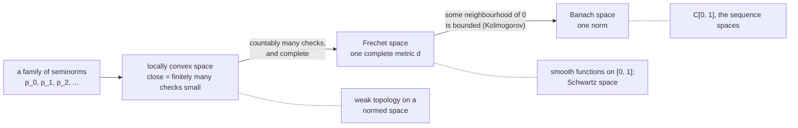
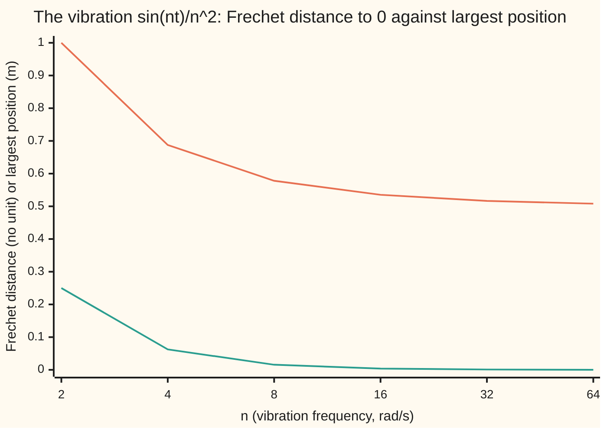

# Locally convex and Frechet spaces: a whole family of size checks instead of one norm

[Syllabus](../../../SYLLABUS.md) → [Functional analysis](../README.md) → [Normed and Banach Spaces](../README.md#s01) → Locally convex and Frechet spaces

---

## General Overview

An elevator test rig moves a car 1 m in 1 s along the curve $`f(t) = t^3`$ metres, with $`t`$ the time in seconds (illustrative numbers for a fast test move). Engineers care about four sizes of this move at once:

- **How far:** largest position, 1 m.
- **How fast:** largest speed, 3 m/s.
- **How hard:** largest acceleration, 6 m/s².
- **How sudden:** largest jerk (the rate of change of acceleration, felt as a lurch), 6 m/s³.

Now add a vibration $`g_n(t) = \sin(nt)/n^2`$ metres, shaking at $`n`$ radians per second. At $`n = 10`$ it moves the car at most 1 cm and adds at most 0.1 m/s of speed. Yet its acceleration reaches 1 m/s², about a tenth of gravity, and its jerk reaches 10 m/s³. Raise $`n`$ and the shake shrinks in position and speed, while its acceleration stays at 1 m/s² and its jerk grows.

Is the vibration small? The position check says yes. The acceleration check says no. No single size settles it.

A space of smooth motions therefore needs every check at once: position, speed, acceleration, and so on forever. Each check is a **seminorm**: a size rule like a norm, except that it may read zero on something that is not zero (the jerk check reads zero on a steady acceleration). A space whose closeness is set by a family of seminorms is **locally convex**. When the family is countable, the checks pack into one distance; when that distance has no holes, the space is a **Frechet space** (after Maurice Fréchet). For $`t^3`$ that distance from standing still is 1 + 1/2 + 1/4 + 1/8 = 1.875.

**A locally convex space measures each vector by a family of seminorms and calls two vectors close when finitely many of those checks are small at once; a Frechet space is one where a countable family packs into a complete metric, and for the smooth functions no single norm can do the family's job.**

**What kind of fact this is:** four definitions (seminorm, locally convex space, Frechet space, bounded set) and three theorems proved on this card in Why it works: the metric gives the same limits as the family, the smooth functions on [0, 1] are complete, and they carry no norm with the right limits. Separation, open mapping and closed graph are carried over from their own cards in outline, and Kolmogorov's normability test is stated with its source. The elevator numbers are illustrative.

### The picture: from a family of checks to one norm



Schematic. Each box is a special case of the one to its left; dotted lines give examples. Step 6 proves the smooth functions never reach the Banach box.

---

## The formula

Notation first, in words.

- $`C^\infty[0, 1]`$ is the set of **smooth functions** on [0, 1]: functions with derivatives of every order, one-sided at the two ends.
- $`f^{(k)}`$ is the $`k`$-th derivative of $`f`$; $`f^{(0)} = f`$.
- A **seminorm** $`p`$ gives every vector a size $`p(f) \ge 0`$ with $`p(cf) = \lvert c \rvert\, p(f)`$ for every number $`c`$ and $`p(f + g) \le p(f) + p(g)`$. Unlike a norm ([Normed and Banach spaces](01-normed-spaces-and-banach-spaces.md)), $`p(f) = 0`$ is allowed for $`f \ne 0`$. Here $`p`$ is a seminorm, not an $`L^p`$ exponent.

The example's family, its neighbourhoods and its metric:

```math
p_k(f) = \max_{0 \le t \le 1} \lvert f^{(k)}(t) \rvert, \qquad U(\varepsilon, m) = \{ f : p_0(f) < \varepsilon, \ldots, p_m(f) < \varepsilon \}
```

**Read it aloud:** the $`k`$-th check is the largest size of the $`k`$-th derivative; a basic neighbourhood of zero asks the first $`m + 1`$ checks to be below $`\varepsilon`$ at once.

```math
d(f, g) = \sum_{k=0}^{\infty} 2^{-k} \min\big(1, \, p_k(f - g)\big)
```

**Read it aloud:** the distance from $`f`$ to $`g`$ caps each check of their difference at 1, weights check $`k`$ by one over $`2^k`$, and adds them all.

The definitions, built on these:

- **Topology from a family.** A basic neighbourhood of 0 asks finitely many members of the family to be below $`\varepsilon`$; for $`p_0, p_1, \ldots`$ that is $`U(\varepsilon, m)`$. A set is open when, around each of its points $`f`$, it holds $`f`$ plus a basic neighbourhood ([Topological space](../../17-Topology/02-Topological%20Spaces/01-topological-spaces-and-bases.md)). So $`f_j \to f`$ exactly when $`p_k(f_j - f) \to 0`$ for every $`k`$ separately.
- **Locally convex space.** A vector space whose topology comes from a family of seminorms that **separates points**: every vector other than 0 has some check above zero. Equivalently, every neighbourhood of 0 holds a convex one.
- **Frechet space.** A locally convex space with a countable family, complete in the metric $`d`$: every sequence that is Cauchy in $`d`$ converges.
- **Bounded set.** A set $`B`$ on which every seminorm of the family stays below some number. When one norm gives the topology, its unit ball is bounded in this sense.

The **Schwartz space** of the line uses $`p_{a,b}(f) = \sup_t \lvert t^a f^{(b)}(t) \rvert`$ for whole numbers $`a, b \ge 0`$: smooth functions that, with every derivative, fade faster than any power of $`1/\lvert t \rvert`$. The bell $`e^{-t^2/2}`$ belongs: $`p_{1,0} = p_{0,1}`$ = 0.606531 and $`p_{2,0}`$ = 0.735759. **Test functions** are smooth functions that are zero outside some bounded interval; on functions that vanish outside one fixed interval they use the same checks $`p_k`$.

| Symbol | Plain meaning | In our example | Push it up and the answer… |
| --- | --- | --- | --- |
| $`t`$, $`f(t)`$, $`f^{(k)}`$ | time, s; a motion profile, m; its $`k`$-th derivative (speed, acceleration, jerk for $`k`$ = 1, 2, 3) | $`f(t) = t^3`$ on [0, 1] s; $`f^{(2)} = 6t`$ | — |
| $`p_k`$, $`p`$, $`c`$ | the $`k`$-th check; any seminorm; a number that scales a vector | $`p_0`$ to $`p_4`$ of $`t^3`$: 1, 3, 6, 6, 0 | a bigger check: a rougher move |
| $`C^\infty[0, 1]`$, $`f_j`$, $`h_k`$ | smooth functions on [0, 1]; a sequence of them; the limit of their $`k`$-th derivatives (Step 3) | all motion profiles | — |
| $`N`$, $`T_N`$, $`\theta`$ | a degree; the Chebyshev polynomial, $`T_N(\cos\theta) = \cos N\theta`$; an angle | $`T_3(2t - 1)`$: $`p_0`$ = 1, $`p_1`$ = 18 | bigger $`N`$: the slope constant $`2N^2`$ grows |
| $`U(\varepsilon, m)`$, $`\varepsilon`$, $`m`$, $`B_d(r)`$ | basic neighbourhood of 0; its tolerance; the last check it asks; the metric ball of radius $`r`$ | $`U(0.1, 2)`$: position, speed and acceleration below 0.1 | bigger $`m`$: a stricter neighbourhood |
| $`d(f, g)`$, $`2^{-k}`$, $`\min(1, \cdot)`$, $`K`$ | the Frechet metric; weight of check $`k`$; the cap at 1; terms kept in a truncated sum | $`d(t^3, 0)`$ = 1.875; 60 terms in the code | — |
| $`g_n`$, $`n`$ | the vibration $`\sin(nt)/n^2`$ m; its frequency in rad/s | $`n = 10`$: checks 0.01, 0.1, 1, 10 | position and speed shrink, acceleration stays 1 |
| $`s_N`$ | the first $`N + 1`$ terms of the series for $`e^t`$ | $`d(s_8, e^t)`$ = 0.019345 | bigger $`N`$: closer to $`e^t`$ |
| $`f_w`$, $`w`$, $`u`$ | the smoothed corner $`\sqrt{(t - 1/2)^2 + w^2}`$; its width; the scaled time $`(t - 1/2)/w`$ | $`w`$ = 0.1, 0.01, 0.001 | smaller $`w`$: sharper corner |
| $`\varphi`$, $`C`$, $`s_U`$, $`\lambda`$ | a continuous linear functional; the constant in its bound; the gauge of a convex neighbourhood $`U`$; a mixing weight in [0, 1] | $`\varphi(f) = f''(1)`$; $`s_U(t^3)`$ = 6 | — |
| $`p_{a,b}`$, $`a`$, $`b`$, $`\psi`$ | Schwartz check: power $`a`$ of $`t`$ times derivative $`b`$; a smooth bump, zero outside [−1, 1] | bell $`e^{-t^2/2}`$: $`p_{1,0}`$ = 0.606531 | — |
| $`X`$, $`X'`$, $`x`$, $`p_\varphi`$, $`B`$ | a normed space, its dual and a vector (Step 7); the weak check $`\lvert \varphi(x) \rvert`$; a bounded set | $`e_n \rightharpoonup 0`$ in $`\ell^2`$ | — |

### When it holds

- **Each check is a seminorm.** Then each set $`\{p < \varepsilon\}`$ is convex. Break the scaling rule and convexity can fail everywhere. On $`L^{1/2}[0, 1]`$ (functions, step functions included, with $`\int_0^1 \lvert f \rvert^{1/2}\,dt`$ finite) that size obeys the triangle inequality, but doubling $`f`$ multiplies it by $`\sqrt{2}`$. The function 1 is the average of 100 pieces, each 100 on one hundredth of [0, 1], of size 0.100000. Every function splits this way, so every convex neighbourhood of 0 is the whole space, and the only continuous linear functional is 0.
- **The family separates points.** Drop $`p_0`$ and keep $`p_1, p_2, \ldots`$: a motion and the same motion shifted by a constant read the same on every check, so limits stop being unique.
- **The family is countable, for a metric.** A countable family can be weighted and summed. The weak topology of an infinite-dimensional normed space has no metric. A metric would need only countably many checks $`\varphi_1, \varphi_2, \ldots`$; then a vector $`x_k`$ of norm $`k`$ that $`\varphi_1`$ to $`\varphi_k`$ read as 0 would converge weakly to 0, yet weakly convergent sequences are bounded ([Three Banach theorems](08-open-mapping-closed-graph-and-uniform-boundedness.md)).
- **The weights add up to something finite, and each check is capped.** Without the weights $`2^{-k}`$, the sum for $`e^t`$ reads 10 after 10 terms and 100 after 100. Without the cap, $`e^{2t}`$ gives 73.890561 after 10 terms and keeps growing.
- **Completeness, for Frechet.** Under the single check $`p_0`$ the smoothed corners $`f_w(t) = \sqrt{(t - 1/2)^2 + w^2}`$, each within $`w`$ of $`\lvert t - 1/2 \rvert`$, form a Cauchy sequence whose limit $`\lvert t - 1/2 \rvert`$ is not smooth. The full family sees the corner, and Step 3 proves no such hole exists.

---

## Why it works

### Step 0: closeness asks finitely many checks at a time, and countably many checks can be summed

A neighbourhood demands only the first few checks, each to a tolerance, so a vibration counts as near zero once position, speed and acceleration are small, whatever the higher checks say. A countable list of checks packs into one number: weight check $`k`$ by $`2^{-k}`$ so the tail is tiny, and cap each at 1 so one huge check cannot hide the others.

**The finite rehearsal.** On straight moves, a list of two numbers, the speed is the gap between the ends: $`p_1(f) = \lvert f(1) - f(0) \rvert \le 2p_0(f)`$, and later checks are 0. Position alone controls the family. On polynomials of degree at most $`N`$, a list of $`N + 1`$ coefficients, the constant grows. The Chebyshev polynomial of [Runge's phenomenon](../../16-Numerical%20analysis/04-Interpolation%20and%20Approximation/04-runge-phenomenon-and-chebyshev-nodes.md), moved onto [0, 1] as $`T_N(2t - 1)`$, has largest size 1 and largest slope $`2N^2`$ (at $`2t - 1 = \cos\theta`$ its slope is $`2N\sin N\theta/\sin\theta`$, largest at the ends): 2, 18 and 200 at $`N`$ = 1, 3 and 10. Each finite list needs one norm, but no constant serves every $`N`$, and $`C^\infty[0, 1]`$ has no $`N`$: the vibration's ratio $`p_3/p_2 = n`$ has no ceiling.

The reason is general. On a finite list each seminorm is at most a constant times the largest entry, by the triangle rule of [Equivalent norms](04-equivalence-of-norms-in-finite-dimensions.md). Finitely many members of a separating family already separate points: the vectors they all read as 0 form a subspace, and while it holds a nonzero vector, some further member lowers its dimension. Their maximum is a norm, which that card pins to the largest entry, so the family gives the same limits as one norm.

### Step 1: seminorms make convex neighbourhoods

If $`p(f) < \varepsilon`$ and $`p(g) < \varepsilon`$, then for $`0 \le \lambda \le 1`$, $`p(\lambda f + (1 - \lambda) g) \le \lambda p(f) + (1 - \lambda) p(g) < \varepsilon`$. So each $`\{p < \varepsilon\}`$ is convex, and $`U(\varepsilon, m)`$, a finite intersection of them, is convex too. Adding and scaling are continuous, because the checks obey the triangle inequality and scale with $`\lvert c \rvert`$.

The converse also holds. A convex neighbourhood $`U`$ of 0 that is symmetric ($`-U = U`$) has a **gauge** $`s_U(f)`$, the $`s_C`$ of [Separation](07-hahn-banach-separation-and-supporting-walls.md): the infimum of the $`r > 0`$ with $`f`$ in $`rU`$, the $`r`$ at the boundary. The gauge is a seminorm. So "built from seminorms" and "has convex neighbourhoods" are the same property.

### Step 2: the metric gives the same limits as the family

$`d`$ is a metric. It is zero only when every check of $`f - g`$ is zero, and $`p_0`$ alone forces $`f = g`$. Its triangle inequality comes from $`\min(1, a + b) \le \min(1, a) + \min(1, b)`$. It is **translation invariant**: $`d(f + h, g + h) = d(f, g)`$.

It has the same limits as the family. If $`d(f_j, f) \to 0`$, each term does too, so every $`p_k(f_j - f) \to 0`$. Conversely, the tail beyond some $`K`$ adds at most $`2^{-K}`$, and the first $`K`$ terms, finitely many, can all be made small together.

<details>
<summary>Detailed proof: the metric and the family give the same open sets</summary>

Write $`B_d(r) = \{f : d(f, 0) < r\}`$. Both topologies are translation invariant, so it is enough to compare neighbourhoods of 0.

**A metric ball holds a basic neighbourhood.** Given $`r > 0`$, pick $`m`$ with $`2^{-m} < r/2`$. If $`f \in U(r/4, m)`$ then

$`\displaystyle d(f, 0) \le \sum_{k=0}^{m} 2^{-k} \frac{r}{4} + \sum_{k > m} 2^{-k} < \frac{r}{2} + 2^{-m} < r.`$

**A basic neighbourhood holds a metric ball.** Given $`U(\varepsilon, m)`$ with $`\varepsilon < 1`$, take $`r = 2^{-m}\varepsilon`$. If $`d(f, 0) < r`$ then for each $`k \le m`$, $`2^{-k} \min(1, p_k(f)) < 2^{-m}\varepsilon`$, so $`\min(1, p_k(f)) < \varepsilon < 1`$ and $`p_k(f) < \varepsilon`$. ∎

</details>

### Step 3: the smooth functions are complete

Take a sequence that is Cauchy in $`d`$. By Step 2 it is Cauchy in every check: for each $`k`$ the derivatives $`f_j^{(k)}`$ are Cauchy in the largest-size norm. Continuous functions on [0, 1] are complete in that norm ([Function spaces C and Lp](03-function-spaces-c-and-lp.md)), so each derivative sequence has a continuous limit $`h_k`$.

The limits fit together: when functions and their derivatives both converge uniformly, the limit's derivative is the limit of the derivatives ([Swapping limits](../../06-Calculus%20and%20analysis/06-Series/08-swapping-limits-with-integrals-and-derivatives.md)). So $`h_0' = h_1`$, $`h_1' = h_2`$, and so on: $`h_0`$ is smooth and $`f_j \to h_0`$ in every check.

The Taylor sums of $`e^t`$ show it at work. The distance $`d(s_N, e^t)`$ falls from 1.077423 at $`N = 2`$ to 0.305112, 0.019345 and 0.000076 at $`N`$ = 4, 8 and 16, and the limit $`e^t`$ is smooth.

<details>
<summary>Detailed proof: C^∞[0, 1] is complete in d</summary>

Let $`(f_j)`$ be Cauchy in $`d`$. For $`\varepsilon < 1`$ and each $`k`$, once $`d(f_i, f_j) < 2^{-k}\varepsilon`$ we have $`p_k(f_i - f_j) < \varepsilon`$. So $`(f_j^{(k)})`$ is Cauchy in the largest-size norm on $`C[0, 1]`$, which is complete. Call its limit $`h_k`$, a continuous function.

For each $`k`$ and each $`t`$,

$`\displaystyle f_j^{(k)}(t) = f_j^{(k)}(0) + \int_0^t f_j^{(k+1)}(s)\,ds.`$

Uniform convergence lets the limit pass through the integral, so $`h_k(t) = h_k(0) + \int_0^t h_{k+1}(s)\,ds`$. By the fundamental theorem of calculus, $`h_k' = h_{k+1}`$. Hence $`h_0`$ is smooth with $`h_0^{(k)} = h_k`$, so $`p_k(f_j - h_0) \to 0`$ for every $`k`$, and $`d(f_j, h_0) \to 0`$ by Step 2. ∎

</details>

### Step 4: separation by a flat wall still works

[Separation](07-hahn-banach-separation-and-supporting-walls.md) splits a point from a closed convex set that holds a ball, using the set's gauge as the bound for Hahn-Banach. In a locally convex space the same proof runs with a convex neighbourhood in place of the ball, because Step 1 says its gauge is a seminorm. As there, the general case uses the axiom of choice (a rule of set theory that lets a proof pick from infinitely many options at once).

Here is an explicit case. Take $`U = U(1, 3)`$: position, speed, acceleration and jerk all below 1. Its gauge is $`s_U(f) = \max(p_0, p_1, p_2, p_3)`$, which is 6 for $`t^3`$, so $`t^3`$ lies outside $`U`$. The functional $`\varphi(f) = f''(1)`$, the acceleration at the end of the move, has $`\lvert \varphi(f) \rvert \le p_2(f)`$. So $`\varphi < 1`$ on all of $`U`$, while $`\varphi(t^3) = 6`$. The wall $`\varphi = 1`$ separates them.

The same bound describes every continuous linear functional on $`C^\infty[0, 1]`$: $`\lvert \varphi(f) \rvert \le C \max(p_0(f), \ldots, p_m(f))`$ for some number $`C`$ and some $`m`$. The slope at the end, $`f'(1)`$, is one: for $`t^3`$ it is 3, at the bound $`p_1 = 3`$. So a locally convex space has many continuous functionals, and the dual space of [Dual spaces](09-dual-spaces-and-lp-duality.md) is still large. For $`C^\infty[0, 1]`$, though, there is no unit ball, so no dual norm $`\lVert \varphi \rVert`$.

### Step 5: Baire's theorem still applies, so the three Banach theorems survive

A Frechet space is a complete metric space, so [Baire category theorem](../../17-Topology/01-Metric%20Spaces/10-baire-category-theorem.md) holds in it. The proofs on [Three Banach theorems](08-open-mapping-closed-graph-and-uniform-boundedness.md) used only three things: Baire, linearity, and a way to shrink and shift a neighbourhood of 0. The convex neighbourhoods $`U(\varepsilon, m)`$ take the place of balls, and the correction-in-rounds argument uses the complete metric $`d`$.

So between Frechet spaces:

- **Open mapping.** A continuous linear map onto another Frechet space sends open sets to open sets.
- **Closed graph.** A linear map defined on the whole space with a closed graph is continuous.
- **Uniform boundedness.** A family of continuous linear maps that stays bounded at each input is equicontinuous: one neighbourhood serves every map at once.

Full proofs are in Trèves, listed in Sources.

### Step 6: the smooth functions carry no norm with the right limits

Suppose some norm gave exactly the limits of the family. Its unit ball would be a neighbourhood of 0 and a bounded set. So it is enough to show that **no neighbourhood of 0 in $`C^\infty[0, 1]`$ is bounded**.

Every neighbourhood holds some $`U(\varepsilon, m)`$. That set asks nothing about check $`m + 1`$. Take the vibration with its size scaled down: $`(\varepsilon/2)\sin(nt)/n^{m}`$. Its checks 0 to $`m`$ are at most $`\varepsilon/2`$, for every $`n \ge 2`$, but its check $`m + 1`$ is $`(\varepsilon/2)\,n`$, which grows without limit. So the neighbourhood is not bounded, and no norm exists.

With $`\varepsilon = 0.1`$ and $`m = 2`$ this is $`g_n/20`$. Position, speed and acceleration stay at most 0.05, while the jerk is 0.5, 5.0 and 50.0 at $`n`$ = 10, 100 and 1000.

The converse is **Kolmogorov's normability test** (1934), stated with its source: a locally convex space is normable exactly when some neighbourhood of 0 is bounded.

Test functions that vanish outside [−1, 1] fail the same way. Take the bump $`\psi(t) = e^{-1/(1 - t^2)}`$ for $`\lvert t \rvert < 1`$, 0 outside. By Leibniz's rule for derivatives of a product, checks 0 to $`m`$ of $`\psi(t)\sin(nt)/n^m`$ stay below one bound for every $`n`$, while check $`m + 1`$ is $`n\psi(t)`$ times a sine or cosine of $`nt`$ plus bounded terms, so near $`t = 0`$ it grows like $`n\psi(0)`$. A bell in place of $`\psi`$ does the same for the Schwartz space. All test functions together are worse still. They form a countable union of closed subspaces, one per interval $`[-m, m]`$, each with no interior, so by Baire no complete metric fits them. Their true topology is built from all the intervals at once; [Distributions](../04-Distributions%20and%20Sobolev%20Spaces/01-test-functions-and-distributions.md) uses it.

### Step 7: the weak topology is locally convex too

On a normed space $`X`$, take one check for each bounded functional $`\varphi`$: $`p_\varphi(x) = \lvert \varphi(x) \rvert`$. These seminorms separate points by [Hahn-Banach](06-hahn-banach-theorem.md), so they make a locally convex topology, the **weak topology**. Its convergent sequences are the $`x_n \rightharpoonup x`$ of [Reflexive spaces](10-reflexive-spaces-and-the-second-dual.md), such as $`e_n \rightharpoonup 0`$ in $`\ell^2`$. On the dual $`X'`$, the checks $`\lvert \varphi(x) \rvert`$, one for each $`x`$ in $`X`$, make the **weak-star topology**, locally convex in the same way. [Weak convergence](../02-Hilbert%20Spaces/09-weak-convergence-and-banach-alaoglu.md) spends these topologies on compactness.

---

## Worked numbers, by hand

The elevator move $`f(t) = t^3`$ m on [0, 1] s, then the vibration at $`n = 10`$.

| Step | Arithmetic | Value |
| --- | --- | --- |
| $`p_0`$, largest position | $`\max t^3`$, at $`t = 1`$ | 1 |
| $`p_1`$, largest speed | $`\max 3t^2`$ | 3 |
| $`p_2`$, largest acceleration | $`\max 6t`$ | 6 |
| $`p_3`$, jerk; $`p_4`$ onwards | $`6`$; then $`0`$ | 6; 0 |
| cap each check at 1 | 1, 3, 6, 6 become 1, 1, 1, 1 | 1, 1, 1, 1 |
| weight and add | $`1 + 1/2 + 1/4 + 1/8`$ | **$`d(t^3, 0)`$ = 1.875000** |
| vibration $`g_{10}`$: checks | $`1/100,\ 1/10,\ 1,\ 10`$; check $`k`$ is $`10^{k-2}`$ | 0.01, 0.1, 1, 10 |
| $`d(g_{10}, 0)`$ | $`0.01 + 0.1/2 + 1/4 + (1/8 + 1/16 + \cdots)`$ | 0.560000 |

The move sits 1.875 from standing still. The vibration at $`n = 10`$ sits 0.56 away, and as $`n`$ grows that distance falls only to 0.5: the acceleration check never lets it reach 0.



The upper line is $`d(g_n, 0) = 0.5 + 1/(2n) + 1/n^2`$, levelling off at 0.5. The lower line is the largest position $`p_0(g_n) = 1/n^2`$, falling to 0. Under the position norm alone the vibration vanishes; in $`C^\infty[0, 1]`$ it does not.

What the computation hides: the code samples each function at 1001 times and adds 60 terms of the metric. The claim "acceleration stays 1 for every $`n`$" is proved by hand ($`\sin(nt)`$ reaches 1 at $`t = \pi/(2n) \le 1`$ once $`n \ge 2`$), not by sampling.

### What breaks if you drop a piece

| Mistake | Comes out at | What went wrong |
| --- | --- | --- |
| Use only the position norm $`p_0`$ | $`f_w`$ against $`f_{w/2}`$: position gaps 0.050000, 0.005000, 0.000500; slope gap 0.259921 = $`2^{1/3} - 1`$ every time | Cauchy in $`p_0`$, but the limit $`\lvert t - 1/2 \rvert`$ has a corner; smooth functions are not complete under the position norm $`p_0`$ |
| Drop the weights $`2^{-k}`$ | $`e^t`$: 10 after 10 terms, 100 after 100 | every check of $`e^t`$ is $`e`$, capped at 1; the sum has no limit |
| Drop the cap $`\min(1, \cdot)`$ | $`e^{2t}`$: 73.890561 after 10 terms | check $`k`$ is $`2^k e^2`$, which cancels the weight; each term adds $`e^2`$ |
| Drop convexity: size by $`\int \lvert f \rvert^{1/2}`$ on $`L^{1/2}[0, 1]`$ | 1 on [0, 1] is the average of 4 pieces of size 0.500000, or 100 of size 0.100000 | every convex neighbourhood of 0 holds the function 1; no wall can separate anything |

---

## Code, from first principles, and it actually runs

Every number takes at least two roads: exact derivatives of integer coefficients against central differences of samples ($`t^3`$), integer coefficients against $`2N^2`$ (Chebyshev), sampled checks and 60-term sums against closed forms (the vibration), series tails against Taylor's bounds ($`e^t`$), a grid maximum against a ternary search and $`2^{1/3} - 1`$ (the corner), and closed forms for the bell. Everything is a truncation, finite grids and sums; the infinite claims rest on the proofs above.

### Python

```python
# Locally convex and Frechet spaces: smooth motion profiles on [0, 1] s, sized by every derivative.
# Standard library only.  Every number quoted on the card is printed here.
import math

GRID = [j / 1000 for j in range(1001)]  # 1001 sample times across [0, 1] s


def fd(f, k, t, h=1e-3):  # road 2: k-th central difference, built from samples of f alone
    return sum((-1) ** (k - j) * math.comb(k, j) * f(t + (j - k / 2) * h) for j in range(k + 1)) / h ** k


def p_fd(f, k):  # seminorm p_k(f) = max |f^(k)(t)| over the grid, derivative by differences
    return max(abs(fd(f, k, t)) for t in GRID)


def p_poly(c, k):  # road 1: differentiate integer coefficients k times, then take the grid maximum
    for _ in range(k):
        c = [i * c[i] for i in range(1, len(c))]
    return max(abs(sum(a * t ** i for i, a in enumerate(c))) for t in GRID) if c else 0.0


def dist(ps):  # the Frechet metric from a list of seminorm values p_0, p_1, ...
    return sum(2.0 ** -k * min(1.0, x) for k, x in enumerate(ps))


def cheb(N):  # finite rehearsal: integer coefficients of T_N(2t - 1), from T_(k+1) = 2(2t - 1) T_k - T_(k-1)
    a, b = [1], [-1, 2]
    for _ in range(N - 1):
        a, b = b, [4 * x - 2 * y - z for x, y, z in zip([0] + b, b + [0], a + [0, 0])]
    return b


print("smooth functions on [0, 1]: p_k(f) = max |f^(k)(t)|, d(f, g) = sum 2^-k min(1, p_k(f - g))")
print("elevator move f(t) = t^3 m, t in s")
print("   k   p_k exact   p_k from samples only")
cube = [0, 0, 0, 1]
exact = [p_poly(cube, k) for k in range(41)]
for k in range(5):
    by_fd = f"{p_fd(lambda t: t ** 3, k):22.6f}" if k < 4 else "        (not sampled)"
    print(f"{k:4d} {exact[k]:11.6f} {by_fd}")
assert exact[:5] == [1, 3, 6, 6, 0]  # the hand values
assert all(abs(p_fd(lambda t: t ** 3, k) - exact[k]) < 1e-5 for k in range(4))
assert abs(dist(exact) - 1.875) < 1e-15  # 1 + 1/2 + 1/4 + 1/8, every later term zero
print(f"d(t^3, 0) = 1 + 1/2 + 1/4 + 1/8 = {dist(exact):.6f}")
print(f"slope at the end f'(1) = {fd(lambda t: t ** 3, 1, 1.0):.6f}, bounded by p_1 = {exact[1]:.6f}")
print(f"wall f''(1) = {fd(lambda t: t ** 3, 2, 1.0):.6f}; gauge of U = max(p_0..p_3) = {max(exact[:4]):.6f}")
print("finite rehearsal, polynomials of degree <= N: T_N(2t - 1), where T_N(cos th) = cos(N th)")
print("   N  p_0(T_N)   p_1(T_N)  2N^2")
for N in (1, 3, 10):
    q0, q1 = p_poly(cheb(N), 0), p_poly(cheb(N), 1)
    assert abs(q0 - 1) < 1e-9 and abs(q1 - 2 * N * N) < 1e-9  # closed forms: |T_N| <= 1, slope 2N^2 at t = 1
    print(f"{N:4d} {q0:9.6f} {q1:10.6f} {2 * N * N:5d}")


def ripple_p(n, k):  # closed form for g_n(t) = sin(n t) / n^2 on [0, 1], n >= 2
    return float(n) ** (k - 2)


g10 = lambda t: math.sin(10 * t) / 100
print("ripple g_n(t) = sin(n t)/n^2, n = 10, seminorms from samples: "
      + ", ".join(f"p_{k} {p_fd(g10, k):.6f}" for k in range(3)))
assert all(abs(p_fd(g10, k) / ripple_p(10, k) - 1) < 1e-3 for k in range(3))
print("   n    p_0(g_n)    p_1(g_n)  p_2(g_n)  p_3(g_n)  d(g_n, 0) by 60 terms  0.5 + 1/(2n) + 1/n^2")
chart_d, chart_p0 = [], []
for n in (2, 4, 8, 10, 16, 32, 64):
    d60 = dist([ripple_p(n, k) for k in range(60)])
    closed = 0.5 + 1 / (2 * n) + 1 / n ** 2
    assert abs(d60 - closed) < 2.0 ** -58  # the truncated sum misses at most the tail 2^-59 + ...
    if n != 10:
        chart_d.append(f"{d60:.4f}")
        chart_p0.append(f"{ripple_p(n, 0):.4f}")
    print(f"{n:4d} {ripple_p(n, 0):11.6f} {ripple_p(n, 1):11.6f} {ripple_p(n, 2):9.0f} {ripple_p(n, 3):9.0f}"
          f" {d60:22.6f} {closed:21.6f}")
print(f"chart: n 2, 4, 8, 16, 32, 64")
print(f"chart: d(g_n, 0) {', '.join(chart_d)}")
print(f"chart: p_0(g_n) {', '.join(chart_p0)}")

# completeness: Taylor sums s_N of e^t are Cauchy in d and close in on e^t, which is smooth
print("Taylor sums s_N of e^t\n   N  d(s_N, e^t)  d(s_N, s_2N)")
for N in (2, 4, 8, 16):
    def gap(M, k):  # p_k(e^t - s_M): the tail of the series for e from j = M - k + 1, largest at t = 1
        rem = sum(1 / math.factorial(j) for j in range(max(0, M - k + 1), 80))
        if k <= M:  # road 2: e minus the partial sum, and Taylor's bound 1/(m+1)! <= rem <= e/(m+1)!
            assert abs(rem - (math.e - sum(1 / math.factorial(j) for j in range(M - k + 1)))) < 1e-14
            assert 1 / math.factorial(M - k + 1) <= rem <= math.e / math.factorial(M - k + 1)
        return rem
    d_lim = dist([gap(N, k) for k in range(60)])
    d_cau = dist([gap(N, k) - gap(2 * N, k) for k in range(60)])  # s_2N - s_N, all terms positive
    assert d_cau <= d_lim + 1e-15
    print(f"{N:4d} {d_lim:12.6f} {d_cau:13.6f}")
assert d_lim < 1e-4

# one norm is not enough: smoothed corners f_w(t) = sqrt((t - 1/2)^2 + w^2) are Cauchy in p_0 only
fine = [j / 200000 for j in range(200001)]
slope = lambda w, t: (t - 0.5) / math.sqrt((t - 0.5) ** 2 + w * w)
lo, hi = 0.0, 5.0  # road 2 for the stuck slope gap: ternary search of u/sqrt(u^2+1/4) - u/sqrt(u^2+1)
phi = lambda u: u / math.sqrt(u * u + 0.25) - u / math.sqrt(u * u + 1)
for _ in range(200):
    a, b = lo + (hi - lo) / 3, hi - (hi - lo) / 3
    lo, hi = (a, hi) if phi(a) < phi(b) else (lo, b)
print("corner:      w  p_0(f_w - |t - 1/2|)  p_0(f_w - f_w/2)  p_1(f_w - f_w/2)")
for w in (0.1, 0.01, 0.001):
    p0_lim = max(math.sqrt((t - 0.5) ** 2 + w * w) - abs(t - 0.5) for t in fine)
    p0_cau = max(math.sqrt((t - 0.5) ** 2 + w * w) - math.sqrt((t - 0.5) ** 2 + w * w / 4) for t in fine)
    p1_cau = max(abs(slope(w, t) - slope(w / 2, t)) for t in fine)
    assert abs(p0_lim - w) < 1e-15 and abs(p0_cau - w / 2) < 1e-15 and abs(p1_cau - phi(lo)) < 1e-5
    print(f"{w:15.3f} {p0_lim:21.6f} {p0_cau:17.6f} {p1_cau:17.6f}")
assert abs(phi(lo) - (2 ** (1 / 3) - 1)) < 1e-12  # road 3: the closed form 2^(1/3) - 1, where phi'(u) = 0
print(f"  slope gap by search over u = (t - 1/2)/w: {phi(lo):.6f} at every w; closed form 2^(1/3) - 1 = {2 ** (1 / 3) - 1:.6f}")

# no norm: U(0.1, 2) = {p_0, p_1, p_2 < 0.1} holds g_n / 20 for every n, yet p_3 grows
print("U(0.1, 2) holds g_n/20: p_0..p_2 at most 0.05, p_3 = "
      + ", ".join(f"{ripple_p(n, 3) / 20:.1f}" for n in (10, 100, 1000)) + " at n = 10, 100, 1000")

# Schwartz space: the bell e^(-t^2/2) and the seminorms max |t^a f^(b)(t)|
bell = lambda t: math.exp(-t * t / 2)
wide = [-10 + j / 1000 for j in range(20001)]
s10 = max(abs(t * bell(t)) for t in wide)
s01 = max(abs(fd(bell, 1, t)) for t in wide)
s20 = max(t * t * bell(t) for t in wide)
assert abs(s10 - math.exp(-0.5)) < 1e-6 and abs(s01 - math.exp(-0.5)) < 1e-6 and abs(s20 - 2 / math.e) < 1e-6
print(f"bell: p_(1,0) = {s10:.6f}, p_(0,1) = {s01:.6f}, p_(2,0) = {s20:.6f}")
tails = [max(abs(t ** 3 / (1 + t * t)) for t in (M * j / 1000 for j in range(1001))) for M in (10, 100, 1000)]
assert all(abs(x - M ** 3 / (1 + M * M)) < 1e-9 * M for x, M in zip(tails, (10, 100, 1000)))
print("1/(1+t^2): max |t^3 f(t)| over |t| <= 10, 100, 1000: " + ", ".join(f"{x:.3f}" for x in tails))

# what breaks
print(f"no weights, e^t: sum of min(1, p_k) over K terms = {sum(min(1, math.e) for _ in range(10)):.0f} at K = 10, "
      f"{sum(min(1, math.e) for _ in range(100)):.0f} at K = 100")
e2 = [p_fd(lambda t: math.exp(2 * t), k) for k in range(4)]
assert all(abs(x / (2 ** k * math.e ** 2) - 1) < 1e-5 for k, x in enumerate(e2))
print(f"no min(1, .), e^(2t): p_k = 2^k e^2, so sum 2^-k p_k over 10 terms = {10 * math.e ** 2:.6f}")
for n in (4, 100):  # L^(1/2): size of n times the indicator of [0, 1/n), by a midpoint sum
    size = sum(math.sqrt(n) for i in range(100000) if (i + 0.5) / 100000 < 1 / n) / 100000
    assert abs(size - 1 / math.sqrt(n)) < 1e-9
    print(f"not convex, L^(1/2): 1 on [0, 1] is the average of {n} pieces of size {size:.6f}")
print("ALL CHECKS PASS")
```

**Ran 2026-11-24 on macOS, Python 3.14.10, standard library only. All checks passed. Output, pasted from the run:**

```
smooth functions on [0, 1]: p_k(f) = max |f^(k)(t)|, d(f, g) = sum 2^-k min(1, p_k(f - g))
elevator move f(t) = t^3 m, t in s
   k   p_k exact   p_k from samples only
   0    1.000000               1.000000
   1    3.000000               3.000000
   2    6.000000               6.000000
   3    6.000000               6.000001
   4    0.000000         (not sampled)
d(t^3, 0) = 1 + 1/2 + 1/4 + 1/8 = 1.875000
slope at the end f'(1) = 3.000000, bounded by p_1 = 3.000000
wall f''(1) = 6.000000; gauge of U = max(p_0..p_3) = 6.000000
finite rehearsal, polynomials of degree <= N: T_N(2t - 1), where T_N(cos th) = cos(N th)
   N  p_0(T_N)   p_1(T_N)  2N^2
   1  1.000000   2.000000     2
   3  1.000000  18.000000    18
  10  1.000000 200.000000   200
ripple g_n(t) = sin(n t)/n^2, n = 10, seminorms from samples: p_0 0.010000, p_1 0.100000, p_2 0.999991
   n    p_0(g_n)    p_1(g_n)  p_2(g_n)  p_3(g_n)  d(g_n, 0) by 60 terms  0.5 + 1/(2n) + 1/n^2
   2    0.250000    0.500000         1         2               1.000000              1.000000
   4    0.062500    0.250000         1         4               0.687500              0.687500
   8    0.015625    0.125000         1         8               0.578125              0.578125
  10    0.010000    0.100000         1        10               0.560000              0.560000
  16    0.003906    0.062500         1        16               0.535156              0.535156
  32    0.000977    0.031250         1        32               0.516602              0.516602
  64    0.000244    0.015625         1        64               0.508057              0.508057
chart: n 2, 4, 8, 16, 32, 64
chart: d(g_n, 0) 1.0000, 0.6875, 0.5781, 0.5352, 0.5166, 0.5081
chart: p_0(g_n) 0.2500, 0.0625, 0.0156, 0.0039, 0.0010, 0.0002
Taylor sums s_N of e^t
   N  d(s_N, e^t)  d(s_N, s_2N)
   2     1.077423      0.979167
   4     0.305112      0.300930
   8     0.019345      0.019330
  16     0.000076      0.000076
corner:      w  p_0(f_w - |t - 1/2|)  p_0(f_w - f_w/2)  p_1(f_w - f_w/2)
          0.100              0.100000          0.050000          0.259921
          0.010              0.010000          0.005000          0.259921
          0.001              0.001000          0.000500          0.259919
  slope gap by search over u = (t - 1/2)/w: 0.259921 at every w; closed form 2^(1/3) - 1 = 0.259921
U(0.1, 2) holds g_n/20: p_0..p_2 at most 0.05, p_3 = 0.5, 5.0, 50.0 at n = 10, 100, 1000
bell: p_(1,0) = 0.606531, p_(0,1) = 0.606531, p_(2,0) = 0.735759
1/(1+t^2): max |t^3 f(t)| over |t| <= 10, 100, 1000: 9.901, 99.990, 999.999
no weights, e^t: sum of min(1, p_k) over K terms = 10 at K = 10, 100 at K = 100
no min(1, .), e^(2t): p_k = 2^k e^2, so sum 2^-k p_k over 10 terms = 73.890561
not convex, L^(1/2): 1 on [0, 1] is the average of 4 pieces of size 0.500000
not convex, L^(1/2): 1 on [0, 1] is the average of 100 pieces of size 0.100000
ALL CHECKS PASS
```

### Rust

```rust
// Locally convex and Frechet spaces: smooth motion profiles on [0, 1] s, sized by every derivative.
// std only, no crates.  Every number quoted on the card is printed here.
const E: f64 = std::f64::consts::E;

fn grid() -> Vec<f64> { (0..=1000).map(|j| j as f64 / 1000.0).collect() } // 1001 sample times across [0, 1] s

fn binom(k: usize, j: usize) -> f64 { (0..j).fold(1.0, |acc, i| acc * (k - i) as f64 / (i + 1) as f64) }
fn fact(n: usize) -> f64 { (1..=n).fold(1.0, |a, i| a * i as f64) }

// road 2: k-th central difference, built from samples of f alone
fn fd(f: &dyn Fn(f64) -> f64, k: usize, t: f64) -> f64 {
    let h = 1e-3;
    let s: f64 = (0..=k).map(|j| if (k - j) % 2 == 0 { 1.0 } else { -1.0 } * binom(k, j) * f(t + (j as f64 - k as f64 / 2.0) * h)).sum();
    s / h.powi(k as i32)
}

// seminorm p_k(f) = max |f^(k)(t)| over the grid, derivative by differences
fn p_fd(f: &dyn Fn(f64) -> f64, k: usize) -> f64 { grid().iter().map(|&t| fd(f, k, t).abs()).fold(0.0, f64::max) }

// road 1: differentiate integer coefficients k times, then take the grid maximum
fn p_poly(c0: &[i64], k: usize) -> f64 {
    let mut c = c0.to_vec();
    for _ in 0..k { c = (1..c.len()).map(|i| i as i64 * c[i]).collect(); }
    let ev = |t: f64| c.iter().enumerate().map(|(i, &a)| a as f64 * t.powi(i as i32)).sum::<f64>().abs();
    grid().iter().map(|&t| ev(t)).fold(0.0, f64::max)
}

// the Frechet metric from a list of seminorm values p_0, p_1, ...
fn dist(ps: &[f64]) -> f64 { ps.iter().enumerate().map(|(k, &x)| 2f64.powi(-(k as i32)) * x.min(1.0)).sum() }
// closed form for g_n(t) = sin(n t) / n^2 on [0, 1], n >= 2
fn ripple_p(n: u32, k: i32) -> f64 { (n as f64).powi(k - 2) }

// finite rehearsal: integer coefficients of T_N(2t - 1), from T_(k+1) = 2(2t - 1) T_k - T_(k-1)
fn cheb(n: usize) -> Vec<i64> {
    let (mut a, mut b) = (vec![1i64], vec![-1i64, 2]);
    for _ in 1..n {
        let c: Vec<i64> = (0..=b.len())
            .map(|i| 4 * (if i > 0 { b[i - 1] } else { 0 }) - 2 * b.get(i).unwrap_or(&0) - a.get(i).unwrap_or(&0)).collect();
        a = std::mem::replace(&mut b, c);
    }
    b
}

// p_k(e^t - s_M): the tail of the series for e from j = M - k + 1, largest at t = 1
fn gap(m: usize, k: usize) -> f64 {
    let start = if k <= m { m - k + 1 } else { 0 };
    let rem: f64 = (start..80).map(|j| 1.0 / fact(j)).sum();
    if k <= m {
        // road 2: e minus the partial sum, and Taylor's bound 1/(m+1)! <= rem <= e/(m+1)!
        let partial: f64 = (0..=m - k).map(|j| 1.0 / fact(j)).sum();
        assert!((rem - (E - partial)).abs() < 1e-14);
        assert!(1.0 / fact(m - k + 1) <= rem && rem <= E / fact(m - k + 1));
    }
    rem
}

fn main() {
    println!("smooth functions on [0, 1]: p_k(f) = max |f^(k)(t)|, d(f, g) = sum 2^-k min(1, p_k(f - g))");
    println!("elevator move f(t) = t^3 m, t in s");
    println!("   k   p_k exact   p_k from samples only");
    let cube_f = |t: f64| t * t * t;
    let exact: Vec<f64> = (0..41).map(|k| p_poly(&[0, 0, 0, 1], k)).collect();
    for k in 0..5 {
        let by_fd = if k < 4 { format!("{:22.6}", p_fd(&cube_f, k)) } else { "        (not sampled)".to_string() };
        println!("{:4} {:11.6} {}", k, exact[k], by_fd);
    }
    assert!(exact[..5] == [1.0, 3.0, 6.0, 6.0, 0.0]); // the hand values
    assert!((0..4).all(|k| (p_fd(&cube_f, k) - exact[k]).abs() < 1e-5));
    assert!((dist(&exact) - 1.875).abs() < 1e-15); // 1 + 1/2 + 1/4 + 1/8, every later term zero
    println!("d(t^3, 0) = 1 + 1/2 + 1/4 + 1/8 = {:.6}", dist(&exact));
    println!("slope at the end f'(1) = {:.6}, bounded by p_1 = {:.6}", fd(&cube_f, 1, 1.0), exact[1]);
    let gmax = exact[..4].iter().cloned().fold(0.0, f64::max);
    println!("wall f''(1) = {:.6}; gauge of U = max(p_0..p_3) = {:.6}", fd(&cube_f, 2, 1.0), gmax);
    println!("finite rehearsal, polynomials of degree <= N: T_N(2t - 1), where T_N(cos th) = cos(N th)");
    println!("   N  p_0(T_N)   p_1(T_N)  2N^2");
    for &n in &[1usize, 3, 10] {
        let (q0, q1) = (p_poly(&cheb(n), 0), p_poly(&cheb(n), 1));
        assert!((q0 - 1.0).abs() < 1e-9 && (q1 - (2 * n * n) as f64).abs() < 1e-9); // closed forms: |T_N| <= 1, slope 2N^2 at t = 1
        println!("{:4} {:9.6} {:10.6} {:5}", n, q0, q1, 2 * n * n);
    }

    let g10 = |t: f64| (10.0 * t).sin() / 100.0;
    let s: Vec<String> = (0..3).map(|k| format!("p_{} {:.6}", k, p_fd(&g10, k))).collect();
    println!("ripple g_n(t) = sin(n t)/n^2, n = 10, seminorms from samples: {}", s.join(", "));
    assert!((0..3).all(|k| (p_fd(&g10, k) / ripple_p(10, k as i32) - 1.0).abs() < 1e-3));
    println!("   n    p_0(g_n)    p_1(g_n)  p_2(g_n)  p_3(g_n)  d(g_n, 0) by 60 terms  0.5 + 1/(2n) + 1/n^2");
    let (mut cd, mut cp) = (vec![], vec![]);
    for &n in &[2u32, 4, 8, 10, 16, 32, 64] {
        let d60 = dist(&(0..60).map(|k| ripple_p(n, k)).collect::<Vec<_>>());
        let closed = 0.5 + 1.0 / (2.0 * n as f64) + 1.0 / (n as f64 * n as f64);
        assert!((d60 - closed).abs() < 2f64.powi(-58)); // the truncated sum misses at most the tail
        if n != 10 {
            cd.push(format!("{:.4}", d60));
            cp.push(format!("{:.4}", ripple_p(n, 0)));
        }
        println!("{:4} {:11.6} {:11.6} {:9.0} {:9.0} {:22.6} {:21.6}",
                 n, ripple_p(n, 0), ripple_p(n, 1), ripple_p(n, 2), ripple_p(n, 3), d60, closed);
    }
    println!("chart: n 2, 4, 8, 16, 32, 64");
    println!("chart: d(g_n, 0) {}", cd.join(", "));
    println!("chart: p_0(g_n) {}", cp.join(", "));

    // completeness: Taylor sums s_N of e^t are Cauchy in d and close in on e^t, which is smooth
    println!("Taylor sums s_N of e^t\n   N  d(s_N, e^t)  d(s_N, s_2N)");
    let mut d_lim = 0.0;
    for &n in &[2usize, 4, 8, 16] {
        d_lim = dist(&(0..60).map(|k| gap(n, k)).collect::<Vec<_>>());
        let d_cau = dist(&(0..60).map(|k| gap(n, k) - gap(2 * n, k)).collect::<Vec<_>>());
        assert!(d_cau <= d_lim + 1e-15);
        println!("{:4} {:12.6} {:13.6}", n, d_lim, d_cau);
    }
    assert!(d_lim < 1e-4);

    // one norm is not enough: smoothed corners f_w(t) = sqrt((t - 1/2)^2 + w^2) are Cauchy in p_0 only
    let fine: Vec<f64> = (0..=200000).map(|j| j as f64 / 200000.0).collect();
    let slope = |w: f64, t: f64| (t - 0.5) / ((t - 0.5).powi(2) + w * w).sqrt();
    // road 2 for the stuck slope gap: ternary search of u/sqrt(u^2+1/4) - u/sqrt(u^2+1)
    let phi = |u: f64| u / (u * u + 0.25).sqrt() - u / (u * u + 1.0).sqrt();
    let (mut lo, mut hi) = (0.0f64, 5.0f64);
    for _ in 0..200 {
        let (a, b) = (lo + (hi - lo) / 3.0, hi - (hi - lo) / 3.0);
        if phi(a) < phi(b) { lo = a } else { hi = b }
    }
    println!("corner:      w  p_0(f_w - |t - 1/2|)  p_0(f_w - f_w/2)  p_1(f_w - f_w/2)");
    for &w in &[0.1f64, 0.01, 0.001] {
        let mx = |g: &dyn Fn(f64) -> f64| fine.iter().map(|&t| g(t)).fold(f64::MIN, f64::max);
        let p0_lim = mx(&|t: f64| ((t - 0.5).powi(2) + w * w).sqrt() - (t - 0.5).abs());
        let p0_cau = mx(&|t: f64| ((t - 0.5).powi(2) + w * w).sqrt() - ((t - 0.5).powi(2) + w * w / 4.0).sqrt());
        let p1_cau = mx(&|t: f64| (slope(w, t) - slope(w / 2.0, t)).abs());
        assert!((p0_lim - w).abs() < 1e-15 && (p0_cau - w / 2.0).abs() < 1e-15 && (p1_cau - phi(lo)).abs() < 1e-5);
        println!("{:15.3} {:21.6} {:17.6} {:17.6}", w, p0_lim, p0_cau, p1_cau);
    }
    assert!((phi(lo) - (2f64.cbrt() - 1.0)).abs() < 1e-12); // road 3: the closed form 2^(1/3) - 1, where phi'(u) = 0
    println!("  slope gap by search over u = (t - 1/2)/w: {:.6} at every w; closed form 2^(1/3) - 1 = {:.6}", phi(lo), 2f64.cbrt() - 1.0);

    // no norm: U(0.1, 2) = {p_0, p_1, p_2 < 0.1} holds g_n / 20 for every n, yet p_3 grows
    let s: Vec<String> = [10u32, 100, 1000].iter().map(|&n| format!("{:.1}", ripple_p(n, 3) / 20.0)).collect();
    println!("U(0.1, 2) holds g_n/20: p_0..p_2 at most 0.05, p_3 = {} at n = 10, 100, 1000", s.join(", "));

    // Schwartz space: the bell e^(-t^2/2) and the seminorms max |t^a f^(b)(t)|
    let bell = |t: f64| (-t * t / 2.0).exp();
    let wide: Vec<f64> = (0..=20000).map(|j| -10.0 + j as f64 / 1000.0).collect();
    let s10 = wide.iter().map(|&t| (t * bell(t)).abs()).fold(0.0, f64::max);
    let s01 = wide.iter().map(|&t| fd(&bell, 1, t).abs()).fold(0.0, f64::max);
    let s20 = wide.iter().map(|&t| t * t * bell(t)).fold(0.0, f64::max);
    assert!((s10 - (-0.5f64).exp()).abs() < 1e-6 && (s01 - (-0.5f64).exp()).abs() < 1e-6 && (s20 - 2.0 / E).abs() < 1e-6);
    println!("bell: p_(1,0) = {:.6}, p_(0,1) = {:.6}, p_(2,0) = {:.6}", s10, s01, s20);
    let tails: Vec<f64> = [10.0f64, 100.0, 1000.0].iter().map(|&m| {
        let x = (0..=1000).map(|j| m * j as f64 / 1000.0).map(|t| (t.powi(3) / (1.0 + t * t)).abs()).fold(0.0, f64::max);
        assert!((x - m.powi(3) / (1.0 + m * m)).abs() < 1e-9 * m);
        x
    }).collect();
    let s: Vec<String> = tails.iter().map(|x| format!("{:.3}", x)).collect();
    println!("1/(1+t^2): max |t^3 f(t)| over |t| <= 10, 100, 1000: {}", s.join(", "));

    // what breaks
    let (k10, k100): (f64, f64) = ((0..10).map(|_| E.min(1.0)).sum(), (0..100).map(|_| E.min(1.0)).sum());
    println!("no weights, e^t: sum of min(1, p_k) over K terms = {:.0} at K = 10, {:.0} at K = 100", k10, k100);
    let e2f = |t: f64| (2.0 * t).exp();
    assert!((0..4).all(|k| (p_fd(&e2f, k) / (2f64.powi(k as i32) * E * E) - 1.0).abs() < 1e-5));
    println!("no min(1, .), e^(2t): p_k = 2^k e^2, so sum 2^-k p_k over 10 terms = {:.6}", 10.0 * E * E);
    for &n in &[4u32, 100] { // L^(1/2): size of n times the indicator of [0, 1/n), by a midpoint sum
        let size = (0..100000).filter(|&i| (i as f64 + 0.5) / 100000.0 < 1.0 / n as f64)
            .map(|_| (n as f64).sqrt()).sum::<f64>() / 100000.0;
        assert!((size - 1.0 / (n as f64).sqrt()).abs() < 1e-9);
        println!("not convex, L^(1/2): 1 on [0, 1] is the average of {} pieces of size {:.6}", n, size);
    }
    println!("ALL CHECKS PASS");
}
```

**Ran 2026-11-24 on macOS, rustc 1.98.1, no crates. All checks passed. Output, pasted from the run:**

```
smooth functions on [0, 1]: p_k(f) = max |f^(k)(t)|, d(f, g) = sum 2^-k min(1, p_k(f - g))
elevator move f(t) = t^3 m, t in s
   k   p_k exact   p_k from samples only
   0    1.000000               1.000000
   1    3.000000               3.000000
   2    6.000000               6.000000
   3    6.000000               6.000001
   4    0.000000         (not sampled)
d(t^3, 0) = 1 + 1/2 + 1/4 + 1/8 = 1.875000
slope at the end f'(1) = 3.000000, bounded by p_1 = 3.000000
wall f''(1) = 6.000000; gauge of U = max(p_0..p_3) = 6.000000
finite rehearsal, polynomials of degree <= N: T_N(2t - 1), where T_N(cos th) = cos(N th)
   N  p_0(T_N)   p_1(T_N)  2N^2
   1  1.000000   2.000000     2
   3  1.000000  18.000000    18
  10  1.000000 200.000000   200
ripple g_n(t) = sin(n t)/n^2, n = 10, seminorms from samples: p_0 0.010000, p_1 0.100000, p_2 0.999991
   n    p_0(g_n)    p_1(g_n)  p_2(g_n)  p_3(g_n)  d(g_n, 0) by 60 terms  0.5 + 1/(2n) + 1/n^2
   2    0.250000    0.500000         1         2               1.000000              1.000000
   4    0.062500    0.250000         1         4               0.687500              0.687500
   8    0.015625    0.125000         1         8               0.578125              0.578125
  10    0.010000    0.100000         1        10               0.560000              0.560000
  16    0.003906    0.062500         1        16               0.535156              0.535156
  32    0.000977    0.031250         1        32               0.516602              0.516602
  64    0.000244    0.015625         1        64               0.508057              0.508057
chart: n 2, 4, 8, 16, 32, 64
chart: d(g_n, 0) 1.0000, 0.6875, 0.5781, 0.5352, 0.5166, 0.5081
chart: p_0(g_n) 0.2500, 0.0625, 0.0156, 0.0039, 0.0010, 0.0002
Taylor sums s_N of e^t
   N  d(s_N, e^t)  d(s_N, s_2N)
   2     1.077423      0.979167
   4     0.305112      0.300930
   8     0.019345      0.019330
  16     0.000076      0.000076
corner:      w  p_0(f_w - |t - 1/2|)  p_0(f_w - f_w/2)  p_1(f_w - f_w/2)
          0.100              0.100000          0.050000          0.259921
          0.010              0.010000          0.005000          0.259921
          0.001              0.001000          0.000500          0.259919
  slope gap by search over u = (t - 1/2)/w: 0.259921 at every w; closed form 2^(1/3) - 1 = 0.259921
U(0.1, 2) holds g_n/20: p_0..p_2 at most 0.05, p_3 = 0.5, 5.0, 50.0 at n = 10, 100, 1000
bell: p_(1,0) = 0.606531, p_(0,1) = 0.606531, p_(2,0) = 0.735759
1/(1+t^2): max |t^3 f(t)| over |t| <= 10, 100, 1000: 9.901, 99.990, 999.999
no weights, e^t: sum of min(1, p_k) over K terms = 10 at K = 10, 100 at K = 100
no min(1, .), e^(2t): p_k = 2^k e^2, so sum 2^-k p_k over 10 terms = 73.890561
not convex, L^(1/2): 1 on [0, 1] is the average of 4 pieces of size 0.500000
not convex, L^(1/2): 1 on [0, 1] is the average of 100 pieces of size 0.100000
ALL CHECKS PASS
```

### Lean

Lean proves the three theorems of Why it works, the first for any countable family, and checks the example's arithmetic.

- Take any countable family of seminorms $`p_0, p_1, \ldots`$ and its sum $`d`$. Then $`d(f_j, f) \to 0`$ exactly when every $`p_k(f_j - f) \to 0`$.
- Take a sequence of smooth functions on [0, 1] that is Cauchy in $`d`$. Then it converges in $`d`$ to a smooth function on [0, 1].
- No norm on the smooth functions on [0, 1] has the same convergent sequences as the checks $`p_0, p_1, \ldots`$ together.
- Take the checks 1, 3, 6, 6 of $`t^3`$. Then capping, weighting and adding them gives 1 + 1/2 + 1/4 + 1/8 = 1.875.
- Take the vibration at $`n = 10`$. Then its distance $`1/2 + 1/(2n) + 1/n^2`$ from rest is 0.56.
- Take $`N`$ = 1, 3 and 10. Then the Chebyshev slope $`2N^2`$ is 2, 18 and 200.

Each function's check values, the Taylor sums, the corner, the bell and the What breaks numbers are left to the Python and Rust checks.

```lean
-- Locally convex and Frechet spaces: the metric sum of 2^-k min(1, p_k) gives the same limits as its seminorms, the smooth functions on [0, 1] are complete in it, and no norm on them gives the right limits.
import Mathlib.Analysis.Calculus.ContDiff.Operations
import Mathlib.Analysis.Calculus.IteratedDeriv.Defs
import Mathlib.Analysis.Normed.Module.Seminorm.Basic
import Mathlib.Topology.Algebra.InfiniteSum.Real
import Mathlib.Analysis.Normed.Group.Tannery
import Mathlib.Analysis.Calculus.IteratedDeriv.Lemmas
import Mathlib.Analysis.SpecialFunctions.ExpDeriv
import Mathlib.MeasureTheory.Integral.IntervalIntegral.FundThmCalculus

open Set Filter Topology
open scoped ContDiff

/-- The Frechet metric of a countable family of checks `p 0, p 1, ...`:
`d(x, y) = ∑ 2^-k min(1, p_k(x - y))`. -/
noncomputable def frechetDist {E : Type*} [Sub E] (p : ℕ → E → ℝ) (x y : E) : ℝ :=
  ∑' k : ℕ, (1 / 2 : ℝ) ^ k * min 1 (p k (x - y))

/-- The smooth functions on `[0, 1]` (derivatives of every order, one-sided at the ends).
Each one is set to `0` outside `[0, 1]`, so an element is exactly one function on `[0, 1]`. -/
def SmoothOn01 : Submodule ℝ (ℝ → ℝ) where
  carrier := {f | ContDiffOn ℝ ∞ f (Icc 0 1) ∧ ∀ t ∉ Icc (0 : ℝ) 1, f t = 0}
  zero_mem' := ⟨contDiffOn_const, fun _ _ => rfl⟩
  add_mem' := fun hf hg =>
    ⟨hf.1.add hg.1, fun t ht => by simp [hf.2 t ht, hg.2 t ht]⟩
  smul_mem' := fun c _ hf =>
    ⟨hf.1.const_smul c, fun t ht => by simp [hf.2 t ht]⟩

/-- The `k`-th check on `[0, 1]`: `p_k(f) = max over t in [0, 1] of |f^(k)(t)|`,
with one-sided derivatives at the ends. -/
noncomputable def pk (k : ℕ) (f : ℝ → ℝ) : ℝ :=
  ⨆ t : Icc (0 : ℝ) 1, |iteratedDerivWithin k f (Icc 0 1) t|

lemma halfMin_summable (q : ℕ → ℝ) (hq : ∀ k, 0 ≤ q k) :
    Summable (fun k : ℕ => (1 / 2 : ℝ) ^ k * min 1 (q k)) := by
  refine Summable.of_nonneg_of_le (fun k => mul_nonneg (by positivity) (le_min zero_le_one (hq k)))
    (fun k => ?_) (summable_geometric_of_lt_one (r := (1 / 2 : ℝ)) (by norm_num) (by norm_num))
  calc (1 / 2 : ℝ) ^ k * min 1 (q k) ≤ (1 / 2 : ℝ) ^ k * 1 :=
        mul_le_mul_of_nonneg_left (min_le_left _ _) (by positivity)
    _ = _ := mul_one _

lemma halfMin_tendsto_iff (q : ℕ → ℕ → ℝ) (hq : ∀ k j, 0 ≤ q k j) :
    Tendsto (fun j => ∑' k : ℕ, (1 / 2 : ℝ) ^ k * min 1 (q k j)) atTop (𝓝 0) ↔
      ∀ k, Tendsto (fun j => q k j) atTop (𝓝 0) := by
  constructor
  · intro h k
    have h1 : Tendsto (fun j => (1 / 2 : ℝ) ^ k * min 1 (q k j)) atTop (𝓝 0) := by
      refine squeeze_zero (fun j => mul_nonneg (by positivity) (le_min zero_le_one (hq k j)))
        (fun j => ?_) h
      exact (halfMin_summable (fun k => q k j) (fun k => hq k j)).le_tsum k
        (fun i _ => mul_nonneg (by positivity) (le_min zero_le_one (hq i j)))
    have h2 : Tendsto (fun j => min 1 (q k j)) atTop (𝓝 0) := by
      have := h1.const_mul ((2 : ℝ) ^ k)
      simp only [mul_zero] at this
      refine this.congr (fun j => ?_)
      rw [← mul_assoc, ← mul_pow]; norm_num
    have h3 : ∀ᶠ j in atTop, min 1 (q k j) = q k j := by
      filter_upwards [h2.eventually (gt_mem_nhds (show (0 : ℝ) < 1 by norm_num))] with j hj
      rcases le_total 1 (q k j) with h | h
      · rw [min_eq_left h] at hj; exact absurd hj (lt_irrefl _)
      · exact min_eq_right h
    exact h2.congr' h3
  · intro h
    have := tendsto_tsum_of_dominated_convergence (f := fun j k => (1 / 2 : ℝ) ^ k * min 1 (q k j))
      (𝓕 := atTop) (g := fun _ => 0) (bound := fun k => (1 / 2 : ℝ) ^ k)
      (summable_geometric_of_lt_one (r := (1 / 2 : ℝ)) (by norm_num) (by norm_num)) (fun k => ?_)
      (Eventually.of_forall fun j k => ?_)
    · simpa using this
    · have : Tendsto (fun j => min 1 (q k j)) atTop (𝓝 (min 1 0)) :=
        tendsto_const_nhds.min (h k)
      rw [min_eq_right zero_le_one] at this
      simpa using this.const_mul ((1 / 2 : ℝ) ^ k)
    · rw [Real.norm_eq_abs, abs_of_nonneg (mul_nonneg (by positivity) (le_min zero_le_one (hq k j)))]
      calc (1 / 2 : ℝ) ^ k * min 1 (q k j) ≤ (1 / 2 : ℝ) ^ k * 1 :=
            mul_le_mul_of_nonneg_left (min_le_left _ _) (by positivity)
        _ = _ := mul_one _

lemma uI01 : UniqueDiffOn ℝ (Icc (0 : ℝ) 1) := uniqueDiffOn_Icc zero_lt_one

lemma pk_nonneg (k : ℕ) (f : ℝ → ℝ) : 0 ≤ pk k f :=
  Real.iSup_nonneg (fun _ => abs_nonneg _)

lemma pk_le {k : ℕ} {f : ℝ → ℝ} {C : ℝ}
    (h : ∀ t ∈ Icc (0 : ℝ) 1, |iteratedDerivWithin k f (Icc 0 1) t| ≤ C) : pk k f ≤ C := by
  have : Nonempty (Icc (0 : ℝ) 1) := ⟨⟨0, by simp⟩⟩
  exact ciSup_le fun t => h t t.2

lemma le_pk {k : ℕ} {f : ℝ → ℝ}
    (hb : ∃ C, ∀ t ∈ Icc (0 : ℝ) 1, |iteratedDerivWithin k f (Icc 0 1) t| ≤ C)
    {t : ℝ} (ht : t ∈ Icc (0 : ℝ) 1) : |iteratedDerivWithin k f (Icc 0 1) t| ≤ pk k f := by
  obtain ⟨C, hC⟩ := hb
  exact le_ciSup (f := fun t : Icc (0 : ℝ) 1 => |iteratedDerivWithin k f (Icc 0 1) t|)
    ⟨C, by rintro _ ⟨s, rfl⟩; exact hC s s.2⟩ ⟨t, ht⟩

lemma bound_of_contDiffOn {f : ℝ → ℝ} (hf : ContDiffOn ℝ ∞ f (Icc 0 1)) (k : ℕ) :
    ∃ C, ∀ t ∈ Icc (0 : ℝ) 1, |iteratedDerivWithin k f (Icc 0 1) t| ≤ C :=
  isCompact_Icc.exists_bound_of_continuousOn
    (hf.continuousOn_iteratedDerivWithin (by exact_mod_cast le_top) uI01)

lemma pk_smul (k : ℕ) {c : ℝ} (hc : 0 ≤ c) (f : ℝ → ℝ) : pk k (c • f) = c * pk k f := by
  unfold pk
  rw [Real.mul_iSup_of_nonneg hc]
  congr 1; ext t
  rw [iteratedDerivWithin_const_smul_field, smul_eq_mul, abs_mul, abs_of_nonneg hc]

lemma hasDerivWithinAt_iteratedDerivWithin {f : ℝ → ℝ} (hf : ContDiffOn ℝ ∞ f (Icc 0 1))
    (k : ℕ) {t : ℝ} (ht : t ∈ Icc (0 : ℝ) 1) :
    HasDerivWithinAt (iteratedDerivWithin k f (Icc 0 1))
      (iteratedDerivWithin (k + 1) f (Icc 0 1) t) (Icc 0 1) t := by
  rw [iteratedDerivWithin_succ]
  exact ((hf.differentiableOn_iteratedDerivWithin (by exact_mod_cast WithTop.coe_lt_top _) uI01)
    t ht).hasDerivWithinAt

lemma hasDerivWithinAt_of_uniform (F F' : ℕ → ℝ → ℝ) (G G' : ℝ → ℝ)
    (hF : ∀ j, ∀ t ∈ Icc (0 : ℝ) 1, HasDerivWithinAt (F j) (F' j t) (Icc 0 1) t)
    (hF'c : ∀ j, ContinuousOn (F' j) (Icc 0 1))
    (hG : ∀ t ∈ Icc (0 : ℝ) 1, Tendsto (fun j => F j t) atTop (𝓝 (G t)))
    (hG' : TendstoUniformlyOn F' G' atTop (Icc 0 1)) :
    ∀ t ∈ Icc (0 : ℝ) 1, HasDerivWithinAt G (G' t) (Icc 0 1) t := by
  have hG'c : ContinuousOn G' (Icc 0 1) := hG'.continuousOn (Frequently.of_forall hF'c)
  have hsub : ∀ t ∈ Icc (0 : ℝ) 1, uIcc 0 t ⊆ Icc 0 1 := fun t ht => by
    rw [uIcc_of_le ht.1]; exact Icc_subset_Icc le_rfl ht.2
  have ftc : ∀ j, ∀ t ∈ Icc (0 : ℝ) 1, F j t - F j 0 = ∫ x in (0 : ℝ)..t, F' j x := by
    intro j t ht
    refine (intervalIntegral.integral_eq_sub_of_hasDerivAt_of_le ht.1 ?_ ?_ ?_).symm
    · intro x hx
      exact (hF j x ⟨hx.1, hx.2.trans ht.2⟩).continuousWithinAt.mono
        (Icc_subset_Icc le_rfl ht.2)
    · intro x hx
      exact (hF j x ⟨hx.1.le, hx.2.le.trans ht.2⟩).hasDerivAt
        (Icc_mem_nhds hx.1 (hx.2.trans_le ht.2))
    · exact ((hF'c j).mono (hsub t ht)).intervalIntegrable
  have lim_int : ∀ t ∈ Icc (0 : ℝ) 1, Tendsto (fun j => ∫ x in (0 : ℝ)..t, F' j x) atTop
      (𝓝 (∫ x in (0 : ℝ)..t, G' x)) := by
    intro t ht
    rw [Metric.tendsto_atTop]
    intro ε hε
    obtain ⟨M, hM⟩ := eventually_atTop.1 (Metric.tendstoUniformlyOn_iff.1 hG' (ε / 2) (by linarith))
    refine ⟨M, fun j hj => ?_⟩
    rw [dist_eq_norm, ← intervalIntegral.integral_sub
      ((hF'c j).mono (hsub t ht)).intervalIntegrable (hG'c.mono (hsub t ht)).intervalIntegrable]
    calc ‖∫ x in (0 : ℝ)..t, (F' j x - G' x)‖ ≤ ε / 2 * |t - 0| := by
          refine intervalIntegral.norm_integral_le_of_norm_le_const (fun x hx => ?_)
          rw [uIoc_of_le ht.1] at hx
          have := hM j hj x ⟨hx.1.le, hx.2.trans ht.2⟩
          rw [dist_comm, dist_eq_norm] at this
          exact this.le
      _ ≤ ε / 2 * 1 := by
          gcongr; rw [sub_zero, abs_of_nonneg ht.1]; exact ht.2
      _ < ε := by linarith
  have hGint : ∀ t ∈ Icc (0 : ℝ) 1, G t = G 0 + ∫ x in (0 : ℝ)..t, G' x := by
    intro t ht
    have h1 : Tendsto (fun j => F j t - F j 0) atTop (𝓝 (G t - G 0)) :=
      (hG t ht).sub (hG 0 ⟨le_rfl, zero_le_one⟩)
    have h2 : Tendsto (fun j => F j t - F j 0) atTop (𝓝 (∫ x in (0 : ℝ)..t, G' x)) :=
      (lim_int t ht).congr (fun j => (ftc j t ht).symm)
    have := tendsto_nhds_unique h1 h2
    linarith
  set E : ℝ → ℝ := IccExtend zero_le_one (domRestrict (Icc (0 : ℝ) 1) G') with hEdef
  have hE : Continuous E := continuous_IccExtend_iff.2 hG'c.domRestrict
  have hEG : EqOn E G' (Icc 0 1) := fun x hx => by
    rw [hEdef, IccExtend_of_mem _ _ hx]; rfl
  intro t ht
  have hH : HasDerivAt (fun u => G 0 + ∫ x in (0 : ℝ)..u, E x) (E t) t :=
    (hE.integral_hasStrictDerivAt 0 t).hasDerivAt.const_add (G 0)
  rw [← hEG ht]
  refine hH.hasDerivWithinAt.congr (fun u hu => ?_) ?_
  · rw [hGint u hu]
    congr 1
    exact intervalIntegral.integral_congr (fun x hx => (hEG (hsub u hu hx)).symm)
  · rw [hGint t ht]
    congr 1
    exact intervalIntegral.integral_congr (fun x hx => (hEG (hsub t ht hx)).symm)

lemma expFam_contDiff (a c : ℝ) : ContDiff ℝ ∞ (fun t => a * Real.exp (c * t)) :=
  contDiff_const.mul (Real.contDiff_exp.comp (contDiff_const.mul contDiff_id))

lemma expFam_mem (a c : ℝ) :
    (Icc (0 : ℝ) 1).indicator (fun t => a * Real.exp (c * t)) ∈ SmoothOn01 :=
  ⟨(expFam_contDiff a c).contDiffOn.congr (fun _ ht => indicator_of_mem ht _),
    fun _ ht => indicator_of_notMem ht _⟩

lemma expFam_iDW (a c : ℝ) (k : ℕ) {t : ℝ} (ht : t ∈ Icc (0 : ℝ) 1) :
    iteratedDerivWithin k ((Icc (0 : ℝ) 1).indicator (fun t => a * Real.exp (c * t)))
      (Icc 0 1) t = a * (c ^ k * Real.exp (c * t)) := by
  rw [iteratedDerivWithin_congr (fun s hs => indicator_of_mem hs _) ht,
    iteratedDerivWithin_eq_iteratedDeriv uI01
      ((expFam_contDiff a c).contDiffAt.of_le (by exact_mod_cast le_top)) ht,
    iteratedDeriv_const_mul_field, iteratedDeriv_exp_const_mul]

#print axioms halfMin_summable
#print axioms halfMin_tendsto_iff
#print axioms uI01
#print axioms pk_nonneg
#print axioms pk_le
#print axioms le_pk
#print axioms bound_of_contDiffOn
#print axioms pk_smul
#print axioms hasDerivWithinAt_iteratedDerivWithin
#print axioms hasDerivWithinAt_of_uniform
#print axioms expFam_contDiff
#print axioms expFam_mem
#print axioms expFam_iDW

/-- The smooth functions on `[0, 1]` carry no norm with the right limits: there is no norm `N`
for which `N(f_j - g) → 0` holds exactly when `p_k(f_j - g) → 0` for every `k` separately. -/
theorem smooth_functions_carry_no_norm :
    ¬ ∃ N : Seminorm ℝ SmoothOn01, (∀ f, N f = 0 → f = 0) ∧
      ∀ (f : ℕ → SmoothOn01) (g : SmoothOn01),
        Tendsto (fun j => N (f j - g)) atTop (𝓝 0) ↔
          ∀ k, Tendsto (fun j => pk k ((f j : ℝ → ℝ) - g)) atTop (𝓝 0) := by
  rintro ⟨N, -, H⟩
  have H0 : ∀ u : ℕ → SmoothOn01, Tendsto (fun j => N (u j)) atTop (𝓝 0) ↔
      ∀ k, Tendsto (fun j => pk k (u j : ℝ → ℝ)) atTop (𝓝 0) := by
    intro u; simpa using H u 0
  have Snn : ∀ (m : ℕ) (g : ℝ → ℝ), 0 ≤ ∑ k ∈ Finset.range (m + 1), pk k g :=
    fun m g => Finset.sum_nonneg (fun k _ => pk_nonneg k g)
  obtain ⟨m, C, hC⟩ : ∃ m : ℕ, ∃ C : ℝ, ∀ g : SmoothOn01,
      N g ≤ C * ∑ k ∈ Finset.range (m + 1), pk k (g : ℝ → ℝ) := by
    by_contra hne
    push Not at hne
    choose F hF using fun m : ℕ => hne m ((m : ℝ) + 1)
    have hNpos : ∀ m, 0 < N (F m) := fun m =>
      lt_of_le_of_lt (mul_nonneg (by positivity) (Snn m _)) (hF m)
    let u : ℕ → SmoothOn01 := fun m => (N (F m))⁻¹ • F m
    have hNu : ∀ m, N (u m) = 1 := by
      intro m
      change N ((N (F m))⁻¹ • F m) = 1
      rw [map_smul_eq_mul, Real.norm_eq_abs, abs_of_pos (inv_pos.2 (hNpos m)),
        inv_mul_cancel₀ (hNpos m).ne']
    have hpku : ∀ k m, pk k (u m : ℝ → ℝ) = (N (F m))⁻¹ * pk k (F m : ℝ → ℝ) := by
      intro k m
      change pk k (((N (F m))⁻¹ • F m : SmoothOn01) : ℝ → ℝ) = _
      rw [Submodule.coe_smul]
      exact pk_smul k (inv_pos.2 (hNpos m)).le _
    have hsmall : ∀ k m, k ≤ m → pk k (u m : ℝ → ℝ) ≤ 1 / ((m : ℝ) + 1) := by
      intro k m hkm
      rw [hpku]
      have h1 : pk k (F m : ℝ → ℝ) ≤ ∑ i ∈ Finset.range (m + 1), pk i (F m : ℝ → ℝ) :=
        Finset.single_le_sum (fun i _ => pk_nonneg i _)
          (Finset.mem_range.2 (Nat.lt_succ_of_le hkm))
      rw [inv_mul_eq_div, div_le_div_iff₀ (hNpos m) (by positivity)]
      have h2 := mul_le_mul_of_nonneg_right h1 (show (0 : ℝ) ≤ (m : ℝ) + 1 by positivity)
      have h3 := hF m
      nlinarith
    have hconv : ∀ k, Tendsto (fun m => pk k (u m : ℝ → ℝ)) atTop (𝓝 0) := by
      intro k
      refine squeeze_zero' (Eventually.of_forall fun m => pk_nonneg _ _) ?_
        tendsto_one_div_add_atTop_nhds_zero_nat
      filter_upwards [eventually_ge_atTop k] with m hm using hsmall k m hm
    have hlim := (H0 u).2 hconv
    simp only [hNu] at hlim
    exact one_ne_zero (tendsto_nhds_unique tendsto_const_nhds hlim)
  let h : ℕ → SmoothOn01 := fun j =>
    ⟨(Icc (0 : ℝ) 1).indicator (fun t => (((j : ℝ) + 1) ^ (m + 1) * Real.exp ((j : ℝ) + 1))⁻¹ *
      Real.exp (((j : ℝ) + 1) * t)), expFam_mem _ _⟩
  have hval : ∀ k j, ∀ t ∈ Icc (0 : ℝ) 1, iteratedDerivWithin k (h j : ℝ → ℝ) (Icc 0 1) t =
      (((j : ℝ) + 1) ^ (m + 1) * Real.exp ((j : ℝ) + 1))⁻¹ *
        (((j : ℝ) + 1) ^ k * Real.exp (((j : ℝ) + 1) * t)) :=
    fun k j t ht => expFam_iDW _ _ k ht
  have hbound : ∀ k j, ∀ t ∈ Icc (0 : ℝ) 1, |iteratedDerivWithin k (h j : ℝ → ℝ) (Icc 0 1) t| ≤
      ((j : ℝ) + 1) ^ k / ((j : ℝ) + 1) ^ (m + 1) := by
    intro k j t ht
    rw [hval k j t ht]
    have hn : 0 < (j : ℝ) + 1 := by positivity
    have hexp : Real.exp (((j : ℝ) + 1) * t) ≤ Real.exp ((j : ℝ) + 1) :=
      Real.exp_le_exp.2 (mul_le_of_le_one_right hn.le ht.2)
    rw [abs_of_nonneg (by positivity)]
    rw [show (((j : ℝ) + 1) ^ (m + 1) * Real.exp ((j : ℝ) + 1))⁻¹ *
        (((j : ℝ) + 1) ^ k * Real.exp (((j : ℝ) + 1) * t)) =
        ((j : ℝ) + 1) ^ k / ((j : ℝ) + 1) ^ (m + 1) *
          (Real.exp (((j : ℝ) + 1) * t) / Real.exp ((j : ℝ) + 1)) by
      field_simp]
    exact mul_le_of_le_one_right (by positivity) ((div_le_one (Real.exp_pos _)).2 hexp)
  have hlow : ∀ k ≤ m, ∀ j, pk k (h j : ℝ → ℝ) ≤ 1 / ((j : ℝ) + 1) := by
    intro k hk j
    refine pk_le (fun t ht => (hbound k j t ht).trans ?_)
    have hn : 1 ≤ (j : ℝ) + 1 := by
      have : (0 : ℝ) ≤ j := Nat.cast_nonneg j
      linarith
    rw [div_le_div_iff₀ (by positivity) (by positivity), one_mul, ← pow_succ]
    exact pow_le_pow_right₀ hn (by omega)
  have htop : ∀ j, 1 ≤ pk (m + 1) (h j : ℝ → ℝ) := by
    intro j
    have h1 : (1 : ℝ) ∈ Icc (0 : ℝ) 1 := ⟨zero_le_one, le_rfl⟩
    have := le_pk ⟨_, hbound (m + 1) j⟩ h1
    rw [hval (m + 1) j 1 h1, mul_one, inv_mul_cancel₀ (by positivity), abs_one] at this
    exact this
  have hS0 : Tendsto (fun j => ∑ k ∈ Finset.range (m + 1), pk k (h j : ℝ → ℝ)) atTop (𝓝 0) := by
    rw [show (0 : ℝ) = ∑ k ∈ Finset.range (m + 1), (0 : ℝ) by simp]
    refine tendsto_finsetSum _ (fun k hk => ?_)
    exact squeeze_zero (fun j => pk_nonneg _ _)
      (fun j => hlow k (Nat.lt_succ_iff.1 (Finset.mem_range.1 hk)) j)
      tendsto_one_div_add_atTop_nhds_zero_nat
  have hN0 : Tendsto (fun j => N (h j)) atTop (𝓝 0) := by
    refine squeeze_zero (fun j => apply_nonneg N _) (fun j => hC (h j)) ?_
    simpa using hS0.const_mul C
  have hev := ((H0 h).1 hN0 (m + 1)).eventually (gt_mem_nhds (show (0 : ℝ) < 1 by norm_num))
  obtain ⟨j, hj⟩ := hev.exists
  linarith [htop j]

/-- The metric gives the same limits as the family: for any countable family of seminorms,
`d(x_j, y) → 0` exactly when `p_k(x_j - y) → 0` for every `k` separately. -/
theorem frechet_metric_same_limits {E : Type*} [AddCommGroup E] [Module ℝ E]
    (p : ℕ → Seminorm ℝ E) (x : ℕ → E) (y : E) :
    Tendsto (fun j => frechetDist (fun k => p k) (x j) y) atTop (𝓝 0) ↔
      ∀ k, Tendsto (fun j => p k (x j - y)) atTop (𝓝 0) := by
  unfold frechetDist
  exact halfMin_tendsto_iff (fun k j => p k (x j - y)) (fun k j => apply_nonneg _ _)

/-- The smooth functions on `[0, 1]` are complete: every sequence that is Cauchy in the
Frechet metric `d` converges in `d` to a smooth function on `[0, 1]`. -/
theorem smooth_functions_complete (f : ℕ → SmoothOn01)
    (hf : ∀ ε > 0, ∃ M : ℕ, ∀ i ≥ M, ∀ j ≥ M,
      frechetDist pk (f i : ℝ → ℝ) (f j) < ε) :
    ∃ g : SmoothOn01, Tendsto (fun j => frechetDist pk (f j : ℝ → ℝ) g) atTop (𝓝 0) := by
  have hS : ∀ j, ContDiffOn ℝ ∞ (f j : ℝ → ℝ) (Icc 0 1) := fun j => (f j).2.1
  have hZ : ∀ j, ∀ t ∉ Icc (0 : ℝ) 1, (f j : ℝ → ℝ) t = 0 := fun j => (f j).2.2
  have hdiff : ∀ k i j, ∀ t ∈ Icc (0 : ℝ) 1,
      iteratedDerivWithin k ((f i : ℝ → ℝ) - (f j : ℝ → ℝ)) (Icc 0 1) t =
        iteratedDerivWithin k (f i) (Icc 0 1) t - iteratedDerivWithin k (f j) (Icc 0 1) t :=
    fun k i j t ht => iteratedDerivWithin_sub ht uI01
      ((hS i t ht).of_le (by exact_mod_cast le_top)) ((hS j t ht).of_le (by exact_mod_cast le_top))
  have hcauchy : ∀ k, UniformCauchySeqOn
      (fun j => iteratedDerivWithin k (f j : ℝ → ℝ) (Icc 0 1)) atTop (Icc 0 1) := by
    intro k
    rw [Metric.uniformCauchySeqOn_iff]
    intro ε hε
    obtain ⟨M, hM⟩ := hf ((1 / 2 : ℝ) ^ k * min ε 1) (by positivity)
    refine ⟨M, fun i hi j hj t ht => ?_⟩
    have hd := hM i hi j hj
    unfold frechetDist at hd
    have hterm : (1 / 2 : ℝ) ^ k * min 1 (pk k ((f i : ℝ → ℝ) - (f j : ℝ → ℝ))) <
        (1 / 2 : ℝ) ^ k * min ε 1 :=
      lt_of_le_of_lt ((halfMin_summable (fun n => pk n ((f i : ℝ → ℝ) - (f j : ℝ → ℝ)))
        (fun n => pk_nonneg _ _)).le_tsum k
        (fun _ _ => mul_nonneg (by positivity) (le_min zero_le_one (pk_nonneg _ _)))) hd
    have hmin := lt_of_mul_lt_mul_left hterm (by positivity)
    have hpk : pk k ((f i : ℝ → ℝ) - (f j : ℝ → ℝ)) < ε := by
      rcases le_total 1 (pk k ((f i : ℝ → ℝ) - (f j : ℝ → ℝ))) with h | h
      · rw [min_eq_left h] at hmin
        exact absurd (hmin.trans_le (min_le_right _ _)) (lt_irrefl _)
      · rw [min_eq_right h] at hmin
        exact hmin.trans_le (min_le_left _ _)
    rw [Real.dist_eq, ← hdiff k i j t ht]
    exact (le_pk (bound_of_contDiffOn ((hS i).sub (hS j)) k) ht).trans_lt hpk
  let G : ℕ → ℝ → ℝ := fun k t =>
    limUnder atTop (fun j => iteratedDerivWithin k (f j : ℝ → ℝ) (Icc 0 1) t)
  have hGlim : ∀ k, ∀ t ∈ Icc (0 : ℝ) 1, Tendsto
      (fun j => iteratedDerivWithin k (f j : ℝ → ℝ) (Icc 0 1) t) atTop (𝓝 (G k t)) :=
    fun k t ht => tendsto_nhds_limUnder (cauchySeq_tendsto_of_complete ((hcauchy k).cauchySeq ht))
  have hGunif : ∀ k, TendstoUniformlyOn
      (fun j => iteratedDerivWithin k (f j : ℝ → ℝ) (Icc 0 1)) (G k) atTop (Icc 0 1) :=
    fun k => (hcauchy k).tendstoUniformlyOn_of_tendsto (hGlim k)
  have hGderiv : ∀ k, ∀ t ∈ Icc (0 : ℝ) 1, HasDerivWithinAt (G k) (G (k + 1) t) (Icc 0 1) t :=
    fun k => hasDerivWithinAt_of_uniform _ _ (G k) (G (k + 1))
      (fun j t ht => hasDerivWithinAt_iteratedDerivWithin (hS j) k ht)
      (fun j => (hS j).continuousOn_iteratedDerivWithin (by exact_mod_cast le_top) uI01)
      (hGlim k) (hGunif (k + 1))
  have hGeq : ∀ k, EqOn (iteratedDerivWithin k (G 0) (Icc 0 1)) (G k) (Icc 0 1) := by
    intro k
    induction k with
    | zero => intro t ht; simp [iteratedDerivWithin_zero]
    | succ k ih =>
      intro t ht
      rw [iteratedDerivWithin_succ, derivWithin_congr ih (ih ht)]
      exact (hGderiv k t ht).derivWithin (uI01 t ht)
  have hGcd : ContDiffOn ℝ ∞ (G 0) (Icc 0 1) := by
    apply contDiffOn_of_differentiableOn_deriv
    intro m _
    have hd : DifferentiableOn ℝ (G m) (Icc 0 1) := fun t ht =>
      (hGderiv m t ht).differentiableWithinAt
    exact hd.congr (fun t ht => hGeq m ht)
  have hGz : ∀ t ∉ Icc (0 : ℝ) 1, G 0 t = 0 := by
    intro t ht
    simp only [G, iteratedDerivWithin_zero, hZ _ t ht]
    exact tendsto_const_nhds.limUnder_eq
  refine ⟨⟨G 0, hGcd, hGz⟩, ?_⟩
  unfold frechetDist
  refine (halfMin_tendsto_iff (fun k j => pk k ((f j : ℝ → ℝ) - G 0))
    (fun k j => pk_nonneg _ _)).2 ?_
  intro k
  rw [Metric.tendsto_atTop]
  intro ε hε
  obtain ⟨M, hM⟩ := eventually_atTop.1
    (Metric.tendstoUniformlyOn_iff.1 (hGunif k) (ε / 2) (by linarith))
  refine ⟨M, fun j hj => ?_⟩
  rw [Real.dist_eq, sub_zero, abs_of_nonneg (pk_nonneg _ _)]
  refine lt_of_le_of_lt (pk_le (fun t ht => ?_)) (by linarith : ε / 2 < ε)
  rw [iteratedDerivWithin_sub ht uI01 ((hS j t ht).of_le (by exact_mod_cast le_top))
    ((hGcd t ht).of_le (by exact_mod_cast le_top)), hGeq k ht, abs_sub_comm]
  have := hM j hj t ht
  rw [Real.dist_eq] at this
  exact this.le

-- The move t^3: checks p_0 to p_3 are 1, 3, 6, 6 (p_k = 0 from k = 4),
-- each capped at 1 and weighted by 2^-k: d(t^3, 0) = 1 + 1/2 + 1/4 + 1/8 = 15/8 = 1.875.
example : ∑ k : Fin 4, (1 / 2 : ℚ) ^ (k : ℕ) * min 1 (![1, 3, 6, 6] k) = 15 / 8 := by
  simp [Fin.sum_univ_four]
  norm_num

-- The vibration at n = 10: d(g_10, 0) = 1/2 + 1/(2n) + 1/n^2 = 0.56 = 14/25.
example : (1 / 2 : ℚ) + 1 / (2 * 10) + 1 / 10 ^ 2 = 14 / 25 := by norm_num

-- Chebyshev slopes 2N^2 at N = 1, 3, 10: 2, 18 and 200.
example : (2 * 1 ^ 2, 2 * 3 ^ 2, 2 * 10 ^ 2) = (2, 18, 200) := by decide

#print axioms smooth_functions_carry_no_norm
#print axioms frechet_metric_same_limits
#print axioms smooth_functions_complete
```

**Checked 2026-11-24 on macOS, Lean 4.36.0-rc2, Mathlib v4.36.0-rc2. Every proof is complete and uses only Lean's standard axioms. Output, pasted from the run:**

```
'halfMin_summable' depends on axioms: [propext, Classical.choice, Quot.sound]
'halfMin_tendsto_iff' depends on axioms: [propext, Classical.choice, Quot.sound]
'uI01' depends on axioms: [propext, Classical.choice, Quot.sound]
'pk_nonneg' depends on axioms: [propext, Classical.choice, Quot.sound]
'pk_le' depends on axioms: [propext, Classical.choice, Quot.sound]
'le_pk' depends on axioms: [propext, Classical.choice, Quot.sound]
'bound_of_contDiffOn' depends on axioms: [propext, Classical.choice, Quot.sound]
'pk_smul' depends on axioms: [propext, Classical.choice, Quot.sound]
'hasDerivWithinAt_iteratedDerivWithin' depends on axioms: [propext, Classical.choice, Quot.sound]
'hasDerivWithinAt_of_uniform' depends on axioms: [propext, Classical.choice, Quot.sound]
'expFam_contDiff' depends on axioms: [propext, Classical.choice, Quot.sound]
'expFam_mem' depends on axioms: [propext, Classical.choice, Quot.sound]
'expFam_iDW' depends on axioms: [propext, Classical.choice, Quot.sound]
'smooth_functions_carry_no_norm' depends on axioms: [propext, Classical.choice, Quot.sound]
'frechet_metric_same_limits' depends on axioms: [propext, Classical.choice, Quot.sound]
'smooth_functions_complete' depends on axioms: [propext, Classical.choice, Quot.sound]
```

> [!TIP]
> **Try changing**
> Guess first, then run it.
> - **A faster vibration.** Add `1000` to the list `(2, 4, 8, 10, 16, 32, 64)`. Guess the distance first. It prints 0.500501: largest position 0.000001 m, still half a unit from rest.
> - **A gentler corner.** Add `0.5` to the widths `(0.1, 0.01, 0.001)`. Guess the slope gap. It prints 0.259921 again: the gap depends only on the scaled time, never on the width.
> - **More Taylor terms.** Add `20` to `(2, 4, 8, 16)`. It prints 0.000005: the sums keep closing in on $`e^t`$.

---

## The usual mistake

> [!warning]
> **Measuring a smooth function by one norm and calling it small.** The vibration at $`n = 10`$ has largest position 0.01 m, so it looks negligible. Its acceleration is 1 m/s², and the riders feel it. In $`C^\infty[0, 1]`$ it sits 0.56 from rest, and no growth of $`n`$ brings that below 0.5. Step 6 proves no single norm can repair this.
>
> - **Reading the metric's value as a physical size.** The 1.875 for $`t^3`$ depends on the weights $`2^{-k}`$, the cap at 1 and the units. Change them and the number changes; the limits do not.
> - **Asking a neighbourhood to control every check.** $`U(0.1, 2)`$ holds $`g_n/20`$ with jerk 50.0 at $`n = 1000`$. A neighbourhood controls finitely many checks; that is why it is not bounded.
> - **Expecting every locally convex space to have a metric.** Only a countable family packs into one. The weak topology of an infinite-dimensional space and the test functions on the whole line have none.

---

## Where you meet it in real life

- **Motion control.** Elevators, machine tools and robot arms plan moves with limits on position, speed, acceleration and jerk together: this card's topology in engineering form.
- **Track and road design.** Transition curves on railways and highways keep curvature and its rate of change within limits, so the check list goes past position and slope.
- **Distributions and differential equations.** Test functions and the Schwartz space are the probes on which distributions act; their checks decide which readings count as continuous.

> **Say it back**
> A seminorm is a size rule that may read zero on a non-zero vector, and two vectors are close when finitely many checks of their difference are small. A countable family packs into a metric, $`\sum 2^{-k}\min(1, p_k)`$, which gives 1.875 for the move $`t^3`$. Separation works in every locally convex space, through the gauge; when the metric is complete the space is Frechet, and Baire's theorem keeps open mapping and closed graph alive. The smooth functions on [0, 1] are Frechet but have no norm giving their limits: every neighbourhood lets the next derivative grow without limit. The vibration $`\sin(nt)/n^2`$ shrinks in position but stays more than 0.5 from rest, because its acceleration never shrinks.

---

## What this builds on

- [Normed and Banach spaces](01-normed-spaces-and-banach-spaces.md): the norm and completeness; a seminorm is a norm with the "zero only for zero" rule dropped.
- [Separation](07-hahn-banach-separation-and-supporting-walls.md): the flat wall from a gauge; Step 4 reruns it with a convex neighbourhood.
- [Three Banach theorems](08-open-mapping-closed-graph-and-uniform-boundedness.md): open mapping, closed graph and uniform boundedness from Baire; Step 5 carries them to Frechet spaces.
- [Equivalent norms](04-equivalence-of-norms-in-finite-dimensions.md): in finitely many dimensions one norm does the job of any family (Step 0).
- [Nets and filters](../../17-Topology/02-Topological%20Spaces/11-nets-and-filters.md): limits in topologies with no countable base, such as the weak topology, where sequences are not enough.
- [Baire category theorem](../../17-Topology/01-Metric%20Spaces/10-baire-category-theorem.md): a complete metric space is not a countable union of thin sets; Steps 5 and 6 use it.

## Where this goes next

- [Distributions](../04-Distributions%20and%20Sobolev%20Spaces/01-test-functions-and-distributions.md): continuous linear functionals on the test functions, with the topology of Step 6.
- [Tempered distributions](../04-Distributions%20and%20Sobolev%20Spaces/05-tempered-distributions-and-the-fourier-transform.md): the dual of the Schwartz space, where the Fourier transform of a hum or a spike lives.
- [Weak convergence](../02-Hilbert%20Spaces/09-weak-convergence-and-banach-alaoglu.md): the weak and weak-star topologies of Step 7, and the compactness they buy.

Left open: the test functions on the whole line are complete but carry no complete metric, so what exactly is their topology, and why do distributions need it?

---

## Sources

Verified 2026-11-24: every link below resolves to the publisher's page.

- Kolmogoroff, A. "Zur Normierbarkeit eines allgemeinen topologischen linearen Raumes." *Studia Mathematica* 5 (1934): 29–33. [doi:10.4064/sm-5-1-29-33](https://doi.org/10.4064/sm-5-1-29-33). The normability test of Step 6: normable exactly when some neighbourhood of 0 is bounded and convex.
- Conway, J. B. *A Course in Functional Analysis*, 2nd ed. Springer, Graduate Texts in Mathematics 96, 1990. [doi:10.1007/978-1-4757-4383-8](https://doi.org/10.1007/978-1-4757-4383-8). Chapter IV: locally convex spaces from seminorms, metrisable and Frechet spaces, and Hahn-Banach in this setting.
- Narici, L., and Beckenstein, E. *Topological Vector Spaces*, 2nd ed. Chapman and Hall/CRC, 2010. [doi:10.1201/9781584888673](https://doi.org/10.1201/9781584888673). Seminorms, gauges, bounded sets and normability.
- Trèves, F. *Topological Vector Spaces, Distributions and Kernels.* Dover, 2006 (first published 1967). [Publisher's page](https://store.doverpublications.com/products/9780486453521). Frechet spaces of smooth functions, the open mapping and closed graph theorems for them, and the topology of test functions.
