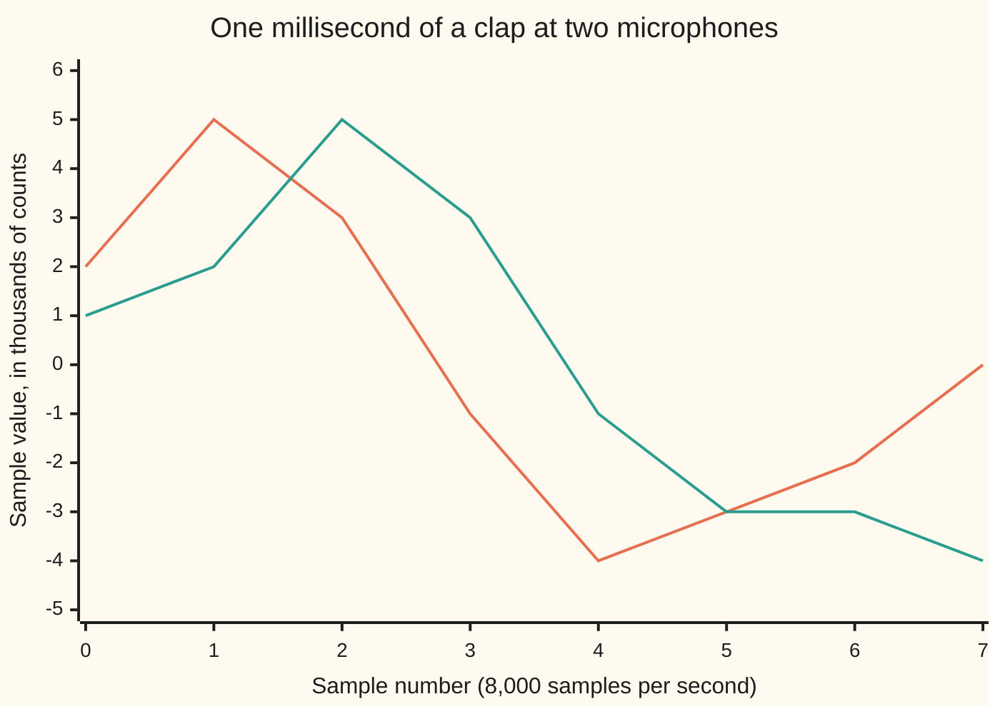
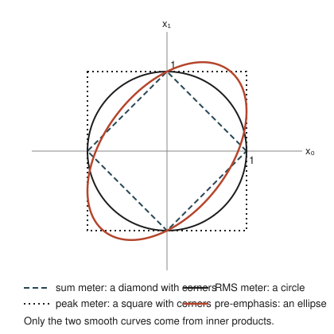

# Inner products: length and angle in a space of signals

[Syllabus](../../../SYLLABUS.md) → [Functional analysis](../README.md) → [Hilbert Spaces](../README.md#s02) → Inner products

---

## General Overview

Two microphones a few centimetres apart record one hand clap at 8,000 samples a second. Take one millisecond from each: eight samples, in thousands of counts (illustrative numbers).

- Clip A: 2, 5, 3, −1, −4, −3, −2, 0.
- Clip B: 1, 2, 5, 3, −1, −3, −3, −4.

How alike are the clips, and does one microphone hear the clap later?

Multiply the clips sample by sample and add: 43. Divide by the two clip lengths, each the square root of a sum of squares, and the score is 0.6062. Slide clip A one sample later and repeat: the score jumps to 0.9586. So B hears the clap one sample, 0.125 ms, after A. No slide can push the score above 1, and the shortfall below 1 is set exactly by B's own noise.

That "multiply and add" is an **inner product**. It gives signals lengths and angles, and the score is the cosine of the angle between two clips. The ceiling of 1 is the **Cauchy–Schwarz inequality**.

The second question runs the other way. An audio engineer has many meters that give a clip a size: the root-mean-square (RMS) meter, the peak meter, the sum of absolute values. Which ones hide an angle? A meter with a hidden inner product passes the **parallelogram law**, and the **polarization identity** then rebuilds the inner product from the meter's readings alone.

**An inner product gives every signal a length and every pair an angle; Cauchy–Schwarz keeps the angle's cosine between −1 and 1; and a size meter has an inner product behind it exactly when it passes the parallelogram law.**

**What kind of fact this is:** the inner product and the Hilbert space are definitions. Cauchy–Schwarz, the parallelogram law, the polarization identity and its converse (the Jordan–von Neumann theorem) are theorems, proved on this card in Why it works. That square-summable lists form a complete space is proved on [Riesz-Fischer](../../10-Measure%20and%20integration/07-Sizes%20of%20Functions/05-completeness-of-lp.md).

### The picture: two clips of one clap



Caption: the first line is clip A, the second is clip B. B is A one sample later, with small differences at samples 0, 5 and 7.

---

## The formula

Notation first, in words. A **vector space** is a collection of things that can be added and scaled, here clips ([Normed and Banach spaces](../01-Normed%20and%20Banach%20Spaces/01-normed-spaces-and-banach-spaces.md)). The scaling numbers are **scalars**: real, or complex once Fourier coefficients appear. The **conjugate** $`\bar\lambda`$ of a complex number $`\lambda`$ flips the sign of its imaginary part; $`i`$ is the square root of −1.

An **inner product** turns two vectors x, y into a scalar $`\langle x, y\rangle`$ by three rules, for every x, y, z and scalar $`\lambda`$:

```math
\langle y, x\rangle = \overline{\langle x, y\rangle}, \qquad \langle x,\, y + \lambda z\rangle = \langle x, y\rangle + \lambda\,\langle x, z\rangle, \qquad \langle x, x\rangle > 0 \ \text{ whenever } x \neq 0 .
```

**Read it aloud:** swapping the slots conjugates the answer; the second slot respects adding and scaling; every nonzero vector has a positive inner product with itself.

So the first slot pulls scalars out conjugated: $`\langle \lambda x, y\rangle = \bar\lambda\,\langle x, y\rangle`$. Texts differ on which slot is conjugated; this library conjugates the first, like wing 07's $`v^* w`$. On clips, $`\langle x, y\rangle = \sum_n \bar x_n\, y_n`$: conjugate each sample of x, times the matching sample of y, added over the samples n.

The **length** (norm) is $`\lVert x\rVert = \sqrt{\langle x, x\rangle}`$, the square root of the sum of squares. The RMS meter divides that sum by the number of samples before the root. That fixed rescaling changes no angle and no test below, so this card's RMS meter is the length itself. The central inequality:

```math
\lvert\langle x, y\rangle\rvert \;\le\; \lVert x\rVert\,\lVert y\rVert, \qquad \text{with equality exactly when one of } x, y \text{ is a scalar multiple of the other.}
```

**Read it aloud:** the inner product is at most the product of the two lengths in size, and reaches it only when the two vectors lie on one line.

For real vectors this defines the **angle** $`\theta`$ by $`\cos\theta = \langle x, y\rangle / (\lVert x\rVert\,\lVert y\rVert)`$, the **normalized correlation** of signal work. Clips A and B each sum to 0, so it is also the correlation of statistics.

Two identities tie the length back to the inner product:

```math
\lVert x+y\rVert^2 + \lVert x-y\rVert^2 = 2\lVert x\rVert^2 + 2\lVert y\rVert^2, \qquad \langle x, y\rangle = \frac14 \sum_{m=0}^{3} i^{-m}\, \lVert x + i^m y\rVert^2 .
```

**Read it aloud:** a parallelogram's two diagonals, squared and added, equal its four sides squared and added; and four length readings, of x plus y turned through each power of i, give the inner product.

The first is the **parallelogram law**, the second the **polarization identity**. With real scalars it shortens to $`\langle x, y\rangle = \tfrac14\big(\lVert x+y\rVert^2 - \lVert x-y\rVert^2\big)`$. The converse is the **Jordan–von Neumann theorem**: a norm comes from an inner product exactly when it obeys the parallelogram law for every pair.

A **Hilbert space** $`H`$ is a vector space with an inner product that is **complete** in its length: every sequence whose members get as close to each other as you like has a limit inside the space.

| Symbol | Plain meaning | In our example | Push it up and the answer… |
| --- | --- | --- | --- |
| $`x`$, $`y`$, $`z`$ | vectors: clips, or lists of Fourier coefficients | x is clip A (slid one sample in the split), y is clip B | — |
| $`\lambda`$, $`\bar\lambda`$, $`i`$, $`\mathrm{Re}`$ | a scalar, its conjugate, the square root of −1, the real part | the conjugate of −1 − 6i is −1 + 6i | — |
| $`\langle x, y\rangle`$ | the inner product | 43 for A and B; 68 after the slide; 98 − 25i for the frames | a closer match |
| $`\lVert x\rVert`$ | the length, square root of $`\langle x, x\rangle`$ | squared lengths 68 (A) and 74 (B) | the score divides by it |
| $`\lVert x\rVert_1`$, $`\lVert x\rVert_\infty`$, $`\lVert x\rVert_E`$ | other meters: sum of absolute values, peak, pre-emphasised energy | 20, 5 and the square root of 41 for clip A | — |
| $`\theta`$, $`\cos\theta`$ | the angle between real vectors; its cosine, the correlation | 0.6062 before the slide, 0.9586 after | 1: one clip is a positive multiple of the other |
| $`t`$, $`r`$ | in the proof: how much of x is in y, and the perpendicular remainder | t = 1; r = 1, 0, 0, 0, 0, 1, 0, −2, B's noise | a bigger r, a lower score |
| $`X_k`$, $`Y_k`$, $`k`$, $`n`$, $`x_n`$ | Fourier coefficients of the first four samples of A and of B, at frequency number k; n numbers samples, and $`x_n`$ is sample n | X = (9, −1 − 6i, 1), Y = (11, −4 + i, 1) | — |
| $`m`$; $`q`$, $`u`$, $`v`$, $`s`$ | the polarization counter, 0 to 3; in the converse proof, the candidate product built from a meter, two helper vectors and a real scale | readings 454, 308, 62, 208 | — |
| $`N`$ | the number of entries kept | 8 samples; 10 to 10,000 in the cut list | the missing energy falls like 1/N |
| $`c`$, $`c^{(N)}`$ | the list 1, 1/2, 1/3, …, and its first N entries | full energy $`\pi^2/6`$ = 1.644934 | a longer cut sits closer to $`c`$ |
| $`H`$, $`\ell^2`$ | a Hilbert space; the lists with a finite sum of squares | $`\ell^2`$ holds $`c`$; lists with finitely many nonzero entries do not | — |

### When it holds

- **For complex scalars, the first slot is conjugated.** Without it a "squared length" can be complex: the frame's coefficients give 47 + 12i instead of 119.
- **Only zero has length zero.** Otherwise the equality case of Cauchy–Schwarz fails: a remainder r of zero length need not be zero.
- **The parallelogram law holds for every pair.** The sum meter passes on A and 2A (4000 against 4000) and fails on A and B (1924 against 1768).
- **A Hilbert space is complete.** Cauchy–Schwarz and polarization need no completeness; the theorems after this card do. The cuts of 1, 1/2, 1/3, … close in on each other but have no limit among lists that stop after finitely many nonzero entries, of any length.

---

## Why it works

### Step 0: two vectors at a time live in a flat plane

Cauchy–Schwarz, the parallelogram law and polarization each involve two vectors. Two vectors span a flat plane through zero, however many samples the clips have. So each of these results is plane geometry, unchanged for 8 samples, 8,000 or infinitely many. The converse's proof in Step 5 combines three vectors, but its test, the parallelogram law, looks at one plane at a time. The working move: split y into a part along x and a remainder at a right angle to x.

### Step 1: the length of a sum

The rules expand a squared length as for arrows:

```math
\lVert x + y\rVert^2 = \lVert x\rVert^2 + \langle x, y\rangle + \langle y, x\rangle + \lVert y\rVert^2 = \lVert x\rVert^2 + 2\,\mathrm{Re}\,\langle x, y\rangle + \lVert y\rVert^2 .
```

Here $`\mathrm{Re}`$ takes the real part: the middle terms are a number and its conjugate.

### Step 2: Cauchy–Schwarz from the split

Take x not zero. Let $`t = \langle x, y\rangle / \lVert x\rVert^2`$ and $`r = y - t\,x`$. Then $`\langle x, r\rangle = \langle x, y\rangle - t\,\lVert x\rVert^2 = 0`$: the remainder is perpendicular to x. With the cross term zero, Step 1 gives Pythagoras:

```math
\lVert y\rVert^2 = \lvert t\rvert^2\,\lVert x\rVert^2 + \lVert r\rVert^2, \qquad\text{so}\qquad \lVert x\rVert^2\,\lVert y\rVert^2 - \lvert\langle x, y\rangle\rvert^2 = \lVert x\rVert^2\,\lVert r\rVert^2 \;\ge\; 0 .
```

That is Cauchy–Schwarz with its slack written out. Equality needs $`\lVert r\rVert = 0`$, so r = 0, so y is a multiple of x.

On the clips, x is A slid one sample and y is B. Then t = 68/68 = 1, and r = B − (slid A) = 1, 0, 0, 0, 0, 1, 0, −2: B's own noise. Pythagoras reads 74 = 68 + 6. The slack is 5032 − 4624 = 408 = 68 × 6. Without the slide, t = 43/68, the remainder's squared length is 46.8088 and the slack 3183.

Step 1 with Cauchy–Schwarz gives $`\lVert x+y\rVert \le \lVert x\rVert + \lVert y\rVert`$, so every inner product makes a norm.

[The dot product](../../03-Algebra/06-Dot%20Products%20and%20Best%20Fits/01-dot-product.md) proved the real case with a quadratic in a real number that cannot go negative. With complex scalars that bounds only the real part of $`\langle x, y\rangle`$; the split needs no repair.

### Step 3: complex scalars, and why the first slot is conjugated

A complex z has size $`\lvert z\rvert = \sqrt{\bar z z}`$, and $`\bar z z`$ is never negative. Plain $`z z`$ can be anything: for z = −1 − 6i it is −35 + 12i. The conjugate makes $`\langle x, x\rangle`$ a squared length.

Complex vectors arrive with Fourier coefficients. Take each clip's first four samples, a 0.5 ms frame. Its coefficient at frequency number k is

```math
X_k = \sum_{n=0}^{3} x_n\, e^{-2\pi i k n/4} = \sum_{n=0}^{3} x_n\,(-i)^{kn} .
```

For a real frame, k = 3 repeats k = 1 conjugated, so k = 0, 1, 2 carry the frame. A's frame 2, 5, 3, −1 gives X = (9, −1 − 6i, 1); B's frame 1, 2, 5, 3 gives Y = (11, −4 + i, 1).

Conjugating X: $`9 \times 11 + (-1+6i)(-4+i) + 1 \times 1 = 98 - 25i`$. The squared lengths are 81 + 37 + 1 = 119 and 121 + 17 + 1 = 139. Cauchy–Schwarz holds: $`\lvert 98 - 25i\rvert^2 = 10229`$, below 119 × 139 = 16541, slack 6312. In lengths, 101.1385 against 128.6118.

### Step 4: the parallelogram law and polarization

Write Step 1 for x + y and x − y. Adding cancels the cross terms: the parallelogram law. Subtracting leaves $`4\,\mathrm{Re}\,\langle x, y\rangle`$: real polarization. For the clips, $`\lVert A+B\rVert^2 = 228`$ and $`\lVert A-B\rVert^2 = 56`$, so 228 + 56 = 284 = 2 × 68 + 2 × 74, and (228 − 56)/4 = 43.

With complex scalars, replace y by $`i y`$. Since $`\langle x, i y\rangle = i\,\langle x, y\rangle`$, its real part is minus the imaginary part of $`\langle x, y\rangle`$. For the frames the four readings are 454, 308, 62 and 208:

- real part: (454 − 62)/4 = 98;
- imaginary part: (208 − 308)/4 = −25.

The meter alone, read four times, returns 98 − 25i.

### Step 5: the test, run backwards

Start from a meter with no inner product in sight. Define $`\langle x, y\rangle`$ by polarization and check the three rules.

- **Positive.** At y = x it gives $`\lVert x\rVert^2`$.
- **Swap.** It conjugates, because $`\lVert x - y\rVert = \lVert y - x\rVert`$ and $`\lVert x + i y\rVert = \lVert y - i x\rVert`$.
- **Adding.** The hard rule. The parallelogram law, used on two well-chosen pairs, shows that the products of x and of z with y add to twice the product of their midpoint with y. Halving then gives additivity.
- **Scaling.** Additivity gives whole multiples, then fractions; the meter changes continuously, so every real number follows, and i gives the complex part.

So one failing pair proves there is no inner product, and passing on every pair builds one. The peak meter fails at once: on the unit samples (1, 0) and (0, 1) it reads 2 for the diagonals against 4 for the sides. Its polarized "product" is not additive: 36 for A + B against B, but 12 + 25 = 37 from the parts.

<details>
<summary>Detailed proof: a norm obeying the parallelogram law comes from an inner product</summary>

**Real scalars.** Let the norm obey the parallelogram law and define

$`\displaystyle q(x, y) = \tfrac14\big(\lVert x+y\rVert^2 - \lVert x-y\rVert^2\big).`$

1. *Positive and symmetric.* $`q(x, x) = \tfrac14\lVert 2x\rVert^2 = \lVert x\rVert^2`$, and $`q(y, x) = q(x, y)`$. Also $`q(-x, y) = -q(x, y)`$ and $`q(0, y) = 0`$.
2. *Midpoint rule.* The law for $`u = \tfrac12(x+z) + y`$ and $`v = \tfrac12(x-z)`$, whose sum is x + y and difference z + y, reads

   $`\displaystyle \lVert x+y\rVert^2 + \lVert z+y\rVert^2 = 2\big\lVert \tfrac12(x+z) + y\big\rVert^2 + 2\big\lVert \tfrac12(x-z)\big\rVert^2.`$

   Subtract the same with −y for y: $`q(x, y) + q(z, y) = 2\,q\big(\tfrac12(x+z), y\big)`$.
3. *Additivity.* With z = 0, $`q(x, y) = 2\,q(\tfrac12 x, y)`$; so the midpoint rule becomes $`q(x, y) + q(z, y) = q(x + z, y)`$.
4. *Scaling.* Additivity and step 1 give $`q(s x, y) = s\,q(x, y)`$ for whole numbers s, then fractions. The norm is continuous (by the triangle rule it moves by at most the length of the change), so both sides are continuous in s and agree for every real s.

So q is an inner product whose length is the given norm. ∎

**Complex scalars.** Define $`\langle x, y\rangle = q(x, y) + i\,q(i x, y)`$, which is the formula's polarization identity. Because $`\lVert i x\rVert = \lVert x\rVert`$, $`q(i x, i y) = q(x, y)`$ and $`q(i x, y) = -q(x, i y)`$. Then:

- $`\langle i x, y\rangle = q(i x, y) + i\,q(-x, y) = -i\,\langle x, y\rangle`$, so the first slot pulls out $`\bar i = -i`$;
- $`\langle y, x\rangle = q(x, y) - i\,q(i x, y)`$, the conjugate of $`\langle x, y\rangle`$;
- $`\langle x, x\rangle = \lVert x\rVert^2`$, since $`q(i x, x) = \tfrac14\big(\lVert (1+i) x\rVert^2 - \lVert (i-1) x\rVert^2\big) = 0`$.

Additivity and real scaling carry over from q. ∎

</details>

### Step 6: the picture, a round ball means a hidden inner product

A meter's **unit ball** is the set of vectors it reads as 1 or less. On two-sample clips the balls can be drawn, here to scale.

<p align="center"></p>

Caption: the diamond is the sum meter, radius 0.7071 on the diagonals. The square is the peak meter, radius 1.4142 on the diagonals. The circle is the RMS meter, radius 1 everywhere. The tilted ellipse is the pre-emphasis meter, half-axes 1.2808 and 0.7808, long axis at 52.0 degrees.

An inner product's squared length on a plane is a weighted sum of squares and a cross product, whose ball is an ellipse. The parallelogram law looks at one plane at a time. So a norm comes from an inner product exactly when every flat slice of its ball through zero is an ellipse. Corners give a meter away.

**Pre-emphasis**, used in speech processing to lift high frequencies, replaces each sample by $`x_n - \tfrac12 x_{n-1}`$ (nothing before sample 0). The meter $`\lVert x\rVert_E`$ is the root of the sum of squares of the result. Its definition never says "inner product", yet it passes the law on the clips exactly: 163 against 163.

Polarization then finds the hidden inner product: 18.25 on A and B, the same as multiplying the two pre-emphasised clips sample by sample. Polarizing single-sample clips finds the hidden weights. On three samples they are 5/4 on the diagonal (1 for the last), −1/2 between neighbours and 0 elsewhere. On two samples the meter reads $`\tfrac54 x_0^2 - x_0 x_1 + x_1^2`$: the tilted ellipse.

### Step 7: from lists to infinite lists, and the Hilbert space

Let the clip grow to 8,000 samples, a whole second. The inner product is the same sum with more terms, and by Step 0 nothing above changes.

Infinitely many entries are different. A clip with a sudden jump in level has Fourier coefficients falling roughly like 1/n. Take the list $`c = (1, \tfrac12, \tfrac13, \dots)`$ as a stand-in and cut it to its first N entries, $`c^{(N)}`$.

| N | energy kept, $`\lVert c^{(N)}\rVert^2`$ | N times the energy missing | distance from $`c^{(N)}`$ to $`c^{(2N)}`$ |
| ---: | ---: | ---: | ---: |
| 10 | 1.549768 | 0.9517 | 0.215396 |
| 100 | 1.634984 | 0.9950 | 0.070446 |
| 1,000 | 1.643935 | 0.9995 | 0.022352 |
| 10,000 | 1.644834 | 1.0000 | 0.007071 |

The full energy is $`\pi^2/6`$ = 1.644934, and the missing part falls like 1/N. The cuts close in on each other, but what they close in on has infinitely many nonzero entries. So the lists that stop after finitely many nonzero entries, of any length, have a hole where $`c`$ should be, with this inner product: they are not complete.

The space $`\ell^2`$ of lists with a finite sum of squares fills the hole. It is L2 for counting measure on the whole numbers, the model space of [L2 as a Hilbert space](../../10-Measure%20and%20integration/07-Sizes%20of%20Functions/06-l2-as-a-hilbert-space.md), which [Riesz-Fischer](../../10-Measure%20and%20integration/07-Sizes%20of%20Functions/05-completeness-of-lp.md) proves complete. A complete inner product space is a **Hilbert space**: clips of any fixed length N, $`\ell^2`$, and L2 of an interval are; lists that stop after finitely many nonzero entries, and continuous functions with the L2 length, are not.

What the truncation hides: every space of N-entry lists is complete, so no computation at fixed N shows the hole. It shows only as a trend over N whose limit has infinitely many nonzero entries.

---

## Worked numbers, by hand

Clips A and B, real scalars.

| Step | Arithmetic | Value |
| --- | --- | --- |
| inner product, no slide | 2 + 10 + 15 − 3 + 4 + 9 + 6 + 0 | 43 |
| squared lengths | 4 + 25 + 9 + 1 + 16 + 9 + 4 + 0; 1 + 4 + 25 + 9 + 1 + 9 + 9 + 16 | 68; 74 |
| Cauchy–Schwarz ceiling | square root of 68 × 74 = 5032 | 70.9366 |
| score, no slide | 43 / 70.9366 | 0.6062 |
| A slid one sample | 0, 2, 5, 3, −1, −4, −3, −2 (the dropped sample was 0) | squared length 68 |
| inner product after the slide | 0 + 4 + 25 + 9 + 1 + 12 + 9 + 8 | 68 |
| score after the slide | 68 / 70.9366 | **0.9586** |
| split | t = 68/68; r = B minus slid A | t = 1; r = 1, 0, 0, 0, 0, 1, 0, −2 |
| Pythagoras | 68 + (1 + 1 + 4) | 74 |
| slack | 5032 − 68 × 68 | 408 = 68 × 6 |
| polarization | (228 − 56) / 4 | 43 |
| parallelogram, peak meter | peaks 8, 4 for A + B, A − B and 5, 5 for A, B: 64 + 16 against 2 × 25 + 2 × 25 | 80 against 100 |

B is A heard one sample (0.125 ms) later, plus noise, and the shortfall of 0.9586 below 1 comes from the noise alone: squared length 6 against A's 68. Other slides score lower, 0.7120 at two samples and 0.1724 at three; each divides by the slid clip's own length, the square root of 64 and of 55.

### What breaks if you drop a piece

| Mistake | Comes out at | What went wrong |
| --- | --- | --- |
| Dropping the conjugate on the frame's coefficients | a "squared length" of 47 + 12i, not 119 | a squared length must be real and not negative |
| Real polarization on complex coefficients | 98, not 98 − 25i | only the real part survives; the phase is lost |
| Polarizing the peak meter | 36 for A + B against B, 12 + 25 = 37 from the parts | not additive: no inner product exists |
| Testing the law on one pair | sum meter: 4000 against 4000 on A and 2A; 1924 against 1768 on A and B | a pair on one line passes every norm |

---

## Code, from first principles, and it actually runs

The code works the clips exactly: fractions in Python, integers and Gaussian integers (complex numbers with whole-number parts) in Rust. Its roads: inner products summed directly and rebuilt by polarization from meter readings; Cauchy–Schwarz against the split y = t x + r, whose slack must equal the remainder's energy; the parallelogram law on four meters on the clips, and three of them on 2000 random complex pairs (SplitMix64, seed 20261115); the pre-emphasis inner product by polarization against the filtered clips; the cut lists against $`\pi^2/6`$. Code checks instances; the proofs cover every pair and every dimension.

### Python

```python
# Inner products and Hilbert spaces -- the check behind the card.  Standard library only.
# Two 8-sample clips (thousands of counts, 8,000 samples a second): B hears A one sample
# late, plus a little noise.  Roads: inner products summed directly; Cauchy-Schwarz rebuilt
# from the split y = t x + r; polarization from meter readings alone; the parallelogram law
# on four meters, exact and on random pairs; truncations of 1/n against pi^2/6.
from fractions import Fraction as Fr
import math

A, B = [2, 5, 3, -1, -4, -3, -2, 0], [1, 2, 5, 3, -1, -3, -3, -4]
ip = lambda x, y: sum(a.conjugate() * b for a, b in zip(x, y))   # conjugate the first slot
sq2 = lambda x: ip(x, x).real                                    # squared RMS-type length
n2, n1 = lambda x: math.sqrt(sq2(x)), lambda x: sum(abs(a) for a in x)
npk = lambda x: max(abs(a) for a in x)                           # the peak meter
pre = lambda x: [Fr(a) - Fr(b, 2) for a, b in zip(x, [0] + x[:-1])]
sqE = lambda x: sum(a * a for a in pre(x))                       # pre-emphasised energy
add = lambda x, y, c=1: [a + c * b for a, b in zip(x, y)]
shift = lambda x, k: [0] * k + x[:len(x) - k]
f4 = lambda v: f"{v:.4f}"
cx = lambda z: f"{int(z.real)}{'+' if z.imag >= 0 else '-'}{abs(int(z.imag))}i"
I = [1, 1j, -1, -1j]                                             # i to the powers 0, 1, 2, 3

# 1. correlation of the two clips at each lag: the cosine of the angle between them
print("lag,inner product,squared lengths,correlation")
for k in range(4):
    x = shift(A, k)
    print(f"lag {k},{ip(x, B)},{sq2(x):.0f} {sq2(B):.0f},{f4(ip(x, B) / (n2(x) * n2(B)))}")
best = max(range(4), key=lambda k: ip(shift(A, k), B) / n2(shift(A, k)))
print(f"delay,{best} sample,{1000 * best / 8000:.3f} ms")
assert best == 1                                                 # B is A, one sample late
# 2. Cauchy-Schwarz as a split: B = t (shifted A) + r with r perpendicular to shifted A
for k in (0, 1):
    x = shift(A, k)
    t = Fr(ip(x, B), ip(x, x)); r = [b - t * a for a, b in zip(x, B)]
    assert ip(x, r) == 0 and sq2(B) == sq2(r) + t * t * sq2(x)   # Pythagoras, exactly
    gap = sq2(x) * sq2(B) - ip(x, B) ** 2
    assert gap == sq2(x) * sq2(r)                                # the slack is the remainder
    print(f"split lag {k},t {t},r squared {float(sq2(r)):.4f},bound {f4(n2(x) * n2(B))},gap {gap} = {sq2(x) * sq2(B)} - {ip(x, B) ** 2}")
print("lag 1 remainder,", [int(a) for a in r])
assert r == [1, 0, 0, 0, 0, 1, 0, -2]                            # the noise, recovered
# 3. polarization: the inner product from four meter readings, real and complex
S, D = add(A, B), add(A, B, -1)
print(f"polarize real,{sq2(S)} {sq2(D)},{(sq2(S) - sq2(D)) // 4}")
assert (sq2(S) - sq2(D)) / 4 == ip(A, B) == 43
dft = lambda x: [sum(a * I[(-k * n) % 4] for n, a in enumerate(x)) for k in range(3)]
X, Y = dft(A[:4]), dft(B[:4])                                   # half-spectrum of the first frame
print("frame coefficients,", " ".join(cx(z) for z in X), "|", " ".join(cx(z) for z in Y))
reads = [sq2(add(X, Y, I[m])) for m in range(4)]
pol = sum(I[-m % 4] * reads[m] for m in range(4)) / 4
print("polarize complex,", " ".join(f"{v:.0f}" for v in reads), cx(pol), "direct", cx(ip(X, Y)))
assert pol == ip(X, Y) == 98 - 25j                              # four lengths give the product
z = ip(X, Y)
print(f"complex CS,squared lengths {sq2(X):.0f} {sq2(Y):.0f},{abs(z) ** 2:.0f} {sq2(X) * sq2(Y):.0f},gap {sq2(X) * sq2(Y) - abs(z) ** 2:.0f},{f4(abs(z))} {f4(n2(X) * n2(Y))}")
assert abs(z) ** 2 < sq2(X) * sq2(Y)
print("no conjugate,", cx(X[1] * X[1]), "|", cx(sum(a * a for a in X)), "against", f"{sq2(X):.0f}",
      "| real polarization,", f"{(sq2(add(X, Y)) - sq2(add(X, Y, -1))) / 4:.0f}")
# 4. the parallelogram test on four meters, on the clips and on the two unit samples
E0, E1 = [1, 0], [0, 1]
print("meters on A B A+B A-B,sum", " ".join(str(n1(v)) for v in (A, B, S, D)) + ",peak", " ".join(str(npk(v)) for v in (A, B, S, D)))
for name, nm in (("RMS", sq2), ("pre-emphasis", sqE), ("sum", lambda x: n1(x) ** 2), ("peak", lambda x: npk(x) ** 2)):
    lhs, rhs = nm(S) + nm(D), 2 * nm(A) + 2 * nm(B)
    l0, r0 = nm(add(E0, E1)) + nm(add(E0, E1, -1)), 2 * nm(E0) + 2 * nm(E1)
    print(f"parallelogram {name},clips {float(lhs):.2f} vs {float(rhs):.2f},unit samples {float(l0):.2f} vs {float(r0):.2f}")
assert n1(S) ** 2 + n1(D) ** 2 == 1924 and npk(S) ** 2 + npk(D) ** 2 == 80   # both fail
print("one lucky pair (A and 2A), sum meter,", n1(add(A, A, 2)) ** 2 + n1(add(A, A, -2)) ** 2,
      2 * n1(A) ** 2 + 2 * n1(add(A, A)) ** 2)
pk = lambda x, y: Fr(npk(add(x, y)) ** 2 - npk(add(x, y, -1)) ** 2, 4)
print(f"polarized peak,A B {pk(A, B)},A+B B {pk(add(A, B), B)},B B {pk(B, B)},sum of parts {pk(A, B) + pk(B, B)}")
assert pk(add(A, B), B) != pk(A, B) + pk(B, B)                  # not additive: no inner product
# 5. the pre-emphasis meter's hidden inner product, recovered by polarization
pE = lambda x, y: (sqE(add(x, y)) - sqE(add(x, y, -1))) / 4
direct = sum(a * b for a, b in zip(pre(A), pre(B)))
G = [[pE([int(i == j) for j in range(3)], [int(k == j) for j in range(3)]) for k in range(3)] for i in range(3)]
print("pre-emphasis,", f"{float(sqE(A)):.2f} {float(sqE(B)):.2f}", f"polarized {float(pE(A, B)):.2f} direct {float(direct):.2f}")
print("pre-emphasis Gram, three samples,", " | ".join(" ".join(str(g) for g in row) for row in G))
assert pE(A, B) == direct and G[0][0] == Fr(5, 4) and G[0][1] == Fr(-1, 2) and G[0][2] == 0
# 6. random pairs from SplitMix64, seed 20261115: worst Cauchy-Schwarz ratio, worst law defect
st = [20261115]
def rnd():
    st[0] = (st[0] + 0x9E3779B97F4A7C15) % 2 ** 64; z = st[0]
    z = ((z ^ (z >> 30)) * 0xBF58476D1CE4E5B9) % 2 ** 64; z = ((z ^ (z >> 27)) * 0x94D049BB133111EB) % 2 ** 64
    return (z ^ (z >> 31)) >> 11
u = lambda: rnd() / 2 ** 52 - 1.0
worst, dfl = 0.0, {"RMS": 0.0, "sum": 0.0, "peak": 0.0}
for _ in range(2000):
    x = [complex(u(), u()) for _ in range(8)]; y = [complex(u(), u()) for _ in range(8)]
    worst = max(worst, abs(ip(x, y)) / (n2(x) * n2(y)))
    for name, nm in (("RMS", n2), ("sum", n1), ("peak", npk)):
        q = nm(add(x, y)) ** 2 + nm(add(x, y, -1)) ** 2 - 2 * nm(x) ** 2 - 2 * nm(y) ** 2
        dfl[name] = max(dfl[name], abs(q) / (nm(x) ** 2 + nm(y) ** 2))
print(f"random 2000 complex pairs,worst ratio {f4(worst)},law defect RMS sum peak {f4(dfl['RMS'])} {f4(dfl['sum'])} {f4(dfl['peak'])}")
assert worst < 1 and dfl["RMS"] < 1e-12 and dfl["sum"] > 0.1 and dfl["peak"] > 0.1
# 7. completeness: the list 1, 1/2, 1/3, ... cut at N; the cuts settle, the limit is not a finite list
full = math.pi * math.pi / 6
for N in (10, 100, 1000, 10000):
    sN = sum(1 / (n * n) for n in range(1, N + 1)); gapN = sum(1 / (n * n) for n in range(N + 1, 2 * N + 1))
    print(f"truncate N {N},energy {sN:.6f},N times missing {N * (full - sN):.4f},distance to 2N {math.sqrt(gapN):.6f}")
    assert abs(N * (full - sN) - 1) < 1.0 / N                    # the missing energy is about 1/N
print(f"limit energy pi^2/6,{full:.6f}")
# 8. figure: unit balls of four meters on two samples, radius in four directions
h = math.sqrt(0.5)
nE2 = lambda v: math.sqrt(v[0] * v[0] + (v[1] - v[0] / 2) * (v[1] - v[0] / 2))
for name, nm in (("sum", n1), ("RMS", n2), ("peak", npk), ("pre-emphasis", nE2)):
    print(f"figure,{name} radius at 0 45 90 135 degrees," + " ".join(f4(1 / nm(d)) for d in ([1.0, 0.0], [h, h], [0.0, 1.0], [-h, h])))
lo, hi = (9 - math.sqrt(17)) / 8, (9 + math.sqrt(17)) / 8         # eigenvalues of [[5/4,-1/2],[-1/2,1]]
ax = [1.0, 2 * (1.25 - lo)]; ax = [a / math.sqrt(ax[0] ** 2 + ax[1] ** 2) for a in ax]
print(f"figure,pre-emphasis ellipse semi-axes {f4(1 / math.sqrt(lo))} {f4(1 / math.sqrt(hi))},tilt {math.degrees(math.atan2(ax[1], ax[0])):.1f} degrees")
assert abs(1 / nE2(ax) - 1 / math.sqrt(lo)) < 1e-12               # eigen formula meets the meter
# 9. try changing: the speech-standard coefficient 0.97; a 4-power meter
pre97 = lambda x: sum((Fr(a) - Fr(97 * b, 100)) ** 2 for a, b in zip(x, [0] + x[:-1]))
print(f"try coefficient 0.97,clips {float(pre97(S) + pre97(D)):.4f} vs {float(2 * pre97(A) + 2 * pre97(B)):.4f}")
assert pre97(S) + pre97(D) == 2 * pre97(A) + 2 * pre97(B)        # any fixed filter keeps the law
n4sq = lambda x: math.sqrt(sum(a ** 4 for a in x))
print(f"try 4-power meter,clips {n4sq(S) + n4sq(D):.2f} vs {2 * n4sq(A) + 2 * n4sq(B):.2f}")
print("ALL CHECKS PASS")
```

**Ran 2026-11-15 on macOS, Python 3.14.10, standard library only. All checks passed. Output, pasted from the run:**

```
lag,inner product,squared lengths,correlation
lag 0,43,68 74,0.6062
lag 1,68,68 74,0.9586
lag 2,49,64 74,0.7120
lag 3,11,55 74,0.1724
delay,1 sample,0.125 ms
split lag 0,t 43/68,r squared 46.8088,bound 70.9366,gap 3183 = 5032 - 1849
split lag 1,t 1,r squared 6.0000,bound 70.9366,gap 408 = 5032 - 4624
lag 1 remainder, [1, 0, 0, 0, 0, 1, 0, -2]
polarize real,228 56,43
frame coefficients, 9+0i -1-6i 1+0i | 11+0i -4+1i 1+0i
polarize complex, 454 308 62 208 98-25i direct 98-25i
complex CS,squared lengths 119 139,10229 16541,gap 6312,101.1385 128.6118
no conjugate, -35+12i | 47+12i against 119 | real polarization, 98
meters on A B A+B A-B,sum 20 22 40 18,peak 5 5 8 4
parallelogram RMS,clips 284.00 vs 284.00,unit samples 4.00 vs 4.00
parallelogram pre-emphasis,clips 163.00 vs 163.00,unit samples 4.50 vs 4.50
parallelogram sum,clips 1924.00 vs 1768.00,unit samples 8.00 vs 4.00
parallelogram peak,clips 80.00 vs 100.00,unit samples 2.00 vs 4.00
one lucky pair (A and 2A), sum meter, 4000 4000
polarized peak,A B 12,A+B B 36,B B 25,sum of parts 37
pre-emphasis, 41.00 40.50 polarized 18.25 direct 18.25
pre-emphasis Gram, three samples, 5/4 -1/2 0 | -1/2 5/4 -1/2 | 0 -1/2 1
random 2000 complex pairs,worst ratio 0.8438,law defect RMS sum peak 0.0000 0.5831 1.6415
truncate N 10,energy 1.549768,N times missing 0.9517,distance to 2N 0.215396
truncate N 100,energy 1.634984,N times missing 0.9950,distance to 2N 0.070446
truncate N 1000,energy 1.643935,N times missing 0.9995,distance to 2N 0.022352
truncate N 10000,energy 1.644834,N times missing 1.0000,distance to 2N 0.007071
limit energy pi^2/6,1.644934
figure,sum radius at 0 45 90 135 degrees,1.0000 0.7071 1.0000 0.7071
figure,RMS radius at 0 45 90 135 degrees,1.0000 1.0000 1.0000 1.0000
figure,peak radius at 0 45 90 135 degrees,1.0000 1.4142 1.0000 1.4142
figure,pre-emphasis radius at 0 45 90 135 degrees,0.8944 1.2649 1.0000 0.7845
figure,pre-emphasis ellipse semi-axes 1.2808 0.7808,tilt 52.0 degrees
try coefficient 0.97,clips 164.1468 vs 164.1468
try 4-power meter,clips 123.24 vs 133.19
ALL CHECKS PASS
```

### Rust

```rust
// Inner products and Hilbert spaces -- the check behind the card.  std only, no crates.
// Two 8-sample clips (thousands of counts, 8,000 samples a second): B hears A one sample
// late, plus a little noise.  Roads: inner products summed directly; Cauchy-Schwarz rebuilt
// from the split y = t x + r; polarization from meter readings alone; the parallelogram law
// on four meters, exact and on random pairs; truncations of 1/n against pi^2/6.
// Exact work uses integers (pre-emphasis scaled by 4) and Gaussian integers (re, im).

const A: [i64; 8] = [2, 5, 3, -1, -4, -3, -2, 0];
const B: [i64; 8] = [1, 2, 5, 3, -1, -3, -3, -4];

fn ip(x: &[i64], y: &[i64]) -> i64 { x.iter().zip(y).map(|(a, b)| a * b).sum() }
fn add(x: &[i64], y: &[i64], c: i64) -> Vec<i64> { x.iter().zip(y).map(|(a, b)| a + c * b).collect() }
fn shift(x: &[i64], k: usize) -> Vec<i64> { let mut v = vec![0; k]; v.extend_from_slice(&x[..x.len() - k]); v }
fn n1(x: &[i64]) -> i64 { x.iter().map(|a| a.abs()).sum() }
fn npk(x: &[i64]) -> i64 { x.iter().map(|a| a.abs()).max().unwrap() }
fn sqe4(x: &[i64]) -> i64 { (0..x.len()).map(|n| { let d = 2 * x[n] - if n > 0 { x[n - 1] } else { 0 }; d * d }).sum() }
fn gcd(a: i64, b: i64) -> i64 { if b == 0 { a.abs() } else { gcd(b, a % b) } }
fn frac(n: i64, d: i64) -> String { let g = gcd(n, d); let (n, d) = (n / g, d / g); if d == 1 { format!("{}", n) } else { format!("{}/{}", n, d) } }
fn f4(v: f64) -> String { format!("{:.4}", v) }

#[derive(Clone, Copy, PartialEq, Debug)]
struct G { re: i64, im: i64 }                                     // a Gaussian integer re + im i
fn gm(a: G, b: G) -> G { G { re: a.re * b.re - a.im * b.im, im: a.re * b.im + a.im * b.re } }
fn gc(a: G) -> G { G { re: a.re, im: -a.im } }
fn gip(x: &[G], y: &[G]) -> G { x.iter().zip(y).fold(G { re: 0, im: 0 }, |s, (a, b)| { let p = gm(gc(*a), *b); G { re: s.re + p.re, im: s.im + p.im } }) }
fn gsq(x: &[G]) -> i64 { gip(x, x).re }
fn gadd(x: &[G], y: &[G], c: G) -> Vec<G> { x.iter().zip(y).map(|(a, b)| { let p = gm(c, *b); G { re: a.re + p.re, im: a.im + p.im } }).collect() }
fn cx(z: G) -> String { format!("{}{}{}i", z.re, if z.im >= 0 { "+" } else { "-" }, z.im.abs()) }
const I: [G; 4] = [G { re: 1, im: 0 }, G { re: 0, im: 1 }, G { re: -1, im: 0 }, G { re: 0, im: -1 }];

#[derive(Clone, Copy)]
struct C { re: f64, im: f64 }                                     // a float complex number
fn cip(x: &[C], y: &[C]) -> C {
    let mut s = C { re: 0.0, im: 0.0 };
    for (a, b) in x.iter().zip(y) { let (ar, ai) = (a.re, -a.im); s.re += ar * b.re - ai * b.im; s.im += ar * b.im + ai * b.re; }
    s
}
fn cn2(x: &[C]) -> f64 { cip(x, x).re.sqrt() }
fn cn1(x: &[C]) -> f64 { x.iter().fold(0.0, |s, a| s + a.re.hypot(a.im)) }
fn cpk(x: &[C]) -> f64 { x.iter().fold(0.0f64, |m, a| m.max(a.re.hypot(a.im))) }
fn cadd(x: &[C], y: &[C], c: f64) -> Vec<C> { x.iter().zip(y).map(|(a, b)| C { re: a.re + c * b.re, im: a.im + c * b.im }).collect() }

fn main() {
    // 1. correlation of the two clips at each lag: the cosine of the angle between them
    println!("lag,inner product,squared lengths,correlation");
    let mut best = 0; let mut bv = f64::MIN;
    for k in 0..4 {
        let x = shift(&A, k);
        let (p, xx, bb) = (ip(&x, &B), ip(&x, &x), ip(&B, &B));
        println!("lag {},{},{} {},{}", k, p, xx, bb, f4(p as f64 / ((xx as f64).sqrt() * (bb as f64).sqrt())));
        let v = p as f64 / (xx as f64).sqrt(); if v > bv { bv = v; best = k; }
    }
    println!("delay,{} sample,{:.3} ms", best, 1000.0 * best as f64 / 8000.0);
    assert!(best == 1);
    // 2. Cauchy-Schwarz as a split: B = t (shifted A) + r, t = p/q, so q r = q B - p x in integers
    let mut r = vec![];
    for k in 0..2 {
        let x = shift(&A, k);
        let (p, q) = (ip(&x, &B), ip(&x, &x)); let g = gcd(p, q); let (p, q) = (p / g, q / g);
        let qr: Vec<i64> = B.iter().zip(&x).map(|(b, a)| q * b - p * a).collect();
        assert!(ip(&x, &qr) == 0 && q * q * ip(&B, &B) == ip(&qr, &qr) + p * p * ip(&x, &x));
        let gap = ip(&x, &x) * ip(&B, &B) - ip(&x, &B).pow(2);
        assert!(gap * q * q == ip(&x, &x) * ip(&qr, &qr));
        println!("split lag {},t {},r squared {},bound {},gap {} = {} - {}", k, frac(p, q), f4(gap as f64 / ip(&x, &x) as f64),
                 f4(((ip(&x, &x) * ip(&B, &B)) as f64).sqrt()), gap, ip(&x, &x) * ip(&B, &B), ip(&x, &B).pow(2));
        r = qr.iter().map(|v| v / q).collect();
    }
    println!("lag 1 remainder, {:?}", r);
    assert!(r == vec![1, 0, 0, 0, 0, 1, 0, -2]);
    // 3. polarization: the inner product from four meter readings, real and complex
    let (s, d) = (add(&A, &B, 1), add(&A, &B, -1));
    println!("polarize real,{} {},{}", ip(&s, &s), ip(&d, &d), (ip(&s, &s) - ip(&d, &d)) / 4);
    assert!(ip(&s, &s) - ip(&d, &d) == 4 * 43 && ip(&A, &B) == 43);
    let dft = |x: &[i64]| -> Vec<G> { (0..3).map(|k: i64| x.iter().enumerate().fold(G { re: 0, im: 0 }, |z, (n, a)| {
        let w = I[((-k * n as i64).rem_euclid(4)) as usize]; G { re: z.re + a * w.re, im: z.im + a * w.im } })).collect() };
    let (xf, yf) = (dft(&A[..4]), dft(&B[..4]));
    println!("frame coefficients, {} | {}", xf.iter().map(|z| cx(*z)).collect::<Vec<_>>().join(" "), yf.iter().map(|z| cx(*z)).collect::<Vec<_>>().join(" "));
    let reads: Vec<i64> = (0..4).map(|m| gsq(&gadd(&xf, &yf, I[m]))).collect();
    let mut pol = G { re: 0, im: 0 };
    for m in 0..4 { let w = I[(4 - m) % 4]; pol = G { re: pol.re + w.re * reads[m], im: pol.im + w.im * reads[m] }; }
    assert!(pol.re % 4 == 0 && pol.im % 4 == 0);
    let pol = G { re: pol.re / 4, im: pol.im / 4 }; let z = gip(&xf, &yf);
    println!("polarize complex, {} {} direct {}", reads.iter().map(|v| v.to_string()).collect::<Vec<_>>().join(" "), cx(pol), cx(z));
    assert!(pol == z && z == G { re: 98, im: -25 });
    let (zz, pr) = (z.re * z.re + z.im * z.im, gsq(&xf) * gsq(&yf));
    println!("complex CS,squared lengths {} {},{} {},gap {},{} {}", gsq(&xf), gsq(&yf), zz, pr, pr - zz, f4((zz as f64).sqrt()), f4((pr as f64).sqrt()));
    assert!(zz < pr);
    let nc = xf.iter().fold(G { re: 0, im: 0 }, |s, a| { let p = gm(*a, *a); G { re: s.re + p.re, im: s.im + p.im } });
    let one = G { re: 1, im: 0 }; let mone = G { re: -1, im: 0 };
    println!("no conjugate, {} | {} against {} | real polarization, {}", cx(gm(xf[1], xf[1])), cx(nc), gsq(&xf), (gsq(&gadd(&xf, &yf, one)) - gsq(&gadd(&xf, &yf, mone))) / 4);
    // 4. the parallelogram test on four meters, on the clips and on the two unit samples
    let (e0, e1) = ([1i64, 0], [0i64, 1]);
    let vs = [A.to_vec(), B.to_vec(), s.clone(), d.clone()];
    println!("meters on A B A+B A-B,sum {},peak {}", vs.iter().map(|v| n1(v).to_string()).collect::<Vec<_>>().join(" "), vs.iter().map(|v| npk(v).to_string()).collect::<Vec<_>>().join(" "));
    let meters: [(&str, fn(&[i64]) -> f64); 4] = [("RMS", |x| ip(x, x) as f64), ("pre-emphasis", |x| sqe4(x) as f64 / 4.0),
        ("sum", |x| (n1(x) * n1(x)) as f64), ("peak", |x| (npk(x) * npk(x)) as f64)];
    for (name, nm) in meters.iter() {
        let (lhs, rhs) = (nm(&s) + nm(&d), 2.0 * nm(&A) + 2.0 * nm(&B));
        let (l0, r0) = (nm(&add(&e0, &e1, 1)) + nm(&add(&e0, &e1, -1)), 2.0 * nm(&e0) + 2.0 * nm(&e1));
        println!("parallelogram {},clips {:.2} vs {:.2},unit samples {:.2} vs {:.2}", name, lhs, rhs, l0, r0);
    }
    assert!(n1(&s).pow(2) + n1(&d).pow(2) == 1924 && npk(&s).pow(2) + npk(&d).pow(2) == 80);
    println!("one lucky pair (A and 2A), sum meter, {} {}", n1(&add(&A, &A, 2)).pow(2) + n1(&add(&A, &A, -2)).pow(2), 2 * n1(&A).pow(2) + 2 * n1(&add(&A, &A, 1)).pow(2));
    let pk4 = |x: &[i64], y: &[i64]| npk(&add(x, y, 1)).pow(2) - npk(&add(x, y, -1)).pow(2);   // 4 times the polarized peak
    let ab = add(&A, &B, 1);
    println!("polarized peak,A B {},A+B B {},B B {},sum of parts {}", frac(pk4(&A, &B), 4), frac(pk4(&ab, &B), 4), frac(pk4(&B, &B), 4), frac(pk4(&A, &B) + pk4(&B, &B), 4));
    assert!(pk4(&ab, &B) != pk4(&A, &B) + pk4(&B, &B));
    // 5. the pre-emphasis meter's hidden inner product, recovered by polarization (scaled by 16)
    let pe16 = |x: &[i64], y: &[i64]| sqe4(&add(x, y, 1)) - sqe4(&add(x, y, -1));
    let fa: Vec<i64> = (0..8).map(|n| 2 * A[n] - if n > 0 { A[n - 1] } else { 0 }).collect();
    let fb: Vec<i64> = (0..8).map(|n| 2 * B[n] - if n > 0 { B[n - 1] } else { 0 }).collect();
    println!("pre-emphasis, {:.2} {:.2} polarized {:.2} direct {:.2}", sqe4(&A) as f64 / 4.0, sqe4(&B) as f64 / 4.0, pe16(&A, &B) as f64 / 16.0, ip(&fa, &fb) as f64 / 4.0);
    let e = |i: usize| -> Vec<i64> { (0..3).map(|j| (i == j) as i64).collect() };
    let gram: Vec<Vec<i64>> = (0..3).map(|i| (0..3).map(|k| pe16(&e(i), &e(k))).collect()).collect();
    println!("pre-emphasis Gram, three samples, {}", gram.iter().map(|row| row.iter().map(|g| frac(*g, 16)).collect::<Vec<_>>().join(" ")).collect::<Vec<_>>().join(" | "));
    assert!(pe16(&A, &B) == 4 * ip(&fa, &fb) && gram[0][0] == 20 && gram[0][1] == -8 && gram[0][2] == 0);
    // 6. random pairs from SplitMix64, seed 20261115: worst Cauchy-Schwarz ratio, worst law defect
    let mut st: u64 = 20261115;
    let mut rnd = || { st = st.wrapping_add(0x9E3779B97F4A7C15); let mut z = st;
        z = (z ^ (z >> 30)).wrapping_mul(0xBF58476D1CE4E5B9); z = (z ^ (z >> 27)).wrapping_mul(0x94D049BB133111EB);
        ((z ^ (z >> 31)) >> 11) as f64 / 4503599627370496.0 - 1.0 };
    let (mut worst, mut dfl) = (0.0f64, [0.0f64; 3]);
    let cm: [fn(&[C]) -> f64; 3] = [cn2, cn1, cpk];
    for _ in 0..2000 {
        let x: Vec<C> = (0..8).map(|_| { let re = rnd(); C { re, im: rnd() } }).collect();
        let y: Vec<C> = (0..8).map(|_| { let re = rnd(); C { re, im: rnd() } }).collect();
        let z = cip(&x, &y); worst = worst.max(z.re.hypot(z.im) / (cn2(&x) * cn2(&y)));
        for (j, nm) in cm.iter().enumerate() {
            let q = nm(&cadd(&x, &y, 1.0)).powi(2) + nm(&cadd(&x, &y, -1.0)).powi(2) - 2.0 * nm(&x).powi(2) - 2.0 * nm(&y).powi(2);
            dfl[j] = dfl[j].max(q.abs() / (nm(&x).powi(2) + nm(&y).powi(2)));
        }
    }
    println!("random 2000 complex pairs,worst ratio {},law defect RMS sum peak {} {} {}", f4(worst), f4(dfl[0]), f4(dfl[1]), f4(dfl[2]));
    assert!(worst < 1.0 && dfl[0] < 1e-12 && dfl[1] > 0.1 && dfl[2] > 0.1);
    // 7. completeness: the list 1, 1/2, 1/3, ... cut at N; the cuts settle, the limit is not a finite list
    let full = std::f64::consts::PI * std::f64::consts::PI / 6.0;
    for n in [10u64, 100, 1000, 10000] {
        let sn: f64 = (1..=n).map(|k| 1.0 / ((k * k) as f64)).fold(0.0, |a, b| a + b);
        let gapn: f64 = (n + 1..=2 * n).map(|k| 1.0 / ((k * k) as f64)).fold(0.0, |a, b| a + b);
        println!("truncate N {},energy {:.6},N times missing {},distance to 2N {:.6}", n, sn, f4(n as f64 * (full - sn)), gapn.sqrt());
        assert!((n as f64 * (full - sn) - 1.0).abs() < 1.0 / n as f64);
    }
    println!("limit energy pi^2/6,{:.6}", full);
    // 8. figure: unit balls of four meters on two samples, radius in four directions
    let h = 0.5f64.sqrt();
    let ne2 = |v: [f64; 2]| (v[0] * v[0] + (v[1] - v[0] / 2.0) * (v[1] - v[0] / 2.0)).sqrt();
    let fm: [(&str, Box<dyn Fn([f64; 2]) -> f64>); 4] = [("sum", Box::new(|v: [f64; 2]| v[0].abs() + v[1].abs())),
        ("RMS", Box::new(|v: [f64; 2]| (v[0] * v[0] + v[1] * v[1]).sqrt())), ("peak", Box::new(|v: [f64; 2]| v[0].abs().max(v[1].abs()))), ("pre-emphasis", Box::new(ne2))];
    for (name, nm) in fm.iter() {
        let rs: Vec<String> = [[1.0, 0.0], [h, h], [0.0, 1.0], [-h, h]].iter().map(|d| f4(1.0 / nm(*d))).collect();
        println!("figure,{} radius at 0 45 90 135 degrees,{}", name, rs.join(" "));
    }
    let (lo, hi) = ((9.0 - 17f64.sqrt()) / 8.0, (9.0 + 17f64.sqrt()) / 8.0);
    let ax0 = [1.0, 2.0 * (1.25 - lo)]; let l = (ax0[0] * ax0[0] + ax0[1] * ax0[1]).sqrt(); let ax = [ax0[0] / l, ax0[1] / l];
    println!("figure,pre-emphasis ellipse semi-axes {} {},tilt {:.1} degrees", f4(1.0 / lo.sqrt()), f4(1.0 / hi.sqrt()), ax[1].atan2(ax[0]).to_degrees());
    assert!((1.0 / ne2(ax) - 1.0 / lo.sqrt()).abs() < 1e-12);
    // 9. try changing: the speech-standard coefficient 0.97 (scaled by 100); a 4-power meter
    let p97 = |x: &[i64]| -> i64 { (0..8).map(|n| { let d = 100 * x[n] - 97 * if n > 0 { x[n - 1] } else { 0 }; d * d }).sum() };
    println!("try coefficient 0.97,clips {:.4} vs {:.4}", (p97(&s) + p97(&d)) as f64 / 10000.0, (2 * p97(&A) + 2 * p97(&B)) as f64 / 10000.0);
    assert!(p97(&s) + p97(&d) == 2 * p97(&A) + 2 * p97(&B));
    let n4sq = |x: &[i64]| (x.iter().map(|a| a.pow(4)).sum::<i64>() as f64).sqrt();
    println!("try 4-power meter,clips {:.2} vs {:.2}", n4sq(&s) + n4sq(&d), 2.0 * n4sq(&A) + 2.0 * n4sq(&B));
    println!("ALL CHECKS PASS");
}
```

**Ran 2026-11-15 on macOS, rustc 1.98.1, no crates. All checks passed. Output, pasted from the run:**

```
lag,inner product,squared lengths,correlation
lag 0,43,68 74,0.6062
lag 1,68,68 74,0.9586
lag 2,49,64 74,0.7120
lag 3,11,55 74,0.1724
delay,1 sample,0.125 ms
split lag 0,t 43/68,r squared 46.8088,bound 70.9366,gap 3183 = 5032 - 1849
split lag 1,t 1,r squared 6.0000,bound 70.9366,gap 408 = 5032 - 4624
lag 1 remainder, [1, 0, 0, 0, 0, 1, 0, -2]
polarize real,228 56,43
frame coefficients, 9+0i -1-6i 1+0i | 11+0i -4+1i 1+0i
polarize complex, 454 308 62 208 98-25i direct 98-25i
complex CS,squared lengths 119 139,10229 16541,gap 6312,101.1385 128.6118
no conjugate, -35+12i | 47+12i against 119 | real polarization, 98
meters on A B A+B A-B,sum 20 22 40 18,peak 5 5 8 4
parallelogram RMS,clips 284.00 vs 284.00,unit samples 4.00 vs 4.00
parallelogram pre-emphasis,clips 163.00 vs 163.00,unit samples 4.50 vs 4.50
parallelogram sum,clips 1924.00 vs 1768.00,unit samples 8.00 vs 4.00
parallelogram peak,clips 80.00 vs 100.00,unit samples 2.00 vs 4.00
one lucky pair (A and 2A), sum meter, 4000 4000
polarized peak,A B 12,A+B B 36,B B 25,sum of parts 37
pre-emphasis, 41.00 40.50 polarized 18.25 direct 18.25
pre-emphasis Gram, three samples, 5/4 -1/2 0 | -1/2 5/4 -1/2 | 0 -1/2 1
random 2000 complex pairs,worst ratio 0.8438,law defect RMS sum peak 0.0000 0.5831 1.6415
truncate N 10,energy 1.549768,N times missing 0.9517,distance to 2N 0.215396
truncate N 100,energy 1.634984,N times missing 0.9950,distance to 2N 0.070446
truncate N 1000,energy 1.643935,N times missing 0.9995,distance to 2N 0.022352
truncate N 10000,energy 1.644834,N times missing 1.0000,distance to 2N 0.007071
limit energy pi^2/6,1.644934
figure,sum radius at 0 45 90 135 degrees,1.0000 0.7071 1.0000 0.7071
figure,RMS radius at 0 45 90 135 degrees,1.0000 1.0000 1.0000 1.0000
figure,peak radius at 0 45 90 135 degrees,1.0000 1.4142 1.0000 1.4142
figure,pre-emphasis radius at 0 45 90 135 degrees,0.8944 1.2649 1.0000 0.7845
figure,pre-emphasis ellipse semi-axes 1.2808 0.7808,tilt 52.0 degrees
try coefficient 0.97,clips 164.1468 vs 164.1468
try 4-power meter,clips 123.24 vs 133.19
ALL CHECKS PASS
```

### Lean

Lean proves Cauchy–Schwarz, complex polarization and the Jordan–von Neumann theorem in any number of dimensions, with no completeness assumed.

- Take any real or complex inner product space. Then the inner product of x and y is at most the product of their lengths in size.
- In that space, equality holds exactly when one of x, y is a scalar multiple of the other.
- Take complex scalars, with the first slot conjugated. Then four length readings, of x plus y turned through each power of i, give the inner product.
- Take a norm on a real or complex vector space. Then it comes from an inner product exactly when it obeys the parallelogram law for every pair.
- The hand-worked numbers check exactly, such as the inner product 43, the slack 408 = 68 × 6 and the frames' 98 − 25i.

The decimal scores, the pre-emphasis meter, the random pairs and the cuts of $`c`$ are left to the Python and Rust checks.

```lean
-- Inner products: Cauchy–Schwarz with its equality case, complex polarization, and the Jordan–von Neumann test that a norm comes from an inner product exactly when it obeys the parallelogram law.
import Mathlib.Analysis.InnerProductSpace.Basic
import Mathlib.Analysis.InnerProductSpace.OfNorm
import Mathlib.NumberTheory.Zsqrtd.GaussianInt

open ComplexConjugate

/-- Cauchy–Schwarz: in any real or complex inner product space (first slot conjugated), the
inner product is at most the product of the two lengths in size, `‖⟨x, y⟩‖ ≤ ‖x‖ ‖y‖`, with
equality exactly when one of `x`, `y` is a scalar multiple of the other. -/
theorem cauchy_schwarz_with_equality_case {𝕜 E : Type*} [RCLike 𝕜] [NormedAddCommGroup E]
    [InnerProductSpace 𝕜 E] (x y : E) :
    ‖inner 𝕜 x y‖ ≤ ‖x‖ * ‖y‖ ∧
      (‖inner 𝕜 x y‖ = ‖x‖ * ‖y‖ ↔ (∃ c : 𝕜, y = c • x) ∨ ∃ c : 𝕜, x = c • y) := by
  refine ⟨norm_inner_le_norm x y, ?_⟩
  constructor
  · intro h
    by_cases hx : x = 0
    · exact Or.inr ⟨0, by simp [hx]⟩
    · have := ((norm_inner_eq_norm_tfae 𝕜 x y).out 1 3).1 h
      exact Or.inl (this.resolve_left hx)
  · rintro (h | h)
    · exact ((norm_inner_eq_norm_tfae 𝕜 x y).out 1 3).2 (Or.inr h)
    · have := ((norm_inner_eq_norm_tfae 𝕜 y x).out 1 3).2 (Or.inr h)
      rw [norm_inner_symm, this, mul_comm]

/-- Polarization identity with complex scalars: four length readings give the inner product,
`⟨x, y⟩ = (1/4) ∑_{m=0}^{3} i^(-m) ‖x + i^m y‖²`. -/
theorem complex_polarization_identity {E : Type*} [NormedAddCommGroup E]
    [InnerProductSpace ℂ E] (x y : E) :
    inner ℂ x y =
      (1 / 4 : ℂ) * ∑ m ∈ Finset.range 4,
        (Complex.I ^ m)⁻¹ * ((‖x + Complex.I ^ m • y‖ : ℂ) ^ 2) := by
  rw [inner_eq_sum_norm_sq_div_four (𝕜 := ℂ) x y]
  simp only [Finset.sum_range_succ, Finset.sum_range_zero, RCLike.I_to_complex]
  have h2 : Complex.I ^ 2 • y = -y := by simp
  have h3 : Complex.I ^ 3 • y = -(Complex.I • y) := by
    rw [pow_succ', mul_smul, h2]; simp
  rw [h2, h3, ← sub_eq_add_neg, ← sub_eq_add_neg]
  simp only [pow_zero, pow_one, one_smul, inv_one, one_mul, zero_add]
  have hI2 : (Complex.I ^ 2)⁻¹ = -1 := by simp
  have hI3 : (Complex.I ^ 3)⁻¹ = Complex.I := by
    rw [pow_succ, Complex.I_sq]; simp
  rw [hI2, hI3, Complex.inv_I]
  simp only [RCLike.ofReal_eq_complex_ofReal]
  ring

/-- Jordan–von Neumann: a norm on a real or complex vector space comes from an inner product
(conjugate-symmetric, linear in the second slot, positive on nonzero vectors, with
`⟨x, x⟩ = ‖x‖²`) exactly when it obeys the parallelogram law
`‖x + y‖² + ‖x - y‖² = 2‖x‖² + 2‖y‖²` for every pair. -/
theorem norm_from_inner_product_iff_parallelogram_law {𝕜 E : Type*} [RCLike 𝕜]
    [NormedAddCommGroup E] [NormedSpace 𝕜 E] :
    (∃ ip : E → E → 𝕜,
        (∀ x y, ip y x = conj (ip x y)) ∧
        (∀ x y z, ip x (y + z) = ip x y + ip x z) ∧
        (∀ (c : 𝕜) x y, ip x (c • y) = c * ip x y) ∧
        (∀ x, x ≠ 0 → 0 < RCLike.re (ip x x)) ∧
        (∀ x, ip x x = ((‖x‖ ^ 2 : ℝ) : 𝕜))) ↔
      ∀ x y : E, ‖x + y‖ ^ 2 + ‖x - y‖ ^ 2 = 2 * ‖x‖ ^ 2 + 2 * ‖y‖ ^ 2 := by
  constructor
  · rintro ⟨ip, hsymm, hadd, hsmul, -, hnorm⟩ x y
    have haddl : ∀ a b z, ip (a + b) z = ip a z + ip b z := by
      intro a b z
      rw [hsymm, hadd, map_add, ← hsymm, ← hsymm]
    have hneg : ∀ a z, ip a (-z) = -ip a z := by
      intro a z
      rw [← neg_one_smul 𝕜 z, hsmul]; ring
    have hnegl : ∀ a z, ip (-a) z = -ip a z := by
      intro a z
      rw [hsymm, hneg, map_neg, ← hsymm]
    have key : ip (x + y) (x + y) + ip (x - y) (x - y) = 2 * ip x x + 2 * ip y y := by
      simp only [sub_eq_add_neg, haddl, hadd, hneg, hnegl, neg_neg]
      ring
    rw [hnorm, hnorm, hnorm, hnorm] at key
    apply (RCLike.ofReal_injective (K := 𝕜))
    push_cast at key ⊢
    exact key
  · intro h
    let _ : InnerProductSpace 𝕜 E := InnerProductSpace.ofNorm 𝕜 (fun x y => by
      have := h x y
      simp only [← pow_two]
      linarith)
    refine ⟨fun x y => inner 𝕜 x y, fun x y => (inner_conj_symm (𝕜 := 𝕜) y x).symm,
      fun x y z => inner_add_right x y z, fun c x y => inner_smul_right x y c,
      fun x hx => ?_, fun x => ?_⟩
    · exact (re_inner_self_pos (𝕜 := 𝕜)).2 hx
    · show inner 𝕜 x x = _
      rw [inner_self_eq_norm_sq_to_K]; push_cast; rfl

-- The card's worked numbers on clips A = 2, 5, 3, -1, -4, -3, -2, 0 and B = 1, 2, 5, 3, -1, -3, -3, -4.
-- Inner product of A and B, and their squared lengths.
example : (List.zipWith (· * ·) [2, 5, 3, -1, -4, -3, -2, 0] [1, 2, 5, 3, -1, -3, -3, -4]).sum
    = (43 : ℤ) := by decide
example : (List.zipWith (· * ·) [2, 5, 3, -1, -4, -3, -2, 0] [2, 5, 3, -1, -4, -3, -2, 0]).sum
    = (68 : ℤ) := by decide
example : (List.zipWith (· * ·) [1, 2, 5, 3, -1, -3, -3, -4] [1, 2, 5, 3, -1, -3, -3, -4]).sum
    = (74 : ℤ) := by decide
-- A slid one sample against B: inner product 68.
example : (List.zipWith (· * ·) [0, 2, 5, 3, -1, -4, -3, -2] [1, 2, 5, 3, -1, -3, -3, -4]).sum
    = (68 : ℤ) := by decide
-- The split for the slid clips: Pythagoras 74 = 68 + 6, slack 5032 - 4624 = 408 = 68 × 6.
example : (74 : ℤ) = 68 + (1 + 1 + 4) ∧ (68 * 74 - 68 ^ 2 : ℤ) = 408 ∧ (408 : ℤ) = 68 * 6 := by
  norm_num
-- Parallelogram law and real polarization for A and B: 228 + 56 = 2 × 68 + 2 × 74, (228 - 56)/4 = 43.
example : (List.zipWith (· * ·) [3, 7, 8, 2, -5, -6, -5, -4] [3, 7, 8, 2, -5, -6, -5, -4]).sum
    = (228 : ℤ) ∧
    (List.zipWith (· * ·) [1, 3, -2, -4, -3, 0, 1, 4] [1, 3, -2, -4, -3, 0, 1, 4]).sum = (56 : ℤ) ∧
    (228 + 56 : ℤ) = 2 * 68 + 2 * 74 ∧ (228 - 56 : ℤ) = 4 * 43 := by decide
-- The sum meter fails the law on A and B (1924 against 1768) but passes on A and 2A (4000 against 4000).
example : (40 ^ 2 + 18 ^ 2 : ℤ) = 1924 ∧ (2 * 20 ^ 2 + 2 * 22 ^ 2 : ℤ) = 1768 ∧
    (60 ^ 2 + 20 ^ 2 : ℤ) = 2 * 20 ^ 2 + 2 * 40 ^ 2 := by norm_num
-- The peak meter fails it: 8² + 4² = 80 against 2 × 5² + 2 × 5² = 100.
example : (8 ^ 2 + 4 ^ 2 : ℤ) = 80 ∧ (2 * 5 ^ 2 + 2 * 5 ^ 2 : ℤ) = 100 := by norm_num
-- Complex frames X = (9, -1 - 6i, 1), Y = (11, -4 + i, 1) as Gaussian integers:
-- ⟨X, Y⟩ = 98 - 25i, squared lengths 119 and 139, |⟨X, Y⟩|² = 10229 < 16541 = 119 × 139.
example : star (⟨9, 0⟩ : GaussianInt) * ⟨11, 0⟩ + star (⟨-1, -6⟩ : GaussianInt) * ⟨-4, 1⟩
    + star (⟨1, 0⟩ : GaussianInt) * ⟨1, 0⟩ = ⟨98, -25⟩ := by decide
example : (81 + 37 + 1 : ℤ) = 119 ∧ (121 + 17 + 1 : ℤ) = 139 ∧ (98 ^ 2 + 25 ^ 2 : ℤ) = 10229 ∧
    (10229 : ℤ) < 119 * 139 := by norm_num
-- Dropping the conjugate gives a complex "squared length": 81 + (-1 - 6i)² + 1 = 47 + 12i.
example : (⟨9, 0⟩ : GaussianInt) * ⟨9, 0⟩ + (⟨-1, -6⟩ : GaussianInt) * ⟨-1, -6⟩
    + (⟨1, 0⟩ : GaussianInt) * ⟨1, 0⟩ = ⟨47, 12⟩ := by decide
-- Complex polarization from the four readings 454, 308, 62, 208: real part 98, imaginary part -25.
example : (454 - 62 : ℤ) = 4 * 98 ∧ (208 - 308 : ℤ) = 4 * (-25) := by norm_num

#print axioms cauchy_schwarz_with_equality_case
#print axioms complex_polarization_identity
#print axioms norm_from_inner_product_iff_parallelogram_law
```

**Checked 2026-11-15 on macOS, Lean 4.36.0-rc2, Mathlib v4.36.0-rc2. Every proof is complete and uses only Lean's standard axioms. Output, pasted from the run:**

```
'cauchy_schwarz_with_equality_case' depends on axioms: [propext, Classical.choice, Quot.sound]
'complex_polarization_identity' depends on axioms: [propext, Classical.choice, Quot.sound]
'norm_from_inner_product_iff_parallelogram_law' depends on axioms: [propext, Classical.choice, Quot.sound]
```

> [!TIP]
> **Try changing**
> - **Remove the noise.** In either check, set B to A slid one sample: `0, 2, 5, 3, -1, -4, -3, -2`. Guess first: what does lag 1 score? It scores 1.0000, and the split prints gap 0 = 4624 - 4624, the equality case. The remainder is now all zeros, so the assert that it equals B's noise 1, 0, 0, 0, 0, 1, 0, −2 stops the run.
> - **Change the pre-emphasis coefficient to 0.97.** Section 9 of the checks runs this one and the next. Guess first: does the law break? No: 164.1468 against 164.1468. A fixed linear filter that loses no signal, followed by a sum of squares, always hides an inner product.
> - **Swap in a fourth-power meter**, the fourth root of the sum of fourth powers. Guess first. The law fails, 123.24 against 133.19: among power meters only the power 2 passes.

---

## The usual mistake

> [!warning]
> **Assuming every size meter has angles.** Angles, correlation and perpendicular drops need an inner product behind the norm. The peak meter has none: 2 against 4 in the parallelogram law, and a polarized "product" giving 36 where additivity demands 37. Test the law before using a meter for angles.
>
> - **Forgetting the conjugate.** The frame's unconjugated "squared length" is 47 + 12i, not 119.
> - **Real polarization on complex data.** It returns 98 and drops the −25i.
> - **Judging a match at one slide.** Unslid, the clips score 0.6062; slid one sample, 0.9586.
> - **Trusting one passing pair.** The sum meter passes on A and 2A, 4000 against 4000, and has no inner product.

---

## Where you meet it in real life

- **Microphone arrays.** Which microphone heard a sound first, and by how much, is the slide that maximises the correlation of their clips. Knapp and Carter's generalized correlation method weights the Fourier coefficients before taking the inner product.
- **Matching and search.** Template matching in audio and images, and cosine similarity between long feature lists, use this card's score. The ceiling of 1 makes loud and quiet signals comparable.
- **Statistics.** A correlation is the cosine between centred data lists; [Holder's inequality](../../10-Measure%20and%20integration/07-Sizes%20of%20Functions/02-holders-inequality.md) uses Cauchy–Schwarz to keep it between −1 and 1.
- **Quantum mechanics.** A state is a unit vector in a complex Hilbert space. The chance of finding one state as another is the squared size of their inner product, at most 1 by Cauchy–Schwarz. Physicists also conjugate the first slot.

> **Say it back**
> An inner product multiplies two signals sample by sample, conjugating the first, and adds; it gives lengths and angles. Cauchy–Schwarz caps it by the product of the lengths, and the slack is the energy one signal does not share with the other: 408 = 68 × 6 for the slid clips. A size meter hides an inner product exactly when it passes the parallelogram law, and polarization then rebuilds the product from readings. A Hilbert space is an inner product space with no holes, such as the square-summable lists.

---

## What this builds on

- [Normed and Banach spaces](../01-Normed%20and%20Banach%20Spaces/01-normed-spaces-and-banach-spaces.md): norms, the triangle rule and completeness, which an inner product supplies here.
- [The dot product](../../03-Algebra/06-Dot%20Products%20and%20Best%20Fits/01-dot-product.md): lengths, right angles and real Cauchy–Schwarz for lists, extended here to complex scalars and any space.
- [L2 as a Hilbert space](../../10-Measure%20and%20integration/07-Sizes%20of%20Functions/06-l2-as-a-hilbert-space.md): the model Hilbert space, its parallelogram law against the 1- and 3-norms, and the completeness, from [Riesz-Fischer](../../10-Measure%20and%20integration/07-Sizes%20of%20Functions/05-completeness-of-lp.md), that $`\ell^2`$ inherits.
- [Holder's inequality](../../10-Measure%20and%20integration/07-Sizes%20of%20Functions/02-holders-inequality.md): Cauchy–Schwarz as its p = 2 case for integrals, already used there to bound a correlation.

## Where this goes next

- [Projection](02-projection-theorem-and-orthogonal-complements.md): in a Hilbert space the closest point of a closed subspace exists, with a perpendicular miss; completeness and the parallelogram law do the work.
- [Weak convergence](09-weak-convergence-and-banach-alaoglu.md): vectors converge weakly when every inner product with a fixed vector converges, a looser limit for infinite dimensions.
- [Adjoints](../03-Bounded%20Operators/03-adjoints-self-adjoint-and-unitary-operators.md): each bounded operator has a partner, its adjoint, that moves it from one slot of the inner product to the other.

On this shelf, [Orthonormal bases](03-orthonormal-bases-and-parseval.md) matches the inner product of coefficient lists with that of the signals, and [Riesz representation](06-riesz-representation-theorem.md) shows every continuous linear measurement on H is an inner product with one fixed vector.

Left open: given a closed family of allowed signals in a Hilbert space, does a closest member always exist, and is the miss at a right angle to the family?

---

## Sources

Verified 2026-11-15: every link below resolves to the publisher's page.

- Jordan, P., and J. von Neumann. "On inner products in linear, metric spaces." *Annals of Mathematics* 36(3), 1935, 719–723. [DOI 10.2307/1968653](https://doi.org/10.2307/1968653). The proof that the parallelogram law singles out the norms that come from inner products.
- Knapp, C. H., and G. C. Carter. "The generalized correlation method for estimation of time delay." *IEEE Transactions on Acoustics, Speech, and Signal Processing* 24(4), 1976, 320–327. [DOI 10.1109/TASSP.1976.1162830](https://doi.org/10.1109/TASSP.1976.1162830). Time delay between two sensors from the peak of their weighted cross-correlation.
- Axler, Sheldon. *Linear Algebra Done Right*, 4th ed. Springer, 2024. [DOI 10.1007/978-3-031-41026-0](https://doi.org/10.1007/978-3-031-41026-0) (open access). Chapter 6: Cauchy–Schwarz by the orthogonal split, for real and complex scalars, and the parallelogram equality; it conjugates the second slot.
- Kreyszig, Erwin. *Introductory Functional Analysis with Applications*. Wiley, 1978. [Publisher page](https://www.wiley.com/en-us/Introductory+Functional+Analysis+with+Applications-p-9780471504597). Inner product and Hilbert spaces at a gentle pace, with the parallelogram equality and inner product spaces that are not complete.
