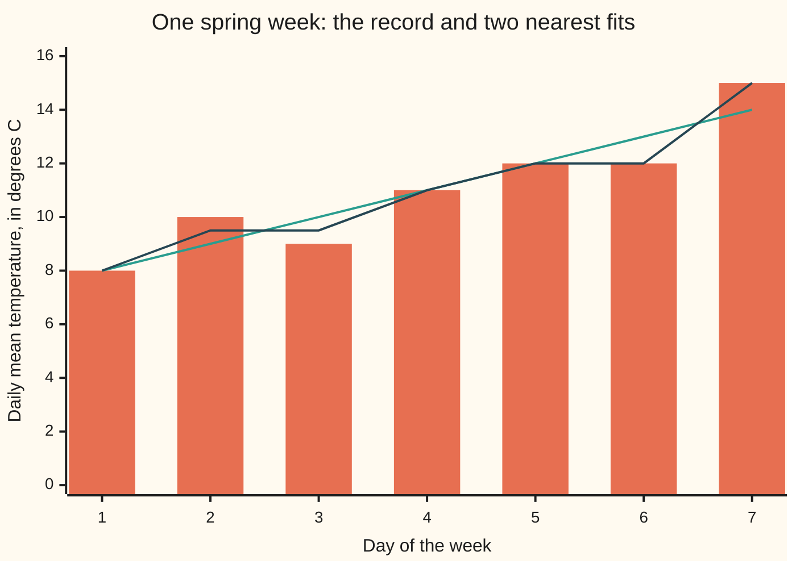
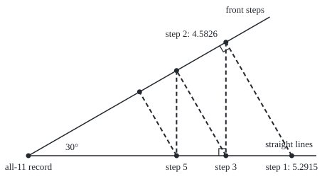

# Projection: every point has exactly one nearest point in a closed subspace

[Syllabus](../../../SYLLABUS.md) → [Functional analysis](../README.md) → [Hilbert Spaces](../README.md#s02) → Projection

---

## General Overview

A weather station logs one daily mean temperature for a spring week: 8, 10, 9, 11, 12, 12 and 15 °C (illustrative numbers). The question is the trend. Is it warming, and by how much per day?

The best straight line through the week is 11 °C on the middle day, rising 1 °C per day: 8, 9, 10, 11, 12, 13, 14. What is left over, 0, 1, −1, 0, 0, −1, 1, is the day-to-day weather. The record splits into two parts that add back to it: a trend and a leftover.

The leftover has no trend in it: fit a line to it and you get zero. The trend is already a line: fit a line to it and you get it back. Fitting twice changes nothing.

[Least squares](../../03-Algebra/06-Dot%20Products%20and%20Best%20Fits/04-least-squares.md) already finds this line. This card asks what keeps the split working when the record is an infinite list or a whole function. The answer is **closed**: the family of allowed fits must contain all its own limits.

**In a Hilbert space, every closed subspace splits each vector uniquely into its nearest point in the subspace plus a leftover perpendicular to the whole subspace, and the map to the nearest point is a projection: applying it twice is the same as applying it once.**

**What kind of fact this is:** a theorem. The nearest point's existence is proved on [L2 as a Hilbert space](../../10-Measure%20and%20integration/07-Sizes%20of%20Functions/06-l2-as-a-hilbert-space.md) by an argument valid in any Hilbert space. The convex-set version, the complement split and the operator facts are proved here in Why it works. The alternating-projection theorem is stated with a named source.

### The picture: the week, its trend and its warming-only fit



Caption: the bars are the seven readings. The first line is the nearest straight line, 11 + 1 × (day − 4). The second line is the nearest record that never cools from one day to the next, found in Step 1 below.

---

## The formula

Notation first, in words. $`H`$ is a **Hilbert space**: a vector space with an inner product $`\langle x, y\rangle`$, complete in the length $`\lVert x\rVert = \sqrt{\langle x, x\rangle}`$ ([Inner products](01-inner-products-and-hilbert-spaces.md)). Scalars on this card are real; with complex scalars the inner product conjugates its first slot. Here $`H`$ is the space of 7-day records, and $`\langle x, y\rangle`$ multiplies day by day and adds.

A **subspace** $`M`$ is a family closed under adding and scaling. It is **closed** when every limit, in the length $`\lVert\cdot\rVert`$, of members of $`M`$ is again in $`M`$. Its **orthogonal complement** $`M^\perp`$ is every vector perpendicular to all of $`M`$. The **projection** $`P_M`$ sends each vector to its nearest point in $`M`$.

```math
y = P_M y + r, \qquad P_M y \in M, \qquad r \in M^\perp, \qquad P_M P_M = P_M
```

**Read it aloud:** the record is its nearest point in M plus a leftover perpendicular to M, and projecting a second time changes nothing.

Since every vector splits once and only once, $`H`$ is the **direct sum** $`M \oplus M^\perp`$. The leftover is itself a projection, $`r = (I - P_M)\,y`$, the nearest point of $`y`$ in $`M^\perp`$.

| Symbol | Plain meaning | In our example | Push it up and the answer… |
| --- | --- | --- | --- |
| $`H`$, $`\langle x, y\rangle`$, $`\lVert x\rVert`$ | a complete space with an inner product; the inner product; the length | 7-day records; day-by-day products added | — |
| $`y`$ | the record to be split | 8, 10, 9, 11, 12, 12, 15 °C | raise one day, the trend tilts toward it |
| $`t`$, $`\mathbf 1`$, $`a`$, $`b`$ | the day counted from the middle day; the all-ones record; intercept (the middle day's trend value); slope | −3 to 3; seven 1s; 11 °C; 1 °C per day | a steeper record, a larger b |
| $`M`$ | a closed subspace: the allowed fits | straight lines $`a\mathbf 1 + b\,t`$ | a bigger M, a smaller leftover |
| $`P_M`$, $`I`$, $`J`$, $`T`$ | the projection onto $`M`$; the identity; the all-ones matrix; the transpose, marked by a raised T: rows and columns swapped | $`28P_M = 4J + t\,t^{T}`$ | — |
| $`r`$ | the leftover $`y - P_M y`$ | 0, 1, −1, 0, 0, −1, 1 | — |
| $`M^\perp`$ | everything perpendicular to all of $`M`$ | records with $`\langle r,\mathbf 1\rangle = \langle r, t\rangle = 0`$, 5 dimensions | — |
| $`C`$, $`P_C`$, $`s_j`$ | a closed convex set; its nearest-point map; the step that is 1 from day j + 1 on | records that never cool; 8, 9.5, 9.5, 11, 12, 12, 15 | — |
| $`M_1`$, $`M_2`$, $`\theta`$, $`k`$ | two closed subspaces; the angle between them; the step count | lines; front steps; 30°; 1 to 50 | a smaller angle, slower convergence |
| $`x`$, $`z`$, $`m`$, $`c`$, $`P`$, $`Q`$ | any vector; a vector of $`M^\perp`$; a member of $`M`$; a member of $`C`$; any operator with $`P^2 = P`$; one whose leftover is not perpendicular | Q: the endpoint line | — |
| $`\ell^2`$, $`e_n`$, $`N`$ | square-summable sequences; the sequence with 1 in place n; a cut-off | the tail 1, 1/2, 1/3, …, and its even places | larger N, smaller miss, never zero |
| $`d`$, $`c_n`$, $`n`$, $`p`$, $`p'`$, $`s`$, $`u`$, $`v`$, $`y_1`$, $`y_2`$, $`z_n`$ | proof helpers: the least distance, near-best members and their index, nearest points, a step size, two leftovers, two records, a sequence in the complement | $`d^2`$ = 4 for the lines | — |

### When it holds

- **The subspace is closed.** Records that stop after finitely many days get within 0.0316 of the tail 1, 1/2, 1/3, … at N = 1000, and closer at every N, but none reaches it: there is no nearest point.
- **The space is complete.** The proof builds the nearest point as a limit, which a space with holes may lack. Finite-dimensional spaces, like the 7-day records, are complete, and their subspaces are closed.
- **The length comes from an inner product.** Without one there is no "perpendicular". Under other lengths a nearest point can fail to be unique ([L2 as a Hilbert space](../../10-Measure%20and%20integration/07-Sizes%20of%20Functions/06-l2-as-a-hilbert-space.md) shows a whole interval of nearest constants at p = 1).
- **For a set that is not a subspace, it must be convex.** A convex set contains the whole segment between any two of its members. The warming-only records are convex; the projection onto them exists and is unique, but it is not linear.

---

## Why it works

### Step 0: nearest means perpendicular, and a limit supplies the nearest point

The nearest point of a line is where the leftover meets the line at a right angle (the algebra wing's [Projection](../../03-Algebra/06-Dot%20Products%20and%20Best%20Fits/02-orthogonal-projection.md)). In infinite dimensions the hard part is existence: fits may get ever closer without one arriving. On [L2 as a Hilbert space](../../10-Measure%20and%20integration/07-Sizes%20of%20Functions/06-l2-as-a-hilbert-space.md) the parallelogram law forces near-best fits together, completeness gives them a limit, and closedness keeps it inside $`M`$. That proof uses only the inner product and completeness, so it holds in any Hilbert space $`H`$.

On the week, the line $`11 + t`$ leaves $`r`$ = 0, 1, −1, 0, 0, −1, 1. Its inner product with $`\mathbf 1`$ is 0 and with $`t`$ is 0, so $`r`$ is perpendicular to every line $`a\mathbf 1 + b\,t`$. Pythagoras follows: $`\lVert y\rVert^2 = 879 = 875 + 4`$.

### Step 1: closed convex sets get a nearest point too, with an obtuse angle

The same proof works for any closed convex set $`C`$, because the midpoint of two members stays in $`C`$. The test changes. A point $`P_C y`$ of $`C`$ is nearest exactly when every other member $`c`$ sits at an angle of 90° or more:

```math
\langle\, y - P_C y,\; c - P_C y \,\rangle \le 0 \quad \text{for every } c \in C.
```

**Read it aloud:** standing at the nearest point, the arrow back to the record and the arrow to any other member of C make an angle of 90° or more.

Take $`C`$ = records that never cool from one day to the next. The fix is to pool neighbours that go the wrong way: days 2 and 3 read 10 then 9, so both become 9.5. The result is 8, 9.5, 9.5, 11, 12, 12, 15, with squared miss 0.5.

The certificate needs no trust in the pooling. Every warming-only record is a constant plus non-negative multiples of the steps $`s_j`$. The leftover has $`\langle r,\mathbf 1\rangle = 0`$, $`\langle r, P_C y\rangle = 0`$ and $`\langle r, s_j\rangle \le 0`$ for every step; the largest is 0. That is the obtuse-angle test.

$`P_C`$ is not linear. For the record turned upside down, $`-y`$, the pooling merges all seven days, so its nearest warming-only record is flat: −11 every day. But $`-P_C y`$ is −8, −9.5, −9.5, −11, −12, −12, −15, which falls and is not even in $`C`$.

<details>
<summary>Detailed proof: existence, uniqueness and the obtuse-angle test for a closed convex set</summary>

Let $`d`$ be the greatest lower bound of $`\lVert y - c\rVert`$ over $`c`$ in $`C`$, and pick $`c_n`$ in $`C`$ with $`\lVert y - c_n\rVert^2 < d^2 + 1/n`$. The parallelogram law with $`u = y - c_n`$ and $`v = y - c_k`$ gives

$`\displaystyle \lVert c_n - c_k\rVert^2 = 2\lVert y - c_n\rVert^2 + 2\lVert y - c_k\rVert^2 - 4\,\big\lVert y - \tfrac12(c_n + c_k)\big\rVert^2 .`$

Convexity puts the midpoint in $`C`$, so the last length is at least $`d`$, and the right side is below $`2/n + 2/k`$. The sequence settles down. Completeness gives a limit; closedness puts it in $`C`$; its distance is $`d`$. Two nearest points $`p`$ and $`p'`$ give, by the same law, $`\lVert p - p'\rVert^2 \le 4d^2 - 4d^2 = 0`$.

The test: for $`c`$ in $`C`$ and $`0 < s \le 1`$, the point $`p + s(c - p)`$ is in $`C`$, so

$`\displaystyle \lVert y - p\rVert^2 \le \lVert y - p\rVert^2 - 2s\,\langle y - p,\, c - p\rangle + s^2\lVert c - p\rVert^2 .`$

Divide by $`s`$ and let $`s`$ shrink to 0: $`\langle y - p, c - p\rangle \le 0`$. Conversely, if the test holds, then $`\lVert y - c\rVert^2 = \lVert y - p\rVert^2 - 2\langle y - p, c - p\rangle + \lVert c - p\rVert^2 \ge \lVert y - p\rVert^2`$. ∎

</details>

### Step 2: for a subspace, obtuse becomes perpendicular, so the projection is linear

A subspace contains $`P_M y + m`$ and $`P_M y - m`$ for every $`m`$ in $`M`$. The obtuse-angle test, run in both directions, forces $`\langle y - P_M y, m\rangle = 0`$. So the leftover is perpendicular to all of $`M`$: it lies in $`M^\perp`$.

Perpendicularity is a linear condition. If $`y_1 - P_M y_1`$ and $`y_2 - P_M y_2`$ are both perpendicular to $`M`$, so is their sum. The split into a part in $`M`$ and a perpendicular leftover is unique, so $`P_M(y_1 + y_2) = P_M y_1 + P_M y_2`$, and scaling works the same way. $`P_M`$ is a linear operator, here the 7 × 7 matrix $`P_M = (4J + t\,t^{T})/28`$. That matrix sends the record to 8, 9, 10, 11, 12, 13, 14, the same line as the fit.

### Step 3: the complement is always closed, and splits the space when M is closed

$`M^\perp`$ is a subspace: sums and multiples of perpendicular vectors stay perpendicular. It is always closed, even when $`M`$ is not, because the inner product is continuous. If $`z_n \to z`$ and each $`\langle z_n, m\rangle = 0`$, then $`\langle z, m\rangle = 0`$.

When $`M`$ is closed, Step 2 writes every $`y`$ as $`P_M y + (y - P_M y)`$, one part in $`M`$ and one in $`M^\perp`$. The split is unique, because a vector in both $`M`$ and $`M^\perp`$ is perpendicular to itself, so it is zero. That is $`H = M \oplus M^\perp`$.

On the week, $`M`$ has 2 dimensions and $`M^\perp`$ has 5. The traces show it: trace $`P_M`$ = 2 and trace $`(I - P_M)`$ = 5, the dimensions of the two pieces.

Applying the split twice gives $`(M^\perp)^\perp = M`$ for closed $`M`$. For any $`M`$, $`(M^\perp)^\perp`$ is the closure of $`M`$: $`M`$ together with all its limits. [Dual spaces](../01-Normed%20and%20Banach%20Spaces/09-dual-spaces-and-lp-duality.md) writes $`M^\perp`$ for the functionals that vanish on $`M`$; [Riesz representation](06-riesz-representation-theorem.md) matches each one with a single vector of the complement here, so the two meanings agree.

### Step 4: idempotent and self-adjoint is exactly an orthogonal projection

An operator $`P`$ is **idempotent** when $`P^2 = P`$: doing it twice is doing it once. $`P_M`$ is idempotent, because $`P_M y`$ is already in $`M`$ and is its own nearest point. It is also **self-adjoint**: $`\langle P_M x, y\rangle = \langle x, P_M y\rangle`$. Both sides equal $`\langle P_M x, P_M y\rangle`$, since the leftovers are perpendicular to $`M`$.

The converse holds too. Let a bounded operator $`P`$ have $`P^2 = P`$ and be self-adjoint, and let $`M`$ be its range. Then $`M`$ is the set where $`Px = x`$, which is closed. The leftover $`y - Py`$ is perpendicular to every $`Pz`$, because $`\langle y - Py, Pz\rangle = \langle P(y - Py), z\rangle = 0`$. So $`P = P_M`$. On the week the matrix check is exact: $`(28P_M)^2 = 28 \cdot (28P_M)`$ entry by entry, and the matrix equals its own transpose.

Idempotent alone is not enough. The line through the first and last readings, day 1 at 8 °C and day 7 at 15 °C, is a map $`Q`$ onto lines with $`Q^2 = Q`$. But its leftover is not perpendicular to the lines: $`\langle r, \mathbf 1\rangle = -3.5`$. Its squared miss is 6.5278 against the true 4. It is an **oblique projection**: a split along a slanted direction.

### Step 5: two fits taken in turn reach their common part

Suppose two closed subspaces $`M_1`$ and $`M_2`$ each have an easy projection, but their intersection does not. Project onto $`M_1`$, then $`M_2`$, then $`M_1`$, and repeat. In finite dimensions the iterates approach $`P_{M_1 \cap M_2}\, y`$. After the first drop, each round trip shrinks the distance by a factor of at most $`\cos^2\theta`$, where $`\theta`$ is the angle between the two subspaces once their common part is removed.

In any Hilbert space, the iterates still converge in length to $`P_{M_1 \cap M_2}\, y`$. This is von Neumann's alternating-projection theorem, stated here with Deutsch's book as the source. The rate is the new difficulty: when $`\theta`$ is 0, convergence can be arbitrarily slow (Bauschke, Deutsch and Hundal). The section on alternating projections below traces the week's case.

### Step 6: a closed subspace of ℓ² against one that is not closed

Take $`H = \ell^2`$, the sequences whose squares add to a finite total, and the tail $`y`$ = 1, 1/2, 1/3, …, a decaying anomaly after a heat wave.

First a closed subspace: $`M`$ = the sequences that are zero at every odd place 1, 3, 5, …. A limit of such sequences is zero at those places too, so $`M`$ is closed. Its complement $`M^\perp`$ is the sequences zero at every even place. The nearest point keeps the even places, $`P_M y`$ = 0, 1/2, 0, 1/4, …, and the leftover 1, 0, 1/3, 0, 1/5, … lies in $`M^\perp`$. The code holds the first $`N`$ places, the cut:

| N | $`\lVert P_M y\rVert^2`$ in the cut | $`\lVert r\rVert^2`$ in the cut | Distance from the cut to $`P_M y`$ |
| --- | --- | --- | --- |
| 10 | 0.365903 | 1.183865 | 0.212910 |
| 100 | 0.406283 | 1.228701 | 0.070359 |
| 1000 | 0.410734 | 1.233201 | 0.022350 |
| 10000 | 0.411184 | 1.233651 | 0.007071 |

The two parts settle on $`\pi^2/24`$ = 0.411234 and $`\pi^2/8`$ = 1.233701, which add to $`\pi^2/6`$ = 1.644934: Pythagoras in infinite dimensions. The cuts close in on $`P_M y`$, which is itself in $`M`$, so the least distance, $`\sqrt{\pi^2/8}`$ = 1.110721, is attained.

Now let $`M`$ be the sequences with only finitely many non-zero entries. It is a subspace but not closed. The best member of $`M`$ that stops after $`N`$ places copies the first $`N`$ entries. Its miss is the length of the rest:

| N | Best miss | √N × miss |
| --- | --- | --- |
| 1 | 0.803078 | 0.8031 |
| 10 | 0.308490 | 0.9755 |
| 100 | 0.099751 | 0.9975 |
| 1000 | 0.031615 | 0.9998 |
| 10000 | 0.010000 | 1.0000 |

The miss falls like $`1/\sqrt N`$ and reaches zero at no $`N`$. The smallest distance from $`y`$ to $`M`$ is 0, but no member of $`M`$ attains it. There is no nearest point.

The complement shows the same failure. A vector perpendicular to every $`e_n`$ has every entry zero, so $`M^\perp = \{0\}`$. Then $`M \oplus M^\perp`$ is just $`M`$, not all of $`\ell^2`$, and $`(M^\perp)^\perp = \ell^2`$ is the closure of $`M`$, not $`M`$. The code holds only the truncations; the proof is the argument above.

---

## Worked numbers, by hand

The record $`y`$ = 8, 10, 9, 11, 12, 12, 15 °C on days $`t`$ = −3 to 3.

| Step | Arithmetic | Value |
| --- | --- | --- |
| $`\langle y, \mathbf 1\rangle`$ | 8 + 10 + 9 + 11 + 12 + 12 + 15 | 77 |
| intercept $`a`$ | 77 ÷ 7 | 11 °C |
| $`\langle y, t\rangle`$ | −24 − 20 − 9 + 0 + 12 + 24 + 45 | 28 |
| slope $`b`$ | 28 ÷ $`\langle t, t\rangle`$ = 28 ÷ 28 | 1 °C per day |
| trend $`P_M y`$ | 11 + t on each day | 8, 9, 10, 11, 12, 13, 14 |
| leftover $`r`$ | record minus trend | 0, 1, −1, 0, 0, −1, 1 |
| $`\langle r, \mathbf 1\rangle`$, $`\langle r, t\rangle`$ | 1 − 1 − 1 + 1; −2 + 1 − 2 + 3 | 0 and 0 |
| Pythagoras | 879 = 875 + 4 | holds |
| fit the trend again | it is already a line | 8, 9, 10, 11, 12, 13, 14 |
| fit the leftover | $`\langle r,\mathbf 1\rangle`$ and $`\langle r,t\rangle`$ are 0 | **0 every day** |

The week warms by 1 °C per day, and the leftover carries no trend at all: projecting it gives zero, projecting the trend gives the trend.

### What breaks if you drop a piece

| Mistake | Comes out at | What went wrong |
| --- | --- | --- |
| Not closed: finite records against the tail 1, 1/2, 1/3, … | best miss 0.031615 at N = 1000; never 0 | The least distance is 0 and nothing attains it |
| Not perpendicular: the line through days 1 and 7 | $`Q^2 = Q`$, but squared miss 6.5278, not 4; $`\langle r, t\rangle = -4.6667`$ | An oblique projection is idempotent but not nearest |
| Convex but treated as linear: $`-P_C y`$ for $`P_C(-y)`$ | −8, −9.5, −9.5, −11, −12, −12, −15, which falls | The true answer is −11 every day |
| One round of alternating projections taken as the answer | slope 0.75, still 3.9686 from the all-11 record | A round trip only cuts the gap to 3/4 of itself |

The code prints all four.

---

## Alternating projections: two fits taken in turn

A forecaster has two models for the week. $`M_1`$ is the straight lines. $`M_2`$ is the **front steps**: one level on days 1 to 3 and another on days 4 to 7, as if a warm front arrived on day 4. The front fit alone is 9, 9, 9, 12.5, 12.5, 12.5, 12.5, with squared miss 11 against the line's 4.

The only records that are both a line and a front step are the flat ones. The nearest flat record to the week is its mean, 11 every day. Alternating projections should find it using only the two separate fits.

Remove the flat part from both families. What is left of $`M_1`$ is the direction $`t`$; what is left of $`M_2`$ is the step minus its mean. Their angle has $`\cos^2\theta = 0.75`$, so $`\theta`$ = 30°. After the first drop, each drop multiplies the squared distance to the all-11 record by 0.75.

Odd steps apply the line fit, even steps the front fit. Every distance below matches the closed form $`\sqrt{28}\,(3/4)^{(k-1)/2}`$, where $`\sqrt{28}`$ is the length of the slope-1 part of the trend. After step 3 the slope is 0.75; every round trip multiplies it by 3/4.

```
distance from the all-11 record, by step
step  1  ##########################  5.2915
step  2  #######################     4.5826
step  3  ####################        3.9686
step  4  #################           3.4369
step  5  ###############             2.9765
step  6  #############               2.5777
step  7  ###########                 2.2324
step  8  ##########                  1.9333
step 20  ##                          0.3441
step 50                              0.0046
```

<p align="center"></p>

Caption: the plane of the two trend directions, drawn to scale at 70 units per °C of length. The horizontal line is the straight-line fits, the slanted line the front-step fits, meeting at 30° at the all-11 record. Each dashed segment is a perpendicular drop. The first drop, from the record to the line, leaves this plane and is not drawn; the figure starts at step 1.

---

## Code, from first principles, and it actually runs

The code takes three roads to the trend: the inner-product formulas, the integer matrix $`28P_M`$, and a grid of 25 rival lines checked against the exact identity squared miss = 4 + 7(a − 11)² + 28(b − 1)². It checks $`P_M^2 = P_M`$ exactly, pools the warming-only fit and certifies it by the obtuse-angle test, runs 50 alternating steps against the closed form, and reaches the $`\ell^2`$ tail by two roads: $`\pi^2/6`$ minus a partial sum, and a direct sum to two million terms. It splits the tail into even and odd places and holds the parts to $`\pi^2/24`$ and $`\pi^2/8`$. The 7-day work is in exact fractions.

### Python

```python
# Projection theorem and orthogonal complements -- the check behind the card.
# Standard library only.  The seven-day record is done in exact fractions; the
# alternating projections and the infinite tail run in floats.  Nothing imported
# knows the answer: the fits, the matrix, the pooling and the sums are written out.
from fractions import Fraction as F
import math

y = [F(v) for v in (8, 10, 9, 11, 12, 12, 15)]   # daily mean temperature, deg C (illustrative)
t = [F(v) for v in range(-3, 4)]                  # day, counted from the middle day
one = [F(1)] * 7

def dot(u, v): return sum((a * b for a, b in zip(u, v)), F(0))
def sub(u, v): return [a - b for a, b in zip(u, v)]
def num(q): return str(q.numerator) if q.denominator == 1 else f"{float(q):.4f}".rstrip("0").rstrip(".")
def vec(v): return "(" + ", ".join(num(q) for q in v) + ")"
def yn(c): return "yes" if c else "no"
def line(a, b): return [a + b * s for s in t]
def fit(v): return line(dot(v, one) / 7, dot(v, t) / 28)          # P_M: nearest straight line
def front(v):                                                     # P_2: one level days 1-3, one days 4-7
    lo, hi = (v[0] + v[1] + v[2]) / 3, (v[3] + v[4] + v[5] + v[6]) / 4
    return [lo] * 3 + [hi] * 4

def warming(v):                                                   # P_C: pool adjacent violators
    blocks = []                                                   # each block: [sum, count]
    for x in v:
        blocks.append([x, 1])
        while len(blocks) > 1 and blocks[-2][0] / blocks[-2][1] > blocks[-1][0] / blocks[-1][1]:
            s, n = blocks.pop()
            blocks[-1][0] += s
            blocks[-1][1] += n
    return [s / n for s, n in blocks for _ in range(n)]

# ---- the split y = P y + r, three roads to the same line ----
a, b = dot(y, one) / 7, dot(y, t) / 28
p = line(a, b)
r = sub(y, p)
H28 = [[4 + int(t[i] * t[j]) for j in range(7)] for i in range(7)]  # 28 P = 4 J + t t^T
mul = lambda A, B: [[sum(A[i][k] * B[k][j] for k in range(7)) for j in range(7)] for i in range(7)]
Pmat_y = [sum(H28[i][j] * y[j] for j in range(7)) / 28 for i in range(7)]
HH = mul(H28, H28)
grid = [(F(10) + F(i, 2), F(1, 2) + F(j, 4)) for i in range(5) for j in range(5)]
miss = {g: dot(sub(y, line(*g)), sub(y, line(*g))) for g in grid}
formula_ok = all(miss[(aa, bb)] == 4 + 7 * (aa - 11) ** 2 + 28 * (bb - 1) ** 2 for aa, bb in grid)
best = min(grid, key=lambda g: miss[g])
print(f"record y, deg C: {vec(y)}; days t = {vec(t)}")
print(f"line fit: a = <y,1>/<1,1> = {num(dot(y, one))}/7 = {num(a)}, b = <y,t>/<t,t> = {num(dot(y, t))}/28 = {num(b)}")
print(f"trend P y = {vec(p)}")
print(f"residual r = y - P y = {vec(r)}")
print(f"<r,1> = {num(dot(r, one))}, <r,t> = {num(dot(r, t))}")
print(f"Pythagoras: |y|^2 = {num(dot(y, y))} = |P y|^2 {num(dot(p, p))} + |r|^2 {num(dot(r, r))}")
print(f"P y by the matrix 28P = 4J + t t^T: {vec(Pmat_y)}; same: {yn(Pmat_y == p)}")
print(f"P P = P exactly: {yn(HH == [[28 * v for v in row] for row in H28])}; "
      f"P symmetric: {yn(all(H28[i][j] == H28[j][i] for i in range(7) for j in range(7)))}")
print(f"trace P = {num(F(sum(H28[i][i] for i in range(7)), 28))}, "
      f"trace (I - P) = {num(7 - F(sum(H28[i][i] for i in range(7)), 28))}")
print(f"P(P y) = P y: {yn(fit(p) == p)}; P r = {vec(fit(r))}")
print(f"25 rival lines: least squared miss {num(miss[best])} at a = {num(best[0])}, b = {num(best[1])}; "
      f"4 + 7(a - 11)^2 + 28(b - 1)^2 on all 25: {yn(formula_ok)}")

# ---- the warming-only records: a closed convex cone, not a subspace ----
pc = warming(y)
rc = sub(y, pc)
steps = [[F(0)] * j + [F(1)] * (7 - j) for j in range(1, 7)]       # s_j: 1 from day j+1 on
cert = max(dot(rc, s) for s in steps)
print(f"warming-only fit P_C y = {vec(pc)}, squared miss {num(dot(rc, rc))}")
print(f"certificate: <r,1> = {num(dot(rc, one))}, <r,P_C y> = {num(dot(rc, pc))}, largest <r,s_j> = {num(cert)}")
print(f"P_C(P_C y) = P_C y: {yn(warming(pc) == pc)}; P_C(-y) = {vec(warming([-v for v in y]))}; "
      f"-P_C y = {vec([-v for v in pc])}")

# ---- alternating projections: lines, then front steps, then lines ... ----
s4 = [F(0)] * 3 + [F(1)] * 4
w = sub(s4, [F(4, 7)] * 7)                                         # the front step, minus its mean
cos2 = dot(t, w) ** 2 / (dot(t, t) * dot(w, w))
print(f"front fit P_2 y = {vec(front(y))}, squared miss {num(dot(sub(y, front(y)), sub(y, front(y))))}")
print(f"angle between the two fits: cos^2 = {num(cos2)}, angle {math.degrees(math.acos(math.sqrt(cos2))):.4f} deg")
x, dist = [float(v) for v in y], []
for k in range(1, 51):
    x = fit(x) if k % 2 else front(x)
    sq = 0.0
    for v in x:
        sq += (v - 11.0) * (v - 11.0)
    dist.append(math.sqrt(sq))
print("step k: distance from the all-11 record, closed form sqrt(28) (3/4)^((k-1)/2)")
for k in list(range(1, 9)) + [20, 50]:
    print(f"  {k:2d}: {dist[k - 1]:.4f}  {math.sqrt(28) * 0.75 ** ((k - 1) / 2):.4f}")

# ---- what breaks if you drop a piece ----
q = line((y[0] + y[6]) / 2, (y[6] - y[0]) / 6)                      # line through days 1 and 7
rq = sub(y, q)
qq = line((q[0] + q[6]) / 2, (q[6] - q[0]) / 6)
print(f"mistake 1, endpoint line: a = {num(q[3])}, b = {num(q[4] - q[3])}; Q Q = Q: {yn(qq == q)}; "
      f"squared miss {num(dot(rq, rq))}; <r,1> = {num(dot(rq, one))}, <r,t> = {num(dot(rq, t))}")
x3 = fit(front(fit(y)))
print(f"mistake 2, one round taken as the answer: slope {num(x3[4] - x3[3])}, {dist[2]:.4f} from the all-11 record")
print("mistake 3, finite records against the tail 1, 1/2, 1/3, ... in l2:")
basel, tails = math.pi * math.pi / 6, []
for n in (1, 10, 100, 1000, 10000):
    head, road2, K = 0.0, 0.0, 2000000
    for k in range(n, 0, -1):
        head += 1.0 / (k * k)
    for k in range(K, n, -1):                                     # summed smallest first
        road2 += 1.0 / (k * k)
    road1 = basel - head
    road2 += 1.0 / K - 0.5 / K ** 2 + 1.0 / (6 * K ** 3)        # Euler-Maclaurin tail past K
    tails.append(math.sqrt(road1))
    print(f"  N = {n:5d}: best miss {math.sqrt(road1):.6f} (direct sum {math.sqrt(road2):.6f}), "
          f"sqrt(N) x miss {math.sqrt(n * road1):.4f}")
    assert abs(road1 - road2) < 1e-9
print("closed subspace of l2: keep the even places of the tail, cut at N")
for n in (10, 100, 1000, 10000):
    ev, od = 0.0, 0.0
    for k in range(1, n + 1):
        if k % 2: od += 1.0 / (k * k)
        else: ev += 1.0 / (k * k)
    print(f"  N = {n:5d}: |P y|^2 {ev:.6f}, |r|^2 {od:.6f}, cut to P y {math.sqrt(basel / 4 - ev):.6f}")
    assert abs(ev - basel / 4) < 1 / n and abs(od - 3 * basel / 4) < 1 / n
print(f"  limits: pi^2/24 {basel / 4:.6f} + pi^2/8 {3 * basel / 4:.6f} = pi^2/6 {basel:.6f}; miss {math.sqrt(3 * basel / 4):.6f}")
pts = [(40 + 70 * d, 220.0) if k % 2 == 0 else (40 + 70 * d * math.sqrt(0.75), 220 - 35 * d)
       for k, d in enumerate(dist[:6])]
print("figure, " + "; ".join(f"({u:.1f}, {v:.1f})" for u, v in pts))

assert (a, b) == (11, 1) and Pmat_y == p and best == (11, 1) and formula_ok   # three roads, one line
assert dot(r, one) == 0 and dot(r, t) == 0 and dot(y, y) == dot(p, p) + dot(r, r)
assert HH == [[28 * v for v in row] for row in H28] and fit(r) == [0] * 7  # P P = P, P r = 0
assert dot(rc, one) == 0 and dot(rc, pc) == 0 and cert <= 0 and warming(pc) == pc
assert cos2 == F(3, 4) and all(abs(d - math.sqrt(28) * 0.75 ** (k / 2)) < 1e-12 for k, d in enumerate(dist))
assert qq == q and dot(rq, rq) > dot(r, r) and all(u > v > 0 for u, v in zip(tails, tails[1:]))
print("ALL CHECKS PASS")
```

**Ran 2026-11-15 on macOS, Python 3.14.10, standard library only. All checks passed. Output, pasted from the run:**

```
record y, deg C: (8, 10, 9, 11, 12, 12, 15); days t = (-3, -2, -1, 0, 1, 2, 3)
line fit: a = <y,1>/<1,1> = 77/7 = 11, b = <y,t>/<t,t> = 28/28 = 1
trend P y = (8, 9, 10, 11, 12, 13, 14)
residual r = y - P y = (0, 1, -1, 0, 0, -1, 1)
<r,1> = 0, <r,t> = 0
Pythagoras: |y|^2 = 879 = |P y|^2 875 + |r|^2 4
P y by the matrix 28P = 4J + t t^T: (8, 9, 10, 11, 12, 13, 14); same: yes
P P = P exactly: yes; P symmetric: yes
trace P = 2, trace (I - P) = 5
P(P y) = P y: yes; P r = (0, 0, 0, 0, 0, 0, 0)
25 rival lines: least squared miss 4 at a = 11, b = 1; 4 + 7(a - 11)^2 + 28(b - 1)^2 on all 25: yes
warming-only fit P_C y = (8, 9.5, 9.5, 11, 12, 12, 15), squared miss 0.5
certificate: <r,1> = 0, <r,P_C y> = 0, largest <r,s_j> = 0
P_C(P_C y) = P_C y: yes; P_C(-y) = (-11, -11, -11, -11, -11, -11, -11); -P_C y = (-8, -9.5, -9.5, -11, -12, -12, -15)
front fit P_2 y = (9, 9, 9, 12.5, 12.5, 12.5, 12.5), squared miss 11
angle between the two fits: cos^2 = 0.75, angle 30.0000 deg
step k: distance from the all-11 record, closed form sqrt(28) (3/4)^((k-1)/2)
   1: 5.2915  5.2915
   2: 4.5826  4.5826
   3: 3.9686  3.9686
   4: 3.4369  3.4369
   5: 2.9765  2.9765
   6: 2.5777  2.5777
   7: 2.2324  2.2324
   8: 1.9333  1.9333
  20: 0.3441  0.3441
  50: 0.0046  0.0046
mistake 1, endpoint line: a = 11.5, b = 1.1667; Q Q = Q: yes; squared miss 6.5278; <r,1> = -3.5, <r,t> = -4.6667
mistake 2, one round taken as the answer: slope 0.75, 3.9686 from the all-11 record
mistake 3, finite records against the tail 1, 1/2, 1/3, ... in l2:
  N =     1: best miss 0.803078 (direct sum 0.803078), sqrt(N) x miss 0.8031
  N =    10: best miss 0.308490 (direct sum 0.308490), sqrt(N) x miss 0.9755
  N =   100: best miss 0.099751 (direct sum 0.099751), sqrt(N) x miss 0.9975
  N =  1000: best miss 0.031615 (direct sum 0.031615), sqrt(N) x miss 0.9998
  N = 10000: best miss 0.010000 (direct sum 0.010000), sqrt(N) x miss 1.0000
closed subspace of l2: keep the even places of the tail, cut at N
  N =    10: |P y|^2 0.365903, |r|^2 1.183865, cut to P y 0.212910
  N =   100: |P y|^2 0.406283, |r|^2 1.228701, cut to P y 0.070359
  N =  1000: |P y|^2 0.410734, |r|^2 1.233201, cut to P y 0.022350
  N = 10000: |P y|^2 0.411184, |r|^2 1.233651, cut to P y 0.007071
  limits: pi^2/24 0.411234 + pi^2/8 1.233701 = pi^2/6 1.644934; miss 1.110721
figure, (410.4, 220.0); (317.8, 59.6); (317.8, 220.0); (248.4, 99.7); (248.4, 220.0); (196.3, 129.8)
ALL CHECKS PASS
```

### Rust

Same numbers, same labels, built with `rustc --edition 2021 -O`. The fractions are a small struct of two 64-bit integers.

```rust
// Projection theorem and orthogonal complements -- the same check as the Python,
// in Rust.  No crates.  The seven-day record is done in exact fractions (a small
// struct below); the alternating projections and the infinite tail run in floats.
use std::ops::{Add, Div, Mul, Neg, Sub};

#[derive(Clone, Copy, PartialEq, Debug)]
struct Q(i64, i64);                                   // numerator, denominator > 0, in lowest terms
fn gcd(a: i64, b: i64) -> i64 { if b == 0 { a.abs() } else { gcd(b, a % b) } }
fn q(n: i64, d: i64) -> Q { let g = gcd(n, d).max(1) * d.signum(); Q(n / g, d / g) }
impl Add for Q { type Output = Q; fn add(self, o: Q) -> Q { q(self.0 * o.1 + o.0 * self.1, self.1 * o.1) } }
impl Sub for Q { type Output = Q; fn sub(self, o: Q) -> Q { q(self.0 * o.1 - o.0 * self.1, self.1 * o.1) } }
impl Mul for Q { type Output = Q; fn mul(self, o: Q) -> Q { q(self.0 * o.0, self.1 * o.1) } }
impl Div for Q { type Output = Q; fn div(self, o: Q) -> Q { q(self.0 * o.1, self.1 * o.0) } }
impl Neg for Q { type Output = Q; fn neg(self) -> Q { Q(-self.0, self.1) } }
impl PartialOrd for Q {
    fn partial_cmp(&self, o: &Q) -> Option<std::cmp::Ordering> { (self.0 * o.1).partial_cmp(&(o.0 * self.1)) }
}
fn z(n: i64) -> Q { Q(n, 1) }
fn f(x: Q) -> f64 { x.0 as f64 / x.1 as f64 }

fn dot(u: &[Q], v: &[Q]) -> Q { u.iter().zip(v).fold(z(0), |s, (a, b)| s + *a * *b) }
fn sub(u: &[Q], v: &[Q]) -> Vec<Q> { u.iter().zip(v).map(|(a, b)| *a - *b).collect() }
fn num(x: Q) -> String {
    if x.1 == 1 { return format!("{}", x.0) }
    format!("{:.4}", f(x)).trim_end_matches('0').trim_end_matches('.').to_string()
}
fn vec(v: &[Q]) -> String { format!("({})", v.iter().map(|x| num(*x)).collect::<Vec<_>>().join(", ")) }
fn yn(c: bool) -> &'static str { if c { "yes" } else { "no" } }
fn line(a: Q, b: Q) -> Vec<Q> { (-3..4).map(|s| a + b * z(s)).collect() }
fn fit(v: &[Q]) -> Vec<Q> {                           // P_M: nearest straight line
    let t: Vec<Q> = (-3..4).map(z).collect();
    line(dot(v, &[z(1); 7]) / z(7), dot(v, &t) / z(28))
}
fn fit_f(v: &[f64]) -> Vec<f64> {                     // the same, in floats, same order of operations
    let (mut sa, mut sb) = (0.0, 0.0);
    for i in 0..7 { sa += v[i] * 1.0; sb += v[i] * (i as f64 - 3.0) }
    let (a, b) = (sa / 7.0, sb / 28.0);
    (-3..4).map(|s| a + b * s as f64).collect()
}
fn front(v: &[f64]) -> Vec<f64> {                     // P_2: one level days 1-3, one days 4-7
    let (lo, hi) = ((v[0] + v[1] + v[2]) / 3.0, (v[3] + v[4] + v[5] + v[6]) / 4.0);
    (0..7).map(|i| if i < 3 { lo } else { hi }).collect()
}
fn front_q(v: &[Q]) -> Vec<Q> {
    let (lo, hi) = ((v[0] + v[1] + v[2]) / z(3), (v[3] + v[4] + v[5] + v[6]) / z(4));
    (0..7).map(|i| if i < 3 { lo } else { hi }).collect()
}
fn warming(v: &[Q]) -> Vec<Q> {                       // P_C: pool adjacent violators
    let mut blocks: Vec<(Q, i64)> = Vec::new();       // each block: (sum, count)
    for &x in v {
        blocks.push((x, 1));
        while blocks.len() > 1 && {
            let (l, m) = (blocks[blocks.len() - 2], blocks[blocks.len() - 1]);
            l.0 / z(l.1) > m.0 / z(m.1)
        } {
            let (s, n) = blocks.pop().unwrap();
            let last = blocks.last_mut().unwrap();
            *last = (last.0 + s, last.1 + n);
        }
    }
    blocks.iter().flat_map(|&(s, n)| vec![s / z(n); n as usize]).collect()
}

fn main() {
    let y: Vec<Q> = [8, 10, 9, 11, 12, 12, 15].iter().map(|&v| z(v)).collect();
    let t: Vec<Q> = (-3..4).map(z).collect();
    let one = vec![z(1); 7];
    // ---- the split y = P y + r, three roads to the same line ----
    let (a, b) = (dot(&y, &one) / z(7), dot(&y, &t) / z(28));
    let p = line(a, b);
    let r = sub(&y, &p);
    let h28: Vec<Vec<i64>> = (0..7).map(|i| (0..7).map(|j| 4 + (i - 3) * (j - 3)).collect()).collect();
    let hh: Vec<Vec<i64>> = (0..7).map(|i| (0..7).map(|j| (0..7).map(|k| h28[i][k] * h28[k][j]).sum()).collect()).collect();
    let pmat_y: Vec<Q> = (0..7).map(|i| (0..7).fold(z(0), |s, j| s + z(h28[i][j]) * y[j]) / z(28)).collect();
    let pp_ok = (0..7).all(|i| (0..7).all(|j| hh[i][j] == 28 * h28[i][j]));
    let sym = (0..7).all(|i| (0..7).all(|j| h28[i][j] == h28[j][i]));
    let tr = q((0..7).map(|i| h28[i][i]).sum(), 28);
    let grid: Vec<(Q, Q)> = (0..5).flat_map(|i| (0..5).map(move |j| (z(10) + q(i, 2), q(1, 2) + q(j, 4)))).collect();
    let miss = |g: &(Q, Q)| { let e = sub(&y, &line(g.0, g.1)); dot(&e, &e) };
    let formula_ok = grid.iter().all(|g| miss(g) == z(4) + z(7) * (g.0 - z(11)) * (g.0 - z(11)) + z(28) * (g.1 - z(1)) * (g.1 - z(1)));
    let best = grid.iter().fold(grid[0], |m, g| if miss(g) < miss(&m) { *g } else { m });
    println!("record y, deg C: {}; days t = {}", vec(&y), vec(&t));
    println!("line fit: a = <y,1>/<1,1> = {}/7 = {}, b = <y,t>/<t,t> = {}/28 = {}", num(dot(&y, &one)), num(a), num(dot(&y, &t)), num(b));
    println!("trend P y = {}", vec(&p));
    println!("residual r = y - P y = {}", vec(&r));
    println!("<r,1> = {}, <r,t> = {}", num(dot(&r, &one)), num(dot(&r, &t)));
    println!("Pythagoras: |y|^2 = {} = |P y|^2 {} + |r|^2 {}", num(dot(&y, &y)), num(dot(&p, &p)), num(dot(&r, &r)));
    println!("P y by the matrix 28P = 4J + t t^T: {}; same: {}", vec(&pmat_y), yn(pmat_y == p));
    println!("P P = P exactly: {}; P symmetric: {}", yn(pp_ok), yn(sym));
    println!("trace P = {}, trace (I - P) = {}", num(tr), num(z(7) - tr));
    println!("P(P y) = P y: {}; P r = {}", yn(fit(&p) == p), vec(&fit(&r)));
    println!("25 rival lines: least squared miss {} at a = {}, b = {}; 4 + 7(a - 11)^2 + 28(b - 1)^2 on all 25: {}",
             num(miss(&best)), num(best.0), num(best.1), yn(formula_ok));
    // ---- the warming-only records: a closed convex cone, not a subspace ----
    let pc = warming(&y);
    let rc = sub(&y, &pc);
    let cert = (1..7).map(|j| dot(&rc, &(0..7).map(|i| z((i >= j) as i64)).collect::<Vec<Q>>()))
        .fold(z(-1000), |m, v| if v > m { v } else { m });
    let neg_y: Vec<Q> = y.iter().map(|v| -*v).collect();
    let neg_pc: Vec<Q> = pc.iter().map(|v| -*v).collect();
    println!("warming-only fit P_C y = {}, squared miss {}", vec(&pc), num(dot(&rc, &rc)));
    println!("certificate: <r,1> = {}, <r,P_C y> = {}, largest <r,s_j> = {}", num(dot(&rc, &one)), num(dot(&rc, &pc)), num(cert));
    println!("P_C(P_C y) = P_C y: {}; P_C(-y) = {}; -P_C y = {}", yn(warming(&pc) == pc), vec(&warming(&neg_y)), vec(&neg_pc));
    // ---- alternating projections: lines, then front steps, then lines ... ----
    let w: Vec<Q> = (0..7).map(|i| z((i >= 3) as i64) - q(4, 7)).collect();
    let cos2 = dot(&t, &w) * dot(&t, &w) / (dot(&t, &t) * dot(&w, &w));
    let fy = front_q(&y);
    let ef = sub(&y, &fy);
    println!("front fit P_2 y = {}, squared miss {}", vec(&fy), num(dot(&ef, &ef)));
    println!("angle between the two fits: cos^2 = {}, angle {:.4} deg", num(cos2), f(cos2).sqrt().acos().to_degrees());
    let mut x: Vec<f64> = y.iter().map(|v| f(*v)).collect();
    let mut dist: Vec<f64> = Vec::new();
    for k in 1..51 {
        x = if k % 2 == 1 { fit_f(&x) } else { front(&x) };
        let mut sq = 0.0;
        for v in &x { sq += (v - 11.0) * (v - 11.0) }
        dist.push(sq.sqrt());
    }
    println!("step k: distance from the all-11 record, closed form sqrt(28) (3/4)^((k-1)/2)");
    for k in (1..9).chain([20, 50]) {
        println!("  {:2}: {:.4}  {:.4}", k, dist[k - 1], 28f64.sqrt() * 0.75f64.powf((k - 1) as f64 / 2.0));
    }
    // ---- what breaks if you drop a piece ----
    let qline = |v: &[Q]| line((v[0] + v[6]) / z(2), (v[6] - v[0]) / z(6));   // line through days 1 and 7
    let ql = qline(&y);
    let rq = sub(&y, &ql);
    let qq = qline(&ql);
    println!("mistake 1, endpoint line: a = {}, b = {}; Q Q = Q: {}; squared miss {}; <r,1> = {}, <r,t> = {}",
             num(ql[3]), num(ql[4] - ql[3]), yn(qq == ql), num(dot(&rq, &rq)), num(dot(&rq, &one)), num(dot(&rq, &t)));
    let fy1 = fit(&y);
    let x3 = fit(&front_q(&fy1));
    println!("mistake 2, one round taken as the answer: slope {}, {:.4} from the all-11 record", num(x3[4] - x3[3]), dist[2]);
    println!("mistake 3, finite records against the tail 1, 1/2, 1/3, ... in l2:");
    let basel = std::f64::consts::PI * std::f64::consts::PI / 6.0;
    let mut tails: Vec<f64> = Vec::new();
    for n in [1u64, 10, 100, 1000, 10000] {
        let (mut head, mut road2, kk) = (0.0f64, 0.0f64, 2000000u64);
        for k in (1..=n).rev() { head += 1.0 / ((k * k) as f64) }
        for k in (n + 1..=kk).rev() { road2 += 1.0 / ((k * k) as f64) }   // summed smallest first
        let road1 = basel - head;
        let kf = kk as f64;
        road2 += 1.0 / kf - 0.5 / (kf * kf) + 1.0 / (6.0 * kf * kf * kf);  // Euler-Maclaurin tail past K
        tails.push(road1.sqrt());
        println!("  N = {:5}: best miss {:.6} (direct sum {:.6}), sqrt(N) x miss {:.4}",
                 n, road1.sqrt(), road2.sqrt(), (n as f64 * road1).sqrt());
        assert!((road1 - road2).abs() < 1e-9);
    }
    println!("closed subspace of l2: keep the even places of the tail, cut at N");
    for n in [10u64, 100, 1000, 10000] {
        let (mut ev, mut od) = (0.0f64, 0.0f64);
        for k in 1..=n { if k % 2 == 1 { od += 1.0 / ((k * k) as f64) } else { ev += 1.0 / ((k * k) as f64) } }
        println!("  N = {:5}: |P y|^2 {:.6}, |r|^2 {:.6}, cut to P y {:.6}", n, ev, od, (basel / 4.0 - ev).sqrt());
        assert!((ev - basel / 4.0).abs() < 1.0 / n as f64 && (od - 3.0 * basel / 4.0).abs() < 1.0 / n as f64);
    }
    println!("  limits: pi^2/24 {:.6} + pi^2/8 {:.6} = pi^2/6 {:.6}; miss {:.6}", basel / 4.0, 3.0 * basel / 4.0, basel, (3.0 * basel / 4.0).sqrt());
    let pts: Vec<String> = dist[..6].iter().enumerate().map(|(k, d)| {
        let (u, v) = if k % 2 == 0 { (40.0 + 70.0 * d, 220.0) } else { (40.0 + 70.0 * d * 0.75f64.sqrt(), 220.0 - 35.0 * d) };
        format!("({:.1}, {:.1})", u, v)
    }).collect();
    println!("figure, {}", pts.join("; "));

    assert!(a == z(11) && b == z(1) && pmat_y == p && best == (z(11), z(1)) && formula_ok);   // three roads, one line
    assert!(dot(&r, &one) == z(0) && dot(&r, &t) == z(0) && dot(&y, &y) == dot(&p, &p) + dot(&r, &r));
    assert!(pp_ok && fit(&r) == vec![z(0); 7]);                                            // P P = P, P r = 0
    assert!(dot(&rc, &one) == z(0) && dot(&rc, &pc) == z(0) && cert <= z(0) && warming(&pc) == pc);
    assert!(cos2 == q(3, 4) && dist.iter().enumerate().all(|(k, d)| (d - 28f64.sqrt() * 0.75f64.powf(k as f64 / 2.0)).abs() < 1e-12));
    assert!(qq == ql && dot(&rq, &rq) > dot(&r, &r) && tails.windows(2).all(|p| p[0] > p[1] && p[1] > 0.0));
    println!("ALL CHECKS PASS");
}
```

**Ran 2026-11-15 on macOS, rustc 1.98.1, no crates. All checks passed. Output, pasted from the run:**

```
record y, deg C: (8, 10, 9, 11, 12, 12, 15); days t = (-3, -2, -1, 0, 1, 2, 3)
line fit: a = <y,1>/<1,1> = 77/7 = 11, b = <y,t>/<t,t> = 28/28 = 1
trend P y = (8, 9, 10, 11, 12, 13, 14)
residual r = y - P y = (0, 1, -1, 0, 0, -1, 1)
<r,1> = 0, <r,t> = 0
Pythagoras: |y|^2 = 879 = |P y|^2 875 + |r|^2 4
P y by the matrix 28P = 4J + t t^T: (8, 9, 10, 11, 12, 13, 14); same: yes
P P = P exactly: yes; P symmetric: yes
trace P = 2, trace (I - P) = 5
P(P y) = P y: yes; P r = (0, 0, 0, 0, 0, 0, 0)
25 rival lines: least squared miss 4 at a = 11, b = 1; 4 + 7(a - 11)^2 + 28(b - 1)^2 on all 25: yes
warming-only fit P_C y = (8, 9.5, 9.5, 11, 12, 12, 15), squared miss 0.5
certificate: <r,1> = 0, <r,P_C y> = 0, largest <r,s_j> = 0
P_C(P_C y) = P_C y: yes; P_C(-y) = (-11, -11, -11, -11, -11, -11, -11); -P_C y = (-8, -9.5, -9.5, -11, -12, -12, -15)
front fit P_2 y = (9, 9, 9, 12.5, 12.5, 12.5, 12.5), squared miss 11
angle between the two fits: cos^2 = 0.75, angle 30.0000 deg
step k: distance from the all-11 record, closed form sqrt(28) (3/4)^((k-1)/2)
   1: 5.2915  5.2915
   2: 4.5826  4.5826
   3: 3.9686  3.9686
   4: 3.4369  3.4369
   5: 2.9765  2.9765
   6: 2.5777  2.5777
   7: 2.2324  2.2324
   8: 1.9333  1.9333
  20: 0.3441  0.3441
  50: 0.0046  0.0046
mistake 1, endpoint line: a = 11.5, b = 1.1667; Q Q = Q: yes; squared miss 6.5278; <r,1> = -3.5, <r,t> = -4.6667
mistake 2, one round taken as the answer: slope 0.75, 3.9686 from the all-11 record
mistake 3, finite records against the tail 1, 1/2, 1/3, ... in l2:
  N =     1: best miss 0.803078 (direct sum 0.803078), sqrt(N) x miss 0.8031
  N =    10: best miss 0.308490 (direct sum 0.308490), sqrt(N) x miss 0.9755
  N =   100: best miss 0.099751 (direct sum 0.099751), sqrt(N) x miss 0.9975
  N =  1000: best miss 0.031615 (direct sum 0.031615), sqrt(N) x miss 0.9998
  N = 10000: best miss 0.010000 (direct sum 0.010000), sqrt(N) x miss 1.0000
closed subspace of l2: keep the even places of the tail, cut at N
  N =    10: |P y|^2 0.365903, |r|^2 1.183865, cut to P y 0.212910
  N =   100: |P y|^2 0.406283, |r|^2 1.228701, cut to P y 0.070359
  N =  1000: |P y|^2 0.410734, |r|^2 1.233201, cut to P y 0.022350
  N = 10000: |P y|^2 0.411184, |r|^2 1.233651, cut to P y 0.007071
  limits: pi^2/24 0.411234 + pi^2/8 1.233701 = pi^2/6 1.644934; miss 1.110721
figure, (410.4, 220.0); (317.8, 59.6); (317.8, 220.0); (248.4, 99.7); (248.4, 220.0); (196.3, 129.8)
ALL CHECKS PASS
```

The two outputs match line for line.

### Lean

Lean proves the split, the operator test and the convex-set test for every real Hilbert space, and checks the week's numbers exactly.

- Take a closed subspace $`M`$ and any $`y`$. Then $`y = P_M y + r`$, with $`P_M y`$ in $`M`$ and $`r`$ in $`M^\perp`$.
- No other split of $`y`$ into a part in $`M`$ and a part in $`M^\perp`$ exists.
- $`P_M y`$ is a nearest point of $`M`$ to $`y`$, and no other member of $`M`$ is as near.
- Projecting twice is projecting once: $`P_M P_M = P_M`$.
- Take a bounded operator $`P`$. Then $`P`$ is idempotent and self-adjoint exactly when $`P = P_M`$ for some closed subspace $`M`$.
- Take a non-empty closed convex set $`C`$ and any $`y`$. Then $`C`$ has exactly one nearest point to $`y`$.
- Take a point $`p`$ of $`C`$. Then $`p`$ is that nearest point exactly when $`\langle y - p, c - p\rangle \le 0`$ for every $`c`$ in $`C`$.
- The week's sums are $`\langle y, \mathbf 1\rangle = 77`$, $`\langle y, t\rangle = 28`$ and $`\langle t, t\rangle = 28`$.
- The record is the trend 8, 9, 10, 11, 12, 13, 14 plus the leftover 0, 1, −1, 0, 0, −1, 1.
- The leftover is perpendicular to $`\mathbf 1`$ and to $`t`$, and Pythagoras reads 879 = 875 + 4.
- The matrix $`28P_M = 4J + t\,t^{T}`$ sends the record to 28 times the trend, and the leftover to zero.
- That matrix squared is 28 times itself, and it equals its own transpose.
- Its trace is 56, so trace $`P_M`$ = 2 and trace $`(I - P_M)`$ = 5.

The warming-only fit, the endpoint line, the alternating projections and the $`\ell^2`$ tails are left to the Python and Rust checks.

```lean
-- Projection: in a complete real inner-product space, every closed subspace splits each vector uniquely into its nearest point plus a perpendicular leftover, the nearest-point map is idempotent, the idempotent self-adjoint operators are exactly these projections, a closed convex set has one nearest point fixed by the obtuse-angle test, and the card's seven-day numbers are checked.
import Mathlib.Analysis.InnerProductSpace.Projection.Basic
import Mathlib.Analysis.InnerProductSpace.Projection.Minimal
import Mathlib.Analysis.Convex.Basic
import Mathlib.Data.Matrix.Mul
import Mathlib.Tactic.NormNum
import Mathlib.Tactic.FinCases

open RealInnerProductSpace

namespace ProjectionTheoremAndOrthogonalComplements

/-- Pythagoras for the projection: the distance from `y` to a point `m` of `M`, squared, is the
distance to the projection squared plus the distance from the projection to `m` squared. -/
theorem norm_sub_sq_eq_proj_add
    {H : Type*} [NormedAddCommGroup H] [InnerProductSpace ℝ H] [CompleteSpace H]
    (M : ClosedSubmodule ℝ H) (y m : H) (hm : m ∈ M) :
    ‖y - m‖ ^ 2 = ‖y - (M : Submodule ℝ H).starProjection y‖ ^ 2 +
      ‖(M : Submodule ℝ H).starProjection y - m‖ ^ 2 := by
  have hmem : (M : Submodule ℝ H).starProjection y - m ∈ (M : Submodule ℝ H) :=
    Submodule.sub_mem _ (Submodule.starProjection_apply_mem _ _) hm
  have h0 : ⟪y - (M : Submodule ℝ H).starProjection y,
      (M : Submodule ℝ H).starProjection y - m⟫ = 0 :=
    Submodule.starProjection_inner_eq_zero _ _ hmem
  have := norm_add_sq_eq_norm_sq_add_norm_sq_real h0
  rw [sub_add_sub_cancel] at this
  rw [sq, sq, sq]
  exact this

#print axioms norm_sub_sq_eq_proj_add

/-- The projection theorem. In a Hilbert space `H` (real scalars, complete), let `M` be a closed
subspace and `P` the projection onto it. Every vector `y` is `P y` plus a leftover `y - P y`,
with `P y` in `M` and the leftover in the orthogonal complement `Mᗮ`. This split is the only one:
any `y = m + r` with `m` in `M` and `r` in `Mᗮ` has `m = P y` and `r = y - P y`. `P y` is a
nearest point of `M` to `y`, and the only one. Projecting twice is projecting once:
`P ∘ P = P`. -/
theorem closed_subspace_unique_split_nearest_point_idempotent
    {H : Type*} [NormedAddCommGroup H] [InnerProductSpace ℝ H] [CompleteSpace H]
    (M : ClosedSubmodule ℝ H) :
    let P := (M : Submodule ℝ H).starProjection
    (∀ y : H,
      P y ∈ M ∧ y - P y ∈ (M : Submodule ℝ H)ᗮ ∧
      (∀ m ∈ M, ∀ r ∈ (M : Submodule ℝ H)ᗮ, y = m + r → m = P y ∧ r = y - P y) ∧
      (∀ m ∈ M, ‖y - P y‖ ≤ ‖y - m‖) ∧
      (∀ q ∈ M, (∀ m ∈ M, ‖y - q‖ ≤ ‖y - m‖) → q = P y)) ∧
    P ∘L P = P := by
  intro P
  refine ⟨fun y => ⟨?_, ?_, ?_, ?_, ?_⟩, ?_⟩
  · exact Submodule.starProjection_apply_mem _ _
  · exact Submodule.sub_starProjection_mem_orthogonal _
  · intro m hm r hr hy
    have h1 : P y = m := Submodule.eq_starProjection_of_mem_orthogonal' hm hr hy
    refine ⟨h1.symm, ?_⟩
    rw [h1, hy]; abel
  · intro m hm
    have h := norm_sub_sq_eq_proj_add M y m hm
    have h2 : ‖y - P y‖ ^ 2 ≤ ‖y - m‖ ^ 2 := by
      rw [h]; nlinarith [sq_nonneg ‖(M : Submodule ℝ H).starProjection y - m‖]
    exact (pow_le_pow_iff_left₀ (norm_nonneg _) (norm_nonneg _) two_ne_zero).mp h2
  · intro q hq hmin
    have h := norm_sub_sq_eq_proj_add M y q hq
    have hle := hmin (P y) (Submodule.starProjection_apply_mem _ _)
    have h2 : ‖y - q‖ ^ 2 ≤ ‖y - P y‖ ^ 2 :=
      pow_le_pow_left₀ (norm_nonneg _) hle 2
    have h3 : ‖P y - q‖ ^ 2 = 0 := by
      have := sq_nonneg ‖P y - q‖
      change ‖y - q‖ ^ 2 = ‖y - P y‖ ^ 2 + ‖P y - q‖ ^ 2 at h
      linarith
    have h4 : P y - q = 0 := by
      rwa [sq_eq_zero_iff, norm_eq_zero] at h3
    exact (sub_eq_zero.mp h4).symm
  · exact (Submodule.isIdempotentElem_starProjection (K := (M : Submodule ℝ H))).eq

/-- Idempotent and self-adjoint is exactly an orthogonal projection. A bounded operator `P` on a
Hilbert space satisfies `P ∘ P = P` and `⟪P x, y⟫ = ⟪x, P y⟫` for all `x`, `y` exactly when it
is the projection onto some closed subspace `M`. -/
theorem idempotent_self_adjoint_iff_orthogonal_projection
    {H : Type*} [NormedAddCommGroup H] [InnerProductSpace ℝ H] [CompleteSpace H]
    (P : H →L[ℝ] H) :
    (P ∘L P = P ∧ ∀ x y : H, ⟪P x, y⟫ = ⟪x, P y⟫) ↔
      ∃ M : ClosedSubmodule ℝ H, P = (M : Submodule ℝ H).starProjection := by
  constructor
  · rintro ⟨hidem, hsym⟩
    have hclosed : IsClosed (LinearMap.range (P : H →ₗ[ℝ] H) : Set H) := by
      have : (LinearMap.range (P : H →ₗ[ℝ] H) : Set H) = {x | P x = x} := by
        ext x
        constructor
        · rintro ⟨z, rfl⟩
          change P (P z) = P z
          rw [← ContinuousLinearMap.comp_apply, hidem]
        · intro hx
          exact ⟨x, hx⟩
      rw [this]
      exact isClosed_eq P.continuous continuous_id
    refine ⟨⟨LinearMap.range (P : H →ₗ[ℝ] H), hclosed⟩, ?_⟩
    ext x
    symm
    apply Submodule.eq_starProjection_of_mem_orthogonal
    · exact ⟨x, rfl⟩
    · rintro w ⟨z, rfl⟩
      change ⟪P z, x - P x⟫ = 0
      have : P (P x) = P x := by rw [← ContinuousLinearMap.comp_apply, hidem]
      rw [hsym, map_sub, this, sub_self, inner_zero_right]
  · rintro ⟨M, rfl⟩
    exact ⟨(Submodule.isIdempotentElem_starProjection (K := (M : Submodule ℝ H))).eq,
      Submodule.inner_starProjection_left_eq_right _⟩

/-- Closed convex sets. In a Hilbert space, a non-empty closed convex set `C` has exactly one
nearest point `p` to each vector `y`. A point `p` of `C` is that nearest point exactly when every
other member `c` of `C` sits at an angle of 90° or more: `⟪y - p, c - p⟫ ≤ 0`. -/
theorem closed_convex_unique_nearest_point_obtuse_angle
    {H : Type*} [NormedAddCommGroup H] [InnerProductSpace ℝ H] [CompleteSpace H]
    (C : Set H) (hne : C.Nonempty) (hclosed : IsClosed C) (hconv : Convex ℝ C) (y : H) :
    (∃! p, p ∈ C ∧ ∀ c ∈ C, ‖y - p‖ ≤ ‖y - c‖) ∧
    ∀ p ∈ C, ((∀ c ∈ C, ‖y - p‖ ≤ ‖y - c‖) ↔ ∀ c ∈ C, ⟪y - p, c - p⟫ ≤ 0) := by
  have hiff : ∀ p ∈ C, ((∀ c ∈ C, ‖y - p‖ ≤ ‖y - c‖) ↔ ∀ c ∈ C, ⟪y - p, c - p⟫ ≤ 0) := by
    intro p hp
    have : Nonempty C := ⟨⟨p, hp⟩⟩
    have hbdd : BddBelow (Set.range fun w : C => ‖y - w‖) :=
      ⟨0, Set.forall_mem_range.2 fun _ => norm_nonneg _⟩
    rw [← norm_eq_iInf_iff_real_inner_le_zero hconv hp]
    constructor
    · intro h
      apply le_antisymm
      · exact le_ciInf fun w => h w w.2
      · exact ciInf_le hbdd ⟨p, hp⟩
    · intro h c hc
      rw [h]
      exact ciInf_le hbdd ⟨c, hc⟩
  refine ⟨?_, hiff⟩
  obtain ⟨p, hp, hpeq⟩ := exists_norm_eq_iInf_of_complete_convex hne hclosed.isComplete hconv y
  have : Nonempty C := ⟨⟨p, hp⟩⟩
  have hbdd : BddBelow (Set.range fun w : C => ‖y - w‖) :=
    ⟨0, Set.forall_mem_range.2 fun _ => norm_nonneg _⟩
  have hpmin : ∀ c ∈ C, ‖y - p‖ ≤ ‖y - c‖ := fun c hc => hpeq ▸ ciInf_le hbdd ⟨c, hc⟩
  refine ⟨p, ⟨hp, hpmin⟩, ?_⟩
  rintro q ⟨hq, hqmin⟩
  have h1 := (hiff p hp).mp hpmin q hq
  have h2 := (hiff q hq).mp hqmin p hp
  have h3 : ⟪q - p, q - p⟫ ≤ 0 := by
    have e : ⟪q - p, q - p⟫ = ⟪y - p, q - p⟫ + ⟪y - q, p - q⟫ :=
      calc ⟪q - p, q - p⟫ = ⟪(y - p) - (y - q), q - p⟫ := by congr 1; abel
        _ = ⟪y - p, q - p⟫ - ⟪y - q, q - p⟫ := inner_sub_left _ _ _
        _ = ⟪y - p, q - p⟫ + ⟪y - q, p - q⟫ := by
          have hn : ⟪y - q, q - p⟫ = -⟪y - q, p - q⟫ := by
            rw [← inner_neg_right, neg_sub]
          rw [hn, sub_neg_eq_add]
    linarith
  exact sub_eq_zero.mp (real_inner_self_nonpos.mp h3)

/-! The card's seven-day record: readings `y`, days `t` counted from the middle day, the all-ones
record `one`, the trend `p = 11 + t`, the leftover `r`, and the integer matrix `28 P_M = 4J + t tᵀ`. -/

/-- The week's readings, in °C. -/
def y : Fin 7 → ℤ := ![8, 10, 9, 11, 12, 12, 15]
/-- The day, counted from the middle day. -/
def t : Fin 7 → ℤ := ![-3, -2, -1, 0, 1, 2, 3]
/-- The all-ones record. -/
def one : Fin 7 → ℤ := fun _ => 1
/-- The trend, 11 + t. -/
def p : Fin 7 → ℤ := ![8, 9, 10, 11, 12, 13, 14]
/-- The leftover, record minus trend. -/
def r : Fin 7 → ℤ := ![0, 1, -1, 0, 0, -1, 1]
/-- The matrix `28 P_M = 4J + t tᵀ`. -/
def P28 : Matrix (Fin 7) (Fin 7) ℤ := fun i j => 4 + t i * t j

-- ⟨y, 1⟩ = 77, ⟨y, t⟩ = 28, ⟨t, t⟩ = 28: intercept 77/7 = 11, slope 28/28 = 1.
example : ∑ i, y i * one i = 77 := by decide
example : ∑ i, y i * t i = 28 := by decide
example : ∑ i, t i * t i = 28 := by decide
-- The trend is 11 + t, and the record is trend plus leftover.
example : p = fun i => 11 + t i := by decide
example : y = p + r := by decide
-- The leftover is perpendicular to every line: ⟨r, 1⟩ = 0 and ⟨r, t⟩ = 0.
example : ∑ i, r i * one i = 0 := by decide
example : ∑ i, r i * t i = 0 := by decide
-- Pythagoras: 879 = 875 + 4.
example : ∑ i, y i * y i = 879 ∧ ∑ i, p i * p i = 875 ∧ ∑ i, r i * r i = 4 := by decide
-- The matrix sends the record to 28 times the trend.
example : P28.mulVec y = fun i => 28 * p i := by decide
-- (28 P_M)² = 28 · (28 P_M), so P_M P_M = P_M; and P_M equals its transpose.
example : P28 * P28 = (28 : ℤ) • P28 := by decide
example : P28.transpose = P28 := by decide
-- trace (28 P_M) = 56 and trace (28 I - 28 P_M) = 140: dimensions 2 and 5.
example : P28.trace = 56 ∧ (28 * 7 : ℤ) - P28.trace = 140 := by decide
-- The line fit of the leftover is zero: P_M r = 0.
example : P28.mulVec r = 0 := by decide

#print axioms closed_subspace_unique_split_nearest_point_idempotent
#print axioms idempotent_self_adjoint_iff_orthogonal_projection
#print axioms closed_convex_unique_nearest_point_obtuse_angle

end ProjectionTheoremAndOrthogonalComplements
```

**Checked 2026-11-15 on macOS, Lean 4.36.0-rc2, Mathlib v4.36.0-rc2. Every proof is complete and uses only Lean's standard axioms. Output, pasted from the run:**

```
'ProjectionTheoremAndOrthogonalComplements.norm_sub_sq_eq_proj_add' depends on axioms: [propext, Classical.choice, Quot.sound]
'ProjectionTheoremAndOrthogonalComplements.closed_subspace_unique_split_nearest_point_idempotent' depends on axioms: [propext, Classical.choice, Quot.sound]
'ProjectionTheoremAndOrthogonalComplements.idempotent_self_adjoint_iff_orthogonal_projection' depends on axioms: [propext, Classical.choice, Quot.sound]
'ProjectionTheoremAndOrthogonalComplements.closed_convex_unique_nearest_point_obtuse_angle' depends on axioms: [propext, Classical.choice, Quot.sound]
```

> [!TIP]
> **Try changing**
> Guess first, then run it.
> - **A cooler last day.** Set the last reading to 11 instead of 15. Guess first: does the trend still rise? It does, more gently: slope 0.5714 °C per day, and the warming-only fit pools the last three days at 11.6667. The assert that pins the three roads to intercept 11 and slope 1 stops the program.
> - **A longer tail.** Add 100000 to the cut-offs N = 1, 10, 100, 1000, 10000 of mistake 3. Guess first: the miss should be about $`1/\sqrt N`$. It prints 0.003162, still not zero, and every assert passes.
> - **Break the projection.** Change `/ 28` in `fit` to `/ 27`. Guess first: is it still idempotent? No: each pass scales the slope again, so `P(P y) = P y` now reads no. The assert that holds the alternating distances to the closed form stops the program.
> - **Pool the wrong way.** Change `>` to `<` in `warming`. Guess first: the pooled record flattens to 11 every day, squared miss 32, and the assert on the obtuse-angle certificate stops it.

---

## The usual mistake

> [!warning]
> **Assuming every subspace has a nearest point.** In finite dimensions every subspace is closed, so the habit forms. In $`\ell^2`$ the finite records come within 0.010000 of the tail 1, 1/2, 1/3, … at N = 10000, yet none reaches it. Check closedness before you project.
>
> - **Idempotent taken for orthogonal.** The endpoint line has $`Q^2 = Q`$ but squared miss 6.5278, not 4. Nearest needs self-adjoint too.
> - **Treating a convex projection as linear.** $`P_C(-y)`$ is −11 every day; $`-P_C y`$ falls, so it is not even in $`C`$.
> - **Stopping alternating projections early.** One round leaves a gap of 3.9686; after 50 steps it is still 0.0046.
> - **Reading $`(M^\perp)^\perp`$ as $`M`$.** It is the closure of $`M`$. For the finite records, $`M^\perp`$ is only the zero sequence, so $`(M^\perp)^\perp`$ is all of $`\ell^2`$.

---

## Where you meet it in real life

- **Detrending climate and sensor records.** Subtracting the best-fit line, $`(I - P_M)\,y`$, comes before studying day-to-day weather. Idempotence is why detrending twice changes nothing.
- **Audio compression.** Keeping only a one-second clip's Fourier coefficients for frequencies below a cut-off projects it onto the closed span of the low frequencies ([Orthonormal bases](03-orthonormal-bases-and-parseval.md)).
- **CT scanners.** Each X-ray beam gives one linear equation, a flat set of possible images. The algebraic reconstruction technique projects the image onto each set in turn.
- **Curves that must rise.** Dose–response curves and calibrated risk scores use the pooling on this card, called isotonic regression: projection onto a closed convex cone.
- **Forecasting.** A conditional expectation is the projection onto what is known ([Conditional expectation as a projection](../../10-Measure%20and%20integration/09-Conditional%20Expectation/03-conditional-expectation-as-projection.md)).

> **Say it back**
> In a Hilbert space, a closed subspace has exactly one nearest point to each vector, and the leftover is perpendicular to the whole subspace. So the space splits into the subspace and its orthogonal complement, every vector once and only once. The projection is linear, idempotent and self-adjoint, and those three properties characterise it. A closed convex set also has one nearest point, found by an obtuse-angle test, but the map is not linear. Without closedness the nearest point can vanish: finite records approach the tail 1, 1/2, 1/3, … but never reach it.

---

## What this builds on

- [Inner products](01-inner-products-and-hilbert-spaces.md): the inner product, the length it gives, and the Hilbert space $`H`$.
- The algebra wing's [Projection](../../03-Algebra/06-Dot%20Products%20and%20Best%20Fits/02-orthogonal-projection.md): the split of a vector into a shadow on a line or plane and a perpendicular leftover.
- [Conditional expectation as a projection](../../10-Measure%20and%20integration/09-Conditional%20Expectation/03-conditional-expectation-as-projection.md): a projection on an infinite-dimensional space, where the subspace is "everything known".
- [L2 as a Hilbert space](../../10-Measure%20and%20integration/07-Sizes%20of%20Functions/06-l2-as-a-hilbert-space.md): the proof that a closed subspace has a nearest point, by the parallelogram law and completeness.
- [Least squares](../../03-Algebra/06-Dot%20Products%20and%20Best%20Fits/04-least-squares.md): the straight-line fit as a projection with perpendicular residuals, the finite rehearsal here.

## Where this goes next

- [Orthonormal bases](03-orthonormal-bases-and-parseval.md): with a perpendicular basis, the projection is a sum of coefficients, and Parseval's identity is Pythagoras term by term.
- [Riesz representation](06-riesz-representation-theorem.md): the complement of a functional's kernel is one line, and that line names the functional.

The question this card leaves open: how should the nearest point be computed when the closed subspace is infinite-dimensional and has no finite list of directions to project onto?

---

## Sources

Verified 2026-11-15: every link below resolves to the publisher's page.

- Deutsch, Frank. *Best Approximation in Inner Product Spaces*. Springer, 2001. [doi:10.1007/978-1-4684-9298-9](https://doi.org/10.1007/978-1-4684-9298-9). Nearest points in convex sets, complements, and von Neumann's alternating-projection theorem, proved.
- Bauschke, Heinz H., and Patrick L. Combettes. *Convex Analysis and Monotone Operator Theory in Hilbert Spaces*, 2nd ed. Springer, 2017. [doi:10.1007/978-3-319-48311-5](https://doi.org/10.1007/978-3-319-48311-5). The projection onto a closed convex set and its obtuse-angle test.
- Bauschke, Heinz H., Frank Deutsch, and Hein Hundal. "Characterizing Arbitrarily Slow Convergence in the Method of Alternating Projections." *International Transactions in Operational Research* 16, no. 4 (2009): 413–425. [doi:10.1111/j.1475-3995.2008.00682.x](https://doi.org/10.1111/j.1475-3995.2008.00682.x). When the angle is zero, alternating projections can be arbitrarily slow.
- Ayer, Miriam, H. D. Brunk, G. M. Ewing, W. T. Reid, and Edward Silverman. "An Empirical Distribution Function for Sampling with Incomplete Information." *Annals of Mathematical Statistics* 26, no. 4 (1955): 641–647. [doi:10.1214/aoms/1177728423](https://doi.org/10.1214/aoms/1177728423). The pool-adjacent-violators method behind the warming-only fit.
- Gordon, Richard, Robert Bender, and Gabor T. Herman. "Algebraic Reconstruction Techniques (ART) for Three-Dimensional Electron Microscopy and X-ray Photography." *Journal of Theoretical Biology* 29, no. 3 (1970): 471–481. [doi:10.1016/0022-5193(70)90109-8](https://doi.org/10.1016/0022-5193(70)90109-8). Image reconstruction by projecting onto one beam's equation at a time.
